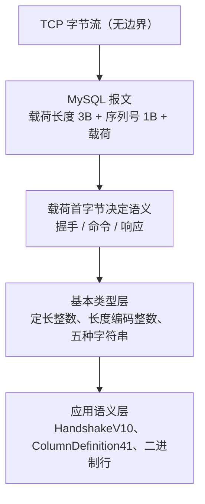
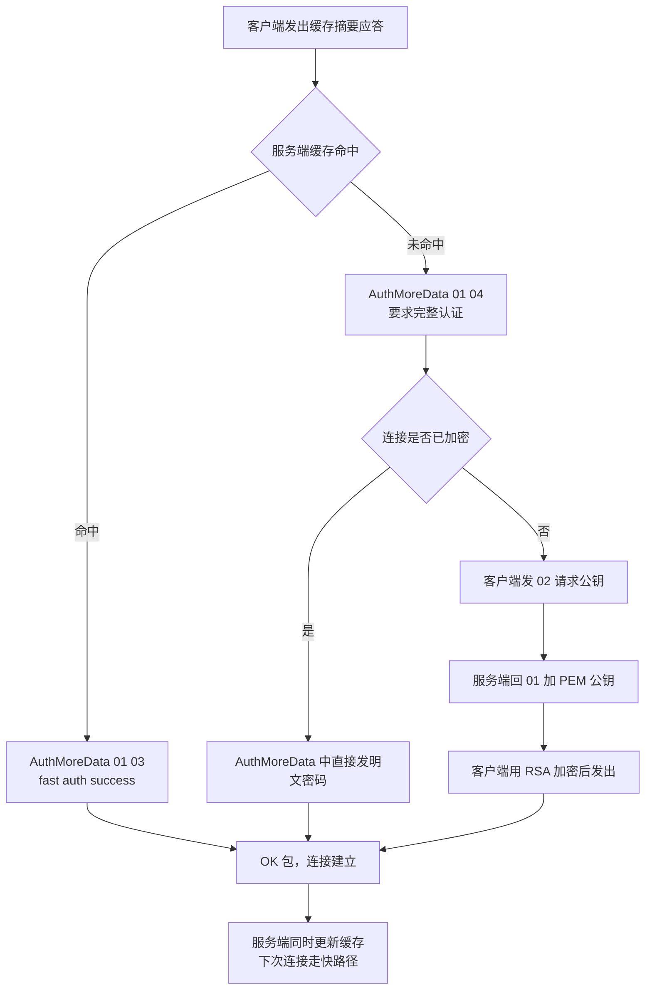
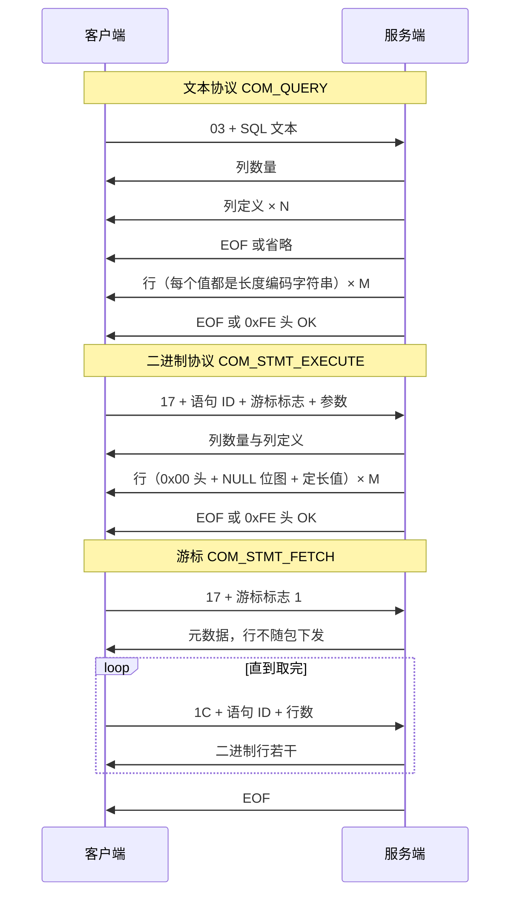
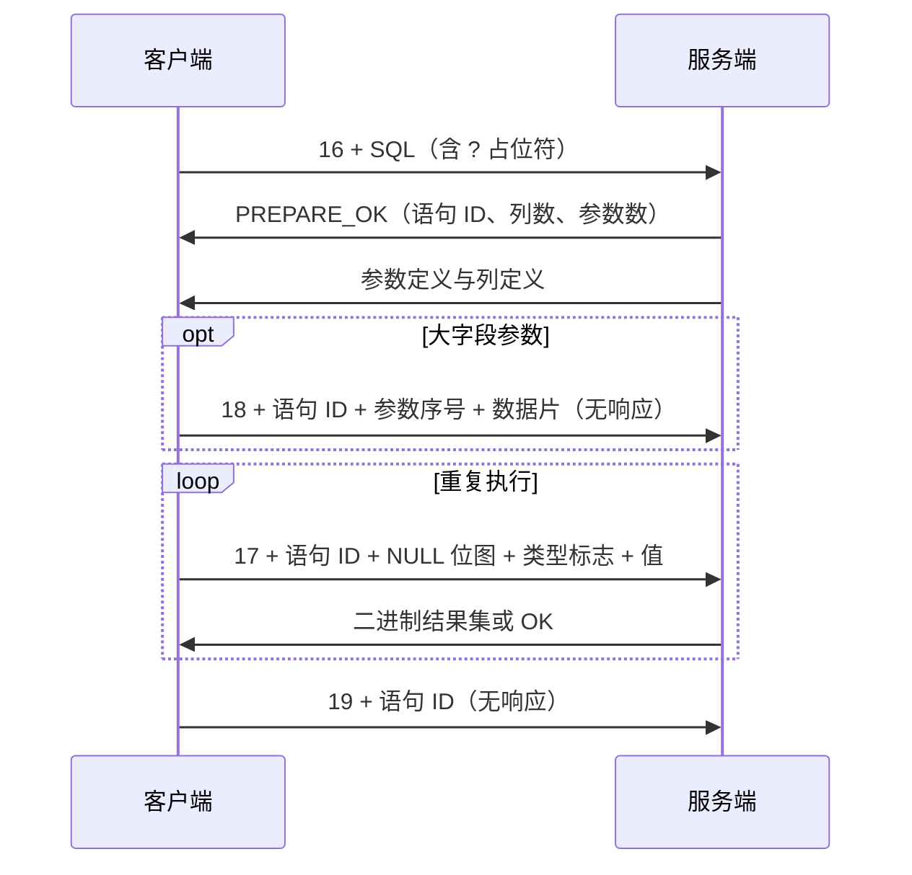
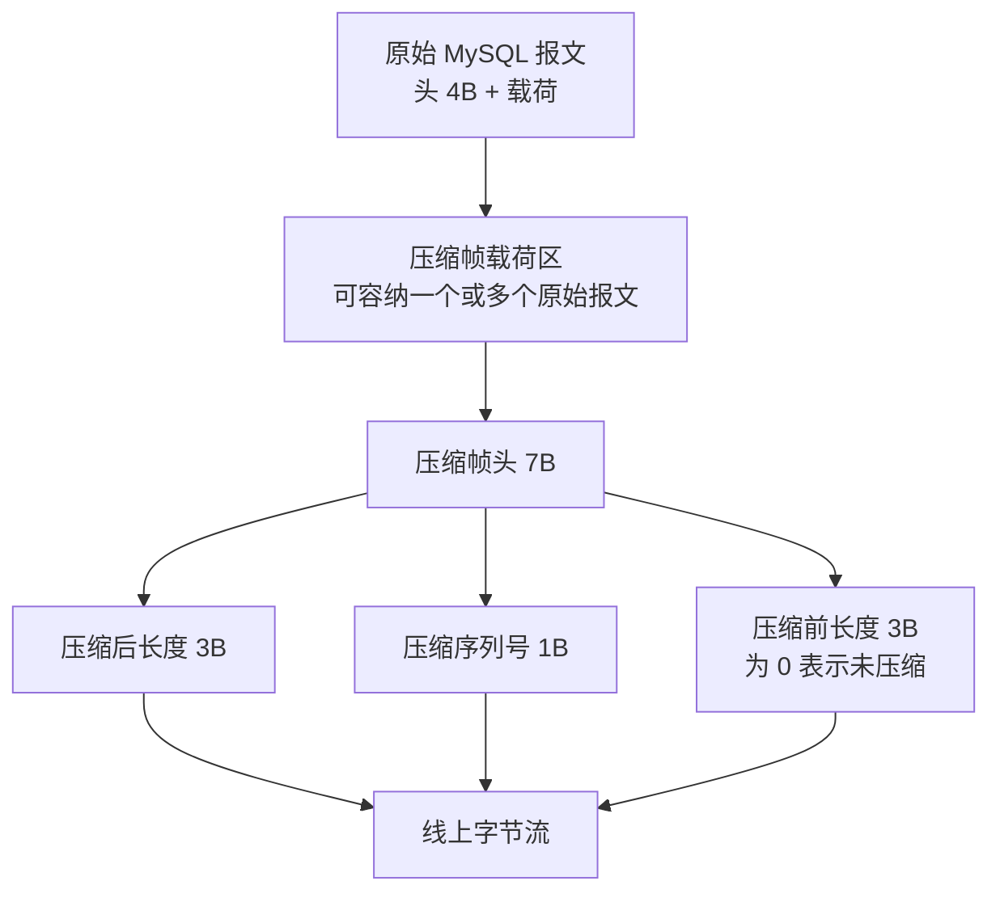
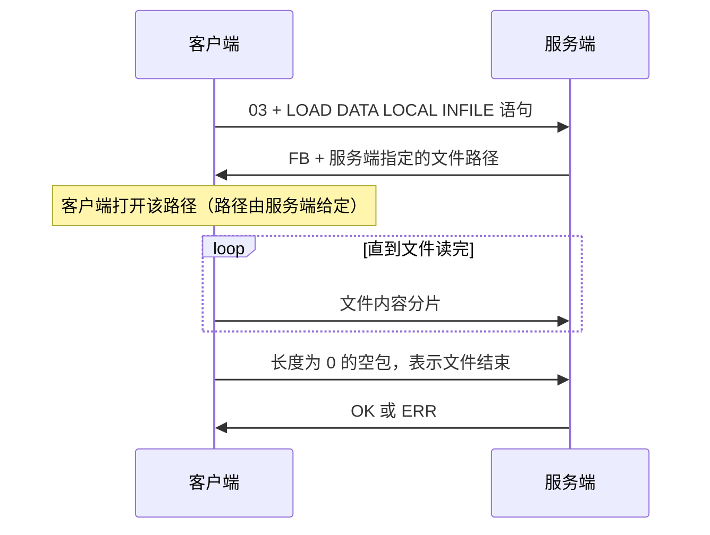

# 第3章 客户端和服务端交互协议

**摘要：**

客户端与服务端之间那套二进制约定，绝大多数人只隔着驱动看它——连上了就算成功，慢了就归因于网络或索引。可只要你要写一个代理、一个连接池中间件、一个自研的 binlog 消费端，或者仅仅想在 `tcpdump` 里确认"这条连接到底有没有走 TLS、结果集为什么比预期多出两个包"，就得直接面对端口上流动的字节：服务端先发什么、客户端怎么回、两端的能力位如何取交集、结果集有几种编码、什么样的包会让服务端直接断链。本章按一次连接的生命周期逐段拆解这套线格式，从 `HandshakeV10` 与 `HandshakeResponse41` 的字段排布，到 `caching_sha2_password` 的三次交换与 8.4 之后 `mysql_native_password` 的退场口径；从 `CLIENT_DEPRECATE_EOF` 这类"开了之后报文就变形"的能力位，到文本协议与二进制协议在字节一级的差异；再到 `max_allowed_packet` 触顶时的真实行为、压缩帧的 7 字节头，以及 `CLIENT_LOCAL_FILES` 把读文件的权限交给对端的经典陷阱。落点不是背报文，而是拿到一份可以照着实现的规格，顺带纠正几处流传甚广的说法：超限不是截断，压缩不总是更快，`0xFB` 也不只是一个 NULL 标记。

---

## 3.1 协议的位置：在字节流上重建边界

本章只写协议的线格式（wire format）这一侧——假设你要从零实现一个客户端，必须知道哪些字节、按什么顺序、在什么条件下出现。"协议"这个词在数据库语境里有两重所指：一层是客户端与 `mysqld` 之间那套二进制约定，另一层是分布式系统里的一致性协议，本章只谈前者。协议在源码里怎么落地（虚拟 IO 层、`THD` 的状态机、认证插件的注册与回调），[[中间件/MySQL/读书笔记-Mysql内核架构/02. 深入解析MySQL 客户端与服务端通信协议|读书笔记 02]] 已经拆到函数一级；[[中间件/MySQL/MySQL架构与底层原理/01 MySQL 全局架构——一条 SQL 的完整生命周期|架构 01]] 关心连接环节的运行期判据，[[中间件/MySQL/MySQL进阶使用/00 专栏导览|MySQL 进阶]] 那一列则完全不碰协议。三处的结论本章不重复；线程创建与 `THD` 的生命周期属于代码层次，见本列 [[中间件/MySQL/MySQL内核设计与实现/1.0 第1章 MySQL内核简介|第 1 章]]，模块边界见 [[中间件/MySQL/MySQL内核设计与实现/2.0 第2章 MySQL内核整体架构|第 2 章]]。

### 3.1.1 四种连接方式与它们的差异

MySQL 提供的连接手段并没有超出进程间通信的常规范畴：跨主机的 TCP 套接字、同机的 UNIX 域套接字、以及 Windows 上的命名管道与共享内存。这四种方式在协议层完全等价——握手、认证、命令、结果集，一个字节都不差——差异全部落在传输层的语义上。

| 连接方式 | 平台 | 寻址单位 | 主要代价 |
| :--- | :--- | :--- | :--- |
| TCP 套接字 | 全平台 | IP + 端口（默认 3306） | 完整的 TCP 握手与拥塞控制；跨主机时受 MTU 与延迟影响 |
| UNIX 域套接字 | Linux、UNIX | 文件路径 | 仅限同机；路径长度受 `sun_path` 限制；权限由文件属主控制 |
| 命名管道 | Windows | 管道名 | 仅限同机；需 `--enable-named-pipe` 显式开启 |
| 共享内存 | Windows | 共享内存名 | 仅限同机；需 `--shared-memory` 显式开启；容量与同步开销固定 |

同机上 UNIX 域套接字优于 TCP，原因不在协议而在内核路径：它绕过了 TCP/IP 协议栈的校验和与路由查找，`tcpdump` 也抓不到它。笔者见过一类排查事故，正是把连接方式从 TCP 改成 socket 之后，网络侧的观测手段整体失效，看板上连接数骤降被误判为应用故障。连接方式的选择因此不只是性能问题，它决定了你能观测到什么。

用 `tcpdump` 抓一次完整的连接建立与断开，看到的是三次握手、中间的协议交互、末尾的四次挥手（实际捕获常常只有三个包，因为第二、三次挥手会被合并）。中间那些包才是本章的内容：TCP 只负责把字节可靠地送过去，字节怎么解释完全由应用层约定。

### 3.1.2 报文骨架：四字节决定一切

在 MySQL 协议里，TCP 的一个段往往恰好承载一个报文，但这不是约定，只是巧合。协议自己有一套分帧（framing）规则：每个报文由固定 4 字节的头部与变长的载荷组成，头部的 3 字节是小端序的载荷长度，第 4 字节是序列号。



> **图3-1 协议的四层封装**

三字节的长度字段决定了这个协议的基本尺度。3 字节能表达的最大值是 `0xFFFFFF`，即 16,777,215 字节，这构成单包载荷的硬上限；超过这条线的数据必须切成多个报文，由接收方按序拼接。拼接的判据是"当前包的长度是否等于上限"，而不是某个结束标记——因此当载荷恰好是上限的整数倍时，发送方还要补一个长度为 0 的空包来表示结束。这是所有"用长度表达结束"的设计共同的边界问题。

协议版本号从 4.1 起就停在 10，二十余年没有再升。这不是因为协议没演进，而是因为所有演进都交给了能力位（capability flags）：新增功能只需占用一个比特位，两端各自声明支持与否，交集成什么就启用什么。把"版本协商"降级为"能力协商"，是这套协议能长期兼容的根本原因——客户端可以永远只发它认识的最老的那一套字段。

### 3.1.3 基本类型：只有整数和字符串

协议的类型系统极小，只有整数与字符串两类，复杂结构全部由它们拼出来。

定长整数（Fixed-Length Integer）是无符号的，可取 1、2、3、4、8 字节，一律小端序。这里有一个容易被忽略的细节：3 字节的定长整数在别处很少见，它是为报文头的长度字段专门留的。

长度编码整数（Length-Encoded Integer）用一个首字节决定后面还有几个字节，是这套协议里信息密度最高也最容易读错的类型，见表3-1。

**表3-1 长度编码整数的约定**

| 首字节 | 后续字节数 | 可表示范围 | 说明 |
| :--- | :--- | :--- | :--- |
| `0x00` 至 `0xFA` | 0 | 0 至 250 | 首字节本身即数值 |
| `0xFB` | 无 | 无 | NULL 标记，只出现在结果集行内 |
| `0xFC` | 2 | 251 至 65535 | 251 这个值必须写成 `FC FB 00` |
| `0xFD` | 3 | 65536 至 16777215 | |
| `0xFE` | 8 | 16777216 至 2^64-1 | 结果集行内不会出现 |
| `0xFF` | 无 | 无 | ERR 包标记，永不作为长度出现 |

于是 65536 的编码是 `FD 00 00 01`：首个字节 `FD` 声明"后面还有 3 字节"，紧随的 3 字节按小端序解释为 `0x010000`。而 251 这个数值是个陷阱——它的"自然"编码 `FB` 已经被 NULL 占用了，所以只能走 2 字节形态，写成 `FC FB 00`。这是"保留值被真实数据占用"的典型后遗症，读到 `FB` 时先别急着当数字。

字符串有五种编码，区别只在长度从哪来，见表3-2。

**表3-2 五种字符串编码**

| 编码 | 长度来源 | 典型出现位置 |
| :--- | :--- | :--- |
| `FixedLengthString` | 协议固定 | ERR 包里的 5 字节 SQLSTATE |
| `NullTerminatedString` | 遇 `0x00` 结束 | 服务端版本号、用户名、认证插件名 |
| `VariableLengthString` | 由前置字段决定 | 认证数据（前面有 1 字节长度） |
| `LengthEncodedString` | 前缀是长度编码整数 | 列定义的库名/表名/列名、文本结果集的值 |
| `RestOfPacketString` | 包的剩余长度 | `COM_QUERY` 里的 SQL 文本 |

回到表3-2 的最后一栏：`COM_QUERY` 的 SQL 属于 `RestOfPacketString`，没有长度前缀也没有终止符，长度完全由报文头的长度字段反推。因此 SQL 文本里可以自由出现分号、引号和 NULL 字节，解析器压根不靠内容判断边界。

---

## 3.2 握手与认证：谁先说，说什么

三次握手完成后，TCP 只提供了一条可靠的字节流，双方对彼此一无所知。MySQL 的做法是让服务端先开口：在客户端还没报上名之前，服务端就把自己的版本、能力、字符集、认证插件连同挑战随机数一并推过去。这个顺序不是随意定的，它是"挑战-应答"（challenge-response）认证的前置条件——密码不能明文上线，所以必须由服务端先出一道题。

### 3.2.1 服务端的第一个包：HandshakeV10

握手初始化包（`HandshakeV10`）的字段顺序见表3-3。它的排布有一个历史包袱：能力位被拆成低 16 位与高 16 位两段，中间夹着字符集与状态标志，原因是 4.0 时代的协议里只有低 16 位，后来新增的位无处可放，只能挂到包尾部去。

**表3-3 HandshakeV10 的字段顺序**

| # | 字段 | 长度 | 说明 |
| :--- | :--- | :--- | :--- |
| 1 | `protocol_version` | 1 B | 恒为 `0x0A`，即 10 |
| 2 | `server_version` | NUL 串 | 如 `5.7.19`、`8.0.36`；客户端据此猜测对端能力 |
| 3 | `connection_id` | 4 B | 即 `SHOW PROCESSLIST` 里的 Id |
| 4 | `auth_plugin_data_part_1` | 8 B | 挑战随机数的前 8 字节 |
| 5 | `filler` | 1 B | 恒为 `0x00` |
| 6 | `capability_flags` 低 16 位 | 2 B | 服务端支持的能力 |
| 7 | `character_set` | 1 B | 服务端默认字符集 |
| 8 | `status_flags` | 2 B | 是否自动提交、是否在事务中 |
| 9 | `capability_flags` 高 16 位 | 2 B | 补足到 32 位 |
| 10 | `auth_plugin_data_len` | 1 B | 通常 21：20 字节随机数加一个 NUL |
| 11 | `reserved` | 10 B | 全 0，留给未来的扩展 |
| 12 | `auth_plugin_data_part_2` | 13 B | 随机数剩余 12 字节加 NUL |
| 13 | `auth_plugin_name` | NUL 串 | 仅在 `CLIENT_PLUGIN_AUTH` 置位时出现 |

随机数分两段发不是设计上的优雅，而是历史包袱：4.1 之前的握手包在 `part_1` 之后只有 8 字节挑战数，引入长密码哈希后需要 20 字节，剩下 12 字节只能塞到能力位之后。读到 `part_2` 时若发现它不足 13 字节，说明对端是老版本，得按 `auth_plugin_data_len` 而不是固定值定位。

下面这一段是 5.7.19 服务端主动发出的握手包，去掉 IP 与 TCP 头部后的载荷如下。

```
0x0030:  fbee 62cc 4a00 0000 0a35 2e37 2e31 3900  ..b.J....5.7.19.
0x0040:  0700 0000 321f 052d 3a52 454c 00ff f721  ....2..-:REL...!
0x0050:  0200 ff81 1500 0000 0000 0000 0000 004d  ...............M
0x0060:  730e 405a 4d6d 215c 591c 2b00 6d79 7371  s.@ZMm!\Y.+.mysq
0x0070:  6c5f 6e61 7469 7665 5f70 6173 7377 6f72  l_native_passwor
0x0080:  6400                                     d.
```

报文头是 `4a 00 00 00`：载荷 74 字节，序列号 0。逐字段读下来，能对上表3-3 的每一行，见表3-4。

**表3-4 握手包的逐字节解读**

| 字节 | 内容 | 解释 |
| :--- | :--- | :--- |
| `0a` | 协议版本 | 10 |
| `35 2e 37 2e 31 39 00` | 服务端版本 | `5.7.19` |
| `07 00 00 00` | 连接 ID | 7 |
| `32 1f 05 2d 3a 52 45 4c` | 随机数前段 | 8 字节 |
| `00` | 填充 | |
| `ff f7` | 能力位低 16 位 | `0xF7FF` |
| `21` | 字符集 | 33，`utf8_general_ci` |
| `02 00` | 状态标志 | `0x0002`，自动提交 |
| `ff 81` | 能力位高 16 位 | `0x81FF`，合起来是 `0x81FFF7FF` |
| `15` | 随机数长度 | 21 |
| `00` × 10 | 保留 | |
| `4d 73 ... 2b 00` | 随机数后段 | 12 字节加 NUL |
| `mysql_native_password\0` | 默认认证插件 | 5.7 的默认值 |

把 `0x81FFF7FF` 拆成比特看，能读到服务端的态度：低段 `0xF7FF` 里有 `CLIENT_COMPRESS`（`0x0020`）、`CLIENT_LOCAL_FILES`（`0x0080`）、`CLIENT_PROTOCOL_41`（`0x0200`）、`CLIENT_SSL`（`0x0800`）、`CLIENT_TRANSACTIONS`（`0x2000`）、`CLIENT_SECURE_CONNECTION`（`0x8000`）；高段 `0x81FF` 里有从 `CLIENT_MULTI_STATEMENTS`（`0x00010000`）一路到 `CLIENT_DEPRECATE_EOF`（`0x01000000`）的九个位，外加 `CLIENT_SSL_VERIFY_SERVER_CERT`。也就是说，5.7 的服务端几乎把所有开关都摆在桌上了，等客户端挑。

### 3.2.2 客户端的回答：HandshakeResponse41

客户端读完握手包，回一个 `HandshakeResponse41`。它的字段顺序见表3-5，注意第 6 项的长度前缀有三种形态，取决于客户端置了哪个能力位。

**表3-5 HandshakeResponse41 的字段顺序**

| # | 字段 | 长度 | 出现条件 |
| :--- | :--- | :--- | :--- |
| 1 | `capability_flags` | 4 B | 必填，客户端声明自己真正要用的能力 |
| 2 | `max_packet_size` | 4 B | 必填，客户端能接收的最大报文 |
| 3 | `character_set` | 1 B | 必填，连接字符集的排序规则编号 |
| 4 | `reserved` | 23 B | 全 0 |
| 5 | `username` | NUL 串 | 必填 |
| 6 | `auth_response` | 变长 | 视能力位取三者之一，见下 |
| 7 | `database` | NUL 串 | 需 `CLIENT_CONNECT_WITH_DB` |
| 8 | `auth_plugin_name` | NUL 串 | 需 `CLIENT_PLUGIN_AUTH` |
| 9 | `connect_attrs` | 长度编码 | 需 `CLIENT_CONNECT_ATTRS` |
| 10 | `zstd_level` | 1 B | 需 `CLIENT_ZSTD_COMPRESSION_ALGORITHM` |

第 6 项的三态是协议里少见的"同一位置三种编码"：置了 `CLIENT_PLUGIN_AUTH_LENENC_CLIENT_DATA` 时用长度编码整数作前缀，只置 `CLIENT_SECURE_CONNECTION` 时用 1 字节长度，两者都没有时退化成 NUL 结尾的串。这也是为什么老驱动连新服务端偶尔会读错位——前缀长度不同，后面所有字段的偏移全跟着变。

同一台机器上 `mysql` 命令行客户端发出的登录包，去掉传输层头部后是这样。

```
0x0030:  33c4 5dd6 b700 0001 85a6 ff01 0000 0001  3.].............
0x0040:  2100 0000 0000 0000 0000 0000 0000 0000  !...............
0x0050:  0000 0000 0000 0000 726f 6f74 0014 ab41  ........root...A
0x0060:  a9cc c77b 68ac a47e d697 44e8 9933 fd79  ...{h..~..D..3.y
0x0070:  858d 6d79 7371 6c5f 6e61 7469 7665 5f70  ..mysql_native_p
0x0080:  6173 7377 6f72 6400 6603 5f6f 7305 4c69  assword.f._os.Li
0x0090:  6e75 780c 5f63 6c69 656e 745f 6e61 6d65  nux._client_name
0x00a0:  086c 6962 6d79 7371 6c04 5f70 6964 0533  .libmysql._pid.3
0x00b0:  3037 3438 0f5f 636c 6965 6e74 5f76 6572  0748._client_ver
0x00c0:  7369 6f6e 0635 2e37 2e31 3909 5f70 6c61  sion.5.7.19._pla
0x00d0:  7466 6f72 6d06 7838 365f 3634 0c70 726f  tform.x86_64.pro
0x00e0:  6772 616d 5f6e 616d 6505 6d79 7371 6c    gram_name.mysql
```

报文头 `b7 00 00 01`：载荷 183 字节，序列号 1——紧接在服务端的序列号 0 之后递增。能力位是 `85 a6 ff 01`，小端解释为 `0x01FFA685`。这个数值值得逐位拆开，因为它正好是 libmysqlclient 5.7 的默认组合，也是一份"一个成熟客户端想要什么"的清单：

- `0x00000001` `CLIENT_LONG_PASSWORD`、`0x00000004` `CLIENT_LONG_FLAG`：老能力的遗留，被无条件置位；
- `0x00000080` `CLIENT_LOCAL_FILES`：允许服务端要求客户端上传本地文件，命令行客户端默认就开着，这个默认值在后文会变成一个安全议题；
- `0x00000200` `CLIENT_PROTOCOL_41`：使用 4.1 协议，没有它服务端会直接拒绝；
- `0x00000400` `CLIENT_INTERACTIVE`：把本连接标记为交互式，服务端的 `wait_timeout` 会被 `interactive_timeout` 覆盖；
- `0x00002000` `CLIENT_TRANSACTIONS`、`0x00008000` `CLIENT_SECURE_CONNECTION`：前者支持事务状态标志，后者启用 1 字节长度前缀的认证数据；
- `0x00010000` 至 `0x01000000` 的九个高位：多语句、多结果集、预处理多结果集、插件认证、连接属性、长度编码的认证数据、过期密码处理、会话跟踪、EOF 替代。

注意 `CLIENT_SSL`（`0x0800`）与 `CLIENT_CONNECT_WITH_DB`（`0x0008`）都没有置位——前者说明这条连接是明文，后者说明登录时没指定库。能力位能直接读出运行状态，这是判断"到底有没有加密"的依据。

### 3.2.3 协商的本质是取交集

服务端在握手包里给出的是它的全集，客户端在响应包返回的是它真正要用的子集，两者按位与之后才是本连接生效的能力。这一段逻辑没有协商报文，也没有确认包：客户端自己算交集，服务端收到后自己再算一次，双方各自按同一个规则推导，因此不需要额外的往返。

这个设计把版本差异消解在比特里：老客户端连新服务端时，新能力进不了交集，反之同理，于是"服务端升级导致老应用崩溃"这类事故在协议层基本不会发生。代价是新特性必须两端都升级才生效，`CLIENT_DEPRECATE_EOF` 从 5.7.5 引入到普遍启用隔了多年，原因就在这里。

协商失败则完全是另一回事。交集为空不是协商失败，协商失败指的是"某一方不具备继续的最低条件"，表现为连接阶段就返回错误包并断链。判断连接阶段的失败原因，看错误码比看错误文本可靠，见表3-6。

**表3-6 连接阶段失败的判据**

| 错误码 | 典型文本 | 机制 |
| :--- | :--- | :--- |
| 1040 | `Too many connections` | 连接数已达 `max_connections`，握手之前就被拒 |
| 1130 | `Host ... is not allowed to connect` | `acl_check_host` 失败，主机不在任何账号的授权范围 |
| 1045 | `Access denied for user` | 认证数据校验不通过，或插件不匹配导致摘要算法不同 |
| 1251 | `Client does not support authentication protocol` | 老客户端不认服务端要求的插件 |
| 3159 | `Connections using insecure transport are prohibited` | 账号要求 TLS，而客户端未置 `CLIENT_SSL` |
| 1153 | `Got a packet bigger than 'max_allowed_packet' bytes` | 握手响应本身超限，通常是连接属性太长 |
| 1043 | `Bad handshake` | 报文结构解析失败，序列号或字段长度错位 |

其中 1045 最具迷惑性：密码确实正确，但插件不匹配也会报同一个错。原因是两种插件的应答算法不同，服务端拿 `mysql_native_password` 的公式去校验一个 `caching_sha2_password` 的应答，结果必然不等——从服务端视角看，这与密码输错无法区分。

### 3.2.4 认证插件的切换：AuthSwitchRequest

账号绑定的插件未必是服务端在握手包里推荐的那个。5.7 的握手包建议 `mysql_native_password`，而某个账号可能已经迁到 `caching_sha2_password`；8.0 则相反，握手包建议 `caching_sha2_password`，而某个老账号还留在 `mysql_native_password`。协议的处理办法是让服务端在收到响应包之后再纠正一次：如果客户端声明的插件与账号的插件不一致，服务端发一个 `AuthSwitchRequest`。

这个包的形态很简短：首字节 `0xFE`，随后是 NUL 结尾的插件名，再随后是该插件自己的挑战数据（对 `mysql_native_password` 和 `caching_sha2_password` 都是一个新的 20 字节随机数）。客户端收到后，用新插件重算应答并发回，服务端再给最终的 OK 或 ERR。注意这里的 `0xFE` 与后文要讲的 EOF 包、长度编码整数的 8 字节形态同值——同一个字节在三个上下文里表示三件事，判断依据只能是当前处于哪个阶段。

这也解释了一类常见误判：两端配置都没错，连接却要求两次认证——抓包里"响应包之后又来一个 `0xFE` 开头的包"，不是协议错乱，是插件在切换。

### 3.2.5 caching_sha2_password 的三次交换

`caching_sha2_password` 从 8.0.4 起成为默认插件，它比 `mysql_native_password` 多了一层服务端缓存，也因此把认证路径分成了快慢两条。

快路径的前提是服务端缓存里已经有该用户的密码摘要。此时客户端照常计算应答（把密码做两轮 SHA-256，再用随机数做带盐哈希，最后与摘要异或），服务端比对缓存命中，回一个载荷为 `01 03` 的包（`AuthMoreData`，子类型 `0x03` 表示 fast auth success），紧接着回 OK。整个过程仍然只有一个往返，但服务端发了两个包——这是它比 `mysql_native_password` 多出来的那个包，也是抓包时最容易误判"多了个包是不是出错"的地方。

慢路径的前提是缓存未命中，比如服务刚重启、或者这是该用户第一次连接。服务端回 `01 04`（子类型 `0x04` 表示需要完整认证），此时客户端有两条路：

- 如果连接已经加密（`CLIENT_SSL` 生效），直接把明文密码放进 `AuthMoreData` 里发过去，服务端用 TLS 的保护来替代 RSA 加密；
- 如果连接是明文，客户端先发一个单字节 `0x02`（`RequestPublicKey`）请求服务端的 RSA 公钥，服务端回 `01` 加上 PEM 格式的公钥，客户端再用它加密"密码与随机数异或后的结果"并发回。

后一条路意味着明文连接下首次认证要付出额外的两个往返。这也解释了一个运维现象：同一个账号，重启 `mysqld` 之后的第一次连接明显慢于后续连接，慢的不是网络，是走了 RSA 那一段。



> **图3-2 caching_sha2_password 的两条认证路径**

由此可以回答一个常被问错方向的问题：真正容易失败的是旧客户端连 8.0 服务端，而不是 8.0 客户端连 5.7。8.0 客户端连 5.7 时，服务端握手包里建议 `mysql_native_password`，客户端认得它，即使客户端主动声明 `caching_sha2_password`，服务端也会用 `AuthSwitchRequest` 把它切回去，因此能连。反过来，5.7 时代的驱动不认识 `caching_sha2_password`，服务端又没有可切换的余地（账号只绑了这一个插件），结果就是 1251 或者"插件无法加载"——这才是升级 8.0 之后大面积连接失败的真实机制。

### 3.2.6 mysql_native_password 的退场节奏

`mysql_native_password` 的算法是 `SHA1(password)` 与 `SHA1(随机数 + SHA1(SHA1(password)))` 的异或。它的弱点不在算法强度，而在服务端存的是 `SHA1(SHA1(password))`——一张彩虹表就能反查，且不支持通道绑定。因此官方给出的时间线是渐进的，版本口径需要说清楚，见表3-7。

**表3-7 认证插件的版本口径**

| 版本 | `mysql_native_password` 的状态 | `caching_sha2_password` 的状态 |
| :--- | :--- | :--- |
| 5.7 | 默认插件，长期可用 | 不存在 |
| 8.0.4 起 | 仍可用，但不再是默认 | 成为默认插件 |
| 8.0.34 | 标记为弃用（deprecated） | 默认 |
| 8.4 | 默认禁用，需 `--mysql-native-password=ON` 才可用 | 默认 |
| 9.0 | 从服务端移除 | 默认，且是唯一的内置密码插件 |

所以"8.4 起移除"这个说法只对了一半：8.4 是关掉默认开关，真正从代码里消失是 9.0。这个区别在升级预案里很实际——8.4 上还能用一个启动参数把老账号救回来，9.0 上则只能改插件或改密码。

---

## 3.3 能力位：协商出来的开关

能力位是这套协议里信息量最密集的 4 个字节。每一个比特背后都是一次协议形态的改变：有的改变结束包的类型，有的改变一个会话能发几条语句，有的把本地文件系统的一部分控制权交出去。表3-8 挑出实现客户端时必须处理的九个位。

**表3-8 关键能力位一览**

| 能力位 | 位值 | 开启后报文怎么变 |
| :--- | :--- | :--- |
| `CLIENT_PROTOCOL_41` | `0x00000200` | 启用 4.1 报文：状态标志与告警计数进入 OK 包和 EOF 包，ERR 包带上 SQLSTATE |
| `CLIENT_SECURE_CONNECTION` | `0x00008000` | 认证数据前用 1 字节长度，不再用 NUL 结尾 |
| `CLIENT_PLUGIN_AUTH` | `0x00080000` | 握手包尾出现插件名，响应包也可带插件名，从而允许 `AuthSwitchRequest` |
| `CLIENT_DEPRECATE_EOF` | `0x01000000` | 列定义之后的 EOF 消失，行结束的 EOF 变成 `0xFE` 头的 OK 包 |
| `CLIENT_MULTI_STATEMENTS` | `0x00010000` | 一条 `COM_QUERY` 里允许分号分隔的多条语句，响应变成多段结果 |
| `CLIENT_MULTI_RESULTS` | `0x00020000` | 存储过程的多个结果集可以依次返回 |
| `CLIENT_LOCAL_FILES` | `0x00000080` | 允许服务端用 `0xFB` 帧要求客户端上传本地文件 |
| `CLIENT_COMPRESS` | `0x00000020` | 此后所有报文进入压缩帧封装，zlib 算法 |
| `CLIENT_ZSTD_COMPRESSION_ALGORITHM` | `0x04000000` | 同上，但用 zstd；需在响应包尾部多带一个压缩级别字节 |
| `CLIENT_SESSION_TRACK` | `0x00800000` | OK 包里的信息段改成长度编码串，并可附带会话状态变更列表 |

剩下的位不改变报文结构，只改变语义：`CLIENT_FOUND_ROWS` 让 `UPDATE` 返回匹配行数而非修改行数，`CLIENT_IGNORE_SPACE` 允许函数名与左括号之间有空格，`CLIENT_INTERACTIVE` 换用更长的空闲超时。它们不改变解析逻辑，实现客户端时可以原样透传。

### 3.3.1 CLIENT_DEPRECATE_EOF：省掉一个包，改掉一条判据

在 4.1 协议里，一个 `SELECT` 的响应是五段：列数量、列定义、EOF、行、EOF。第一个 EOF 告诉客户端"元数据到此为止"，第二个 EOF 告诉客户端"数据到此为止"。两次 EOF 都是 5 字节的短包，内容只有头、告警计数和状态标志。

从 5.7.5 起，`CLIENT_DEPRECATE_EOF` 把这两个 EOF 一并处理掉：列定义之后不再发任何结束包，客户端靠"列定义的数量已经收满"自己判断元数据结束；行结束的那个 EOF 换成一个 `0xFE` 开头的 OK 包。这么改的动机很朴素——每个结果集省掉 5 字节和一个往返位置，在高频短查询上不是小数目；更实际的价值是 OK 包能携带受影响行数与 `last_insert_id`，而 EOF 包不能。

**表3-9 结束方式的前后对比**

| 阶段 | 未启用 `CLIENT_DEPRECATE_EOF` | 启用之后 |
| :--- | :--- | :--- |
| 结果集开头 | 列数量 | 列数量，不变 |
| 元数据 | 列定义 × N | 列定义 × N，不变 |
| 元数据结束 | EOF（`0xFE`，5 字节） | 不发，靠计数判断 |
| 数据行 | 行 × M | 行 × M，不变 |
| 数据结束 | EOF（`0xFE`，5 字节） | OK（`0xFE` 头，含受影响行数与插入 ID） |

这个改动给解析方留了一个必须处理的歧义：结束包仍以 `0xFE` 开头，与 EOF 无法靠首字节区分。判据只能是长度——4.1 协议下的 EOF 载荷固定 5 字节，`0xFE` 头的 OK 包在此之上还要带两个长度编码整数，最短也有 7 字节。按"长度不超过 5 视为 EOF"处理两种形态都不会误判；只判首字节，则会把携带状态的 OK 包当成无内容的 EOF，`last_insert_id` 悄悄丢失。

顺便指出一个真实抓包里常见的情形。前文那次 `select * from testtb` 的响应，最后三个包是：

```
0x0090:  0c21 006c 0000 00fd 0000 0000 000a 0000  .!.l............
0x00a0:  0401 3107 7a68 616e 6779 7507 0000 05fe  ..1.zhangyu.....
0x00b0:  0000 2200 0000                           .."...
```

第二列定义之后直接是 `0a 00 00 04`（载荷 10、序列号 4）的行包，中间没有 EOF；列定义占用了序列号 2 与 3，行包是 4，结束包是 `07 00 00 05`——载荷长度 7，内容是 `fe 00 00 22 00 00 00`。这个 7 字节的包不是 EOF，而是 `0xFE` 头的 OK：受影响行数 0、插入 ID 0、状态 `0x0022`、告警 0。状态值 `0x0022` 里 `0x0002` 是自动提交，`0x0020` 是"查询未使用索引"，与这条全表扫描的语句正好对上。把它当 EOF 读，丢的不只是状态，还包括"这条查询没走索引"这条可观测信息。

### 3.3.2 多语句与多结果集

`CLIENT_MULTI_STATEMENTS` 打开之后，`COM_QUERY` 的载荷里可以出现分号分隔的多条语句，服务端按顺序执行并依次回结果。每条结果之后的状态标志里会置上 `SERVER_MORE_RESULTS_EXISTS`（`0x0008`），客户端必须一直读到该位清零，才能认为这一轮交互结束。

这个位是判断"读完了没有"的唯一可靠依据。很多自研客户端在这里出错：读完第一个结果集就返回，剩下的结果留在内核缓冲区里，下一次查询读到的却是上一次的残留——表现是"结果错位"，而错误现场离根因已经很远。

`CLIENT_MULTI_RESULTS` 是另一件事：它允许一次调用返回多个结果集，典型场景是存储过程里有多条 `SELECT`。它和 `CLIENT_MULTI_STATEMENTS` 经常一起打开，但二者独立——只开前者也能执行多结果集的存储过程，只是不能在一次 `COM_QUERY` 里拼多条语句。批量插入、`DROP TABLE a, b` 这类语句并不需要 `CLIENT_MULTI_STATEMENTS`，它们是单条语句多对象，容易混淆。

### 3.3.3 CLIENT_LOCAL_FILES 与压缩位

这两个位都是"开启之后整个通道的形态变了"的类型，因此值得在这里说清报文层面的变化，收益与安全的讨论分别留给 3.8 与 3.9。

`CLIENT_LOCAL_FILES` 打开后，`LOAD DATA LOCAL INFILE` 的执行会多出一段反向交互：服务端不直接执行，而是回一个首字节 `0xFB` 的帧，帧体是它想要的**文件路径字符串**；客户端读到这个帧，就去本地打开该路径，把内容按报文分片发出，最后用一个长度为 0 的包表示文件结束；服务端收齐后执行导入并回 OK 或 ERR。整段流程里，路径由服务端指定，客户端只负责打开——这句话读完，安全隐患已经呼之欲出。

`CLIENT_COMPRESS` 打开后，从下一个包开始，所有报文都被包进压缩帧：原来的报文整体成为压缩帧的载荷，帧头 7 字节，含压缩后长度、压缩序列号、压缩前长度。压缩层的序列号与原报文的序列号互相独立，两套计数各自递增、各自回绕。`CLIENT_ZSTD_COMPRESSION_ALGORITHM` 的帧结构完全相同，只是压缩算法换成 zstd，并且客户端必须在响应包末尾多写一个字节声明压缩级别。

### 3.3.4 CLIENT_SESSION_TRACK：让服务端主动汇报状态

会话状态在 MySQL 里是被客户端"镜像"的：客户端需要在本地维护一份副本，知道当前在哪个库、自动提交开没开、隔离级别是什么、字符集是什么。在 `CLIENT_SESSION_TRACK` 之前，这份副本只能靠客户端自己解析语句来维护，任何"服务端悄悄改了状态"的场景——存储过程里改了 `sql_mode`、触发器里切换了库、`SET` 语句被重写——都会让副本失真，进而让连接池把连接还回去时带着错误的假设。

这个位让服务端在每次响应的 OK 包里附带变更：OK 包的信息段从 NUL 结尾的串改为长度编码串，若状态标志里置了 `SERVER_SESSION_STATE_CHANGED`（`0x4000`），信息段之后还会跟一段会话状态变更列表，每项由类型字节加数据组成。类型包括系统变量（`0x00`）、当前库（`0x01`）、状态改变标记（`0x02`）、GTID 集合（`0x03`）、事务特征（`0x04`）、事务状态（`0x05`）。客户端读到 `0x01` 就知道要更新本地记录的库名，读到 `0x00` 就更新对应变量——不需要解析任何 SQL。

这一位对中间件尤其重要：代理层要为成百上千条连接维护会话状态，靠解析 SQL 同步并不可靠，打开它之后同步就成了"读 OK 包"这样的机械事。代价是 OK 包变长，短查询密集的负载要单独压测这部分开销。

## 3.4 命令阶段与 COM_*

认证通过之后，连接进入命令阶段。这一段是严格的一问一答：客户端发一个首字节为命令码的报文，服务端回一组报文，序列号在每个新命令开始时归零。除了少数例外（`COM_QUIT` 之后连接关闭、`COM_STMT_CLOSE` 无回包），服务端总会给出至少一个包。

命令码定义在 `include/mysql_com.h` 的 `enum_server_command` 里，表3-10 是其中实现客户端会用到的部分。

**表3-10 常用命令码**

| 命令 | 值 | 载荷 | 响应 |
| :--- | :--- | :--- | :--- |
| `COM_QUIT` | `0x01` | 无 | 无，连接关闭 |
| `COM_INIT_DB` | `0x02` | 库名 | OK 或 ERR |
| `COM_QUERY` | `0x03` | SQL 文本（包剩余） | 结果集或 OK 或 ERR |
| `COM_FIELD_LIST` | `0x04` | 表名 + 通配符 | 列定义序列，已弃用 |
| `COM_PING` | `0x0E` | 无 | OK |
| `COM_CHANGE_USER` | `0x11` | 用户名、应答、库名、字符集、插件名 | OK 或 ERR，会话被重置 |
| `COM_BINLOG_DUMP` | `0x12` | 起始位点、标志、服务器 ID | 持续的 binlog 事件流 |
| `COM_STMT_PREPARE` | `0x16` | SQL 文本 | `PREPARE_OK` 或 ERR |
| `COM_STMT_EXECUTE` | `0x17` | 语句 ID、游标标志、参数 | 二进制结果集或 OK 或 ERR |
| `COM_STMT_SEND_LONG_DATA` | `0x18` | 语句 ID、参数序号、数据片 | 无 |
| `COM_STMT_CLOSE` | `0x19` | 语句 ID | 无 |
| `COM_STMT_RESET` | `0x1A` | 语句 ID | OK，清空已累积的长数据 |
| `COM_SET_OPTION` | `0x1B` | 选项值 | EOF 或 OK，用于按会话开关多语句 |
| `COM_STMT_FETCH` | `0x1C` | 语句 ID、行数 | 二进制行，直到 EOF |

其中 `COM_QUERY` 承担了绝大多数日常流量：所有不经过预处理的语句、所有 DDL、所有被客户端"文本化"的调用，都走这一条路径。它的报文结构最简单，也最能说明协议的风格。

```
0x0030:  33c8 2a97 1500 0000 0373 656c 6563 7420  3.*......select.
0x0040:  2a20 6672 6f6d 2074 6573 7474 62         *.from.testtb
```

头部 `15 00 00 00` 之后，载荷首字节 `0x03` 是命令码，其后 20 字节是 `select * from testtb`。注意序列号是 0：这是新命令的第一个包，计数被重置。整条语句没有长度前缀，也没有分号，长度完全由头部决定——正是表3-2 里 `RestOfPacketString` 的用法。

服务端的响应以一个包的首字节区分类型，这一层分类并不复杂，但字段顺序容易记混，见表3-11。

**表3-11 四种响应包**

| 首字节 | 类型 | 主要字段 |
| :--- | :--- | :--- |
| `0x00` | OK | 受影响行数、插入 ID、状态标志、告警数、信息段 |
| `0xFF` | ERR | 错误码、`#` 加 5 字节 SQLSTATE、错误信息 |
| `0xFE` | EOF 或 `0xFE` 头 OK | 长度 5 为 EOF（告警数、状态标志）；更长则按 OK 解析 |
| 其他 | 结果集开头 | 该字节起始的长度编码整数即列数量 |

有三处容易读错。第一，OK 包里的受影响行数与插入 ID 都是长度编码整数，不是定长整数，这与早期文档里写的 `int` 有出入，读到 `0xFC` 就必须按 2 字节后续处理。第二，ERR 包的 SQLSTATE 前有一个 `#` 字符（`0x23`），它为 0 时表示不带 SQLSTATE 的老形态。第三，`COM_STATISTICS`（`0x09`）的响应是个例外：它直接返回一串文本，没有类型首字节，读完整个包就是结果。

`COM_BINLOG_DUMP` 值得单独提一句：主从复制用的并不是另一套协议，而是同一条连接上的命令。从库完成握手与认证后发一条 `COM_BINLOG_DUMP`，主库持续推送 binlog 事件，序列号在这个长流里递增直到回绕。所谓"复制账号"与普通账号在协议层并无区别，差异只在权限与这条长连接的生命周期上。

---

## 3.5 结果集的三种格式

到这里遇到了整套协议里最需要分清的一处：结果集不是一个东西，而是三个。文本协议服务于 `COM_QUERY`，二进制协议服务于 `COM_STMT_EXECUTE`，游标形态服务于 `COM_STMT_FETCH`。三者的元数据部分几乎相同，数据行的编码方式完全不同，误用的后果不是报错，而是把数字读成字符串、把 NULL 读成零。

### 3.5.1 文本协议：一切皆为字符串

`COM_QUERY` 的响应按五段展开：列数量、列定义、EOF、行、EOF。列数量是一个长度编码整数，列定义是 `ColumnDefinition41` 的重复，行是若干长度编码字符串的拼接，每个值都以"长度前缀加内容"的形式出现。

`ColumnDefinition41` 的字段见表3-12。它的固定字段部分前有一个长度为 12 的标记（`0x0c`），这个字节只表示"后面的固定字段有 12 字节"，不携带任何语义，读错它会导致后面所有字段依次错位——这是手写解析器最先翻车的地方。

**表3-12 ColumnDefinition41 的字段顺序**

| # | 字段 | 编码 | 说明 |
| :--- | :--- | :--- | :--- |
| 1 | `catalog` | 长度编码字符串 | 恒为 `def` |
| 2 | `schema` | 长度编码字符串 | 库名 |
| 3 | `table` | 长度编码字符串 | 表别名 |
| 4 | `org_table` | 长度编码字符串 | 表原名 |
| 5 | `name` | 长度编码字符串 | 列别名 |
| 6 | `org_name` | 长度编码字符串 | 列原名 |
| 7 | 固定字段长度 | 长度编码整数 | 恒为 `0x0c` |
| 8 | `character_set` | 2 B | 该列的字符集编号，64 表示二进制 |
| 9 | `column_length` | 4 B | 显示宽度的最大值 |
| 10 | `type` | 1 B | 字段类型码，见 `enum_field_types` |
| 11 | `flags` | 2 B | 是否非空、是否主键、是否无符号等 |
| 12 | `decimals` | 1 B | 小数位数 |
| 13 | `filler` | 2 B | 全 0 |

列别名与原名同时下发，是为了让客户端在 `SELECT a AS b` 时既能显示 `b`，又能回溯到 `a`。第 8 项 `character_set` 为 63 或 64 时表示该列是二进制串，客户端不该按文本解码——这是"字段里存的是字节还是字符"在协议层的唯一判据，比看类型码可靠，因为 `BLOB` 与 `TEXT` 用的是同一批类型码。

行数据的编码简单到近乎粗糙：每个值先写长度编码整数，再写内容。整数值被转成十进制字符串，所以 `1` 的编码是 `01 31`——长度 1，内容字符 `1`。空字符串写成 `00`，NULL 写成单个 `FB`。这正是文本协议里 NULL 的全部表示，也是与"长度为 251 的字符串"最容易混淆的地方；协议自己解决了这个歧义：251 必须写成 `FC FB 00`，因此 `FB` 单独出现时只能是 NULL。

### 3.5.2 二进制协议：先看位图，再看类型

`COM_STMT_EXECUTE` 的响应在结构上与文本协议平行，但有两处不同：元数据里的列定义会带更准确的长度与标志，数据行则以 `0x00` 开头，跟着一个 NULL 位图。

这个 `0x00` 是行头而非值，作用是让二进制行与 OK 包、EOF 包区分开。紧随其后的 NULL 位图长度是 `(列数 + 7 + 2) / 8` 向下取整，注意那个额外的 `+2`：前两位被跳过，列 0 的 NULL 标志落在第二个字节的最低位。这个偏移只是历史约定，没有任何逻辑必要性，但偏移算错会让所有 NULL 判断整体移位一位。

位图之后的每个非 NULL 值按列的类型码定长或变长编码：整数按其声明宽度取 1、2、3、4、8 字节的小端二进制，浮点按 IEEE 754 的 4 或 8 字节，日期时间按"长度字节加分量"的形式，字符串仍然走长度编码。也就是说，二进制协议省掉的是"数值与字符串之间的转换"，而不是"长度前缀"。

**表3-13 两种协议的字节差异**

| 能力 | 文本协议 | 二进制协议 |
| :--- | :--- | :--- |
| 触发命令 | `COM_QUERY` | `COM_STMT_EXECUTE` |
| 元数据 | `ColumnDefinition41` | 基本相同，`flags` 更可信 |
| 行首字节 | 直接是第一个值的长度前缀 | 恒为 `0x00` |
| NULL 表示 | 单字节 `FB` | NULL 位图中的一个比特 |
| 整数表示 | 十进制 ASCII | 小端定长二进制 |
| 浮点表示 | 十进制 ASCII | IEEE 754 |
| 日期表示 | `YYYY-MM-DD HH:MM:SS` 文本 | 长度字节加年月日时分秒微秒 |
| 结束方式 | EOF 或 `0xFE` 头 OK | 同左 |
| 客户端解析成本 | 需要字符串转数值 | 直接映射内存 |

表3-13 的最后一列解释了二进制协议真正的价值：它省的不是带宽，是解析。一个 `BIGINT` 在文本协议里是 20 字节以内的 ASCII，客户端要逐字符累加并处理溢出；在二进制协议里就是 8 字节小端整数，`memcpy` 之后即可使用。反过来，对短字符串为主的负载，二进制协议因为行头与位图的存在反而略大——这一点后文量化时会算。

### 3.5.3 游标：把结果集变成可拉取的流

默认情况下，`COM_STMT_EXECUTE` 会把整个结果集一次性推给客户端。对返回百万行的查询，这意味着服务端要把结果全部物化，客户端要把它们全部缓冲。游标（cursor）提供了另一种形态：在 `COM_STMT_EXECUTE` 的标志字节里声明只读游标（值为 1），服务端只回元数据，随后客户端用 `COM_STMT_FETCH` 分批取行。



> **图3-3 三种结果集形态**

游标有三个必须知道的前提。其一，它要求 `CLIENT_PS_MULTI_RESULTS` 被协商上，否则服务端会直接报错；其二，它是只读的，`CURSOR_TYPE_FOR_UPDATE` 与 `SCROLLABLE` 在实际实现里支持得并不完整；其三，游标打开期间服务端为这条语句保留状态，`COM_STMT_RESET` 或 `COM_STMT_CLOSE` 是唯一的清理手段，异常退出会把这些状态留到连接断开为止。所以游标不是"分页查询"的通用替代品：它的适用场景是"结果集大到不能一次性物化，但又确实要全量处理"，而不是"页面上要翻页"。

### 3.5.4 逐字节读一次真实响应

把前面几节合起来，读一个真实的结果集就不再是黑箱。以下是 `select * from testtb` 返回的完整载荷，表 `testtb` 只有两列：`id int`、`name varchar`。

```
0x0030:  fbf2 7715 0100 0001 022c 0000 0203 6465  ..w......,....de
0x0040:  6606 7465 7374 6462 0674 6573 7474 6206  f.testdb.testtb.
0x0050:  7465 7374 7462 0269 6402 6964 0c3f 000b  testtb.id.id.?..
0x0060:  0000 0003 0350 0000 0030 0000 0303 6465  .....P...0....de
0x0070:  6606 7465 7374 6462 0674 6573 7474 6206  f.testdb.testtb.
0x0080:  7465 7374 7462 046e 616d 6504 6e61 6d65  testtb.name.name
0x0090:  0c21 006c 0000 00fd 0000 0000 000a 0000  .!.l............
0x00a0:  0401 3107 7a68 616e 6779 7507 0000 05fe  ..1.zhangyu.....
0x00b0:  0000 2200 0000                           .."...
```

第一个包是 `01 00 00 01 02`：载荷 1 字节，序列号 1，内容 `02` 即列数量为 2。第二个包 `2c 00 00 02` 载荷 44 字节，是 `id` 列的定义：`03 def`、`06 testdb`、`06 testtb`、`06 testtb`、`02 id`、`02 id` 六段字符串共 31 字节，加 `0c` 标记与 12 字节固定字段，正好 44。固定字段里 `3f 00` 是字符集 63（二进制），`0b 00 00 00` 是显示宽度 11，`03` 是 `FIELD_TYPE_LONG`，`03 50` 是标志位 `0x5003`，`00 00 00` 是小数位与填充。

第三个包 `30 00 00 03` 载荷 48 字节，是 `name` 列的定义，比前一个长 4 字节，因为列名与别名各多两个字符。固定字段里 `21 00` 是字符集 33，`6c 00 00 00` 是宽度 108，`fd` 是 `VAR_STRING`。

第四个包 `0a 00 00 04` 是本例唯一一行：`01 31` 是 `1`，`07 7a 68 61 6e 67 79 75` 是 `zhangyu`。每个值前面都是自己的长度，因为这是文本协议。

第五个包 `07 00 00 05` 结束结果集，内容 `fe 00 00 22 00 00 00`。前面已经判过：载荷 7 字节，是 `0xFE` 头的 OK 而非 EOF，状态 `0x0022` 里既有自动提交也有"未使用索引"。

这段十六进制的信息密度其实很高：序列号能确认有没有丢包，字符集编号能确认客户端有没有把 `VAR_STRING` 当字节流处理，状态位能看出语句的执行质量。会读这些字节，排障时就不必在"应用说慢、数据库说快"之间反复拉锯。

---

## 3.6 预处理语句：把参数从 SQL 文本里拆出去

`COM_QUERY` 的问题不在效率，在结构：SQL 文本与参数值混在一起，服务端每次都要完整解析一遍，客户端则要在拼接字符串时负责转义。预处理语句把这两件事分开——解析一次，执行多次，参数走独立通道。

### 3.6.1 PREPARE 的应答

`COM_STMT_PREPARE` 的载荷是 SQL 文本，其中参数位置写成 `?`。服务端的应答是 `PREPARE_OK`，字段见表3-14。它只回一个语句 ID 和两对计数，真正的元数据跟在后面：先参数定义，再列定义，各以 EOF 收尾（若启用了 `CLIENT_DEPRECATE_EOF` 则省略）。

**表3-14 PREPARE_OK 的字段顺序**

| # | 字段 | 长度 | 说明 |
| :--- | :--- | :--- | :--- |
| 1 | 状态 | 1 B | 恒为 `0x00` |
| 2 | 语句 ID | 4 B | 后续 `EXECUTE`、`CLOSE` 都要带它 |
| 3 | 列数 | 2 B | 结果集的列数 |
| 4 | 参数数 | 2 B | `?` 的个数 |
| 5 | 填充 | 1 B | `0x00` |

语句 ID 的作用域是连接。它不是一个全局句柄，连接断开就失效，重连之后必须重新 prepare；这也解释了为什么连接池里"语句缓存"必须与物理连接绑定，跨连接的语句 ID 毫无意义。

### 3.6.2 EXECUTE 的参数编码

`COM_STMT_EXECUTE` 的载荷是这套协议里最复杂的一段，结构见表3-15。它的设计有一个隐含目的：重复执行同一条语句时，只发送变化的值，把类型声明省掉。

**表3-15 COM_STMT_EXECUTE 的载荷结构**

| # | 字段 | 长度 | 说明 |
| :--- | :--- | :--- | :--- |
| 1 | 命令码 | 1 B | `0x17` |
| 2 | 语句 ID | 4 B | 来自 `PREPARE_OK` |
| 3 | 游标标志 | 1 B | 0 无游标，1 只读游标 |
| 4 | 迭代次数 | 4 B | 恒为 1 |
| 5 | NULL 位图 | (参数数+7)/8 | 仅当参数数大于 0 |
| 6 | 新类型标志 | 1 B | `1` 表示后面带类型数组 |
| 7 | 类型数组 | 参数数 × 2 B | 每项为类型码加"是否无符号"标志 |
| 8 | 参数值 | 变长 | 按类型数组逐一定长或变长编码 |

第 6 项 `new_params_bound_flag` 是这段协议的精华。它等于 1 时，客户端把每个参数的类型声明一遍，服务端缓存下来；之后重复执行同一语句，只要参数类型不变，就把它置 0，载荷里只剩 NULL 位图与值本身。对一个参数为 `INT` 的语句，这省掉 2 字节；对十个参数的批量插入，省掉 20 字节——单次不多，但在每秒数万次的写入路径上，这是一笔稳定的收益。

第 7 项每个参数占 2 字节：第一个字节是类型码（取自 `enum_field_types`，如 `0x03` 为 `LONG`、`0x08` 为 `LONGLONG`、`0xfd` 为 `VAR_STRING`），第二个字节的最高位表示有无符号（`0x80` 为无符号）。也就是说类型信息并不是一个字节的类型码，而是"类型码 + 符号位"的两字节组合，只读第一个字节会把 `BIGINT UNSIGNED` 当成有符号处理。

第 8 项的值编码取决于类型，见表3-16。注意变长类型仍然走长度编码字符串，这一点与文本协议一致；真正的差别在定长类型上。

**表3-16 参数值的编码方式**

| 类型 | 编码 | 字节数 |
| :--- | :--- | :--- |
| `TINY` | 小端整数 | 1 |
| `SHORT`、`YEAR` | 小端整数 | 2 |
| `LONG`、`INT24` | 小端整数 | 4 |
| `LONGLONG` | 小端整数 | 8 |
| `FLOAT` | IEEE 754 | 4 |
| `DOUBLE` | IEEE 754 | 8 |
| `DATE`、`DATETIME`、`TIMESTAMP` | 长度字节 + 分量 | 0、4、7 或 11 |
| `TIME` | 长度字节 + 分量 | 0、8 或 12 |
| 字符串与 `BLOB` 类 | 长度编码字符串 | 变长 |
| `NEWDECIMAL` | 长度编码字符串 | 变长 |

`NEWDECIMAL` 用字符串传输是一个务实的妥协：十进制小数没有无损的二进制表示，硬塞进浮点会丢精度，所以协议选择保留文本形态，由服务端再做转换。

### 3.6.3 长数据的分片

当一个参数是几十 MB 的 `BLOB` 时，把它塞进 `COM_STMT_EXECUTE` 会撞上 16 MB 的单包上限。协议给出的办法是 `COM_STMT_SEND_LONG_DATA`（`0x18`）：每次带语句 ID、参数序号和一段数据，服务端把这些片段累积到该参数的缓冲区里，**这个命令没有响应包**；客户端发完之后再照常发 `COM_STMT_EXECUTE`，此时该参数在 NULL 位图里标记为"有值"，类型数组里给出类型，但值本身不再出现。

这里需要纠正一处流传较广的说法：长数据分片并不以 `0xFB` 开头。`0x18` 是独立命令码，累积的数据块只是裸字节。`0xFB` 在本协议里只有两个身份——结果集行内的 NULL 标记、以及 `LOAD DATA LOCAL INFILE` 的文件请求帧首字节。把这三者混为一谈，解析器会在处理大字段时走向完全错误的分支。

副作用是累积的数据在执行前一直占着服务端内存，而 `COM_STMT_RESET` 是清空它的唯一手段：中断的批量导入若只关连接不 reset，内存要等到连接断开才释放。

### 3.6.4 三次往返的成本

完整的预处理生命周期是三步：`PREPARE` 拿语句 ID 与元数据、`EXECUTE` 带参数、`CLOSE` 释放。注意第三步没有响应包——`COM_STMT_CLOSE` 是即发即忘的，不需要等确认。因此"预处理能省往返"这个说法只在重复执行时成立：执行 N 次的总往返是 1 次 prepare 加 N 次 execute，当 N 大于 1 时平均往返下降；N 等于 1 时反而比 `COM_QUERY` 多一个往返。



> **图3-4 预处理语句的往返结构**

正是这个成本结构决定了驱动要维护语句池：`poolPreparedStatements` 之类的参数，本质上是在"多一个往返"和"多占服务端语句资源"之间做取舍。

### 3.6.5 为什么预处理能防住注入

参数化查询能防 SQL 注入，这个结论人人会说，机制却常被归因为"驱动做了转义"。协议层面的解释更直接：在 `COM_STMT_PREPARE` 阶段，服务端拿到的是一条带 `?` 的完整 SQL，它会做词法、语法、语义分析，产出执行计划并把这个计划与语句 ID 绑定；`?` 在那时已经被登记为参数位置，不再是文本的一部分。到了 `COM_STMT_EXECUTE` 阶段，参数值走在类型数组与值区里，服务端**从不重新解析这些字节**，只是把它们按声明类型填进预留的参数槽。

于是 `' OR 1=1 --` 这样的输入在这条路径上没有任何特殊身份：它在类型数组里被声明为字符串，在值区里是一段长度前缀加若干字节，服务端把它原样写入参数槽，`--` 不构成注释，引号不构成字符串边界。注入的前提是"数据被当作代码解析"，而协议把数据和代码放在了两个不同的解析通道里。

对比之下，拼接字符串再发 `COM_QUERY` 时，值仍会进入 SQL 文本，只能靠转义去"消除"特殊字符的语法意义；转义的正确性依赖字符集、`sql_mode` 与转义函数本身的完整性，任何一处不一致都会留下缺口。

---

## 3.7 边界的边界：max_allowed_packet

协议给出了 16 MB 的单包上限，`max_allowed_packet` 则在它之上又加了一层：任何一个报文——无论单包还是拼接后的完整载荷——都不能超过这个参数。两者常被混为一谈，实际上分工不同：16 MB 是分帧规则决定的硬上限，`max_allowed_packet` 是可配置的软上限，前者靠切包绕过，后者绕不过去。

### 3.7.1 超限不是截断，是断连

这是本章最需要说清的一句话。报文超过 `max_allowed_packet` 时，服务端不会截断、不会丢弃尾部、也不会"尽量处理"——它会返回错误 `ER_NET_PACKET_TOO_LARGE`（错误码 1153，SQLSTATE `08S01`），文本大意是 `Got a packet bigger than 'max_allowed_packet' bytes`，然后**关闭这条连接**。

断连而不是报错，是因为此刻的连接状态已经不可信：服务端只读到一个声称很长但超出允许范围的头部，剩下的字节还堆在接收缓冲区里，它无法判断哪一个字节才是这条消息的结尾。继续往下读就会把后半段当成新命令，产生难以解释的错乱；干脆断掉是唯一安全的选择。

对应用而言，这个行为的表现形式很容易误判。典型症状是"插入大文本时报 `Lost connection to MySQL server during query`"或"`server has gone away`"，1153 往往被日志埋在上一条语句后面，看起来像网络抖动。判据是：失败若稳定复现在某条涉及大字段的语句上，先查 `max_allowed_packet`，再查网络。

### 3.7.2 三个值，谁说了算

这条线上有三个独立的配置，任何一个是短板都会导致失败，取值与代价见表3-17。

- 客户端声明的接收上限，写在 `HandshakeResponse41` 的第二项。客户端收不了比它更大的包，服务端也不会发。
- 服务端的 `max_allowed_packet`，同时约束它接收与发送的报文。
- 从库的 `max_allowed_packet`。复制链路上，主库把大事务写进 binlog，从库读取该事件时必须能容纳，因此从库的这个值不能小于主库。

**表3-17 max_allowed_packet 相关取值与代价**

| 对象 | 默认值 | 调大的代价 | 调小的后果 |
| :--- | :--- | :--- | :--- |
| 服务端 `max_allowed_packet` | 64 MB | 每个连接按需分配接收缓冲，峰值内存随并发线性上升 | 大字段读写直接断连，表现为 1153 |
| 客户端声明值 | 随驱动而异，常见 16 MB | 客户端侧内存占用上升 | 收到大结果集时本地断连 |
| 硬上限 | 1 GB | 不可超过，超过即配置无效 | 无 |
| `net_buffer_length` | 16 KB | 初始缓冲按此分配，之后按需扩张到上限 | 扩张次数增多，长语句多一些内存分配 |

这张表解释了一个常见的配置争论：把 `max_allowed_packet` 从 64 MB 调到 256 MB 换来的是"更大的缓冲"，代价是每个连接的峰值内存都可能翻几倍。在连接数上千的实例上，这个参数不是"调大更安全"，而是要按"最大字段值的实际分布"来定——绝大多数业务的大字段在几 MB 以内，64 MB 已经留出了一个数量级的余量。

### 3.7.3 大字段传输的判据

判断一条链路能不能稳定传输某个大字段，需要同时算清三笔账。

第一笔是行的大小。一行数据在文本协议里的体积约等于各字段文本长度加各自 1 至 4 字节的长度前缀，再加上 4 字节报文头。一个 32 MB 的 `LONGBLOB` 无论怎么编码都超过默认值，必须调大参数或者改用分片写入。

第二笔是结果集的物化方式。默认的 `COM_QUERY` 与 `COM_STMT_EXECUTE` 都会把结果推完，两端都按行缓冲；取一个 50 MB 的字段，两边都要能容纳"一整行"，因为单行不能跨报文拆分——分帧只在报文层，行必须在同一个报文里完整。

第三笔是失败时的代价。大字段传输一旦失败就是断连，连接池里的连接作废，重试要重走一遍握手与认证，`caching_sha2_password` 的慢路径还会再慢一次。因此批量导入大字段的正确做法是按批次切分，让单批落在参数值的几分之一以内。

---

## 3.8 压缩协议：用 CPU 换带宽

`CLIENT_COMPRESS` 与 `CLIENT_ZSTD_COMPRESSION_ALGORITHM` 的开启方式是在握手响应里置位，之后整条连接上所有报文都进入压缩帧。注意是"所有"——包括认证、命令、结果集，没有按报文选择性压缩的余地。

### 3.8.1 七字节头的封装

压缩帧的头部固定 7 字节，结构见图3-5：3 字节压缩后长度、1 字节压缩序列号、3 字节压缩前长度。若压缩前长度为 0，表示这一帧的载荷未经压缩（原始数据），接收方直接取用。



> **图3-5 压缩帧的封装结构**

三个细节值得单独记住。压缩序列号是独立计数器，与原始报文的序列号互不影响，各自从 0 开始、各自在 255 之后回绕；一个压缩帧里可以装多个原始报文，一个原始报文也可以跨多个压缩帧，两种切分互不约束；因此"包边界"在压缩开启后变成了两层概念，解析时必须先解帧再解包。

压缩带来的一个隐性代价是延迟。压缩器需要攒够数据才有好的压缩比，而服务端在写响应时未必能一次攒够一帧，于是小包场景下可能出现"为了压 100 字节而多等一个调度周期"的情形。这也是为什么压缩在高频小查询上收益不稳定——省下的带宽不足以抵消多出来的处理与缓冲。

### 3.8.2 zlib 与 zstd 的取舍

两种算法共用同一套压缩帧封装，差异见表3-18。

**表3-18 两种压缩算法**

| 维度 | `CLIENT_COMPRESS`（zlib） | `CLIENT_ZSTD_COMPRESSION_ALGORITHM`（zstd） |
| :--- | :--- | :--- |
| 引入版本 | 很早，4.0 时代即有 | 8.0.18 起 |
| 压缩级别 | 固定，无法在握手时声明 | 客户端在响应包尾部声明 1 字节级别 |
| 典型压缩比 | 中等 | 同级别下通常更高 |
| CPU 开销 | 同级别下通常更高 | 在低级别上更快 |
| 适用范围 | 任意版本对端 | 需两端都支持该能力位 |

zstd 的优势在于"压缩比与速度的曲线更平缓"：级别 1 至 3 的耗时接近甚至低于 zlib 默认级别，而压缩比更高。但它的可用性受两端版本约束，老服务端不认这个能力位，置了也进不了交集。

### 3.8.3 该不该开压缩

判据可以收敛成三个问题。

带宽是否是瓶颈？跨公网、跨可用区、跨机房的连接，带宽与 RTT 都是稀缺资源，压缩的收益直接体现在传输时间上；同机或同机架的连接，带宽近乎免费，压缩只会增加 CPU 开销与延迟抖动。

负载是文本型还是已压缩型？SQL 文本、日志字段、重复度高的枚举值与时间戳，压缩比通常可观；`JPEG`、`PNG` 与已压缩的归档，压缩后体积可能不变甚至略大。

CPU 余量在哪里？压缩发生在服务端的连接线程里，是每个连接独立消耗的。若实例的 CPU 已经接近饱和，开压缩会让排队更严重；若瓶颈在网络而 CPU 空闲，压缩几乎是无成本的优化。

容易被忽略的一头一尾是：收益最高的是 `LOAD DATA LOCAL INFILE` 与批量 `INSERT`，大段重复文本能达到数倍压缩比；收益最低的是点查，几十字节的响应里 7 字节帧头就占去两成。

---

## 3.9 CLIENT_LOCAL_FILES：把读文件的权力交给对端

`LOAD DATA LOCAL INFILE` 是一个设计上很实用、安全模型上很别扭的功能：它让服务端去读客户端的本地文件。数据库服务端通常运行在另一台机器上，物理上无法访问客户端的磁盘，于是协议设计了一次反向请求——服务端告诉客户端"我需要这个文件，你读给我"，客户端照办。

### 3.9.1 协议流程



> **图3-6 LOAD DATA LOCAL INFILE 的反向取文件流程**

流程里最关键的一句是"路径由服务端给定"。客户端在这个环节没有任何独立判断：它收到什么路径就打开什么路径，读到的内容按协议发回去。协议本身没有、也无法提供"这个路径是否在允许范围内"的校验，因为客户端根本不掌握服务端的意图。

### 3.9.2 攻击面

把上面的流程代入一个恶意服务端的视角，攻击路径就非常直白：搭一个假的 MySQL 服务端，等客户端连上来，在认证阶段放行（甚至可以要求密码，反正它只是收集），然后回一个 `0xFB` 帧，路径写 `/etc/passwd`、`~/.ssh/id_rsa`、`/etc/mysql/my.cnf`、应用配置文件——客户端会逐一读取并发送。整个过程对客户端应用完全透明，日志里只显示一次普通的 `LOAD DATA` 失败。

这个攻击之所以成立，根因是把"信任方向"弄反了：客户端本来只需信任服务端返回的数据，这里却被要求信任服务端指定的**文件路径**。数据出错最多是业务错误，读文件出错则是凭据泄露。更麻烦的是，这条路径不经过 SQL 权限系统——`FILE` 权限约束的是服务端读它自己的文件，与客户端读自己的文件是两回事。

### 3.9.3 两端的开关

服务端侧有 `local_infile` 变量，8.0 起默认为 `OFF`；5.7 时代默认是 `ON`，这是很多老系统升级后"导入功能突然不可用"的原因。但只关服务端不够——真正的防线在客户端，因为恶意服务端不会遵守你的 `local_infile` 设置。

**表3-19 客户端的放行方式**

| 客户端 | 开关 | 默认值 |
| :--- | :--- | :--- |
| C API（libmysqlclient） | `MYSQL_OPT_LOCAL_INFILE`，或 `ENABLED_LOCAL_INFILE` 编译选项 | 取决于编译选项 |
| Connector/J | `allowLoadLocalInfile` | 8.0 起默认 `false` |
| Connector/Python | `local_infile` 参数 | 默认 `false` |
| Go 的 `go-sql-driver/mysql` | `allowAllFiles`，或 `allowLoadLocalInfile` 配合 `RegisterLocalFile` | 默认 `false` |
| 命令行 `mysql` | `--local-infile` | 5.7 默认开启，8.0 默认关闭 |

从表3-19 能读出一条清晰的演进线索：所有主流驱动都在近十年里把默认值从"允许"改成了"禁止"，而命令行客户端的默认值也随之收紧。这不是过度反应，而是把"能力"与"授权"分开——`LOAD DATA LOCAL` 依然可用，但必须由使用方显式打开。

### 3.9.4 判据

必须显式禁止的理由有三条：它把一个数据导入功能变成了任意文件读取原语，攻击面与收益不成比例；它破坏了"客户端只信任数据"的模型，而这个模型是 TLS 之外唯一还在起作用的东西；它的正当用途可以被替代——服务端用 `LOAD DATA INFILE` 读自己的文件（受 `FILE` 权限约束），或由应用上传后写入，都比放开客户端文件读取可控。

如果确有场景必须使用，最小化的做法是把 `allowLoadLocalInfile` 打开的同时限定路径白名单（`go-sql-driver/mysql` 的 `RegisterLocalFile` 就是这种思路），并且确保连接只指向可信的服务端——包括不让应用连到由第三方提供的、可被 DNS 劫持的地址。

---

## 3.10 读报文时的三个陷阱

手写解析器时踩的坑，绝大多数集中在这三处。它们都不是复杂逻辑，而是"同一个字节在不同上下文里含义不同"这类历史遗留问题。

### 3.10.1 长度编码整数：别按字节数猜

长度编码整数的规则只有一条：看首字节。`0x00` 至 `0xFA` 就是数值本身；`0xFC`、`0xFD`、`0xFE` 分别声明"后面还有 2、3、8 字节"；`0xFB` 是 NULL；`0xFF` 是错误包标记。全部按小端序解释后续字节。

翻车点有三个。一是把 `0xFB` 当数值 251，于是读到 NULL 时算出 251 个字节的长度，后面全部错位。二是忽略"251 必须写成 `FC FB 00`"这条规则，写编码器时输出 `FB`，接收方按 NULL 处理。三是把 `0xFE` 一律当长度前缀，忘了它在结果集上下文里可能是一个 EOF/OK 包的首字节——判断依据是"当前是否在解析一个值"，而不是字节值本身。

### 3.10.2 0xFB 的双重身份

`0xFB` 在结果集的行里是 NULL，在命令响应里是"请把本地文件发给我"。同一个字节，两个含义，取决于当前处于哪个协议阶段。

识别方法并不神秘：只有在等待 `COM_QUERY` 结果的场景下，`0xFB` 才可能是文件请求；而在逐行解析的过程中，`0xFB` 只会是某个字段的 NULL。危险的是把两者混在一个状态机里判断——那会在收到文件请求时把它当成一个 NULL 值继续读行，随后读到的路径字符串被当成列数据，整条报文解析崩掉却报不出有用信息。

同一类问题还有两个：`0xFE` 既是 EOF 包与 `0xFE` 头 OK 包的首字节，也是 8 字节长度编码整数的前缀，还是 `AuthSwitchRequest` 的首字节；`0xFF` 既是 ERR 包首字节，又不能出现在长度编码整数里（这是协议给的便利，可以用它快速判断错误）。四个标记字节覆盖了大半个协议状态，判断永远要靠上下文，不能靠单字节。

### 3.10.3 序列号：归零与回绕

序列号是 1 字节，从 0 开始，每发一个包加 1，加到 255 之后回到 0。它有两条容易被忽略的规则：每个新命令开始时归零；压缩协议下另有一个独立的压缩序列号。

归零这条规则用于判错：客户端收到的第一个响应包，序列号应当是请求包加 1，若是 0 则说明服务端把这一轮当成了新命令，通常意味着上一个结果集没读完、残留报文被错位解读。回绕在大结果集上才是真问题——序列号会绕过若干圈，用"必须递增"来校验就会误报；正确做法是只在命令的第一个包校验，其后放弃，这也说明它只是一层防错位的弱校验。

---

## 3.11 反例与量化

### 3.11.1 三个反例

**以为压缩总是更快。** 在一个 CPU 使用率本就偏高的实例上打开 `CLIENT_COMPRESS`，压测结果显示吞吐下降：瓶颈从来不在网络，压缩只是让 CPU 的排队更长了一截。更有迷惑性的是同机测试：回环带宽近乎无限，省下的传输时间敌不过编解码开销，于是"压测显示压缩更慢"被当成"压缩没用"。判据是瓶颈位置，不是丢包率。

**开了 `CLIENT_LOCAL_FILES`。** 一个内部数据导入工具为了让 `LOAD DATA LOCAL INFILE` 跑通，把驱动的 `allowLoadLocalInfile` 打开，并在连接串里允许任意主机。半年后这个工具被部署到一个可以访问外网的网段，攻击面从"内网可信"变成了"任何能冒充服务端的地址"。这件事的代价不是数据被改，而是应用配置里的数据库口令被读走。

**把 `0xFB` 当纯 NULL 处理。** 解析器在行数据里遇到 `0xFB` 就写 NULL，看起来完全正确，直到某天 `LOAD DATA LOCAL INFILE` 的执行让它读到一个文件请求帧——它把路径当成一个 NULL 值，继续按行解析，剩下的字节被解释成一堆垃圾列，抛出的异常指向"列数不匹配"，离真正的原因隔了三层。

### 3.11.2 量化：协议开销与压缩收益

以下数字是按报文结构推算的示例，不是任何基准测试的结果，量级用于说明比例关系。

先看协议开销。一个 `SELECT 1` 类查询的响应由三个包组成：列数量包（1 字节载荷）、列定义包（约 40 字节载荷）、行包（约 2 字节载荷），每个包含 4 字节头部。总线上约 55 字节，其中 12 字节是包头，占比两成上下——越窄的结果集，协议开销占比越高。

再看行内开销。一行 `BIGINT id`、`VARCHAR(20) name`、`INT age`，取值 `1234567890`、`zhangyu`、`42`：文本协议下行载荷是 11 加 8 加 3 共 22 字节，加包头 26 字节；二进制协议下是行头 1 字节、NULL 位图 1 字节、8 加 8 加 4 共 22 字节，加包头 26 字节。两者恰好持平——因为文本协议对数值的编码效率其实不低，而二进制协议多出了行头与位图的固定成本。若换成 10 个 `INT` 列，文本约 74 字节、二进制约 47 字节，差距才拉到三成以上。

最后看压缩。一段重复度高的 SQL 文本或日志型行数据，用 zlib 默认级别通常能压到原体积的三分之一到四分之一；而已经压缩过的二进制大字段几乎不缩。因此"压缩能省多少"没有普适答案，它取决于负载里可压缩内容的比例——在文本型 OLAP 导出上收益显著，在 BLOB 存取上接近零，还要付出每连接一份的 CPU 开销。

---

## 3.12 结语

把这一章的内容压缩成一句话：MySQL 协议是一套用能力位代替版本号、用长度代替终止符、用上下文代替类型标记的二进制约定。它的每一处别扭都有出处——能力位分成两段是被 4.1 的历史撑开的，随机数分两段发是老握手包的剩余空间，`0xFB` 身兼二职是因为 NULL 与文件请求各自只需要一个标记，`CLIENT_DEPRECATE_EOF` 把两个 5 字节的 EOF 换成一个更长、带状态的 OK 包，而首字节始终是 `0xFE`。

理解这些出处，比记住字段顺序更有用。写客户端时，你会知道为什么 `new_params_bound_flag` 值得缓存类型、为什么游标不能当分页、为什么 `max_allowed_packet` 触顶是断连而不是截断；排障时，你会知道 1045 可能不是密码错、`Lost connection` 可能不是网络问题、结果集错位可能只是漏读了一个 `SERVER_MORE_RESULTS_EXISTS`。剩下真正需要权衡的只有几处：压缩开不开取决于瓶颈在带宽还是 CPU，本地文件放不放取决于能否接受"服务端指定路径"这个前提，预处理用不用取决于执行次数能否摊薄那次额外往返。这些都没有唯一答案，只有与负载形态匹配与否。

---

## 参考资料

1. MySQL Server 文档「Client/Server Protocol」总览：<https://dev.mysql.com/doc/dev/mysql-server/latest/page_protocol_basic_packets.html>
2. `HandshakeV10` 与 `HandshakeResponse41` 的字段定义：<https://dev.mysql.com/doc/dev/mysql-server/latest/page_protocol_connection_phase_packets_protocol_handshake_v10.html>
3. 命令阶段与预处理语句协议：<https://dev.mysql.com/doc/dev/mysql-server/latest/page_protocol_command_phase_ps.html>
4. 压缩协议帧结构：<https://dev.mysql.com/doc/dev/mysql-server/latest/page_protocol_basic_compression.html>
5. `caching_sha2_password` 插件说明：<https://dev.mysql.com/doc/refman/8.4/en/caching-sha2-pluggable-authentication.html>
6. `mysql_native_password` 在 8.4 的状态：<https://dev.mysql.com/doc/refman/8.4/en/native-pluggable-authentication.html>
7. `LOAD DATA LOCAL` 的安全说明：<https://dev.mysql.com/doc/refman/8.4/en/load-data-local-security.html>
8. 系统变量 `max_allowed_packet`、`local_infile`、`net_buffer_length`：<https://dev.mysql.com/doc/refman/8.4/en/server-system-variables.html>
9. 源码中的命令码与字段类型定义：`include/mysql_com.h`

---

> [!note] 思考题
> 1. 如果一个客户端的解析器只按首字节区分结果集结束包，在启用 `CLIENT_DEPRECATE_EOF` 的连接上会丢掉哪些信息？
> 2. `caching_sha2_password` 的慢路径在明文连接上需要额外的往返，为什么官方不直接要求所有连接都走 TLS 来避免这一段？
> 3. 同一份 64 MB 的 `LONGBLOB`，用 `COM_QUERY` 写入与用预处理加分片写入，失败时的恢复代价差在哪里？
> 4. 若要在代理层实现读写分离，需要从协议里读出哪些信息才能正确判断一条语句是否会修改数据？
> 5. 为什么 `LOAD DATA LOCAL INFILE` 的安全防线最终落在客户端驱动而不是服务端的 `local_infile` 变量上？