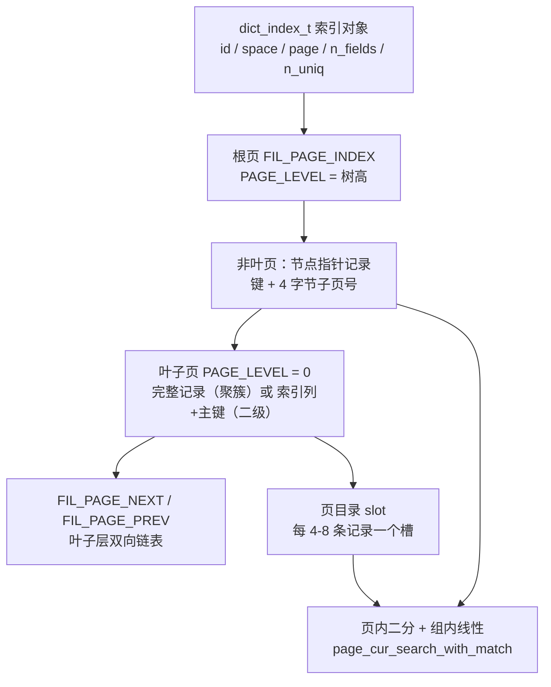
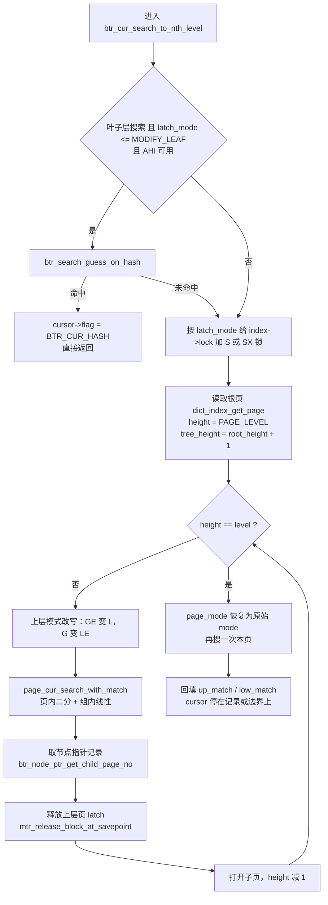
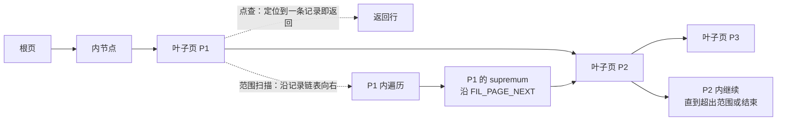
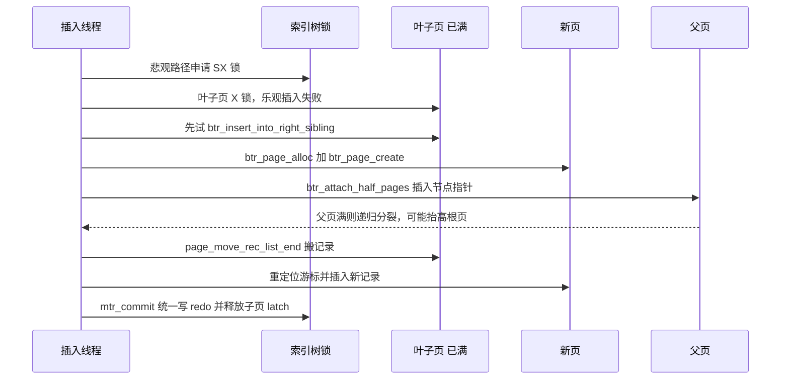
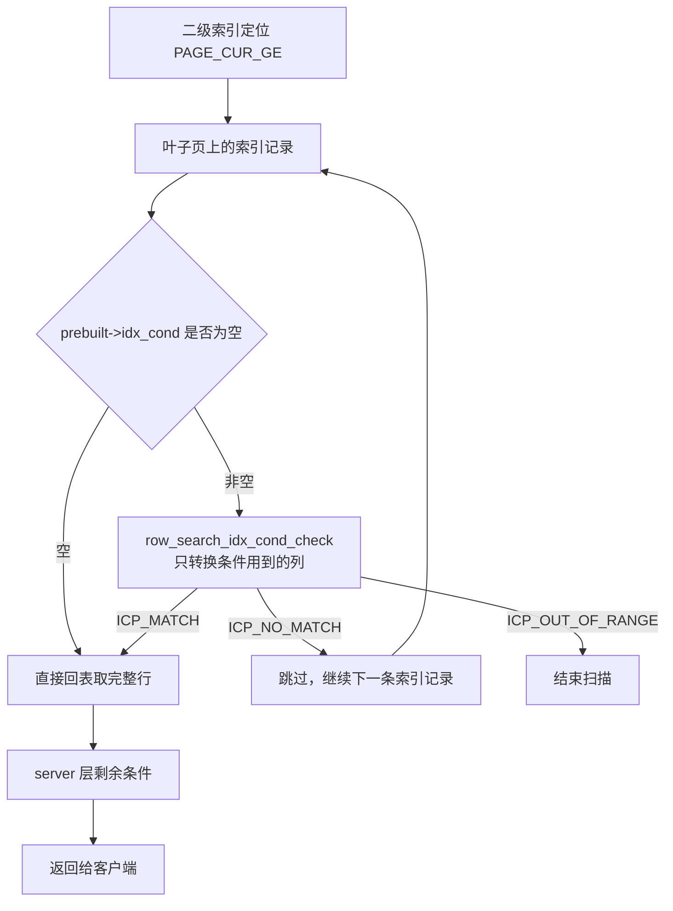
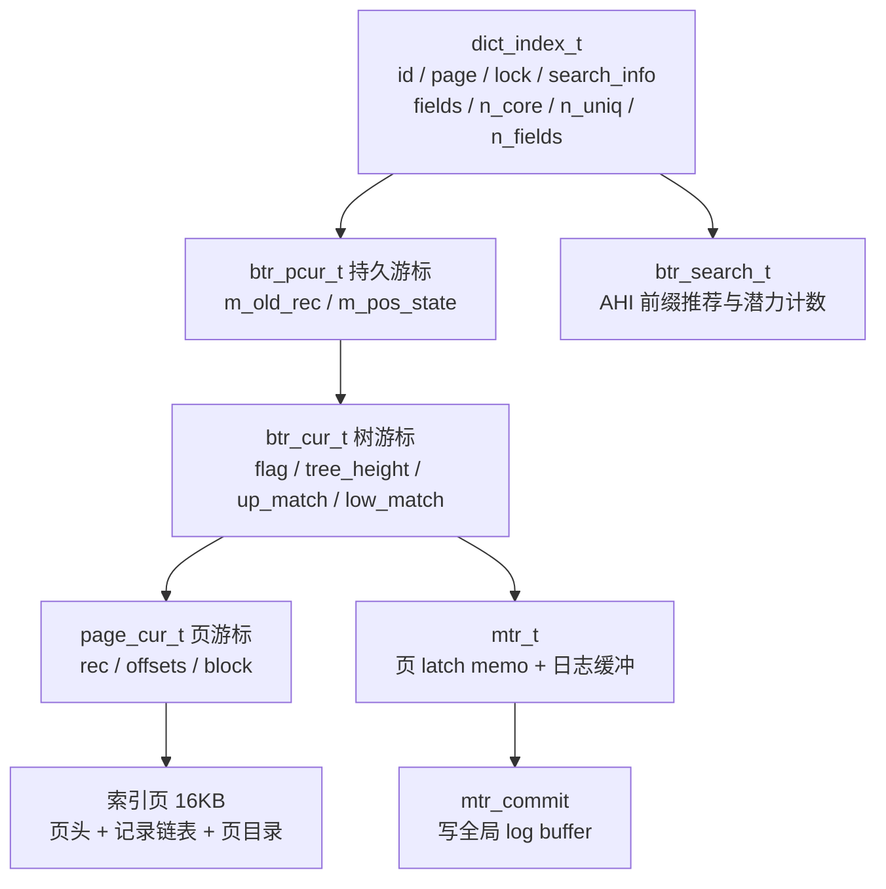

# 第7章 InnoDB索引的实现

**摘要：**

索引是 InnoDB 里唯一被反复读取、又必须被原地修改的结构，因此它的实现被拆成了两套语言：一套是数据字典里的对象描述，回答"这个索引有哪些列、哪些列足以唯一确定一条记录"；另一套是页内的物理布局与定位算法，回答"给定一个 key，究竟先比哪一层、再比哪一条记录"。本篇只写这两套语言，以及把它们粘合起来的那个最小执行单元——mini-transaction。沿着一条 `WHERE id = 100` 的等值查询走完根页、内节点、叶子页，再看一条分裂语句如何把页、父节点指针与兄弟链一起改掉，就能理解 InnoDB 索引的绝大多数行为：为什么点查的 IO 次数等于树高，为什么范围扫描可以只沿叶子层走，为什么覆盖索引的判定根本不在 InnoDB 里，以及为什么索引页的每一次修改都必须包在 mtr 中。本篇的落点是"定位一个 key 时到底走哪几层、比较什么"。

与同仓库另外三处相邻主题的分工是：[[11. InnoDB 索引：B+Tree 的工程实现与分裂合并哲学]] 讲工程实现与分裂合并的取舍，[[05 InnoDB 索引结构——B+Tree 的工程哲学与页分裂机制]] 讲页结构与运行期的形态观察，[[01 索引设计实战——从建错索引到建对索引]] 讲怎么建索引；页与文件的背景知识留在本列的 [[5.0 第5章 InnoDB存储引擎]] 与 [[6.0 第6章 InnoDB文件组织]]。

---

## 7.1 树在纸上，索引在页里

几乎每一本数据库教材都会画一棵 B+Tree：矩形是节点，箭头是父子指针，叶子之间再拉一条链。这张图没有错，但它把三个层次揉成了一张纸——逻辑上的有序结构、内存中的描述对象、磁盘上的 16KB 页面。真正读源码时会发现，InnoDB 里没有"树节点"这种对象，只有索引对象（`dict_index_t`）和一堆通过页号互相引用的页；父子关系体现在每个非叶页上那些比普通记录多出一个字段的节点指针记录里，兄弟关系体现在页头那两个 4 字节的前后页号里，而"有序"这件事同时由三层机制保证：页之间按最小键排序、页内记录按单向链表排序、页尾的目录插槽提供二分入口。

因此"查找一个 key"这件事在 InnoDB 里被拆成两个不同粒度的动作。第一个动作发生在树这一层，负责从根页一路降到目标层的某一页，由 `btr_cur_search_to_nth_level` 完成；第二个动作发生在页这一层，负责在一页之内定位到某条记录，由 `page_cur_search_with_match` 完成。前者关心的是"走哪个孩子"，后者关心的是"停在哪条记录旁边"。两者之间靠一个 4 字节的子页号连接，而整个下降过程被包装在一个 mtr 里，页的 latch 随下降逐层释放。

> [!note]
> 本篇的源码口径是 MySQL 8.0 的 `storage/innobase`，凡涉及 5.6/5.7 差异的地方会单独标注。InnoDB 的源码在 8.0 有过几轮重构（AHI 分区、索引锁、Record 缓存），但数据结构与定位算法的主干从 5.5 起没有变过。

下图把这三层关系摊开，后面各节都围绕它展开。



## 7.2 索引对象：dict_index_t 与 dict_field_t

数据字典里的 `dict_index_t` 是一个索引在内存中的全部身份，成员有几十个，按用途分成十几组：树布局、比较依据、统计、AHI、压缩、在线 DDL、INSTANT 列。读定位算法时真正需要的只有一小撮，笔者的习惯是先只看七个：`id`（索引号，页头里的 `PAGE_INDEX_ID` 与之相等，用来发现页与索引的错配）、`page`（根页号）、`lock`（保护树上层的读写锁）、`search_info`（自适应哈希索引的分析状态）、以及 `n_fields`/`n_uniq`/`n_user_defined_cols` 这三个计数。前四个负责"找到这棵树"，后三个负责"怎么比较"。

索引列由 `dict_field_t` 描述，它本身很薄：`col` 指向表列，`prefix_len` 是前缀长度（字节），`fixed_len` 是定长标记，`is_ascending` 记录升降序。前缀长度这个字段是覆盖索引与 ICP 判定的分水岭——一个 `KEY(pad(10))` 的索引列，`prefix_len` 非零，意味着这条索引里只有前 10 个字节，`dict_field_t` 知道这件事，而很多应用层的判断并不知道。

### 7.2.1 三个计数：n_fields、n_uniq 与 n_core

这是整套结构里最容易看晕的地方。三个计数都以"字段"为单位，但数的不是同一批字段。

`n_fields` 是索引记录里字段的总数，也就是这条记录在页上实际被比较的字段个数。用户定义的列算一个，InnoDB 自己追加进来的列也算一个。对于聚簇索引，追加的是两个系统列 `DB_TRX_ID` 与 `DB_ROLL_PTR`（多版本与回滚指针，紧跟在键列之后）；对于没有显式主键的表，还要先追加一个 6 字节的 `DB_ROW_ID`，聚簇索引因此退化成 `GEN_CLUST_INDEX`。对于二级索引，追加的是主键列——这是本节后半段的主题。

`n_uniq` 是"从头开始数，多少个字段就足以唯一确定一条索引记录"。它不是用户声明的列数，而是 InnoDB 为了保证唯一性而补足之后的列数：聚簇唯一索引里它就是主键列数，二级非唯一索引里它等于 `n_fields`（因为必须把追加的主键也算进去才能区分同一索引键下的多行），二级唯一索引里它退回用户列数（唯一约束本身已经够了）。

第三个计数在源码里的名字是 `n_user_defined_cols`，注释写得直白：用户定义在索引里的列数，内部表示还会追加更多列。它就是本篇沿用书籍口径所称的 `n_core`——一些早期资料与书籍用这个更短的名字，而 MySQL 5.5 到 8.0 的官方源码一直叫 `n_user_defined_cols`，MariaDB 的 InnoDB 分支里则叫 `n_core_fields`。名字不同，含义一致，读源码时不必在两个名字之间犹豫。

三者的取值不是靠约定，而是靠 `dict_index_build_internal_clust` 与 `dict_index_build_internal_non_clust` 两个函数在建索引对象时写死的。聚簇索引一侧的骨架是：

```c
/* 先把用户声明的列数存下来，这就是 n_core 的含义 */
new_index->n_user_defined_cols = index->n_fields;

if (dict_index_is_unique(index)) {
  /* 有唯一约束：用户列已经够唯一 */
  new_index->n_uniq = new_index->n_def;
} else {
  /* 无主键：还得再加上 DB_ROW_ID */
  new_index->n_uniq = 1 + new_index->n_def;
}
```

二级索引一侧的骨架更值得抄下来，因为它把"二级索引为什么带主键"写成了代码：

```c
new_index->n_user_defined_cols = index->n_fields;

/* 标记索引里已经包含的列，只被前缀索引覆盖的列不算包含 */
for (i = 0; i < new_index->n_def; i++) {
  if (field->prefix_len == 0) indexed[field->col->ind] = true;
}

/* 把主键列追加进来，已经存在的跳过 */
for (i = 0; i < clust_index->n_uniq; i++) {
  field = clust_index->get_field(i);
  if (!indexed[field->col->ind]) dict_index_add_col(new_index, ...);
}

if (dict_index_is_unique(index)) {
  new_index->n_uniq = index->n_fields;   /* 唯一二级索引：n_uniq == n_core */
} else {
  new_index->n_uniq = new_index->n_def;  /* 普通二级索引：n_uniq == n_fields */
}
new_index->n_fields = new_index->n_def;
```

把这两段合起来，四种索引的取值就很整齐了。

| 索引类型 | n_core（用户列） | n_uniq | n_fields | 追加了什么 |
| :--- | ---: | ---: | ---: | :--- |
| 聚簇主键索引 | 主键列数 | 主键列数 | n_uniq + 2 | DB_TRX_ID、DB_ROLL_PTR |
| 聚簇隐式索引（无主键） | 0 | 1 | 3 | DB_ROW_ID、DB_TRX_ID、DB_ROLL_PTR |
| 二级唯一索引 | 用户列数 | n_core | n_core + 未重复的主键列数 | 主键列 |
| 二级非唯一索引 | 用户列数 | n_fields | n_core + 未重复的主键列数 | 主键列 |

由此还能推出一个容易被忽略的细节：`dict_index_get_n_unique_in_tree()` 对聚簇索引返回 `n_uniq`，对二级索引返回 `n_fields`。原因就藏在上表里——二级索引的记录只有在把追加的主键列也比较完之后才唯一，所以"树内唯一"的字段数必须取 `n_fields`；聚簇索引的 `n_fields` 里带着两个系统列，拿它去比较会多比两次，必须退回 `n_uniq`。这个函数在定位、分裂点选择、AHI 前缀推荐里反复出现，读到它时只要想起这张表就不会迷失。

### 7.2.2 二级索引必须带主键

很多人第一次听到"二级索引的叶子节点存的是索引列加主键"时，会把它当成一种优化，仿佛 InnoDB 为了少回表而顺手多存了几列。事实相反：这是唯一性要求的结果，不是优化。

B+Tree 的有序性要求同一个位置上不能有两条完全相同的键，否则"二分找到第一个不小于 X 的记录"这条路径就会退化，插入位置的判定也无从谈起。二级索引的索引列允许重复，`WHERE pad = 'x'` 可能命中一万行，若只存索引列，这一万条记录在页上就完全一样，既无法稳定排序，也无法在删除时精确定位到某一条。把主键列追加进索引列之后，每条记录都获得了页内的唯一身份证，`n_uniq` 才成立。所以"二级索引一定带主键"不是设计者的偏心，是 B+Tree 的入场券；而回表之所以成为可能，只是这张入场券顺带提供的信息。

这里还有一条实践含义：主键的长度会直接摊到每一个二级索引上。一个 36 字节的 UUID 主键，会让每个二级索引的每条记录都多出 36 字节，页能装的记录数下降，树变高，缓存命中率下降。这也是"建议自增整型主键"的理由之一，与后文分裂行为那条理由相互独立。

> [!info]
> 前缀索引是这条规则的例外场景：`KEY(pad(10))` 只存 10 个字节，若主键列恰好也在用户列里且是前缀形式，`indexed[]` 不会被置位，InnoDB 仍会再完整追加一次主键列。所以"索引里有这列"和"索引里有这列的完整值"永远是两件事。

## 7.3 页：16KB 里的一整套微结构

索引页的类型是 `FIL_PAGE_INDEX`（数值 17855），但它并不是"一块放记录的空间"，而是一套完整的微型文件系统：头部有元数据，中间是记录堆，页尾是从后往前生长的目录，中间还夹着一条由删除记录串起来的空闲链表。理解定位算法之前，必须先把这些区域的相对位置记住，因为所有比较都发生在这块 16KB 的字节数组里。

页的前 38 个字节属于文件层（`FIL_PAGE_SPACE_OR_CHKSUM`、`FIL_PAGE_PREV`、`FIL_PAGE_NEXT`、`FIL_PAGE_LSN`、`FIL_PAGE_TYPE` 等），其中第 8 与第 12 字节的前后页号就是叶子层双向链表的实现。紧接着是 36 字节的索引页头，再往后是根页才使用的两个文件段头（各 10 字节），于是用户数据从第 94 字节（`PAGE_DATA`）开始。紧凑格式下 `infimum` 记录位于第 99 字节，`supremum` 记录位于第 112 字节，这两个"记录"没有用户数据，只承担边界哨兵的作用，页内二分最终收敛到的就是它们之间的某个位置。

页头的字段不多，但每一个都在定位或修改时被读一次。

| 字段 | 偏移/宽度 | 含义与在定位中的作用 |
| :--- | :--- | :--- |
| `PAGE_N_DIR_SLOTS` | 0 / 2B | 页目录槽数，二分查找的上界由它决定 |
| `PAGE_HEAP_TOP` | 2 / 2B | 记录堆顶，新记录从这里往后分配 |
| `PAGE_N_HEAP` | 4 / 2B | 堆中记录数，最高位标记紧凑格式 |
| `PAGE_FREE` | 6 / 2B | 已删除记录组成的单向空闲链表头 |
| `PAGE_GARBAGE` | 8 / 2B | 空闲链表里的字节数，乐观插入要靠它判断能否复用 |
| `PAGE_LAST_INSERT` | 10 / 2B | 最近插入记录的位置，插入方向启发式的核心 |
| `PAGE_DIRECTION` | 12 / 2B | 最近插入方向：PAGE_LEFT / PAGE_RIGHT |
| `PAGE_N_DIRECTION` | 14 / 2B | 同方向连续插入次数 |
| `PAGE_N_RECS` | 16 / 2B | 用户记录数，不含 infimum/supremum |
| `PAGE_MAX_TRX_ID` | 18 / 8B | 修改过本页的最大事务号，只对二级索引有意义 |
| `PAGE_LEVEL` | 26 / 2B | 层级，0 为叶子；`page_is_leaf()` 判的就是它 |
| `PAGE_INDEX_ID` | 28 / 8B | 所属索引号，与 `dict_index_t::id` 校验 |

`PAGE_MAX_TRX_ID` 这一项值得单独说一句：它只出现在二级索引和插入缓冲树上，作用是让只读查询在扫描二级索引时，能整页判断"这一页有没有比查询的 read view 更新的事务改过"，从而跳过不必要的回表与版本判断。聚簇索引不需要它，因为聚簇索引的每条记录本身带着 `DB_TRX_ID`。同一个字段在两类索引上的语义差异，是"聚簇与二级索引结构不同"的一个具体投影。

### 7.3.1 页目录：每 4 到 8 条记录一个槽

记录在页内是一条单向链表，从 `infimum` 指向 `supremum`，顺序即键序。链表只能顺序走，于是一页 100 多条记录若从头走到尾，平均要比较 50 次，这显然不能接受。InnoDB 的解法是在页尾倒着长出一个目录：每个槽占 2 字节，存的是某条记录在页内的偏移量；槽指向的记录再用记录头里的 `n_owned` 字段（4 个二进制位）告诉外界"从这个槽到下一个槽之间有几条记录"。

规则是硬性的：除首尾两个槽外，每个槽拥有的记录数在 4 到 8 之间（`PAGE_DIR_SLOT_MIN_N_OWNED` 与 `PAGE_DIR_SLOT_MAX_N_OWNED`）。插入时若某个槽的 `n_owned` 涨到 9，`page_dir_split_slot` 会在这组记录的中点处插一个新槽，把 9 条拆成 4 条和 5 条；删除时若某槽跌破 4，`page_dir_balance_slot` 会尝试与上邻槽合并。因此"每 6 到 8 条记录一个槽"是一个常见但不精确的说法，稳态下更接近 4 到 8 条，具体取值取决于插入与删除的历史。

这个设计带来的查找成本是可以精确估计的。设页内槽数为 S，先对槽做二分，需要约 `log2(S)` 次记录比较，落在一个槽上之后，再在该槽拥有的 1 到 8 条记录里线性扫描，最多 8 次比较。以 16KB 页、平均行长 100 字节估算，一页约 150 条记录，约 30 到 37 个槽，于是页内一次定位大致是 5 到 6 次二分加平均 2 到 4 次线性，合计 8 到 10 次记录比较。这个数量级与"页内记录数"几乎无关，只随槽数对数增长，这正是页目录存在的全部意义。

### 7.3.2 插入方向：PAGE_LAST_INSERT 的妙用

页头里有三个字段专门服务一种最常见的负载：自增主键的顺序插入。`PAGE_LAST_INSERT` 记录上一条插入记录的位置，`PAGE_DIRECTION` 记录插入方向，`PAGE_N_DIRECTION` 记录同方向连续插入的次数。

当一页上连续向右插入超过 3 次，且本次搜索模式是 `PAGE_CUR_LE`（插入专用模式）时，`page_cur_search_with_match` 会在进入二分之前先试一次捷径：直接拿 `PAGE_LAST_INSERT` 指向的记录和它的后继与目标键比较两次，若目标键恰好落在这两条记录之间，直接把游标放上去返回。两次比较取代了整个"二分加线性"，这就是顺序插入在页内层面几乎不花定位成本的原因。

这条捷径只对插入模式生效，因为只有插入才天然遵循"上一条之后就是下一条"的局部性；等值查询的键分布由业务决定，无从假设。把这一点与后文的页分裂启发式放在一起看，会发现 InnoDB 对"顺序插入"这件事有一套完整的、从页内到页间的优待路径——优待的动机不是讨好自增主键，而是减少页分裂的次数与分裂带来的碎片。

## 7.4 定位一个 key：btr_cur_search_to_nth_level

现在进入本篇的核心。`btr_cur_search_to_nth_level` 是 InnoDB 里被调用最频繁的函数之一，它的职责可以用一句话概括：从根页出发，逐层下降，直到停在指定层的某一页上，并把"游标停在哪条记录旁、匹配了几个字段"这两件事回填给调用者。它的参数表就是一篇文章的提纲：

- `index` 与 `tuple`：在哪棵树上找什么键；
- `level`：要找哪一层，绝大多数调用是 0（叶子层）；
- `mode`：`PAGE_CUR_G` / `PAGE_CUR_GE` / `PAGE_CUR_L` / `PAGE_CUR_LE` 之一，决定"停在大于还是小于目标的位置"；
- `latch_mode`：`BTR_SEARCH_LEAF`（只读，叶子页 S 锁）、`BTR_MODIFY_LEAF`（乐观修改，叶子页 X 锁，不锁树）、`BTR_MODIFY_TREE`（悲观修改，整棵树 SX 锁）；
- `cursor`：既输入又输出，输入时携带调用者已匹配的字段数，输出时携带命中位置；
- `mtr`：整个下降过程的事务容器。

它的前半段是两件与 B+Tree 无关的事：先试自适应哈希索引，再决定这棵树要加什么锁。哈希试探只在叶子层搜索、且 `latch_mode <= BTR_MODIFY_LEAF`、且该索引没有禁用 AHI、且上一次搜索曾因 AHI 命中而标记 `last_hash_succ` 时才进行；命中就直接返回，完全不碰 B+Tree。没命中则按 `latch_mode` 给树加上 S 锁或 SX 锁，然后从 `dict_index_get_page(index)` 拿到根页号，开始下降。

下图把一次完整下降的判定顺序画出来，注意所有"叶子层才生效"的分支。



### 7.4.1 上层模式改写：为什么 GE 会变成 L

流程里有一个容易被跳过的分支：在非目标层上，搜索模式不是原样使用的，`PAGE_CUR_GE` 会被改写成 `PAGE_CUR_L`，`PAGE_CUR_G` 被改写成 `PAGE_CUR_LE`；只有到达 `level` 那一层，`page_mode` 才被还原成调用者给的 `mode`。

原因在于非叶页上的记录语义与叶子页不同。非叶页的记录是节点指针，它的键等于子页中最小记录的键，InnoDB 需要找到"目标键可能落在哪个孩子的区间里"。用 `PAGE_CUR_L`（最后一个严格小于目标键的节点指针）正好能选出区间覆盖目标键的那个孩子：若目标键严格落在两个节点指针的键之间，它就是属于左边那个孩子；若目标键恰好等于某个节点指针的键，改写后的定位会落在它的左邻，而不是它本身。

这个"左邻"的偏差由调用者兜底：叶子层搜索若发现游标停在 `supremum` 上，范围扫描会沿 `FIL_PAGE_NEXT` 走到下一页继续找。源码在这个位置留了一句提醒，说 `up_match` 与 `low_match` 在相邻记录位于不同叶子页时可能偏大，正是为这件事打的补丁。笔者的看法是，这属于"用一次额外的页访问换取更简单的下降逻辑"的取舍，代价发生在恰好等于页边界键的那一小部分查询上，而这类查询的目标页往往就在缓冲池里，实际影响有限。

### 7.4.2 页内二分：先切目录，再走链表

真正决定"停在哪条记录"的是 `page_cur_search_with_match`。它的主体是两段循环，第一段在页目录上二分，第二段在槽内线性。

```c
low = 0;
up = page_dir_get_n_slots(page) - 1;

/* 第一段：在目录槽上二分，直到上下界相邻 */
while (up - low > 1) {
  mid = (low + up) / 2;
  mid_rec = page_dir_slot_get_rec(page_dir_get_nth_slot(page, mid));
  cur_matched_fields = std::min(low_matched_fields, up_matched_fields);
  cmp = tuple->compare(mid_rec, index, offsets, &cur_matched_fields);

  if (cmp > 0)                                  goto low_slot_match;   /* 键在右边 */
  else if (cmp)                                 goto up_slot_match;    /* 键在左边 */
  else if (mode == PAGE_CUR_G || mode == PAGE_CUR_LE) goto low_slot_match;
  else                                          goto up_slot_match;
}

/* 第二段：在上界槽拥有的记录里线性走，直到上下记录相邻 */
while (page_rec_get_next_const(low_rec) != up_rec) {
  mid_rec = page_rec_get_next_const(low_rec);
  cmp = tuple->compare(...);
  ...
}

/* 定位：G/GE 停在 up_rec，L/LE 停在 low_rec */
if (mode <= PAGE_CUR_GE) page_cur_position(up_rec, block, cursor);
else                     page_cur_position(low_rec, block, cursor);
```

这段代码里有三个值得记住的设计。

第一，比较的代价被摊到了"已匹配字段数"上。`tuple->compare` 接收一个输入输出参数 `cur_matched_fields`，表示与当前记录前缀相等的字段数；随着二分推进，这个值只会单调增大，后续比较可以从第一个不匹配的字段接着比，而不必从第一列重来。对于 `(a, b, c)` 这种多列索引，键的前缀越长，节省越多。这也是为什么 `btr_cur_t` 里除了 `up_match`/`low_match` 还要存 `up_bytes`/`low_bytes`：定位可能停在某个字段的中间，字节级的匹配信息同样要带出去，供 AHI 的前缀推荐使用。

第二，相等时的分支选择决定了模式的语义。`cmp == 0` 时，`PAGE_CUR_G` 与 `PAGE_CUR_LE` 把相等记录视为"还在左边"，继续向右搜；`PAGE_CUR_GE` 与 `PAGE_CUR_L` 视为"已经到右边"，继续向左搜。最终 `G` 与 `GE` 定位到 `up_rec`，`L` 与 `LE` 定位到 `low_rec`，于是四种模式各自得到干净的语义：

| 模式 | 精确定义 | 典型调用者 |
| :--- | :--- | :--- |
| `PAGE_CUR_G` | 第一条严格大于键的记录 | 范围扫描推进到下一个键、跳过相等前缀 |
| `PAGE_CUR_GE` | 第一条大于等于键的记录 | 等值查询与范围扫描的起点 |
| `PAGE_CUR_L` | 最后一条严格小于键的记录 | 上层节点指针定位（由 GE 改写而来） |
| `PAGE_CUR_LE` | 最后一条小于等于键的记录 | 插入定位（由 G 改写而来）、页内插入点 |

第三，`PAGE_CUR_GE` 的语义就是"找到第一个大于等于 key 的位置"，这一句决定了整个范围扫描的起点语义。`row_search_mvcc` 打开游标时用的正是 `PAGE_CUR_GE`，拿到记录后用 `up_match` 与搜索元组的字段数比较：若 `up_match` 小于元组字段数，说明搜索键没有完全匹配上，范围为空，直接返回耗尽；若不小于，说明搜索键的每个字段都比中了，可以接着做可见性判断。`up_match` 在这里不是调试信息，而是判定"是否命中"的依据。

### 7.4.3 点查的 IO 次数等于树高

定位算法一旦清楚，"一次点查要读几个页"这个问题就变成纯粹的算术。从根页开始，每下降一层读一个页，直到叶子页，读的页数等于树高。B+Tree 的树高由两个因子决定：叶子页能装多少条记录，非叶页能挂多少个子页。

举个量化的例子（以下数字为示例推算，不是任何版本的性能承诺）。16KB 页，去掉页头、页目录与记录头开销，可用空间约 15KB。若表的一行数据加记录头约 200 字节，叶子页可装约 70 到 75 行。非叶页的每条节点指针记录是"键加 4 字节子页号"再加 5 字节记录头，8 字节的 BIGINT 主键下约 17 到 20 字节，一页可挂 700 到 900 个子页。取偏保守的 700，则三层树能覆盖 `700 × 700 × 70`，约 3400 万行；四层树能覆盖到百亿量级。

| 树的层数 | 点查需访问的页数 | 示例容量（示例推算） | 说明 |
| ---: | ---: | ---: | :--- |
| 2 | 2 | 数万行 | 小表，根页即叶子或只有一层内节点 |
| 3 | 3 | 千万到亿级 | OLTP 单表的常见形态 |
| 4 | 4 | 十亿级 | 大表或长主键、宽行 |
| 5 | 5 | 百亿级以上 | 通常意味着主键过长或行过宽 |

"访问的页数"不等于"磁盘 IO 次数"。根页与上层内节点几乎常驻缓冲池，叶子页的命中率取决于数据热度和缓冲池大小，因此一次点查的物理 IO 常常是 0 到 1 次。把树高理解成"逻辑上要碰几次页"，把缓冲池命中率理解成"这几次里有多少次真的落到磁盘"，两个概念分开，才不会在排查慢查询时把"树高 3"错当成"三次磁盘 IO"。

### 7.4.4 范围扫描：只沿叶子层走

范围扫描的起点由一次 `PAGE_CUR_GE` 定位给出，之后不再回到上层。叶子页之间由 `FIL_PAGE_PREV` 与 `FIL_PAGE_NEXT` 组成双向链表，扫描在当前页内沿记录链表前进，走到 `supremum` 就顺着 `FIL_PAGE_NEXT` 跳到下一页的 `infimum` 之后继续。整个过程不再比较树上的键，也不再持有上层的 latch，这正是 B+Tree 相对 B 树的优势所在：范围查询的代价是"一次树高定位加线性遍历"，而不是"每取一条记录就回到父节点找下一个孩子"。

下图把等值查询与范围扫描的路径并排画出，两者的分岔点就在叶子层。



实现这条链路的游标是 `btr_pcur_t`（持久游标），它在 `btr_cur_t` 之外包了一层"可恢复"的能力：记录当前位置所在的页与偏移，保存一份旧记录副本 `m_old_rec`，并用 `m_pos_state` 标记"是否已定位""是否被移动过"。这样即使 mtr 提交、页被换出，游标也能按旧记录重新定位，范围扫描因此可以跨越多次 mtr 而不断线。

`up_match` 与 `low_match` 在范围扫描里还有一层用途：判断前缀是否已经不再匹配。多列索引上 `WHERE a = 1 AND b > 2` 的扫描，走到 `a` 不再是 1 的记录时就可以停止；这个"a 还是不是 1"的判断，靠的就是每条记录与搜索元组比较后得到的匹配字段数。

## 7.5 改一棵树：mtr 与两条插入路径

只读的定位算法可以随意重试，因为页不会被别人改。一旦要修改，InnoDB 就必须面对一个它无法回避的问题：一次逻辑上的修改往往要动多个页——一次页分裂要创建新页、搬记录、改父页的节点指针、改左右兄弟的前后页号、可能还要递归地分裂父页；这些页分散在文件的不同位置，写入磁盘的先后顺序完全由操作系统与刷脏策略决定。如果中途掉电，页面上会出现"新页已建好但父页还没指过来"或"记录已搬走但兄弟链还连着旧页"这种半成品状态。

### 7.5.1 mtr：把多页修改变成一个原子步

InnoDB 的答案是 mini-transaction（mtr，迷你事务）。它不是用户事务，不涉及隔离级别、不参与回滚、也不与 undo 日志打交道；它只做两件事：把一组页的 latch 记在自己的 memo 里以便统一释放，把这一组页上的物理修改对应的重做日志记录攒在自己的日志缓冲里，直到 `mtr_commit` 时再一次性写出去。

这解释了一个常被误解的现象：在代码里改一个页，写完记录、调完 `page_cur_tuple_insert`，此刻 redo 并没有生成；真正把日志写进全局 log buffer、把脏页挂上 flush list 的动作发生在 `mtr_commit`。因此"页修改必须在 mtr 里"不是一条编码规范，而是持久性的前提——脱离 mtr 的页修改没有任何日志保护，崩溃恢复时无法重演，也没法保证同一次逻辑修改涉及的多个页一起生效。八步分裂之所以敢先改父页再搬记录，靠的正是这条原子性：崩溃恢复重演 redo 时，只会看到一个完整的分裂或者完全没有分裂。

> [!warning]
> mtr 里持有页 latch，所以 mtr 内不能做等锁、不能做可能阻塞的 IO、不能去拿别的 mtr 已经持有的页。索引页的 latch 竞争在热点表上非常直接，这也是为什么一次插入要尽量走乐观路径——乐观路径只需要叶子页的 X 锁，悲观路径要先拿整棵树的 SX 锁。

### 7.5.2 乐观插入的判定顺序

一次插入的调用链大致是 `row_ins_clust_index_entry`（或二级索引对应的函数）先用 `PAGE_CUR_LE` 做定位，把叶子页 X 锁住，然后调用 `btr_cur_optimistic_insert` 试着在现有页里塞进去；失败则退到 `btr_cur_pessimistic_insert`。乐观路径的判定顺序在源码里是一条严格的短路链，每一步失败都用同一个 `DB_FAIL` 退出：

1. 先按索引定义把元组换算成记录大小 `rec_size`；记录大到需要外置存储时，先拆成外置记录。
2. 压缩页（ROW_FORMAT=COMPRESSED）另有一道检查：若插入后会超过压缩填充的"最优页大小"，直接判失败，并顺手预取左右兄弟页，为即将到来的悲观路径做准备。
3. 取 `max_size = page_get_max_insert_size_after_reorganize(page, 1)`，即"先把页重组一遍之后，还能塞进多少字节"。这一步就把碎片清理的收益算进去了。
4. 若页上存在垃圾（`page_has_garbage`），条件放宽为"重组后仍装不下、且连 1/32 页的空闲都不到、且页上不止一条记录、且不重组也装不下"才失败；否则直接比 `max_size` 与 `rec_size`。
5. 若这是聚簇索引的叶子页、页上已有至少两条记录、且剩余空间只够放下这一条而放不下后续更新所需的空间（`dict_index_get_space_reserve()` 加上记录大小超过 `max_size`），同时该页又满足"可从右分裂"或"可从左分裂"，则主动放弃乐观插入，让悲观路径去做一次分裂。这条规则很少有人注意，它的目的是给后续的原地更新留出膨胀空间，避免更新把记录撑大后触发额外的页迁移。
6. 通过以上检查后调用 `page_cur_tuple_insert`；非压缩页若这次仍失败，会先做一次 `btr_page_reorganize` 再试一次，仍失败才认输。
7. 插入成功后更新 AHI、更新插入缓冲位图、调用 `lock_update_insert` 把新记录的锁信息并入锁表。

| 维度 | 乐观插入 | 悲观插入 |
| :--- | :--- | :--- |
| 触发条件 | 页内空间够，或无垃圾但重组后够 | 乐观路径返回 `DB_FAIL`，或主动让位给分裂 |
| 持有的锁 | 叶子页 X 锁，树锁不加或已释放 | 整棵树 SX 锁，叶子页 X 锁 |
| 主要函数 | `btr_cur_optimistic_insert` | `btr_cur_pessimistic_insert` |
| 可能的重活 | 页重组一次 | 分配新页、搬记录、改父页、递归分裂 |
| 失败退路 | 转悲观 | 预分配 extent 后仍失败则返回 `DB_OUT_OF_FILE_SPACE` |
| 并发影响 | 只影响这一页 | 阻塞同一索引上的其他修改 |

悲观插入在真正动手之前还有两步准备：先把锁与 undo 记录写好（`btr_cur_ins_lock_and_undo`），再为索引树预留足够的空闲 extent，预留量是 `cursor->tree_height / 16 + 3`——用树高估算这次分裂可能消耗的区数，避免分裂到一半发现表空间满了。之后才判断是根页还是普通页：根页要调用 `btr_root_raise_and_insert` 长高一层，普通页走 `btr_page_split_and_insert`。插入完成后，二级索引还要更新页头的 `PAGE_MAX_TRX_ID`，这是一个容易被忽略的顺序细节——游标可能在分裂中被移到别的页上，事务号必须写到最后真正插入的那一页上。

### 7.5.3 页分裂：先试着挤邻居，再选点，最后才搬

`btr_page_split_and_insert` 的源码用注释把流程编成了八个步骤，照这个顺序读最快。

第一步不是分裂，而是尝试把记录塞进右邻居：`btr_insert_into_right_sibling` 只在游标已经位于页尾（下一条是 `supremum`）、右页存在且有空间时才生效。这一招对"页边界上反复插入"的场景很有效，能把一次分裂推迟成一次跨页插入。

第二步选分裂点，分三种启发式，全部围绕页头那两个方向字段做判断。第一种是"从右侧分裂"（`btr_page_get_split_rec_to_right`）：若 `PAGE_LAST_INSERT` 正好等于游标所在记录，说明这是连续向右插入的模式，此时若插入点之后只有 `supremum`，就让新记录独占新页（`split_rec` 为空）；若之后还有一条再是 `supremum`，就把 `next_next_rec` 作为分裂点，故意留一条记录在原页上——注释写明这是为了让顺序插入仍能命中 AHI 的快速检查。第二种是"从左侧分裂"（`btr_page_get_split_rec_to_left`）：若 `PAGE_LAST_INSERT` 正好等于插入点的下一条，说明插入方向在向左收敛，把插入点或它的后继作为分裂点。第三种是兜底：取页中间那条记录 `page_get_middle_rec`，也就是教科书上的 50/50 分裂；若页上只有一条记录，则根据新记录比它大还是小，决定新记录是落到新页还是留在原页。

第三步分配新页，方向由分裂点决定：向右分裂用 `FSP_UP`，提示页号取原页号加一；向左分裂用 `FSP_DOWN`，提示页号取原页号减一。空间局部性在这里被刻意照顾，相邻页号更容易落在同一个区（extent）里，顺序扫描时物理读更连续。

第四步是 `btr_attach_half_pages`，先改树结构，再搬数据。它做三件事：为新的一半构造节点指针记录（键取新页的第一条记录），调用 `btr_insert_on_non_leaf_level` 插进父页（这一步可能递归触发父页分裂，甚至让根页分裂、树高加一）；修改左右兄弟的 `FIL_PAGE_PREV` / `FIL_PAGE_NEXT`；处理 `REC_INFO_MIN_REC_FLAG` 的归属——只有"本层最左页的第一条记录"才带这个标记，页分裂后最左页可能变化，标记要跟着迁移。

第五步搬记录，向右分裂用 `page_move_rec_list_end`，向左分裂用 `page_move_rec_list_start`。搬动不只搬记录本身：锁表要跟着搬（`lock_move_rec_list_end` / `lock_update_split_right`），AHI 要跟着搬（`btr_search_update_hash_on_move`），否则会出现"记录在新页上、锁信息还在旧页上"的错位。压缩页另有 `page_zip_copy_recs` 的兜底路径，在压缩失败时逐字节复制再删。

第六、七步决定记录该落在哪一半，重新定位后插入；第八步若还是插不进去，做一次页重组再试，循环次数由 `n_iterations` 控制，压缩页最多再试一轮。

下图把一次分裂的时序摊开，注意树锁是在第四步之前就持有了，而记录搬动发生在树结构改完之后。



分裂点选择的三条启发式可以对照着看，它们的差别只在"假设了什么样的插入负载"。

| 启发式 | 判定条件 | 分裂点 | 对应负载 |
| :--- | :--- | :--- | :--- |
| 向右分裂 | `PAGE_LAST_INSERT` 等于插入点 | 插入点之后第一条、或留一条后取再下一条 | 自增主键、时间戳递增 |
| 向左分裂 | `PAGE_LAST_INSERT` 等于插入点的下一条 | 插入点本身或它的后继 | 递减键、按范围倒序写入 |
| 中间分裂 | 以上都不满足 | `page_get_middle_rec` | 随机键、UUID 主键 |

对随机键来说，每次分裂都近似 50/50，页的平均填充率长期停在低位，树会变得更"胖"，缓存里能放的有效数据变少；对自增键来说，绝大多数插入落在最右页的尾部，分裂点退化为"新记录独占一页"，旧页保持接近全满。这也是"建议自增主键"的第二条理由，它与前文"主键长度会摊到每个二级索引上"的理由并不重复：一条讲空间，一条讲分裂行为。

分裂带来的另一半代价是回滚。若触发分裂的事务最终回滚，插入的记录会被删掉，删除路径会顺带调用页合并的逻辑；此时若新页已经空了，它会被释放；若是 50/50 分裂，则比较两半的填充率，把低于 `merge_threshold`（`DICT_INDEX_MERGE_THRESHOLD_DEFAULT`，默认 50）的那一半合并回邻页。合并与重组本身是一套独立的机制，涉及向左合并、向右合并、页重组与自适应哈希索引的失效处理，[[11. InnoDB 索引：B+Tree 的工程实现与分裂合并哲学]] 已经把这套取舍讲透了，本篇只保留结论：分裂是写放大与空间碎片的来源，合并是空间回收的来源，两者共用同一个阈值，因此在高并发写入与频繁删除的表上，这个阈值附近的抖动会同时表现为"页多"与"锁等待"。

## 7.6 覆盖索引：判定发生在编译期，不在 InnoDB 里

讲到这里必须纠正一个流传很广的说法：InnoDB 里并没有 `index->is_covering()` 这样的判定函数。索引结构提供的是"这条记录上有哪些列"，至于一次查询能不能只靠索引完成，是 SQL 层在优化阶段替引擎做好的决定。InnoDB 在这个问题上的全部贡献，是在 `ha_innobase::index_flags` 里报告一个能力位 `HA_KEYREAD_ONLY`，意思是"这个索引支持只读索引键就返回所需列"（全文本索引与多值索引除外）。

链条是这样接起来的。表打开时，`setup_key_part_field` 对每个键列检查引擎能力位，把支持的索引记进 `TABLE_SHARE::keys_for_keyread`；`TABLE` 初始化时把它复制成 `covering_keys`。此后每标记一个"查询要用到的列"，`TABLE::mark_column_used` 就会执行 `covering_keys.intersect(part_of_key)`——只有当某个索引仍然包含该列时，它才留在候选集合里。等查询的所有列都标记完，`covering_keys` 里剩下的索引就是"有资格不回表"的索引；优化器用 `table->covering_keys.is_set(key)` 判断，命中则调用 `set_keyread(true)`，执行期 `handler` 的对应标志被置位，InnoDB 才在 `index_read` 时跳过回表。

由此可以写出覆盖索引成立的四个条件，缺一不可：

| 条件 | 判定位置 | 失效后的表现 |
| :--- | :--- | :--- |
| 查询引用的每一列都在该索引里 | `covering_keys.intersect(part_of_key)` | 该索引被移出候选，`Extra` 里没有 `Using index` |
| 这些列在索引里是完整值而非前缀 | `part_of_prefixkey` 与 `prefix_len` | `KEY(pad(10))` 上查 `pad` 会回表 |
| 引擎报告支持只读索引键 | `HA_KEYREAD_ONLY` | 全文本、多值索引直接不参与 |
| 优化器最终选中这个索引 | 代价模型 | 有资格不等于被选中，可能仍然回表 |

### 7.6.1 看起来覆盖，其实不覆盖

第一类误判来自前缀索引。`KEY(pad(10))` 的索引记录里只有 `pad` 的前 10 个字节，`SELECT pad FROM t WHERE pad = 'x'` 看似"只查索引列"，实际拿到的值不完整，server 层通过 `part_of_prefixkey` 把该索引移出 `covering_keys`，查询必须回表。用 `EXPLAIN` 看，`Extra` 里只有 `Using where` 而没有 `Using index`，这就是判据。

第二类误判来自主键列。二级索引物理上带有主键列，但这个"带"是 InnoDB 内部追加的，用户定义的键列里并没有它。server 层之所以还能把"只查主键"的查询判成覆盖，是因为 `use_index_extensions` 开关打开时，表定义阶段会把主键列作为扩展键列追加到二级索引的 `KEY` 结构里（`actual_key_parts` 大于 `user_defined_key_parts`）。把 `use_index_extensions` 关掉，同一条查询立刻退化成回表。这也说明 `n_uniq` 与 `n_core` 的差别不只是概念上的：`n_uniq` 含主键、`n_core` 不含，覆盖判定用的正是 `n_core` 那一侧的信息加上扩展键列，而 InnoDB 内部做唯一性比较用的是 `n_uniq` 那一侧。

第三类误判来自"覆盖等于快"。覆盖只是取消了回表这一环，扫描的行数一点没少。一个 `WHERE status = 1` 的低选择性条件，即使走了覆盖索引，也要扫过几十万条索引记录，代价可能高于一次全表扫描加顺序读。优化器在 `find_shortest_index` 与代价模型之间反复权衡，最终可能放弃覆盖索引，这不是实现缺陷，而是成本判断。

第四类误判来自锁语义。`SELECT ... FOR UPDATE` 这类加锁读需要定位并锁定聚簇索引上的记录，仅读索引键无法完成加锁，优化器通常不会把它判成覆盖扫描。同理，涉及触发器、生成列求值、外置 BLOB 列的查询，也可能被迫回表。

> [!info]
> `EXPLAIN` 的 `Extra` 列只给结论：`Using index` 表示这条路径是覆盖扫描，`Using index condition` 表示有 ICP，两者可以同时出现，含义不同——前者说"不用回表"，后者说"回表之前先在索引上过滤"。

## 7.7 ICP：把过滤搬到回表之前

覆盖索引解决的是"根本不用回表"，ICP（Index Condition Pushdown，索引条件下推）解决的是另一个问题：当不得不回表时，能不能先用索引里已有的列把不需要的行滤掉。考虑 `KEY(a, b)` 上的 `WHERE a = 1 AND b LIKE '%x%'`，`a` 能把范围收窄，`b` 的过滤条件却要在回表取出完整行之后才能判断；如果每一条候选行都先回表再判断 `b`，回表次数等于候选行数。ICP 把这句 `b LIKE '%x%'` 交给引擎，让它在索引记录上先算一遍，只有通过的行才回表。

实现分两半。SQL 层在 `QEP_TAB::push_index_cond` 里把条件"裁剪"出一份只涉及该索引列的副本，通过 `handler::idx_cond_push` 交给引擎，剩下的部分继续留在 server 层作为行条件；引擎侧把这份条件下挂在 `prebuilt->idx_cond` 上，每次在索引上定位到一条记录，就调用 `row_search_idx_cond_check`：先把条件需要的那几列（`idx_cond_n_cols`）转成 MySQL 格式，再调用 `innobase_index_cond`，后者最终落到 `pushed_idx_cond->val_int()`，返回匹配、不匹配或"已越过范围"三种结果。只有匹配的记录才会走到回表那一步。

下图把 ICP 的执行位置标出来，注意过滤发生在叶子页与聚簇索引之间。



推不推得下去，判据也在源码里，可以列成一张检查表。

| 判据 | 说明 |
| :--- | :--- |
| 条件只用到该索引的列 | 字段必须在 `part_of_key` 里，前缀键列不算；BLOB / GEOMETRY 类型不推 |
| 引擎支持 ICP | `index_flags` 里带 `HA_DO_INDEX_COND_PUSHDOWN` |
| 开关与 hint 允许 | `optimizer_switch` 的 `index_condition_pushdown` 打开，且没有 `NO_ICP` 提示 |
| 不是多表 UPDATE / DELETE | 同一 handler 要兼做查找与更新，推下去会改错行 |
| 连接类型不是 CONST / SYSTEM | 这类表只读一次然后复用，推下去只会算一次 |
| 不是聚簇主键索引 | 主键上没有"回表"这一步，推下去收益极低 |
| 不涉及虚拟列、反向扫描、带守卫条件的子查询 | 源码里逐条排除，理由分别是求值依赖、实现限制与语义风险 |

顺带纠正一个流传的说法：ICP 并不是"`LIKE '%x%'` 不能下推"。下推的判据只看"条件里的列在不在索引里"，不看"这个条件能不能用于范围定位"。`LIKE '%x%'` 确实无法缩窄扫描范围，但它完全可以作为索引条件下推到引擎，在索引记录上先过滤一遍——只有在 `a` 这类前缀条件已经把范围收窄、而剩余条件恰好落在索引列上时，这种过滤才划算。真正的禁区是子查询、存储函数、跨表字段（在 BNL/BKA 语境下）、BLOB 与 GEOMETRY，以及前面列出的那些结构性限制。

代价同样存在：ICP 每处理一条索引记录都要把条件涉及的列从 InnoDB 格式转成 MySQL 格式，这是纯 CPU 开销；条件很简单、命中率又高时，这份开销可能超过省下的回表。因此它默认打开，但不是无条件划算，`EXPLAIN` 里出现 `Using index condition` 时仍要结合 `rows` 与条件的选择性一起看。

## 7.8 MRR 与 index_merge：把随机回表变成有组织的批量回表

ICP 减少的是回表次数，MRR（Multi-Range Read，多范围读）改变的是回表的顺序。二级索引上的范围扫描天然是"按索引键排序、按主键随机跳"的访问模式：索引页里相邻的两条记录，主键可能相差几十万，回表就是两次毫不相干的随机读。当候选行有几千条时，这些随机读会把缓冲池搅得一塌糊涂。

MRR 的做法是把"取行"拆成两阶段：第一阶段只做索引扫描，把命中的行标识（rowid）攒进一块缓冲区；第二阶段把缓冲区里的 rowid 排序，再按排序后的顺序回表。这样随机读被压成"按主键递增的一批读"，在机械盘时代这是数量级的差别，在 SSD 上则主要体现为更好的预读与更少的跨页随机跳读。InnoDB 没有自己实现 MRR，它把 `multi_range_read_init` / `multi_range_read_next` 转给 server 层的默认实现 `DsMrr_impl`，缓冲区大小即 `read_rnd_buffer_size`，默认为 256KB。

什么时候 MRR 才值得用，`DsMrr_impl::choose_mrr_impl` 给了一份明确的适用清单：索引只能返回 rowid（不是覆盖扫描）、结果没有要求有序、不是聚簇主键索引（主键范围扫描本身就是顺序的）、索引没有使用前缀列（`key_uses_partial_cols` 为真时 rowid 不完整）、不是临时表。满足之后还要过代价关：`mrr_cost_based` 打开时，只有表的数据文件大于缓冲池（引擎没有缓冲池时按 100MB 估算）且预估行数超过 50，才考虑 DS-MRR；把 `mrr` 打开而把 `mrr_cost_based` 关掉，则"只要可用就强制用"，代价按两者取小。还有一条容易踩的边界：DS-MRR 无法保证输出有序，因此带 `ORDER BY` 的查询若依赖索引顺序，MRR 反而可能让优化器多做一次排序。

index_merge 是另一条路：不是把回表排序，而是把两个索引的扫描结果合并。AND 条件落在两个不同索引上时用交集（intersection），OR 条件用并集（union 或 sort_union）。三者的区别在"行标识是否已经有序"：若每个分支本身按 rowid 有序，并集可以直接归并（union）；若某分支的顺序无法保证，就要先把 rowid 排序再归并（sort_union）。这套区分留在优化器的计划与代价层面，而在 8.0 的执行层，三种形状被统一成了同一个 `IndexMergeIterator`：所有分支都只读索引键，把 rowid 收集起来，用 `Unique` 结构排序去重，再按主键一次性回表；若其中一个分支恰好是主键范围扫描，它的行单独扫描，与去重集合天然不相交。缓冲区大小取自 `sort_buffer_size`，这意味着 index_merge 的成本对 `sort_buffer_size` 敏感，把它调小会让去重退化成更多轮的磁盘归并。

四条路径的作用位置各不相同，把它们放在一张表里对照，比分别记忆更省事。

| 机制 | 作用位置 | 主要开关 | 调大或开启的代价 | 调小或关闭的代价 |
| :--- | :--- | :--- | :--- | :--- |
| 覆盖索引 | 优化期决定，执行期不回表 | `use_index_extensions`、索引设计 | 索引变宽，写入与缓存成本上升 | 回表次数上升，随机读增加 |
| ICP | 索引扫描与回表之间 | `optimizer_switch` 的 `index_condition_pushdown` | 每条索引记录多一次条件求值与格式转换 | 无效行也要回表，IO 放大 |
| MRR | 回表之前重排 rowid | `mrr`、`mrr_cost_based`、`read_rnd_buffer_size` | 排序占用内存与 CPU，输出可能乱序 | 随机回表，缓冲池命中率下降 |
| index_merge | 优化期选计划，执行期合并 rowid | `index_merge` 及其三个子开关、`sort_buffer_size` | 去重与排序开销大，可能不如单索引 | 只能走单索引或全表扫描 |

## 7.9 自适应哈希索引：B+Tree 旁边的一层内存缓存

到这里为止，所有优化都还在 B+Tree 之内。InnoDB 还有一层完全不同的加速机制——自适应哈希索引（Adaptive Hash Index，AHI），它不属于索引结构，不由 SQL 指定，不写进任何索引页，也从不参与持久化。把这句话看清，可以避免后面几节的绝大多数误读：AHI 是 InnoDB 在缓冲池里为"热点页上反复出现的等值查找"临时搭出来的一张哈希表，表里存的是"键前缀的哈希值到页内记录指针"的映射。

它的组织分三层。全局是 `btr_search_sys_t`，内部按 `btr_ahi_parts` 分区，每个分区各有一把 `rw_lock_t` 和一张 `hash_table_t`，分区数由 `innodb_adaptive_hash_index_parts` 控制，默认 8，取值范围 1 到 512，属于只读参数，改了必须重启。第二层是每个索引的 `search_info`（`btr_search_t`），保存这个索引的哈希潜力计数、上一次搜索是否本可命中、以及"推荐前缀"`prefix_info`。第三层是每个缓冲页的 `block->ahi`，记录这一页是否已经建过哈希、用的是哪个前缀、以及该页的命中帮助次数。

建与不建，靠两个计数投票。`btr_search_info_update_hash` 在每次 B+Tree 搜索完成后，根据 `up_match` 与 `low_match` 的关系推算一个"推荐的哈希前缀"：若搜索停在两条记录之间，就用能区分这两条记录的最短前缀。随后的 `btr_search_update_block_hash_info` 累加索引级的 `n_hash_potential` 与页级的 `n_hash_helps`，只有当前者达到 `BTR_SEARCH_BUILD_LIMIT`（100）且后者超过页内记录数的十六分之一（`BTR_SEARCH_PAGE_BUILD_LIMIT` 为 16）时，才会真正在这一页上建哈希。这两个门槛解释了 AHI 的"自适应"到底自适的是什么：不是数据分布，而是同一页上同一前缀的查找模式是否反复出现。

查找时，`btr_cur_search_to_nth_level` 在下降之前先试一次 `btr_search_guess_on_hash`，条件前面已经列过：只在叶子层、只在 `latch_mode <= BTR_MODIFY_LEAF`、索引未禁用 AHI、上轮搜索标记过 `last_hash_succ`。命中时返回的游标带着 `BTR_CUR_HASH` 标记，整条 B+Tree 下降路径被完全跳过；未命中则照常下降，并在结束时继续累积统计，决定下一次是否值得再试。源码在这里有一条断言，提醒调用者：哈希命中时 `up_match` 未必被赋值，调用方必须按 `cursor->flag` 分支处理，而不能假设"搜索完了一定有匹配字段数"。这是 AHI 与主路径之间唯一需要小心咬合的地方。

AHI 的维护成本藏在所有修改路径里：插入后要 `btr_search_update_hash_on_insert`，页分裂搬记录要 `btr_search_update_hash_on_move`，页合并或记录删除要删除对应的哈希项。这些动作都在 mtr 内完成，因为它们改的是哈希表里指向页内记录的指针，页一变指针就失效。

| 参数或机制 | 默认值 | 收益方向 | 代价方向 |
| :--- | :--- | :--- | :--- |
| `innodb_adaptive_hash_index` | ON | 热点等值查询跳过树下降 | 范围扫描为主的负载白付维护成本，CPU 上升 |
| `innodb_adaptive_hash_index_parts` | 8（1-512，只读） | 分区更多，搜索 latch 争用下降 | 内存碎片与哈希表元数据增加，收益随分区递增饱和 |
| 建索引门槛 `n_hash_potential` | 100 | 门槛调低则热点页更早建起哈希 | 误判概率上升，冷页建完立刻失效 |
| 页门槛 `n_hash_helps` | 页内记录数/16 | 门槛调低则覆盖页更广 | 小页上收益低，维护成本压过收益 |

什么场景该把它关掉，源码与运行现象给出了三条线索。其一，范围扫描占主导的负载：AHI 只服务"键前缀能被哈希精确定位"的查找，扫描一条索引区间时一次也用不上，但页上的哈希项照样要维护、分裂时照样要搬。其二，高并发点查且索引高度集中：所有请求打到同一索引的少数页上，`btr_ahi_parts` 给出的分区再多，同一个索引的搜索 latch 仍然是共享的，表现为系统态 CPU 偏高、插入吞吐上不去，而 `SHOW ENGINE INNODB STATUS` 的 "INSERT BUFFER AND ADAPTIVE HASH INDEX" 段落里 hash searches/s 与 non-hash searches/s 的比例并不理想。其三，频繁分裂合并的写密集表：哈希项随页变动被反复拆建，命中率上不去。

> [!note]
> AHI 不是索引结构。它不进数据字典、不出现在 `SHOW INDEX`、不能在 SQL 里指定、崩溃重启后清空重建、也不改变任何查询的语义。把它当成"另一种索引"来设计表结构，方向就错了。

## 7.10 三个看源码时的认知障碍

**障碍一：`dict_index_t` 的字段太多。** 8.0 里这个结构体有几十个成员，从页布局、统计直方图、压缩填充、在线 DDL 日志、INSTANT 列到 AHI 分析状态混在一起。读定位算法时不必逐个认识，按用途分组跳过即可：树标识（`id`、`space`、`page`、`name`）、比较依据（`fields`、`n_fields`、`n_uniq`、`n_user_defined_cols`、`n_nullable`）、并发控制（`lock`、`search_info`）、空间回收（`merge_threshold`）、其余全部视作与本次阅读无关。前文那张四行表就是"比较依据"这一组的全部内容。

**障碍二：`page_cur_t` 与 `btr_cur_t` 是两层游标。** `page_cur_t` 只描述页内位置，四个字段：所在索引、记录指针、该记录各字段偏移（`offsets`）、所在缓冲块。它不知道自己在树里的哪一层，也不知道上层页是谁。`btr_cur_t` 描述树内位置，它内嵌一个 `page_cur_t`，另外带着搜索模式（`flag`）、树高（`tree_height`）、匹配字段数（`up_match`/`low_match` 与字节数）、左邻页（`left_block`，只在 `BTR_SEARCH_PREV` 与 `BTR_MODIFY_PREV` 时使用）以及游标所属的查询线程。再往上包一层的 `btr_pcur_t` 是持久游标，额外保存旧记录副本与位置状态，让游标能跨 mtr 存活。三者是包含关系，不是并列关系，读代码时看到 `btr_cur_get_page_cur(cursor)` 就该意识到"树游标借页游标干活"。

**障碍三：`mtr_commit` 才是写 redo 的那一刻。** 初学者常以为调用 `page_cur_tuple_insert` 之后日志就已经安全，实际上此刻的日志只在 mtr 自己的缓冲里；`mtr_commit` 时才把它拷进全局 log buffer，把脏页挂上 flush list，并释放 memo 里记录的页 latch。这也解释了为什么"页修改必须在 mtr 里"是硬约束而不是风格问题：脱离 mtr 的页修改既没有日志可重演，也没有 latch 保护。

下图把这三层对象与它们各自持有的信息画在一起，作为本节的小结。



## 7.11 反例与量化速查

三个流传最广的误读，都能在此前的机制里找到反证。

第一个是"二级索引不带主键"。前半截（二级索引）成立，后半截（不带主键）不成立：不带主键的二级索引无法保证记录唯一，B+Tree 的定位与删除都会失去确定性，所以 InnoDB 在建索引对象时就把主键列追加进去，`n_uniq` 因此等于 `n_fields`（二级非唯一索引）。看到 `EXPLAIN` 里二级索引的 `rows` 估算、或者怀疑"这个二级索引为什么这么大"，先想到这条。

第二个是"覆盖索引一定不回表"。覆盖只是让优化器有了不回表的选项，最终是否回表还要过成本关、锁语义关与索引选择关。`SELECT *`、前缀索引、关闭 `use_index_extensions`、`FOR UPDATE` 这类加锁读，任何一条都能让覆盖失效；反过来，即使覆盖成立，扫过的记录数太多时优化器也可能选全表扫描。

第三个是"AHI 是索引结构"。它活在缓冲池里，不可见、不可指定、不持久，崩溃后重建，只服务键前缀精确匹配，范围扫描完全用不上它。把 AHI 当成索引来设计表，通常会得到相反的结论。

把本篇涉及的量化结论汇总成一张表，便于对照记忆。表中数字全部是示例推算，量级可信，精确值随行宽、主键长度、页大小而变。

| 量 | 示例值 | 推导依据 |
| :--- | :--- | :--- |
| 页内一次定位的比较次数 | 8 到 10 次 | 约 30 个目录槽做二分，组内 1 到 8 条线性 |
| 目录槽拥记录数 | 4 到 8 条 | `PAGE_DIR_SLOT_MIN_N_OWNED` 与 `MAX_N_OWNED` |
| 一次页内顺序插入的定位比较 | 2 次 | `page_cur_try_search_shortcut` 只比两条记录 |
| 一次点查的页访问数 | 3 到 4 页 | 等于树高，物理 IO 取决于缓冲池命中 |
| 三层树的容量 | 千万到亿级行 | 非叶扇出数百乘叶子行数数十 |
| 随机键分裂后的平均填充率 | 约 50% | 中间分裂取页中点 |
| AHI 建索引所需的哈希潜力 | 100 次 | `BTR_SEARCH_BUILD_LIMIT` |
| AHI 页级帮助门槛 | 页内记录数除以 16 | `BTR_SEARCH_PAGE_BUILD_LIMIT` |
| DS-MRR 的行数门槛 | 超过 50 行 | `choose_mrr_impl` 的启发式 |
| DS-MRR 的表大小门槛 | 大于缓冲池或 100MB | `mrr_cost_based` 打开时的判断 |

## 7.12 结语

把索引的实现拆成"对象描述"与"定位算法"两层来看，InnoDB 的许多设计就不再是孤立的知识点。`n_fields`、`n_uniq`、`n_core` 三个计数之所以要同时存在，是因为比较时的唯一性需求（`n_uniq`）与覆盖判定时的用户语义（`n_core`）本来就是两件事，硬塞进一个数字会顾此失彼。页目录之所以要用"二分加组内线性"的混合结构，是因为槽数远小于记录数、而槽内只有几条记录，纯二分与纯线性都不合适。分裂之所以要先改父页再搬记录、并且要在 mtr 里完成，是因为一次逻辑修改天然跨页，原子性只能由日志的粒度来兜底。

这些结构之间还存在一串相互牵制的约束：主键越长，二级索引越宽，树越高，覆盖索引越难成立；分裂越频繁，AHI 的维护成本越高，页碎片越多，而合并又会在阈值附近来回抖动。调优时若只盯着其中一个指标，往往是把代价推到另一处。理解"定位一个 key 到底走哪几层、比较什么"，最大的用处不是记住源码里的函数名，而是在看到执行计划、页统计、AHI 命中率这些运行时数据时，能立刻把它们映射回某个具体结构上的具体行为。

---

## 参考资料

1. MySQL 8.0 Reference Manual, "Clustered and Secondary Indexes", https://dev.mysql.com/doc/refman/8.0/en/innodb-index-types.html
2. MySQL 8.0 Reference Manual, "Index Condition Pushdown Optimization", https://dev.mysql.com/doc/refman/8.0/en/index-condition-pushdown-optimization.html
3. MySQL 8.0 Reference Manual, "Multi-Range Read Optimization", https://dev.mysql.com/doc/refman/8.0/en/mrr-optimization.html
4. MySQL 8.0 Reference Manual, "Index Merge Optimization", https://dev.mysql.com/doc/refman/8.0/en/index-merge-optimization.html
5. MySQL 8.0 Reference Manual, "Adaptive Hash Index", https://dev.mysql.com/doc/refman/8.0/en/innodb-adaptive-hash.html
6. MySQL 8.0 Reference Manual, "InnoDB Parameters", https://dev.mysql.com/doc/refman/8.0/en/innodb-parameters.html
7. MySQL Server 8.0 源码, `storage/innobase/include/dict0mem.h`（`dict_index_t`、`dict_field_t` 定义）, https://github.com/mysql/mysql-server/blob/8.0/storage/innobase/include/dict0mem.h
8. MySQL Server 8.0 源码, `storage/innobase/dict/dict0dict.cc`（`dict_index_build_internal_clust` 与 `dict_index_build_internal_non_clust`）, https://github.com/mysql/mysql-server/blob/8.0/storage/innobase/dict/dict0dict.cc
9. MySQL Server 8.0 源码, `storage/innobase/btr/btr0cur.cc`（`btr_cur_search_to_nth_level`、乐观与悲观插入）, https://github.com/mysql/mysql-server/blob/8.0/storage/innobase/btr/btr0cur.cc
10. MySQL Server 8.0 源码, `storage/innobase/page/page0cur.cc`（`page_cur_search_with_match`）, https://github.com/mysql/mysql-server/blob/8.0/storage/innobase/page/page0cur.cc
11. MySQL Server 8.0 源码, `storage/innobase/btr/btr0btr.cc`（`btr_page_split_and_insert`、`btr_attach_half_pages`）, https://github.com/mysql/mysql-server/blob/8.0/storage/innobase/btr/btr0btr.cc
12. MySQL Server 8.0 源码, `storage/innobase/row/row0sel.cc`（`row_search_idx_cond_check` 与范围扫描主循环）, https://github.com/mysql/mysql-server/blob/8.0/storage/innobase/row/row0sel.cc
13. MySQL Server 8.0 源码, `storage/innobase/btr/btr0sea.cc`（AHI 的建索引判定与哈希查找）, https://github.com/mysql/mysql-server/blob/8.0/storage/innobase/btr/btr0sea.cc
14. MySQL Server 8.0 源码, `sql/sql_select.cc`（`QEP_TAB::push_index_cond`）, https://github.com/mysql/mysql-server/blob/8.0/sql/sql_select.cc
15. MySQL Server 8.0 源码, `sql/handler.cc`（`DsMrr_impl` 与 MRR 代价判定）, https://github.com/mysql/mysql-server/blob/8.0/sql/handler.cc

---

> [!note] 思考题
> 1. 二级非唯一索引的 `n_uniq` 等于 `n_fields`，而二级唯一索引的 `n_uniq` 等于 `n_core`。这个差异会在定位、分裂点选择、AHI 前缀推荐这三处分别产生什么影响？
> 2. 上层节点指针定位时 `PAGE_CUR_GE` 被改写成 `PAGE_CUR_L`。若目标键恰好等于某个节点指针的键，下降会落到左邻页，此时是哪一层代码把结果纠正回来的？
> 3. 覆盖索引的判定链条从 `HA_KEYREAD_ONLY` 一路走到 `set_keyread(true)`。如果在 `use_index_extensions=OFF` 的实例上做"只查主键"的二级索引查询，链条断在哪一环？
> 4. 乐观插入的第五条判定会主动放弃插入、交由悲观路径分裂。这条规则保护的是哪类后续操作，代价又是什么？
> 5. AHI 的分区数只能重启生效，为什么不能做成在线可调？如果强行在线上把 `innodb_adaptive_hash_index` 关掉，已经在哈希表里的记录会怎样被清理？
> 6. 一次页分裂要在 mtr 内修改新页、旧页、父页与兄弟页。若崩溃恰好发生在 `mtr_commit` 之前，恢复过程凭什么判断这次分裂"没有发生"？
