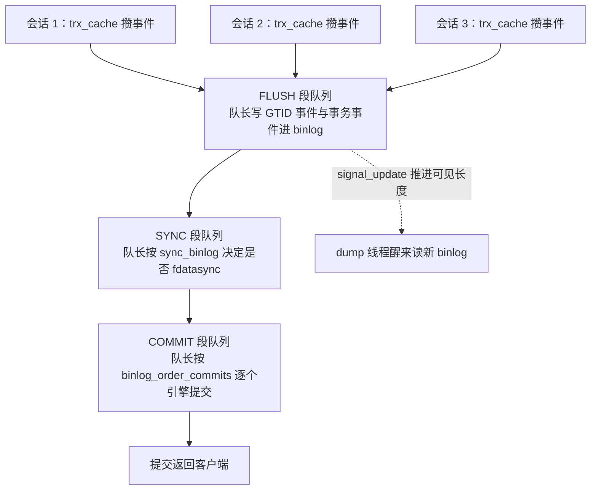
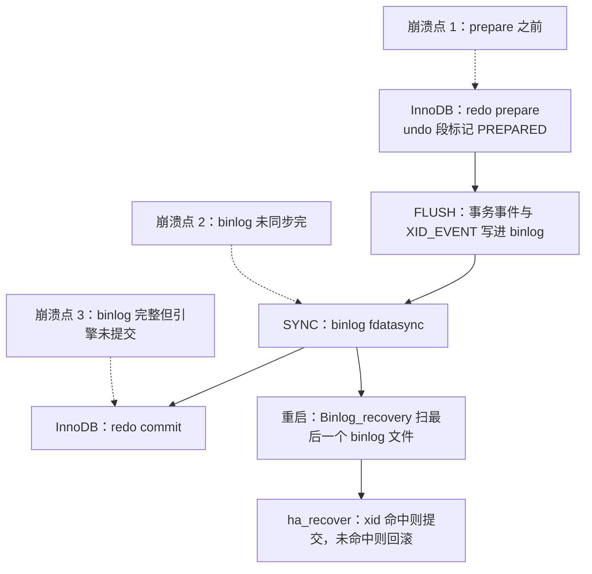
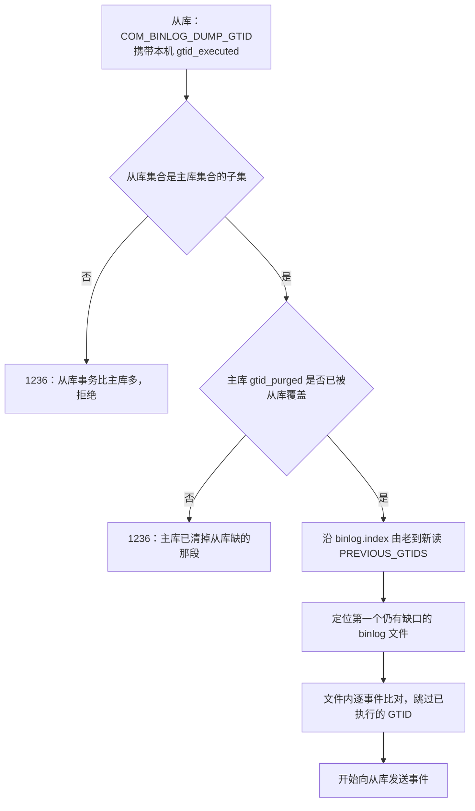
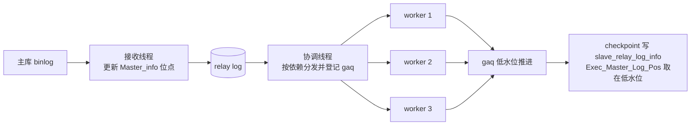
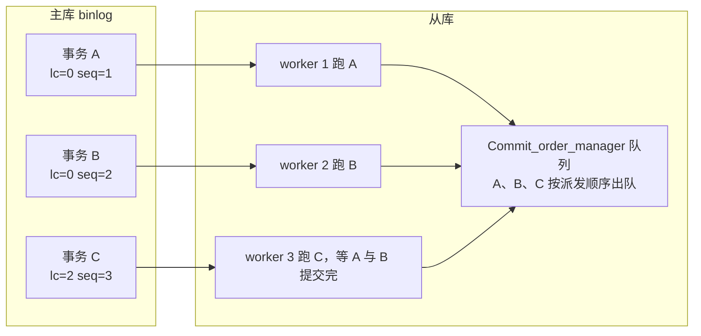

# 第9章 MySQL 高可用实现

**摘要：**

一条 `UPDATE` 提交时，它的 binlog 并没有直接落进文件，而是先在会话私有的 cache 里长大，再由别的线程按批搬进 binlog 文件；同一时刻 InnoDB 已经把这个事务的 redo 置成 `PREPARED`，等在那里，看 binlog 的脸色决定自己该提交还是回滚。这段被反复引用、却很少被写清的流程，是本章要拆的第一块骨架：`session` binlog cache 到 binlog 文件的搬运，以及 `ordered_commit` 里 FLUSH、SYNC、COMMIT 三段流水线。第二块骨架是 GTID 的内核表示——`gtid_executed` 凭什么能用一个区间集合代替位点，`mysql.gtid_executed` 表在从库关掉 binlog 之后又凭什么还能记住"执行过什么"。第三块是从库：`Relay_log_info` 与 `slave_worker_info` 各记一份位点，`LOGICAL_CLOCK` 用主库写进 binlog 的 `last_committed` 与 `sequence_number` 判断两个事务能不能并行，而 `slave_preserve_commit_order` 又把这并行拉回串行提交。第四、五块分别是半同步的 `AFTER_SYNC` 等待点与 `binlog_row_image` 对重放成本的影响——前者决定了崩溃时数据可能停在哪一边，后者决定了重放一条更新要扫多少行。把这些拼起来，能回答三个具体问题：崩溃发生在提交链路的哪一格时，事务究竟会被提交还是回滚；从库的并行度是谁算出来的、为什么有时加 worker 也没用；半同步的 ACK 到底保证到了哪一步。全篇只写复制链路上的内核数据结构与算法，演进史、运行期延迟定位与高可用选型分别留给另外三篇。

---

本篇只写复制链路上的内核数据结构与算法；复制的演进史与各版本取舍见 [[中间件/MySQL/读书笔记-Mysql内核架构/13. MySQL 主从复制：从异步到 WriteSet 的并行进化史|读书笔记 13]]，延迟与不一致的运行期定位见 [[中间件/MySQL/MySQL架构与底层原理/10 Binlog 与主从复制——数据同步的底层传动链|架构列 10]]，高可用方案怎么选见 [[中间件/MySQL/MySQL进阶使用/10 MySQL 高可用方案选型——从主从到 InnoDB Cluster|进阶列 10]]。版本口径以 MySQL 8.0 为准，涉及 5.7 的差异单独标注；8.0.26 之后 `slave_*` 系列变量与语句陆续改名 `replica_*`，`CHANGE MASTER TO` 对应 `CHANGE REPLICATION SOURCE TO`，下文统一用新名，旧名只在首次出现时括注一次。

## 9.1.1 binlog 不是在提交时写进去的

初学者对 binlog 通常有两种想象，两种都不对。一种把它当成 redo log 的兄弟，以为事务提交时 binlog 缓冲区被就地刷进磁盘；另一种把它当成一张流水账，以为每条语句执行完就追加一行。真实的结构是三层：事务执行期间产生的事件写进当前会话私有的 binlog cache，提交时才由组提交的队长线程把这个 cache 的内容整段搬进 binlog 文件，文件再用 `fsync` 落到磁盘。

这个三段结构解释了很多"看起来莫名其妙"的现象。为什么一个执行了十分钟、写了几百万行的大事务，在提交那一刻才突然卡住——因为它的 binlog cache 一直在内存或者临时文件里，提交时才需要一次性搬进 binlog 文件并做同步；为什么 `binlog_cache_size` 调小之后磁盘 IO 反而上升——因为超过这个阈值，cache 会溢出到 `tmpdir` 下的临时文件，写事件变成了"先写临时文件、再读出来写进 binlog"的两趟；为什么从库只能看到完整的事务、看不到执行到一半的行事件——dump 线程读的是 binlog 文件的可见长度，而文件的可见长度是在 FLUSH 段结束时被推进的。

`THD` 上挂的容器叫 `binlog_cache_mngr`，里面并排放着两个 `binlog_cache_data`：`trx_cache` 收事务型引擎的语句，`stmt_cache` 收非事务语句与自动提交的语句。两者各自持有一个 `IO_CACHE`，初始化时通过 `open_cached_file()` 打开，带上 `MY_TEMPORARY` 标志——这意味着它先当内存缓冲区用，超过容量就悄悄变成临时文件，调用方不用关心切换。默认容量由 `binlog_cache_size` 决定，32 KB。

这也解释了为什么 `Binlog_cache_use` 与 `Binlog_cache_disk_use` 这一对状态变量值得盯。前者统计"用过事务缓存的事务数"，后者统计"用到临时文件的事务数"，两者的比值就是缓存命中率。若 `Binlog_cache_disk_use` 持续增长，说明长事务多、单事务事件量大，32 KB 不够用；但把 `binlog_cache_size` 直接调到几十 MB 是另一种错误——它按会话计上限，五百个连接同时跑大事务就是一笔可观的内存开销；好在 cache 是第一次写事件时才打开、事务结束即释放，真实占用取决于同时活跃的事务数而不是连接总数，所以更稳妥的做法是先看 `Disk_use` 的增长速率再决定。

还有一个容易被忽略的上限是 `max_binlog_cache_size`。它管的是单个事务的缓存总量，一旦超限，事务直接失败，报错信息是 `Multi-statement transaction required more than 'max_binlog_cache_size' bytes of storage`。这条错误在批量 `UPDATE`、大字段写入、`LOAD DATA` 的场景里出现得比想象中频繁，而它和 `binlog_cache_size` 的区别常常被混淆：后者是"内存缓冲多大"，前者是"整笔事务允许多大"，超出后者的后果不是落到磁盘，而是事务报废。

### 四个计数器怎么读

判断写入侧的健康度不需要开 general log，几个状态计数器足够。

| 计数器 | 含义 | 异常读数意味着什么 |
| :--- | :--- | :--- |
| `Binlog_cache_use` | 使用过事务缓存的事务数 | 与提交总数背离时，说明大量语句走了 `stmt_cache` |
| `Binlog_cache_disk_use` | 溢出到临时文件的事务数 | 持续增长说明长事务多，`binlog_cache_size` 偏小 |
| `Binlog_commits` | 写 binlog 的提交次数 | 与业务提交数对比可看出是否被过滤规则挡掉 |
| `Binlog_group_commits` | 组提交的批数 | 与 `Binlog_commits` 的比值就是平均批大小 |

最后一行最有用。两者相除得到平均批大小，若长期接近 1，说明组提交根本没攒起来：可能是并发不足，也可能是 FLUSH 段被某个长事务占住了队长位置——队长不放手，后面的事务进不了文件。

> [!note] 事务压缩发生在哪一段
> 8.0 引入的 `binlog_transaction_compression` 把整个事务的事件按 zstd 压成一个 `Transaction_payload_event`，压缩动作就发生在 FLUSH 段、cache 内容搬进文件的那一刻。因此它对 `binlog_cache_size` 的行为没有影响（cache 里仍是未压缩事件），但会显著改变从库侧的解析路径：重放之前要先把 payload 展开，`Mts_submode_database` 的调度代码里专门有一段 `unfold_transaction_payload_event()` 处理这件事。

## 9.1.2 group commit 的三段流水线

`ordered_commit()` 是这条路线的总入口，它把"提交"拆成 FLUSH、SYNC、COMMIT 三段。调度结构在 8.0 里由 `Commit_stage_manager` 与 `Thread_queue` 承担：每个事务线程进入某一阶段时先 `enter_stage()` 把自己挂到该阶段的队列上，然后判断自己是不是队首；是队首就替整队干活，不是就退到条件变量上等。队首干完这一段的活，`change_stage()` 把整队移交给下一段，同时唤醒队首之外的线程继续去下一段排队。

下面这张图画的是三段之间的数据流与队长的职责。

三段各自解决一个不同的问题，混在一起讲就会失真。

FLUSH 段解决"事务的事件必须成段且有序地进入文件"。队长对队列里每个线程的 cache 调 `write_transaction()`：先在事件最前面写 GTID 事件（或者匿名事务的等价事件），再把 cache 里真实的事件内容追加进去，最后更新文件的可见长度并 `signal_update()`。之所以**必须由一个线程串行做**，是因为多个线程的 cache 要按队列顺序首尾相接，任何交错都会让一个事务的事件被另一个事务打断，从库就再也解析不出事务边界。

SYNC 段解决"落到磁盘"这件事的批量化。`sync_binlog=1` 表示每次提交都要 `fdatasync`；`sync_binlog=N` 表示累计 N 次写再同步一次；`sync_binlog=0` 则完全交给操作系统。真正昂贵的是 `fdatasync` 本身——一次磁盘同步的耗时不随写入量线性增长，于是"攒够一批再同步"的收益极大，这就是组提交存在的根本理由。

COMMIT 段解决"引擎侧的提交"。队长在这里对队列里的事务逐个调 `ha_commit_low()`，InnoDB 的 `trx_commit` 把 redo 的提交标记写下、释放锁、清理 undo。`binlog_order_commits`（默认 ON）决定这一段的串行程度：ON 时提交顺序严格等于 binlog 写入顺序，OFF 时各线程在 SYNC 之后各自提交，引擎可见顺序可能与 binlog 顺序不一致。

| 阶段 | 谁在做 | 做的事情 | 出错后的语义 |
| :--- | :--- | :--- | :--- |
| FLUSH | 队首线程 | 写 GTID 事件、搬 cache 内容、推进可见长度 | 整队报错，事务回滚，binlog 不前进 |
| SYNC | 队首线程 | 按 `sync_binlog` 计数决定 `fdatasync` | 报错，事务回滚，但已写文件的部分留下截断 |
| COMMIT | 队首线程 | 逐个 `ha_commit_low()`，释放锁与 undo | 单个事务可能"binlog 已写、引擎未提交"，交给恢复处理 |

### 攒批的两个旋钮

`binlog_group_commit_sync_delay` 与 `binlog_group_commit_sync_no_delay_count` 是专门为攒批加的旋钮，前者让 SYNC 段的队长在同步之前故意睡一会儿，后者给这个睡眠设一个提前结束的条件。

- `binlog_group_commit_sync_delay`：单位是微秒，默认 0，上限 1000000（1 秒）。设为 1000 表示队长在 `fdatasync` 前等 1 毫秒，等这 1 毫秒里新来的事务进入 SYNC 队列，一并同步。
- `binlog_group_commit_sync_no_delay_count`：默认 0，上限 100000。当 SYNC 队列里已经攒到这么多事务时立即结束等待，不再睡满。

这两个参数的设计意图可以从名字读出来：**用延迟换同步次数**。它们只在真的需要 fsync 的场合有意义——如果 `sync_binlog=0`，SYNC 段没有磁盘同步可攒，睡眠只是白白增加提交延迟；如果负载本身很轻，`sync_delay` 设得再大也攒不到第二个事务，效果是"每个事务固定多等一个 delay"。

| 参数 | 默认值 | 调大的代价 | 调小的代价 |
| :--- | :--- | :--- | :--- |
| `binlog_cache_size` | 32768 | 每会话预留内存上升，长事务减少临时文件 | 大事务溢写 tmpdir，binlog 写入多一趟 IO |
| `max_binlog_cache_size` | 平台上限 | 单个超大事务可能吃光 tmpdir | 大事务直接报 `ER_TRANS_CACHE_FULL` |
| `sync_binlog` | 1 | 值越大丢 binlog 的窗口越大，主从可能分叉 | 恢复为 1 时每次提交一次 fsync，写吞吐下降 |
| `binlog_group_commit_sync_delay` | 0 | 提交延迟上升，低并发时纯亏 | 批变小，fsync 次数上升 |
| `binlog_group_commit_sync_no_delay_count` | 0 | 高并发下攒批被打断，收益变小 | 队列容易长时间等满 delay |
| `binlog_order_commits` | ON | 关掉后提交并行，但引擎可见顺序与 binlog 顺序脱钩 | 保持 ON 时提交串行，吞吐受提交耗时限制 |

## 9.1.3 两阶段提交：崩溃插在哪一格

binlog 与 InnoDB 之间没有共享的事务管理器，两者靠一套类似 X/Open XA 的两阶段提交绑在一起。顺序是：InnoDB 把 redo 写成 `PREPARED`、undo 段标记为 prepared、事务的 xid 挂到引擎的待恢复列表上；接着 Server 层把事务事件与 `XID_EVENT` 写进 binlog 并同步；最后才回到引擎，把 redo 的提交标记写下。中间任何一步都可能崩，而崩溃之后的**判断权不在 InnoDB 手里**。

关键在于恢复路径的顺序。启动时 binlog 侧先跑自己的恢复：`binlog::Binlog_recovery` 打开**最后一个** binlog 文件，从头扫到尾，把遇到的 `XID_EVENT` 里的 xid 收集成一个 `Xid_commit_list`，遇到文件尾部不完整的事件就当作截断处理（源码里的状态是 `truncated`，不算 malformed）；扫完之后调 `ha_recover(&m_internal_xids, &xa_list)`，把这个列表交给所有存储引擎。InnoDB 把自己处于 prepared 状态的事务逐个拿出来比对：xid 在列表里的提交，不在列表里的回滚。

下面这张图把三个崩溃点标在顺序上。

三种情形摊开看：

| 崩溃点 | binlog 状态 | 引擎状态 | 恢复动作 | 客户端看到的结果 |
| :--- | :--- | :--- | :--- | :--- |
| prepare 之前 | 无该事务事件 | 未 prepare | 无事务可恢复 | 失败或连接断开，数据未写 |
| prepare 之后、binlog 同步之前 | 尾部残缺或没有 `XID_EVENT` | prepared | xid 不在列表，回滚 | 失败，数据未写 |
| binlog 完整、引擎未提交 | 有完整 `XID_EVENT` | prepared | xid 命中列表，提交 | 可能报错，但数据已提交 |
| 引擎已提交 | 完整 | 已提交 | 无需恢复 | 成功 |

第三行是最反直觉的一格：客户端拿到的是超时或连接中断，按常理应该当作失败处理，但数据的命运是"已提交"。业务侧如果按"报错就当没写"来重试，就会写出重复数据。这也是为什么应用层处理提交超时只能走"查一下到底有没有"这条路，而不能凭返回值判断。

而"binlog 完整"这个判据本身有两层含义。第一层是这个事务的 `XID_EVENT` 确实落在文件里；第二层是文件尾部没有半截事件——如果有，恢复会把它截掉，但截断只影响被截掉的那一段，已经完整落盘的 `XID_EVENT` 不受牵连。所以真正决定命运的是第一层，事务自己的 `XID_EVENT` 就是它的结束标记。

> [!warning] 只扫最后一个文件，不是偷懒
> 前面的 binlog 文件里的所有事务，要么已经被当时的崩溃恢复处理过，要么已经不可能是"半个事务"——它们早已被关闭、轮转、结算完毕。只有最后一个文件才有"事务写到一半"的可能，所以 `Binlog_recovery` 只认最后一个文件。这也意味着 `PURGE BINARY LOGS` 与"从库还缺不缺"是两件互不相关的事。

### 持久化的四种组合

两阶段提交保证的是 binlog 与引擎之间的一致性，不是持久性。持久性由两个参数各自的取值组合决定，`innodb_flush_log_at_trx_commit` 管 redo 的刷盘时机，`sync_binlog` 管 binlog 的刷盘时机。

| redo / binlog | commit 时的动作 | 掉电可能丢什么 | 一致性 | 取向 |
| :--- | :--- | :--- | :--- | :--- |
| 1 / 1 | redo fsync，binlog fsync | 不丢已经返回成功的提交 | 最强，推荐搭配 | 金融、账务 |
| 1 / 0 | redo fsync，binlog 交操作系统 | binlog 尾部若干事务（引擎已提交、binlog 没有） | 单机一致，主从可能分叉 | 从库可整库重建时 |
| 0 / 1 | binlog fsync，redo 每秒刷 | redo 尾部（引擎可能回滚、binlog 已记） | 反向分叉，最难收拾 | 导入、可重建数据 |
| 0 / 0 | 两者都交操作系统 | redo 与 binlog 各自丢一段 | 不可预期 | 一次性任务 |

表里最容易被低估的是第三行。`innodb_flush_log_at_trx_commit=0` 配 `sync_binlog=1` 时，binlog 每条都落了盘，redo 却在一秒一次的刷盘节奏里，崩溃丢掉 redo 之后引擎里可能根本没有这个事务，而 binlog 里躺着完整的 `XID_EVENT`。恢复时 `ha_recover` 找不到对应的 prepared 事务，这条 binlog 记录就无人认领；从库按 binlog 把它执行了，主库的数据页里却没有——两边朝相反方向分叉，而且这种分叉不会自动收敛。所以官方推荐永远是这一对都设 1，其中任何一边退让，都要求你先想清楚退让之后"谁是权威"这个问题。

## 9.1.4 GTID 的内核表示

GTID 的文本形式 `uuid:1-100:105:200-300` 看上去像一个编号列表，内核里它是"SID 到区间链表"的映射。`Gtid_set` 持有 `Sid_map`，把 16 字节的 UUID 映射成 sidno，然后按 sidno 存一条 `Interval` 链表——每个 `Interval` 只有 `start` 和 `end` 两个 gno，链表按 gno 递增有序。因此一个执行过一亿个事务的主库，描述它全部执行历史的 `Gtid_set` 可能只有几十个节点，而不是一亿条记录；譬如同一次组提交里连着写下的两百个事务，在集合里就是一个 `200-399` 的区间。

区间是有上界的，`GNO_END` 等于 `INT64_MAX`，也就是说单个 uuid 的事务编号空间近乎无限，真正的限制在 `Interval` 节点数量与集合运算的复杂度上。文本输出时，单点区间打印成一个数字，连续区间打印成 `a-b`，相邻与重叠区间会被合并——这条"规范化"不变量很重要，它保证同一个集合只有一种文本形式，也保证 `is_subset()` 之类的运算可以退化成区间链表的有序归并。

`Gtid_state` 里并排放着五个集合，搞混它们是读复制源码时最常见的迷路方式。

| 集合 | 对应变量或用途 | 含义 |
| :--- | :--- | :--- |
| `executed_gtids` | `gtid_executed` | 本机执行过的全部 GTID，含已清理的 |
| `lost_gtids` | `gtid_purged` | `executed_gtids` 里 binlog 已被清掉的那部分 |
| `owned_gtids` | 无对外变量 | 已分配但尚未提交的 GTID，正在执行的事务占着它们 |
| `gtids_only_in_table` | 无对外变量 | 只写进了 `mysql.gtid_executed` 表、没进过 binlog 的部分 |
| `previous_gtids_logged` | 无对外变量 | 已经写进 binlog 的 `PREVIOUS_GTIDS` 事件的那部分 |

`gtid_purged` 与 `gtid_executed` 的关系因此是包含而不是并列：`gtid_purged` 是子集，清理得越多子集越大，最终可能等于全集。这也决定了 `SET GLOBAL gtid_purged` 只能在 `gtid_executed` 为空时设置——否则无法保证子集关系。从备份重建从库的标准动作正是利用这一点：先 `RESET MASTER` 清空执行历史，再设 `gtid_purged` 为备份时刻的集合，让从库的"已执行"与主库对齐。

`owned_gtids` 的作用则体现在事务进行中的那段时间。事务拿到 GTID 之后、提交之前，这个编号归它独占，既不在 `executed_gtids` 里，也不会被第二个事务拿走。因此主库上一个跑十分钟的大事务，期间它占住的那个 gno 在 `gtid_executed` 里是空缺的；如果它最终回滚，这个编号被释放但不会回收，空洞就永久留在集合里。这说明"集合里有洞"本身并不指向故障，把洞读成"事务被跳过"是常见的过度解读，真正的判据要拿主库的集合做对照。

### 为什么需要 `mysql.gtid_executed` 表

GTID 模式最初的假设是"每个实例都开着 binlog"，执行的 GTID 就记录在 binlog 里，靠 `PREVIOUS_GTIDS` 事件串起来。这个假设在两种部署里不成立：从库用 `log_replica_updates=OFF` 不写 binlog，只做重放；或者干脆不给从库开 `log_bin`。此时 GTID 没有一个自然载体，`gtid_executed` 就会在重启后归零，从库再连主库时会发生"全部事务都重新要一遍"的灾难。

`mysql.gtid_executed` 就是为此存在的持久化位置。表结构只有三列：`source_uuid CHAR(36)`、`interval_start BIGINT`、`interval_end BIGINT`，每个 uuid 一行或多行区间。写入时机不是每个事务一行，而是按事务提交时的 GTID 做区间合并，所以表的行数远小于事务数；它在 8.0 里还需要定期压缩，早期的 `gtid_executed_compression_period` 参数控制压缩周期，后续版本把它弃用、改为自动触发，具体行为以对应版本文档为准。

这张表还有一个容易忽略的语义：它可以在 binlog 关闭的情况下独立维护执行历史，因此"从库的 GTID 位置"不必依赖 relay log 或 binlog 是否完整。`RESET MASTER` 会清空 binlog，但 `gtid_executed` 全局变量与这张表不会因此归零——这正是把位点从"文件偏移"升级成"集合"之后必须付出的对应设计。

### `gtid_next` 的两种取值

会话变量 `gtid_next` 决定下一个事务用哪个 GTID。`AUTOMATIC` 是默认值，服务端从本机 `server_uuid` 对应的 gno 空间里递增分配；显式指定 `uuid:gno` 则跳过分配，用给定的值。

显式取值在复制链路上有两个不可替代的用途。一是从库重放：重放一个事务之前，`SQL_THREAD`（或 MTS 的协调线程）把 `gtid_next` 设成这个事务在 GTID 事件里的值，于是从库记录下来的 GTID 与主库逐位一致，切换之后才能互相认账。二是人工跳过：把 `gtid_next` 设成某个 GTID，然后执行一个空事务（`BEGIN` 后直接 `COMMIT`），这个 GTID 就进入 `gtid_executed`，原事务不会再被索要。

显式取值的副作用是它可以在集合里造洞。设 `uuid:100` 之后，`uuid:99` 依然空缺，`gtid_executed` 的区间链表里就出现了 `1-98:100` 这样的形状。造出来的洞和并发回滚留下的洞在集合上长得一模一样，区分办法是拿主库的集合作对照：主库上同位置也有洞，那是回滚；只有这台机器上有洞而主库连续，那才是注入、`gtid_purged` 设错或者历史拼接留下的痕迹。

### `GTID_SUBSET` 与 `GTID_SUBTRACT`

这两个函数是 GTID 集合运算的 SQL 出口。`GTID_SUBSET(s1, s2)` 返回 1 表示 `s1` 是 `s2` 的子集，0 表示不是，任一参数为 NULL 时返回 NULL；`GTID_SUBTRACT(s1, s2)` 返回 `s1` 里不属于 `s2` 的 GTID，任一为 NULL 时返回 NULL。

实现语义在 `Gtid_set` 里：`is_subset()` 按 sidno 遍历两条有序区间链表，用 `is_interval_subset()` 判断"子集的每个区间是否被超集的若干区间覆盖"，复杂度是区间数量的线性归并；`subtract()` 走同一套归并，把被覆盖的部分切掉、剩下的拼回一条新链表。这里没有**把集合展开成事务编号**的动作——否则一个执行了几十亿事务的实例，光比较一次就要遍历几十亿个编号。理解这一点之后，`GTID_SUBTRACT` 在超大实例上依然是常数级操作就不奇怪了。

`auto_position` 的握手就是这两个函数的内核版本。

两条拒绝路径分别对应两种现场事故。第一种是"从库比主库多"——典型于主从切换后把旧主降级成从库，旧主上还留着新主没有的事务，此时必须先处理掉多出来的部分；第二种是"主库已经清掉"——典型于从库离线太久，缺口掉进了 `gtid_purged` 的区间里，除了重建没有第二条路。

判断从库到底"缺"还是"跳过"，看两个变量再加一步对照：`Retrieved_Gtid_Set` 是接收线程已经收下来的集合，`Executed_Gtid_Set` 是执行历史。两者差集非空，说明只是还没追完，属于正常延迟。

区间里有洞则要分三种情况。第一种是主库自己的集合上就有同一个洞——那多半是并发下的事务回滚：事务 A 拿到 gno 5、事务 B 拿到 6，A 回滚之后 5 就永久空缺，因为编号不会回收。这种洞从主库生成 binlog 时就不存在，从库当然也复现出来，它什么也不说明。第二种是主库连续、从库有洞，且 `Retrieved_Gtid_Set` 覆盖了那个 gno——说明事件收到过却没执行，这是真的被跳过了。第三种是两边都连续、只有 `Retrieved` 与 `Executed` 之间差了一段，那是追赶速度问题，不是数据问题。

这套判据比看秒数可靠得多，因为秒数只回答"离上一次事件多久"，不回答"中间有没有漏"。

## 9.1.5 从库的三个线程与两份位点

从库的线程结构在实现上比描述里复杂一层。接收线程（`IO_THREAD`，即 receiver）连主库、把事件追加到 relay log、更新自己在主库上的位点；协调线程（原 `SQL_THREAD`，开启并行后原地变成 coordinator）从 relay log 读事件、按依赖关系分发；worker 线程组执行真正的事务。启动之后在 `SHOW PROCESSLIST` 里能看到它们分别停在与"等主库发事件""等协调线程派活""等 worker 释放队列"对应的状态上。

位点其实有**两套，各管一段**。`Master_info` 记的是"我从主库拿到了哪里"，对外表现为 `Read_Master_Log_Pos` 与 `Retrieved_Gtid_Set`；`Relay_log_info` 记的是"我执行到了哪里"，对外表现为 `Relay_Log_Pos`、`Exec_Master_Log_Pos`、`Executed_Gtid_Set`。两者各自持久化到 `mysql.slave_master_info` 与 `mysql.slave_relay_log_info`（8.0 默认 `master_info_repository=TABLE`），写入周期由 `sync_source_info` 与相关参数控制，默认都不是每次事件都落盘。

`Relay_log_info` 里的字段值得逐个看，因为它们决定了崩溃之后从哪里重来。

| 字段 | 含义 | 崩溃恢复时的作用 |
| :--- | :--- | :--- |
| `group_relay_log_name` / `group_relay_log_pos` | 当前事务组在 relay log 里的起点 | 事务型的组只能退回组边界重放 |
| `event_relay_log_pos` | 当前正在应用的事件位置 | 非事务语句与 DDL 的恢复锚点 |
| `future_event_relay_log_pos` | 下一个事件的预读位置 | 由 `inc_event_relay_log_pos()` 推进 |
| `gaq` | 按 `sequence_number` 索引的组分派表 | 记录每个组分给了哪个 worker |
| `checkpoint_group` | 一次 checkpoint 覆盖的最大事务数 | 默认 512，决定位点推进的粒度 |
| `current_mts_submode` | 当前调度策略对象 | 决定分发走库名还是走 `last_committed` |
| `commit_order_mngr` | 提交顺序管理器 | 保证提交顺序与主库一致 |

worker 那边不是"另有一套结构"，而是一个继承关系：`Slave_worker` 继承自 `Relay_log_info`，每个 worker 都持有一份完整的位点信息，只是不对外展示。持久化到 `mysql.slave_worker_info` 的是每个 worker 的 `Checkpoint_relay_log_name`、`Checkpoint_relay_log_pos`、`Checkpoint_seqno` 与一组 bitmap（`Checkpoint_group_bitmap`）。bitmap 的作用是记住"这一组事务里哪些 worker 已经完成"，恢复时按它把各 worker 的状态推到一个一致的边界上，而不是把整组重放一遍。

relay log 本身不必依赖 fsync 保证完整。8.0 的 `relay_log_recovery` 默认开启，启动时丢弃本地 relay log，让接收线程重新从主库拉取，执行位点由 `mysql.slave_relay_log_info` 里的值决定。这样 relay log 的损坏只是一个"重新下载"的问题，不是数据完整性问题；`sync_relay_log` 默认 10000（每万个事件同步一次）也就不再是风险点。

它与主库 binlog 的差异值得列成一张表，因为很多人把两者当成同一种东西。

| 维度 | 主库 binlog | 从库 relay log |
| :--- | :--- | :--- |
| 写入者 | 组提交的队长线程 | 接收线程 |
| 内容来源 | 会话 binlog cache | 主库 dump 线程发来的事件流 |
| 清理策略 | 按 `binlog_expire_logs_seconds` 到期清理 | `relay_log_purge` 开启时随应用进度清理 |
| 损坏后的后果 | 复制缺口，可能需要重建从库 | 丢弃重下，前提是 `relay_log_recovery` 开启 |
| 位点权威 | 文件名加偏移，或 GTID 集合 | 由 `Relay_log_info` 持有，主库并不知道 |

表格最后一行说的是位点权威：主库从不记录"某个从库读到哪了"。这既是 MySQL 复制的轻量之处，也是保留期问题的根源——清理逻辑没有任何来自从库的反馈。

下面这张图画的是位点在三个线程之间的流向。

### 链路另一端：dump 线程

主库的发送逻辑常被忽略，但延迟在下游看起来是什么形状，由它决定。收到 `COM_BINLOG_DUMP` 或 `COM_BINLOG_DUMP_GTID` 之后，主库创建一个 binlog sender 线程（底层仍是 `THD`），由 `Binlog_sender` 驱动读文件、解析、按事件发送。

发送的边界不是文件长度，而是 `atomic_binlog_end_pos`——FLUSH 段结束时由 `update_binlog_end_pos()` 推进的那个可见长度。sender 读到这个位置不能收工，因为主库随时可能有新事务；它会挂到 `MYSQL_BIN_LOG` 的条件变量上等，由 `signal_update()` 唤醒。所谓"从库没事干时阻塞在网络读上"，真实机制是条件变量加超时，不是轮询。

超时之外还有心跳。`master_heartbeat_period` 决定主库空闲时多久发一个 `HEARTBEAT_EVENT`，这个事件不进 relay log，从库收到只更新接收时间与位点，作用是证明链路还活着，同时为延迟计算提供参照点。它带来一个判读上的副作用：心跳足够频繁时，`Last_IO_Error` 为空、位点也在动，但主库可能一个业务事务都没产生。

| 现象 | 内核里的位置 | 该怎么读 |
| :--- | :--- | :--- |
| `Read_Master_Log_Pos` 长时间不动 | sender 停在 `atomic_binlog_end_pos` 上等条件变量 | 主库没有新事务，或 sender 已被 kill |
| 位点按 `master_heartbeat_period` 节奏跳 | 心跳事件更新的接收位点 | 链路空闲，不是延迟 |
| `Read_Master_Log_Pos` 在动而 `Exec_Master_Log_Pos` 不动 | 接收侧正常，协调线程或 worker 卡住 | 看 worker 状态与 `Last_SQL_Errno` |

## 9.1.6 LOGICAL_CLOCK：依赖在主库算好

并行复制最关键的一点，也是最容易搞反的一点：**并行与否由主库算定**。主库在写每个事务的 GTID 事件时，往事件头里塞两个 64 位整数——`sequence_number` 与 `last_committed`。8.0 里这一步发生在 `write_transaction()`，由 `Transaction_dependency_tracker::get_dependency()` 一次算出这两个值；5.7 的事件布局相同，取值时机略有差别，不影响语义。

`sequence_number` 是全局单调自增的序号，每个事务取一个，同一批提交里每个事务的序号都不同。`last_committed` 表示"这个事务依赖到哪个序号为止"，语义上是一个前驱指针：序号小于等于 `last_committed` 的事务必须都提交之后，本事务才能开始。于是判断两个事务能否并行有了直接依据——`last_committed` 相同的事务互为兄弟，谁也不依赖谁，可以在从库上同时跑；`last_committed` 不同的事务是父子关系，子必须等父。

`COMMIT_ORDER` 模式下，`last_committed` 直接取"上一批提交里最后一个事务的序号"。同一批里的事务共享同一个 `last_committed`，所以并行度等于组提交的批大小；批越小、并发越低，并行度越接近 1。

`WRITESET` 模式改写了这个值。主库为每个事务计算一个写集——把主键与唯一键的值按"索引名 + 库名 + 表名 + 值"的形式拼成字符串再哈希，每个元素唯一确定一行。然后在历史表里查这些元素最近被哪个序号的事务碰过，取其中最大的序号作为自己的 `last_committed`；如果一个都没查到，就把 `last_committed` 取成历史表的下界（源码里是 `m_writeset_history_start`），意思是"我不依赖任何近期事务"。历史表的容量由 `binlog_transaction_dependency_history_size` 控制，默认 25000 条，上限 1000000。

这个改动为什么有效，可以从批大小的角度理解。组提交的批要求各事务几乎同时提交，这在低并发下根本凑不出来；写集判断则没有时间上的约束——只要两个事务没碰同一行，哪怕它们隔了几十毫秒，`last_committed` 也能一样低。**瓶颈从批次换成冲突**，后者通常大得多。

| 跟踪模式 | `last_committed` 取值 | 并行度来源 | 前置条件 |
| :--- | :--- | :--- | :--- |
| `COMMIT_ORDER` | 上一批最后事务的序号 | 组提交的批大小 | 无额外条件，默认模式 |
| `WRITESET` | 与本事务写集冲突的最近序号 | 不冲突事务的并发规模 | 行有主键或唯一键，写集提取未关闭 |
| `WRITESET_SESSION` | 上述值与同会话上一事务序号的较大者 | 同上，但同会话串行 | 同上，另需承受会话内串行 |

`WRITESET_SESSION` 的存在原因值得一说。同一会话里的事务之间存在一些 binlog 看不见的依赖：临时表、会话变量、用户自己假定的执行顺序。若放任它们并行，从库上可能出现"同一个连接先后执行的两次更新被倒序应用"。把同会话事务的 `last_committed` 抬到上一事务的序号上，就把这条隐式依赖显式化了。

版本差异在这里必须点明：5.7.22 backport 写集能力时，还得把 `transaction_write_set_extraction` 设成 `XXHASH64`（5.7 默认 OFF）；8.0 这个变量的默认值已经是 `XXHASH64`（变量仍在但已废弃），光靠 `binlog_transaction_dependency_tracking` 就能切换。反过来，如果有人把 `transaction_write_set_extraction` 关掉又去设 `WRITESET`，服务端会直接报 `ER_WRONG_USAGE` 拒绝——源码里的检查就是这么写的。

### 从库怎么用它

协调线程读到 GTID 事件，取出 `last_committed`，再和自己维护的低水位比较。低水位是"已完成组的最小序号"，由 `gaq` 的低水位推进得到；只要 `last_committed` 不大于低水位，说明依赖的前驱全都提交完了，可以立刻挑一个空闲 worker 派下去；否则协调线程会调 `wait_for_last_committed_trx()` 阻塞自己，等 worker 提交时通过 `logical_clock_cond` 唤醒。比较时 `SEQ_UNINIT` 被视作最小值（`clock_leq()` 里专门处理了这一情形），因为某些事务没有可用的逻辑时间戳。

这条路径带来了一个反直觉的结果：从库执行的先后顺序与主库的提交顺序**不必**一致，只要依赖关系成立。同一批里的三个事务可能被三个 worker 以任意顺序完成，因为按定义它们互不冲突。

### `slave_preserve_commit_order` 把顺序拉回来

问题在于"互不冲突"只对数据库成立，对业务不一定成立。从库如果还开着 binlog 供下游订阅，或者有应用直接在从库上读，那么提交顺序不一致会带来麻烦：下游按顺序消费时会看到两个事务的次序颠倒，读到中间态。`replica_preserve_commit_order`（旧名 `slave_preserve_commit_order`，8.0 默认 ON）就是为这个场景准备的。

实现是 `Commit_order_manager`，一句话概括就是**执行并行、提交串行**：协调线程把事务派给 worker 时，把该 worker 挂进一个按派发顺序排列的队列；worker 执行完准备提交时，先看自己是不是队首，不是就等，是才提交并出队。于是执行阶段完全并行，提交阶段严格串行，且串行顺序恰好等于协调线程的派发顺序，也就等于主库 binlog 的写入顺序。

这条保证的代价是被迫的串行点。若某一批里有一个长事务，后面的 worker 即使早就跑完也要卡在提交队列里等它；worker 在等的时候占着队列槽位，协调线程可能因为队列满而暂停派发，最终并行度被拖回到接近 1。这就是"并行度上不去"的常见解释之一，而且它和 worker 数量无关——加 worker 只会让更多线程陪着一起等。

### 并行度上不去的五条判据

第一条，看 `last_committed` 的分布。用 `mysqlbinlog` 解析主库 binlog，GTID 事件那一行会带 `last_committed=` 与 `sequence_number=`，统计同一个 `last_committed` 值出现的次数，就是那一批实际可并行的事务数。若绝大多数取值只出现一次，说明并行度本来就是 1，从库再调也调不出来。

第二条，看跟踪模式是不是默认的 `COMMIT_ORDER`。这是 8.0 的默认值，很多人没改过就在抱怨并行度低；改成 `WRITESET` 之后并行度往往有明显变化，前提是行上有主键或唯一键。

第三条，看写集是否真的算得出来。没有主键也没有唯一键的表，行无法被唯一定位，写集元素落空，这类事务的 `last_committed` 会退回到 `COMMIT_ORDER` 的语义。大表没有主键的库，开 `WRITESET` 的效果接近于零。

第四条，看 worker 的实际占用。`performance_schema.replication_applier_status_by_worker` 里若大量 worker 的 `APPLYING_TRANSACTION` 为空而 `replica_parallel_workers` 设得很大，说明协调线程没东西可分，问题在依赖串行而不是 worker 不够。

第五条，看提交侧。`replica_preserve_commit_order=ON` 时提交串行，若从库的 `sync_binlog` 或 redo 同步本身慢，worker 会全挤在提交队列；此时看 `SHOW PROCESSLIST` 会发现 worker 的状态停在等待提交而不是等待派活，瓶颈在磁盘而不在调度。

还有一条不归属于任何参数的硬约束：单个事务永远只能在一个 worker 上执行。一个跑十分钟的大事务，期间其余 worker 可能都在空转，这是并行复制无法绕过的天花板。

### 库名模式为什么退场

5.6 的并行粒度是库名，实现留在 `Mts_submode_database` 里，至今仍可切换过去。协调线程解析 `TABLE_MAP_EVENT` 取到库名，在全局哈希表里查这个库绑定的 worker，查不到就调 `get_least_occupied_worker()` 挑一个当前事务最少的 worker 绑上去，此后该库的事务固定发给这个 worker。

它的缺陷是结构性的。并行度上限等于"同时有写操作的库的数量"，单库业务恒为 1；分了库之后热点库依然把事务串在同一个 worker 上。更麻烦的是它依赖 `TABLE_MAP_EVENT` 提供库名，纯 `QUERY_EVENT` 的事务没有库名可比，只能退回串行。`LOGICAL_CLOCK` 之所以能取代它，本质是把"并行的判据"从库这个粗粒度容器换成了事务之间的真实依赖，而依赖信息恰好可以随 binlog 一起传过去。8.0 已将 `replica_parallel_type` 标记废弃、默认值固定为 `LOGICAL_CLOCK`，库名模式只剩兼容价值。

## 9.1.7 半同步：ACK 到底保证什么

半同步插件挂在几个观察者钩子上，钩子的位置决定了"等"发生在哪一刻。`Binlog_storage_observer` 的 `after_flush` 钩子对应 `writeTranxInBinlog()`，把当前事务的结束位点记下来，供 dump 线程决定在哪个事件上打 ACK 标记；`after_sync` 钩子对应 `repl_semi_report_binlog_sync()`，只有 `wait_point=AFTER_SYNC` 时才在钩子里调 `commitTrx()` 等待；`Trans_observer` 的 `after_commit` 钩子对应 `repl_semi_report_commit()`，`wait_point=AFTER_COMMIT` 时在这里等。

两个等待点的差别可以用一句话概括：AFTER_SYNC 在 binlog 同步之后、引擎提交之前等，AFTER_COMMIT 在引擎提交之后等。

| 等待点 | 等待发生在 | 此刻其他会话能否读到事务结果 | 主库崩溃并切换的后果 |
| :--- | :--- | :--- | :--- |
| `AFTER_SYNC` | SYNC 之后、引擎提交之前 | 不能 | 事务要么在从库上、要么整体消失，不会出现"别人读到了但新主没有" |
| `AFTER_COMMIT` | 引擎提交之后 | 能 | 已可见的事务可能只存在于旧主，切换后丢失 |

`AFTER_COMMIT` 的问题不是"可能丢一个事务"这么温和，而是"已经有人看见的数据消失了"。分布式系统里最难补救的状态就是这种：读到过的东西后来不存在，任何基于那次读取做出的后续决策都失去依据。这也是 5.7 起把默认值改成 `AFTER_SYNC` 的原因。

还有一层叠加效应值得单独提。`AFTER_SYNC` 的等待在 SYNC 段，`binlog_group_commit_sync_delay` 的睡眠也在 SYNC 段，两者前后脚：队长先睡满 delay，再做 fsync，fsync 返回后才进入半同步等待。于是单次提交的延迟接近"delay + fsync + 网络往返 + 从库写 relay log"的和。在开了 delay 的实例上，半同步超时阈值要按这个叠加值来估，否则正常的攒批延迟会被误判成从库异常，进而触发一次不必要的降级。

ACK 的通道与 binlog 数据流是分开的。从库启动半同步时会在 dump 连接之外另开一条连接，主库侧由 `Ack_receiver` 线程接收，包体以一个 magic 字节开头，后面跟 8 字节位点与 binlog 文件名；主库在需要确认的事务末事件头部塞一个两字节的同步头（magic 加 flag），从库看到 flag 置位才回 ACK。没置位的事件不回包，这样每个事务只有最后一个事件产生一次网络往返。

超时的处理值得细看，因为它不是一个事务的局部行为，而是一个状态机的切换。`rpl_semi_sync_source_timeout`（默认 10000 毫秒）到点之后，源码走的分支依次是：打印 `ER_SEMISYNC_WAIT_FOR_BINLOG_TIMEDOUT` 警告、`rpl_semi_sync_source_wait_timeouts` 计数加一、`switch_off()` 把 `Rpl_semi_sync_source_status` 置为 OFF，然后放行这个事务。此后所有提交都按异步走，不再等待。要恢复半同步，必须等到某个从库回了一个位点不早于主库上次提交位点的 ACK，`reportReply()` 里比较之后才 `switch_on()`。

这个滞回设计解释了一类现场现象：半同步"闪断"之后，主库会连续一段时间都是异步状态，监控上表现为 `Rpl_semi_sync_source_status` 在两个状态之间跳变、`Rpl_semi_sync_source_no_tx` 持续增长。闪断的触发条件通常是网络抖动或者从库一次长时间的 IO 停顿。

> [!info] AFTER_SYNC 保证的边界
> 它保证的是"**至少一个从库收到了这段 binlog**，并写进了 relay log"。没有保证这段 binlog 被应用，也没有保证它落盘——`sync_relay_log` 默认每 10000 个事件才同步一次，从库自己掉电时仍可能丢掉这段。想把这个缺口也补上，代价是把 `sync_relay_log` 设成 1，等于每个事件一次 fsync。

另外两个参数决定了"等谁"的严格程度。`rpl_semi_sync_source_wait_for_replica_count`（默认 1）要求几个从库确认；`rpl_semi_sync_source_wait_no_replica`（默认 ON）决定"没有从库连上来时是否继续按半同步等"——ON 意味着即使从库全掉线，主库也会等满超时才放行，写入会被拖到超时；OFF 则直接降级。

半同步的部署还有几个前提容易被跳过，它们不写在插件文档的显眼处，但缺一个就会让"半同步"变成心理安慰：

- 从库必须加载接收端插件并把 `rpl_semi_sync_replica_enabled`（旧名 `rpl_semi_sync_slave_enabled`）打开，否则它不会回 ACK，主库永远等到超时。
- 从库的 `relay_log_recovery` 若被关掉，崩溃后的 relay log 可能带着半个事务，ACK 过的位点就不可信了。
- 网络路径上不能有会重排、会攒包的中间设备，ACK 依赖"位点单调前进"的假设。
- 从库的磁盘若比主库慢一个量级，`AFTER_SYNC` 的等待时间会被从库的写 relay log 速度直接决定。

把这四条合起来看，半同步的语义边界就清楚了：它是**是链路确认，不是数据确认**。

## 9.1.8 复制格式与 `binlog_row_image`

`binlog_format` 的三个取值决定了 binlog 里装的是什么。`STATEMENT` 装 SQL 语句，从库重新执行一遍；`ROW` 装行变更的前后镜像，从库按行定位后直接改数据；`MIXED` 在两者之间自动切换，默认走 ROW，碰到不确定的语句退回 STATEMENT。8.0 的默认值是 ROW，STATEMENT 早已不推荐用于有复制拓扑的实例，因为任何非确定性表达式都会让从库算出不同的结果。

`STATEMENT` 的失真不是理论问题。`NOW()`、`CURRENT_USER()`、`UUID()`、`@@server_id` 这类值在主库求值一次、到从库再求一次；`UPDATE ... LIMIT 10` 缺 `ORDER BY` 时两边的扫描顺序可以不同；自增列与 `LAST_INSERT_ID()` 在并发下也可能落到不同的行。这些偏差单条看不出来，几个月之后表现为"某几张表的主从数据对不上"，而 binlog 里没有任何错误可查，只能靠校验工具发现。

ROW 格式下真正影响重放成本的是 `binlog_row_image`。它有三档：`full` 记全部列的前后镜像，`minimal` 前镜像只记能唯一定位行的列、后镜像只记变更列，`noblob` 在 `full` 的基础上跳过未被修改的 BLOB 与 TEXT 列。三档的选择直接决定 binlog 体积与从库定位成本，而这两者方向相反。

| 取值 | 前镜像 | 后镜像 | binlog 体积 | 从库重放成本 | 副作用 |
| :--- | :--- | :--- | :--- | :--- | :--- |
| `full` | 全部列 | 全部列 | 最大 | 有主键时按主键定位，成本最低 | 大字段表 binlog 膨胀 |
| `minimal` | 仅主键等价列 | 仅变更列 | 最小 | 必须能靠主键定位，否则退化 | 下游 CDC 拿不到完整行，无法还原 |
| `noblob` | 除未改 BLOB 外全部列 | 除未改 BLOB 外全部列 | 居中 | 同 `full` | 少量场景仍需 BLOB 全量 |

`minimal` 在前镜像上有一个兜底规则，源码里写得很直接：只有当表存在主键（或非空唯一索引）时，才把前镜像裁剪成主键列；没有主键的表，裁剪条件不成立，前镜像保留整行。这个规则意味着"用 `minimal` 省体积"这件事在无主键表上完全失效，反而叠加了"从库无法靠索引定位"的惩罚。

无主键表在 ROW 格式下的重放是最隐蔽的延迟来源。主库执行一条 `UPDATE t SET pad='x' WHERE id=10`，有主键时从库根据行事件里的主键值做一次索引查找即可；没有主键时，从库必须扫表找匹配行，最坏情况是把整张表读一遍，而且如果前镜像是整行，还要逐列比较才能确认匹配。批量更新是乘法：一万行的更新事件、每行都要扫一遍百万行的表，从库的 IO 与 CPU 会在几分钟内被打满，而主库这边只看到一条普通的 `UPDATE`。

`slave_rows_search_algorithms`（默认 `INDEX_SCAN,HASH_SCAN`）提供了缓解手段：`HASH_SCAN` 会把待匹配的行按前镜像建一个临时哈希，避免对每一行都从头扫表。但它依然需要把表数据读进内存构建哈希，表的规模一大，收益就被内存上限吃掉。根治办法只有一个——**给表加主键**，这一条在复制场景里的价值远高于它在单机查询优化里的价值。

## 9.1.9 位点管理：文件偏移与集合协商

复制起点有两种表达方式。文件偏移式用 `SOURCE_LOG_FILE` 加 `SOURCE_LOG_POS`（旧名 `MASTER_LOG_FILE`/`MASTER_LOG_POS`）直接指向主库 binlog 的某个字节位置；集合式用 `SOURCE_AUTO_POSITION=1`（旧写法 `MASTER_AUTO_POSITION=1`）让双方用 GTID 集合协商。

| 维度 | 文件偏移 | `auto_position=1` |
| :--- | :--- | :--- |
| 记录的信息 | 文件名 + 字节偏移 | `gtid_executed` 集合 |
| 主库轮转后的行为 | 位点失效，需人工更新 | 自动续上 |
| 主从切换 | 需人工算出差异位点补齐 | 自动找缺口 |
| 依赖 binlog 保留期 | 是，且更脆弱 | 是，缺口被清则无法启动 |
| 出错时的判据 | 找不到文件、偏移错位 | 1236，错误信息里带 GTID 集合 |

`auto_position` 把"位点"抽象掉之后，代价转嫁到了保留期上。主库不会因为某个从库落后就暂停清理 binlog，`binlog_expire_logs_seconds`（默认 2592000，即 30 天）一到，`PURGE` 就在启动与 rotate 时执行。从库离线时间超过这个窗口，它缺的事务已经进了 `gtid_purged`，重连时直接吃 1236，除了用备份重建没有第二条路。

这条约束在实践中经常被算错，因为"从库离线"往往不是整段时间都离线：网络抖动导致的反复重连、复制线程被误停后没人发现、机房搬迁时的长时间停机，都可能让某个从库的 `gtid_executed` 停在三十天之前。判断方法很直接：在主库上算 `GTID_SUBTRACT(gtid_executed, 从库集合)`，再判断结果与 `gtid_purged` 是否有交集，有交集就是死局。

`gtid_purged` 的增长在两种动作之后最明显。一是到期自动清理，`PURGE` 在启动与 binlog 轮转时执行，`binlog_expire_logs_seconds` 到点即删；二是人工执行 `PURGE BINARY LOGS TO` 或 `BEFORE`，为省空间一次性砍掉一大段。后者比前者危险得多——它可以在几秒内把某个从库还需要的区间整段抹掉，而且没有任何前置校验会拦住这条命令。`RESET MASTER` 更彻底，它清空全部 binlog、把 `gtid_purged` 抬到等于 `gtid_executed`，等于宣布"所有历史都不可追"，只应该在重建拓扑时使用。

> [!note] 一条可以提前做的检查
> 把 `GTID_SUBTRACT` 的结果与 `gtid_purged` 的交集检查做成定时任务，在主库上跑，能提前几天发现"某台从库马上要掉出保留期"。这件事比事后处理 1236 便宜得多，因为事后只剩下重建一条路。

## 9.1.10 三个读源码时的认知障碍

第一处是 `Relay_log_info` 与 `slave_worker_info` 的关系。它们不是并列的两个结构，而是对象上的继承与持久化上的分行：`Slave_worker` 继承 `Relay_log_info`，每个 worker 都有一份完整的位点对象；落盘时协调线程写 `mysql.slave_relay_log_info` 一行，每个 worker 写 `mysql.slave_worker_info` 一行。`SHOW REPLICA STATUS` 只报协调线程那一行，所以它给出的是低水位，不是任何单个 worker 的当前位置。

第二处是 `last_committed` 的归属。它是主库在写 binlog 时算出来的、写进事件头的值，从库只是读。这意味着从库侧任何参数都改变不了已到达事件的依赖信息——抱怨"从库并行度低"时去调从库参数是南辕北辙，该改的是主库的 `binlog_transaction_dependency_tracking`，以及业务表有没有主键。

第三处是 MTS 的 checkpoint 语义。协调线程推进位点时取的是 `gaq` 的低水位，也就是**最慢那个 worker 的组边界**，不是最快 worker 的位置。`Exec_Master_Log_Pos` 因此天然滞后于实际执行进度，用 `Read_Master_Log_Pos` 减去它得到的差值会偏大；`Seconds_Behind_Master` 用的又是另一个量（最近处理事务的提交时间戳差），三者不是一回事。笔者读这段代码时卡住最久的地方就在这里：先入为主地以为"位点"只有一个，于是把 worker 的进度、协调线程的进度与 `SHOW REPLICA STATUS` 报出来的数字混为一谈。这也解释了为什么并行复制开启后，`SHOW REPLICA STATUS` 的位点会跳着走——`replica_checkpoint_group`（默认 512）与 `replica_checkpoint_period`（默认 300 毫秒）决定了位点每次推进的粒度。

> [!warning] 三条纪律
> 判断从库进度看 `Retrieved_Gtid_Set` 与 `Executed_Gtid_Set` 的差，不看秒数；判断并行度看 `last_committed` 分布，不看 worker 数量；判断顺序一致性看 `replica_preserve_commit_order`，不看 `binlog_order_commits`——后者的作用域只在主库的提交阶段。

## 9.1.11 三则反例

第一则，`replica_preserve_commit_order=OFF` 之后仍期望提交顺序与主库一致。关掉它意味着允许 worker 各自提交，协调线程按依赖派发、worker 按自己的节奏完成，顺序由锁竞争与 IO 延迟决定。后果分两种：从库不开 binlog 时，读到的是"某个中间状态"，业务若在从库上做二次计算会算出错数；从库开 binlog 供下游订阅时，下游看到的顺序与主库不同，按主库顺序设计的幂等逻辑会失效。

第二则，`WRITESET` 没开就抱怨并行度低。8.0 的默认跟踪模式是 `COMMIT_ORDER`，并行度严格等于组提交批大小，低并发业务（每秒几百个事务、提交时间分散）算出来的批大小经常是 1。此时从库有 16 个 worker 也只能用一个，`performance_schema.replication_applier_status_by_worker` 里会看到 15 个 worker 长期空转。改 `binlog_transaction_dependency_tracking=WRITESET` 之后，若并行度还是上不去，才轮到查表有没有主键。

第三则，`auto_position` 配了但 binlog 保留期太短。把 `binlog_expire_logs_seconds` 从 30 天调到 3 天以省空间，同时容忍某台从库偶尔离线一周，这套组合迟早会在一次故障后变成"从库起不来"。保留期的正确算法是：不小于最长允许的从库离线时长，加上处理故障的人为延迟，再加上一段安全余量。

| 反例 | 表面现象 | 根因 | 处置 |
| :--- | :--- | :--- | :--- |
| 关掉 `replica_preserve_commit_order` 后要求顺序一致 | 从库读到中间态、下游消费乱序 | 执行并行、提交由竞争决定 | 要么打开该参数，要么接受乱序并让下游幂等 |
| 开着 `COMMIT_ORDER` 抱怨并行度低 | worker 大量空转、平均批大小接近 1 | `last_committed` 只用组提交边界 | 切 `WRITESET`，并确认表有主键 |
| `auto_position` 配短保留期 | 重连报 1236、错误里带 GTID 区间 | 缺口落进 `gtid_purged` | 用备份重建，没有别的路 |

## 9.1.12 量级判断与常见误判

组提交攒批的收益可以用一个简单模型估出来，这里只给示例推算。设一次 `fdatasync` 的平均耗时为 `t`，忽略其他开销，则每事务独立同步的吞吐上限约为 `1/t`；攒够 `b` 个事务再同步，吞吐上限约为 `b/t`，代价是最早到达的那个事务要等整批凑齐，平均下来相当于多等半个批间隔。若 `t` 取 1 毫秒量级，独立同步的上限是每秒千次提交；`binlog_group_commit_sync_delay` 设 1 毫秒、负载每秒五千次提交时，平均每批约 5 个事务，同步次数降到原来的五分之一。反过来，负载每秒只有两百次提交时，同一个 delay 仍然只能攒到 1 个事务，每个事务白等接近 1 毫秒——这就是低并发下不该开 delay 的原因。

并行度与延迟的关系同样是示例推算。设单个 worker 的回放速率为 `R`，主库写入速率为 `W`，平均可并行组大小为 `g`，则从库的稳态回放能力约为 `g·R`。当 `W > g·R` 时延迟线性增长，增长速度约为 `W - g·R`。取 `R` 为每秒一万事务、`W` 为每秒五万事务、`COMMIT_ORDER` 下 `g=2`，从库每秒只能追两万，每秒积压三万，一小时就是上亿个事务的缺口；把 `g` 提到 10 之后回放能力超过写入速率，缺口才开始收窄。这些数字只用来判断量级与方向，真实环境里 `R` 受行大小、索引数量、磁盘 IO 影响极大。

常见的误判有三条。第一，把 `Exec_Master_Log_Pos` 当成真实执行进度，在并行复制场景下它落后于最快的 worker，据此判断"从库很慢"会误伤。第二，忽略 `Last_IO_Errno` 与 `Last_SQL_Errno` 的区别，前者是网络与认证层的问题，后者是重放冲突，两者的处置完全不同。第三，以为半同步就等于强一致——它只在"至少一个从库收到 binlog"这个意义上更强，既不保证该事务在从库上已经可见，也不保证从库把这段 relay log 落了盘。

## 9.1.13 结语

把这条链路从头看一遍，会发现它靠**三个不变量**支撑。第一个不变量是 binlog 与引擎的原子性：两阶段提交把"提交还是回滚"的决定权交给 binlog，恢复时以最后一个 binlog 文件里的 xid 为准，代价是客户端在某些崩溃点上会拿到与真实结果不符的返回值。第二个不变量是位点的集合化：GTID 用区间链表把"文件偏移"变成"集合运算"，让主从切换不再需要人工算位点，代价是保留期成了硬约束，缺口一旦被清理就没有协商余地。第三个不变量是并行度的来源：`last_committed` 由主库在写 binlog 时算定，从库只是消费者，能调的只有 worker 数量与是否保序。

三个不变量都指向同一个取舍：复制把一部分判断权从运行期移到了写入期。写的时候多算一点、多等一点，切换与追平的时候才能少算一点。这条思路在组复制里被推得更远——那里连"谁先提交"都要靠共识协议定下来，代价是写入路径上多了一轮网络往返，详见 [[中间件/MySQL/MySQL内核设计与实现/9.2 第9章 MySQL组复制与总结|本列 9.2]]；而事务本身的提交语义，则要回到 [[中间件/MySQL/MySQL内核设计与实现/8.1 第8章 MySQL事务实现|本列 8.1]] 里去看。

想顺着某条线索继续的，可以按下表分流。

| 想读什么 | 去哪篇 |
| :--- | :--- |
| 复制从异步到 WriteSet 的演进与版本取舍 | [[中间件/MySQL/读书笔记-Mysql内核架构/13. MySQL 主从复制：从异步到 WriteSet 的并行进化史|读书笔记 13]] |
| 延迟与不一致的运行期定位、`SHOW REPLICA STATUS` 逐字段解读 | [[中间件/MySQL/MySQL架构与底层原理/10 Binlog 与主从复制——数据同步的底层传动链|架构列 10]] |
| 高可用方案选型：主从、MHA、MGR、InnoDB Cluster | [[中间件/MySQL/MySQL进阶使用/10 MySQL 高可用方案选型——从主从到 InnoDB Cluster|进阶列 10]] |
| 事务的 ACID、MVCC 与内部 XA | [[中间件/MySQL/MySQL内核设计与实现/8.1 第8章 MySQL事务实现|本列 8.1]] |
| 组复制的 Paxos 变种、流控与冲突检测 | [[中间件/MySQL/MySQL内核设计与实现/9.2 第9章 MySQL组复制与总结|本列 9.2]] |

## 参考资料

1. MySQL Server 8.0 源码，`sql/binlog.cc`（`ordered_commit`、`write_transaction`），<https://github.com/mysql/mysql-server/blob/8.0/sql/binlog.cc>
2. MySQL Server 8.0 源码，`sql/binlog/recovery.cc`（`Binlog_recovery`），<https://github.com/mysql/mysql-server/blob/8.0/sql/binlog/recovery.cc>
3. MySQL Server 8.0 源码，`sql/rpl_rli.h`（`Relay_log_info`），<https://github.com/mysql/mysql-server/blob/8.0/sql/rpl_rli.h>
4. MySQL Server 8.0 源码，`sql/rpl_mta_submode.h`（`Mts_submode_logical_clock`），<https://github.com/mysql/mysql-server/blob/8.0/sql/rpl_mta_submode.h>
5. MySQL Server 8.0 源码，`sql/rpl_gtid.h`（`Gtid_set`、`Gtid_state`），<https://github.com/mysql/mysql-server/blob/8.0/sql/rpl_gtid.h>
6. MySQL Server 8.0 源码，`plugin/semisync/semisync_source.cc` 与 `semisync_source_plugin.cc`，<https://github.com/mysql/mysql-server/blob/8.0/plugin/semisync/semisync_source_plugin.cc>
7. MySQL Server 8.0 源码，`sql/sys_vars.cc`（各参数默认值），<https://github.com/mysql/mysql-server/blob/8.0/sql/sys_vars.cc>
8. MySQL 8.0 Reference Manual，Replication，<https://dev.mysql.com/doc/refman/8.0/en/replication.html>
9. MySQL 8.0 Reference Manual，Replication with Global Transaction Identifiers，<https://dev.mysql.com/doc/refman/8.0/en/replication-gtids.html>
10. MySQL 8.0 Reference Manual，Semisynchronous Replication，<https://dev.mysql.com/doc/refman/8.0/en/replication-semisync.html>
11. MySQL 8.0 Reference Manual，Binary Logging Options and Variables，<https://dev.mysql.com/doc/refman/8.0/en/replication-options-binary-log.html>
12. MySQL 8.0 Reference Manual，Replica Server Options and Variables，<https://dev.mysql.com/doc/refman/8.0/en/replication-options-replica.html>

---

> [!note] 思考题
> 1. 如果把 `sync_binlog` 设为 1 而 `innodb_flush_log_at_trx_commit` 设为 0，一次掉电之后，主库与从库可能分别停在什么样的事务边界上，为什么这种分叉不会自动收敛
> 2. `Binlog_recovery` 只扫最后一个 binlog 文件，如果崩溃发生在 binlog 轮转的瞬间（新文件已创建、旧文件末尾的 `ROTATE_EVENT` 还没写完），恢复路径会怎么处理
> 3. `gtid_executed` 的区间集合里出现空洞，有哪几种可能的原因，怎样用一个 SQL 查询区分"被跳过"与"还没收到"
> 4. `WRITESET` 让两个不在同一组提交、但操作不同行的事务获得相同的 `last_committed`，这个做法在跨会话存在外键级联或触发器副作用时还成立吗
> 5. 半同步超时之后状态机进入异步，要等 ACK 位点追过上次提交位点才恢复，这个滞回设计如果去掉会带来什么问题