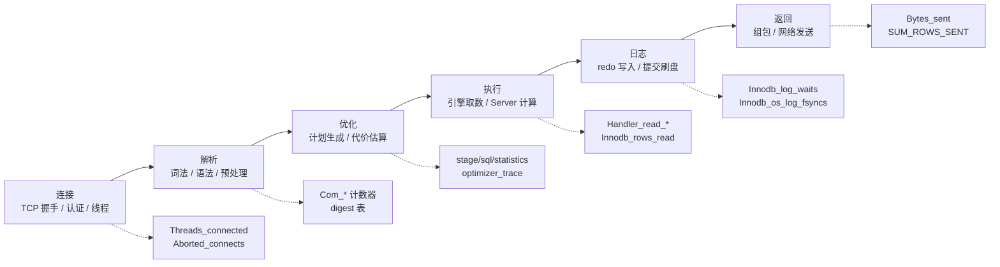
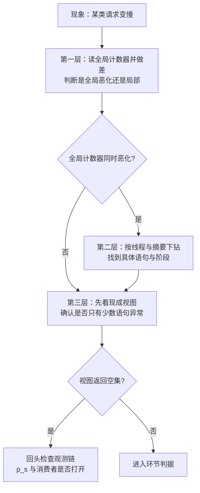
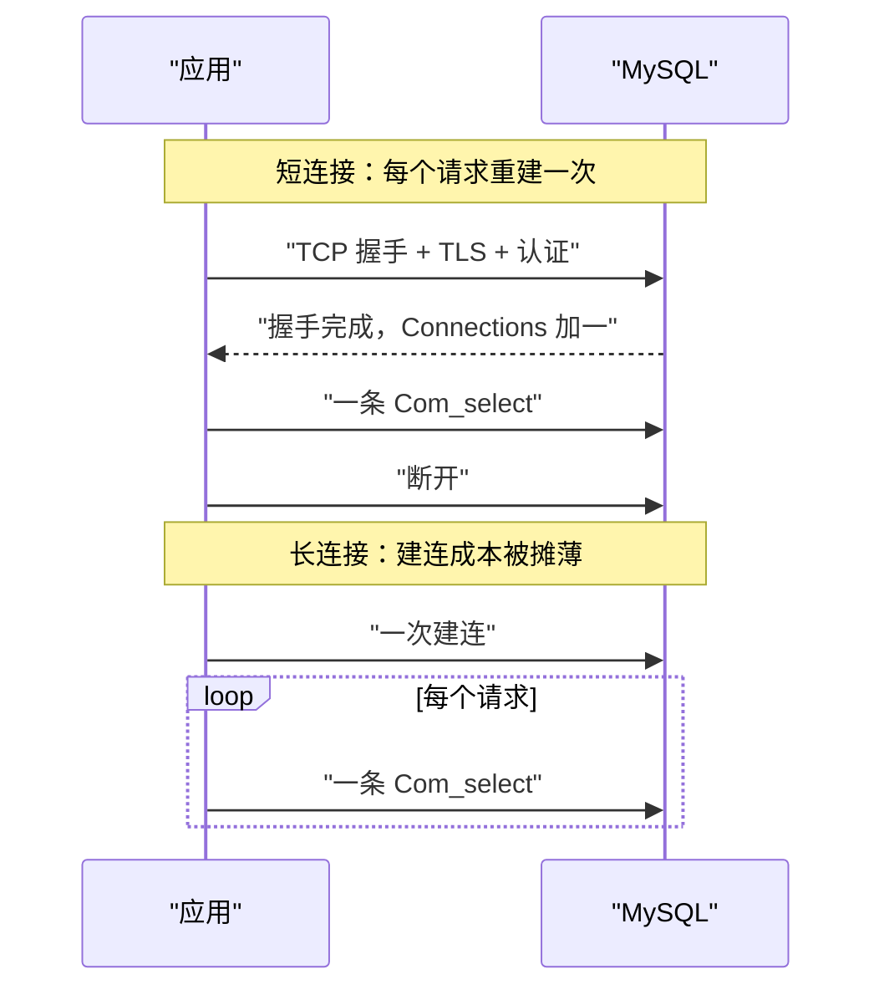
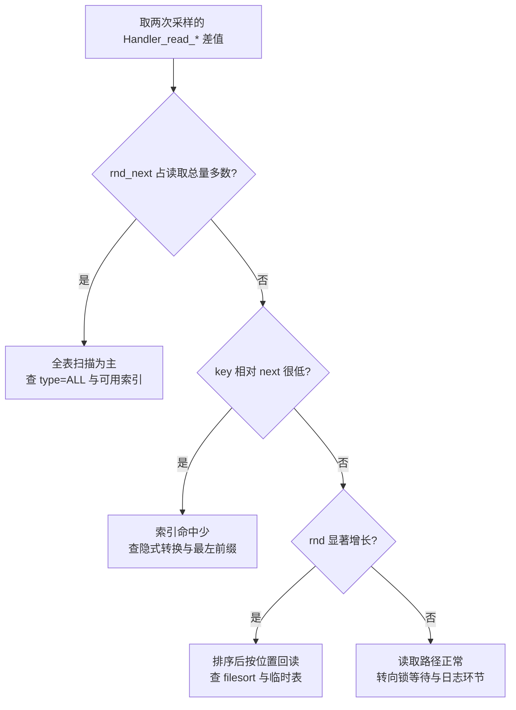
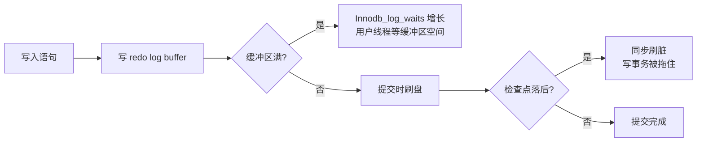
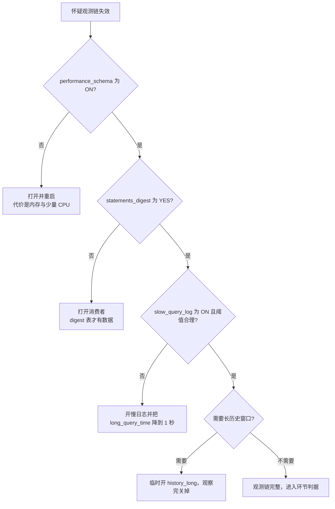

# 01 MySQL 全局架构——一条 SQL 的完整生命周期

**摘要：**

一条 SQL 慢下来，极少能用「语句写错了」一句话交代清楚：连接建立、语句解析、计划生成、引擎取数、日志落盘、结果返回，六个环节各有独立的资源与等待对象，各自暴露的计数器也不是同一套。机制层的拆解已经细到源码，本篇换一个提问方式——不看数据在内部怎样流动，只看时间停在哪一段，以及停住时哪些计数器的差值会动。

全文按六个环节切分，每一节给出可观测点、判据口径与该查的 `performance_schema` 表，并点明该环节的判据在哪些条件下会失效；随后讨论三层观测工具（`SHOW STATUS`、`performance_schema`、`sys` schema）各自的开销与盲区，8.0 移除查询缓存之后观测面发生了什么变化，三个让人「看不出慢在哪」的配置成因，以及把累计计数器当瞬时值、把 `Slow_queries` 当结论这几类反例。判据的排布遵循同一条原则：非零即定性的硬指标在前，指标间的比例关系居中，经验阈值断后，三者不混用。读完应当能回答两个问题：一条慢 SQL 该先看哪个计数器；当所有计数器都正常时，该怀疑观测链本身哪里没打开。

---

## 第 1 章 换一个提问方式：从「怎么走」到「停在哪」

### 1.1 机制讲清了，问题还是定位不了

线上一条按主键的点查，测试环境的响应时间是 3 毫秒，生产环境是 2.7 秒，SQL 文本没有改，索引没有掉，执行计划还是 `const`，慢日志里 `Rows_examined` 与 `Rows_sent` 都是 1，`Lock_time` 接近于零。按「SQL 写得好不好」这条线索，这条语句找不到任何可优化的地方，但它确实慢，而且慢得稳定。

问题不在语句，在提问方式。「SQL 怎么写才快」是一个关于代码的问题，读执行计划、看索引覆盖就能回答；「这条 SQL 的时间花在哪一段」是一个关于运行期状态的问题，只有计数器能回答。一条语句从进入服务端到把结果交回客户端，要依次穿过六个环节，每个环节等待的东西完全不同：连接环节等的是文件描述符、认证插件与线程；解析环节等的是 CPU；优化环节等的是统计信息；执行环节等的是缓冲池、磁盘与行锁；日志环节等的是 redo 空间与 fsync；返回环节等的是网络带宽与客户端的消费速度。六段里任何一段被拖住，最终呈现给用户的都是「这条 SQL 慢」，而 `Slow_queries` 只是在末尾加一，对定位没有任何信息量。

机制层面的拆解在 [[中间件/MySQL/读书笔记-Mysql内核架构/01. MySQL总体架构：Server层与存储引擎的插件化设计|读书笔记 01：总体架构]] 里已做到源码级，本篇不重复，只在需要解释判据成因时给一句结论并指过去。

### 1.2 六个环节的切分口径

本文所说的「环节」按两件事切分：可独立观测、可独立失效，与代码模块的划分并不一致——解析器与预处理共同的风险是「同一条语句被反复解析」，观测共用 `Com_*`，所以合成一段；日志环节在代码上属于 InnoDB，决定的却是提交延迟而非取数延迟，所以必须拆开。

这样切分后，每一段都对应一组互不重叠的计数器，判据不必借用别段指标，也不会出现「一个数字既能解释 A 又能解释 B」的模糊地带。图中虚线连到各段的主要可观测点。不妨把六个环节看成一条流水线上的六个工位：工位之间没有缓冲，任何一站积压都会拖慢整条线的节拍，而用户手里只有一个「总耗时」。



只读语句没有日志环节——普通 `SELECT` 既不写 redo 也不写 binlog，它的判据只有五段；写入语句六段齐全，而且第五段常常才是主要矛盾。这个差别决定了排查的第一步不是看指标，而是确认语句类型：如果慢的是查询却去翻 redo 指标，等于拿体温计量血压。

### 1.3 一条贯穿本文的案例

案例取自订单库，三张语句覆盖三类典型形态，后续各章反复引用同一条，不再换例子。

- 语句 A（点查）：`SELECT id, user_id, amount, status FROM orders WHERE id = ?`
- 语句 B（范围加排序）：`SELECT id, user_id, amount FROM orders WHERE status = ? AND created_at >= ? ORDER BY created_at DESC LIMIT 100`
- 语句 C（批量写）：`UPDATE orders SET settled = 1, settled_at = NOW() WHERE id IN (...)`，每批 500 个主键

`orders` 表的索引情况是刻意设计的：主键 `id`，联合索引 `(user_id, created_at)`，`status` 上没有任何索引。于是语句 B 的谓词 `status = ?` 天然用不上索引，它的 Handler 指纹会带明显的全表扫描特征；语句 A 的 Handler 指纹则应该几乎只有 `Handler_read_key`。两种指纹的对照，就是第 6 章判据的来源。

---

## 第 2 章 观测的三层工具与它们的开销

### 2.1 第一层：全局计数器与必须做差的读法

`SHOW GLOBAL STATUS` 给出的几乎全是自实例启动以来的**累计值**，这既是优点也是陷阱：查询代价极低，任何时刻都能读一次；单次读数却只回答「历史上发生过多少次」，回答不了「现在以多快的速度发生」。判断某环节是否正在恶化，唯一的正确用法是两次读数做差。

差分有三条纪律。先读 `Uptime`：全局状态变量存在内存里，重启会全部清零，`Uptime` 小于采样间隔就直接放弃这组数据。再固定采样间隔，太短被抖动淹没，太长把故障窗口抹平，线上常用 10 秒到 60 秒。最后保证两次采样用同一条语句、同一组字段。

直接读 `performance_schema.global_status` 比 `SHOW GLOBAL STATUS` 更适合做差，因为它是一张普通表，可以用一条语句精确挑出关心的字段，也方便脚本按列取值。

```sql
-- 采样脚本：同一语句跑两次，用后一次减前一次；Uptime 必须一起读
SELECT NOW() AS ts, Uptime,
       Threads_connected, Threads_running, Max_used_connections,
       Connections, Aborted_connects, Connection_errors_max_connections,
       Com_select, Com_stmt_prepare, Com_stmt_execute, Prepared_stmt_count,
       Handler_read_key, Handler_read_rnd_next, Handler_read_rnd,
       Innodb_rows_read, Innodb_buffer_pool_reads,
       Innodb_log_waits, Innodb_os_log_written, Innodb_os_log_fsyncs,
       Bytes_sent, Slow_queries
FROM performance_schema.global_status
WHERE VARIABLE_NAME IN (
  'Uptime',
  'Threads_connected','Threads_running','Max_used_connections',
  'Connections','Aborted_connects','Connection_errors_max_connections',
  'Com_select','Com_stmt_prepare','Com_stmt_execute','Prepared_stmt_count',
  'Handler_read_key','Handler_read_rnd_next','Handler_read_rnd',
  'Innodb_rows_read','Innodb_buffer_pool_reads',
  'Innodb_log_waits','Innodb_os_log_written','Innodb_os_log_fsyncs',
  'Bytes_sent','Slow_queries');
```

`sys.metrics` 把常用状态变量按类型整理成四列结果集，便于做采集项，字段覆盖面不及直接读 `global_status`。

### 2.2 第二层：按线程与按语句的事件

`performance_schema` 把运行期发生的事情分成三类事件：语句事件（`events_statements_*`）、阶段事件（`events_stages_*`）、等待事件（`events_waits_*`）。三者的关系是包含关系——一条语句包含若干阶段，一个阶段包含若干等待，所以排查的顺序也是自上而下：先按语句摘要找到可疑语句，再下钻到它的阶段耗时，最后才看它卡在哪种等待上。

这一层有三个必须记住的细节。时间单位是皮秒，`TIMER_WAIT` 除以 10 的 12 次方才是秒。线程标识有两套，`performance_schema.threads` 里的 `THREAD_ID` 是内部编号，`PROCESSLIST_ID` 才对应 `SHOW PROCESSLIST` 那一列，不映射就会查到别人的数据。摘要表依赖 `statements_digest` 消费者，它在 8.0 默认是 YES，不过每条线程的历史默认只留 10 行（`performance_schema_events_statements_history_size`），更长的窗口要开 `events_statements_history_long`，那是另一张表和另一份内存。

开销方面，真正决定成本的不是 instrument 有多少个（默认状态下大多数是开着的），而是消费者与历史表的行数上限：`history_long` 每多留一行就是多占一份内存，`events_waits_history_long` 这种按等待事件逐条记录的表尤其贵。量级的示例推算见第 10 章。

### 2.3 第三层：已经封装好的视图

`sys` schema 是一组建立在 `performance_schema` 与 `information_schema` 之上的视图，价值在于常用的 join、排序与百分比已经算好。`sys.statement_analysis` 按摘要列出执行次数、总延迟、扫描行数与临时表数量；`sys.statements_with_full_table_scans` 直接给出「没走索引的执行占比」；`sys.processlist` 把线程、当前语句、当前等待与事务状态拼成一行；`sys.innodb_lock_waits` 配好了锁等待双方的信息；`sys.memory_global_by_current_bytes` 与 `sys.io_global_by_wait_by_latency` 分别回答内存和 I/O 花在哪里。

这层的代价很低，不过前提必须说清：视图只是把 `performance_schema` 已采到的数据重新排列，p_s 没开或消费者关掉，视图会安静地返回空集而不报错，空集被当成「没问题」是排查中最常见的一次误判。

| 维度 | 第一层：`SHOW GLOBAL STATUS` | 第二层：`performance_schema` | 第三层：`sys` schema |
| :--- | :--- | :--- | :--- |
| 数据形态 | 实例级累计计数器 | 语句、阶段、等待三级事件 | 对 p_s 预聚合的视图 |
| 粒度 | 实例 | 线程、语句、摘要 | 语句、会话、等待、内存 |
| 回答什么问题 | 总量与方向对不对 | 具体是谁慢、慢在哪一段 | 现成的排名与百分比 |
| 观测代价 | 极低，随时可查 | 中，取决于消费者与历史行数 | 低，但视图本身要跑聚合 |
| 主要盲区 | 无线程与语句归属，重启清零 | 解析段没有独立事件，历史默认只留 10 行 | p_s 没采到的它也没有 |
| 典型入口 | `global_status`、`sys.metrics` | `events_statements_summary_by_digest`、`data_lock_waits` | `statement_analysis`、`statements_with_full_table_scans` |

三层工具的选择顺序可以收成一张图：先做差定向，再下钻到语句，最后用现成视图确认；若视图返回空集，回头检查观测链本身。



---

## 第 3 章 连接环节：慢在建立，不在执行

### 3.1 可观测点

连接环节的耗时发生在语句事件开始之前，`performance_schema` 的语句表看不到它，`events_stages_*` 里也没有对应阶段，这一点不记住就会陷入「语句都不慢、用户就是慢」的僵局。可用的观测量有三类：连接类（`Connections`、`Aborted_connects`、`Connection_errors_*`）、线程类（`Threads_connected`、`Threads_running`、`Threads_created`、`Threads_cached`）、TLS 类（`Ssl_accepts`、`Ssl_finished_accepts`）。建连的绝对耗时只能靠客户端计时：连续建连若干次取平均与分位数，再与长连接下的语句延迟对照。

### 3.2 四类失效形态与判据

连接环节的「慢」有四种互不相同的成因，判据也不同。

| 失效形态 | 关键指标 | 判据口径 | 该看哪张表 |
| :--- | :--- | :--- | :--- |
| 连接数打满 | `Connection_errors_max_connections`、`Threads_connected`、`Max_used_connections` | 前者非零即已发生拒绝，这是硬判据；后者长期高于 `max_connections` 的八成说明容量告急，属经验口径 | `global_status`、`sys.metrics` |
| 握手或认证失败 | `Aborted_connects`、`Connection_errors_*` | `Aborted_connects` 在涨而 `Connections` 平稳，说明连接没走完认证就断了 | `global_status` |
| 反向 DNS 拖慢 | 新建连接耗时（客户端计时） | 单次建连稳定多出毫秒级，且开销与新连接数成正比 | 客户端计时、`Aborted_connects` |
| TLS 握手开销 | `Ssl_accepts`、`Ssl_finished_accepts` | 两者差值大说明握手失败；`Ssl_accepts` 增速等于新建连接增速，说明每条连接都在做完整握手 | `global_status` |

`max_connections` 打满这条线的判据最清晰：**`Connection_errors_max_connections` 一旦非零**，就是已经打满，不必算比例。此时 `Threads_connected` 贴着 `max_connections` 形成高位平台，`Threads_running` 却未必高——大量连接只是占着位置。两个指标是否分离，正是「连接数不够」与「执行能力不够」的分界。

线程模型只留一句结论：社区版一连接一线程，线程栈与连接缓冲随连接数线性增长，机制见 [[中间件/MySQL/读书笔记-Mysql内核架构/01. MySQL总体架构：Server层与存储引擎的插件化设计|读书笔记 01]] 的「连接管理」一节。

### 3.3 DNS 反解：最容易被忽略的固定成本

`skip_name_resolve` 默认为 OFF，每个新建连接都要把客户端 IP 反向解析成主机名，再与权限表的 `Host` 字段比对。正常情况下这是亚毫秒级，但 DNS 响应一变慢或超时，每条新建连接就稳定多出几毫秒到数秒，这笔开销与业务、数据量都无关，表现为「所有请求都慢一点，慢日志却很干净」。

判据不是某个计数器而是对照：新建连接耗时显著高于长连接下的语句耗时，且固定差值不随数据量变化，就该怀疑反解。处置是把 `skip_name_resolve` 设为 ON，代价是权限表里用主机名写的授权规则失效，须改用 IP 或网段，多租户环境动手前要先盘点授权表。8.0 早期版本可用 `host_cache` 观察缓存内容，该表在后继版本已废弃，以对应版本文档为准。

### 3.4 SSL 与认证插件：8.0 之后绕不开的两笔开销

完整 TLS 握手是 CPU 密集操作，`require_secure_transport=ON` 时不可避免。`Ssl_accepts` 与 `Ssl_finished_accepts` 的差值反映握手失败，两者增速与新建连接增速同步说明每次建连都在重做握手——长连接把这笔成本摊薄到接近零，短连接要为每个请求付一次。

认证插件在 8.0 之后也变了：`caching_sha2_password` 是默认插件，首次认证要走 RSA 公钥交换或缓存路径，比 `mysql_native_password` 的一步式校验重，而 8.4 移除了后者，退路不再存在。这两笔成本都只落在建连耗时里。

### 3.5 参数与代价

| 参数 | 8.0 默认 | 调大的代价 | 调小的代价 | 触发判据后怎么动 |
| :--- | :--- | :--- | :--- | :--- |
| `max_connections` | 151 | 线程与内存线性上涨，超过并发能力后排队更严重 | 提前触发拒绝，应用侧直接报错 | 先压连接池上限，再考虑是否调整 |
| `skip_name_resolve` | OFF | 主机名授权规则失效，需改用 IP 或网段 | 每个新连接都要反解，建连抖动 | 长连接占比高时打开 |
| `thread_cache_size` | 自动（-1） | 空闲线程常驻，内存占用上升 | 线程反复创建销毁，CPU 抖动 | 结合 `Threads_created` 增速判断 |
| `wait_timeout` | 28800 | 空闲连接长期占位，连接池回收滞后 | 误杀安静中的长事务与连接 | 必须大于连接池的 `maxLifetime` |

---

## 第 4 章 解析环节：`Com_*` 计数器在说什么

### 4.1 可观测点

解析环节没有独立的阶段事件，也没有「解析耗时」这一列，判据只能建立在计数器的速率关系上。可用的是 `Com_*` 一族（`Com_select`、`Com_stmt_prepare`、`Com_stmt_execute`、`Com_stmt_close`、`Com_stmt_reprepare`）、`Questions` 与 `Queries` 的差值（后者包含存储过程内部执行的语句），以及 `Prepared_stmt_count` 这个瞬时量。

单条语句的解析成本是微秒级，除非语句极长或被反复重解析，否则不足以成为瓶颈；这一环真正的风险在于**总量**——连接频繁新建、同一条 SQL 被反复解析而不复用，CPU 会被均匀磨掉一层，表现为「每条 SQL 都不慢，整机吞吐上不去」。

### 4.2 短连接风暴的指纹

短连接的代价不只是握手：每个新连接都要重新解析语句、重新生成计划、重新加载权限缓存。指纹很有辨识度：`Connections` 与 `Com_select` 同斜率上涨，每连接语句数（`Com_select` 增量除以 `Connections` 增量）接近 1，`Threads_created` 跟着涨说明线程缓存也没命中。长连接加连接池则是 `Connections` 平稳、`Com_*` 随业务起伏。



判据是一个比值而不是一个绝对值：**每连接语句数接近 1**，就说明连接复用没有生效，问题在连接池配置或客户端的连接生命周期管理，而不在 SQL。

### 4.3 预处理语句泛滥

服务端预处理会把解析结果缓存复用，代价是每条语句占一份内存。`Prepared_stmt_count` 逼近 `max_prepared_stmt_count`（默认 16382）后，新的预处理直接失败，报错常被应用层当成「无法执行」，误判成连接问题。判据看两处：与上限的比值，以及 `Com_stmt_prepare` 与 `Com_stmt_execute` 的比值——后者远大于前者说明全是「准备一次执行一次」，缓存没复用还多付一次分配。具体是哪几条语句占着名额，查 `performance_schema.prepared_statements_instances`。

`Com_stmt_reprepare` 非零且持续增长，说明执行计划被反复作废后重建，常见诱因是统计信息变化、DDL 或表结构变更，它会把解析与优化的成本合并成一条隐性的慢路径。

### 4.4 摘要表：找「重复」而不是找「慢」

摘要表把同一类语句的执行合成一行，判读靠两个字段的组合：`COUNT_STAR` 很高而 `AVG_TIMER_WAIT` 很低的是重复劳动，单条不值得优化，乘以执行次数吃掉的 CPU 却可观；`COUNT_STAR` 不高而 `AVG_TIMER_WAIT` 很高的才是传统意义上的慢语句。两类问题处置方向完全不同，把前者当后者去改写 SQL 通常毫无收益。

| 现象 | 指标 | 判据口径 | 该看哪张表 |
| :--- | :--- | :--- | :--- |
| 短连接风暴 | `Connections`、`Com_select`、`Threads_created` | 三者同斜率上涨，每连接语句数接近 1 | `global_status` |
| 预处理语句泛滥 | `Prepared_stmt_count`、`Com_stmt_prepare` | 前者逼近 `max_prepared_stmt_count`；后者远多于执行次数 | `global_status`、`prepared_statements_instances` |
| 计划反复重编 | `Com_stmt_reprepare` | 非零且持续增长 | `global_status` |
| 重复劳动吃 CPU | `COUNT_STAR`、`AVG_TIMER_WAIT` | 次数极高但单次极短的摘要 | `events_statements_summary_by_digest` |

---

## 第 5 章 优化环节：用 `rows` 偏差度量「统计信息可不可信」

### 5.1 可观测点

优化环节在阶段事件里有明确位置：`stage/sql/statistics` 对应行数估算与代价比较，`stage/sql/preparing` 对应预处理与子查询展开。某条语句的优化耗时取这两个阶段的累计时间；要看优化器为什么这么选，打开 `optimizer_trace`，它在 `information_schema.OPTIMIZER_TRACE` 里留下候选计划的 `cost_info` 与每张表的 `rows`。8.0.18 之后还有更直接的路：`EXPLAIN ANALYZE` 同时打印估算行数与实际行数，偏差一眼可见。

### 5.2 判据：偏差十倍以上，统计信息就不可信

这是本篇最重要的一条判据。优化器的决策全部建立在行数估算上，估算来自索引基数与采样统计；数据分布剧烈变化而统计信息没跟上，估算就会系统性偏离，计划随之偏离。判断偏离是否严重不需要复杂推导，把估算与实际放在一起即可：

```sql
-- 估算与实测并排：注意 actual rows 与 rows 的差距，而不是只看耗时
EXPLAIN ANALYZE
SELECT id, user_id, amount
FROM orders
WHERE status = 'PAID' AND created_at >= '2026-10-01'
ORDER BY created_at DESC
LIMIT 100;
```

输出里每个迭代器都带 `(cost=... rows=...)` 与 `(actual time=... rows=... loops=...)` 两段（措辞以对应版本文档为准）。**`actual rows` 与 `rows` 相差十倍以上**时，统计信息就应当列为不可信，此时讨论加索引、改写法都没有意义，优化器根本没看到真实分布。十倍是经验门槛：三到五倍在小表上常见，不构成结论；十倍以上通常意味着把走索引误判成走全表，或者相反。

要打开完整决策链，`optimizer_trace` 先看 `join_optimization` 下的 `rows_estimation`（每张表的 `rows` 与 `cost`），再看 `considered_execution_plans` 里被放弃方案的 `cost_info`。被放弃方案只贵一点点，说明是临界误判，修统计信息或调代价常量都可能翻转；差一个数量级，说明估算已彻底失真。追踪缓冲有上限（`optimizer_trace_max_mem_size`，默认 1 MB），超限会被截断并标出，残缺的追踪不能用来下结论。

### 5.3 优化环节自身也会慢

优化不是免费的：表越多候选连接顺序越多，子查询越多搜索空间越大，谓词越复杂 range 优化器尝试次数越多。判断「是不是优化本身慢」只需看一个占比——`stage/sql/statistics` 的累计时间占语句总时间的比例。经验口径下超过一成值得看一眼，超过三成基本可以确定问题在优化环节。

这时处置方向与「SQL 执行慢」完全不同：减少单条语句的 JOIN 表数、把复杂子查询拆成多步、把 `IN` 列表收敛成临时表或连接，都比调索引有效。代价模型怎么算、连接顺序怎么搜，见 [[中间件/MySQL/MySQL架构与底层原理/09 MySQL 查询优化器——从代价模型到执行计划的决策过程|本列 09 篇]]，这里只给判据。

### 5.4 修复动作与它们的代价

| 判据 | 观测手段 | 处置动作 | 动作的代价 |
| :--- | :--- | :--- | :--- |
| `rows` 估算与实际差十倍以上 | `EXPLAIN ANALYZE` 的 `actual rows` 与 `rows` | `ANALYZE TABLE` 刷新统计 | 采样期间读放大，大表耗时以分钟计 |
| 分布倾斜导致估算失真 | `information_schema.COLUMN_STATISTICS` | 建直方图（8.0） | 额外维护统计信息，写入略增 |
| 采样页数不足 | `innodb_stats_persistent_sample_pages` | 调大采样页数 | `ANALYZE` 更慢，统计信息更占空间 |
| 优化阶段耗时占比高 | `stage/sql/statistics` 占比 | 拆查询、减表数 | 业务侧改动，需应用配合 |
| 临界决策反复翻转 | `optimizer_trace` 的 `considered_execution_plans` | 固定执行计划或改写语句 | 固定计划会随数据变化失效，需定期复核 |

---

## 第 6 章 执行环节：`Handler_read_*` 的指纹读法

### 6.1 为什么计数器能反推访问路径

Server 层与存储引擎之间的接口以「行」为单位，取法只有有限几种：按数据文件顺序读、按键值定位、按索引顺序读下一条、按索引逆序读上一条、按已知行位置回读。每种取法在 `Handler_read_*` 里都有独立计数器，这组计数器的比例关系直接刻画了访问路径的形状。索引怎么组织、页怎么分裂见 [[中间件/MySQL/读书笔记-Mysql内核架构/11. InnoDB 索引：B+Tree 的工程实现与分裂合并哲学|读书笔记 11]]，这里只关心取法。取数之外还有一层可见性判断，Undo 版本链被长事务拖长时，这部分开销同样算在执行环节，机制见 [[中间件/MySQL/读书笔记-Mysql内核架构/12. InnoDB 事务实现：ACID 的内核代价与 MVCC 的时间旅行|读书笔记 12：MVCC]]。

### 6.2 七种读法的语义与指纹

MySQL 8.0 里 `Handler_read_*` 一共有七个计数器，经典教材常提其中六个，`Handler_read_last` 是后加的，用于逆序取尾部。

| 计数器 | 读法 | 典型指纹 | 该查什么 |
| :--- | :--- | :--- | :--- |
| `Handler_read_first` | 读索引第一条 | 全索引扫描 | 能否用覆盖索引减少回表 |
| `Handler_read_key` | 按键值定位 | 点查、等值查询 | 命中次数低说明谓词没用上索引 |
| `Handler_read_last` | 读索引最后一条 | `ORDER BY ... DESC` 取尾部 | 逆序扫描是否有更优索引 |
| `Handler_read_next` | 按索引顺序读下一条 | 范围扫描 | 扫描行数与返回行数的比值 |
| `Handler_read_prev` | 按索引逆序读上一条 | 逆序范围扫描 | 同上，注意方向 |
| `Handler_read_rnd` | 按行位置随机读 | 排序后回读 | `filesort` 与临时表 |
| `Handler_read_rnd_next` | 读数据文件下一条 | 全表扫描 | `type=ALL`、缺索引 |

读这组计数器的关键是比例结构而不是单个值。语句 A 的增量应几乎全落在 `Handler_read_key` 上，`rnd_next` 为零；语句 B 因 `status` 无索引，增量大量落在 `rnd_next` 上。**按主键点查却让 `Handler_read_rnd_next` 增长**，说明索引或计划出了问题，先看 `EXPLAIN` 的 `type` 与 `key`，不要急着改语句。

### 6.3 三个可直接用的判据

第一个判据是占比：`Handler_read_rnd_next` 占 `Handler_read_*` 增量的多数，说明全表扫描是主要取数方式，对应 `sys.statements_with_full_table_scans` 里的 `no_index_used_pct`。第二个判据是索引命中率：`Handler_read_key` 相对于 `rnd_next` 极低，同时 `SUM_NO_INDEX_USED` 非零，说明谓词没有用上索引，常见原因譬如隐式类型转换、函数包裹列、联合索引的最左前缀没被满足。第三个判据是排序回读：`Handler_read_rnd` 显著增长而 `Sort_merge_passes` 同步上涨，说明排序在磁盘上做了多轮归并，临时表已经落到磁盘。

第四个判据是引擎层**读放大**：`Innodb_rows_read` 与摘要表的 `SUM_ROWS_EXAMINED` 比值远大于 1，说明读进来的行大半被过滤，谓词下推不到位。缓冲池命中看 `Innodb_buffer_pool_reads` 与 `read_requests` 的比值，结构性解释见 [[中间件/MySQL/读书笔记-Mysql内核架构/04. InnoDB 缓冲池：内存管理的分区革命与 NUMA 陷阱|读书笔记 04]]，判据上只需记住：读放大的时候，命中率再高也只是把慢变成「慢得均匀」。

### 6.4 单条语句的 Read 指纹

全局计数器只回答「整体在扫表」，落到具体语句要靠 8.0.14 起的 `log_slow_extra`（默认关闭，仅对 `log_output=FILE` 生效）：它把 `Bytes_sent`、`Bytes_received` 与 `Read_first`、`Read_key`、`Read_next`、`Read_rnd`、`Read_rnd_next` 等按语句写进慢日志，Handler 指纹不必再靠差分猜。配合下调后的 `long_query_time`，这是定位执行环节最省事的手段。

```text
# 示意：启用 log_slow_extra 后，慢日志头部会多出按语句统计的计数字段，
# 字段名与顺序以对应版本文档为准
# Query_time: 2.310000  Lock_time: 0.000120  Rows_sent: 100  Rows_examined: 486213
# Read_first: 1  Read_key: 0  Read_next: 0  Read_rnd_next: 486213
```

| 判据 | 指标 | 阈值口径 | 该看哪张表 |
| :--- | :--- | :--- | :--- |
| 全表扫描为主 | `Handler_read_rnd_next` 占比 | 占读取总量多数 | `global_status`、`statements_with_full_table_scans` |
| 索引命中不足 | `Handler_read_key`、`SUM_NO_INDEX_USED` | `key` 相对 `rnd_next` 极低，后者非零 | `events_statements_summary_by_digest` |
| 排序回读 | `Handler_read_rnd`、`Sort_merge_passes` | 前者显著且后者同步上涨 | `global_status`、digest 表 |
| 引擎读放大 | `Innodb_rows_read`、`SUM_ROWS_EXAMINED` | 两者比值远大于 1 | `global_status`、digest 表 |
| 缓冲池未命中 | `Innodb_buffer_pool_reads` 与 `read_requests` 的比值 | 长期偏高说明热点不在内存 | `global_status` |



---

## 第 7 章 日志环节：写入慢的两条独立等待线

### 7.1 可观测点

日志环节只在写入路径上存在，它的可观测点集中在三处：redo 缓冲区是否够用（`Innodb_log_waits`、`innodb_log_buffer_size`）、刷盘频率与批量效率（`Innodb_os_log_written`、`Innodb_os_log_fsyncs`、`Innodb_log_writes`）、以及 redo 容量与检查点水位（8.0.30 起的 `Innodb_redo_log_capacity_resized`、`Innodb_redo_log_current_lsn`、`Innodb_redo_log_checkpoint_lsn`、`Innodb_redo_log_logical_size`）。

### 7.2 判据一：`Innodb_log_waits` 非零且在涨

`Innodb_log_waits` 的语义很窄：redo 缓冲区空间不足，用户线程必须等缓冲区被刷出去才能继续写。**它从零变成持续增长**，就说明日志缓冲区已是瓶颈，与 SQL 写得好不好无关，与并发写入量、单事务写入量、刷盘速度有关。调大 `innodb_log_buffer_size`（默认 16 MB）能立刻缓解，但那只是把等待推后——日志生成速率超过刷盘能力时，缓冲区再大也会填满，真正要动的是下游 I/O 或提交频率。

### 7.3 判据二：每次 fsync 摊到多少字节

把 `Innodb_os_log_written` 的增量除以 `Innodb_os_log_fsyncs` 的增量，得到每次 fsync 平均写入的字节数，这是组提交效率的直接度量：比值小说明每次 fsync 只带一点点日志，次数被白白放大；比值大说明多个事务的日志被攒在一起刷盘。判据不需要绝对阈值，只需横向对比：高峰期比值依然很小，说明并发没有形成有效攒批。

`binlog_group_commit_sync_delay` 与 `binlog_group_commit_sync_no_delay_count` 是改变这个比值的两个旋钮，前者用固定的微秒级等待换攒批，后者在攒够一定事务数后立即提交。它们的代价是提交延迟上升，收益是 fsync 次数下降，属于典型的用延迟换吞吐。

### 7.4 判据三：redo 容量与检查点

8.0.30 起 `innodb_redo_log_capacity` 取代了 `innodb_log_file_size` 与 `innodb_log_files_in_group` 的组合，默认 100 MB，且可以在线调整。日志是环形的，最老日志对应的脏页被刷出去之后空间才能复用；容量越小，检查点推进越频繁，写事务越容易被同步刷脏拖住。判断是否逼近这条线，看 `Innodb_redo_log_logical_size` 与 `Innodb_redo_log_capacity_resized` 的比值，或者用 `Innodb_redo_log_current_lsn` 与 `Innodb_redo_log_checkpoint_lsn` 的差值估检查点年龄。比值长期处于高位，说明日志生成速度与刷脏速度已经接近平衡点，任何写入突增都会把它推向同步刷脏。

这条线的机制细节——日志块结构、LSN 的几道水位、检查点怎么推进——在 [[中间件/MySQL/读书笔记-Mysql内核架构/07. 重做日志缓冲区与 WAL：InnoDB 持久性的实现基石|读书笔记 07：WAL]] 里已经拆到源码级，本列 [[中间件/MySQL/MySQL架构与底层原理/03 InnoDB 日志系统——WAL 协议与崩溃恢复的工程实现|03 篇]] 也从工程实现角度讲过一遍，这里只保留判据。

### 7.5 反例：把写入等待当成 SQL 慢

日志环节的慢出现在提交阶段，语句本身的 `Query_time` 可能并不高，事务提交延迟却很高，应用侧看到的是接口超时。此时优化写法、加索引全部无效，因为等待发生在 `COMMIT` 上。特征组合是：语句级延迟正常、提交延迟高、`Innodb_log_waits` 或 fsync 指标异常、磁盘队列深度高。

| 参数 | 8.0 默认 | 调大的代价 | 调小的代价 | 对应判据 |
| :--- | :--- | :--- | :--- | :--- |
| `innodb_log_buffer_size` | 16M | 内存占用上升，恢复时待重放量更大 | `Innodb_log_waits` 增长，提交被缓冲区卡住 | `Innodb_log_waits` 持续非零 |
| `innodb_redo_log_capacity` | 100M | 崩溃恢复时间变长，磁盘占用上升 | 检查点频繁，写事务被同步刷脏拖住 | 容量使用率长期高位 |
| `innodb_flush_log_at_trx_commit` | 1 | 取 2 或 0 可放宽持久性，代价是崩溃可能丢最近一秒 | 已是最严，无更小取值 | 只能用 I/O 能力换，不能靠改 SQL |
| `sync_binlog` | 1 | 取 N 可摊薄 fsync，代价是崩溃丢最多 N 个事务 | 已是最严 | 提交延迟随 fsync 次数上升 |
| `binlog_group_commit_sync_delay` | 0 | 等待换攒批，提交延迟上升 | 每次提交都 fsync，fsync 次数高 | `Innodb_os_log_fsyncs` 与写入量比值偏小 |



---

## 第 8 章 返回环节：结果集与网络

### 8.1 可观测点

返回环节的观测量有三类：结果集规模（摘要表的 `SUM_ROWS_SENT`、慢日志的 `Rows_sent`）、网络吞吐（`Bytes_sent`、`Bytes_received`）、以及线程在发送阶段的停留（`sys.processlist` 的 `state` 与 `performance_schema.events_waits_current` 里的 socket 写等待）。

### 8.2 判据：`rows_sent` 与 `Sending data` 的误读

判据是 `SUM_ROWS_SENT` 的绝对值与它相对 `SUM_ROWS_EXAMINED` 的比值。返回行数本身很大，说明结果集没被收敛——缺 `LIMIT`、分页过宽，或者导出查询打到了线上库；返回行数小而 `rows_examined` 极大，问题在执行环节。两者分工不分清，就会出现「结果集才一百行怎么会慢」与「扫了一百万行结果集却很小」这两种互斥判断。

这一环最容易踩的坑是 `State` 的语义。线程停在 `Sending data` 看着像网络卡住，其实这个阶段包含从引擎读行并处理，真正卡在网络发送的是 `Sending to client`。**把 `Sending data` 当网络问题查网卡**，是这里的经典误判。两条判据：`Sending data` 占比高且 Handler 读放大严重，问题在执行；`Sending to client` 占比高而 `Bytes_sent` 增速不匹配带宽，问题在客户端消费或网络。

客户端消费慢被严重低估：服务端每写一行都要等 socket 可写，客户端读得慢就占住一个线程，表现为「CPU 不高、磁盘不忙、连接全在超时」。判据是连接数与吞吐量不匹配、`Sending to client` 线程数偏高、`Aborted_clients` 增长。

| 判据 | 指标 | 口径 | 该看哪张表 |
| :--- | :--- | :--- | :--- |
| 结果集过大 | `SUM_ROWS_SENT`、`Rows_sent` | 绝对值大且与 `rows_examined` 接近 | digest 表、慢日志 |
| 网络吞吐打满 | `Bytes_sent` 增速 | 与网卡带宽量级对比 | `global_status` |
| 客户端消费慢 | 线程 `state` 为 `Sending to client` | 大量线程停在该状态 | `sys.processlist`、`events_waits_current` |
| 传输中断 | `Aborted_clients`、`max_allowed_packet` 相关错误 | 断连计数增长，伴随应用侧报错 | `global_status`、错误日志 |

---

## 第 9 章 三个「看不出慢在哪」的成因

### 9.1 观测链本身没打开

第一种情况最彻底：`performance_schema` 没有开启。8.0 的默认值是 ON，但不少实例在调优时被显式关掉过，也有一些托管服务默认不暴露。关掉之后，第二层与第三层工具全部落空，`sys` schema 的视图会返回空集而不报错——这一点比报错更危险，因为空集看起来像「没有问题」。检查只需要一条语句：`SELECT @@performance_schema`，返回 0 就先停下来把观测恢复，再谈定位；体温计摔坏了还拿着读数当真，结论只会更糟。

### 9.2 消费者被关掉一半

第二种更隐蔽：实例开着 `performance_schema`，关键消费者却被关。默认 `events_statements_current`、`events_statements_history`、`statements_digest` 为 YES，`events_statements_history_long` 与各类 `events_waits_history_long` 为 NO，于是每条线程只看得到最近十条语句，流量稍有波动可疑语句就被冲走。判断办法是查 `performance_schema.setup_consumers` 里 `ENABLED='NO'` 的行；需要长窗口时临时打开 `history_long`，观察完立刻关掉，它的开销与流量成正比。

### 9.3 慢查询的阈值设得太宽

第三种最常见：`slow_query_log` 默认 OFF，即便打开，`long_query_time` 默认也是 10 秒。这套默认值下绝大多数「用户觉得慢」的语句根本不进慢日志，`Slow_queries` 一直是 0，于是得出「没有慢查询」的结论。正确做法是把阈值降到 1 秒甚至更低，先看清延迟分布的形状，再用 `min_examined_row_limit` 过滤噪声；8.0.14 之后加开 `log_slow_extra`，还能顺带拿到每条语句的 Handler 指纹。

| 盲区 | 检查语句 | 期望值 | 失效后果 |
| :--- | :--- | :--- | :--- |
| `performance_schema` 未开 | `SELECT @@performance_schema` | 1 | 第二、三层工具全部落空 |
| 消费者被关闭 | `SELECT NAME FROM performance_schema.setup_consumers WHERE ENABLED='NO'` | 列表里没有 `statements_digest` 与 `events_statements_*` | digest 表为空，历史只有十条 |
| 慢日志未开或阈值过大 | `SELECT @@slow_query_log, @@long_query_time` | ON 且 1 秒量级 | 语句不进日志，`Slow_queries` 恒为 0 |



---

## 第 10 章 量化：时间、内存与 8.0 的变化

### 10.1 环节占比的示例推算

下面这张表不是实测基准，而是按各环节的物理成本结构做的示例推算，用来建立「哪一段可能吃掉多少时间」的量级感。真实占比必须在自己的实例上采样得到，任何脱离采样直接套用的百分比都是错的。

| 环节 | 点查（示例占比） | 范围扫描加排序（示例占比） | 批量更新（示例占比） | 推算依据 |
| :--- | :--- | :--- | :--- | :--- |
| 连接 | 3%-8% | 3%-8% | 2%-5% | 长连接下摊薄至接近零，短连接可达毫秒级 |
| 解析 | 不足 1% | 不足 1% | 不足 1% | 单条解析是微秒级，除非反复重编 |
| 优化 | 不足 1% | 2%-10% | 1%-3% | 表数与候选计划越多，占比越高 |
| 执行 | 60%-80% | 50%-75% | 30%-50% | 取数、回表、排序与临时表都在此段 |
| 日志 | 不适用 | 不适用 | 25%-50% | 缓冲区等待与 fsync 集中在提交路径 |
| 返回 | 10%-30% | 10%-25% | 5%-10% | 结果集越大占比越高 |

同一条语句在测试与生产的耗时差异，往往不是数据量涨了十倍，而是连接方式、结果集规模、提交频率同时变了。

### 10.2 `performance_schema` 的内存开销

`performance_schema` 的内存由各表行数上限与行宽相乘得到，`SHOW ENGINE PERFORMANCE_SCHEMA STATUS` 给出当前分配与峰值，`sys.memory_global_by_current_bytes` 里的 `memory/performance_schema/%` 事件则给出按模块的明细。

```sql
-- 实测 p_s 自身占了多少内存（单位字节，按降序）
SELECT event_name, current_alloc
FROM sys.memory_global_by_current_bytes
WHERE event_name LIKE 'memory/performance_schema/%'
ORDER BY current_alloc DESC
LIMIT 10;
```

笔者按行数与行宽做一个示例推算：如果 `events_statements_history_long` 设为十万行，单行按数百字节估算，这一张表就是几十 MB；若把 `events_waits_history_long` 也开到同等规模，行宽更大、开销更高，两者叠加到几百 MB 在 8.0 上并不罕见。「全开」因此不可取：收益落在极短窗口内的偶发问题上，代价却是常驻内存与被放大的写入开销。

### 10.3 8.0 之后观测面发生了什么变化

最大的变化是查询缓存消失。它在 5.7.20 起已废弃，8.0 移除，连带「缓存命中率」这类指标一起消失。这块能力当初解决的是「同一条查询被反复执行」，8.0 之后交给应用层缓存与 Redis，数据库侧不再替你缓存，只保留**发现重复**的能力——摘要表把同类语句合并计数。从「替你缓存」退到「告诉你哪里重复」，是把缓存策略交还业务、把观测责任留在数据库。

| 能力 | 5.7 的状态 | 8.0 / 8.4 的状态 | 对判据的影响 |
| :--- | :--- | :--- | :--- |
| 查询缓存 | 5.7.20 起废弃，默认关闭 | 8.0 移除 | 不再有缓存命中率类指标 |
| `performance_schema` | 默认开启 | 默认开启 | 判据默认可用 |
| 锁视图 | `information_schema.INNODB_LOCKS` 等 | 改为 `performance_schema.data_locks` 与 `data_lock_waits` | 锁等待判据要走 p_s |
| 慢日志附加字段 | 只有三行头部 | 8.0.14 起 `log_slow_extra` | 单条语句可直接看 Read 指纹 |
| 实际执行统计 | 无 | 8.0.18 起 `EXPLAIN ANALYZE` | 估算可信度可被直接量化 |
| redo 观测 | 文件大小固定 | 8.0.30 起容量与水位指标 | 容量使用率与检查点可算 |
| 默认认证插件 | `mysql_native_password` | 8.0.4 起 `caching_sha2_password`，8.4 移除前者 | 建连成本结构变化 |

---

## 第 11 章 反例与边界

### 11.1 只看 `Slow_queries` 计数

它只在语句**执行完成**且**超过阈值**时加一，不区分环节，不含解析前失败或超时断开的请求，也不含单条不慢却高频重复的语句。把它当结论，等于把「多少条语句超过阈值」当成「系统为什么慢」，中间隔着一整套环节判据。

### 11.2 把累计值当瞬时值

`Handler_read_rnd_next` 很大只能说明历史上扫过很多行，说明不了现在正在扫。判断当前状态必须做差，而做差先要确认 `Uptime` 没有变小。这类错误的后果是方向被历史数据带偏：刚重启的实例看起来「指标都很大」，长期运行的实例看起来「增长平稳」，结论恰好相反。

### 11.3 把 `performance_schema` 全开

全开的后果是内存常驻与写入路径上的额外开销，收益却集中在一个很窄的场景里。更麻烦的是它会引出相反的结论——「开了 p_s 变慢，所以 p_s 不能用」。正确做法是默认状态加临时打开：要长历史窗口才开 `history_long`，定位完即关；要等待事件细节按 instrument 前缀单开，不整族打开。

### 11.4 判据失效的边界

托管实例是第一类边界：部分云服务不暴露 `performance_schema` 或只暴露部分状态变量，此时第一层与第三层仍可用，第二层要换厂商等价视图。非 InnoDB 表是第二类：`Innodb_rows_read` 这类指标对它们无效，判据退回 `Handler_read_*`。锁等待与复制延迟是第三类，它们不属于六个环节中的任何一段，锁等待看 `data_lock_waits` 与 `sys.innodb_lock_waits`，复制判据见 [[中间件/MySQL/MySQL架构与底层原理/10 Binlog 与主从复制——数据同步的底层传动链|本列 10 篇]]。

### 11.5 判据的优先级

三类判据的可信度不同：计数器从零变成非零（`Connection_errors_max_connections`、`Innodb_log_waits`）是硬判据，出现即定性；指标间的比例关系（`rnd_next` 占比、`rows` 偏差倍数）是结构性判据，需结合业务形态解读；固定百分比（连接数到上限八成、优化阶段占比一成）只是经验口径，要用自己实例的基线校准。优先级搞反，就会出现拿经验阈值否定硬判据。

---

## 第 12 章 结语：先看清再谈看懂

六个环节的判据合起来是一句话：**慢是六种等待之一**。连接环节等资源，解析环节等 CPU，优化环节等统计信息，执行环节等数据，日志环节等磁盘，返回环节等网络与客户端。每一种等待都有自己的计数器，也都有自己的硬判据；先把硬判据摆出来定性，再用结构性判据定位，最后才用经验阈值排序，这个顺序比任何单条阈值都重要。

比判据更容易出错的是观测本身。p_s 没开、消费者被关、慢日志阈值太宽，这三种情况会让所有判据一起失灵，失灵的表现是「一切正常」。所以排查的第一步不是看指标，而是确认指标能不能被看见。

---

## 参考资料

1. MySQL 8.0 Reference Manual, [Performance Schema](https://dev.mysql.com/doc/refman/8.0/en/performance-schema.html)
2. MySQL 8.0 Reference Manual, [Performance Schema Statement Event Tables](https://dev.mysql.com/doc/refman/8.0/en/performance-schema-statement-tables.html)
3. MySQL 8.0 Reference Manual, [Pre-Filtering by Consumer](https://dev.mysql.com/doc/refman/8.0/en/performance-schema-consumer-filtering.html)
4. MySQL 8.0 Reference Manual, [The Slow Query Log](https://dev.mysql.com/doc/refman/8.0/en/slow-query-log.html)
5. MySQL 8.0 Reference Manual, [Tracing the Optimizer](https://dev.mysql.com/doc/refman/8.0/en/optimizer-tracing.html)
6. MySQL 8.0 Reference Manual, [Server Status Variables](https://dev.mysql.com/doc/refman/8.0/en/server-status-variables.html)
7. MySQL 8.0 Reference Manual, [Redo Log](https://dev.mysql.com/doc/refman/8.0/en/innodb-redo-log.html)
8. MySQL 8.0 Reference Manual, [The sys Schema](https://dev.mysql.com/doc/refman/8.0/en/sys-schema.html)
9. MySQL 8.4 Reference Manual, [The optimizer_trace System Variable](https://dev.mysql.com/doc/refman/8.4/en/optimizer-trace-system-variable.html)
10. MySQL 8.0 Reference Manual, [EXPLAIN Statement](https://dev.mysql.com/doc/refman/8.0/en/explain.html)

---

> [!note] 思考题
> 1. 一条按主键的点查在生产环境稳定慢 2 秒，慢日志里 `Rows_examined` 为 1、`Lock_time` 近似为零，六个环节里你会按什么顺序排除？哪一段的耗时根本不会出现在慢日志里？
> 2. `Handler_read_rnd_next` 的绝对值很大，能否据此判断当前正在全表扫描？如果不能，需要补哪两个信息才能下结论？
> 3. `EXPLAIN ANALYZE` 显示某节点 `rows` 估算为 100、`actual rows` 为 12000，你会先动统计信息还是先改 SQL？如果改完统计信息后执行计划没有翻转，下一步查什么？
> 4. 实例的 `Innodb_log_waits` 持续增长，把 `innodb_log_buffer_size` 调大后暂时缓解，一周后又出现。这个反复说明了什么，真正该动的是哪个方向？
> 5. 把 `performance_schema` 全开之后，应用侧反馈偶发变慢。你会用哪几个指标判断开销落在哪里，又该如何设计一个「按需打开、定位即关」的采样方案？