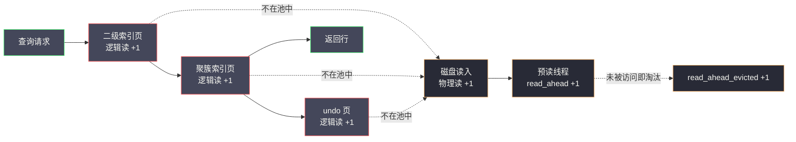
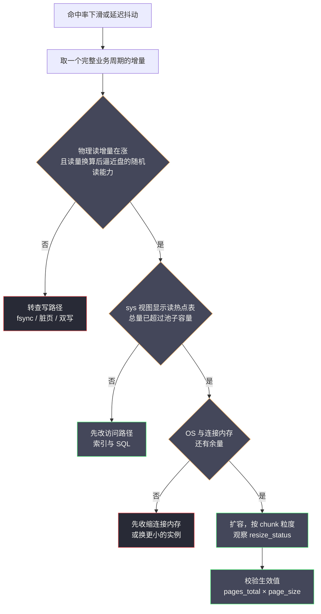
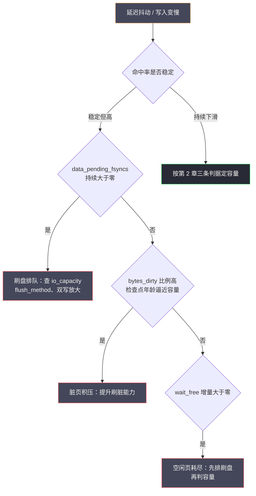
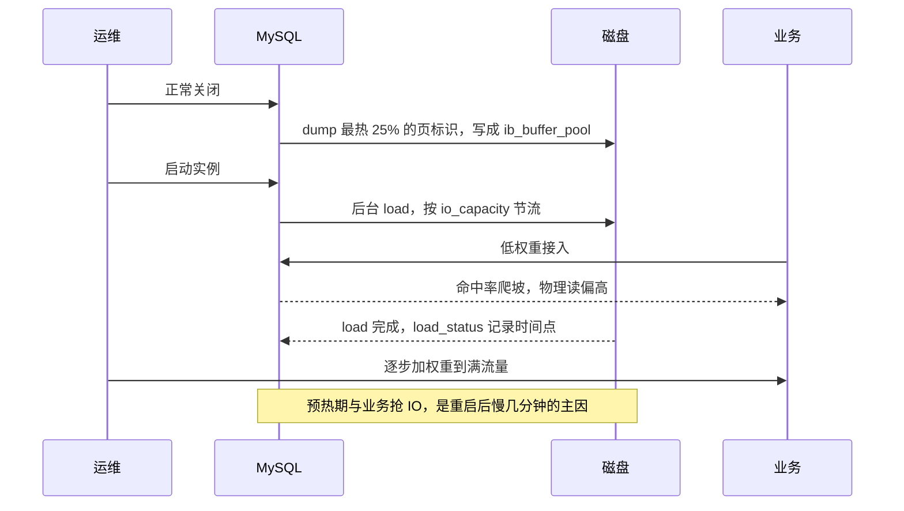
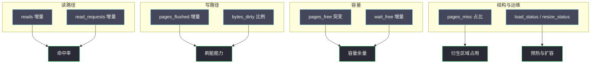

# 02 InnoDB Buffer Pool——内存与磁盘之间的桥梁

**摘要：**

Buffer Pool 的机制部分早有定论——分区、双生代淘汰、三张链表、刷脏与检查点，这些在源码级笔记里已经拆到函数与锁的粒度。真正让 DBA 反复失手的不是"它怎么工作"，而是两个更朴素的问题：这个池子该给多大，以及它此刻到底健康不健康。本文按运行期判据重写这个话题，先纠正命中率的算法与口径，解释为什么一个长期显示 99.9% 的实例仍然会在晚高峰掉进延迟泥潭；再把 `innodb_buffer_pool_size` 的设定拆成三条可执行判据——热数据量、物理读增量、留给系统与连接的余量，给出算例、"设太大"的代价与在线扩容时该看的状态变量；随后逐个解剖三个看着正常其实有病的现场（挂起的 fsync、积压的脏页、等待空闲页），交代四个衍生区域各自的查法，梳理 dump/load 预热的节流行为与重启后先慢几分钟的四个原因，最后收敛成八项监控清单、三则反例与一组边际收益的量化示例。全篇的落点不在参数大小，而在判据组合：单看任何一个指标，处置方向都可能被带偏。

---

## 第 1 章 命中率这个数字在说什么

### 1.1 一次容量评审会上的分歧

某个订单库的容量评审会上，平台组摊开监控截图：命中率 99.94%，曲线平滑得像一条直线，结论是"缓冲池够用，这次扩容不必加内存"。同一时间，业务侧给的另一份数据是晚高峰 P99 从 40 毫秒涨到 300 毫秒，慢查询日志里清一色是带 `UPDATE` 的事务。

两边都没有说谎，只是说的不是同一件事。命中率回答的是"这次逻辑读有没有落在内存里"，它不回答"这次写入能不能按时落到盘上"，也不回答"淘汰链表的尾部是不是堆满了还没刷盘的页"。笔者见过的 Buffer Pool 误判，十有八九起于把这个比例当成了整个内存子系统的健康总分。

### 1.2 正确的算法与它的统计口径

流行的写法是：

```text
命中率 = 1 - Innodb_buffer_pool_reads / Innodb_buffer_pool_read_requests
```

这两个计数器的语义要拆开看，否则算出来的数字会被过度解读。前者是**逻辑读**计数：`Innodb_buffer_pool_read_requests` 记的是向缓冲池请求页的次数，一次 B+Tree 下降、一次回表、一次读 undo 页都各计一次，在源码里对应每个实例的 `n_page_gets`；后者是**物理读**计数：`Innodb_buffer_pool_reads` 记的是这些请求里没能从池子拿到、必须从磁盘读入的页数。分母天然比分子大两个数量级，比例自然贴近 1。

口径上有三条约束，缺一条这个数字就不可信：

1. 先看增量，不看累计值。累计值从实例启动算起，跑满一周之后，任何新出现的抖动都会被历史稀释成小数点后第三位。
2. 窗口要盖住一个完整的业务周期。窗口取三十秒，恰好抽到一次报表扫描，读数就会难看得没有意义；窗口取一小时，又会把间歇性的尖刺摊平成平均值。
3. 记住计数器被重置的时刻。重启归零，`FLUSH STATUS` 也归零。重启后的头几分钟，命中率样本几乎只剩"缓冲区刚被填满"这一段，任何用它做容量判断的做法都在拿噪声当证据。

```sql
-- 两次采样求增量：累计值会掩盖当前状况
SELECT VARIABLE_NAME, VARIABLE_VALUE
FROM performance_schema.global_status
WHERE VARIABLE_NAME IN ('Innodb_buffer_pool_read_requests',
                        'Innodb_buffer_pool_reads',
                        'Innodb_page_size');
```

`performance_schema.global_status` 与 `SHOW GLOBAL STATUS` 同源，取出来的是同一个计数器；两者都不带时间戳，所以"增量"必须由采集端两次采样相减得到，这也意味着采集间隔本身就是判据的一部分。

### 1.3 为什么 99.9% 仍然会慢

命中率高而响应慢，在读写混合的实例上不是异常，而是常态。原因有四层。

第一层，它只覆盖读路径。写路径的压力在另一组计数器上：脏页刷盘看 `Innodb_buffer_pool_pages_flushed` 与 `Innodb_buffer_pool_bytes_dirty`，fsync 排队看 `Innodb_data_pending_fsyncs` 与 `Innodb_os_log_pending_fsyncs`，双写开销看 `Innodb_dblwr_pages_written` 与 `Innodb_dblwr_writes`，二级索引的延迟更新还要看 change buffer 的合并进度。一个写入密集的实例可以长年维持 99.9% 的命中率，同时每一次提交都在队列里等 fsync 返回。

第二层，分母是页级逻辑读，不是语句级。一次主键点查通常产生两到三次逻辑读——二级索引页、聚簇索引页，如果碰上 MVCC 可见性判断还要读 undo 页；这些页只要在内存里，全部记为命中。真正让延迟跳起来的是少数落在关键路径上的 miss，而它们在比例上几乎看不见：十万次逻辑读里出现一百次物理读，命中率仍有 99.9%，但那一百次会各自带着一次盘读或排队等待返回给客户端。

第三层，预读页不在分母里。预读线程读入的页数单独记在 `Innodb_buffer_pool_read_ahead`，读进来但从未被访问就被淘汰的页数记在 `Innodb_buffer_pool_read_ahead_evicted`。后者的绝对值高说明预读在拿磁盘带宽换空间，这部分浪费完全不体现在命中率公式里。

第四层，`SHOW ENGINE INNODB STATUS` 里的 `Buffer pool hit rate 1000 / 1000` 是**区间抽样**，不是全局累计。源码里这一行由两次打印之间的增量算出，用 `page_read_delta / n_page_get_delta` 折算成千分比，打印完即重置窗口；如果监控每五秒抓一次 STATUS，窗口就只有五秒，而空闲实例会干脆打印 `No buffer pool page gets since the last printout`。把这张截图当成"内存子系统健康证明"的做法，本质上是在引用一个可能只有几秒钟的样本。

| 环节 | 命中率是否覆盖 | 该看什么 |
| :--- | :--- | :--- |
| 逻辑读命中 | 覆盖 | `Innodb_buffer_pool_reads` / `read_requests` |
| 预读浪费 | 不覆盖 | `Innodb_buffer_pool_read_ahead_evicted` |
| 脏页刷盘 | 不覆盖 | `Innodb_buffer_pool_pages_flushed`、`bytes_dirty` |
| fsync 排队 | 不覆盖 | `Innodb_data_pending_fsyncs`、`Innodb_os_log_pending_fsyncs` |
| 双写放大 | 不覆盖 | `Innodb_dblwr_pages_written` / `Innodb_dblwr_writes` |
| 二级索引延迟更新 | 不覆盖 | `INSERT BUFFER AND ADAPTIVE HASH INDEX` 段 |

下面这张图把一次读请求经过的环节与计数器的埋点位置画在一起，可以看出命中率只截取了其中很短的一段。



---

## 第 2 章 定容量：三条判据

"把 `innodb_buffer_pool_size` 设成物理内存的 70% 到 80%"这条经验来自单机独享、内存 8GB 到 64GB 的年代，它唯一能保证的事情是"别把操作系统撑死"，对"到底需要多少"一个字都没有回答。要给出可执行的判据，得分别回答三个问题：热数据有多大、缺不缺、以及剩下的内存够不够别人用。

### 2.1 判据一：热数据量

需要的容量约等于热表在"数据页 + 索引页"上的常驻占用，而不是全库大小。取这个数要分两步：先找出哪些表是热的，再量出它们每行占多少字节。

找热表看 `sys.schema_table_statistics` 的读行计数。该视图由 `performance_schema.table_io_waits_summary_by_table` 汇总而来，列名是 `rows_fetched`，按它倒序取前十名，就是当前实例的读热点候选；写密集的表还要把 `rows_inserted`、`rows_updated` 一并看，因为写操作同样要先把页读进池子。

量字节不要用 `information_schema.tables` 的 `data_length / rows`。`data_length` 含碎片的空洞，`rows` 是采样估算，两者相除得到的"平均行宽"在批量删除过的表上可以偏差几倍。更贴近真相的是 `sys.schema_table_statistics_with_buffer`，它把每张表在缓冲池里的实际占用直接摊开：`innodb_buffer_pages`、`innodb_buffer_rows_cached`、`innodb_buffer_bytes_data`。用"字节数 / 缓存行数"反推每行摊分，再把热时段的读行数乘回去，就是**热工作集**的量级。

```sql
SELECT table_schema, table_name, rows_fetched,
       innodb_buffer_pages, innodb_buffer_rows_cached,
       innodb_buffer_bytes_data
FROM sys.schema_table_statistics_with_buffer
ORDER BY rows_fetched DESC
LIMIT 10;
```

举个算例。订单主表是一张两亿行的表，缓冲池里当前缓存了四十万行、占用 96MB，折算每行摊分约 240 字节——这个数字里已经含了聚簇索引页与二级索引页的平均摊分。业务峰值的读行数（按日去重后）约六千万行，两者相乘得到 14GB 左右；再加上两张核心关联表，热工作集合计约 22GB，再给系统表、undo 页、数据字典页与 change buffer 留出三成余量，需要 30GB 量级。此时 48GB 的池子有富余，32GB 就偏紧。**这些数字是示例推算**，真实值必须用自己实例的 `sys` 输出替换，行宽与热点集中度因表而异。

命名上还有一个坑：有些资料把这张表的读行计数写成 `rows_read`，但 `Innodb_rows_read` 是全局状态变量里的读行计数，与按表归属的 `rows_fetched` 不是同一个东西——前者把系统表的读数也算进去，后者才带表名维度。做热点排名要用视图里的 `rows_fetched`，两者混用会把排名带偏。

两个使用前提要写清楚。`INNODB_BUFFER_PAGE` 的扫描是这条链路的代价来源，`sys` 的这两个视图都基于它，在几十 GB 的池子上执行会长时间持有缓冲池相关的锁，不要在高峰跑；`rows_fetched` 是从 `performance_schema` 启动时开始累计的，判断当前热度要取增量而不是看总量。

### 2.2 判据二：命中率与物理读增量

99% 这条阈值没有普适性，它大约对应"每秒物理读占比不到 1%"。这个 1% 在千级 IOPS 的盘上是灾难，在十万级 IOPS 的 NVMe 上则算宽裕——阈值的真正分母是盘的随机读能力与业务的延迟目标。所以判据不能只写"低于 99% 就扩容"，而要写成复合条件：命中率低于阈值，同时 `Innodb_buffer_pool_reads` 的绝对增量在同步上涨，并且物理读集中在 2.1 里量出"超过热工作集"的那些表上，三条同时成立才是容量不足。

换算成 IOPS 时不要默认页大小：`Innodb_buffer_pool_reads` 的单位是页，每页字节数由 `Innodb_page_size` 决定（默认 16KB，也可以在初始化时选 8KB、32KB、64KB）。用页数乘以页大小再除以采样窗口，才是真实的读带宽；在 32KB 页的实例上直接按 16KB 换算，会把带宽低估一半。

反过来的边界同样重要。全表备份、报表导出、`mysqldump --single-transaction`、在线 DDL 的终态拷贝，都会让命中率在一段时间内掉一到三个点，这属于预期行为，判断标准是"扫描结束后十分钟内有没有回升"。回升了就是负载形状问题，不回升才是容量问题。

还有一类"读得太多"不是容量问题而是路径问题：统计信息陈旧或直方图缺失时，优化器可能把一次点查估成范围扫描，`rows_fetched` 成倍上涨，命中率随之下降，但池子其实装得下。这类偏差怎么从执行计划的 `rows` 估算与 `filtered` 上认出来，判据在 [[中间件/MySQL/MySQL架构与底层原理/09 MySQL 查询优化器——从代价模型到执行计划的决策过程|09 查询优化器]] 里，扩容之前值得先排一遍。

### 2.3 判据三：给操作系统与连接留出余量

这里要先纠正一个流传很广的旧参数。`innodb_additional_mem_pool_size` 在 5.6 被标记废弃、5.7 已经移除（WL#7628 同时删掉了 `innodb_use_sys_malloc`），在 8.0/8.4 上既不存在也不生效——配置里如果还留着这一行，实例会因为未知变量直接启动失败。当年它管的是 InnoDB 内部数据结构与数据字典额外申请的内存池，如今这部分内存大部分回到了缓冲池与系统分配器，判据要换成一份别的东西。

| 预留项 | 估算口径 | 风险 |
| :--- | :--- | :--- |
| 每连接缓冲 | `max_connections` ×（`sort_buffer` + `join_buffer` + `read_buffer` + `read_rnd_buffer`） | 排序与 JOIN 一多，实际值会顶到最坏值 |
| 临时表 | `tmp_table_size` / `max_heap_table_size` 是每连接上限，超限落盘 | 大查询并发时内存陡增 |
| Redo Log Buffer | `innodb_log_buffer_size`，写入密集实例常调到 64-256MB | 提交尖峰时日志缓冲不够会触发 `Innodb_log_waits` |
| 数据字典与内部结构 | `STATUS` 里的 `Dictionary memory allocated`，加上哈希表、控制块等簿记 | 随表数量与索引数量增长 |
| 监控与备份代理 | 采集端、备份进程、`mysqldump` 的客户端缓冲 | 常见于"平时够、备份窗口爆" |
| 操作系统与 page cache | 内核、网络缓冲、binlog 与临时文件的文件缓存 | 被挤到 swap 时延迟形状整体恶化 |

最坏值怎么估，可以按 `max_connections` 乘以单连接缓冲上限得到理论上界，再按连接池的真实并发数打折。规划时用上界、监控时用实测，两者不要混。举个数：800 个连接，`sort_buffer_size` 与 `join_buffer_size` 各 256KB、`read_buffer_size` 128KB，最坏值约 0.5GB；如果这台机器上还并行跑着备份与采集，按 1GB 预留更稳。

至于 75% 这个系数的来历，可以从源码里找到出处：`innodb_dedicated_server` 打开时，MySQL 会按检测到的物理内存自动定容，内存不超过 4GB 时取 50%，超过则取 75%，并且只在 `innodb_buffer_pool_size` 没有显式配置时才生效。厂商给的是一个保守且不区分场景的系数，它能保证不撑死系统，不能保证够用。

> [!info] 版本口径
> `innodb_additional_mem_pool_size` 与 `innodb_use_sys_malloc` 在 5.7 已移除，8.0 与 8.4 上写进配置文件会让实例因未知变量启动失败；`innodb_redo_log_capacity` 自 8.0.30 起取代 `innodb_log_file_size` 与 `innodb_log_files_in_group` 的组合，本文凡涉及 redo 容量的判据都按新参数写。其余参数的默认值以 8.0 为准，8.4 上的增删以对应版本文档为准。

### 2.4 算例：一台 128GB 的机器

把三条判据套到一台专用数据库服务器上，过程大致如下。

| 组成项 | 取值 | 依据 |
| :--- | :--- | :--- |
| 物理内存 | 128GB | 机器规格 |
| 操作系统与文件缓存 | 8GB | 内核、网络缓冲、binlog 与临时文件的 page cache |
| 连接内存上界 | 1GB | 800 连接按单连接缓冲上限估算后留一倍余量 |
| Redo Log Buffer | 256MB | 写入密集实例的常见配置 |
| 监控与备份进程 | 1GB | 采集端、备份客户端、导出缓冲 |
| 缓冲池初值 | 100-110GB | 剩余内存再留约一成波动余量 |

得到的结论是这台机器可以设到 100GB 到 110GB，而不是死守 128 × 0.75 = 96GB。但加大之前要确认三件事：swap 没有启用，`max_connections` 与每连接缓冲被连接池真正约束住，`innodb_dedicated_server` 没有和手写配置同时存在。配置值不等于**生效值**——`innodb_buffer_pool_size` 会按 `innodb_buffer_pool_chunk_size`（默认 128MB）与实例数的乘积取整，所以校验一律用 `Innodb_buffer_pool_pages_total × Innodb_page_size`，再对照 `free -g` 的 available 与 `vmstat 1` 里的 si/so 看有没有换页。

### 2.5 设太大的代价

容量不是单调收益，池子大到一定程度之后，每多一分内存都在别处付账。

| 维度 | 调大的代价 | 调小的代价 |
| :--- | :--- | :--- |
| 内存与 swap | 挤压 page cache 与其它进程，极端情况被换出，延迟出现换页抖动 | 物理读上升，命中率下降，盘压力前移 |
| 在线调整 | 按 chunk 粒度重建，期间 `Innodb_buffer_pool_resize_status` 汇报进度，业务会有短时抖动 | 缩容同样要重建，且脏页要更快刷出去 |
| 参数灵活性 | `innodb_buffer_pool_instances` 与 `innodb_buffer_pool_chunk_size` 都是只读参数，池子变大后再想改必须重启 | 池子小于 1GB 时实例数会被强制为 1 |
| 启动与预热 | 分配与 load 时间变长，预热窗口变长 | 预热窗口短，但稳态命中率更低、物理读长期偏高 |
| NUMA 拓扑 | 跨节点访问的比例随容量放大 | 容量小于单节点内存时，跨节点问题被掩盖 |
| core 与诊断 | `innodb_buffer_pool_in_core_file` 默认不把池写入 core 文件，否则 core 会大出几十 GB | 池小则诊断信息少，但 core 更轻 |

这张表里最容易被忽略的是"在线调整"那一行。`innodb_buffer_pool_size` 确实可以动态改，但扩容动作是按 chunk 一块一块重建的，扩容期间既不能改实例数，也不能改 chunk 大小；进度只能通过 `Innodb_buffer_pool_resize_status`、`Innodb_buffer_pool_resize_status_code`、`Innodb_buffer_pool_resize_status_progress` 三个状态变量观察，进度到 100 才算结束。把这当成"改个参数就好"的运维操作，容易在扩容中途重启。

下面这张图把三条判据收成一条可以照着走的分支。



---

## 第 3 章 三个"看着正常其实有病"的现场

监控面板上的绿色只说明没有越界，不说明没有问题。下面三个现场的共同点是：单看任何一个指标都在正常范围，组合起来才能读出病。

### 3.1 现场一：99.9% 的命中率与挂起的 fsync

现象是命中率平稳在 99.9%，慢查询日志没有爆量，但业务侧写入 RT 的 P99 在抖，`Innodb_data_pending_fsyncs` 长期不为零。

判据要分两层。`Innodb_data_pending_fsyncs` 是"此刻尚未完成的 fsync 数"，瞬时大于零是正常的——总会有几笔在飞；持续大于零、并且 `Innodb_data_fsyncs` 的增速明显跟不上 `Innodb_data_writes` 的增速，才说明 IO 队列已经在排队。第二层看放大：`Innodb_dblwr_pages_written / Innodb_dblwr_writes` 给出一次双写平均带多少页，这个比值说明刷脏是否被双写拖住；日志侧的对称指标是 `Innodb_os_log_pending_fsyncs`，它挂起意味着 redo 落盘在排队，通常伴随 `Innodb_log_waits` 上升。

处置方向有三个，都不是加内存。第一是 `innodb_io_capacity`：8.0 默认 200，这是机械盘时代的数，在 NVMe 上等于让后台刷脏按自行车的速度跑。第二是 `innodb_flush_method`：是否让数据文件与双写绕开 page cache，要结合文件系统与存储栈一起判断，不是单独一项就能定。第三是写入峰值本身——如果每秒钟的脏页产生量已经超过盘的持续写能力，任何参数都只是把队列挪个位置。

这一路属于刷盘能力问题，机制侧的推导在 [[中间件/MySQL/MySQL架构与底层原理/03 InnoDB 日志系统——WAL 协议与崩溃恢复的工程实现|03 日志系统]] 里讲 redo 的落盘路径，双写为什么既是保险丝又是放大器在 [[中间件/MySQL/读书笔记-Mysql内核架构/08. InnoDB 双写机制：数据页写入的保险丝|读书笔记 08]] 里有完整拆解。

### 3.2 现场二：free 很小、dirty 很高

`Innodb_buffer_pool_pages_free` 很小，在稳态下并不异常——缓冲池本来就该被数据页填满，空闲页长期接近零恰恰说明缓存被用起来了。这个计数器只在"变化方向"上有信息量：从有到无，说明工作集正在吃掉余量；突然变大，说明有大批页被淘汰或被一次性 purge。

真正要一起看的是三件事：

1. 脏页比例。看 `Innodb_buffer_pool_bytes_dirty / Innodb_buffer_pool_bytes_data`，比用页数算更准，因为页大小可以不是 16KB。比例长期贴着 `innodb_max_dirty_pages_pct`（8.0 默认 90，`innodb_max_dirty_pages_pct_lwm` 默认 10 是开始提前刷脏的低水位），说明刷脏在追着上限跑。
2. 检查点年龄。8.0.30 起可以直接用状态变量算：`Innodb_redo_log_current_lsn - Innodb_redo_log_checkpoint_lsn`，与 `Innodb_redo_log_capacity_resized` 相比。年龄逼近容量意味着最旧的脏页离"必须刷出去才能腾出日志空间"只差一步，这是**检查点年龄**这个指标真正的用途。
3. 刷脏速率是否与写入速率匹配。比 `Innodb_buffer_pool_pages_flushed` 的增量对上 `Innodb_pages_written`，两条曲线长期背离说明刷脏线程在空转或被 IO 卡住。

判据到此为止就可以给结论：脏页比例高、检查点年龄逼近 redo 容量，是"刷脏跟不上"，不是"内存不够"。加内存只会让待刷的脏页总量更大。处置顺序是先看盘（`innodb_io_capacity` 是否匹配设备、`innodb_flush_neighbors` 在 8.0 默认已经是 0，不必再为机械盘时代遗留的邻近页刷新买单），再看写入峰值，最后才轮到内存。

### 3.3 现场三：wait_free 大于零

`Innodb_buffer_pool_wait_free` 是最容易被误读的计数器，语义要按源码来：它累加在"分配不到**空闲页**、只能扫 LRU 找可淘汰页"的等待路径上，并且累加的是扫描迭代数，不是等待次数。这就意味着只要它不为零，就已经有线程在扫 LRU、睡过毫秒级的时间等刷页；数值的大小反映的是"等了多久、扫得多深"，不是"等了几次"。

同一个路径上还有一条错误日志旁证。扫描迭代超过阈值时，InnoDB 会打出 `Difficult to find free blocks in the buffer pool` 的告警，官方在这句提示里把两个根因并排列出：缓冲池太小，或者 fsync 慢到接近冻结。这也是笔者强调不要一看到这个指标就加内存的原因——它和 3.1 描述的是同一条链路的两个端点。

处置顺序：先按 3.1 排除刷盘问题，若 fsync 侧干净而 `wait_free` 仍在增长，才是真的容量不足。告警口径务必用增量：累计值大于零是绝对的误报源，实例跑三天必然出现。

| 现场 | 症状 | 关键计数器 | 根因方向 | 处置 |
| :--- | :--- | :--- | :--- | :--- |
| 一 | 高命中率、写延迟抖动 | `data_pending_fsyncs`、`os_log_pending_fsyncs`、`dblwr_*` | 刷盘能力不足 | 提高 IO 能力、调刷盘方式、削写入峰值 |
| 二 | free 小、dirty 高 | `bytes_dirty / bytes_data`、检查点年龄 | 脏页积压、检查点压力 | 提升刷脏能力，不加内存 |
| 三 | 查询尖刺、错误日志有 free blocks 告警 | `wait_free` 增量、`pages_flushed` | 空闲页耗尽（两因） | 先排刷盘，再判容量 |

下面这张判别图把三个现场串成一条从症状到根因的路径。



---

## 第 4 章 四个衍生区域

缓冲池不是一个孤立的池子，它身边挂着四块共享同一片内存预算的结构。定容量时如果只盯着数据页，这四块会在扩容之后把新增的空间悄悄吃掉。

**Change Buffer** 是延迟更新区，`innodb_change_buffering`（默认 all）决定哪些非唯一二级索引的写可以先记账、等后续读再合并，`innodb_change_buffer_max_size`（默认 25，上限 50）是它占缓冲池的百分比上限。查法看 `SHOW ENGINE INNODB STATUS` 的 `INSERT BUFFER AND ADAPTIVE HASH INDEX` 段：`Ibuf: size ...` 是当前占用，`merged operations` 与 `discarded operations` 的对比说明合并是否跟得上。判据是"二级索引写量与磁盘写放大的比值"，演进史与内核实现见 [[中间件/MySQL/读书笔记-Mysql内核架构/05. InnoDB 插入缓冲：从 Insert Buffer 到 Change Buffer 的二十年演进|读书笔记 05]]。

**自适应哈希索引（AHI）** 建在热点页上，`innodb_adaptive_hash_index`（默认 ON）与 `innodb_adaptive_hash_index_parts`（默认 8，只读）决定它是否开启、分成几个分区。这里要纠正一个常见的监控写法：8.0 的状态变量表里已经没有 `Innodb_adaptive_hash_*` 这一族计数器（源码只导出了调试版的一个计数），照抄旧文档去 `SHOW STATUS LIKE 'Innodb_adaptive_hash%'` 会拿到空集。可用的判据是 STATUS 段末的 `hash searches/s` 与 `non-hash searches/s` 之比，加上 `performance_schema` 里 `wait/synch/rwlock/innodb/` 前缀的 AHI 锁等待；热点等值查询很多、而 AHI 锁等待也高时，关掉它往往比留着更快。结构上的取舍见 [[中间件/MySQL/读书笔记-Mysql内核架构/06. 自适应哈希索引：B+Tree 的加速捷径与锁竞争困局|读书笔记 06]]。

**实例数** 是分区粒度，`innodb_buffer_pool_instances` 是只读参数：池子小于 1GB 时会被强制为 1 并给出提示，大于等于 1GB 时默认 8，每个实例各自持有链表与锁。查法很直接，把 `SHOW VARIABLES LIKE 'innodb_buffer_pool_instances'` 与实际池大小对照，再确认单实例不低于 1GB。判据是高并发下缓冲池相关锁的等待是否集中；分区机制本身以及它没有覆盖的部分（刷脏链路的全局语义）在 [[中间件/MySQL/读书笔记-Mysql内核架构/04. InnoDB 缓冲池：内存管理的分区革命与 NUMA 陷阱|读书笔记 04]] 里。

**Dump 与 Load** 负责跨重启的预热，`innodb_buffer_pool_dump_at_shutdown` 与 `innodb_buffer_pool_load_at_startup` 把"池子里装了什么"持久化成一个只记页标识的文件，重启后按它重新预热。查法看 `Innodb_buffer_pool_dump_status` 与 `Innodb_buffer_pool_load_status` 两个字符串状态，机制与节流在下一章展开。

| 区域 | 关键参数 | 怎么查 | 判据 |
| :--- | :--- | :--- | :--- |
| Change Buffer | `innodb_change_buffering`、`innodb_change_buffer_max_size` | STATUS 的 Ibuf 段、`merged / discarded` | 二级索引写量 vs 写放大 |
| AHI | `innodb_adaptive_hash_index(_parts)` | STATUS 的 hash searches、PFS 的 `btr_search` 锁等待 | 等值查询占比 vs 锁等待 |
| 实例数 | `innodb_buffer_pool_instances` | 变量值与 `pages_total × page_size` 对照 | 单实例 ≥ 1GB、锁等待集中度 |
| Dump/Load | `dump_at_shutdown`、`load_at_startup`、`dump_pct` | `dump_status`、`load_status` | 预热耗时 vs 业务放量节奏 |

---

## 第 5 章 预热与冷启动

### 5.1 重启后为什么先慢几分钟

四个原因叠在一起：其一，页要重新从盘读进来，命中率从接近零的位置爬坡；其二，自适应哈希索引是运行时根据访问模式构建的，不持久化，重启后从空开始，等于把等值查询的第二层加速全部交还给 B+Tree；其三，统计信息与数据字典也要重新变热，8.0 的数据字典本身放在 InnoDB 表里，读字典同样要过缓冲池，重启初期连"打开一张表"都会产生物理读；其四，如果打开了自动预热，load 线程与业务查询会抢同一块盘的 IO 配额，预热和业务互相拖慢。

### 5.2 dump 与 load 的机制

持久化文件默认叫 `ib_buffer_pool`（`innodb_buffer_pool_filename` 可改名），放在数据目录下，格式是每行一对 `space_id,page_no`——只记页标识，不记页内容，所以文件很小，几十万页也就几 MB，和池子大小无关。

dump 在正常关闭时由 `innodb_buffer_pool_dump_at_shutdown`（默认 ON）触发，也可以在运行期用 `SET GLOBAL innodb_buffer_pool_dump_now = ON` 手动做一次。取多少由 `innodb_buffer_pool_dump_pct`（默认 25）控制，它按每个实例的 LRU 头部取最热的那部分，而不是随机抽样。

load 由 `innodb_buffer_pool_load_at_startup`（默认 ON）在后台的 dump 线程里执行，状态字符串会走到 `Buffer pool(s) load completed at ...`；中途想停，用 `SET GLOBAL innodb_buffer_pool_load_abort = ON`，它只对当前这次 load 生效。

### 5.3 预热的节流与放量

预热慢，最常见的原因不是"盘慢"，而是**节流**。load 每完成一个 `innodb_io_capacity` 页的批次就检查一次"这期间有没有别的活动"，有就把节奏压到 `innodb_io_capacity` 附近再继续。默认 `innodb_io_capacity` 是 200，在几十 GB 的池子上意味着预热要跑很久；调高这个参数既加快了刷脏，也顺带加快了预热，两件事在源码里共用同一个旋钮。

实践上的顺序是：重启后先让 load 跑一段时间再逐步放流量，负载均衡的权重一格一格加，不要一重启就满流量；对延迟极敏感的核心库，可以在低峰主动做一次 dump，把文件更新到"当前最热"的状态。



---

## 第 6 章 NUMA：一个配置项带来的偏差

多路服务器上，缓冲池的内存默认跟着启动线程落在某一个 NUMA 节点，而工作线程分散在两个节点；跨节点访问的延迟与带宽都受互联限制，偏偏缓冲池是访问最密集的结构，于是这笔延迟被放大成吞吐上不去。`innodb_numa_interleave` 用内存交错策略让池子均匀分布到各节点，缓解这个偏差。

这个参数有两个硬约束要知道：默认是 OFF，而且只读——必须写在配置文件里、随实例启动生效，运行期改不了；同时它只在 Linux 且编译时带 libnuma 支持的环境里存在，其它平台上看不到这个变量。至于"为什么默认值会滞后于硬件形态""跨节点访问在哪种访问模式下最吃亏"，机制侧的推演与实测思路见 [[中间件/MySQL/读书笔记-Mysql内核架构/04. InnoDB 缓冲池：内存管理的分区革命与 NUMA 陷阱|读书笔记 04]] 的落地区段。

---

## 第 7 章 监控清单：八个必须盯的指标

指标不在多，在于覆盖"结果"与"原因"两侧。下面八项全部是 `Innodb_buffer_pool_*` 前缀的状态变量，按读路径、写路径、容量、结构与运维四组布置，每组两项，一项看结果一项看原因。

| # | 指标 | 含义 | 健康阈值（经验值） | 取数 |
| :--- | :--- | :--- | :--- | :--- |
| 1 | `Innodb_buffer_pool_reads` 增量 | 物理读页数 | 换算成 IOPS 后不超过盘随机读能力的 20% | 状态变量两次采样 |
| 2 | `Innodb_buffer_pool_read_requests` 增量 | 逻辑读页数 | 与第 1 项同步采样，用于算比例 | 状态变量两次采样 |
| 3 | `Innodb_buffer_pool_pages_flushed` 增量 | 刷出的脏页数 | 与写入页数同量级，不长期背离 | 状态变量 |
| 4 | `Innodb_buffer_pool_bytes_dirty / bytes_data` | 脏页占比 | 长期低于 75%，不贴着 90% 上限 | 状态变量 |
| 5 | `Innodb_buffer_pool_pages_free` | 空闲页数 | 稳态接近零属正常，只看突变 | 状态变量 |
| 6 | `Innodb_buffer_pool_wait_free` 增量 | 扫 LRU 等页的迭代数 | 任何窗口内为 0，非零即查 | 状态变量 |
| 7 | `Innodb_buffer_pool_pages_misc` | 被 AHI、change buffer 等占用的页 | 占比稳定，不随访问模式陡增 | 状态变量 |
| 8 | `Innodb_buffer_pool_load_status` / `resize_status` | 预热与扩容进度 | 无 load/resize 在进行 | 状态变量（字符串） |

这八项之外还必须配三个写路径的旁证，它们不带 `Innodb_buffer_pool_` 前缀，所以没有列进清单：`Innodb_data_pending_fsyncs` 看数据文件的 fsync 排队，`Innodb_os_log_pending_fsyncs` 看 redo 落盘的排队，`Innodb_pages_written` 给第 3 项做分母。再加一组算检查点年龄的差值：`Innodb_redo_log_current_lsn` 减 `Innodb_redo_log_checkpoint_lsn`，与 `Innodb_redo_log_capacity_resized` 对照。另外，不少监控模板会列 `Innodb_buffer_pool_pages_latched`，但这一项只在调试构建里导出，生产二进制上取不到值，写进面板只会制造一条永久为空的曲线。

口径统一三条：全部用增量或比例，不用累计值；阈值都跟盘的能力与业务 SLO 挂钩，表里的数只是"需要人工介入"的量级；每个告警都要能回答"下一步查什么"，答不上来的指标不如不放。



---

## 第 8 章 反例三则

### 8.1 把命中率当成唯一指标

命中率只描述读路径的逻辑命中，前面已经拆过它不覆盖的六个环节。把它当总评分，会得到两个方向的错判：读写混合的实例上，明明刷盘已经排队，命中率却一路绿灯；全表扫描的实例上，一次备份就能把读数打到 90%，于是被误判成容量不足而去加内存，加完发现曲线只是恢复了原样，问题在扫描任务本身。

### 8.2 把 `innodb_buffer_pool_size` 设成物理内存的 90%

这条建议的问题不在 90% 这个数，而在它假设了"缓冲池之外的内存占用可以忽略"。真实环境里还有每连接缓冲、临时表、redo log buffer、数据字典、监控与备份进程、操作系统的 network 与 page cache；连接池一旦失控，`max_connections × 单连接缓冲上限` 就能吃掉几个 GB。把物理内存的 90% 给池子，相当于把这些项全部押在"它们永不增长"上。更稳的做法是按第 2 章把账算清：先扣除预留项，再看热工作集，最后用 `pages_total × page_size` 校验生效值。

### 8.3 忽略 `wait_free`，或者只看它的累计值

忽略它会漏掉最直接的"查询在等刷盘"证据：这是唯一一个直接反映"分配不到空闲页"的计数器，错误日志里那句 `Difficult to find free blocks in the buffer pool` 也只在它累积时出现。只看累计值则会走到另一个极端——实例跑三天，累计值必然非零，于是告警天天响、天天被点掉，真正需要处理的那次反而被淹没。正确用法是固定窗口的增量，再加一条与 `data_pending_fsyncs` 的联合判断，把"容量不足"和"刷盘太慢"分开。

---

## 第 9 章 量化：容量、命中率与脏页的取舍

容量与命中率的关系不是线性，**边际收益递减**得非常快。下面的示例推算按"三成热区承载九成读请求"的集中度假设展开，只用于说明趋势，不是任何一次实测的结论。

| 池子容量 | 热工作集覆盖 | 估计命中率 | 每十万逻辑读的物理读 | 折算带宽（每秒十万逻辑读、16KB 页） |
| :--- | :--- | :--- | :--- | :--- |
| 32GB | 覆盖约三分之二 | 93%-95% | 5000-7000 页 | 80-110MB/s |
| 48GB | 覆盖绝大部分 | 97%-98% | 2000-3000 页 | 30-50MB/s |
| 64GB | 基本覆盖 | 99.3% 左右 | 约 700 页 | 约 11MB/s |
| 96GB | 覆盖并留有富余 | 99.6% 左右 | 约 400 页 | 约 6MB/s |

从 32GB 加到 64GB，物理读掉了接近一个数量级，这笔内存花得值；从 64GB 加到 96GB，只换来零点三个百分点的命中率与几个 MB/s 的带宽节省——除非那块盘已经贴着能力上限，否则这 32GB 放在别处（比如留给 page cache 与备份缓冲）收益更高。这也是"容量是判断的结果而不是起点"的一层含义。

脏页比例与写入吞吐之间是另一组取舍。`innodb_max_dirty_pages_pct` 默认 90，意思是允许池子里九成的页是脏的，这在写入平稳时能摊薄 IO；一旦写入尖峰来临，可用的刷脏提前量只剩一成，检查点年龄会迅速逼近 redo 容量，前台线程被拉去刷页。把上限调到 60-80 能留出更多提前量，代价是同样的写入量需要更早、更频繁地刷盘，盘的持续写压力上升。这两者之间没有普适最优点，只能按"写入是否尖峰化"来选择——尖峰明显就留提前量，写入平稳就让它攒。

---

## 第 10 章 结语

回过头看，Buffer Pool 的运维难题其实只有两个，且都不在机制层面：一个是怎么算，一个是怎么判。算，指的是命中率的口径——用增量、盖住业务周期、认出 STATUS 里的千分比只是区间抽样；判，指的是容量的判据——热数据量给出"需要多少"，物理读增量给出"缺不缺"，预留项给出"能不能给"。三条判据各自都能被单独误用，组合起来才具备否决权。

三个现场的价值也在于组合：命中率高而 fsync 挂起，说明要查盘而不是查内存；脏页比例高，说明要查刷脏而不是加容量；`wait_free` 非零，说明要先把两个根因分开再动手。任何一条被单独拎出来当结论，都会把处置方向带偏——多半是往"加内存"那条路上带。

预热是这个话题里最容易被低估的一段。dump/load 的文件很小、机制也简单，但它的速度被 `innodb_io_capacity` 节流，重启后的放量节奏与这个旋钮直接相关。把预热当成"等几分钟自然就好"的经验，和把它当成一个可以设计的过程，差的是一次故障窗口。

---

## 参考资料

1. MySQL 8.0 源码：`storage/innobase/handler/ha_innodb.cc`（状态变量导出表、各参数默认值与 `innodb_dedicated_server` 自动定容逻辑）。https://github.com/mysql/mysql-server/blob/8.0/storage/innobase/handler/ha_innodb.cc
2. MySQL 8.0 源码：`storage/innobase/include/srv0srv.h`（`export_var_t` 状态变量结构，可用于核对 8.0 实际导出的计数项）。https://github.com/mysql/mysql-server/blob/8.0/storage/innobase/include/srv0srv.h
3. MySQL 8.0 源码：`storage/innobase/buf/buf0buf.cc`（缓冲池状态打印、命中率千分比的计算与重置）。https://github.com/mysql/mysql-server/blob/8.0/storage/innobase/buf/buf0buf.cc
4. MySQL 8.0 源码：`storage/innobase/buf/buf0lru.cc`（空闲页分配失败时的等待路径与 `buf_pool_wait_free` 累加位置）。https://github.com/mysql/mysql-server/blob/8.0/storage/innobase/buf/buf0lru.cc
5. MySQL 8.0 源码：`storage/innobase/buf/buf0dump.cc`（`ib_buffer_pool` 的格式、`dump_pct` 的取法与 load 的节流）。https://github.com/mysql/mysql-server/blob/8.0/storage/innobase/buf/buf0dump.cc
6. MySQL 8.0 Reference Manual：InnoDB Buffer Pool Configuration 与 InnoDB Buffer Pool Flushing。https://dev.mysql.com/doc/refman/8.0/en/innodb-buffer-pool.html
7. MySQL Worklog WL#7628：Remove innodb_use_sys_malloc & innodb_additional_mem_pool_size system variable in 5.7。https://dev.mysql.com/worklog/task/?id=7628
8. MySQL `sys` 库视图定义：`schema_table_statistics_with_buffer`、`innodb_buffer_stats_by_table`。https://github.com/mysql/mysql-sys/tree/master/views

---

> [!note] 思考题
> 1. 命中率公式里的两个计数器都是自启累计的，而判据需要增量。如果采集端每 30 秒取一次值，重启、`FLUSH STATUS`、主从切换这三件事分别会让哪一段样本失真，你会怎么在采集侧标记这些窗口？
> 2. `Innodb_buffer_pool_wait_free` 累加的是扫描迭代数，错误日志里也会出现 `Difficult to find free blocks` 的告警。如果这个计数在增长而 `Innodb_data_pending_fsyncs` 一直是零，你会先怀疑容量、`innodb_lru_scan_depth` 还是刷脏线程数？
> 3. `innodb_buffer_pool_dump_pct` 默认只 dump 25% 的最热页，而 load 又被 `innodb_io_capacity` 节流。对一台重启后必须在十分钟内恢复 P99 的核心库，这两个参数应该往哪个方向配，代价分别落在哪里？
> 4. `innodb_dedicated_server` 会自动按物理内存的 75% 设缓冲池，还会连带调整 redo 容量。什么样的部署不该打开它？打开之后又如何确认它没有覆盖你手写的配置值？
> 5. 一台双路 512GB 内存的机器，池子设到 320GB，命中率长期 99.9%，但吞吐上不去。在不改应用的前提下，你会按什么顺序检查 NUMA 交错、实例数、chunk 取整与 `wait_free`？