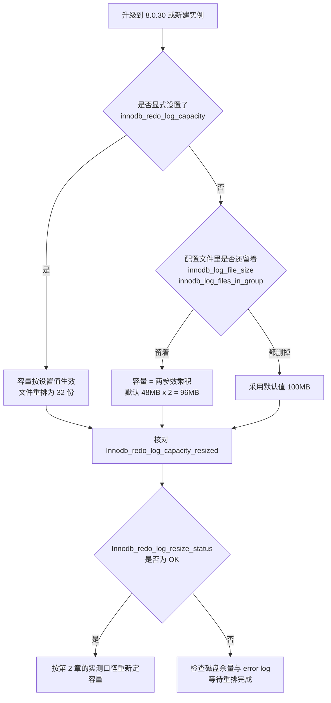
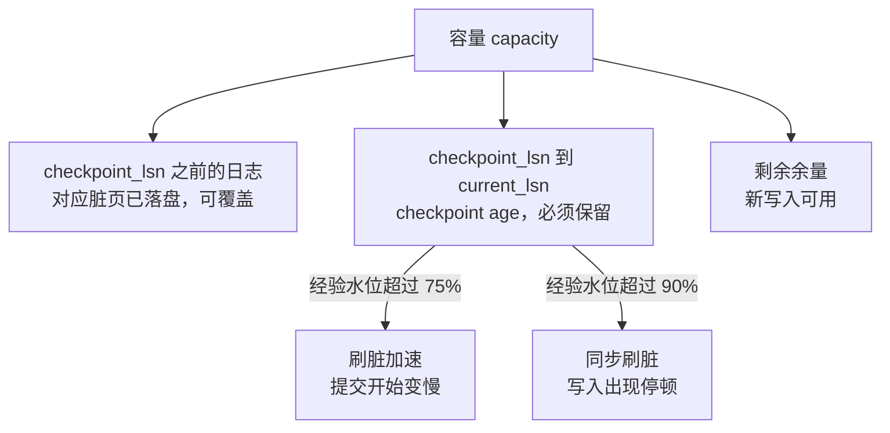
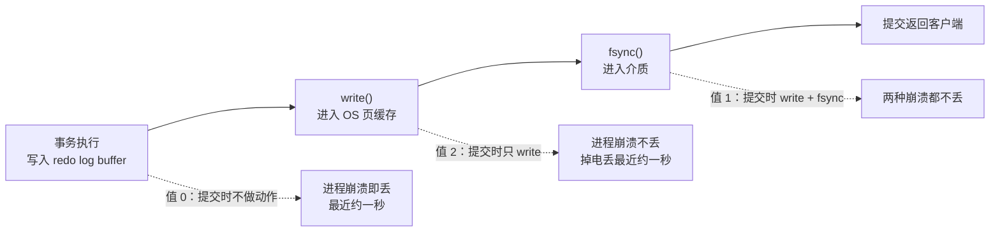

# 03 InnoDB 日志系统——WAL 协议与崩溃恢复的工程实现

**摘要：**

本篇不重讲 WAL 的机制推导。日志缓冲区怎么组织、LSN 的几种水位如何推进、组提交的三个阶段如何合并、两阶段提交为什么以 binlog 为裁决者，这些在读书笔记 07、08、15 里已经拆到源码级，本文只留结论与路由。真正要回答的是三个运行期问题：redo 容量该设多大，8.0.30 起口径从"文件大小乘文件数"换成单一容量参数，判据随之变成"两次检查点之间能产生多少 redo"，配套的是升级库的隐式继承、在线重排的核对方法，以及"先补产能再谈容量"的处置顺序；崩溃恢复的时间怎么预估，重放量的上界是容量，回滚项的耗时是长事务的三到四倍，六级强制恢复各自会丢什么；刷盘策略怎么选，`innodb_flush_log_at_trx_commit` 的三档不是快慢排序，而是三种不同的损失边界，并且必须与 `sync_binlog` 同档。文中给出实测口径、算例、阈值、六项监控与四则反例，并把日志侧三个慢信号的归因顺序、双写与 binlog 两条边界收进同一套判据；数字均标注为示例推算，不冒充基准测试。

---

## 第 1 章 8.0.30 的分水岭：从"文件大小"到"容量"

### 1.1 旧口径把一件事拆成了两个参数

在 8.0.30 之前，redo 的磁盘占用由两个参数共同决定，`innodb_log_file_size` 定义单个文件多大，`innodb_log_files_in_group` 定义组内有几个文件，两者相乘才是总容量。默认值分别是 48MB 与 2，相乘得出 96MB，落盘形态是数据目录下两个 `ib_logfile` 文件，日志按环形顺序在两个文件之间循环覆写。

这套口径的麻烦不在于乘法本身，而在于它把"容量"这个单一决策暴露成了两个可以独立变化的旋钮，运维在配置文件里看到的是两行数字，心里要随时算一遍乘积；更关键的是，8.0.30 之前改容量必须停机，旧实现会在启动时比对文件大小，发现不一致就写一次检查点、关闭并删除旧文件、按新的大小重建，整个过程只能在关闭状态完成。对一个写入密集、又确实需要扩容的实例来说，"为了改一个数字而重启"本身就是一次计划内故障。

### 1.2 新口径：一个参数、一组文件、一次在线重排

8.0.30 起，容量收敛为一个字节数参数 `innodb_redo_log_capacity`，默认 100MB，取值上限为 128GB，旧的两个参数被标记为废弃，设置了容量参数之后不再参与计算。落盘形态也换了，redo 文件住进数据目录下的 `#innodb_redo` 子目录，文件名形如 `#ib_redo582`，InnoDB 会尽量维持 32 个文件，每个约为容量的三十二分之一，其中正在使用的叫普通文件，等待复用的带 `_tmp` 后缀，叫备用文件。

这个设计让"容量"第一次成为可以在线改变的连续量。执行 `SET GLOBAL innodb_redo_log_capacity = ...` 之后，配置立即生效，但物理文件的重排需要时间，容量调大时脏页刷得更保守、redo 文件逐步长到新水位，容量调小时反过来刷得更急，文件逐步回收。因此 8.0.30 之后判断"扩容到底生效没有"，不能只看参数值，要看三个状态量：`Innodb_redo_log_capacity_resized` 给出当前真实的上限，`Innodb_redo_log_resize_status` 给出重排过程的状态，正常应为 `OK`，`Innodb_redo_log_logical_size` 与 `Innodb_redo_log_physical_size` 给出逻辑占用与物理占用。性能模式里还多了 `innodb_redo_log_files` 表，逐文件给出 `START_LSN` 与 `END_LSN`，要核对"哪段日志落在哪个文件里"，这是唯一不必解析状态文本的入口。

从容量到文件的映射关系，以及升级时容易踩的空白，可以用一张图串起来。



### 1.3 迁移的三处注意

第一处是升级库的隐式继承。手册写得很清楚，如果没有设置 `innodb_redo_log_capacity`，但配置文件里还留着旧的两个参数中的任意一个，容量就按两者乘积推导。这意味着一个从 5.7 升上来的实例，即便看到新参数的默认值是 100MB，实际生效的仍是旧配置算出来的 96MB，"新默认值"从未参与。升级检查单里应当有一条硬性动作：**显式写下容量**，然后核对 `Innodb_redo_log_capacity_resized`。

第二处是参数优先级与残留。容量参数一旦显式设置，旧参数即被忽略，但配置文件里留着它们并不会报错，只会在未来的版本里变成噪音，甚至在新版本彻底移除后成为启动失败的原因。迁移时把旧参数删干净，比让它们"被忽略"更稳妥。

第三处是磁盘余量与备份窗口。容量调整与新文件创建是同向的，重排期间新旧文件可能短暂共存，目录占用会高于最终值；另外 8.0.17 起提供的 redo 归档（`innodb_redo_log_archive_dirs` 配合 `innodb_redo_log_archive_start()`）是为备份工具准备的，归档文件与 redo 文件写同一份数据，若两者落在同一块盘上，容量越大、写放大越明显。这一条在规划磁盘时容易被漏掉。

| 维度 | 8.0.30 之前 | 8.0.30 起 | 迁移时的动作 |
| :--- | :--- | :--- | :--- |
| 容量参数 | `innodb_log_file_size` × `innodb_log_files_in_group` | `innodb_redo_log_capacity`（字节） | 显式设置容量，删掉旧参数 |
| 落盘位置 | 数据目录下 `ib_logfile0`、`ib_logfile1` | `#innodb_redo` 目录下的 `#ib_redoN` | 预留升级期间的额外空间 |
| 文件组织 | 固定文件数，环形覆写 | 尽量维持 32 个文件，`_tmp` 为备用 | 用 `innodb_redo_log_files` 核对区间 |
| 调整方式 | 停机后重建文件 | `SET GLOBAL` 在线重排 | 调整后核对 resize 状态与真实上限 |
| 生效后的默认 | 96MB | 100MB | 不要依赖默认值，写进配置 |
| 上限 | 由文件数与单文件大小约束 | 128GB | 超过 16GB 要为"吸收什么"给出解释 |

---

## 第 2 章 该设多大：用"两次检查点之间产生的 redo 量"来定

### 2.1 判据来自一个不等式

redo 空间能被安全复用的边界由检查点决定，检查点之前的日志对应的脏页都已落盘，可以覆盖；检查点之后、写入位置之前的这段日志必须保留，因为崩溃后要靠它重放。这段长度有一个专门的叫法，检查点年龄（checkpoint age），等于当前 LSN 减去检查点 LSN。于是容量的第一个硬约束是一个不等式：checkpoint age 必须小于容量，且要留出水位。机制的推导在 [[07. 重做日志缓冲区与 WAL：InnoDB 持久性的实现基石]] 里，此处只取结论。

把这个不等式翻译成运维语言，判据就清楚了：容量要能装下"两次检查点之间产生的 redo 量"。而两次检查点之间能产生多少 redo，取决于写入速率与刷脏进度，前者是业务的输入，后者是硬件的上限。所以容量从来不是孤立参数，它同时被"峰值生成速率"和"刷脏产能"夹住，前者决定它不能太小，后者决定它再大也没用。

容量内部的空间分布可以按检查点切成三段，水位越过哪一段，系统的行为就换一种。



两处水位都是工程经验值而非文档承诺，不同版本的触发细节可能不同，用它做告警分级足够，用它做精确预测不够。

### 2.2 三个必须实测的量

第一个是生成速率。`Innodb_os_log_written` 是累计写入日志的字节数，取 60 秒增量再除以时间，得到平均速率；判据要看**峰值而非均值**，因为撞墙只发生在峰值时段。采样时最好覆盖一次批处理任务或大促流量，两个时段的速率可能相差一个数量级。

第二个是消费能力，也就是脏页刷盘的速度。`Innodb_buffer_pool_pages_flushed` 的增量乘以页大小即为每秒刷出的字节数，与 `Innodb_data_pending_fsyncs` 合看，后者持续大于零说明刷盘队列积压，产能已经见顶。这一步决定"加容量是否只是把抖动推迟"。

第三个是当前水位。8.0.30 起可以直接用状态变量算，不必再解析 `SHOW ENGINE INNODB STATUS` 的文本。

```sql
-- 8.0.30+：当前重放量上界与水位（示例，采样间隔自行控制）
SELECT
  (SELECT VARIABLE_VALUE FROM performance_schema.global_status
     WHERE VARIABLE_NAME = 'Innodb_redo_log_current_lsn')        AS current_lsn,
  (SELECT VARIABLE_VALUE FROM performance_schema.global_status
     WHERE VARIABLE_NAME = 'Innodb_redo_log_checkpoint_lsn')     AS checkpoint_lsn,
  (SELECT VARIABLE_VALUE FROM performance_schema.global_status
     WHERE VARIABLE_NAME = 'Innodb_redo_log_capacity_resized')   AS capacity;
```

8.0.30 之前没有这三个变量，只能从 `SHOW ENGINE INNODB STATUS` 的 LOG 段落里读 `Log sequence number` 与 `Last checkpoint at`，两者相减即检查点年龄，再除以容量估算水位。有些资料把当前 LSN 写成 `Innodb_log_sequence_number`，MySQL 8.0 的状态变量里并没有这个名字，按本文给出的三个变量取数即可。

### 2.3 算例：一家订单库的容量推算

假设一家订单库的峰值 redo 生成速率为 30MB/s，这是示例推算的假设值，不是基准测试结论。由此可以算出不同容量能吸收多长的峰值突发，以及最坏情况下的重放量上界。

按 75% 的可用水位计算，1GB 容量在峰值下只能撑 25 秒左右，4GB 约 102 秒，8GB 约 205 秒，32GB 约 13.7 分钟。吸收时长的含义是：在这段时间内即使检查点完全推不动，写入也不会撞上空间墙；超过这段时间，就必须依赖刷脏把检查点推起来。

| 容量 | 峰值可吸收时长（30MB/s，示例推算） | 最坏重放量上界 | 调大的代价 | 调小的代价 |
| :--- | :--- | :--- | :--- | :--- |
| 1GB | 约 25 秒（75% 水位） | 1GB | 磁盘与恢复量都小，但几乎没有缓冲 | 峰值期频繁撞墙，提交开始成片变慢 |
| 4GB | 约 102 秒 | 4GB | 磁盘多占 3GB，恢复多扫约 3GB | 突发稍长就要靠刷脏硬扛 |
| 8GB | 约 205 秒 | 8GB | 停机刷脏的窗口变长 | 批量导入窗口容易被截断 |
| 32GB | 约 13.7 分钟 | 32GB | 磁盘占用与关机时间都要重新预算 | 基本不必担心撞墙，属于容量冗余 |

算到这里会出现一个很自然的反问：既然容量越大越不容易撞墙，为什么不直接给 32GB？因为**容量是缓冲，不是产能**。峰值 30MB/s 的 redo 最终都要变成脏页落到磁盘上，双写还会让写量再翻一倍，若刷脏能力只有 40MB/s，8GB 的缓冲只是把"每三分钟抖一次"换成"每十五分钟抖一次，每次抖得更久"。这一点在 2.4 与 2.5 两节里各自展开。

### 2.4 太小：频繁检查点与脏页洪峰

容量不足的表现不是日志文件写满报错，而是检查点被迫高频推进。`SHOW ENGINE INNODB STATUS` 的 LOG 段落里，`Last checkpoint at` 会紧咬着 `Log sequence number`，状态量上表现为水位长期贴在 75% 以上；写入侧的观感是毛刺变密，`Innodb_log_waits` 开始出现非零增量，提交延迟的 P99 被一段一段抬起。极端情况下水位逼近 90%，InnoDB 不得不做同步刷脏，新事务的提交要等脏页落盘，表现为间歇性的写入停顿。

处置顺序值得单独强调：**先确认刷脏产能**，再决定加容量。若 `Innodb_data_pending_fsyncs` 本来就持续大于零、盘的平均写延迟已经顶格，那么加容量只是延长两次抖动之间的间隔，抖动本身并没有消失。真正的顺序是补产能（换盘、提高 `innodb_io_capacity`、检查双写与 `innodb_flush_method`），确认产能有余量之后再谈容量。

### 2.5 太大：恢复变慢只是其中一项

容量越大，最坏情况下的重放量越大，这个上界是硬的：崩溃后恢复从最近一次检查点开始重放，重放量不会超过 checkpoint age 的历史最大值，而这个值又不会超过容量。不过重放速率通常远高于日志生成速率，容量翻两倍不等于恢复时间翻两倍，把"日志越大恢复越慢"当成线性关系会高估这一项。

真正的代价有三处。磁盘占用是最直白的一处，容量乘上副本数与备份策略之后不再是小数。停机时间是第二处，`innodb_fast_shutdown=0` 的关闭流程要把脏页全部刷净，容量越大、允许积累的脏页越多，关机窗口越不可控。第三处最隐蔽：容量过大容易掩盖刷脏能力的不足，让一个本该处理的 IO 问题以"容量够用"的形式潜伏下来，直到某次批量导入把水位推到顶，才发现产能从来不够。

### 2.6 给容量一个起点

按业务画像给起点比给一个"最佳实践数字"更可靠。读多写少、日增 redo 在几十 GB 以内的库，1GB 到 2GB 足以吸收常见突发；以短事务为主的交易库，4GB 到 8GB 是比较稳的区间，也是多数线上实例的实际取值；有周期性批量导入或大促峰值的库，8GB 到 16GB 可以避免导入窗口被检查点截断。超过 16GB 的取值需要能回答一个问题：多出来的容量用来吸收哪一类突发，若答不上来，回到 4GB 并把预算花在刷脏产能上更划算。

---

## 第 3 章 刷盘策略：三档判据不是快慢，而是丢什么

### 3.1 三档分别在哪个环节停手

redo 从产生到落盘要穿过三级：进程内的日志缓冲区、操作系统页缓存、存储介质。三档的差别就是提交时在这条路径上走到了哪一步。值为 0 时提交什么都不做，缓冲区与页缓存都靠后台每秒一次的推进；值为 1 时提交要写完并刷盘，也就是 `write()` 加 `fsync()`；值为 2 时提交只写进页缓存，不刷盘，同样靠每秒一次的推进。那个"每秒一次"由 `innodb_flush_log_at_timeout` 控制，默认 1 秒，但调度并不保证精确到秒，所以"最多丢一秒"是量级判断而不是承诺。

### 3.2 三档的判据表

判据应当从"这一秒的已提交数据丢了会怎样"出发，而不是从"快多少"出发。

| 值 | 提交时的动作 | 进程崩溃 | 操作系统崩溃或掉电 | 适用业务 | 放宽后的代价 |
| :--- | :--- | :--- | :--- | :--- | :--- |
| 1 | 写日志并刷盘（`write` + `fsync`） | 不丢 | 不丢（前提是盘写缓存有掉电保护） | 订单、支付、账务、任何"提交即承诺"的链路 | 每次提交一次刷盘，提交延迟受盘延迟约束 |
| 2 | 只写进操作系统页缓存，不刷盘 | 不丢 | 丢最近约一秒的已提交事务 | 允许整机级故障丢一秒的业务，且故障域与数据重要性匹配 | 进程死不了，掉电才丢；机器级故障窗口被打开 |
| 0 | 提交时不做任何动作 | 丢最近约一秒的已提交事务 | 丢最近约一秒的已提交事务 | 可重放数据：日志采集、监控快照、会话缓存、可重算的中间结果 | 进程一死就丢，且"丢"发生在客户端已经收到成功之后 |

笔记 07 里对组提交的推导可以作为这张表的注脚，这里只留一句结论：`=1` 之所以还能撑住高并发，是因为多个并发提交共享同一次刷盘，实测判据是 `Innodb_os_log_fsyncs` 与 `Innodb_log_writes` 的比值，比值远小于 1 说明组提交在工作，比值接近 1 说明提交被拆得太散或者并发太低，此时该先改应用层的提交粒度，而不是急着降档。

### 3.3 2 与 0 的差别全在"谁持有那一秒"

很多人把 0 与 2 都归为"每秒刷一次"，这个归类在吞吐上大致成立，在故障语义上完全错位。值为 0 时，那一秒的数据还躺在 mysqld 自己的内存里，进程一退就没了，所以进程崩溃即丢；值为 2 时，数据已经通过 `write()` 交到了内核页缓存，进程死活与它无关，只有整机掉电或操作系统崩溃才会带走它。换句话说，0 与 2 之间的差别是"**数据是否已经离开进程**"，而 2 与 1 之间的差别是"**数据是否已经离开机器**"。

还有一处前提常被忽略：值为 1 承诺的是"刷盘成功才返回"，而刷盘是否真的到底层介质，取决于磁盘自身的写缓存策略。若盘上带易失性写缓存且没有电池或电容保护，`fsync()` 可能在数据仍停留在控制器缓存时就返回，此时掉电一样丢数据，只是丢的方式更隐蔽。数据库侧的参数只能保证"我发了刷盘指令"，保证不了"盘真的落了"。



### 3.4 与 binlog 的放宽必须同档

redo 与 binlog 之间靠两阶段提交对齐，准备阶段把 redo 刷盘并打上准备标记，写 binlog 并刷盘，最后在 redo 中打提交标记。恢复时 binlog 是否完整是裁决依据：binlog 有而 redo 只到准备，就补提交；binlog 没有，就回滚。把这个顺序与刷盘策略放在一起看，会得到一个容易被忽略的判断：**两边必须同档放宽**。

若把 redo 放宽到 2 而 `sync_binlog` 保持 1，掉电时可能出现 binlog 已落盘、redo 准备记录却丢在页缓存里的组合。从库按 binlog 把事务同步走了，主库恢复后却没有这次修改，而两阶段提交的裁决依据本身就是一段丢失的 redo，没有任何机制能把这次修改补回来。这类不一致不会自动修复，也不会在监控上直接报警，只会在某次对账时以"主从数据对不上"的形式暴露。要放就两边一起放，代价是同一秒的数据在主从两侧同时消失，一致性反而保住了。

| redo 档位 | `sync_binlog` | 掉电丢什么 | 主从一致性 | 适用判断 |
| :--- | :--- | :--- | :--- | :--- |
| 1 | 1 | 不丢 | 有保障 | 默认，核心链路不改 |
| 2 | 0 | 两侧各丢最近约一秒 | 损失对称，一致性可保 | 可容忍整机故障丢一秒，且能接受对账口径 |
| 2 | 1 | redo 丢、binlog 不丢 | 有分歧风险 | 不推荐，属于只改一半的放宽 |
| 0 | 0 | 进程崩溃即丢一秒 | 损失对称 | 仅限可重放数据，且要有独立的一致性校验 |
| 1 | 0 | redo 不丢、binlog 丢 | 主库有、从库无 | 不推荐：复制链路缺事件，且 PITR 断点 |

---

## 第 4 章 崩溃恢复怎么判：重放量、水位与六级逃生门

### 4.1 恢复时间由四段构成，其中只有两段挡住连接

异常关机后重启，InnoDB 的恢复分成四段。先是表空间发现，按 `innodb_directories` 扫目录，确认哪些表空间文件需要应用日志；接着是 redo 重放，从最近一次检查点重放到日志末尾，把数据页推到崩溃前的最新状态；这两段完成之前实例不接受连接。然后是未提交事务的回滚，由后台线程执行，与新连接并行，手册明确提示在回滚完成之前新连接可能与恢复中的事务产生锁冲突；最后是 change buffer 合并与 purge，这两件事本来就在正常运行时进行，恢复只是把它们接上。


四段的机制推导在 [[15. InnoDB 崩溃恢复：从检查点到重做日志的完整重建之路]] 里逐层展开，本章只取判据。

这个结构给出一条直接的判断：用户能感知的不可用时长约等于"**表空间发现加重放**"，而不是整个恢复过程。于是估算恢复时间时，重放量与重放速率是主项；而决定"恢复后多久恢复正常"的，往往是后台回滚与合并。

### 4.2 三个数决定恢复的工作量

第一个数是重放量，等于当前 LSN 减去检查点 LSN，上界是容量。第二个数是重放速率，它与日志生成速率不是一回事，重放要按页访问，随机性更强，同一块盘上重放速率通常高于生成速率，但不会高出两个数量级。第三个数是**回滚量**，也就是崩溃时仍在执行的大事务所占的 undo 与锁。

三个数里最容易被低估的是第三个。手册对回滚时间的描述相当直白：回滚一个未完成事务的耗时可能达到它已经执行时长的三到四倍，具体取决于负载。这意味着一个跑了十分钟的大事务被崩溃打断，恢复后可能要花半小时以上回滚，而这半小时里实例是接受连接的，表现为一堆锁等待与性能异常，工单上写的却是"数据库重启后就变慢了"。

### 4.3 RTO 预算的一个算例

仍以第 2 章的订单库为例，容量 4GB，最坏撞墙时的重放量为 4GB，假设重放速率 400MB/s，重放本身约 10 秒；表空间发现通常在秒级到几十秒；若崩溃时恰有一个十分钟的大事务在跑，回滚按三到四倍估算就是三十到四十分钟。两相对比，重放项在总量里几乎可以忽略，恢复时间的主导项是**事务设计**。数字均为示例推算，用于说明各项量级关系，不用于对外承诺。

由此得到一条可执行的预算方法：把恢复时间拆成"重放项"与"回滚项"分别估，重放项用容量除以重放速率，回滚项用最长事务的执行时长乘三到四倍。若回滚项超出 RTO，解法不是调小容量，而是把大事务拆小、把批量操作分批提交，或者为关键实例准备故障切换而不是等待原地恢复。

### 4.4 `innodb_force_recovery` 的六级语义

当实例因为页损坏而根本无法启动时，才轮到强制恢复。手册的语气很谨慎：只在紧急情况下设置非零值，先确认有可用备份，从 1 开始逐级递增，4 及以上可能造成数据文件的永久损坏，必须先在独立的物理副本上验证过再用于生产。

| 级别 | 常量名 | 语义 | 代价与风险 |
| :--- | :--- | :--- | :--- |
| 1 | `SRV_FORCE_IGNORE_CORRUPT` | 检测到坏页也让服务运行，`SELECT` 时尽量跳过损坏的记录与页 | 相对安全，可能读到跳页后的残缺结果 |
| 2 | `SRV_FORCE_NO_BACKGROUND` | 阻止主线程与 purge 线程运行 | 防止 purge 过程触发再次崩溃，实例功能受限 |
| 3 | `SRV_FORCE_NO_TRX_UNDO` | 崩溃恢复后不执行事务回滚 | 未提交事务的修改留在数据里，需要人工核对 |
| 4 | `SRV_FORCE_NO_IBUF_MERGE` | 不合并 change buffer，也不计算统计信息 | 可能永久损坏数据文件，之后要重建二级索引；实例转只读 |
| 5 | `SRV_FORCE_NO_UNDO_LOG_SCAN` | 启动时不看 undo 日志，未完成事务一律视为已提交 | 可能永久损坏数据文件；实例转只读 |
| 6 | `SRV_FORCE_NO_LOG_REDO` | 不执行 redo 前滚 | 最激烈的一档，页面停留在旧状态，可能引入更多不一致；只用于把数据导出来 |

使用这套手段有一条纪律：只把它当"把数据导出来"的**临时通道**，不要在配置里常驻，也不要在导出完成之后继续用它跑业务。级别高于 0 时 InnoDB 会拒绝 `INSERT`、`UPDATE`、`DELETE`，4 及以上直接进只读，这些限制本身就是提醒：此刻的实例已经不是一个可以正常服务的数据库。把 `innodb_force_recovery` 写进 `my.cnf` 并长期保留，等于给未来的每一次启动都埋了一个"会丢数据但不报错"的开关。

### 4.5 恢复完成不等于恢复如常

前滚结束、连接放开，只是主流程结束。后台还有回滚、change buffer 合并、purge 在跑，这段时间里的锁等待、读放大与写放大都属于恢复的余波。此外 `innodb_fast_shutdown` 决定了"下次启动需要做多少事"：设置为 0 会在关闭时把脏页刷净并做一次完整检查点，启动几乎不需要重放；设置为 1 跳过部分清理，启动要重放一段；设置为 2 连日志都不刷，等同于模拟崩溃。计划内维护为了缩短停机而设成 1 或 2 是常规做法，但要把"启动会变慢"计入变更窗口，而不是当成故障。

---

## 第 5 章 三个"日志相关"的慢

### 5.1 `Innodb_log_waits` 大于零：日志写入路径上有人排队

这个计数器的定义是：日志缓冲区没有空间、线程不得不等待日志写入推进的次数。它是"日志侧出现等待"最直接的证据，但归因要分两层。第一层是缓冲区本身不够用，典型场景是单条语句写入巨量行，redo 在缓冲区里堆满，写日志的线程还没推进到可以腾出空间的位置；第二层是落盘跟不上，缓冲区之所以腾不出空间，是因为刷盘队列积压，`Innodb_os_log_pending_fsyncs` 会同时抬头。

有一处常见的误读需要纠正：这个计数器涨，**不等于 redo 容量不足**。容量不足的现场是检查点水位贴顶与写入停顿，并不必然表现为 `Innodb_log_waits` 上涨。反过来，容量充裕的实例也完全可能因为一次批量导入把日志缓冲区打满。处置顺序因此是：先看日志侧刷盘队列与 fsync 延迟，再看缓冲区大小，最后才动容量。8.0.30 起日志缓冲区可以在运行期调整（更早的版本要重启），这降低了试错的成本，但也让"随手调大"变得更容易，调大之前先确认瓶颈真的在缓冲区。

### 5.2 `Innodb_data_pending_fsyncs` 持续大于零：数据页刷盘跟不上

这个计数器记录待完成的数据页刷盘请求数。它偶尔大于零是正常的，写入线程同时在跑就会短暂排队；判据是"**持续大于零**且伴随增长趋势"，那说明刷盘请求的到达速率已经超过磁盘能完成的速率。此时观察 `Innodb_buffer_pool_pages_dirty` 会看到脏页比例抬头，`Innodb_buffer_pool_pages_flushed` 的速率却上不去。

根因通常在三处：盘本身的写带宽或 IOPS 不够；双写让有效写量翻倍，尤其是在机械盘或写缓存策略保守的盘上；`innodb_io_capacity` 设得远高于实际能力，刷脏线程按虚高的目标发起 IO，队列越堆越长。第三处最值得警惕，把 `innodb_io_capacity` 按硬盘规格书的顺序写带宽来设，在随机写为主的场景下会把产能估高一个档次。

### 5.3 提交延迟抖动：`=1` 遇上慢盘

第三种慢不在计数器里，而在应用侧的提交延迟分布上。`innodb_flush_log_at_trx_commit=1` 把每次提交绑定到一次刷盘，单次刷盘延迟会原样进入提交延迟。盘正常时这条延迟在一百微秒到几毫秒之间，抖动不大；一旦盘开始排队，提交延迟的 P99 会出现明显的尖刺，而平均值可能只上升了一点。

判断这件事需要两个数放在一起：提交延迟的 P99，以及 `Innodb_os_log_fsyncs` 与 `Innodb_log_writes` 的比值。P99 尖刺、比值接近 1，说明提交基本是逐个刷盘，组提交没有形成；要么并发不够，要么应用把提交拆得太碎。此时的正解是**批量化与提高并发**，让多个提交共享一次刷盘，而不是先降档。降档确实能让尖刺消失，代价是把"延迟问题"换成了"数据损失边界"，这两者的性质完全不同。


| 信号 | 典型现象 | 根因层 | 第一处置 | 处置代价 |
| :--- | :--- | :--- | :--- | :--- |
| `Innodb_log_waits` 增长 | 写入毛刺、提交 P99 抬升 | 日志缓冲不足或日志盘刷不动 | 先看 `Innodb_os_log_pending_fsyncs` 与 fsync 延迟 | 调大缓冲占内存，且可能掩盖真实瓶颈 |
| `Innodb_data_pending_fsyncs` 持续大于零 | 脏页比例抬头、刷脏速率上不去 | 盘带宽不足、双写放大、`innodb_io_capacity` 虚高 | 校正 `innodb_io_capacity`，核对双写与盘型 | 调低 io_capacity 会拖慢检查点推进 |
| 提交延迟 P99 尖刺 | 平均延迟尚可，尾部很差 | 每次提交单次刷盘、组提交未生效 | 应用批量化、提高并发、换盘 | 降档会改变数据损失边界，不是纯性能改动 |

---

## 第 6 章 两条边界：双写与 binlog

### 6.1 双写：一句话与三个版本细节

双写的用途一句话就能说完：脏页在写回原位之前先顺序写一份到双写区，掉电导致页只写了一半时，恢复阶段用这份副本把页补全，避免出现无法用 redo 修复的坏页；关掉它换取写吞吐，风险是把"机器级故障"从"丢一秒数据"升级为"可能要按备份重建"。机制与代价见 [[08. InnoDB 双写机制：数据页写入的保险丝]]，此处只补三个与容量决策相关的版本细节。

8.0.20 起双写区从系统表空间独立成双写文件，文件名形如 `#ib_16384_0.dblwr`，并存放在 `innodb_doublewrite_dir` 指定的目录里，未指定时跟随 `innodb_data_home_dir`；把双写目录放到更快的介质上是这一版本之后才成立的调优手段。8.0.30 起 `innodb_doublewrite` 多了 `DETECT_AND_RECOVER` 与 `DETECT_ONLY` 两档，后者只写元数据、不写页内容，用于检测半写而不用于修复，且这三档之间可以动态切换，但与 `OFF` 之间不能互切。

与容量相关的判断在这里：双写让刷脏的有效写量翻倍，直接压低"每秒能刷出多少脏页"，也就是压缩了检查点的推进能力。容量再大，也只是把撞墙时间往后推，而双写带来的**产能折扣**是实打实的。所以第 2 章那条"先补产能再谈容量"的顺序，在双写开启的实例上更应坚持。

### 6.2 binlog：两阶段提交是主从一致性的地基

redo 与 binlog 的关系一句话概括：提交时先在 redo 里打准备标记并刷盘，再写 binlog 并刷盘，最后在 redo 里打提交标记，恢复时以 binlog 是否完整裁决该事务提交还是回滚。这套顺序的完整推演与 binlog 格式、复制线程模型在 [[10 Binlog 与主从复制——数据同步的底层传动链]] 里，本列不重复。

对运维判断而言，这段机制只产出一条硬约束：redo 与 binlog 的持久性**必须同档**，理由已写在 3.4。把它做进变更检查单，比记住两阶段提交的三个阶段更有用。

---

## 第 7 章 监控项清单：六个必须盯的数

日志侧的监控不需要面面俱到，六个指标足以覆盖绝大多数现场。采集口径有两个共同点：计数器一律**取速率而不是绝对值**，采样窗口 60 秒并保留峰值；所有阈值都要结合实例容量换算成水位，绝对值在不同容量的实例之间没有可比性。

| 指标 | 采集方式 | 阈值 | 越界含义 | 先动哪个旋钮 |
| :--- | :--- | :--- | :--- | :--- |
| 检查点水位 | `current_lsn` 减 `checkpoint_lsn`，除以 `capacity_resized` | 持续超过 75% 告警，超过 90% 高危 | 刷脏推进不及或容量偏小 | 先补刷脏产能，再评估容量 |
| redo 生成速率 | `Innodb_os_log_written` 的每秒增量 | 相对基线上浮一倍且持续 | 批量任务或大事务进入 | 核对业务窗口，必要时限流 |
| 日志等待 | `Innodb_log_waits` 的每秒增量 | 任何持续非零 | 日志写入路径出现排队 | 先看日志盘 fsync 队列 |
| 日志刷盘队列 | `Innodb_os_log_pending_fsyncs`、`Innodb_os_log_pending_writes` | 持续大于零 | 日志盘产能见顶 | 换盘或降低提交频率 |
| 数据页刷盘队列 | `Innodb_data_pending_fsyncs` 与脏页比例 | 持续大于零且脏页比例抬头 | 数据盘产能不足 | 校正 `innodb_io_capacity`、核对双写 |
| 提交延迟 | 应用侧提交 P99 配合 fsync 与写次数的比值 | P99 相对基线翻倍 | 单次刷盘被放大到提交路径 | 批量化、提并发，最后才考虑降档 |

除此之外还有一项 8.0.30 之后才需要盯的状态：`Innodb_redo_log_resize_status` 与 `Innodb_redo_log_capacity_resized`。在线扩容之后如果状态没回到 `OK`，或者真实上限仍停在旧值，说明重排没有完成，此时按新容量估算水位会得出错误的结论。这个坑在旧版本不存在，因为旧版本根本没有在线扩容这条路。

---

## 第 8 章 四则反例

第一则，把 `innodb_flush_log_at_trx_commit=0` 用在支付链路。这类库的特点恰恰是"客户端收到成功就意味着钱动了"，而值为 0 的语义是"提交返回之后，那一秒的数据还可能只存在于进程内存里"。掉电或进程退出，客户端已经确认的扣款在主库上不存在，退款与对账链路全部错位。性能收益确实存在，但它换走的是这条业务唯一不能出让的东西。

第二则，用默认的 100MB 直接承载写密集业务。默认值是给"能跑起来"准备的，不是给"峰值 30MB/s"准备的。这类实例的表现是每隔几十秒一次写入停顿，监控上却看不到明显的错误，只有提交 P99 图上密集的尖刺。判据很简单：算一遍峰值速率与容量的比值，若容量撑不过一分钟，就不该沿用默认值。

第三则，把 `innodb_force_recovery` 当成常规修复手段。有人在实例起不来时逐级上调直到启动，然后把级别留在配置里继续跑业务，理由通常是"反正能跑"。手册对这一档的界定是 4 及以上可能永久损坏数据文件、6 会让页面停在旧状态并可能扩散不一致，这些损坏不会立刻表现为报错，而是让后续的每一次写入都建立在错误的基础上。正确路径是**导出数据**、用备份加 binlog 做时间点恢复，然后重建实例。

第四则，只加容量不改产能。容量买到的是"能承受多长的突发"，买不到"每秒能刷多少脏页"。在第 2 章的算例里，把容量从 4GB 提到 32GB，撞墙间隔从约 102 秒延长到约 13.7 分钟，但刷脏产能若仍停在 40MB/s，峰值 30MB/s 的 redo 加上双写的放大照样会把队列堆起来，只是停顿来得更晚、单次更长。

---

## 第 9 章 结语

这三个参数其实是三种不同性质的兑换。容量兑换的是"抖动频率"与"恢复重放上界"，调大把撞墙推远，同时把最坏恢复量抬高；刷盘三档兑换的是"损失边界"，`=1` 不丢但慢，`=2` 掉电丢一秒，`=0` 连进程崩溃都丢，档位变的是风险的性质而不是大小；强制恢复兑换的是"能不能启动"，每一级都在用数据完整性换可用性。

判断顺序比参数取值更重要：先量生成速率与刷脏产能，再定容量，最后才考虑档位。产能与缓冲不能互相替代，这一点在双写开启、盘型一般、批量导入频繁的实例上尤其明显。至于具体数字，本文给出的都是示例推算的量级，真正的取值只能来自对自家实例的一次实测，因为写入速率的形状、盘的真实延迟、事务的长短分布，都不存在通用答案。若要留一条能长期执行的纪律，笔者以为是把第 7 章那六个指标做成常态看板，并把水位、产能与恢复预算作为同一张变更单上的联动项，改动其中任何一项都重算另外两项。

---

## 参考资料

1. MySQL 8.0 Reference Manual, 17.6.5 Redo Log（容量口径、`#innodb_redo` 文件组织、在线重排与状态变量、redo 归档、禁用 redo）。https://docs.oracle.com/cd/E17952_01/mysql-8.0-en/innodb-redo-log.html
2. MySQL 8.0 Reference Manual, 17.6.4 Doublewrite Buffer（双写文件、`innodb_doublewrite_dir`、`DETECT_ONLY` 与 `DETECT_AND_RECOVER`）。https://docs.oracle.com/cd/E17952_01/mysql-8.0-en/innodb-doublewrite-buffer.html
3. MySQL 8.0 Reference Manual, 17.18.2 InnoDB Recovery（恢复步骤、表空间发现、回滚耗时与后台回滚）。https://docs.oracle.com/cd/E17952_01/mysql-8.0-en/innodb-recovery.html
4. MySQL 8.0 Reference Manual, 17.21.3 Forcing InnoDB Recovery（`innodb_force_recovery` 六级语义与风险）。https://docs.oracle.com/cd/E17952_01/mysql-8.0-en/forcing-innodb-recovery.html
5. MySQL 8.0 Reference Manual, 17.14 InnoDB Startup Options and System Variables（参数与状态变量的作用域、动态性，旧参数废弃说明）。https://docs.oracle.com/cd/E17952_01/mysql-8.0-en/innodb-parameters.html
6. MySQL 8.0 Reference Manual, Server Status Variables（`Innodb_redo_log_current_lsn`、`Innodb_redo_log_checkpoint_lsn` 等）。https://docs.oracle.com/cd/E17952_01/mysql-8.0-en/server-status-variables.html
7. MySQL Server Blog, Dynamic InnoDB Redo Log in MySQL 8.0（8.0.30 redo 架构、容量估算与 `innodb_redo_log_files` 表）。https://dev.mysql.com/blog-archive/dynamic-innodb-redo-log-in-mysql-80/

---

> [!note] 思考题
> 1. 若把容量从 4GB 提到 32GB 而刷脏产能不变，峰值期的写入停顿会消失还是会变形？用第 2 章的算例给出理由。
> 2. `innodb_flush_log_at_trx_commit=2` 配合 `sync_binlog=1`，掉电后主从为何可能不一致？顺着两阶段提交的裁决顺序推一遍。
> 3. 一个执行了十分钟的大事务在崩溃时被打断，恢复时间主要由哪一项决定？用 `innodb_force_recovery=3` 换启动时间，代价具体落在哪里？
> 4. 检查点水位只有 60%，提交延迟 P99 却持续尖刺，先查哪三个量？顺序为什么不能颠倒？
> 5. `Innodb_log_waits` 长期为零，能否说明日志侧健康？还缺哪个观测维度才能下结论？