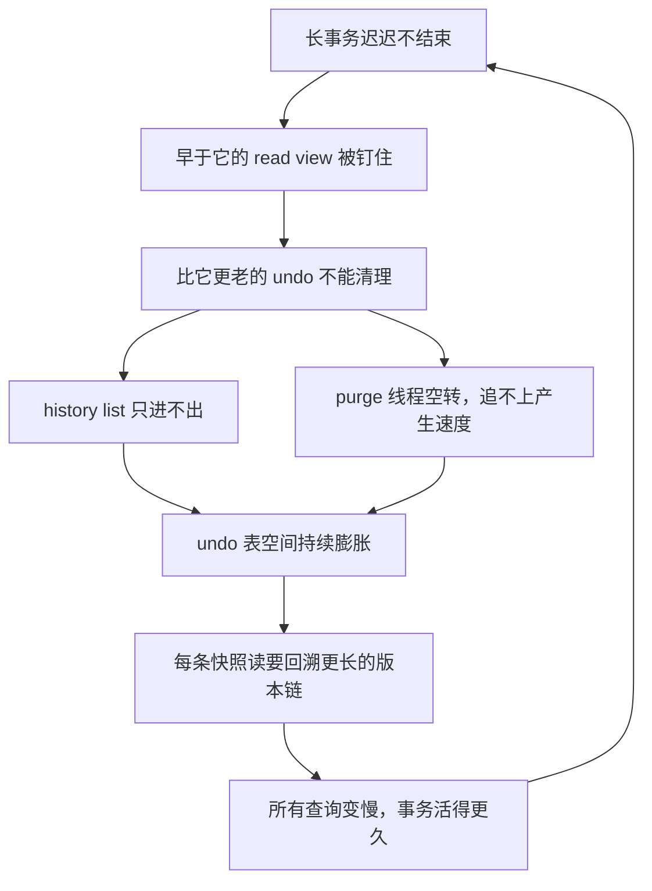
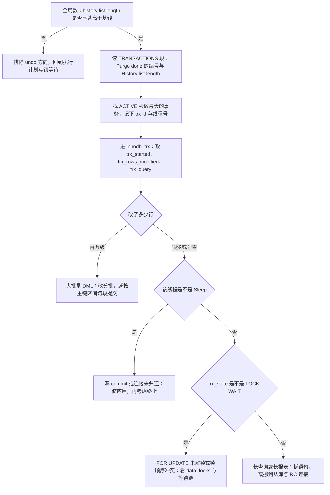
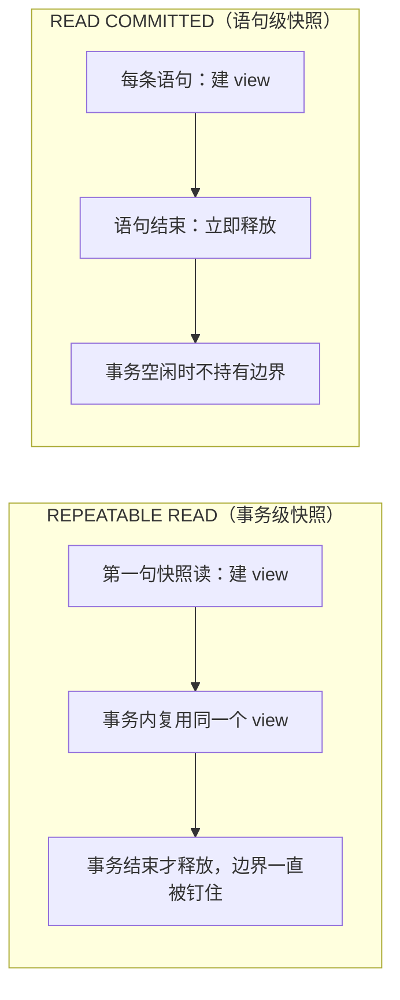

# 04 Undo Log 与 MVCC——多版本并发控制的实现真相

**摘要：**

长事务的代价很少以"事务"的面目出现：它先让 undo 表空间膨胀，再让每一条快照读在更长的版本链上多走几步，最后以"什么都没改，但 P99 涨了三倍"的形式报到值班台上，而慢查询日志里一条可疑记录都没有。本篇不复述 read view 与版本链的机制——那部分在[[12. InnoDB 事务实现：ACID 的内核代价与 MVCC 的时间旅行|读书笔记第十二篇]]里已经拆到源码级——只回答运行期的三个问题：怎么发现（history list length、`TRANSACTIONS` 段里最老事务的启动时间、`information_schema.innodb_trx` 三处判据的口径、取数与阈值，包括那个"面板上有、社区版却没有"的指标名陷阱）、怎么定位（忘 commit、连接池借出未还、大批量 DML、`SELECT ... FOR UPDATE` 未解锁四个来源各自的排查 SQL 与处置代价）、怎么处置（undo 表空间的观测与截断条件、purge 线程的调优边界、"删了数据磁盘不降"的三种成因）。版本口径以 8.0 为主，8.0.14 与 8.4 的差异单独标注；文中给的是判据与代价，不是可以照抄的通用答案，判据可以直接落进巡检脚本，阈值则需要按自家基线重算。

---

## 第 1 章 一条从来没有报错的减速带

某套演练用的 8.0 实例，16 核 64G，主库表约 8000 万行，日更 300 万行。周二上午起业务方反馈列表页变慢：发布前 P99 是 12ms，中午之后稳定在 55ms，下午已经是 90ms 量级，但同一时刻的写入延迟与 QPS 都没有变化。DBA 照例查慢查询日志，前 50 条耗时全部在 200ms 以内，最慢的一条是报表 SQL，与列表页无关；执行计划走的是同一个二级索引，`rows` 估算也没有偏。倒是磁盘一天涨了 40GB，而业务侧并没有做数据导入。

拆开只花了三分钟。`SHOW ENGINE INNODB STATUS` 的 `TRANSACTIONS` 段里 `History list length` 是 210 万，同一段有 `ACTIVE 5400 sec` 且行数改动为零的事务；`information_schema.innodb_trx` 里那一行的 `trx_query` 为 NULL，线程指向一条 `Sleep` 连接。一个半小时前，某个后台任务用 `autocommit=0` 的连接跑了一条 SELECT 做数据校验，之后既没提交也没断开，连接还回了池子。就这一个连接，把整个实例的读路径拖慢了七倍。下面的数字取自演练环境的复现，不是基准测试；可以迁移的是量级与因果关系。

### 1.1 三处反直觉

第一处是写入不慢。所有 DML 的耗时几乎没变，binlog、redo、双写的指标都正常，所以第一轮怀疑通常落在"读放大"或"索引失效"上，而这两条都会被 `EXPLAIN` 排除。

第二处是**慢查询日志干净**。慢日志记的是单条语句超过 `long_query_time` 的执行，而这台机器上没有一条语句真正慢：每条只多花几毫秒，乘上每天几千万次调用才变成整体不可用。

第三处是删了数据磁盘不降。运维在低峰期清理了两千万行历史数据，表文件没有缩小，undo 目录反而又涨了 8GB。三件事在 undo 这条线上是同一个投影。

### 1.2 机制只留一句话

把机制压成一句：长事务攥住一个 read view，凡是比它更老的 undo 都不能被清理，历史链表越来越长，undo 表空间随之膨胀，所有快照读都要在更长的版本链上回溯，于是整个实例变慢。

read view 的四个字段、可见性判断的五条规则、版本链通过 `DB_ROLL_PTR` 串起来的物理形态、Delete Mark 为什么不能立刻物理删除，在[[12. InnoDB 事务实现：ACID 的内核代价与 MVCC 的时间旅行|读书笔记第十二篇]]里已经讲透；隔离级别的语义差别在[[08 InnoDB 事务隔离级别——从脏读到幻读的防御工程|本列隔离级别一篇]]，加锁规则在[[07 InnoDB 锁机制——从记录锁到间隙锁的底层实现|本列锁机制一篇]]。本篇从这三篇的结论之后开始写，只关心运行期：这些机制在监控上留下什么形状的痕迹，痕迹出现之后按什么顺序动手。

---

## 第 2 章 膨胀是一句话的事

### 2.1 因果链的形状

膨胀的因果链只有五个环节，但它是闭环的：清理跟不上会让空间涨，空间涨又让读变慢，读变慢会让事务活得更久，于是清理更跟不上。下图画出这条闭环，注意最后那条回边。



先看 purge 那条分支。purge 并没有坏，它一直在按批次解析历史链表上的 undo 页，只是清理的安全边界被最老的活跃事务钉在了一个很早的位置，**边界**之后的所有 undo 它都无权处理。于是"能清理的"远远少于"新产生的"，历史链表只能变长。

### 2.2 变慢的三条成本路径

第一条是回溯成本。快照读拿到一行记录后，先看 `DB_TRX_ID` 是否对自己可见，不可见就顺着 `DB_ROLL_PTR` 去 undo 里重建上一个版本，再判断，再回溯。版本链越长，单行访问要碰的 undo 记录越多；这部分成本不进执行计划，因为它在存储引擎内部发生，`EXPLAIN` 只看得见"扫描了多少行"。

第二条是 IO 与内存的挤压。undo 记录同样占 buffer pool 的页，膨胀之后会挤掉数据页与索引页的命中率；同时 purge 为了追赶，持续读 undo 页、写脏页、产生 redo，与用户请求争抢同一块盘的带宽与 IOPS。

第三条是看不见的标记：被标记删除的老记录不能回收，索引扫描要多跳过一批死记录，覆盖索引退化成回表的情况变多。三条路径叠在一起，才会出现"单条 SQL 都正常、整体慢七倍"的形状。

### 2.3 三个容易混的"空间"

排查时最常见的错位，是把 undo 表空间、回滚段、历史链表当成一件事。三者是三个层次，膨胀时涨的是后面两层，观测入口也不同。

| 层次 | 是什么 | 观测入口 | 膨胀时谁在涨 |
| :--- | :--- | :--- | :--- |
| 历史链表（history list） | 已提交事务中待清理的 undo 单元组成的链表，长度就是 purge lag | `INNODB_METRICS.trx_rseg_history_len`；`SHOW ENGINE INNODB STATUS` 的 `History list length` | 记录条数，先涨 |
| 回滚段（rollback segment） | 每个 undo 表空间里组织 undo 日志的槽位，`innodb_rollback_segments` 默认 128 | `INNODB_METRICS.trx_rseg_current_size` | 单个段占用的页数 |
| undo 表空间（undo tablespace） | 物理文件 `undo_001`/`undo_002`，默认两个 | `information_schema.INNODB_TABLESPACES` 里 `SPACE_TYPE='Undo'` 的行 | 文件大小，最后涨 |

三者的关系是"因—果—果"：链表长是原因，回滚段占页是过程，文件变大是结果。处置时如果只盯文件，就会得出"删数据不管用"的结论，因为文件的收缩条件根本不在这里。

### 2.4 判据该定在哪

官方文档对 `History list length` 给的口径是：通常保持在一个很低的值，一般在几千以内；写入密集或存在长事务时会升高，即使是只读事务也会。文档同时说明，这个数就是 purge lag 的展示形式。

从此出发，阈值应该分两层。第一层是基线：每套实例在正常业务日里的值落在一个稳定区间，超过基线五到十倍就值得看一眼。第二层是不要越过的线：经验上七位数意味着已有明确的长事务或大事务压着，八位数意味着读放大正在发生，处置要按事故走；这两条是笔者在现场用的经验值，不是文档承诺的常量。

比绝对值更有信息量的是**斜率**。一个稳定在 80 万但不再上涨的值，说明有一个固定长事务恰好钉在那里，处置它就能一次性回落；一个从 3000 一路涨到 200 万的值，说明产生速度远超清理速度，即使杀掉最老的事务也会立刻被新的填满。前者查事务，后者查负载与 purge 能力。

---

## 第 3 章 三个判据，从粗到细

三个判据对应三个粒度：全局计数回答"有没有问题"，段内最老事务回答"在哪个事务上"，明细表回答"它在干什么"。顺序不能反，事务数上万时先翻明细表既慢又容易看花眼。

### 3.1 判据一：history list length

第一个判据是全局数，取数有三条路径，巡检脚本里最好只认一条并写清出处。第一条是 `SHOW ENGINE INNODB STATUS` 的 `TRANSACTIONS` 段，人能读，脚本不好解析，适合手工确认。第二条是 `INNODB_METRICS` 里的 `trx_rseg_history_len`，这是官方给出的程序化入口，默认已启用，`COUNT` 列即当前值：

```sql
-- 官方口径：待清理的 undo 单元数，等价于 purge lag
SELECT COUNT AS history_list_length
FROM information_schema.INNODB_METRICS
WHERE NAME = 'trx_rseg_history_len';
```

第三条要格外小心。监控面板上常见的指标名叫 `Innodb_history_list_length`，这个状态变量是 Percona Server 那条分支提供的，MySQL 社区版的 `SHOW GLOBAL STATUS` 里并没有它，用 `SHOW GLOBAL STATUS LIKE 'Innodb_history%'` 在社区版 8.0/8.4 上会返回空。看到面板上有这条曲线时，先确认采集器背后到底是 `SHOW GLOBAL STATUS`、`INNODB_METRICS` 还是某个发行版的私有变量，否则会把"没采到"当成"值为零"。

阈值按前一章的两层来定。**百万级**就已经说明存在长事务或大事务，值得立刻查；从三千涨到百万的斜率说明产生速度压过清理速度，处置要同时动事务与 purge。反过来，如果它长期在几百到几千之间随业务起伏，排查方向就该回到索引、执行计划与锁等待。

### 3.2 判据二：TRANSACTIONS 段里的最老事务

第二个判据能把"有一个很长的事务"直接翻译成"哪个事务跑了多久"。8.0 的输出样例形如：

```text
------------
TRANSACTIONS
------------
Trx id counter 7748
Purge done for trx's n:o < 7747 undo n:o < 0 state: running but idle
History list length 19
LIST OF TRANSACTIONS FOR EACH SESSION:
---TRANSACTION 421764459790000, not started
0 lock struct(s), heap size 1136, 0 row lock(s)
---TRANSACTION 7747, ACTIVE 23 sec starting index read
mysql tables in use 1, locked 1
LOCK WAIT 2 lock struct(s), heap size 1136, 1 row lock(s)
MySQL thread id 9, OS thread handle 140286987249408, query id 51 localhost root updating
DELETE FROM t WHERE i = 1
```

这段里有三个数要一起读。`Purge done for trx's n:o <` 后面的编号是清理边界，它离 `Trx id counter` 越远说明积压越多；`History list length` 是积压的量；`---TRANSACTION ..., ACTIVE n sec` 是每个事务活了多久，后面的短语（`starting index read`、`updating`）说明它此刻卡在哪一步，比 `trx_state` 更贴近现场。

这里有一个容易踩的坑。输出有长度上限，事务极多时尾部会被截断，此时"看到的最老事务"只是被看到的那一批里最老的，不是全实例最老的。对应的计数器是 `Innodb_truncated_status_writes`，它记录输出被截断的次数，大于零就说明这份输出不能当全量：

```sql
SHOW GLOBAL STATUS LIKE 'Innodb_truncated_status_writes';
```

在事务上万的实例上这个值经常不是零，此时应该改用第三个判据。

### 3.3 判据三：information_schema.innodb_trx

第三个判据是定位长事务的**第一入口**，因为它可以排序、可以过滤、可以关联。它的四个字段构成一条完整的现场证据链：`TRX_STARTED` 给出启动时刻，`TRX_STATE` 给出它在跑还是卡在等锁，`TRX_ROWS_MODIFIED` 给出它改了多少行，`TRX_QUERY` 给出它此刻在执行的语句。

按存活时长排序的巡检语句应该进日常巡检，而不是等出事再手工敲：

```sql
SELECT trx_id, trx_state, trx_started,
       TIMESTAMPDIFF(SECOND, trx_started, NOW()) AS age_sec,
       trx_rows_modified, trx_rows_locked, trx_mysql_thread_id,
       trx_isolation_level, LEFT(trx_query, 120) AS query_head
FROM information_schema.innodb_trx
ORDER BY trx_started
LIMIT 20;
```

把它和 `processlist` 关联，才能看出"事务活着但连接在睡"这种最典型的泄漏形态：

```sql
SELECT t.trx_id, TIMESTAMPDIFF(SECOND, t.trx_started, NOW()) AS age_sec,
       t.trx_state, t.trx_rows_modified, t.trx_mysql_thread_id,
       p.user, p.host, p.db, p.command, p.time, LEFT(p.info, 100) AS info_head
FROM information_schema.innodb_trx t
JOIN information_schema.processlist p ON p.id = t.trx_mysql_thread_id
ORDER BY t.trx_started
LIMIT 20;
```

三个限制要记住。其一，查这张表需要 `PROCESS` 权限，只读账号往往没有，巡检脚本会静默返回空结果，交接时最容易被当成"没有长事务"。其二，它与 `processlist` 之间有瞬间不一致，关联不到的行重查一次即可。其三，事务数上万时查询本身有成本，采集频率不宜高于每分钟一次。

### 3.4 三者的分工

三个判据不是三选一，而是三层下钻：全局数用来做告警，段内最老事务用来做手工确认，明细表用来做定位与取证。

| 判据 | 它回答什么 | 数据来源 | 成本 | 局限 |
| :--- | :--- | :--- | :--- | :--- |
| history list length | 有没有积压、积压多严重 | `INNODB_METRICS.trx_rseg_history_len` | 极低，可秒级采集 | 不指出是哪个事务 |
| TRANSACTIONS 段 | 最老事务跑了多久、卡在哪一步 | `SHOW ENGINE INNODB STATUS` | 低，但输出可能被截断 | 事务多时不全量 |
| innodb_trx | 哪个线程、哪条语句、改了多少行 | `information_schema.innodb_trx` | 中，事务多时有争用 | 需要 PROCESS 权限 |

下图把三个判据串成一条排查路径，从左上角的全局数开始，两步之内就能走到处置动作。



### 3.5 告警怎么设计

告警的第一原则是不要对绝对值设固定阈值：同一套模板在不同实例上的写入量差十倍，七位数在一台机器上是事故，在另一台机器上是日常。

可行的三条规则如下。斜率：十分钟内 `trx_rseg_history_len` 的增长超过按实例写入速率反推的线，说明产生速度已压过清理速度。事务年龄：`innodb_trx` 里存在 `age_sec` 超过 300 秒且 `trx_rows_modified` 大于零的事务，几乎不误报。截断：`Innodb_truncated_status_writes` 的增量大于零，说明有人正拿一份不完整的输出做判断。

阈值之外还要有**采集纪律**：`trx_rseg_history_len` 可以十秒采一次，`innodb_trx` 最多一分钟一次，`SHOW ENGINE INNODB STATUS` 只在人工排查时执行。把最贵的手段放在最低频的位置，是这类监控能不能长期活下去的关键。

---

## 第 4 章 长事务的四个来源

现场看到"事务活了很久"之后，落到应用侧的成因通常只有四类，形状、排查语句与处置动作都不同；按"改了多少行"与"线程在不在睡"切开，基本一次就能命中。

### 4.1 来源一：应用忘了 commit

最典型的形态是：连接上 `autocommit` 被关掉（连接池初始化 SQL 里写了 `SET autocommit=0`，或者业务框架统一这么设），代码执行了一条 SELECT 或 UPDATE，之后既没提交也没回滚，异常分支里只做了日志，连接被正常还回池子。因为连接还在，事务就不会被回收。

判据是两个字段的组合：`processlist` 里 `command` 是 `Sleep`、`time` 已经几百秒，而 `innodb_trx` 里对应那一行 `trx_state` 仍是 `RUNNING`。这个组合的含义很明确——事务活着，但没有任何语句在跑。

```sql
-- 泄漏形态：事务活着，连接在睡
SELECT t.trx_id, t.trx_state, t.trx_started,
       TIMESTAMPDIFF(SECOND, t.trx_started, NOW()) AS age_sec,
       t.trx_rows_modified, p.id AS conn_id, p.user, p.host, p.time
FROM information_schema.innodb_trx t
JOIN information_schema.processlist p ON p.id = t.trx_mysql_thread_id
WHERE p.command = 'Sleep' AND p.time > 300
ORDER BY t.trx_started;
```

处置分两步。先在应用侧把事务边界收紧：能自动提交的语句不要包在显式事务里，包了的必须在 `finally` 里提交或回滚。再在数据库侧把连接管住：连接池配置空闲连接回收与最大存活时间。最后手段是 `KILL CONNECTION`，但它触发异步回滚，回滚本身可能比事务执行还慢，4.5 节会算这笔账。

### 4.2 来源二：连接池借出未还

这一类和上一类在数据库里长得几乎一样，区别在证据的位置：事务本身没有泄漏，泄漏的是连接，事务只是被这条不还的连接一直开着，所以它**成批出现**，而不是单个出现。

判据是聚合而不是明细：按用户与来源主机分组统计 `Sleep` 且持有事务的连接数，如果某个应用实例上这个数持续等于池上限，就是典型的借出未还。

```sql
-- 成批形态：按来源聚合，看谁的睡连接在涨
SELECT p.user, SUBSTRING_INDEX(p.host, ':', 1) AS client_host,
       COUNT(*) AS sleeping_with_trx,
       MAX(p.time) AS max_sleep_sec,
       MAX(TIMESTAMPDIFF(SECOND, t.trx_started, NOW())) AS max_trx_age_sec
FROM information_schema.innodb_trx t
JOIN information_schema.processlist p ON p.id = t.trx_mysql_thread_id
WHERE p.command = 'Sleep'
GROUP BY p.user, SUBSTRING_INDEX(p.host, ':', 1)
ORDER BY sleeping_with_trx DESC;
```

处置主要落在连接池参数上。以常见实现为例，HikariCP 有 `leakDetectionThreshold`（借出超过该时长未归还就打日志），Druid 有 `removeAbandoned` 与 `removeAbandonedTimeout`，语义都是"超时强制回收并告警"，具体取值以对应版本文档为准；这些开关的价值不在回收，而在把"哪段代码借了不还"打成日志。

### 4.3 来源三：大批量 DML

第三类完全不是 bug，而是设计问题：一次 UPDATE 或 DELETE 改百万行，事务就必然很大。它产生的 undo 量与行数成正比，在事务提交之前既不能清理也不能被截断覆盖。

判据很直白：`trx_rows_modified` 在**百万行级**，`trx_state` 是 `RUNNING`，`trx_query` 是 UPDATE 或 DELETE，`trx_rows_locked` 也很大。这类事务的危害会叠加：同时在历史链上制造压力、在行上持有大量锁、在从库上造成延迟。

```sql
-- 大批量形态：行数是主线索
SELECT trx_id, trx_state, trx_started,
       TIMESTAMPDIFF(SECOND, trx_started, NOW()) AS age_sec,
       trx_rows_modified, trx_rows_locked, LEFT(trx_query, 200) AS q
FROM information_schema.innodb_trx
WHERE trx_rows_modified > 100000
ORDER BY trx_rows_modified DESC;
```

处置是分批，把一次百万行的修改切成若干次几千行的提交。按主键区间推进比按 `LIMIT` 更稳，因为后者在有并发写入时可能反复命中同一批行：

```sql
-- 应用侧循环执行，直到影响行数为零；批大小按行宽与 undo 增速反推
UPDATE orders
   SET status = 'expired'
 WHERE status = 'pending'
   AND id > :last_id
 ORDER BY id
 LIMIT 5000;
-- 每批结束后取本批最大的 id 作为下一批的 :last_id，然后提交
```

分批的代价要提前讲清楚。一是批与批之间不再是原子的，业务读取会看到"改了一半"的中间态；二是总量不变、总时长变长，主从延迟从"一次长尖峰"变成"一段平台"；三是并发写入可能让某一批反复失败，需要重试与幂等。分批不是为了更快完成，而是把一次不可控的长事务换成多次可控的短事务。

### 4.4 来源四：SELECT ... FOR UPDATE 忘了解锁

第四类的特征是事务活着、行锁很多，而且往往不是它在等别人，而是别人在等它。`FOR UPDATE` 与 `LOCK IN SHARE MODE` 是当前读，不走 MVCC 快照，直接读最新版本并加锁；一旦事务不结束，锁就不释放，排在后面的写请求全部卡住。

判据要看清楚：`trx_state` 为 `LOCK WAIT` 的那一行不是根因，真正要抓的是它等的那个人——`trx_rows_locked` 很大、`trx_state` 为 `RUNNING`、`trx_query` 为空或是一条早已执行完的语句。

```sql
-- 先看等待链：谁在等、谁在挡
SELECT waiting_pid, blocking_pid, wait_age, locked_table, locked_index,
       waiting_query, blocking_query, sql_kill_blocking_connection
FROM sys.innodb_lock_waits;

-- 再看持锁方的细节：锁模式与锁在哪些记录上
SELECT ENGINE_TRANSACTION_ID, OBJECT_NAME, INDEX_NAME,
       LOCK_TYPE, LOCK_MODE, LOCK_DATA
FROM performance_schema.data_locks
WHERE LOCK_TYPE = 'RECORD' AND LOCK_MODE LIKE 'X%';
```

处置要看根因在"锁的范围"还是在"事务的边界"。锁范围的问题，用更精确的 WHERE 条件与更合适的索引收窄，RR 下还会因间隙锁把范围放大，这也是很多团队把部分只读业务放到 RC 的动机之一，取舍在[[03 事务与隔离级别的正确打开方式|进阶使用一篇]]里另有展开。事务边界的问题，就回到 4.1：拿到锁之后尽快提交，中间不要夹带 RPC 调用或用户交互。

### 4.5 处置的代价：KILL 不是免费的

四个来源的最后一步都可能是"终止事务"，但终止的成本常被低估。`KILL CONNECTION` 会把事务置为 `ROLLING BACK`，**异步回滚**按 undo 记录逆向执行，一个改了百万行的事务回滚时间可能远超执行时间，期间它仍然占着 undo，历史链表仍然不下降。

所以处置顺序是：先修产生源，再考虑终止；终止时优先选已经不再推进的事务，即 `Sleep` 状态、`trx_rows_modified` 不大、回滚代价可控的那类；对正在跑的大批量 DML，先确认它是否还有进度，有进度的等它跑完比杀掉更省事。

还有一个反直觉的观察：杀掉最老的事务之后，`History list length` 不会立刻下降。清理是 purge 的事，从边界放开到数字回落通常有分钟级延迟；如果杀了以后数字还在涨，说明还有第二个长事务，或者产生速度本身压过了清理速度。

---

## 第 5 章 undo 表空间：观测、扩容、截断

### 5.1 三个观测面

观测 undo 表空间有三个入口，各自回答不同的问题：文件多大、状态是什么、盘还剩多少。

```sql
-- 面一：逻辑与物理大小、当前状态
SELECT NAME, SPACE_TYPE, FILE_SIZE, ALLOCATED_SIZE, STATE
FROM information_schema.INNODB_TABLESPACES
WHERE SPACE_TYPE = 'Undo';

-- 面二：文件路径，确认是不是落在独立的盘上
SELECT TABLESPACE_NAME, FILE_NAME
FROM information_schema.FILES
WHERE FILE_TYPE LIKE 'UNDO LOG';
```

第三个面是操作系统，`df` 与 `ls -l` 看到的才是真实占用。三面要对齐看：`STATE` 是 `active` 而文件很大，说明它正在被使用且已经涨过阈值；`STATE` 是 `inactive` 或 `empty` 而文件还很大，说明截断还没轮到它。

默认的两个 undo 表空间物理文件名是 `undo_001` 与 `undo_002`，数据字典内部名是 `innodb_undo_001`/`innodb_undo_002`，`NAME` 列显示哪一个以小版本为准，用 `SPACE_TYPE = 'Undo'` 过滤最稳；位置由非动态参数 `innodb_undo_directory` 决定，改它要重启。

### 5.2 表空间的个数：8.0.14 之后换了入口

8.0 初始化时会创建两个默认 undo 表空间，单实例支持的上限是 127 个。增加表空间的入口在 8.0.14 发生过一次切换，这是版本敏感项。

8.0.14 之前，增加 undo 表空间靠修改 `innodb_undo_tablespaces` 并重启。8.0.14 起这个变量被废弃，**不再可配置**；在线增加表空间改走 SQL：

```sql
-- 8.0.14 起：在线新增一个 undo 表空间
CREATE UNDO TABLESPACE undo_003 ADD DATAFILE 'undo_003.ibu';
```

到 8.4，`innodb_undo_tablespaces` 仍留在参数列表里，但设置它已无效果，文档的措辞是"deprecated，设置无效"。所以运维手册里"调大 `innodb_undo_tablespaces` 增加 undo 空间"那一条，在 8.0.14 以后就是错的。增加表空间的价值在于分散：单个表空间过大时截断只能一个接一个地做，多一个表空间就多一份轮换余量。

### 5.3 截断的条件：不是"变大了就缩"

截断由 `innodb_undo_log_truncate` 控制，8.0 默认开启；超过 `innodb_max_undo_log_size`（默认 1GiB）的表空间会被标记待截断，然后在合适的时机截断回初始大小，8.0.23 起这个初始大小通常是 16MiB。自动截断要求至少两个活跃表空间，因为要留一个顶住负载；手工截断要求至少三个。

关键限制在"合适的时机"四个字上。文档给出的过程是：选中表空间后把里面的回滚段置为 inactive，不再分配给新事务；已经在用这些回滚段的事务允许执行完毕；purge 腾空这些回滚段；全部腾空后执行截断；最后把回滚段重新激活。

于是一条容易误解的判据：长事务不会让截断失败，只会让截断**无限期推迟**。事务不结束，回滚段就一直在用，purge 就腾不空，截断就排在队列里等着。这解释了那个经典现象——`innodb_max_undo_log_size` 明明是 1GiB，文件却长到了几十 GB，不是参数没生效，而是条件没满足。

截断的检查频率由 `innodb_purge_rseg_truncate_frequency` 控制，默认 128，含义是 purge 每被调用 128 次才看一次有没有要截断的表空间。手工触发的方式是把表空间置为 inactive：

```sql
-- 手工截断的第一步：置为 inactive，之后由 purge 完成腾空与截断
ALTER UNDO TABLESPACE undo_003 SET INACTIVE;
-- 状态从 inactive 走到 empty 之后，可以重新激活或直接删除
ALTER UNDO TABLESPACE undo_003 SET ACTIVE;
-- DROP UNDO TABLESPACE undo_003;  -- 只在 empty 状态可用
```

下图是 undo 表空间的状态流转，注意 inactive 到 empty 这一步由事务与 purge 决定，不由时间决定。


### 5.4 量化：增长速率与截断时机

拿开篇那套演练环境做一次示例推算，数字只用于说明量级关系。单条 undo 记录的大小取决于被改动的列与主键宽度，官方只说它"通常小于对应的行"，不给出固定值；按每行 200 字节估。写入侧按每秒 5000 行更新算，如果这些 undo 被一个长事务钉住两小时，积压量是 5000×7200×200 字节，约 7.2GB；钉住一整天，量级到 86GB。开篇那次复现里 undo 目录从 2×16MiB 涨到 190GB，与推算在同一量级。

截断时机可以从两个角度反推。按阈值反推：默认 1GiB 意味着最坏情况下要腾出 1GiB 余量才开始滚动截断，盘上至少要为"截断被推迟的时长内新增的 undo 量"留出空间。按容忍时长反推：若希望单次截断窗口不超过十分钟，而清理速率是每秒 300 个 undo 单元，那么单个表空间超过约 18 万个单元就该轮换。两条推算的共同落点是：`innodb_max_undo_log_size` 该由盘上可容忍的 undo 峰值反推，并与 `innodb_purge_rseg_truncate_frequency` 一起调。

### 5.5 参数与代价

| 参数 | 默认值 | 作用 | 调大的代价 | 调小的代价 |
| :--- | :--- | :--- | :--- | :--- |
| `innodb_max_undo_log_size` | 1073741824（1GiB） | 超过该大小的 undo 表空间被标记待截断 | 单个文件能长到更大，盘上峰值更高，截断窗口更长 | 截断更频繁，截断期间回滚段轮换，负载短暂集中到其他表空间 |
| `innodb_undo_log_truncate` | ON | 是否允许自动截断 | — | 关闭后 undo 只增不减，只能靠重建实例回收 |
| `innodb_purge_rseg_truncate_frequency` | 128 | purge 每调用多少次检查一次可截断的表空间 | 检查变稀疏，截断滞后 | 检查变频繁，purge 额外开销上升 |
| `innodb_undo_tablespaces` | 2 | 8.0.14 前用于设置 undo 表空间个数 | 8.0.14 起不可配置，8.4 设置无效 | 同上，只能改用 CREATE UNDO TABLESPACE |
| `innodb_undo_directory` | 空（数据目录） | undo 表空间位置 | 不适用，非动态参数，改需重启 | 不适用 |
| `innodb_purge_threads` | 4 | purge 线程数上限，8.0 中为非动态参数 | 只在 DML 分散在多表时有收益，单表热点反而加剧争用 | 清理能力不足，历史链表更容易堆积 |

这张表里有两个容易忽略的事实。`innodb_undo_tablespaces` 在 8.0.14 之后已经失去意义，旧资料里的调参建议要直接跳过；`innodb_purge_threads` 在 8.0 里非动态，改它必须重启，不能当作现场急救手段。

---

## 第 6 章 purge：追不上的那台机器

### 6.1 一句话与判据

一句话：purge 是按批次清理历史链表的后台系统，它的清理边界被最老的活跃事务钉住，边界之内干得很快，边界之外干不了。

默认配置下 purge 有 4 个线程，其中一个作协调者，每批共从历史链表上解析并处理 300 个 undo 页，每处理 128 轮才顺手释放一次 undo 页。这三个数字决定了它的吞吐上限，也决定了"追不上"是什么样子。判据看三组数据：历史链表的斜率（只涨不跌就是追不上）、purge 自身的计数器（它们**默认关闭**采集，得先打开）、以及每单位时间清掉多少：

```sql
-- purge 与 undo 的计数器默认 disabled，先按模块打开
SET GLOBAL innodb_monitor_enable = module_purge;
SET GLOBAL innodb_monitor_enable = module_undo;

SELECT NAME, COUNT, STATUS
FROM information_schema.INNODB_METRICS
WHERE NAME IN ('purge_invoked', 'purge_undo_log_pages', 'purge_del_mark_records',
               'purge_upd_exist_or_extern_records', 'purge_truncate_history_count',
               'undo_truncate_count', 'undo_truncate_usec', 'trx_rseg_current_size');
```

`purge_invoked` 与 `purge_undo_log_pages` 都是累计值，采两次求差才能判断清理速率是不是在下降；`undo_truncate_count` 长期不涨，说明截断根本没发生过，方向要回到 5.3 的条件检查。

### 6.2 三种瓶颈

第一种是单表热点。DML 集中在一张表上时，这张表的 purge 只能由一个线程做，此时把 `innodb_purge_threads` 调大没有用。8.0.26 起，当 `innodb_max_purge_lag` 被超过时 purge 工作会在可用线程间自动重分配，但前提是你设了它——默认值 0 表示不限制。

第二种是长事务，也就是本篇主线：它不是能力问题，而是边界问题，purge 有劲使不出。第三种是资源竞争，purge 与用户请求抢同一份 buffer pool 与磁盘，脏页比例高时被拖慢，表观上又是"清理能力不足"，这一种要回到刷脏参数上去查。

### 6.3 调参的边界

`innodb_purge_threads` 的边界很明确：默认 4，上限 32，8.0 中非动态。判断该不该加，看 DML 是集中还是分散：集中在少数表上，加大只会让线程争抢同一批表的锁；分散在很多表上，加大才有收益。

`innodb_purge_batch_size` 默认 300，可动态调整，定义每批处理多少个 undo 页。调大让单批清得更多，代价是单次 purge 占用更久，与用户请求争抢的时间窗更长；调小则相反。文档说这两个参数属于高级调优，多数场景不需要改；这个判断在笔者现场经验里成立——真正的瓶颈多数时候在边界与磁盘。

`innodb_max_purge_lag` 与 `innodb_max_purge_lag_delay` 是另一类手段：前者在 purge lag 超过阈值时对 DML 主动限速，后者给延迟封顶。它把"读变慢"换成了"写变慢"，属于事故期止血，不该当常态配置。

### 6.4 什么时候杀事务，什么时候调 purge

判断依据是"边界"还是"能力"。如果 `innodb_trx` 里能找到一个存活几十分钟的事务，而它之后的历史链表在涨，那是边界问题，杀事务或修应用才有用；如果没有任何长事务，历史链表仍然在涨，那是能力或资源问题，方向在 purge 参数、单表热点与刷脏。

两种情况经常同时存在，处置顺序是**先解边界**、再谈能力。边界不放开，调多少 purge 线程都是空转。

---

## 第 7 章 MVCC 的可见性判据与隔离级别的选择

### 7.1 一句话说完可见性

read view 是快照读的判据，它由四个字段构成。判断一个版本是否可见，看它的 `DB_TRX_ID` 落在这四个数划出的哪一段上，落在活跃集合里就不可见，于是沿版本链往前找。

| 字段 | 含义 | 在排查里的用处 |
| :--- | :--- | :--- |
| `creator_trx_id` | 创建该 view 的事务号 | 判断"自己看自己"的可见性 |
| `trx_ids` | 创建时刻活跃事务号的集合 | 集合越大，创建时并发越高 |
| `min_trx_id` | 集合中的最小值 | 它是清理边界的下界来源 |
| `max_trx_id` | 下一个将分配的事务号 | 大于等于它的版本一律不可见 |

四个字段里对 undo 膨胀有意义的是 `min_trx_id`：它越老，purge 能清的越少。机制层面如何逐条判定，[[12. InnoDB 事务实现：ACID 的内核代价与 MVCC 的时间旅行|读书笔记第十二篇]]的第三章有完整推导，这里只把它当判据用。

### 7.2 RR 与 RC 的差别在于"什么时候建"

两个隔离级别在 MVCC 层面唯一的差别是建 view 的时机：RR 在事务内第一句快照读时建一次，之后整个事务复用；RC 每条语句都新建一个，语句结束即释放。这一个差别决定了 undo 被钉住的时间长短。



这张图解释了为什么同一个"活了半小时的事务"在两种隔离级别下危害不同：RR 下它只要读过一次数据，就把边界钉在半小时前；RC 下它只在语句执行的那几毫秒里钉住边界。

### 7.3 RC 下危害为什么小得多

结论是：RC 下长事务对 undo 的伤害小得多，但"小得多"有前提。

三个前提要一起看。其一，事务必须是真的空闲；如果它正在执行一条要跑十分钟的 SELECT，那十分钟里 view 一直存在，边界照样被钉住。其二，它自己的未提交修改仍然在回滚段里，别的事务读到这些行仍要回溯，RC 减少的是"对别人 undo 的钉扎"，不是"对自己修改的负担"。其三，RC 只是不持有快照，长事务持有的行锁它也有，锁等待不会因为降级消失。所以准确的表述是：RC 把"事务活着"与"undo 不能清"这两件事**解耦**了，RR 把它们绑在了一起。

### 7.4 该用哪个隔离级别的运行期判据

| 维度 | REPEATABLE READ | READ COMMITTED |
| :--- | :--- | :--- |
| read view 生命周期 | 事务级，长事务必钉边界 | 语句级，空闲事务不钉边界 |
| 长事务对 undo 的冲击 | 高，一小时的事务就是一小时积压 | 低，只在语句执行期间有影响 |
| 同一事务内的可重复读 | 有 | 无，同一行两次读可能不同 |
| 间隙锁 | 有，范围条件会锁间隙 | 基本没有，锁范围更小 |
| 对 binlog 的要求 | 无额外要求 | 语句格式下不安全，需要 ROW 格式 |
| 适合的场景 | 需要事务内稳定快照的业务 | 短事务、读多写少、可接受语句级快照 |

落到运行期判据上可以给三条。实例上有大量报表与备份类长事务时，优先把它们挪到 RC 连接或从库，而不是改全实例的隔离级别。业务依赖事务内一致性快照（对账、库存核对这类逻辑）时，RR 是正确选择，代价就是要治理长事务，不能靠降级绕过去。真要全实例降 RC，先确认三件事：应用是否依赖可重复读、`binlog_format` 是否为 ROW、从库与备份工具的行为是否同步调整，细节在[[03 事务与隔离级别的正确打开方式|进阶使用一篇]]里。

---

## 第 8 章 "删了数据磁盘不降"的三种成因

### 8.1 三种成因与各自的判据

这条现象几乎是每个 DBA 都会遇到的第一个反直觉，成因有三种，判据各不同。

| 成因 | 判据 | 处置 | 代价 |
| :--- | :--- | :--- | :--- |
| undo 未清 | 历史链表高，且能找到老事务；undo 文件在涨 | 结束长事务，等 purge 推进 | 回滚可能很慢，期间空间不降反升 |
| purge 滞后 | 没有老事务但历史链表不降；purge 计数器速率下降；单表热点 | 调 purge 参数，或降低写入压力 | 调线程需要重启，调批量会拉长单次占用 |
| 表空间未回收 | 数据表空间有大量空闲页但不归还操作系统；undo 已截断仍是旧文件 | 重建表，或按需重建 undo 表空间 | 重建期间需要额外磁盘，且有锁与复制延迟 |

三者的排查顺序是固定的：**先看历史链表**，排除前两种；再看表空间的 `DATA_FREE` 与 `ALLOCATED_SIZE`，确认第三种。

```sql
-- 第三种成因的判据：空闲页有多少
SELECT TABLE_SCHEMA, TABLE_NAME, TABLE_ROWS, DATA_LENGTH, DATA_FREE
FROM information_schema.TABLES
WHERE TABLE_SCHEMA = 'your_db' AND DATA_FREE > 0
ORDER BY DATA_FREE DESC
LIMIT 20;
```

### 8.2 OPTIMIZE TABLE 的真实代价

第三种成因的处置通常写成"跑一次 `OPTIMIZE TABLE`"，这句话背后的代价值得展开。在 InnoDB 上它等价于 `ALTER TABLE ... FORCE`，也就是**重建整表**与它的所有二级索引，把数据重新写进新的表空间再删掉旧文件。

它至少有三笔成本：空间上新旧两份数据同时存在，盘上要预留接近表大小的余量；时间与锁上，重建虽支持在线读写，但开始与结束的两个瞬间仍需要较短的元数据锁，遇到长事务可能被阻塞很久；复制上，重建产生的写入量会原样传到从库，主从延迟明显上升。所以它不该被当作"磁盘满了就跑一下"的例行操作，而应是容量规划的一部分。

对 undo 表空间来说，第三种成因与第一种常常混在一起：文件之所以大，是因为它曾经被撑大过，撑大之后即使内容清空也不会自己变小，必须走截断。

### 8.3 处置动作与代价对照

| 动作 | 什么时候用 | 代价 | 副作用边界 |
| :--- | :--- | :--- | :--- |
| `KILL CONNECTION` | 事务已不再推进，且回滚量可控 | 异步回滚可能比执行更久，期间 undo 不降 | 回滚期间该连接占用的资源不释放 |
| 拆事务边界 | 源头治理，所有场景 | 需要改应用代码并回归 | 拆分后一致性语义可能变化 |
| 分批 DML | 一次改行数超过十万 | 总时长变长，中间态可见，主从延迟变平台 | 需要幂等与重试设计 |
| 调大 purge 线程 | DML 分散在多表且无长事务 | 需重启，与用户线程争抢 | 单表热点时无效甚至更差 |
| `OPTIMIZE TABLE` | 表空间空闲页多且需要归还磁盘 | 空间双份、长事务阻塞 DDL、复制延迟 | 期间有短锁窗口 |
| 迁移长读 | 报表、备份、校验类查询 | 需要额外连接或从库资源 | 从库有延迟，报表结果需要接受 |

---

## 第 9 章 三个反例

### 9.1 反例一：history list length 长期高位不管

最常见的一种。监控面板上这条曲线长期在几十万，但没人知道它是什么，也没人设告警，因为服务一直"能用"。等到某天写入量翻倍，积压从几十万变成几百万，读延迟突然跳变，排查时才发现根因已经存在了半年。

教训不是"要监控"，而是每个指标都要有明确的责任人与动作：看到它高，清单上要能查到一个事务、一个来源、一个处置动作；查不到，说明它只是个数字。

### 9.2 反例二：用了 RC 却不知道

第二种比第一种更隐蔽。某个环境因为历史原因把全局隔离级别设成了 RC，之后所有关于"事务内一致性"的设计假设都失效了：同一事务里两次读可能不同，对账逻辑偶发不平，缓存与库的比对出现短暂不一致。这些问题都以"偶发"的形式出现，排查成本极高。

反过来也有一种：为了压 undo 把全实例从 RR 降成 RC，却没检查应用是否依赖可重复读。这两种错误是同一问题的两面——隔离级别是个有语义的开关，**不是性能旋钮**。一条 SQL 就能确认当前设置：

```sql
SELECT @@transaction_isolation, @@global.transaction_isolation;
```

### 9.3 反例三：undo 表空间把磁盘撑满

第三种事故形态最直接：undo 表空间快速增长，把数据盘写满，MySQL 进入只读或直接不可用。它通常发生在"一个大事务恰好碰上另一个大事务"的时候：第一个把边界钉死，第二个制造大量 undo，两者积压叠加，几个小时内就能吃掉几百 GB。

防线有三道。第一道是**分盘**，`innodb_undo_directory` 指到独立卷，爆炸半径就限定在那一块盘上。第二道是容量水位告警，盘使用率到 70% 就要看趋势。第三道是阈值，`innodb_max_undo_log_size` 按盘上可容忍的峰值反推设置，让截断早一点开始。

### 9.4 收束

把本篇压成三段。判据上，history list length 是"有没有积压"，`TRANSACTIONS` 段是"最老的事务跑了多久"，`innodb_trx` 是"它在干什么"，三者按粒度下钻，不要跳过前两层。成因上，四个来源覆盖了绝大多数现场，每一类都有对应的 SQL 与处置动作，代价都落在"回滚、空间、复制"这三处。落点还是因地制宜：同一组数字在不同写入量级的实例上含义不同，阈值应该从自家基线里长出来。

---

## 参考资料

1. MySQL 8.0 Reference Manual — InnoDB Multi-Versioning（update undo 的丢弃条件、建议定期提交）：https://dev.mysql.com/doc/refman/8.0/en/innodb-multi-versioning.html
2. MySQL 8.0 Reference Manual — Undo Tablespaces（默认表空间、初始大小、在线新增、截断与手工截断）：https://dev.mysql.com/doc/refman/8.0/en/innodb-undo-tablespaces.html
3. MySQL 8.0 Reference Manual — Purge Configuration（purge lag 与 History list length 的对应关系、默认值、8.0.26 的自动重分配）：https://dev.mysql.com/doc/refman/8.0/en/innodb-purge-configuration.html
4. MySQL 8.0 Reference Manual — InnoDB Startup Options and System Variables（`innodb_purge_threads` 非动态、`innodb_max_undo_log_size`、`innodb_undo_log_truncate` 默认 ON）：https://dev.mysql.com/doc/refman/8.0/en/innodb-parameters.html
5. MySQL 8.0 Reference Manual — InnoDB INFORMATION_SCHEMA Metrics Table（`trx_rseg_history_len`、`purge_*`、`undo_truncate_*` 与模块启用方式）：https://dev.mysql.com/doc/refman/8.0/en/innodb-information-schema-metrics-table.html
6. MySQL 8.0 Reference Manual — The INFORMATION_SCHEMA INNODB_TRX Table（字段语义与 PROCESS 权限要求）：https://dev.mysql.com/doc/refman/8.0/en/information-schema-innodb-trx-table.html
7. MySQL 8.0 Reference Manual — The INFORMATION_SCHEMA INNODB_TABLESPACES Table（`SPACE_TYPE`、`FILE_SIZE`、`ALLOCATED_SIZE`、`STATE`）：https://dev.mysql.com/doc/refman/8.0/en/information-schema-innodb-tablespaces-table.html
8. MySQL 8.0 Reference Manual — InnoDB Standard Monitor and Lock Monitor Output（`TRANSACTIONS` 段的输出格式）：https://dev.mysql.com/doc/refman/8.0/en/innodb-standard-monitor.html
9. MySQL 8.4 Reference Manual — InnoDB Startup Options and System Variables（`innodb_undo_tablespaces` 在 8.4 设置无效）：https://dev.mysql.com/doc/refman/8.4/en/innodb-parameters.html
10. MySQL 8.0 Reference Manual — Server Status Variables（`Innodb_truncated_status_writes`、`Innodb_undo_tablespaces_*`）：https://dev.mysql.com/doc/refman/8.0/en/server-status-variables.html

---

> [!note] 思考题
> 1. 某实例的 history list length 稳定在 80 万不再上涨，读延迟也没有变化。你会动它吗？判断依据应该是绝对值还是斜率，为什么？
> 2. 两个事务同时存在：一个活了 600 秒但一行未改，另一个活了 60 秒改了 80 万行。哪一个更应该被终止，终止之后历史链表会先降还是先升？
> 3. 自动截断明明开着、阈值是 1GiB，undo 文件却涨到了 60GB。设计一组判据，区分"截断被活跃事务推迟"与"purge 清理能力不足"这两种可能。
> 4. 把全实例从 RR 降到 RC，history list length 会立刻回落吗？在什么情况下不会回落？降级之后哪些既有假设需要重新验证？
> 5. undo 表空间与数据文件同盘、盘使用率已经到 92%。请给出一个不重启、不改业务的降险顺序，并说明每一步的代价与回滚方式。