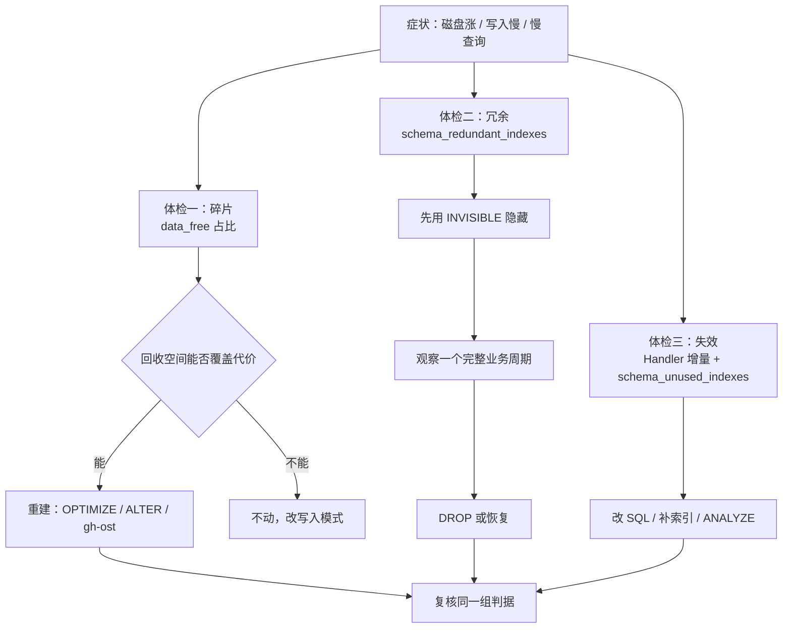
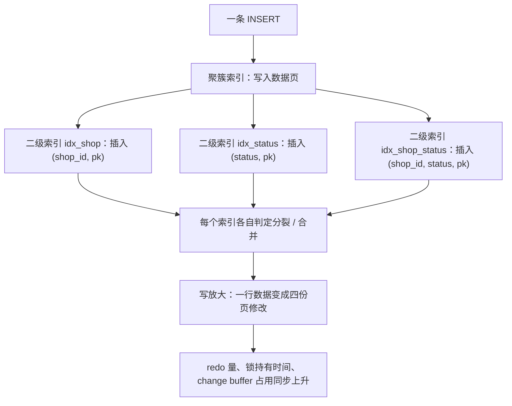
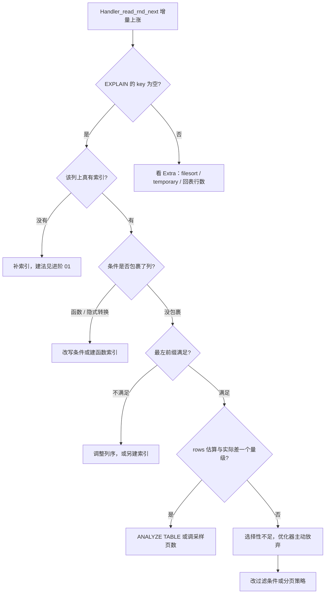
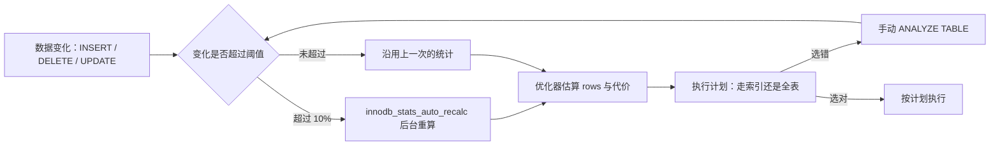

# 05 InnoDB 索引结构——B+Tree 的工程哲学与页分裂机制

**摘要：**

索引的寿命比建它的那次 DDL 长得多：一张表上线两年，无人再碰它的索引定义，磁盘却涨了四成，归档任务跑完之后主从延迟反复冒尖，某条跑了半年的 SQL 突然开始扫全表。这三件事都落在同一棵 B+Tree 上——它的物理形态在运行期被写操作改写了。本篇不重讲结构，页内组织、分裂点选择与合并阈值在源码级的内核笔记里已经拆透，这里只把结论当已知前提，转向 DBA 的位置看三个可测的体检项：碎片、冗余、失效。每一项给出判据（比值、视图、计数器）、复现实验与代价换算，回答同一个问题：症状看得见，动作值不值得做。体检本身不产生价值，它只决定下一步是动手还是继续观测；判据的边界也在这里——它只回答成本，不回答价值。三个体检项要同时观测，只盯一个指标，很容易把成本算成收益，因为碎片、冗余、失效互相牵制，单独处理任一项都可能把代价推到另一项上。

---

## 第 1 章 运行期体检：索引建好之后发生了什么

索引有点特殊：它唯一一次被"设计"是在建表或加索引的那一刻，此后两三年只被写入和读取，没有人再回头看它一眼。开发库数据量小，页分裂与碎片的表现不明显；等数据长到几千万行、写入从每秒几十次涨到几千次，同一个索引定义开始呈现完全不同的物理形态，而 DDL 语句一个字都没变。

这带来一个判断上的错位。多数团队对索引的关注集中在"怎么建"——列序、覆盖、前缀、选择性，这些问题在建索引的那一天就确定了；但索引的性能事故几乎都发生在运行期，症状是磁盘用量、写入延迟、主从延迟与慢查询，而不是某条 CREATE 语句写错了。结构本身在 [[中间件/MySQL/读书笔记-Mysql内核架构/11. InnoDB 索引：B+Tree 的工程实现与分裂合并哲学|读书笔记 11]] 里已经拆到源码路径一级，此处只取三条结论当既定前提：内部节点只存键，叶子节点用双向链表串起，每个页既有按主键有序的记录链表也有页内自由空间。剩下的篇幅留给判据。

### 1.1 三个体检项

碎片、冗余、失效，这三项覆盖了索引运行期绝大多数问题，而且它们有个共同点：都能用一条 SQL 或一个计数器判断，不需要上工具、不需要跑基准。

碎片指物理形态的浪费，判据是表空间里空闲字节占已分配空间的比例；冗余指逻辑上的重复，判据是 `sys` 模式下现成的视图；失效指索引存在但执行计划不用它，判据是 `Handler_read_*` 计数器的增量与 `sys.schema_unused_indexes`。三者并不并列：碎片影响 I/O 与空间，冗余影响写路径，失效影响读路径，一次排查通常从一个症状出发，最后牵出另外两项。

下面这张表给出三项的判据与代价的对应关系，后文每一章展开一行。

| 体检项 | 主判据 | 阈值（工程经验） | 处置动作 | 动作的主要代价 |
| :--- | :--- | :--- | :--- | :--- |
| 碎片 | `data_free / (data_length + index_length)` | 超过 20% 才值得单独处理 | 整表重建，或在线改表工具 | 额外磁盘空间、全表重写的 binlog 与主从延迟 |
| 冗余 | `sys.schema_redundant_indexes` 候选清单 | `index_length > data_length` 视为信号 | 先 `INVISIBLE`，观察后再 `DROP` | 误删后查询退化，需要回滚窗口 |
| 失效 | `Handler_read_rnd_next` 增量、`schema_unused_indexes` | 全表扫占比上升且伴随慢查询 | 改 SQL、补索引、或 `ANALYZE` | 改 SQL 要回归；补索引又增加写路径负担 |

### 1.2 判据的三层结构

笔者习惯把"要不要动手"拆成三层：症状指标（`data_free` 比值、`index_length` 与 `data_length` 的大小关系、`Handler_read_rnd_next` 增量）一眼可见，但只说明"某个现象存在"；复现实验（测试库复现执行计划、`EXPLAIN` 看 `key`、`sys` 视图找未用索引）确认原因；代价换算（额外空间、binlog 量、从库延迟、退化 SQL 条数）决定这笔账划不划算。

只过第一层就动手，是这类事故最常见的起点：碎片率 30% 直接 `OPTIMIZE`，把主从延迟顶到十几分钟；`schema_unused_indexes` 报了几个索引就直接删，月底报表跑成全表扫。只有**三层都过**的动作，才算判据支持的决策。

### 1.3 一个贯穿案例

后文用同一张表承载所有判据，避免每节换例子导致结论不可比。某电商订单表 `shop.orders`，约 2 亿行，主键是 32 位 UUID，日增 40 万行，每天凌晨归档删除 30 天前数据，读写比约 4:1；表上有主键加 7 个二级索引，其中两个是迁移遗留。它同时具备两类碎片成因、一组冗余候选，以及一个归档之后才出现的失效现场。

下面的图把体检的推进顺序画出来：从症状出发，分别落到三个判据，动作之后再回到同一组判据复核。



---

## 第 2 章 体检一：碎片的判据与重建的代价

### 2.1 "碎片"这个词指三层不同的东西

在 InnoDB 的语境里说碎片，至少要分清三层，否则判据会张冠李戴。

第一层是页内空洞。删除只打删除标记，purge 之后腾出的空间回到页内空闲链表，但页内记录按主键有序排列，不能为填洞搬动其他记录，所以这段空间只能等"恰好落在这个页"的后续插入复用。它的表现是页填充率下降，页数却不减。

第二层是页间不均衡。分裂把一个满页拆成两个各约一半的页，此后再没有足够的插入把两页填满，它们就长期停在半空状态。这一层是分裂的直接后果，也是随机主键写入最典型的形态。

第三层是表空间里的空闲区。段与区的分配以区为单位，表扩了几个区而只填满一部分，剩下的空间仍记在表空间文件里，操作系统看不到它被释放。`information_schema.tables` 的 `data_free` 反映的主要是这一层，以及完全空闲的页。

三层的回收手段并不相同：前两层要靠整表重建，或者依赖删除之后相邻页的合并（合并阈值由 `MERGE_THRESHOLD` 控制，默认 50）；第三层在 `innodb_file_per_table=ON` 时可以通过重建把文件缩小并归还操作系统，在共享表空间或通用表空间里则只在内部复用。页内组织与合并的触发条件见读书笔记 11，此处不展开。

这条区分挡住的是一类常见误读：`data_free` 小并**不等于没有碎片**。一个页填充率只有六成的表，如果它的区都被充分利用，`data_free` 可能接近于零；反过来，一个表空间预留了大量空闲区的表，`data_free` 很高，但它未必影响读性能。判据要看两处，不能只看一处。

### 2.2 判据一：data_free 与已分配空间的比例

最常用的一条判据是把 `data_free` 与已分配空间做比：

```sql
SELECT table_schema,
       table_name,
       table_rows,
       data_length,
       index_length,
       data_free,
       ROUND(data_free / NULLIF(data_length + index_length, 0) * 100, 2) AS frag_pct
FROM information_schema.tables
WHERE table_schema NOT IN ('mysql', 'sys', 'information_schema', 'performance_schema')
  AND engine = 'InnoDB'
  AND data_free > 0
ORDER BY frag_pct DESC;
```

工程上把阈值定在 20%：`data_free / (data_length + index_length) > 20%` 时，重建所能回收的空间才值得单独安排一次维护窗口。这个 20% 不是官方数字，是**经验值**，它的含义不是"超过就该重建"，而是"低于这个比例，重建的收益通常压不过代价"——重建要额外空间、要重写全部索引、要把整张表的行灌进 binlog，这三项的固定成本与表的大小成正比，与碎片率无关，所以碎片率越低，单位收益越差。

这张表有几处容易踩空的细节。

| 列 | 含义 | 容易误读之处 |
| :--- | :--- | :--- |
| `table_rows` | 表的行数估算值 | InnoDB 的 `table_rows` 是从统计信息推出来的估算，误差可能到几成，不能拿来算平均行宽或精确碎片量 |
| `data_length` | 聚簇索引占用的字节数 | 近似等于页数 × 页大小，包含页内自由空间与空洞，所以它本身就先"虚高"了一部分 |
| `index_length` | 全部二级索引占用的字节数 | 主键越宽，这个数字越大，与索引个数是两个独立的变量 |
| `data_free` | 表空间内空闲的字节数 | 只在独立表空间下有意义；共享表空间、通用表空间读到的数字不代表可回收空间，分区表要把各分区合起来看 |

### 2.3 判据二：页填充率与分裂、合并速率

`data_free` 覆盖不到页内空洞与页间不均衡，需要另找观测面。`information_schema.INNODB_TABLESTATS` 给出的是内存里维护的索引尺寸统计，其中两个字段的单位是页：

```sql
SELECT t.name,
       t.num_rows,
       t.clust_index_size,
       t.other_index_size,
       ROUND(i.data_length / (t.clust_index_size * 16384) * 100, 2) AS clust_fill_pct
FROM information_schema.INNODB_TABLESTATS t
JOIN information_schema.tables i
  ON i.table_name = SUBSTRING_INDEX(t.name, '/', -1)
 AND i.table_schema = SUBSTRING_INDEX(t.name, '/', 1)
WHERE t.name = 'shop/orders';
```

`data_length` 除以聚簇索引占用的页数，得到的平均每页有效字节与 16KB 的比值，就是页填充率的一阶近似。这个数字长期低于 70%，说明页内空间没有被用起来，即使 `data_free` 很漂亮。`other_index_size` 与 `index_length` 的关系则用来判断二级索引的膨胀程度，后文讲冗余时还会用到。

第二个观测面是分裂与合并的速率。`information_schema.INNODB_METRICS` 里的 `index_page_splits` 与 `index_page_merge_successes` 能看出分裂多还是合并多，但这组计数器默认未全部开启，要先用 `innodb_monitor_enable` 打开对应模块，名称以对应版本的 `INNODB_METRICS` 列表为准。分裂远多于合并，说明写入模式在持续制造碎片，重建只是把同一件事推迟几个月。

### 2.4 两类成因：随机写入与批量删除

成因之一是随机主键。UUID 的取值在空间上均匀分布，每一次插入都落在 B+Tree 的随机位置；目标页已满时分裂成两个各半的页，而后续插入又很难恰好落回这两个页把空位填满。结果是页填充率长期在 50% 到 70% 之间徘徊，热页集合比自增主键大出一个数量级，缓冲池的命中率随之下降。这也是 [[中间件/MySQL/MySQL进阶使用/01 索引设计实战——从建错索引到建对索引|进阶 01]] 里建议用自增主键的主要原因，页分裂的物理过程在读书笔记 11 中有完整的源码路径。

8.0 提供了一条缓解路径：`UUID_TO_BIN(uuid, 1)` 把时间低位换到高位，让主键变成"时间有序、同毫秒内随机"，把随机插入压缩成小范围插入。代价是主键变成 16 字节二进制、可读性丧失、跨库合并要额外保证时间序；而且它只在写入集中在"当前时间"附近时有效，历史回补与跨机房乱序写入都会让顺序性散掉。

成因之二是批量删除。归档任务每天删掉 30 天前的数据，删除只打标记，purge 之后空间回到页内空闲链表；删除按时间从旧到新推进，被清空的页集中在 B+Tree 左侧，这些页此后不会再有插入，因为新数据的主键落在右侧。左侧页长期低填充却仍占着区，`data_free` 未必上涨，页填充率一定下降。这类碎片的特征是删除量与碎片率高度相关：归档量翻倍，半年后碎片率也翻倍。

下面的图把两类成因与三层碎片对应起来，可以看出它们最后都指向同一个动作，但动作的收益不同。


### 2.5 OPTIMIZE TABLE 的真实代价

8.0 里对 InnoDB 表执行 `OPTIMIZE TABLE`，实际被映射为 `ALTER TABLE ... FORCE`，动作是**整表重建**：新建一棵 B+Tree，把行按主键顺序重新灌进去，全部二级索引跟着重建，最后把旧表空间替换掉。文档的说法是它"重建表以更新索引统计并释放聚簇索引中的未使用空间"，这句话没错，但它没说代价，而代价才是判据的核心。

第一项是磁盘空间。重建期间新旧两份数据并存，额外空间约等于表本身的大小；如果表是 200GB，就要预留 200GB 以上的空闲，这一点在磁盘使用率超过 70% 的实例上直接决定了动作不可行。

第二项是 binlog 与复制延迟。row 格式下重建写入的每一行都会进 binlog，一张 200GB 的表重建一遍，binlog 的生成量在百 GB 量级，从库要按顺序回放这些事件，延迟是分钟到十几分钟的量级。线上因为一次 `OPTIMIZE` 把从库顶到延迟告警，是这类操作最常见的事故形态。

第三项是 I/O 与缓冲池。重建是全表顺序读写，会把缓冲池里的业务热页冲掉，结束后短时间内命中率明显下降，查询响应时间出现一个台阶——在线 DDL 保证的是并发 DML 不被阻塞，并不保证延迟不变。

第四项是中断代价。重建失败要回滚，时间与空间都白花；重建期间的并发 DML 会记进在线 DDL 的日志，容量由 `innodb_online_alter_log_max_size` 控制（默认 128MB），写入热点表很容易顶到这个上限，超限即失败回滚。

所以"要不要 `OPTIMIZE`"的判据不是碎片率本身，而是这笔算术：可回收空间乘以它能维持的时间，能否覆盖空间峰值、复制延迟与 I/O 冲击。碎片率 30% 的随机主键表重建后半年回到原状，收益按半年摊；碎片率 15% 的表若业务已停止写入，重建一次能保很久，反而更值得做。

### 2.6 替代方案与它们的代价

`ALTER TABLE ... ENGINE=InnoDB` 常被当作 `OPTIMIZE` 的等价写法，效果上都是整表重建，但它的价值在于可控：可以显式声明 `ALGORITHM=INPLACE, LOCK=NONE`，不被支持时直接报错，而不是静默降级成锁表操作。这类操作在官方在线 DDL 矩阵里属于"重建表"一档，是否允许并发 DML 取决于算法与版本，以对应版本文档为准；写成显式声明，等于让数据库替你做一次可行性检查。

零停机的两条路是 `pt-online-schema-change` 与 `gh-ost`：前者建同构新表、用触发器同步增量、分块拷存量，最后 `RENAME TABLE` 原子切换；后者不装触发器，改成解析 binlog 拿增量，对原表写压力更小，还能限流、暂停。两者都不支持带外键的表，也都要求额外磁盘与 I/O 余量。

| 手段 | 并发 DML | 额外空间 | binlog 增量 | 主要限制 |
| :--- | :--- | :--- | :--- | :--- |
| `OPTIMIZE TABLE` | 在线 DDL 允许，但不保证延迟 | 约一张表大小 | 极大，整表行事件 | 需要维护窗口与磁盘余量 |
| `ALTER TABLE ... ENGINE=InnoDB` | 由显式算法决定，不支持会报错 | 约一张表大小 | 极大 | 同样要窗口，可控性更好 |
| `pt-online-schema-change` | 基本不停写 | 约一张表大小 + 触发器开销 | 中等 | 触发器带来额外写负载，外键要特殊处理 |
| `gh-ost` | 基本不停写，可限流 | 约一张表大小 | 中等 | 要求 row 格式 binlog，不支持外键表 |

选择顺序按"能不能停机"来排：有维护窗口且磁盘余量充足，直接重建最简单；不能停机但能接受数小时限流，用 `gh-ost`；表上有外键又必须在线，先解决外键，再谈工具。**零停机不是零代价**，它只是把代价从"锁"换成了"资源与复杂度"。

---

## 第 3 章 体检二：冗余与重复索引的识别

### 3.1 三种多余

冗余索引有三种形态，前两种是结构性的，第三种是约束性的。完全重复指两个索引的列与列序完全相同，通常来自历史遗留：迁移时重建了索引但旧索引没删，或者 ORM 为外键自动建了索引、DBA 又手工建了一个。前缀覆盖指一个索引的列是另一个索引的最左前缀，譬如 `(a)` 被 `(a, b)` 覆盖，这是最左前缀性质的直接推论：任何能用 `(a)` 完成的定位 `(a, b)` 都能完成，因为按 `a` 定位之后 `b` 是否有序不影响 `a` 的定位精度；反向不成立，被覆盖的永远是列更少的那个。约束性冗余指同一组列上既有唯一索引又有普通索引，唯一索引本身可以当普通索引用，普通索引就多余；反过来删掉唯一索引等于丢掉约束语义——MySQL 没有独立的"唯一约束"对象，唯一性就靠唯一索引表达，这一条不能按冗余处理。

### 3.2 sys.schema_redundant_indexes 的读法

8.0 自带 `sys` 模式，其中 `schema_redundant_indexes` 视图直接给出前缀覆盖与完全重复的候选清单，连删除语句都拼好了：

```sql
SELECT table_schema,
       table_name,
       redundant_index_name,
       redundant_index_columns,
       dominant_index_name,
       dominant_index_columns,
       sql_drop_index
FROM sys.schema_redundant_indexes
WHERE table_schema = 'shop'
ORDER BY table_name, redundant_index_name;
```

结果里 `redundant_*` 是被覆盖的那个，`dominant_*` 是覆盖它的那个，`sql_drop_index` 是可以直接执行的 `ALTER TABLE ... DROP INDEX` 语句。`shop.orders` 上跑一遍，通常能拿到两条：`(shop_id)` 被 `(shop_id, status)` 覆盖，`(status)` 被 `(status, created_at)` 覆盖。

这个视图有三条局限，决定了它只能当**候选清单，不是判决书**。其一，它只按列前缀做语法判定，不识别等值等价：`(a, b)` 与 `(b, a)` 在纯等值负载下功能等价，视图不报其中任何一个。其二，它不看查询负载，"语法上多余"的索引可能恰好是某个高频查询的覆盖索引，删掉之后回表次数上升。其三，它不处理主键与唯一约束：主键被覆盖它不报（也不该报，主键删不掉），唯一索引与普通索引同列时它报普通索引，这个结论对，但反过来删唯一索引不在它建议范围内。

所以流程是拿它出候选，再用 `schema_unused_indexes` 与慢查询交叉验证，最后用 8.0 的隐藏索引做一次无风险试运行。

### 3.3 代价：写路径上多出来的那几条

索引的读收益是显性的，写代价是隐性的，因为它摊在每一次写入里。一次 `INSERT` 要往聚簇索引写一行，再往每一个二级索引各写一条"索引列 + 主键"，每条写入都可能触发目标页的分裂，并占用 change buffer 的空间。

下面的图把一次插入的写路径展开，可以看出索引个数如何线性放大写代价。



这里有一个容易被忽略的耦合点：二级索引叶子存的是索引列加主键，主键越宽，每个条目越胖。32 位 UUID 做主键时每条二级索引记录多带 32 字节，7 个索引就是 7 份；换成 `BIGINT` 只多 8 字节。所以"主键选型"与"索引个数"在页空间上直接相乘。

### 3.4 判据：索引比数据还大

"这张表的索引太多了"这句话需要一条可测的判据，最直接的是 `index_length` 与 `data_length` 的比值：

| 信号 | 读法 | 下一步 |
| :--- | :--- | :--- |
| `index_length > data_length` | 索引占用的空间超过数据本身 | 先查冗余候选，再看索引个数 |
| `OTHER_INDEX_SIZE` 占聚簇索引页数的比例偏高 | 二级索引膨胀，通常由宽主键或过多索引造成 | 与主键宽度一起评估 |
| 单表二级索引超过 5 个 | 写路径要维护 5 份以上副本 | 逐个核对是否被高频查询实际使用 |
| `sys.schema_redundant_indexes` 有输出 | 语法层面存在可覆盖的索引 | 进入隐藏与观察流程 |

需要提醒的是，`index_length > data_length` 不必然错误：宽表窄行、覆盖索引多的表本来就可能索引大于数据。这条判据的价值在于触发一次审视，而非给出结论。

---

## 第 4 章 体检三：失效的六种读法与六个成因

失效是三项里最容易被误判的：索引明明存在，`EXPLAIN` 的 `key` 却是 `NULL`，于是有人给列加上 `FORCE INDEX`，有人把索引重建一遍，有人干脆认为"MySQL 的优化器不行"。这些反应之所以无效，是因为没有区分"索引不可用"与"索引可用但优化器主动放弃"，而这两类的处置方式相反。

### 4.1 Handler_read_* 的六种读法

`Handler_read_*` 是服务层向存储引擎请求读行的计数器，它记录"引擎被要求怎么读"而不是"SQL 写了什么"，因此比慢查询日志更接近执行计划的真实形态。六个计数器各有含义：

| 计数器 | 语义 | 数值上涨说明什么 | 处置方向 |
| :--- | :--- | :--- | :--- |
| `Handler_read_key` | 按索引键定位读一行 | 索引在干活，这是健康信号 | 无需处理，作为分母看比例 |
| `Handler_read_next` | 按索引顺序读下一行 | 范围扫描或索引全扫在发生 | 看是否扫了过多行，考虑覆盖索引 |
| `Handler_read_prev` | 按索引顺序反向读 | `ORDER BY ... DESC` 走了索引 | 正常，除非反向扫的行数远超预期 |
| `Handler_read_first` | 读索引的第一条记录 | 出现索引全扫（`ORDER BY` 无过滤条件之类） | 核对是否真的需要全索引扫描 |
| `Handler_read_rnd` | 按行位置随机回读 | 排序结果回表，通常伴随 `Using filesort` | 调整索引列序让排序走索引 |
| `Handler_read_rnd_next` | 读数据文件的下一行 | 全表扫描在发生，索引没用上 | 本篇重点，按 4.3 的六因逐条排查 |

判据不看绝对值，只看**增量与比例**——取两次采样做差，而不是用 `FLUSH STATUS` 清零，因为清零会影响其他按增量计算的监控，也会把问题藏起来：

```sql
-- 第一次采样
SELECT VARIABLE_NAME, VARIABLE_VALUE
FROM performance_schema.global_status
WHERE VARIABLE_NAME LIKE 'Handler_read%';

-- 间隔一个业务周期（例如 10 分钟，且覆盖一次归档任务）后第二次采样
SELECT VARIABLE_NAME, VARIABLE_VALUE
FROM performance_schema.global_status
WHERE VARIABLE_NAME LIKE 'Handler_read%';
```

两次结果相减，`Handler_read_rnd_next` 的增量占六个计数器总增量的比例，就是全表扫描在全部读操作里的份额。这个比例长期超过三成，又没有对应的数据导入、备份或统计类任务，基本可以确定存在索引失效；再配合 `sys.statements_with_full_table_scans` 把语句定位到具体 SQL：

```sql
SELECT query,
       db,
       exec_count,
       no_index_used_count,
       no_index_used_pct,
       rows_examined,
       rows_sent
FROM sys.statements_with_full_table_scans
WHERE db = 'shop'
  AND no_index_used_count > 0
ORDER BY exec_count DESC
LIMIT 20;
```

这个视图基于 `performance_schema` 的语句摘要统计，列名以对应版本文档为准；价值在于把全局计数器落到具体语句上。

### 4.2 sys.schema_unused_indexes：该删哪个的直接依据

比起推断，`sys.schema_unused_indexes` 更接近判决：它列出实例启动以来（或上次重置统计以来）从未被任何语句使用过的索引。

```sql
SELECT object_schema, object_name, index_name
FROM sys.schema_unused_indexes
WHERE object_schema = 'shop'
ORDER BY object_name, index_name;
```

判据很硬：出现在这个清单里的索引，在被统计的时间窗内一次都没被用过。但它有三条陷阱，误杀都从这三条来。

其一，统计窗口从实例启动或上次清空 `performance_schema` 统计起算，重启即清零。在刚重启两周的实例上下结论，会误杀只在月结才用到的索引；合理窗口要覆盖一次完整业务周期，包括月结、批量对账与年度报表。

其二，视图排除主键，其他索引一律列出，包括靠唯一性做约束、平时没人拿它查询的那些。这类索引删掉等于丢约束，不能按"未使用"处理。

其三，它只说"没用过"，不说"为什么没用过"。索引可能因统计信息过期而被优化器忽略，此时删掉它是把症状当病因，要先 `ANALYZE` 再看。

正确的删除流程是**先隐藏再删除**：先 `ALTER TABLE ... ALTER INDEX ... INVISIBLE` 把它隐藏起来（8.0 特性，隐藏的索引对优化器不可见但仍被维护，随时可以恢复），观察一个完整业务周期，确认没有查询退化，再 `DROP`。

```sql
-- 先隐藏：对优化器不可见，但索引结构仍在，可随时恢复
ALTER TABLE shop.orders ALTER INDEX idx_legacy_shop INVISIBLE;

-- 观察窗口结束后确认无影响
ALTER TABLE shop.orders ALTER INDEX idx_legacy_shop VISIBLE;  -- 或
ALTER TABLE shop.orders DROP INDEX idx_legacy_shop;
```

### 4.3 六个成因与它们的可复现判据

失效的原因可以归成六类，前三类是 SQL 写法问题，后三类是优化器与统计问题。每一类都给一个能在测试库复现的判据，判据的形式统一为"改一处、`EXPLAIN` 看 `type` 与 `key`"。

| 成因 | 可复现的判据 | 处置指向 |
| :--- | :--- | :--- |
| 类型隐式转换 | 字符列与数字字面量比较，`type` 从 `ref` 变 `ALL` | 比较值加引号，或统一列类型 |
| 函数包裹索引列 | `WHERE DATE(col) = ...` 时 `key` 为空，改成半开区间恢复 | 改写条件，或 8.0.13 起建函数索引 |
| 最左前缀不满足 | 联合索引 `(a, b)` 上只查 `b`，`type` 为 `ALL` | 调整列序或另建索引 |
| 选择性太低 | `rows` 接近表行数，优化器主动选择全表扫 | 不必强改，属正确决策 |
| `OR` 条件 | 一侧无索引，整体退化为全表扫 | 改 `UNION ALL`，或给两侧都建索引 |
| 统计信息过期 | `EXPLAIN ANALYZE` 的实际行数与 `rows` 差一个数量级 | `ANALYZE TABLE` 或调采样页数 |

类型隐式转换最隐蔽。`user_id` 是 `VARCHAR(32)`，比较值写成数字 `10086` 时，MySQL 把列这一侧转成 `DOUBLE` 再比较，索引上的有序性对转换后的值不再成立，索引直接失效；反过来列是整型、比较值是字符串 `'10086'`，转换发生在常量一侧，索引仍可用。这个不对称性经常被记反。

```sql
-- 列是 varchar，比较值是数字：列被转成 double，索引失效
EXPLAIN SELECT * FROM shop.orders WHERE user_id = 10086;

-- 加引号后恢复
EXPLAIN SELECT * FROM shop.orders WHERE user_id = '10086';
```

函数包裹同理：`WHERE DATE(created_at) = '2026-11-01'` 让 `created_at` 上的索引无用武之地，改成半开区间即可恢复范围扫描；如果业务确实需要按"日期"这个维度查询，8.0.13 起可以建函数索引，让优化器认得这个表达式。

```sql
-- 改成半开区间，索引可用
EXPLAIN SELECT * FROM shop.orders
 WHERE created_at >= '2026-11-01'
   AND created_at <  '2026-11-02';

-- 8.0.13 起可给表达式建函数索引（注意外层双括号）
ALTER TABLE shop.orders ADD INDEX idx_created_date ((DATE(created_at)));
```

最左前缀不满足的情况在联合索引上最常见，`(shop_id, status, created_at)` 上只写 `status = ?` 的查询用不了这个索引，因为 `status` 的排序只在 `shop_id` 相同的范围内成立。8.0.13 起优化器提供 skip scan（跳跃扫描），当最左列的基数足够低时仍可能用上这个索引，`EXPLAIN` 里表现为 `type` 为 `range` 且 `key` 就是该联合索引；但它不是通用解药，最左列基数一高就退化。

选择性太低这一类不是"失效"，而是优化器的正确决策。条件命中的行占到表的相当比例（经验上超过两成到三成）时，走索引要付出大量随机回表，成本高于顺序扫全表，此时硬加 `FORCE INDEX` 只会更慢。判据是 `rows` 接近表总行数、`filtered` 很高，且 `Extra` 里没有 `Using index`；方向是改过滤条件或分页策略，而不是折腾索引。

`OR` 条件要区分版本与写法：两侧都有索引时优化器可能走 index merge，一侧没有索引时整体退化为全表扫。判据是 `type` 为 `ALL` 且 `Extra` 里没有 `Using union`；处置通常是把 `OR` 拆成两个 `UNION ALL`，或者给另一侧也补上索引。

统计信息过期是最后一类，也最容易与"优化器不行"混淆。8.0.18 起可以用 `EXPLAIN ANALYZE` 看实际行数，与 `rows` 估算对比，差一个数量级即统计失真；常见触发是批量导入、大批量归档删除、大版本升级后没有重新采样。

下面的决策图把六因串成一条排查路径，从"是否扫表"开始，逐层排除。



六因里前三类属于"怎么写 SQL"，完整写法与更多案例在 [[中间件/MySQL/MySQL进阶使用/01 索引设计实战——从建错索引到建对索引|进阶 01]]；执行计划的字段读法与重写手法在 [[中间件/MySQL/MySQL进阶使用/02 SQL 调优方法论——从 EXPLAIN 到执行计划重写|进阶 02]]；后三类的代价模型依据在 [[中间件/MySQL/MySQL架构与底层原理/09 MySQL 查询优化器——从代价模型到执行计划的决策过程|本列 09 篇]]。本篇只保留判据：怎么在运行期发现、怎么用两条 SQL 复现。

---

## 第 5 章 统计信息：ANALYZE 的时机与开销

### 5.1 自动重算管什么、不管什么

InnoDB 的统计信息默认是持久化的（`innodb_stats_persistent=ON`），落在 `mysql.innodb_table_stats` 与 `mysql.innodb_index_stats` 两张表里，重启不会丢。自动重算由 `innodb_stats_auto_recalc` 控制，默认开启，但它的触发条件是"表里有超过 10% 的行发生了变化"，而且重算是在后台**异步**进行的，不是写入完成就立刻更新。

这条机制解决的是"统计不会永远停在昨天"，不解决"统计什么时候准"。一张日增 40 万行、总量 2 亿行的表，每变化 10% 才重算一次，两次之间隔着 2000 万行的差异；中间若夹着一次批量归档删除，`n_rows` 与实际行数会差出可观的幅度，优化器据此估算的 `rows` 随之失真。

### 5.2 参数与它们的代价

| 参数 | 默认值 | 作用 | 调大的代价 | 调小的代价 |
| :--- | :--- | :--- | :--- | :--- |
| `innodb_stats_persistent` | `ON` | 统计落盘，重启不丢 | 关闭后统计重启即失效，计划可能抖动 | 开启是推荐值，一般不动 |
| `innodb_stats_auto_recalc` | `ON` | 行变化超过 10% 时异步重算 | 阈值调小会让重算频繁，采样 I/O 上升 | 调大或关闭后统计更容易过期，`rows` 估偏 |
| `innodb_stats_persistent_sample_pages` | `20` | 每个索引采样的页数 | 采样页数翻倍，`ANALYZE` 耗时近似翻倍，但估算更稳 | 估算方差变大，执行计划可能来回切换 |
| `innodb_stats_on_metadata` | `OFF` | 访问元数据时是否重采 | 打开后每次 `SHOW TABLE STATUS` 或查 `information_schema` 都可能触发采样，高并发下变成性能事故 | 默认关闭，**保持关闭** |

`innodb_stats_on_metadata` 默认关闭是有原因的：一些老版本或第三方工具会把它打开，结果每次监控采集表信息都触发一次索引采样，表现为"监控一开，数据库就慢"。

### 5.3 ANALYZE TABLE 的时机与它读的是什么

`ANALYZE TABLE` 对 InnoDB 表做的事是随机读若干索引页，估算索引列的基数与分布。它不扫全表，但也不便宜：每个索引默认采 20 页，7 个二级索引就是 140 次左右的页读取，这些页未必在缓冲池里。它不阻塞并发 DML，但抢占 I/O 与缓冲池，高峰期对全库跑一遍，效果接近一次小规模全表扫描。

需要手动执行的时机有五个：批量导入或大批量归档删除之后；大版本升级之后（采样策略可能变化）；执行计划在数据没变的情况下突然从 `range` 变 `ALL`；主从切换之后（新主库统计可能落后）；以及加索引之后（新索引要重新采样，虽然加索引本身会触发一次）。

```sql
ANALYZE TABLE shop.orders;

-- 核对统计是否已经更新
SELECT table_name, n_rows, clustered_index_size, sum_of_other_index_sizes, last_update
FROM mysql.innodb_table_stats
WHERE database_name = 'shop' AND table_name = 'orders';
```

下面的图把数据变化、统计重算与执行计划选择串成一个反馈环，可以看出统计过期为什么会表现成"索引失效"。



---

## 第 6 章 主键：一条判据与它的代价

主键与碎片的因果关系前文已讲清，这里只留一条判据：写入顺序追加、不需要跨库合并，用自增整型主键；需要全局唯一，用能保证时间序的 UUID（UUIDv7，或 8.0 的 `UUID_TO_BIN(uuid, 1)`）。纯随机 UUID 作聚簇索引键的代价要拆成三项看：分裂频次、主键宽度乘以二级索引个数（32 字节与 8 字节的差距会复制到每个二级索引条目上）、热页集合的大小（缓冲池里常驻的页数上升，命中率下降）。

选型细节、`BIGINT` 与 `BINARY(16)` 的取舍、以及业务层面的合并需求，在 [[中间件/MySQL/MySQL进阶使用/01 索引设计实战——从建错索引到建对索引|进阶 01]] 里给出；页分裂时分裂点如何选择、记录如何迁移，在 [[中间件/MySQL/读书笔记-Mysql内核架构/11. InnoDB 索引：B+Tree 的工程实现与分裂合并哲学|读书笔记 11]] 里给出源码路径。本篇只强调一点：主键一旦定下，碎片率的上限就被它决定了，后文的所有重建都只是在既有上限下做优化。

---

## 第 7 章 把判据换算成代价：两组示例推算

判据给出"要不要看"，代价决定"要不要做"。下面两组数字都是按固定假设推算的示例，用来演示换算方法，不是基准测试结果；真实环境里替换掉假设即可。

### 7.1 碎片率与重建收益

沿用 `shop.orders`，假设 `data_length` 为 180GB、`index_length` 为 45GB、`data_free` 为 40GB。

碎片率按 `40 / (180 + 45)` 算约 17.8%，还没过 20% 的阈值；但页填充率只有 62% 时，重建后的理论体积会降到 `180 × 0.62 / 0.94 ≈ 119GB`（`innodb_fill_factor` 取 100 时每页仍留约 1/16 给后续插入），八折兑现约 143GB。两组数字合起来看，可回收空间在 40GB 到 80GB 之间，前提是重建期间写入不再产生分裂。

时间估算取决于持续写入带宽：净写 225GB，按 80MB/s 算约 47 分钟，加上二级索引的排序与合并，维护窗口按两小时准备比较稳妥。空间峰值是 225GB 额外占用，磁盘使用率超过 70% 的实例直接不可行；binlog 生成量与表大小同量级，从库按行回放，延迟会在重建期间持续累积。

| 量 | 假设 | 推算 | 判断 |
| :--- | :--- | :--- | :--- |
| 碎片率 | `data_free` 40GB，已分配 225GB | 17.8% | 未过 20%，不建议单独排窗口 |
| 页填充率 | 聚簇索引页数 × 16KB 与 `data_length` 之比 | 62% | 偏低，重建有额外收益 |
| 可回收空间 | 空洞 + 区空闲 | 40GB 至 80GB | 收益成立，但要看窗口成本 |
| 重建耗时 | 净写 225GB，80MB/s | 约 47 分钟 | 加索引重建，按 2 小时窗口 |
| 空间峰值 | 新旧并存 | 225GB 额外占用 | 磁盘余量不足则不可行 |
| 复制影响 | row 格式全表行事件 | 延迟分钟到十几分钟 | 需在低峰期或限流执行 |

这张表的用法不是照抄数字，而是看清一件事：碎片率只是分子，分母是"重建一次能撑多久"。写入模式不变时，重建之后的分裂会以同样速率重新积累，回收的 40GB 半年内可能又长回来；此时真正的动作是改主键或改归档策略，重建**只是止血**。

### 7.2 ANALYZE 的开销

按 7 个索引、每个索引采样 20 页计算，一次 `ANALYZE TABLE` 大约读 140 个索引页；B+Tree 高度按 3 层、根页常驻缓冲池估算，冷缓存下总 I/O 在 140 到 280 次之间，按每次 0.3ms 算约 40 到 85 毫秒，热缓存下只有内存访问。把 `innodb_stats_persistent_sample_pages` 从 20 调到 200，开销近似线性放大到接近一秒——这就是"调大采样更准"的价格。

这类开销在单表上可以忽略，风险在批量：对全库上千张表跑一遍 `ANALYZE`，累加的时间与 I/O 足以影响业务。所以做法是只对出问题的表、在低峰期、逐批执行，而不是把"定期全库 `ANALYZE`"当维护规范。

---

## 第 8 章 边界与反例

判据本身不难，难的是不把它当结论用。下面四条都是把判据用错方向的情形。

第一条，见碎片就 `OPTIMIZE`。碎片率是静态快照，重建是动态过程，两者之间隔着**写入模式**。随机主键的表重建之后，分裂会以同样速率重新积累，几个月后回到同一碎片率，而期间付出的 binlog 与从库延迟是实打实的。要问的是"重建之后写入模式会不会变"，不是"碎片率够不够高"。

第二条，`data_free` 高但业务从不删数据。这种情况下碎片几乎全部来自随机主键插入造成的页分裂与区未用满，重建能回收一部分，但下一次插入又会制造新的；真正该改的是主键或写入顺序。这类表更适合把 `innodb_fill_factor` 调低，让排序建索引时预留更多空间、后续插入少分裂，代价是空间利用率下降。

第三条，删索引不评估查询影响。`schema_unused_indexes` 是"没被用过"，不是"没用"。月结报表、年度对账、排障时才跑的应急 SQL，在统计窗口内可能一次都没执行；直接删掉，等下一次月结才发现，恢复要重建索引，重建索引本身又是一次在线 DDL。隐藏索引的意义就在这里：把"删除"这个不可逆动作拆成"隐藏"与"删除"两步，中间留一个可观测窗口。

第四条，把 `schema_redundant_indexes` 当判决书。它按列前缀判定，不看负载：`(a)` 若是某个查询的覆盖索引，删掉它之后该查询回表次数上升。删除前跑一次 `EXPLAIN` 对比 `key` 与 `rows`，是所有删除动作的最低要求。

---

## 第 9 章 结语：判据的成本

索引的运行期体检，本质是把"要不要动手"这件事从直觉换成一次算术。三个体检项里，碎片的判据最直观也最容易被过度处理——`data_free` 一高就想重建，却很少算清重建期间的 binlog 与从库延迟；冗余的判据最明确，也最容易被无痛忽略——`index_length` 超过 `data_length` 的表在很多团队里无人问津，直到写入压不下去才回头；失效的判据最难，因为"没走索引"与"不该走索引"在表面上完全一样，区分它们需要看 `rows` 与 `filtered`，而不是看 `key` 是否为空。

**判据便宜，动作昂贵**，这个不对称决定了体检的正确用法：先用一条 SQL 确认症状，再用一个实验确认原因，最后用一次算术确认代价。三步都过，动作才是决策；任何一步没过，停在观测上是更好的选择。索引的结构在它被创建的那一天就定了，而它的运行期形态每天都在变，能测的东西比能改的多，这本身就是一种取舍。

---

## 参考资料

1. MySQL. Reference Manual 8.0：InnoDB Index Types（聚簇索引与二级索引）. https://dev.mysql.com/doc/refman/8.0/en/innodb-index-types.html
2. MySQL. Reference Manual 8.0：OPTIMIZE TABLE（InnoDB 映射为 ALTER TABLE ... FORCE 的行为说明）. https://dev.mysql.com/doc/refman/8.0/en/optimize-table.html
3. MySQL. Reference Manual 8.0：Online DDL Operations（各类重建操作的算法与并发 DML 支持矩阵）. https://dev.mysql.com/doc/refman/8.0/en/innodb-online-ddl-operations.html
4. MySQL. Reference Manual 8.0：InnoDB Statistics Collection（持久化统计、`innodb_stats_persistent_sample_pages`、自动重算阈值）. https://dev.mysql.com/doc/refman/8.0/en/innodb-statistics-collection.html
5. MySQL. Reference Manual 8.0：ANALYZE TABLE. https://dev.mysql.com/doc/refman/8.0/en/analyze-table.html
6. MySQL. Reference Manual 8.0：Server Status Variables（`Handler_read_*` 计数器语义）. https://dev.mysql.com/doc/refman/8.0/en/server-status-variables.html
7. MySQL. Reference Manual 8.0：The INFORMATION_SCHEMA TABLES Table（`DATA_LENGTH`、`INDEX_LENGTH`、`DATA_FREE` 定义）. https://dev.mysql.com/doc/refman/8.0/en/information-schema-tables-table.html
8. MySQL. Reference Manual 8.0：sys Schema（`schema_redundant_indexes`、`schema_unused_indexes`、`statements_with_full_table_scans`）. https://dev.mysql.com/doc/refman/8.0/en/sys-schema.html
9. MySQL. Reference Manual 8.0：Invisible Indexes. https://dev.mysql.com/doc/refman/8.0/en/invisible-indexes.html
10. MySQL. Reference Manual 8.0：CREATE INDEX（8.0.13 起的函数键部件）. https://dev.mysql.com/doc/refman/8.0/en/create-index.html
11. MySQL. Reference Manual 8.0：Index Page Merge Threshold（`MERGE_THRESHOLD` 与页合并）. https://dev.mysql.com/doc/refman/8.0/en/index-page-merge-threshold.html
12. MySQL. Reference Manual 8.0：InnoDB Parameters（`innodb_fill_factor`、`innodb_online_alter_log_max_size`、统计相关参数）. https://dev.mysql.com/doc/refman/8.0/en/innodb-parameters.html
13. Percona. percona-toolkit：pt-online-schema-change 文档. https://docs.percona.com/percona-toolkit/pt-online-schema-change.html
14. GitHub. gh-ost：Online schema migrations for MySQL（含限流与暂停能力说明）. https://github.com/github/gh-ost

---

> [!note] 思考题
> 1. 一张表的 `data_free` 长期在 30% 以上，但业务从来不执行 `DELETE`，这时重建能回收的是什么？重建之后碎片还会不会长回来？
> 2. 某表 `index_length` 已经超过 `data_length`，你会先删哪个索引？给出一个不依赖猜测的验证顺序。
> 3. `Handler_read_rnd_next` 的增量突然翻倍，但慢查询日志里没有对应的 SQL，可能是哪几类任务造成的？
> 4. `schema_unused_indexes` 报出某个索引从未被使用，直接 `DROP` 前你需要补齐哪些信息？
> 5. 一张 200GB 的表碎片率 18%、页填充率 70%，业务写入不停，你会选择重建、隐藏索引还是什么都不做？理由是什么？