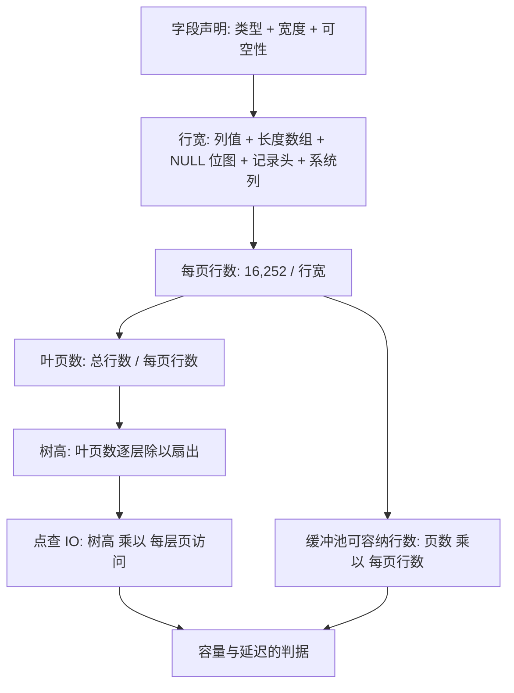
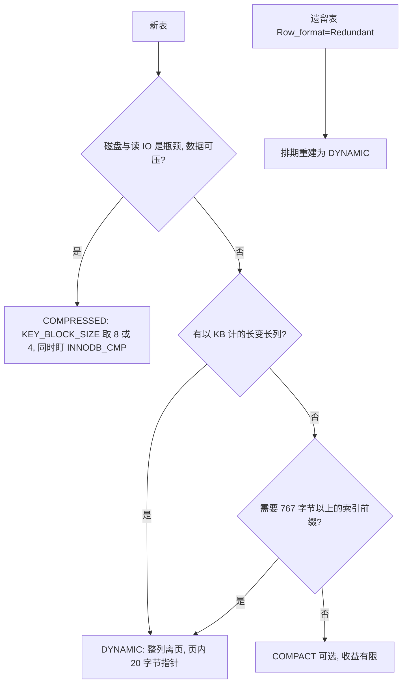
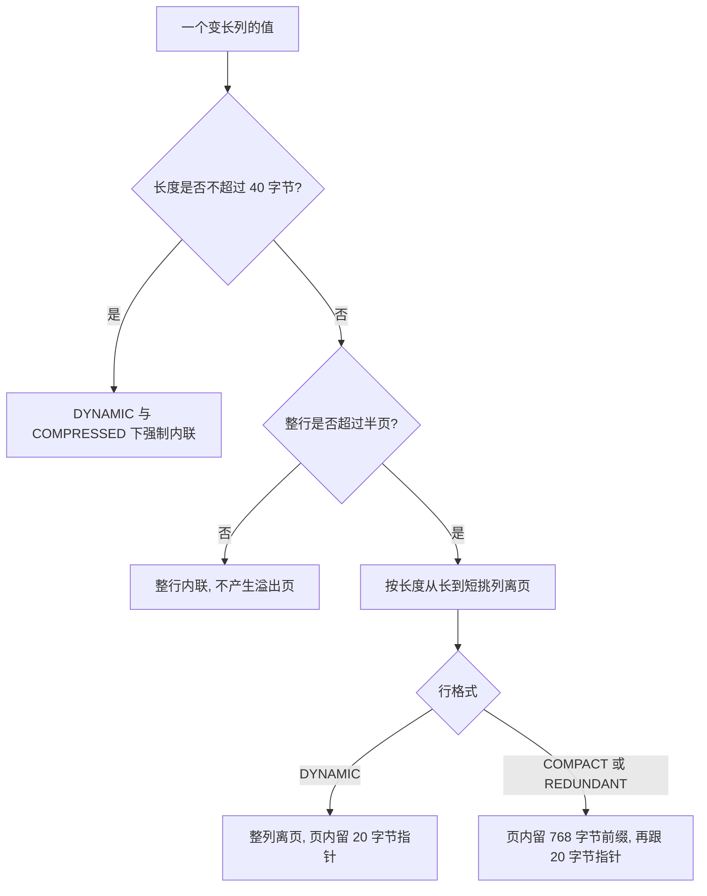

# 06 InnoDB 行格式与数据页结构——数据在磁盘上的真实样貌

**摘要：**

行格式通常被当成存储引擎的实现细节，但在 DBA 的账本上，它是容量、字段宽度与拆表决策的唯一入口。本文不重复行记录与数据页的物理结构，而是把四种行格式摊成一张判据表，回答三个能用笔算回答的问题：一行最多能有多宽，一个 16 KiB 页能装多少行，行宽又如何经由叶页数与树高传导成 IO 次数与缓冲池需求。答案里有一串可以复算的数字：16,252 字节的页内可用空间、8,126 字节的半页上限、150 行与 15 行两种行宽下的每页行数、三层与四层 B+Tree 的分野，以及十万量级页差带来的缓冲池差距。三道校验的分工也一并厘清：65,535 字节的服务器层总行长、8,126 字节的行内上限、3,072 字节的索引键前缀各在什么时机触发，为什么 DYNAMIC 救不了声明宽度超限的表。文章还把最容易算错的三处逐项拆开——utf8mb4 下 CHAR 的声明宽度与页内编码、NULL 位图的固定开销、TEXT/BLOB 的离页门槛——并给出大字段与主表混存、COMPRESSED 指望省缓冲池这两类反例的量化后果，每个算例的参数都可以替换成自己的表重新走一遍。落点是行宽：它是容量规划的第一性变量，拆表、压缩与改类型都是在它之上的权衡。

---

## 第 1 章 从一道算题说起

### 1.1 升级之后仍然会撞上的那条报错

把一套 5.7 的库迁到 8.0 或者 8.4，最常见的拦路虎往往不是字符集，也不是 SQL 模式，而是一条看起来毫无道理的报错：`Row size too large (> 8126)`。奇怪之处在于，5.7 引入 `innodb_default_row_format` 之后，InnoDB 的默认行格式就已经是 DYNAMIC 了，8.0 与 8.4 沿用这一默认，长字段早该在写满半页之前被挪到溢出页去，为什么还会撞上一条按字节计的硬上限？

答案是 InnoDB 的门不止一道。第一道是服务器层的 65,535 字节，按每一列声明的最大长度求和；第二道是 InnoDB 自己的**半页限制**，16 KiB 页下就是 8,126 字节；第三道藏在索引里，DYNAMIC 的索引键前缀上限是 3,072 字节，COMPACT 只有 767 字节。DYNAMIC 解决的是"一个很长的值放不进页内"这个问题，它并不解决"一堆中等宽度的列声明加起来放不进页内"这个问题。建表与改表时的校验按声明的最大宽度求和，不看这一行当前实际存了多少——你在 `VARCHAR(255)` 里只写了三个汉字，校验时它仍然是 1,020 字节。

这就把话题从"行格式是什么"推到"行格式让 DBA 怎么算账"：前者读一遍就能记住，后者每一张新表都要重算。本篇只处理后者。

### 1.2 三个可以用笔算回答的问题

第一个问题是行的上限。一行为什么不能超过半页，这个上限在不同页大小下各是多少，哪些内容不计入这个上限，哪些内容反而被重复计了一次。

第二个问题是一页装多少行。16 KiB 的页里，页头、页尾、两条系统记录与页目录先占掉一块，剩下的才是用户记录区；一个百字节的行与一个千字节的行，每页行数差一个数量级，这个数量级会一路传导到叶页数、树高与每次点查的 IO 次数。

第三个问题是行宽什么时候构成"表太大"。判断表是否臃肿，凭 `data_length` 与"感觉"是不够的，至少要能拿出三个可观测的判据：行宽是否越过 1 KiB、是否有一批高频读取的 TEXT/BLOB、`data_free` 是否长期偏高。这三个判据分别指向三种不同的处置动作，混在一起谈就会得出"加内存"这种既不解决问题也不便宜的结论。

### 1.3 一条从字段声明到 IO 次数的传导链

把上面三个问题串起来，就得到本篇的主线：字段声明决定行宽，行宽决定每页行数，每页行数决定叶页数与树高，树高决定冷查询的页访问次数与缓冲池里非叶页的占用。这条链的每一环都可以用四则运算过一遍，图 1 是它的全貌。

### 1.4 只保留算账所需的四件事实

行记录的完整结构在别处已经拆到源码级，这里只保留与预算直接相关的四项：变长列的实际长度按倒序写成一个长度数组，每列占一到两个字节；可空列的取值状态写成一张位图，每列一位；每条记录有 5 字节的记录头，装着页内链表指针与删除标记；聚簇索引的每条记录还带着 13 字节的系统列，即 6 字节的事务 ID 与 7 字节的回滚指针，没有显式主键时再加一个 6 字节的行 ID。这四项加起来，就是"裸数据"之外每行必须付出的固定开销。

至于页内记录如何编码、溢出页链表如何组织、页目录如何支撑二分查找，机制层面的完整拆解见[[中间件/MySQL/读书笔记-Mysql内核架构/10. InnoDB 数据文件与表空间：段、区、页、行的四层存储帝国|读书笔记 10：四层存储帝国]]，本篇的落点是这些结构在容量表上各占多少钱。

---

## 第 2 章 四种行格式的判据表

### 2.1 一张表定格式

四种行格式的差别，说到底是三个开关：长变长列怎么离页、索引键前缀能放多长、页能不能压缩。其余特性——紧凑存储、变长头、NULL 位图——DYNAMIC、COMPACT、COMPRESSED 三者共享，REDUNDANT 是个例外。表 1 把 DBA 真正要看的维度摊在一起。

| 行格式 | 8.0 默认 | 长变长列的离页策略 | 索引键前缀上限 | 页压缩 | 表空间限制 | 什么时候选它 |
| :--- | :--- | :--- | :--- | :--- | :--- | :--- |
| DYNAMIC | 是 | 整列离页，页内只留 20 字节指针；40 字节以内的 TEXT/BLOB 强制内联 | 3,072 字节 | 不支持 | 系统表空间、独立表空间、通用表空间 | 几乎所有新表；长文本多、需要长前缀索引 |
| COMPACT | 否 | 页内留 768 字节前缀，其余进溢出页 | 767 字节 | 不支持 | 同上 | 只在列值普遍短于 768 字节、且想省一次溢出页读取时才值得考虑 |
| COMPRESSED | 否 | 同 DYNAMIC，另受 `KEY_BLOCK_SIZE` 约束 | 3,072 字节 | zlib 页压缩 | 仅独立表空间与通用表空间 | 磁盘与 IO 是瓶颈、数据可压缩、写不密集 |
| REDUNDANT | 否 | 页内留 768 字节前缀；6 字节记录头与记录目录 | 767 字节 | 不支持 | 同上 | 只为兼容老版本而存在，新表没有任何理由选它 |

表 1 里真正要决策的只有两件事：要不要选 COMPRESSED，遗留的 COMPACT 表要不要重建。这两个决策都取决于可复算的字节数，不取决于偏好。

### 2.2 768 与 20 的差额值多少钱

COMPACT 与 DYNAMIC 的差别在文档里只有两句话，但对容量表的影响很大。COMPACT 的规则是：长变长列的值在 B 树节点里保留前 768 字节，剩下的部分写进溢出页，页内记录里跟一个 20 字节的指针指向溢出页链；DYNAMIC 的规则是**整列离页**：只要这个值放不进页内，整个值都搬到溢出页去，页内只留那 20 字节。

对一个存 10 KiB 正文的 TEXT 列，两种格式在页内的占用量对比如表 2。差额不是"省一点"，而是每行 768 字节。

| 项目 | COMPACT | DYNAMIC |
| :--- | :--- | :--- |
| 页内前缀 | 768 字节 | 0 字节 |
| 溢出页指针 | 20 字节 | 20 字节 |
| 变长长度字段 | 2 字节（长度值等于页内 768 字节加 20 字节指针） | 2 字节 |
| 页内合计 | 约 790 字节 | 约 22 字节 |
| 100 万行的页内占用 | 约 753 MiB | 约 21 MiB |
| 折合 16 KiB 页 | 约 48,200 页 | 约 1,340 页 |

100 万行乘以 768 字节是 768 MB，折合约 46,875 个 16 KiB 页，这些页既占磁盘又占缓冲池，而它们装的内容在溢出页里已经有一份。COMPACT 的设计初衷并不愚蠢：值短于 768 字节时根本不产生溢出页，一次页内读取就够了。分水岭在于列值分布——九成的值落在 200 字节以内，两种格式的页内占用几乎一致；若这一列是正文、日志、JSON 快照这类以 KB 计的内容，768 字节前缀就是纯亏损。

### 2.3 长文本该不该拆表

有了表 2 的算术，"长文本要不要拆到副表"这个问题就能落到判据上，而不是落到"大字段不好"这种口号上。笔者见过的拆表决策，真正成立的只有三种情形。

第一种是主表扫描被大字段拖累。DYNAMIC 下主表的全表扫描或范围扫描不会去读溢出页，除非查询的列清单里带上了这个字段；可一旦带上，每一行都要顺着指针再读一次溢出页，扫描 10 万行就多出 10 万次随机 IO。判据很直接：这条 SQL 的**列清单**里有没有它，以及这条 SQL 的扫描行数量级。

第二种是缓冲池被溢出页挤占。`INNODB_BUFFER_PAGE` 的 `PAGE_TYPE` 会区分普通索引页与 BLOB 页；BLOB 类页占掉一大块，热点索引页的命中率就被稀释。这种挤占在监控上不明显，却是把正文移出主表最硬的依据。

第三种是后缀索引或前缀索引的需求。二级索引的记录必须完整放进一个 B 树页，不允许离页，所以一条记录里的索引列加起来不能太大；把长文本放在主表，等于给每个二级索引都留了一个潜在的超限风险。这条限制在[[中间件/MySQL/MySQL架构与底层原理/05 InnoDB 索引结构——B+Tree 的工程哲学与页分裂机制|本列 05：B+Tree 与页分裂]]里有更完整的推导。

拆表不是免费的。副表带走了字段，也带走了一次 join、一个分布式事务边界，以及一套"主表写成功、副表写失败"的补偿逻辑。判据成立之前先算这笔账，通常会发现把字段改成 `TEXT` 加一个独立查询，比拆表便宜得多。

### 2.4 COMPRESSED：省的是磁盘与 IO，不是内存

关于 COMPRESSED 最流行的误解是"压缩页小，所以缓冲池能多装"。这条在 InnoDB 的页压缩机制下不成立。压缩页的一比一对应关系是固定的：一个 1 KiB、2 KiB、4 KiB 或 8 KiB 的压缩页，对应一个 16 KiB 的未压缩页；要访问其中的数据，InnoDB 必须把它解压回未压缩形态。缓冲池里因此可能同时存在同一个页的压缩版与未压缩版，也可能只有压缩版，或者两者都没有——具体留哪一份，由自适应 LRU 根据系统是 IO 受限还是 CPU 受限来决定。

换句话说，COMPRESSED **省的是磁盘与读盘字节**，代价是每一次访问的 CPU，以及一套额外的写路径：修改先写进页内的未压缩修改日志，日志满了就把整页解压、应用修改、再重新压缩；重压缩失败（压缩失败）时，B 树节点会被分裂后重试，写密集的表因此更容易分裂。压缩页在落盘之前还会往重做日志里写一份副本，重做日志的体量与检查点频率也会跟着上去。表 3 把这些账摊开。

| 维度 | 收益 | 代价 | 可调项 |
| :--- | :--- | :--- | :--- |
| 磁盘占用 | 可压缩数据常降到原体积的四分之一到一半 | 已压缩数据（如 JPEG）几乎无收益，双重压缩只烧 CPU | `KEY_BLOCK_SIZE` 取 8 或 4 |
| 读 IO | 压缩页一次读入的物理字节更少 | 每次访问要解压，CPU 受限时吞吐反而下降 | `innodb_compression_level` |
| 缓冲池 | 不省内存；压缩版与未压缩版可能同时驻留 | 页分裂概率上升，碎片增加 | 监控 `INNODB_CMP` 的成功率 |
| 重做日志 | 无 | 压缩页副本进 redo，日志体积与检查点频率上升 | 8.0.30 起用 `innodb_redo_log_capacity` 统一规划 |

判断一张压缩表是否划算，不需要看文件大小，看 `INNODB_CMP` 就够：`COMPRESS_OPS` 是压缩尝试次数，`COMPRESS_OPS_OK` 是成功的次数，两者之比接近 1 说明页基本压得进去；这个比值持续走低，说明 `KEY_BLOCK_SIZE` 相对行宽偏小，压缩失败带来的分裂与重压已经吃掉收益，此时把 `KEY_BLOCK_SIZE` 从 4 调到 8，或者干脆退回 DYNAMIC，都比继续加压更划算。`INNODB_CMPMEM` 则回答另一半问题：压缩页在缓冲池里实际占了多少、有多少空闲块。

### 2.5 REDUNDANT：三个遗留陷阱

REDUNDANT 是给兼容性留的台阶。它的记录头是 6 字节而不是 5 字节，字段偏移靠一张记录目录（每个字段一到两个字节的指针）来定位，索引键前缀上限只有 767 字节，`NULL` 在记录目录里占一到两个字节，而且定长列的 `NULL` 在数据区仍然**按完整宽度占位**——也就是说，在 REDUNDANT 下把一列改成可空，对定长列并不省空间。

对 DBA 来说，见到 `SHOW TABLE STATUS` 里 `Row_format` 为 `Redundant` 的表，处置只有一个：评估重建。重建的代价与风险、以及重建期间的空间需求，属于表空间与碎片治理的范畴，见[[中间件/MySQL/读书笔记-Mysql内核架构/10. InnoDB 数据文件与表空间：段、区、页、行的四层存储帝国|读书笔记 10]]里关于空间回收的两层结构。

图 2 把四种格式的选择压成一条决策路径，适合在字段评审时直接照着走。

---

## 第 3 章 行长的算术

### 3.1 8,126 的由来

8,126 这个数字在文档里只在报错示例中出现，没有给出推导。它可以自己算出来：16 KiB 的页是 16,384 字节，先扣掉 38 字节的文件头与 56 字节的索引页头，再扣掉页内固定的两条系统记录（infimum 与 supremum，各 13 字节），再扣掉页尾 8 字节的校验和，最后给页目录留至少 4 字节的下限，合计 132 字节的固定开销，剩 16,252 字节。半页就是 8,126 字节，与报错里的数字一致。图 3 是这次减法的分解。

这条上限的意义是保证一个页至少能装两行。页里如果只能装一行，B 树的叶子节点退化成一页一行，树高会失控，页分裂也会失去"把一半记录搬到新页"的平衡点。所以半页限制不是空间浪费，而是 B 树形状的约束条件。

### 3.2 三道门与四个例外

判断一张表能不能建出来，要把**三道门**依次过一遍，它们的触发时机与规避手段完全不同，混在一起就会得出错误的结论，如表 4。

| 门 | 数值 | 校验时机 | 计数口径 | 规避手段 |
| :--- | :--- | :--- | :--- | :--- |
| 服务器层总行长 | 65,535 字节 | 建表与改表 | 各列声明最大宽度求和；TEXT/BLOB 只算 9 到 12 字节 | 把宽列改成 TEXT/BLOB |
| InnoDB 行内行长 | 16 KiB 页下 8,126 字节 | 建表与改表，插入时 | 页内实际保留的形态；离页内容不计入 | 让列变成离页列，或竖切 |
| 索引键前缀 | DYNAMIC 3,072 / COMPACT 767 字节 | 建索引 | 索引列的最大宽度求和 | 用前缀索引，或换行格式 |

三道门之外还有四类例外，值得单独记住，因为它们经常是"明明超了却建成功"与"明明没超却建失败"的来源。

第一类是 TEXT 与 BLOB 的离页内容。它们对 65,535 那道门只贡献 9 到 12 字节，对 8,126 那道门在 DYNAMIC 下只贡献 20 字节指针。文档的示例里，六列 `VARCHAR(10000)` 加一列 `VARCHAR(6000)` 的 latin1 表在 65,535 那道门上失败，把一列换成 `TEXT` 就建成功。

第二类是 40 字节的内联规则。DYNAMIC 与 COMPRESSED 下，长度不超过 40 字节的 TEXT/BLOB 强制内联，不进溢出页；这条规则让"短文本放 TEXT 还是 VARCHAR"在存储上几乎没有差别，差别只落在检索语义与索引方式上。

第三类是 64 KiB 页的反常。4 KiB 到 32 KiB 的页，行上限都是"略小于半页"，64 KiB 页却退回"略小于 16 KiB"，不是半页的 32 KiB。要用 64 KiB 页就得接受这条不对称。

第四类是 COMPRESSED 的松弛。普通表的叶页至少容纳两条记录，压缩表放宽到一条，但那条记录必须能放进页内未压缩的修改日志，压缩表因此在写密集时更容易触发行超限。

### 3.3 一页能装多少行

页内可用 16,252 字节并不等于全部给用户记录：页目录还要按每四到八条记录一个两字节槽的密度占用一点空间，剩下的才是记录区。每一条记录的实际占地由五部分组成，列值、变长长度数组、NULL 位图、5 字节记录头、13 字节系统列。表 5 用两张虚构的表把算式走一遍，所有数字都可以按同样的方法替换成自己的表。

| 组成 | 算例 A：订单窄表 | 算例 B：商品宽表 |
| :--- | :--- | :--- |
| 列值合计 | 85 字节（BIGINT、INT、TINYINT、DECIMAL、VARCHAR、两个 DATETIME） | 1,004 字节（十二个 VARCHAR 各存 40 字节、四个 INT、两个 DATETIME、再加文本） |
| 变长长度数组 | 3 字节（两个变长列，其中一个最大宽度超过 255 字节用两字节） | 20 字节 |
| NULL 位图 | 1 字节（2 个可空列） | 2 字节（9 到 16 个可空列） |
| 记录头 | 5 字节 | 5 字节 |
| 系统列 | 13 字节 | 13 字节 |
| 每行合计 | 约 107 字节 | 约 1,044 字节 |
| 每页行数 | 约 150 行 | 15 行 |
| 页内空间利用率 | 约 99% | 约 96% |

算式只有一行：`页内可用减去页目录占用，再除以每行合计`。算例 A 是 16,202 除以 107，约 151，但页目录本身随记录数增长，收敛下来的稳定值在 150 行上下；算例 B 是 16,246 除以 1,044，15.5，页内只能放 15 行。两张表的行宽差不到十倍，每页行数差了十倍，后面所有的传导都从这里开始。

### 3.4 从每页行数到树高

B+Tree 的高度由叶子页数与每层扇出决定。叶子页数是总行数除以每页行数；扇出是非叶页能容纳的子页指针数，对 8 字节的 BIGINT 主键，一条非叶记录是 8 字节键加 4 字节页号加 5 字节记录头，约 17 字节，16,252 除以 17 约 956，取 900 作为保守值。表 6 用 1 亿行把两种行宽的树算出来，叶页数按 16 KiB 折算成体积，表中的数字都是示例推算。

| 指标 | 算例 A：107 字节行 | 算例 B：1,044 字节行 |
| :--- | :--- | :--- |
| 每页行数 | 150 | 15 |
| 叶子页数（1 亿行） | 约 666,700 页 | 约 6,670,000 页 |
| 叶页占用 | 约 10.2 GiB | 约 102 GiB |
| 第一层非叶页数 | 约 741 页 | 约 7,400 页 |
| 第二层非叶页数 | 1 页（根） | 约 9 页 |
| 第三层非叶页数 | 无 | 1 页（根） |
| 树高 | 3 层 | 4 层 |
| 非叶页总占用 | 约 11.6 MiB | 约 116 MiB |
| 冷点查的页访问次数 | 3 次 | 4 次 |
| 三层树的行容量上限 | 约 1.2 亿行 | 约 1,215 万行 |

表 6 里最值得留意的是最后两行。三层树能装下的行数等于扇出的平方乘以每页行数，算例 A 是 900 的平方再乘 150，约 1.2 亿行；算例 B 只有 1,215 万行。同样是"一亿行"这张表，A 停留在三层，B 必须长到四层。**每多一层**，冷查询就多一次页访问，而这一次访问在缓冲池没有命中时就是一次真实的随机 IO。

非叶页的占用差异也值得记住。树高从三层变四层，常驻缓冲池的非叶页从 742 个涨到约 7,400 个，从 11.6 MiB 涨到 116 MiB；这些页是每次点查的必经之路，被换出之后延迟就从微秒级跳回毫秒级。

### 3.5 缓冲池能装多少行

反过来算一遍，缓冲池容量与行宽的关系更直观。8 GiB 的缓冲池是 524,288 个 16 KiB 页，若全部装某张表的数据页，算例 A 能装约 7,860 万行，算例 B 只能装约 786 万行，差了十倍。这个倍数解释了"加内存"对宽表为何常常无效：内存翻倍，可缓存行数也翻倍，而窄表用同样的钱能多缓存十倍的行。

缓冲池的机制本身不在本篇展开，命中率如何观测、分区与 LRU 如何影响冷热分离，见[[中间件/MySQL/MySQL架构与底层原理/02 InnoDB Buffer Pool——内存与磁盘之间的桥梁|本列 02：Buffer Pool]]。这里要带走的是那个乘法关系：缓冲池页数乘以每页行数等于**可缓存行数**，而每页行数由行长决定。

---

## 第 4 章 字段级判据

### 4.1 TEXT/BLOB 什么时候离页

离页的判据不是"类型是 TEXT 就离页"，而是"这一行放不下时才挑最长的那一列离页"。文档的表述是：一行超过半页时，InnoDB 按列值长度从长到短选择离页列，直到聚簇索引记录能放进页内为止；DYNAMIC 下被选中的列整列离页，页内只留 20 字节指针；COMPACT 与 REDUNDANT 下被选中的列在页内留 768 字节前缀。图 4 是这条判定路径。

这条判据带来两个容易忽略的后果。其一，离页是逐列的，且每一列至少要占用一个完整的溢出页：文档里明确写了，一行里有十列离页，即使十列加起来只有 8 KiB，也要用掉十个溢出页，未压缩时是 160 KiB。把十个短字段都改成 TEXT 并不会更省，恰恰相反。其二，离页的门槛随页大小与整行长度浮动，同一列在窄表里内联、搬到宽表后就离页，这使得"这张表的大字段一直内联"这种经验判断随表结构演进而失效。

### 4.2 innodb_page_size 的影响

页大小**只能在初始化实例时指定**，取值是 4 KiB、8 KiB、16 KiB、32 KiB、64 KiB，默认 16 KiB，运行期改不了，要改只能重建实例。这个参数同时改写了四件事：行上限、索引键前缀上限、每页行数、溢出页的粒度，如表 7。

| 页大小 | 行上限（文档口径） | 索引键前缀上限 | 一页 107 字节行能装几行 | 判据 |
| :--- | :--- | :--- | :--- | :--- |
| 4 KiB | 略小于 2 KiB | 768 字节 | 约 36 行 | 只适合小行、短键的表 |
| 8 KiB | 略小于 4 KiB | 1,536 字节 | 约 74 行 | 折中，但行超限会更早发生 |
| 16 KiB | 8,126 字节 | 3,072 字节 | 约 150 行 | 默认值，绝大多数场景的正确选择 |
| 32 KiB | 约 16,000 字节 | 6,144 字节（按比例推算） | 约 300 行 | 顺序扫描多、随机点查少 |
| 64 KiB | 约 16,000 字节 | 12,288 字节（按比例推算） | 约 600 行 | 行上限并不随页翻倍，慎用 |

小页的 IO 粒度更小，做大范围顺序扫描时不会一次拖进半页无用数据；代价是行上限与键前缀跟着缩水，一张在 16 KiB 页上能建的宽表，在 8 KiB 页上可能建不出来。

### 4.3 CHAR 与 VARCHAR：两个口径的差价

`CHAR` 与 `VARCHAR` 的差别，在声明层是"定长补齐"与"变长存储"；真正影响容量表的，是两个同时生效的口径——声明宽度与页内编码，而绝大多数设计评审只看了其中一个。

第一个口径是**声明宽度**。`CHAR(10)` 在 utf8mb4 下声明的最大宽度是 40 字节，`CHAR(255)` 是 1,020 字节。声明宽度不是空话，它决定了三道门的校验：65,535 那道门按 4N 求和，8,126 那道门在定长列上按 4N 计入，索引键前缀上限也按 4N 算。32 个 `CHAR(64)` 的 utf8mb4 列，声明宽度合计 8,192 字节，已经越过了 8,126 的门槛，在严格模式下直接建不出来；这 32 列即使每一列都只存四个汉字，也不会有任何帮助。

第二个口径是页内编码。变长字符集下，InnoDB 会尝试把 `CHAR(N)` 压到 N 字节以内——去掉尾部空格后按实际字节存，只有值本身长于 N 字节时才按实际长度存，上限是 4N；同时至少为它预留 N 字节，这样把短值改成稍长的值时不必重排整页。所以在页内，`CHAR(10)` 存四个汉字大约占 12 字节，而不是 40 字节。REDUNDANT 是例外，它老老实实按 4N 占满。

两个口径的差价，就是"表设计最常算错的地方"。只看第二个口径，会以为 `CHAR(255)` 只占实际用的那几个字节，于是排布出一堆宽列，最后卡在建表阶段；只看第一个口径，会以为 `CHAR(10)` 一律占 40 字节，于是把本该用 `CHAR` 的定长编码（如两位省份代码、固定长度的哈希前缀）也改成 `VARCHAR`，白白多一个长度字节。表 8 把常见的四种字符列放在一起对照。

| 声明 | 声明宽度（utf8mb4） | 页内典型占用 | 计入 8,126 校验的宽度 | 备注 |
| :--- | :--- | :--- | :--- | :--- |
| CHAR(2) | 8 字节 | 约 2 到 8 字节（至少预留 2 字节） | 8 字节 | 定长代码类字段的合适选择 |
| CHAR(10) | 40 字节 | 约 10 到 40 字节 | 40 字节 | 存四个汉字约 12 字节，但上限按 40 算 |
| CHAR(255) | 1,020 字节 | 变长编码，可能离页 | 1,020 字节 | 声明宽度大于等于 768，会被当变长列处理 |
| VARCHAR(255) | 1,020 字节加 2 字节长度 | 实际字节加 2 | 1,022 字节 | 与 CHAR(255) 在页内几乎等价，语义更清楚 |

`CHAR(255)` 这一行的备注值得再看一眼。文档说固定长度字段只要大于等于 768 字节，就会被编码成变长字段并且可以离页，`CHAR(255)` 在 utf8mb4 下正好超过这条线。这带来一个反直觉的现象：一个声明为定长的列，在页内是可变的，还可能跑到溢出页去，可它在校验与索引里仍然按 1,020 字节计。所谓"定长更省指针"的经验，在大宽度字符集下已经不成立。

还有一条与索引有关的语义差异要记住。`CHAR` 取出时会去掉尾部空格，比较时按排序规则的填充属性处理，在唯一索引上 `'a'` 与 `'a '` 会撞成重复键；`VARCHAR` 保留尾部空格，`utf8mb4_0900_ai_ci` 属于无填充（NO PAD）排序规则，尾部空格参与比较。把这两种语义混在同一个业务键上，比多占几个字节危险得多。

### 4.4 NULL 的价钱

`NULL` 在存储上只花一位，这一位放在行首的 NULL 位图里，位图长度是可空列数除以八向上取整。三十个可空列就是每行 4 字节，一亿行是 400 MB 的裸位图开销，折合约 2.4 万个 16 KiB 页。这笔钱不多，但它是每一行都要付的固定税，且与这些列实际有没有存 `NULL` 无关——把列定义成可空，位图就按可空列数预留，哪怕一亿行里一个 `NULL` 都没有。

`NULL` 真正贵的地方在索引与语义上，有三条判据。

第一条是**唯一约束的失效**。唯一索引允许多个 `NULL` 存在，所以用可空列做业务唯一键，等于把唯一性交给了应用层；`NOT NULL` 加上有意义的默认值，才能让数据库承担这条约束。

第二条是选择率与统计。`IS NULL` 这类条件的选择率取决于实际分布，`NULL` 占比高的列上，优化器对行数的估算更容易偏离，8.0 的直方图能在一定程度上补救，但补救的前提是有人为这些列建了统计。

第三条是定长列的例外。REDUNDANT 下可空定长列在数据区仍按全宽占位，"改成可空来省空间"在那个格式下是错的；COMPACT 与 DYNAMIC 下才真正省。

把列改成 `NOT NULL` 的收益因此有两块：位图变小，优化器与唯一约束也能少做一层判断。这两块都不大，改动成本却几乎是零——新建表时坚持 `NOT NULL` 加默认值，是最便宜的一次优化，而字段类型与表设计的完整取舍见[[中间件/MySQL/MySQL进阶使用/05 表设计与数据类型选择——细节决定性能上限|进阶使用 05：表设计与数据类型]]。

---

## 第 5 章 一页之内：行长变化的代价

### 5.1 UPDATE 让变长列变长时发生了什么

插入是往页的空闲区追加，删除是打标记，这两件事都不会破坏页内布局；真正麻烦的是更新。InnoDB 只在一种情况下能原地改：新旧记录的字节长度相同，改动落在等长的位置。一旦变长列的值变长，路径就分岔了，图 5 是这三条路径。

最常见的触发场景是评论、备注、JSON 快照这类字段：插入时是一个短值，几天后被追加内容，行就长大了。按行数计，一次更新只影响一行；按页计，它可能触发一次**页分裂**，把整页一半的记录搬到新页，同时让两个页的填充率都掉到一半左右。这种分裂在业务上完全无感，在监控上只是一条缓慢上升的曲线，直到某一天顺序扫描的耗时翻了一倍。

索引列的变化还有第二重代价。更新带索引的列，等于在二级索引上先删一条再插一条，分裂同样可能发生，而且二级索引的记录必须整条放进页内，行宽的影响在这里会被放大。

### 5.2 怎么观测

页分裂有现成的计数器，在 `INNODB_METRICS` 里，名字是 `index_page_splits`，此外还有 `index_page_merge_attempts`、`index_page_merge_successful`、`index_page_reorg_attempts`。这些计数器默认关闭，开销与打开的数量成正比，只在诊断时打开，看完就关。

打开之后，把 `index_page_splits` 的增量与 `dml_inserts`、`dml_updates` 的增量放在同一时间窗口里比：比值接近 1 说明每一次写入都在分裂，那已经不是行宽的问题，而是主键顺序或者填充因子出了问题；比值很低但绝对值持续增长，说明是那批"插入时短、后来变长"的字段在制造分裂。`data_free` 与 `buffer_pages_created` 可以作为旁证，前者是碎片，后者是页的净增长，两个一起涨就是典型的"更新导致膨胀"。

### 5.3 怎么在设计上避开

避开的手段有三个，都落在字段与主键的排布上。第一，把可增长的变长列放在记录末尾，让它的增长只影响本行尾部，不牵动其他列的偏移。第二，给这类列预留一点空间，或者在业务上允许"先占位再填内容"，让第一版值就接近最终长度。第三，主键用递增的窄整数，避免随机主键带来的插入分散；这一条与页分裂的关系在[[中间件/MySQL/MySQL架构与底层原理/05 InnoDB 索引结构——B+Tree 的工程哲学与页分裂机制|本列 05]]里有完整的机制推导。

这三条各自对应一个可观测的后果：降低单次更新的搬移概率、降低分裂频率、降低页的分散度。效果用 `index_page_splits` 在改动前后的增量对比来验证。

---

## 第 6 章 表太大的三个判据

### 6.1 判据一：行宽越过 1 KiB

按表 6 的算法，行宽越过 1 KiB 之后每页只能装十几行，一亿行就需要四层树，非叶页的常驻需求也从十几兆跳到一百多兆。这条判据的可观测指标是 `information_schema.TABLES` 里的 `avg_row_length`，以及用 `INNODB_TABLESTATS` 的 `NUM_ROWS` 除以 `CLUST_INDEX_SIZE` 得到的实际每页行数。前者含页内空闲空间，通常偏大；后者更接近真实密度，两个一起看，偏差方向能说明碎片情况。

处置动作是**竖切**：把不常读的宽列、只用于详情页的长文本、历史归档字段移到副表。代价是查询要多一次 join，或者业务要多一次额外请求，事务边界也要重新划。判断是否值得的标准是读放大的量级，而不是行的绝对宽度。

### 6.2 判据二：有高频读取的大字段

这条判据与前一条不同，它针对的不是整行宽，而是某几列特别长且经常被读。溢出页的读取是逐列的，一行带一个 10 KiB 的正文，取这一列就要多读一次溢出页；批量取一千行，最坏就是一千次随机 IO。可观测指标是缓冲池里 BLOB 类页的占比：查 `INNODB_BUFFER_PAGE` 并按 `PAGE_TYPE` 分组，能看到普通索引页与 BLOB 页各占多少。这个查询会遍历缓冲池里的所有页，在几百万页的实例上开销不小，适合在故障窗口里用一次，不适合常驻监控。

处置动作是**拆副表**或者改用对象存储，主表只留摘要与句柄。代价是一致性维护：副表写失败怎么办、对象存储与数据库之间怎么补偿。这笔账通常比"多一次 IO"贵，所以判据成立的门槛要高一些——只有当这一列确实出现在高频查询的列清单里，拆才划算。

### 6.3 判据三：data_free 长期偏高

`data_free` 是表空间里已分配但未被使用的空间，页分裂、批量删除、行迁移都会让它上涨，而它一旦上涨就不会自己回落，因为 InnoDB 的删除只是打标记，空间回收是在页级与区级两个层次上做的。这条判据的可观测指标就是 `SHOW TABLE STATUS` 的 `Data_free`，以及 `data_length` 与真实行数据量之间的差额。

处置动作是重建表，或者在设计上避免批量删除式的清理。代价是重建期间需要额外一份空间、会带来持续 IO、在部分场景下还需要额外的锁，这套流程与碎片治理的机制见[[中间件/MySQL/读书笔记-Mysql内核架构/10. InnoDB 数据文件与表空间：段、区、页、行的四层存储帝国|读书笔记 10]]，操作层面的取舍见[[中间件/MySQL/MySQL架构与底层原理/05 InnoDB 索引结构——B+Tree 的工程哲学与页分裂机制|本列 05]]。图 6 是三者合起来的判断路径。

### 6.4 三个反例

第一个反例是 `utf8mb4` 的 `CHAR(255)` 存四个字：声明宽度 1,020 字节，三十来个这样的列就撞上 8,126，索引前缀也按 1,020 计，而页内实际只用十几个字节。宽度应当按业务边界声明，余量交给 `VARCHAR` 承担。

第二个反例是大字段与主表混存。一张订单主表里塞进商品快照的 JSON、客服备注、物流轨迹，每一条都是 KB 级；主表的行宽被撑到 2 KiB 以上，每页只能装七八行，而这三列在九成以上的查询里根本用不到。拆出去之后主表回到百字节量级，页数、树高与缓冲池需求一起下降。这类改造的收益可以在改造前后用 `CLUST_INDEX_SIZE` 直接对比。

第三个反例是以为 `COMPRESSED` 能省缓冲池。压缩省的是磁盘与读盘字节，缓冲池里可能同时存在压缩版与未压缩版，页分裂概率与重做日志体积还都上升了。真要在内存受限的实例上省缓冲池，办法是**缩行宽**，不是压页面。

---

## 第 7 章 结语：行长是容量规划的第一性变量

把这一篇的算术收拢起来，其实只有一条主线：字段声明决定行宽，行宽决定每页行数，每页行数决定叶页数与树高，树高决定冷查询的页访问次数与非叶页的常驻需求。8,126 是这条链的起点约束，16,252 是可用空间，150 行与 15 行是两种行宽给出的答案，三层与四层是它们在树高上的分野，十倍是它们在缓冲池可缓存行数上的差别。这些数字都能用四则运算复算，也都能在 `INNODB_TABLESTATS` 与 `INNODB_BUFFER_PAGE` 里找到对应的观测口径。

四种行格式的选择并没有想象中那么需要决策：DYNAMIC 是默认值，也是长文本场景下的正确值；COMPRESSED 是一笔用 CPU 换磁盘与 IO 的交易，收益要拿 `INNODB_CMP` 的成功率来验证，而不是拿文件大小来想象；COMPACT 与 REDUNDANT 属于遗留资产，评估重建比为它们辩护更划算。真正需要判断的从来不是格式，而是行宽：什么时候该竖切、什么时候该把长文本移出去、什么时候该承认瓶颈根本不在行格式。

这也意味着容量规划不该从磁盘容量倒推，而该从字段评审开始。一张表的行宽在评审阶段就基本定死了，后面所有的拆表、压缩、加内存，都是在为那个决定付账或者还债。行宽定得合理，四层树与三层树的差别可能永远不会出现；定得不合理，再多的缓冲池也只是把一次 IO 变成一次命中，而每次查询仍然要多走一层。

---

## 参考资料

1. MySQL 8.0 Reference Manual, "InnoDB Row Formats"：四种行格式的存储特性、768 字节前缀与 20 字节指针、40 字节内联规则、索引键前缀上限。<https://dev.mysql.com/doc/refman/8.0/en/innodb-row-format.html>
2. MySQL 8.0 Reference Manual, "InnoDB Limits"：行上限"略小于半页"的口径、64 KiB 页的例外、索引键前缀随页大小缩放的规则。<https://dev.mysql.com/doc/refman/8.0/en/innodb-limits.html>
3. MySQL 8.0 Reference Manual, "Limits on Table Column Count and Row Size"：65,535 字节门、TEXT/BLOB 只计 9 到 12 字节、33 个 `CHAR(255)` 触发 8,126 报错的示例。<https://dev.mysql.com/doc/refman/8.0/en/column-count-limit.html>
4. MySQL 8.0 Reference Manual, "The CHAR and VARCHAR Types"：CHAR 的定长补齐与尾部空格语义、大于等于 768 字节的定长字段被编码为变长。<https://dev.mysql.com/doc/refman/8.0/en/char.html>
5. MySQL 8.0 Reference Manual, "How Compression Works for InnoDB Tables"：压缩页与未压缩页在缓冲池中的共存、修改日志与压缩失败、溢出页逐列占用与十列十页的示例。<https://dev.mysql.com/doc/refman/8.0/en/innodb-compression-internals.html>
6. MySQL 8.0 Reference Manual, "InnoDB INFORMATION_SCHEMA Metrics Table"：`index_page_splits` 等索引计数器与 `innodb_monitor_enable` 的开关方式。<https://dev.mysql.com/doc/refman/8.0/en/innodb-information-schema-metrics-table.html>
7. MySQL 8.0 Reference Manual, "The INFORMATION_SCHEMA INNODB_TABLESTATS Table"：`NUM_ROWS`、`CLUST_INDEX_SIZE`、`OTHER_INDEX_SIZE` 的语义。<https://dev.mysql.com/doc/refman/8.0/en/information-schema-innodb-tablestats-table.html>

---

> [!note] 思考题
> 1. 一张表有 30 个可空列，一亿行，NULL 位图的裸开销约 400 MB。如果把这 30 列全部改成 `NOT NULL` 加默认值，省下的空间在页级是多少，这笔账在什么时候才值得做？
> 2. `CHAR(255)` 在 utf8mb4 下声明 1,020 字节，页内却可能只占十几个字节。如果只按页内占用做容量规划，会在哪个阶段踩到 8,126 的限制？
> 3. 压缩表在缓冲池里可能同时存在压缩版与未压缩版。什么样的负载下这种共存会抵消压缩带来的 IO 收益？
> 4. 行宽从 107 字节涨到 1,044 字节，树高从三层变四层。如果把这张表的热点查询全部改成覆盖索引，树高这件事还会影响延迟吗？
> 5. 一篇正文存 10 KiB 的文章，放在 DYNAMIC 主表里与拆到副表里，两种方案在"详情页一次查询"与"列表页扫 10 万行"这两个场景下的 IO 差距各是多少？