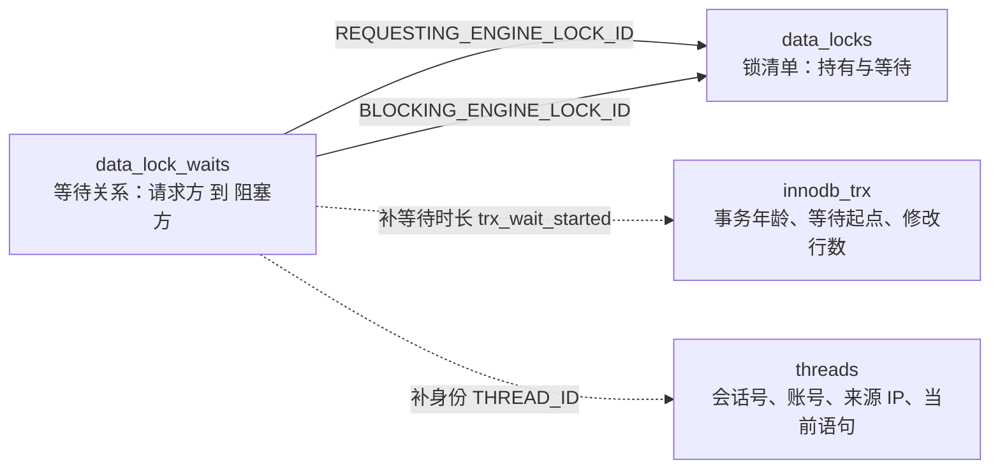
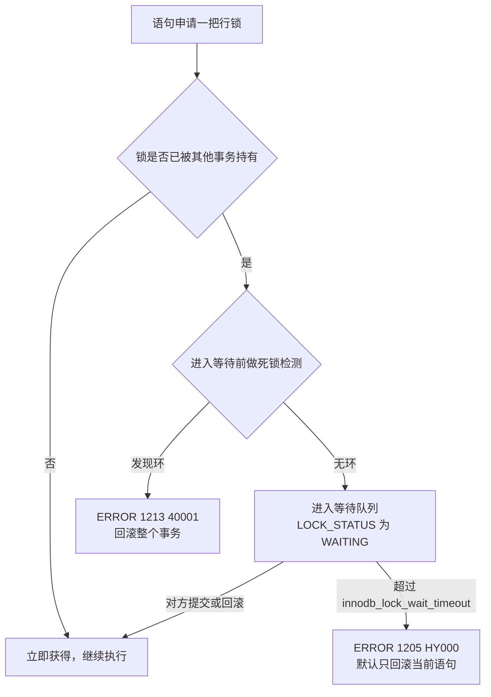
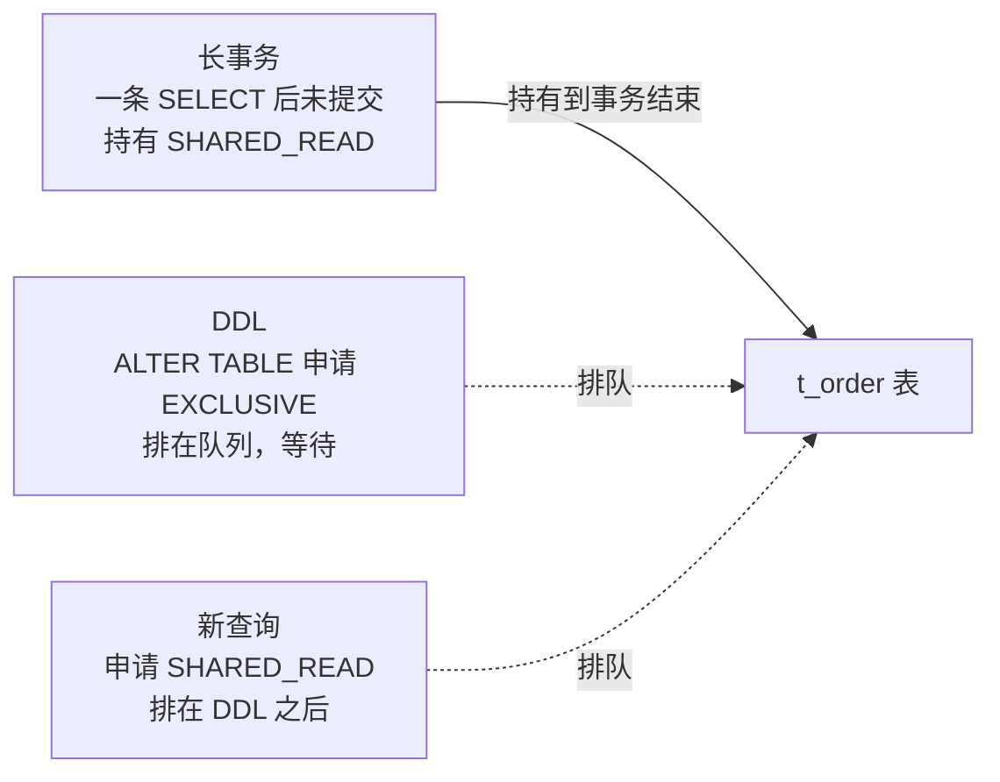

# 07 InnoDB 锁机制——从记录锁到间隙锁的底层实现

**摘要：**

锁是最容易被讲成类型学的一章：记录锁、间隙锁、临键锁、插入意向锁，定义与加锁规则都能背熟，但值班的人面对的从来不是这些名词，而是"这条 UPDATE 为什么卡住、它卡在谁身上、已经卡了多久、挡路的那条 SQL 是谁发的"。回答这类问题不需要再读一遍锁的物理结构，需要的是把散落在三张性能表与一段日志里的证据拼成一条链：`data_locks` 给出锁的清单，`data_lock_waits` 给出等待的边，`innodb_trx` 补上事务年龄与等待起点，三者缺一段就还原不出"谁等谁"。本文按这条链展开：先给出一条能一次问全的等待查询，再沿链找出真正的根事务；然后逐行读 `SHOW ENGINE INNODB STATUS` 的 TRANSACTIONS 段与 LATEST DETECTED DEADLOCK 段，说清"持有"与"等待"的对照，以及死锁取证为什么必须提前打开 `innodb_print_all_deadlocks`；接着分清 1205 与 1213 在回滚范围与重试语义上的差别，并给出 `innodb_lock_wait_timeout` 与 `lock_wait_timeout` 调大调小的代价。三种"锁等待里查不到我"的漏检——非 InnoDB 引擎、元数据锁、快照读——各配判别方法与查询；间隙锁那几类 `LOCK_MODE` 的读法，连同"该不该降到 RC"的运行期判据一并给出。目标很具体：任意时刻抓到一个锁等待现场，都能在几分钟内说出谁在等谁、等的是哪一行、该动谁。

---

## 第 1 章 值班现场：三个入口与它们的分工

凌晨两点十七分，订单服务的更新接口 P99 从 80 毫秒涨到 12 秒，应用日志里开始成片出现 `ERROR 1205 (HY000): Lock wait timeout exceeded`。值班的第一反应通常是 `SHOW PROCESSLIST`，于是看到几十个连接停在 `updating`，另有一批停在 `Waiting for lock`——这条命令能回答"谁在等"，却回答不了另外三件事：这些连接各自在等谁、已经等了多久、等的是哪张表的哪一行。

要把这三件事拼齐，MySQL 8.0 提供的是三个入口，它们之间不是三选一的关系，而是同一条证据链上的三段。

### 1.1 三个入口各负责一段

第一个入口是 `performance_schema.data_locks`，它列出引擎层当前持有与请求中的每一个数据锁，一行一把锁。判断等待者只需一列：`LOCK_STATUS='WAITING'` 的那一行，就是某个语句正卡在这里的原因。

第二个入口是 `performance_schema.data_lock_waits`，它只有等待关系，每一行是一条边：`REQUESTING_ENGINE_TRANSACTION_ID` 指向等待者，`BLOCKING_ENGINE_TRANSACTION_ID` 指向挡路者，两侧各带一个引擎锁 ID，可以把 `data_locks` 里对应的两行锁记录拉过来。

第三个入口是 `information_schema.innodb_trx`，它给的是事务的时间与体量：`trx_started` 说明事务活了多久，`trx_wait_started` 说明它从哪一刻开始等锁，`trx_rows_modified` 与 `trx_weight` 说明它的代价有多大，`trx_mysql_thread_id` 把它对回一个会话。

**缺一段就还原不出现场**：`data_locks` 里没有"等了多久"，`data_lock_waits` 里没有"哪张表哪一行"，`innodb_trx` 里没有"锁的是什么模式"。这也解释了为什么很多人第一次查锁会觉得"信息不够"——不是表不够用，是只用了一张。

下图是这三个入口的拼接关系，箭头方向表示"从哪张表取字段补到哪张表"。



### 1.2 版本断层：5.7 的脚本迁到 8.0 会失真

三个入口里有两个是 8.0 才有的。8.0 之前，锁信息走的是 `information_schema.INNODB_LOCKS` 与 `INNODB_LOCK_WAITS`，这两个视图在 8.0 已被移除，沿用旧视图的监控脚本升级后会直接报"表不存在"。

更隐蔽的坑在语义上：5.7 的 `INNODB_LOCKS` 并不列出全部锁，它只显示"已经请求但未获得的锁"，以及"某个事务持有、正在阻塞别人的锁"。`data_locks` 则是全量清单，一个事务有几把锁就几行。把按"锁数量"设阈值的老告警直接搬过来，会看到数值成倍增长，然后误判为"锁竞争恶化"。

同样值得记住的是另一处反向变化：8.0 的元数据锁采集（`wait/lock/metadata/sql/mdl`）默认开启，5.7 需要手工打开 instrument。从 5.7 升上来的人如果按老经验认为"MDL 查不到"，会白走一段弯路。

### 1.3 三张表的边界

| 入口 | 一行代表什么 | 独有的字段 | 别处才有的字段 | 读取代价 |
| :--- | :--- | :--- | :--- | :--- |
| `data_locks` | 一把锁（表级或行级） | `LOCK_TYPE`、`LOCK_MODE`、`LOCK_DATA` | 等待时长、会话身份 | 每次查询都是全量扫描内存锁表，锁极多时明显变慢 |
| `data_lock_waits` | 一条等待边 | 请求方与阻塞方的事务号、锁 ID | 锁模式、表名、键值 | 只与"正在等待"的锁相关，通常很小 |
| `innodb_trx` | 一个活跃事务 | `trx_started`、`trx_wait_started`、`trx_rows_modified`、`trx_weight` | 锁模式、等待目标 | 小，但在长事务堆积时行数会多 |

还有一条容易被忽略的前置条件：读取 `performance_schema` 需要相应的 `SELECT` 权限；看不到其他会话的 `PROCESSLIST_INFO` 时，通常是缺少 `PROCESS` 权限，具体以对应版本的权限文档为准。没有权限的账号查出来的结果会让人误以为不存在等待。

---

## 第 2 章 data_locks：把锁的清单读成一句话

### 2.1 一条查询的样子

`data_locks` 的列有十五个，排查时常用的只有八个。下面这条查询把等待中的锁排在前面，是为了让"卡住的那把锁"出现在结果的第一屏。

```sql
SELECT ENGINE_TRANSACTION_ID AS trx_id,
       THREAD_ID,
       OBJECT_SCHEMA, OBJECT_NAME, INDEX_NAME,
       LOCK_TYPE, LOCK_MODE, LOCK_STATUS, LOCK_DATA
FROM performance_schema.data_locks
ORDER BY LOCK_STATUS DESC, ENGINE_TRANSACTION_ID;
```

在一个"订单状态更新被阻塞"的现场，输出大致长这样（表名与事务号为例）：

```text
trx_id    THREAD_ID  OBJECT_NAME  INDEX_NAME  LOCK_TYPE  LOCK_MODE      LOCK_STATUS  LOCK_DATA
4218773   1288       t_order      PRIMARY     RECORD     X,REC_NOT_GAP  WAITING      10087
4218773   1288       t_order      NULL        TABLE      IX             GRANTED      NULL
4218773   1288       t_order      PRIMARY     RECORD     X,REC_NOT_GAP  GRANTED      10086
4218774   1291       t_order      NULL        TABLE      IX             GRANTED      NULL
4218774   1291       t_order      PRIMARY     RECORD     X,REC_NOT_GAP  GRANTED      10087
```

一眼能读出的信息是：事务 4218773 已经拿到 id=10086 的记录锁，正等 id=10087；挡路的是事务 4218774，它持有 10087 上的排他记录锁。4218773 之所以先拿 10086 再等 10087，是因为 `id IN (10086, 10087)` 这个条件按主键升序加锁；条件里的顺序与索引顺序一致，就不会自造出交叉。两个事务都有一行表级 `IX`，那是加行锁之前的意向锁，不是"锁表"。

### 2.2 关键字段的读法

| 字段 | 读法 | 容易读错的地方 |
| :--- | :--- | :--- |
| `ENGINE` | 恒为 InnoDB | 非 InnoDB 引擎的等待根本不在这张表里 |
| `ENGINE_TRANSACTION_ID` | 事务号，可与 `innodb_trx.trx_id` 对齐 | 它和 `THREAD_ID` 是两个体系的编号，不能互相替代 |
| `THREAD_ID` | P_S 内部线程号 | `innodb_trx.trx_mysql_thread_id` 是会话号，要经 `threads.PROCESSLIST_ID` 才等价 |
| `LOCK_TYPE` | `TABLE` 或 `RECORD` | 每个事务都有一行表级 `IX`，计数时必须排除 |
| `LOCK_MODE` | `S`/`X`/`IS`/`IX` 加 `GAP`、`REC_NOT_GAP`、`INSERT_INTENTION` 修饰 | 无修饰的 `X` 是临键锁，不是**排他行锁** |
| `LOCK_STATUS` | `GRANTED` 或 `WAITING` | 只有 `WAITING` 是等待者 |
| `LOCK_DATA` | 被锁记录的索引键值 | 间隙锁显示的是间隙之后那条记录的键值，不是被锁行的键值 |
| `INDEX_NAME` | 锁所在索引 | 为 `NULL` 表示表级锁；二级索引上 `LOCK_DATA` 会附加主键值 |

`LOCK_DATA` 那一列值得单独说。它的语义是"锁落在哪条索引记录上"，因此主键索引上给的是主键值，二级索引上给的是"二级索引值, 主键值"；而间隙锁的 `LOCK_DATA` 指向间隙之后的第一条记录，最后一段间隙（从当前最大键到正无穷）会显示 `supremum pseudo-record`。把 `LOCK_DATA` 当成"被锁行的行号"是排查里最常见的误读，看到一个键值就去找那行数据，**方向从一开始就偏了**。

锁模式在 InnoDB 内部的表示与加锁规则，见 [[中间件/MySQL/MySQL内核设计与实现/8.2 第8章 MySQL锁实现|MySQL 锁实现]]；锁为何落在索引记录上、与页内槽位的关系，见 [[中间件/MySQL/读书笔记-Mysql内核架构/11. InnoDB 索引：B+Tree 的工程实现与分裂合并哲学|InnoDB 索引]]。

### 2.3 三条计数与分组规则

第一条：按 `ENGINE_TRANSACTION_ID` 分组看。一个事务通常至少两行（表级意向锁加若干记录锁），行数多说明它锁的范围大，这本身就是判断"它是不是元凶"的第一手依据。

第二条：`WAITING` 只表示"此刻有人在申请"，不等于"业务卡住的原因"。真正需要处置的往往是另一个事务——它持有锁、却已经空闲在事务里，自己没有在等任何人，因此不会出现在 `data_lock_waits` 的请求侧。

第三条：统计锁规模时**必须过滤表级行**，否则数字会虚高到无法使用。按行锁数量排序，能很快看出谁在扩大范围：

```sql
SELECT ENGINE_TRANSACTION_ID AS trx_id, COUNT(*) AS row_locks
FROM performance_schema.data_locks
WHERE LOCK_TYPE = 'RECORD'
GROUP BY ENGINE_TRANSACTION_ID
ORDER BY row_locks DESC;
```

### 2.4 它是快照，不是历史

`data_locks` 每次查询都是"当下"的内存锁表，既没有累计值也没有历史。上一分钟是谁锁了这张表、锁了多久，它一概不知。这是它的设计边界，也决定了必须有一套把现场"留下来"的机制。

---

## 第 3 章 把三张表连成一条查询

### 3.1 等待关系只有一条边

`data_lock_waits` 的语义很窄：每有一个等待中的锁请求，就有一行，最多只有请求方和阻塞方两方。它不记录"谁先来后到"，也不记录时长。死锁在它里面表现为两条方向相反的边同时存在，不过真发生死锁时 InnoDB 会立刻回滚一方，所以靠这张表抓环的机会并不多——抓环是 `LATEST DETECTED DEADLOCK` 的活。

### 3.2 一条查询给出全部答案

下面这条查询是本章的核心交付，它把"谁在等谁、等了多久、等的是哪张表哪一行、双方是哪条 SQL"一次给全。连接条件用引擎锁 ID 而不是事务号，是因为同一个事务可能同时请求多把锁，只有锁 ID 才能定位到"正在等的那一把"。

```sql
SELECT
    w.REQUESTING_ENGINE_TRANSACTION_ID                              AS 等待事务,
    TIMESTAMPDIFF(SECOND, r.trx_wait_started, NOW())                AS 已等待秒数,
    r.trx_rows_modified                                             AS 等待方已改行数,
    w.BLOCKING_ENGINE_TRANSACTION_ID                                AS 阻塞事务,
    TIMESTAMPDIFF(SECOND, b.trx_started, NOW())                     AS 阻塞事务年龄秒,
    b.trx_rows_modified                                             AS 阻塞方已改行数,
    lr.OBJECT_SCHEMA                                                AS 等待库,
    lr.OBJECT_NAME                                                  AS 等待表,
    lr.INDEX_NAME                                                   AS 等待索引,
    lr.LOCK_MODE                                                    AS 等待锁模式,
    lr.LOCK_DATA                                                    AS 等待键值,
    lb.LOCK_MODE                                                    AS 阻塞锁模式,
    lb.LOCK_DATA                                                    AS 阻塞键值,
    tr.PROCESSLIST_ID                                               AS 等待会话,
    tr.PROCESSLIST_USER                                             AS 等待账号,
    tr.PROCESSLIST_HOST                                             AS 等待来源,
    tr.PROCESSLIST_INFO                                             AS 等待语句,
    tb.PROCESSLIST_ID                                               AS 阻塞会话,
    tb.PROCESSLIST_USER                                             AS 阻塞账号,
    tb.PROCESSLIST_HOST                                             AS 阻塞来源,
    tb.PROCESSLIST_INFO                                             AS 阻塞语句
FROM performance_schema.data_lock_waits AS w
JOIN performance_schema.data_locks AS lr
     ON lr.ENGINE_LOCK_ID = w.REQUESTING_ENGINE_LOCK_ID
JOIN performance_schema.data_locks AS lb
     ON lb.ENGINE_LOCK_ID = w.BLOCKING_ENGINE_LOCK_ID
LEFT JOIN information_schema.INNODB_TRX AS r
     ON r.trx_id = w.REQUESTING_ENGINE_TRANSACTION_ID
LEFT JOIN information_schema.INNODB_TRX AS b
     ON b.trx_id = w.BLOCKING_ENGINE_TRANSACTION_ID
LEFT JOIN performance_schema.threads AS tr
     ON tr.THREAD_ID = w.REQUESTING_THREAD_ID
LEFT JOIN performance_schema.threads AS tb
     ON tb.THREAD_ID = w.BLOCKING_THREAD_ID
ORDER BY 已等待秒数 DESC;
```

几处细节决定了这条查询靠不靠得住。

等待时长只能来自 `innodb_trx.trx_wait_started`，因为 `data_lock_waits` 没有时间列。`trx_wait_started` 在事务没有等待时为 `NULL`，`TIMESTAMPDIFF` 的结果也就是 `NULL`，这正好把"这一行是否真的在等"标了出来。

会话身份只能来自 `performance_schema.threads`。`innodb_trx.trx_mysql_thread_id` 是会话号（等于 `threads.PROCESSLIST_ID`），而 `data_lock_waits` 与 `data_locks` 里的 `THREAD_ID` 是内部线程号，两套编号混用会 join 出空结果——这是自写锁查询时最常见的错误。

语句文本建议两处都取。`innodb_trx.trx_query` 只在事务正在执行语句时有值，阻塞方一旦空闲在事务里（拿了连接没提交），它就是 `NULL`；`threads.PROCESSLIST_INFO` 的值域略宽，还能顺带看到阻塞方上一次执行的语句，虽然那一句不一定是加锁的那一句。

`innodb_trx.trx_id` 与 `ENGINE_TRANSACTION_ID` 的类型声明在个别版本上并不完全一致，直接比较偶尔会出现隐式转换或匹配不上的情况，稳妥的做法是两侧都 `CAST(... AS CHAR)` 再比。这两张表都很小，放弃索引不影响什么。

### 3.3 找到等待链的根

排查锁等待最常见的浪费，是把注意力放在等待者身上。等待者只是症状，处置它是徒劳的——杀掉它，下一个连接马上补位，继续等。真正要动的是**阻塞了别人、自己却不在等**的那个根事务。

```sql
SELECT t.trx_id,
       t.trx_started,
       TIMESTAMPDIFF(SECOND, t.trx_started, NOW()) AS 事务年龄秒,
       t.trx_rows_modified,
       t.trx_mysql_thread_id                        AS 会话号,
       t.trx_query
FROM information_schema.INNODB_TRX AS t
WHERE EXISTS (SELECT 1 FROM performance_schema.data_lock_waits AS w
              WHERE w.BLOCKING_ENGINE_TRANSACTION_ID = t.trx_id)
  AND NOT EXISTS (SELECT 1 FROM performance_schema.data_lock_waits AS w
                  WHERE w.REQUESTING_ENGINE_TRANSACTION_ID = t.trx_id)
ORDER BY 事务年龄秒 DESC;
```

**结果通常只有一到两行**。若根事务的 `trx_query` 是 `NULL` 而事务年龄已经几分钟，基本可以断定是应用侧"开了事务、忘记提交或回滚"，处置办法是 `KILL` 会话，然后从连接池与代码路径两头查。若 `trx_query` 有值且是一条大范围更新，方向则在语句与索引上，不是连接的锅。

下图是一条典型的两段等待链：等待方本身不构成环，所以不会被死锁检测处理，它只能一直等到超时或者根事务结束。


### 3.4 sys 视图的便利与代价

MySQL 自带 `sys` 库提供了包装好的视图：`sys.innodb_lock_waits` 直接给出 `wait_age`、`locked_table`、`locked_index`、`waiting_query`、`blocking_query` 等字段，`sys.schema_table_lock_waits` 处理元数据锁。日常排查用它们更快，一条 `SELECT * FROM sys.innodb_lock_waits\G` 就能看个大概。

代价是字段由别人挑。想知道 `LOCK_MODE` 到底是临键锁还是纯间隙锁、`LOCK_DATA` 指向哪条记录，仍然要回到 `data_locks`。视图适合"先确认有没有等待"，自写的连接查询适合"确认等的是哪一行"，两者不要互相替代。

如果要按问题倒查字段，可以记住这张对照：

| 要回答的问题 | 该看的字段 |
| :--- | :--- |
| 谁在等 | `data_lock_waits.REQUESTING_ENGINE_TRANSACTION_ID` |
| 等谁 | `data_lock_waits.BLOCKING_ENGINE_TRANSACTION_ID` |
| 等了多久 | `innodb_trx.trx_wait_started` 与 `NOW()` 之差 |
| 等哪张表哪一行 | `data_locks` 请求侧的 `OBJECT_NAME`、`INDEX_NAME`、`LOCK_DATA` |
| 谁发起的 | `threads.PROCESSLIST_USER`、`PROCESSLIST_HOST` |

---

## 第 4 章 SHOW ENGINE INNODB STATUS 的 TRANSACTIONS 段

### 4.1 它为什么还没有被取代

`SHOW ENGINE INNODB STATUS` 是 2000 年代就有的命令，在性能表齐全的 8.0 里仍然值得保留，理由有三个。

第一，它一条命令就给全：等待者的 SQL 全文、它持有的锁、它正在等的锁、锁所在的索引与页号，全在一个文本块里，不需要 join 任何表。第二，它不依赖 `performance_schema` 是否开启，权限上也只需 `PROCESS` 一项，不必逐表授权。第三，它与 error log 里那段死锁日志同源，读法一致——学会一段，两处都能用。

### 4.2 一个 LOCK WAIT 块逐行读

下面是从 TRANSACTIONS 段里截出来的一个等待事务，行内注释是读法（行首的连字符与缩进保持原样，不要当成装饰）：

```text
---TRANSACTION 4218773, ACTIVE 12 sec starting index read
mysql tables in use 1, locked 1
LOCK WAIT 3 lock struct(s), heap size 1136, 1 row lock(s)
MySQL thread id 1288, OS thread handle 123145, query id 88213 10.20.3.17 orderapp updating
UPDATE t_order SET status = 2 WHERE id IN (10086, 10087)
------- TRX HAS BEEN WAITING 12 SEC FOR THIS LOCK TO BE GRANTED:
RECORD LOCKS space id 2 page no 5 n bits 96 index PRIMARY of table `order_db`.`t_order` trx id 4218773 lock_mode X locks rec but not gap waiting
Record lock, heap no 2 PHYSICAL RECORD: n_fields 3; compact format; info bits 0
 0: len 8; hex 8000000000002767; asc    g;;
 1: len 6; hex 000000405f15; asc    _ ;;
 2: len 7; hex 82000009a40110; asc        ;;
------------------
TABLE LOCK table `order_db`.`t_order` trx id 4218773 lock mode IX
RECORD LOCKS space id 2 page no 5 n bits 96 index PRIMARY of table `order_db`.`t_order` trx id 4218773 lock_mode X locks rec but not gap
Record lock, heap no 1 PHYSICAL RECORD: n_fields 3; compact format; info bits 0
 0: len 8; hex 8000000000002766; asc    f;;
```

逐行拆开看，这个块回答的是五个问题。

事务头 `---TRANSACTION 4218773, ACTIVE 12 sec starting index read` 给出事务号、活跃时长与当前阶段。`starting index read` 表示它正在做索引定位，还没走到改数据；换成 `updating` 就说明已经在写行，加锁范围已经确定。

`LOCK WAIT 3 lock struct(s), heap size 1136, 1 row lock(s)` 这一行出现 `LOCK WAIT` 四个字，就足以判定该事务处于锁等待。后两个数字反映它涉及的锁结构与已持有的行锁数量，数字越大，它自己占用的资源越多。

`MySQL thread id 1288, ... 10.20.3.17 orderapp updating` 是定位业务的最短路径：会话号、来源 IP、账号、阶段。很多时候看到来源 IP 与账号，就能直接判断是哪台应用机上的哪个连接池出了问题。

`UPDATE t_order SET status = 2 WHERE id IN (10086, 10087)` 是导致这次等待的那条语句。这一段的价值全在这行——`data_locks` 给不出 SQL，只有这里给。

`------- TRX HAS BEEN WAITING 12 SEC FOR THIS LOCK TO BE GRANTED:` 之后是等待目标：`index PRIMARY` 上的 `lock_mode X locks rec but not gap waiting`。`locks rec but not gap` 对应 `data_locks` 里的 `X,REC_NOT_GAP`，行尾的 `waiting` 对应 `LOCK_STATUS='WAITING'`，第 4.3 节给完整对照表。

最后的分隔线之后打印的是该事务自己持有的锁，先 `TABLE LOCK ... lock mode IX`，再 `RECORD LOCKS ... lock_mode X locks rec but not gap`。这一段最容易被跳过，但在"为什么它拿不到"这个问题上恰恰最有用：它已经拿到 10086 那把锁，只差 10087 这一把，而这一把被旁边那个单行更新按住——离完成只差一步，正是这类等待最常见的样子。

注意这里与死锁段的一个差别：TRANSACTIONS 段里"持有"的部分没有小标题，靠一条 `------------------` 分隔线切开；而死锁段会显式写出 `HOLDS THE LOCK(S)` 与 `WAITING FOR THIS LOCK TO BE GRANTED`。同一个引擎，两套排版，按习惯读容易把持有当等待。

### 4.3 锁模式方言对照

`SHOW ENGINE INNODB STATUS` 用英文短语描述锁模式，`data_locks` 用逗号分隔的标记，两者一一对应：

| 状态输出里的写法 | data_locks 的 LOCK_MODE | 含义 |
| :--- | :--- | :--- |
| `lock_mode X` | `X` | 临键锁：记录本身加它之前的间隙 |
| `lock_mode X locks rec but not gap` | `X,REC_NOT_GAP` | 只锁记录，不锁间隙 |
| `lock_mode X gap before rec` | `X,GAP` | 只锁间隙，不锁记录 |
| `lock_mode X gap before rec insert intention` | `X,GAP,INSERT_INTENTION` | 插入意向锁，等待一个被占住的间隙 |
| `lock_mode S` | `S` | 共享临键锁 |
| 行尾的 `waiting` | `LOCK_STATUS='WAITING'` | 尚未获得，正在等 |

### 4.4 它的三个边界

第一，它只是一次打印，结果是快照。两次执行之间状态可能完全不同，先看到一堆 `LOCK WAIT`、再执行时已经散去，是常态。

第二，输出有长度上限，锁信息量大时后面的内容会被截掉；单条语句的文本也可能被截断，超长 SQL 只能看到前一段。想拿完整输出，得让 InnoDB 周期性把它写进 error log（`innodb_status_output` 系列参数），而不是靠客户端抓屏。

第三，它不提供任何过滤能力。想按表名、按账号筛，只能靠 `performance_schema` 的查询。所以合理的分工是：`SHOW ENGINE INNODB STATUS` 负责"取证"，看清某一刻的具体锁与 SQL；三张性能表负责"普查"，能在几百个等待里筛出最该处置的那一个。

---

## 第 5 章 超时、错误码与两个开关

### 5.1 50 秒从哪来，调大调小各付什么代价

`innodb_lock_wait_timeout` 是行锁等待的上限，默认 50 秒，作用域是全局与会话，可以动态修改。批处理作业常把它调小到 5 到 10 秒，目的是"快速失败、别占着连接池"；报表类长事务则有人想调大，理由是"别把正常事务误杀"。

这两个方向都有明确的代价，而代价不在参数本身，在连接上：

| 参数 | 默认值 | 作用域与动态性 | 调大的代价 | 调小的代价 |
| :--- | :--- | :--- | :--- | :--- |
| `innodb_lock_wait_timeout` | 50 秒 | 全局、会话，动态 | 等待方长时间占用连接，连接池被吃光，故障从"一条语句慢"升级为"整个服务不可用" | 正常的长事务被误判为超时，业务需要补偿逻辑，重试风暴会放大下游压力 |
| `lock_wait_timeout` | 31536000 秒 | 全局、会话，动态 | DDL 在元数据锁上几乎永不超时，事故能挂一整天 | DDL 快速失败，需要人工重跑，灰度期间反复失败 |
| `innodb_rollback_on_timeout` | OFF | 全局，仅启动参数 | 超时也回滚整个事务，回滚成本随事务体量上升 | 保持默认时，超时只回滚当前语句，应用要自己收拾残局 |

表里第三行的"调大调小"其实不准确，因为它不是动态参数，改它得改配置文件并重启。把这一行放进表里的目的是提醒：它是一个语义开关，不是一个调优旋钮。

顺带说明上表第二行的来源。`lock_wait_timeout` 的默认值是一年，这是"改个字段导致全站卡死能挂几个小时"的直接原因：DDL 在等元数据锁时几乎不会自己放弃。

### 5.2 1205 与 1213：回滚范围不同

| 错误码 | SQLSTATE | 触发条件 | InnoDB 的回滚范围 | 应用应当做什么 |
| :--- | :--- | :--- | :--- | :--- |
| 1205 | HY000 | 等锁超过 `innodb_lock_wait_timeout` | 默认只回滚当前语句 | 先回滚整个事务，再按幂等前提重试 |
| 1213 | 40001 | 等待图中检出环，被选为牺牲者 | 回滚整个事务 | 直接重试，配合退避与次数上限 |

这两行差别极大，但错误信息长得很像，都以 `try restarting transaction` 结尾，所以经常被同一个 `catch` 分支处理，然后在 1205 的场景下出问题。

1213 是干净的：事务的全部修改被撤销，客户端拿到错误时数据库侧已经回到事务开始前的状态，重试不会叠加任何东西。

1205 不是：默认配置下 InnoDB 只回滚"等锁的那条语句"，事务里之前执行的语句仍然有效，事务本身仍然活着。应用如果照着错误提示直接重试整段逻辑，就相当于在一个已经改了前几步的事务上再跑一遍。要消除这个歧义，可以把 `innodb_rollback_on_timeout` 设为 ON，让 1205 与 1213 的回滚语义对齐，代价是大事务回滚要重放更多 undo。

下图是从一次加锁申请到两种结局的完整分支，注意死锁检测发生在"进入等待之前"，而不是等待超时之后。



### 5.3 死锁检测该不该关

`innodb_deadlock_detect` 默认开启，检测在每次进入锁等待时触发：以当前事务为起点在等待图里做深度优先搜索，找到环就立即回滚代价小的一方。代价小是按事务权重算的，权重近似等于"修改行数加锁定行数"（对应 `innodb_trx.trx_weight`），所以大事务在多数情况下比小事务更不容易被牺牲。

**检测本身有硬上限**，这一点在文档里写得很少：等待图里的事务超过 200 个，或者遍历需要检查超过 100 万把锁时，InnoDB 会放弃遍历、直接按死锁处理并回滚。输出里会出现 `TOO DEEP OR LONG SEARCH IN THE LOCK TABLE WAITS-FOR GRAPH` 字样，表示这是"检测成本过高"导致的回滚，不是真的环。这两条上限是代码里的常量，不可配置。

关掉检测能省下遍历开销，代价是真正的死锁不再立即失败：一方会一直等到 `innodb_lock_wait_timeout` 到期才收到 1205，把秒级失败拖成分钟级挂起。适用的场景很窄——短事务、极高并发、并且死锁日志已经证明环路集中在少数几对语句上；普通 OLTP 保持默认即可。

---

## 第 6 章 死锁：从日志取证到处置

### 6.1 LATEST DETECTED DEADLOCK 段

死锁的现场只在一个地方完整存在：`SHOW ENGINE INNODB STATUS` 输出里的 `LATEST DETECTED DEADLOCK` 段。它记录最近一次死锁里形成环的那两个事务，各自的 SQL 与持有、等待的锁。

```text
------------------------
LATEST DETECTED DEADLOCK
------------------------
2026-11-18 02:31:07 0x7f6e8c0b1700
*** (1) TRANSACTION:
TRANSACTION 4221900, ACTIVE 2 sec starting index read
mysql tables in use 1, locked 1
LOCK WAIT 3 lock struct(s), heap size 1136, 2 row lock(s)
MySQL thread id 1310, OS thread handle 123145, query id 89120 10.20.3.17 orderapp updating
UPDATE t_order SET status = 2 WHERE id IN (10086, 10087)
*** (1) HOLDS THE LOCK(S):
RECORD LOCKS space id 2 page no 5 n bits 96 index PRIMARY of table `order_db`.`t_order` trx id 4221900 lock_mode X locks rec but not gap
Record lock, heap no 2 PHYSICAL RECORD: n_fields 3; compact format; info bits 0
 0: len 8; hex 8000000000002766; asc    f;;
*** (1) WAITING FOR THIS LOCK TO BE GRANTED:
RECORD LOCKS space id 2 page no 5 n bits 96 index PRIMARY of table `order_db`.`t_order` trx id 4221900 lock_mode X locks rec but not gap waiting
Record lock, heap no 3 PHYSICAL RECORD: n_fields 3; compact format; info bits 0
 0: len 8; hex 8000000000002767; asc    g;;
*** (2) TRANSACTION:
TRANSACTION 4221901, ACTIVE 2 sec starting index read
mysql tables in use 1, locked 1
LOCK WAIT 3 lock struct(s), heap size 1136, 2 row lock(s)
MySQL thread id 1312, OS thread handle 123145, query id 89121 10.20.3.22 orderapp updating
UPDATE t_order SET status = 3 WHERE id IN (10087, 10086)
*** (2) HOLDS THE LOCK(S):
RECORD LOCKS space id 2 page no 5 n bits 96 index PRIMARY of table `order_db`.`t_order` trx id 4221901 lock_mode X locks rec but not gap
Record lock, heap no 3 PHYSICAL RECORD: n_fields 3; compact format; info bits 0
 0: len 8; hex 8000000000002767; asc    g;;
*** (2) WAITING FOR THIS LOCK TO BE GRANTED:
RECORD LOCKS space id 2 page no 5 n bits 96 index PRIMARY of table `order_db`.`t_order` trx id 4221901 lock_mode X locks rec but not gap waiting
Record lock, heap no 2 PHYSICAL RECORD: n_fields 3; compact format; info bits 0
 0: len 8; hex 8000000000002766; asc    f;;
*** WE ROLL BACK TRANSACTION (2)
```

读这段要**按对照读、不按顺序读**。

第一步，把两个事务的 `HOLDS THE LOCK(S)` 与 `WAITING FOR THIS LOCK TO BE GRANTED` 交叉对照。两把锁都落在 `PRIMARY` 上，具体是哪条记录要看紧随其后的记录内容——`hex 8000000000002766` 这类编码就是主键值的二进制表示，换算出来是 10086。对照下来，事务 1 持有 10086、等 10087；事务 2 持有 10087、等 10086，两条边方向相反，环就闭合了。

第二步，看两个 `WAITING FOR` 落在哪条记录上，以及 `lock_mode` 后面有没有 `gap` 修饰语。这一例两条边都落在 `PRIMARY` 的相邻记录上，是纯粹的行冲突；如果其中一条带 `gap before rec` 或 `insert intention`，那是间隙冲突，处置方向完全不同（第 8 章）。行冲突的成因几乎总是访问顺序不一致：同一条语句里 `IN` 列表的顺序不同、两个服务更新同一批主键的顺序不同，都能造出反向的边。这也是"统一加锁顺序"能治住一类死锁、却对另一类无能为力的原因。

第三步，看 `WE ROLL BACK TRANSACTION (n)`，确认这一次被牺牲的是谁。牺牲判据是事务权重（修改行数与锁定行数的组合），这里被回滚的是 2 号事务，说明它的权重更小；不是"谁先到"，也不是"谁看起来更弱"。

第四步，看两边的 `MySQL thread id ... 来源 IP 账号`。同一个 IP、同一个账号前缀、同一段 SQL 特征，往往指向同一段代码；不同账号则可能是两个服务在操作同一批数据。

这段日志也有明确的盲区，需要提前知道：它只包含形成环的那两个事务，第三个事务即便也持有相关锁，也不会出现在这里；它只包含每个事务的一条 SQL，同一个事务里更早的加锁语句看不到；它只按"最近一次"覆盖，高并发下你登上机器时，现场早已换了一批。

### 6.2 只看最后一次是不够的

上面那条"只保留最近一次"，是排查死锁时最致命的限制。解决办法只有一个参数：

```sql
SET GLOBAL innodb_print_all_deadlocks = ON;
```

打开之后，每一次死锁的完整信息都会写进 error log，不再被覆盖。它是动态参数，立即生效，但**不会写进配置文件**——重启后回到 `OFF`。这一点必须补上配置文件，否则下次维护重启，取证能力就悄悄没了。

配合日志采集之后，死锁就从"事后回忆"变成"可统计对象"：按表名与索引名做频次，能找到 top 形态；按出现时段做分布，能看出是不是某个定时任务引发的。不开这个参数，就只能祈祷故障时自己恰好在场，并且赶在下次覆盖之前把屏截下来。

### 6.3 死锁不是异常，是并发系统的常态

任何允许多事务并发修改同一批行的系统都会产生等待环。InnoDB 的职责不是杜绝死锁，而是在毫秒级检出并回滚一方，让整个系统继续前进。把"出现死锁"当成故障，是把设计问题当成了运行事故。

由此推出应用侧的一条硬要求：**必须能重试**。收到 1213 时，事务已经被完整撤销，只要语句幂等（或者有唯一键保护），重试是安全的；退避与次数上限要设，否则死锁会变成重试风暴。这条要求与"如何写出不产生死锁的代码"是两件事——前者保证出了问题能自愈，后者降低出问题的概率，两者不能互相替代。

把死锁挡在代码一侧的做法（统一加锁顺序、缩小事务范围、范围收敛）见 [[中间件/MySQL/MySQL进阶使用/04 锁与并发控制——开发者必须理解的死锁问题|锁与并发控制]]。

死锁的频率是设计信号，不是故障信号。偶尔一次可以忽略；每小时多次，就该去归类了：是不是同一对表、同一个索引、同一段访问顺序；是不是范围更新把间隙锁放大了；是不是索引缺失导致扫描范围远超需要。归类的材料，就是 `innodb_print_all_deadlocks` 写到 error log 里的那些段。

### 6.4 死锁频率怎么看

死锁的累计次数不在 `SHOW GLOBAL STATUS` 里。容易被记混的 `Innodb_deadlocks` 并不是一个合法的状态变量，真正的计数在 InnoDB 的指标表：

```sql
SELECT NAME, COUNT, STATUS
FROM information_schema.INNODB_METRICS
WHERE NAME = 'lock_deadlocks';
```

`STATUS` 显示 `enabled` 时 `COUNT` 才有意义，计数器随实例重启归零。要按时间看速率，就把两次采样差值与 `Uptime` 的差值相除，落到监控里做趋势，而不是盯着绝对值。

下面的链路是死锁从产生到被治理的完整路径，也是笔者建议在团队里固定的分工：应用负责重试，DBA 负责取证与归类，开发负责按归类结果改访问顺序或索引。


---

## 第 7 章 为什么锁等待里没有我

"我的语句在等，但 `data_locks` 里查不到我的事务"——这句抱怨在值班群里出现频率很高，成因只有三种，而且判别方法各不相同。

### 7.1 第一种：等的不是 InnoDB 的锁

`data_locks` 的 `ENGINE` 列恒为 InnoDB。MyISAM 表上的表锁、`LOCK TABLES` 显式加的表锁、某些备份工具施加的锁，都不在这张表里。遇到"明明在等却查不到"，第一件事是确认表引擎，第二件事是确认等待对象是不是行。

### 7.2 第二种：等的是元数据锁

元数据锁（Metadata Lock，MDL）由 Server 层维护，服务于表结构的一致性，与 InnoDB 的行锁系统是两套东西，因此 `data_locks` 与 `SHOW ENGINE INNODB STATUS` 都看不见它。它的入口是 `performance_schema.metadata_locks`。

| 字段 | 读法 |
| :--- | :--- |
| `OBJECT_TYPE` | `TABLE`、`GLOBAL`、`SCHEMA`、`FUNCTION` 等，处理 DDL 事故时通常只看 `TABLE` |
| `LOCK_TYPE` | `SHARED_READ`（读与 DML 的读路径）、`SHARED_WRITE`（DML 的写路径）、`EXCLUSIVE`（DDL） |
| `LOCK_DURATION` | `TRANSACTION` 表示直到事务结束才释放；`STATEMENT` 表示语句结束即释放 |
| `LOCK_STATUS` | `GRANTED` 已持有，`PENDING` 排队中 |
| `OWNER_THREAD_ID` | 持有或申请该 MDL 的线程，经 `threads.THREAD_ID` 对回会话 |

下面这条查询把 MDL 的持有者与排队者一起列出来，并把持有事务的年龄带出来——年龄是最关键的判据：

```sql
SELECT ml.OBJECT_SCHEMA                                              AS 库,
       ml.OBJECT_NAME                                                AS 表,
       ml.LOCK_TYPE, ml.LOCK_DURATION, ml.LOCK_STATUS,
       th.PROCESSLIST_ID                                             AS 会话,
       th.PROCESSLIST_USER                                           AS 账号,
       th.PROCESSLIST_STATE                                          AS 状态,
       TIMESTAMPDIFF(SECOND, trx.trx_started, NOW())                 AS 持有事务年龄秒,
       th.PROCESSLIST_INFO                                           AS 当前语句
FROM performance_schema.metadata_locks AS ml
LEFT JOIN performance_schema.threads AS th
       ON th.THREAD_ID = ml.OWNER_THREAD_ID
LEFT JOIN information_schema.INNODB_TRX AS trx
       ON trx.trx_mysql_thread_id = th.PROCESSLIST_ID
WHERE ml.OBJECT_SCHEMA NOT IN ('mysql', 'performance_schema', 'information_schema', 'sys')
ORDER BY ml.LOCK_STATUS, ml.OBJECT_SCHEMA, ml.OBJECT_NAME;
```

结果的典型形态是这样：一行 `GRANTED` 的 `SHARED_READ`，会话是一个普通业务连接，`持有事务年龄秒` 显示 3600 以上，`当前语句` 为 `NULL`；紧跟一串 `PENDING` 的 `EXCLUSIVE`（某条 `ALTER TABLE`）与 `SHARED_READ`（后续的新查询）。

这就是"改个字段导致全站卡死"的完整机制，值得逐步走一遍：

1. 某个连接开了一个事务，执行过一条普通的 `SELECT`，于是持有该表的 `SHARED_READ` MDL，`LOCK_DURATION` 为 `TRANSACTION`。
2. 事务没有提交，也没有回滚。它可能是一条被遗忘在代码里的 `begin`，也可能是应用侧连接泄漏。
3. 运维执行 `ALTER TABLE` 加字段，申请 `EXCLUSIVE` MDL，被挡，进入队列。
4. 此后所有访问该表的新语句都要申请 `SHARED_READ` MDL，而队列**先来后到**，它们排在已经等待的 `EXCLUSIVE` 后面。
5. 于是整张表的新查询全部阻塞。业务侧看不到任何行锁，DBA 在 `data_locks` 里也找不到任何东西。
6. 由于 `lock_wait_timeout` 默认是一年，这个状态可以持续到有人手工处理为止。

下图是这条阻塞链的形状，注意它是一条队列，不是一张图：真正卡住全表的不是 DDL，而是**排在队列前面的排他请求**。



处置办法与判据都很明确。判别只靠 `SHOW PROCESSLIST` 的 `State` 列就够：出现 `Waiting for table metadata lock` 就是这条路径，不必去 `data_locks` 里找。处置要先释放持有者——`KILL` 那个会话（`KILL QUERY` 不够，必须 `KILL CONNECTION` 才会结束事务并释放 MDL），DDL 才能进。如果业务侧一时不能改那条长事务，可以给 DDL 会话设 `SET SESSION lock_wait_timeout = 5`，让它在拿不到锁时快速失败并在业务低峰重跑，而不是挂在队列里把整张表拖死。

还有一处容易被忽略：8.0 的 `ALGORITHM=INSTANT` 确实让加列一类的变更不再复制表数据，但它仍要拿排他 MDL，仍会被长事务挡住。区别只在"拿到之后放得快"，而不是"拿不到也能做"。

### 7.3 第三种：它是快照读，本来就不加锁

REPEATABLE READ 下的普通 `SELECT` 走一致性读，读的是 undo 版本链，不加任何行锁，因此不会出现在 `data_locks` 里。这类语句如果"慢"，原因在版本链长度或者扫描行数上，与锁无关——它的等待对象是 CPU 与 IO，不是另一个事务。

版本链如何构造、快照如何判断可见性，见 [[中间件/MySQL/读书笔记-Mysql内核架构/12. InnoDB 事务实现：ACID 的内核代价与 MVCC 的时间旅行|InnoDB 事务实现]]。

真正加锁的读只有三类：`SELECT ... FOR UPDATE`、`SELECT ... FOR SHARE`，以及 `UPDATE`/`DELETE` 的定位过程。8.0 里 `FOR SHARE` 取代了旧的 `LOCK IN SHARE MODE`，语义不变。

### 7.4 三种漏检的判别顺序

按下面的顺序走，通常两分钟能定位：

| 现象 | 先查什么 | 结论 |
| :--- | :--- | :--- |
| `data_locks` 里没有，`State` 含 `metadata lock` | `performance_schema.metadata_locks` | 元数据锁事故，处置持有 MDL 的长事务 |
| `data_locks` 里没有，`State` 是 `Sending data` 一类 | 执行计划与扫描行数 | 与锁无关，走慢查询路径 |
| `data_locks` 里没有，表是 MyISAM | `SHOW TABLE STATUS` 看引擎，`SHOW OPEN TABLES` 看占用 | 引擎级表锁，与 InnoDB 锁体系无关 |

---

## 第 8 章 间隙锁的排查难点与隔离级别的运行期判据

### 8.1 三种 LOCK_MODE 的读法

间隙锁在 `data_locks` 里的形态不止一种，读错会走很远的方向：

| LOCK_MODE | 锁住的是什么 | 排查时意味着什么 |
| :--- | :--- | :--- |
| `X` | 记录本身加它之前的间隙（临键锁） | 范围扫描或非唯一索引等值命中，锁的范围比语句写的范围大 |
| `X,GAP` | 只有间隙，不锁任何现有记录 | 该语句防止别人在这个区间插入，冲突对象是 INSERT |
| `X,GAP,INSERT_INTENTION` | 插入意向：想在某个间隙插，但该间隙被占 | 等待方是 INSERT 语句，阻塞方持有间隙锁或临键锁 |
| `X,REC_NOT_GAP` | 只有记录，不含间隙 | 唯一索引等值命中后的退化形态，锁范围最小 |

最典型的误读发生在 `X,GAP` 上。间隙锁的 `LOCK_DATA` 显示的是"间隙之后那条记录"的键值，所以看到一个 `LOCK_DATA=10086` 的间隙锁，正确的理解是"10086 之前的那段区间进不去"，而不是"10086 这行被锁了"。如果间隙一直延伸到索引末尾，`LOCK_DATA` 会显示 `supremum pseudo-record`，意思是"从当前最大键到正无穷，插入全部被挡"。

`X,GAP,INSERT_INTENTION` 的生成条件也值得记一笔：会话 A 执行 `SELECT ... WHERE user_id = 10086 FOR UPDATE`，在 `idx_user` 上留下临键锁；会话 B 随后 `INSERT` 一条 `user_id = 10086` 的记录，它在 `data_locks` 里就是一行等待中的 `X,GAP,INSERT_INTENTION`，`LOCK_DATA` 指向被占住的间隙之后那条记录。看到这种形态，方向就该从"哪条 UPDATE 锁了行"转到"哪个事务锁住了范围"。

看到 `X,GAP,INSERT_INTENTION` 在等待时，可以按三个问题往下走：语句的 WHERE 是否走了索引（没走索引的范围更新会锁住扫描到的全部记录与间隙）；条件是不是范围条件（`>`、`BETWEEN`、`IN`、前缀 `LIKE` 天然要求锁范围）；能不能用主键或唯一索引把范围收窄成等值（唯一索引等值命中会退化为 `X,REC_NOT_GAP`）。

### 8.2 RC 下没有间隙锁的边界

READ COMMITTED 下，InnoDB 除两种情形外不再使用间隙锁：外键约束检查与唯一键重复检查。这也是不少团队把隔离级别从 RR 降到 RC 的直接动机——由间隙锁引发的等待与死锁会明显减少。

边界也要说清楚。RC 放弃的是"范围查询时锁住间隙"，不是放弃所有范围锁；外键与唯一键路径上的锁仍然存在，因此"并发插入同一个唯一键会互相等待甚至死锁"在 RC 下依旧成立，只是冲突形态从间隙锁等待变成了插入意向等待。另外 **RC 每条语句取一次新快照**，同一事务内两次读可能不一致，依赖"事务内读稳定"的业务逻辑需要重新检查。binlog 格式也必须用 ROW，`STATEMENT` 在 RC 下有额外限制，这一点在 8.0 的默认配置里是满足的。

两种隔离级别在快照上的差别见 [[中间件/MySQL/MySQL架构与底层原理/08 InnoDB 事务隔离级别——从脏读到幻读的防御工程|事务隔离级别]]。

| 判据 | 留在 RR | 改到 RC |
| :--- | :--- | :--- |
| 间隙锁等待占锁等待总量的大头 | 需要逐个改语句范围，成本高 | 一次性消除大部分间隙锁，见效快 |
| 业务依赖事务内多次读一致 | 必须留在 RR | 语义会变，需要逐处核对 |
| 存在外键约束与高频唯一键并发插入 | 影响较小 | 唯一键路径的冲突形态变化，需要压测验证 |
| 主从复制与备份链路 | 无额外约束 | binlog 必须为 ROW，工具链要确认 |

### 8.3 看到间隙锁等待时先问的三件事

第一件是"这条语句需要锁这么大的范围吗"。很多间隙锁等待的根源不是隔离级别，而是语句写得太宽：一个没有走索引的 `UPDATE ... WHERE status = 1`，会把扫描到的每一行都加上临键锁，范围等于全表。

第二件是"这个范围能不能用唯一索引收窄"。同样的语义，走唯一索引等值命中的语句只加 `X,REC_NOT_GAP`，不碰间隙。

第三件是"降隔离级别是不是在替语句质量买单"。RC 能让一大批间隙锁消失，但如果根因是缺索引或者条件写法，改成 RC 只是把问题往后推：范围扫描带来的锁行数、扫描行数、复制量都还在。

---

## 第 9 章 反例与运行期阈值

### 9.1 四个反例

第一个反例是只看 `innodb_trx`。`trx_query` 只显示事务当前正在执行的语句，阻塞方往往空闲在事务里，这一列就是 `NULL`。于是排查者得出"没有人在锁我"的结论，然后在索引和 SQL 上绕圈。正确做法是把 `trx_id` 与 `data_lock_waits` 的 `BLOCKING_ENGINE_TRANSACTION_ID` 对齐，看它到底持有哪些锁。

第二个反例是不开 `innodb_print_all_deadlocks`。`LATEST DETECTED DEADLOCK` 只保留最后一次，高并发下等你连上机器，它已经被下一次覆盖。死锁取证的前提是"所有死锁都落盘"，这个参数属于上线就该配的清单，不是出事后再想起来的东西。

第三个反例是把 MDL 等待当成行锁等待。表现是在 `data_locks` 与 `SHOW ENGINE INNODB STATUS` 里反复查，什么也查不到，然后去调 `innodb_lock_wait_timeout`——而 DDL 等元数据锁用的是 `lock_wait_timeout`，调行锁超时对它毫无作用。判别只需一眼 `State` 列。

第四个反例是看到死锁就降隔离级别或者乱加索引。降 RC 能减少间隙锁型死锁，但对"两个事务以相反顺序更新同一批主键"这类环毫无作用；乱加索引可能把锁范围改小，也可能让优化器换一条更差的执行路径。

### 9.2 监控指标与阈值

锁等待的监控要抓"瞬时"与"累计"两类，只有累计值看不出当前是否卡住，只有瞬时值看不出趋势：

| 指标 | 来源 | 观察方式 | 示例处置阈值 |
| :--- | :--- | :--- | :--- |
| `Innodb_row_lock_current_waits` | `SHOW GLOBAL STATUS` | 瞬时值 | 持续大于 0 且不回落，立刻查 `data_lock_waits` |
| `Innodb_row_lock_time_avg` | 同上 | 累计平均值，毫秒 | 超过 200 毫秒开始关注，超过 1 秒进入排查 |
| `Innodb_row_lock_waits` | 同上 | 累计次数 | 与 `Uptime` 求比值，超过每分钟 1 次需要看是哪些语句 |
| `Innodb_row_lock_time_max` | 同上 | 单次最长等待，毫秒 | 接近 `innodb_lock_wait_timeout × 1000` 说明已有语句等满超时 |
| `lock_deadlocks` | `information_schema.INNODB_METRICS` | 累计次数 | 大于 0 就应有对应日志；每小时持续增长需要归类 |
| MDL 排队数 | `metadata_locks` 中 `PENDING` 计数 | 瞬时值 | 出现即视为事故前兆，立即定位持有 MDL 的事务 |

表里的阈值都是**示例推算，不是基准值**：不同业务的语句耗时量级差得很远，对"200 毫秒"的容忍度也完全不同。正确的用法是把自己的历史分位数作为基线，再看指标是否偏离，而不是照抄别人的数字。

### 9.3 处置顺序

把前面几章压成一条可以贴在值班手册上的顺序：

1. 先确认是不是元数据锁。看 `SHOW PROCESSLIST` 的 `State`，出现 `Waiting for table metadata lock` 就直接跳 `metadata_locks`。
2. 不是 MDL，就跑三表连接的等待查询，拿到"谁等谁、等多久、哪张表哪个索引哪个键值"。
3. 按"阻塞别人且自己不在等"的条件找出根事务，确认它是空闲在事务里还是在执行大范围语句。
4. 空闲在事务里的，`KILL` 会话并回头查连接泄漏；执行大范围语句的，看执行计划与锁范围。
5. 死锁类问题，先确认 `innodb_print_all_deadlocks` 已开，再按日志归类，不要凭一次现场就改索引。
6. 改完之后用 `Innodb_row_lock_time_avg` 与 `lock_deadlocks` 的增长速率复测，确认没有把问题转移到别处。

---

## 结语

锁的机制可以从 B+Tree 索引一直讲到内存里的锁对象，但线上需要的判断只有几条：等待关系必须靠三张表拼，缺一段就还原不出"谁等谁"；`SHOW ENGINE INNODB STATUS` 负责取证，性能表负责普查，两者的边界不要混用；1205 与 1213 的回滚范围不同，应用的 retry 分支必须分开写；元数据锁是独立的一套系统，`data_locks` 里查不到它属于正常现象；间隙锁的等待要读成"某个区间进不去"，而不是"某一行被锁住"。

这些判断的共同点是它们都在回答同一个问题：此刻该动谁。把这个问题的答案固定成流程，比记住多少个锁类型名词更有用。

---

## 参考资料

1. MySQL 8.0 Reference Manual, The data_locks Table — https://dev.mysql.com/doc/refman/8.0/en/performance-schema-data-locks-table.html
2. MySQL 8.0 Reference Manual, The data_lock_waits Table — https://dev.mysql.com/doc/refman/8.0/en/performance-schema-data-lock-waits-table.html
3. MySQL 8.0 Reference Manual, The metadata_locks Table — https://dev.mysql.com/doc/refman/8.0/en/performance-schema-metadata-locks-table.html
4. MySQL 8.0 Reference Manual, InnoDB Locking — https://dev.mysql.com/doc/refman/8.0/en/innodb-locking.html
5. MySQL 8.0 Reference Manual, Deadlock Detection — https://dev.mysql.com/doc/refman/8.0/en/innodb-deadlock-detection.html
6. MySQL 8.0 Reference Manual, innodb_lock_wait_timeout — https://dev.mysql.com/doc/refman/8.0/en/innodb-parameters.html#sysvar_innodb_lock_wait_timeout
7. MySQL 8.0 Reference Manual, sys.innodb_lock_waits 与 sys.schema_table_lock_waits — https://dev.mysql.com/doc/refman/8.0/en/sys-innodb-lock-waits.html
8. MySQL WorkLog WL#9629, Enable PFS MDL Instrumentation by Default — https://dev.mysql.com/worklog/task/?id=9629

---

> [!note] 思考题
> 1. `data_lock_waits` 为什么不提供等待时长，而要绕到 `innodb_trx.trx_wait_started` 去取？如果让你设计，时长放在哪一层更合理，代价是什么？
> 2. 一个事务持有三把行锁、修改了 0 行；另一个事务持有 1 把行锁、修改了 5000 行。发生死锁时 InnoDB 更可能回滚哪一个？这与应用的退避策略有什么关系？
> 3. 用 `SET GLOBAL innodb_print_all_deadlocks = ON` 打开后，实例重启为什么又失效了？在没有配置管理权限的环境里，还有什么办法保住死锁现场？
> 4. 一条只执行过普通 `SELECT` 的长事务，为什么能挡住整张表的后续查询与 DDL？`KILL QUERY` 与 `KILL CONNECTION` 在这条链路上分别会有什么效果？
> 5. 降到 RC 能显著减少间隙锁等待，但哪几类业务的语义会随之改变？用什么方法在灰度阶段验证没有踩到这些变化？