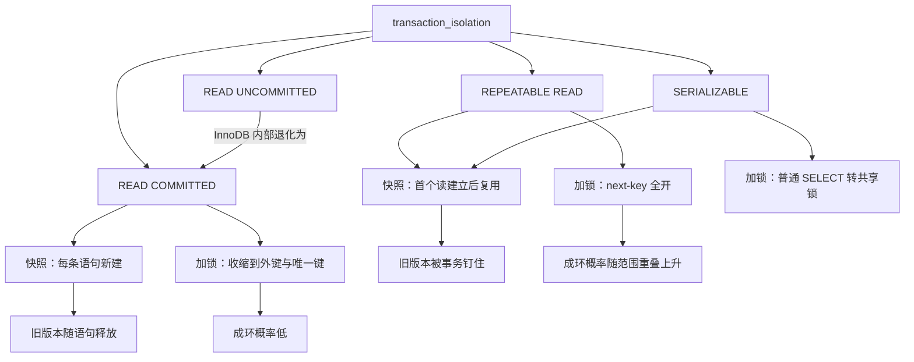
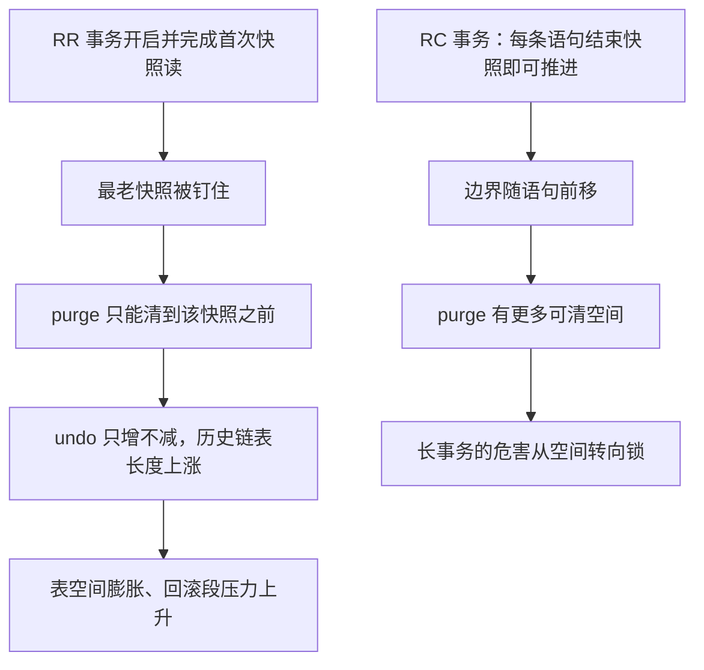
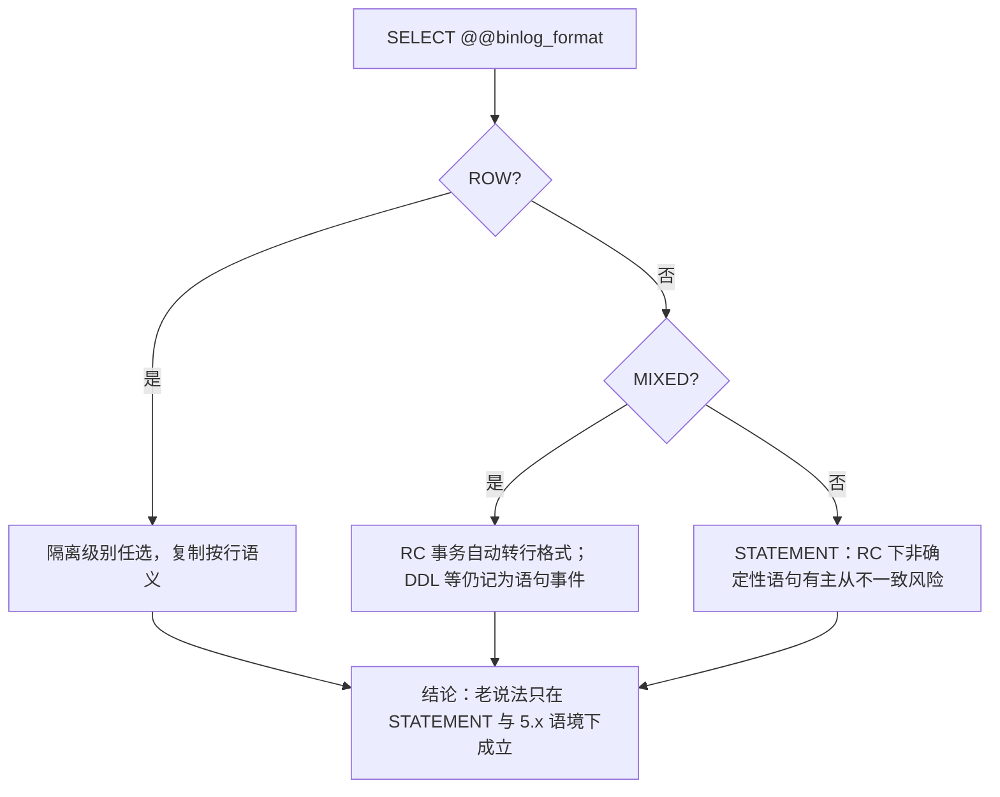
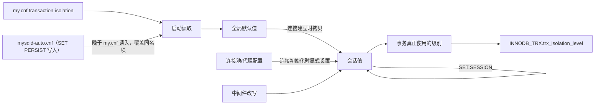

# 08 InnoDB 事务隔离级别——从脏读到幻读的防御工程

**摘要：**

隔离级别的教科书定义回答的是"禁止哪些异常"，运行期真正要回答的是"为这层可见性付了什么代价"——锁加得多宽、旧版本留多久、同一条 UPDATE 的行为会不会变、复制链路还安不安全。本文把这四个问题按运行期判据逐条展开：先用一张判据表把四种级别的代价摆平，再指出 InnoDB 的 READ UNCOMMITTED 在实现上退化为 READ COMMITTED，这一条最容易被误读成"能读到未提交数据"；随后沿间隙锁与死锁日志、read view 寿命与 undo 回收边界、半一致性读与 `ROW_COUNT()` 的偏移、binlog 格式与时代惯性四条线，给出可观测的判据与阈值；最后把切换通道（启动参数、`SET GLOBAL`、`SET PERSIST`、会话级、连接池配置）的生效边界与四个陷阱讲清楚，并交代 RC 的三个代价与选型判据。贯穿全篇的是一套插入密集的订单库：它默认跑在 RR 上，死锁日志里反复出现插入意向锁与间隙锁的对撞，团队想切 RC 又担心主从与对账，笔者的处理方式是把切换拆成可观测的四个判据逐条验完再动手。落点始终是取舍，不是推荐。

---

## 第 1 章 隔离级别的账要按运行期代价算

### 1.1 教科书那张表在值班时不管用

SQL:1992 用"禁止哪些并发异常"来定义隔离级别：脏读、不可重复读、幻读。这张表人人会背，但它在值班现场不提供任何可执行的判断，因为它只描述结果可不可见，不描述为了这个可见性付了什么。一位 DBA 在面对"把全局隔离级别从 RR 改成 RC"这样的决策时，需要的不是再背一遍异常表，而是回答四个问题：锁的形态变了没有，旧版本的回收边界变了没有，同一条 UPDATE 的执行行为变了没有，复制链路还安不安全。这四个问题分别对应间隙锁、快照寿命、半一致性读与 binlog 格式。

把话说直白些：隔离级别的代价集中在两处，一处是锁——谁被阻塞、阻塞多久；一处是多版本——旧版本被钉住多久。四种级别的差异可以全部映射到这两处，剩下的零散差异（譬如 RR 在唯一键冲突时的加锁细节、外键检查对间隙锁的依赖）属于锁模块的内容，推导见《[[中间件/MySQL/MySQL架构与底层原理/07 InnoDB 锁机制——从记录锁到间隙锁的底层实现|07 InnoDB 锁机制]]》，这里只取结论。

### 1.2 四种级别的运行期判据表

下表按运行期可观测的维度横向比较四种级别，最后一列是各自适合的业务形态；只写会直接转化成锁等待、空间占用或复制风险的东西，不写语义。

| 隔离级别 | 快照创建时机 | 间隙锁 | 普通 SELECT | 死锁倾向 | 旧版本可回收边界 | 复制格式约束 | 适合的业务 |
| :--- | :--- | :--- | :--- | :--- | :--- | :--- | :--- |
| READ UNCOMMITTED | 每条语句（与 RC 同） | 仅外键与唯一键检查 | 不加锁，但读不到未提交行 | 低 | 随语句推进 | 与 RC 相同 | 无，InnoDB 下无实际用途 |
| READ COMMITTED | 每条语句新建 | 仅外键与唯一键检查 | 不加锁 | 低 | 随语句推进 | 需行格式 binlog | 短事务、高并发写入 |
| REPEATABLE READ | 首个快照读后复用 | next-key 全开 | 不加锁 | 中高 | 被事务钉住 | 无 | 需要一致快照的报表与对账 |
| SERIALIZABLE | 同 RR | next-key 全开 | 加共享锁 | 高 | 被事务钉住 | 无 | 低频强一致的小表 |

读这张表有三处**不对称**值得停一下。第一处，READ UNCOMMITTED 与 READ COMMITTED 在 InnoDB 里几乎占同一行，这不是笔误，原因在 1.4 节单独交代。第二处，间隙锁是"全开/收缩"两态，快照是"语句级/事务级"两态，两个开关各两档，四种行为的差异就穷尽了，没有第五种组合。第三处，后两列（回收边界、复制约束）严格说不是"级别定义的一部分"，而是级别选择带来的副作用，正因如此它们在选型讨论里最容易被漏算——改一个隔离级别，改的往往不只是可见性。

### 1.3 机制底座可以压成三句话

机制的源码级推导不必在这里重做，压成三句话够用。快照读的可见性由 read view 决定，它记录创建瞬间的活跃事务集合，读一行时按行的 `DB_TRX_ID` 逐版本回溯；当前读（`FOR UPDATE`、`FOR SHARE`、DML）不回溯版本，直接读最新已提交版本并在索引记录上加锁；隔离级别本身不改变版本链的形状，只改变两件事——用哪个快照读、锁加多宽。read view 的四个字段与五条可见性判断规则见《[[中间件/MySQL/读书笔记-Mysql内核架构/12. InnoDB 事务实现：ACID 的内核代价与 MVCC 的时间旅行|读书笔记 12：InnoDB 事务实现]]》第 3 章，版本链的物理构建见本列《[[中间件/MySQL/MySQL架构与底层原理/04 Undo Log 与 MVCC——多版本并发控制的实现真相|04 Undo Log 与 MVCC]]》。

下图把这个底座画成一张分叉图，四种级别在两条分叉上各自落位，后文所有判据都可以回溯到这两个开关。



### 1.4 READ UNCOMMITTED 在 InnoDB 里是个空档位

"READ UNCOMMITTED 能读到别人没提交的数据"这句话，在 InnoDB 上不成立。手册对这个级别的描述是：SELECT 以非锁定方式执行，但可能用到某行的早期版本，因此这种读不一致，也被称作脏读。请注意措辞——它说的是可能用到早期版本，而不是可能读到**未提交版本**；这两件事在工程上天差地别，前者是快照选错，后者是把未提交的修改暴露出去。InnoDB 的读路径无论级别如何都要过一遍版本可见性判断，代码里没有"跳过判断、取最新未提交版本"的分支，所以这个级别在 InnoDB 里实际表现与 RC 无异：每条语句拿一份新快照，读到的永远是最新已提交的版本。

这一条值得动手验证，成本只有两条连接。下面这段会话可以自己跑一遍，注意第二个 `SELECT` 读到的仍是提交前的值，而不是 200。

```sql
-- 会话 A：制造一个未提交的修改
SET SESSION transaction_isolation = 'READ-UNCOMMITTED';
BEGIN;
UPDATE t SET val = 200 WHERE id = 1;   -- 保持不提交

-- 会话 B：用同样的级别尝试读脏数据
SET SESSION transaction_isolation = 'READ-UNCOMMITTED';
SELECT @@transaction_isolation;        -- READ-UNCOMMITTED，确认设置确实生效
SELECT val FROM t WHERE id = 1;        -- 读到的仍是提交前的值
```

这个结论有两个现实后果。其一，把 MySQL 的 RU 当成"能看见未提交数据"的调试手段用，会得到与预期相反的观测，排查方向随之走偏；正确的观察入口是 `SHOW ENGINE INNODB STATUS` 的事务段、`information_schema.INNODB_TRX` 与 `performance_schema.data_locks`，而不是把级别降到 RU。其二，从 SQL Server 或 Oracle 迁移过来的用法要重新评估——在那些数据库上 RU 是"脏读许可证"，在 InnoDB 上它只是一张名义上的空档位，把它写进参数模板既拿不到想要的语义，也丢掉了 RC 的名义清晰度。因此本列的判据很干脆：RU 不进入候选集。

---

## 第 2 章 间隙锁：RR 与 RC 分水岭上的死锁账

### 2.1 "RC 没有间隙锁"这句话要打折

前面那套订单库的死锁日志，第一眼看上去就是这句话的反面教材：两笔下单在相邻的两个 id 区间各自持有 next-key 锁，随后都尝试插入到对方的间隙里，日志里两侧都写着 `insert intention waiting`。严格的表述是：RC 下间隙锁只在两个场景保留——外键约束检查与唯一键重复检查，手册对此有明确说明。很多一线判断建立在过于干净的前提上，以为切到 RC 后与间隙锁有关的等待会彻底消失。实际上，唯一键冲突引发的等待在 RC 下照样出现，跨表写入时的外键检查也会带出间隙锁，只是范围收缩了。所以切级别之后死锁率下降，降的是"范围扫描型加锁"那部分，不是全部。

对于典型的 `UPDATE orders SET status = 2 WHERE status = 1`，两种级别的执行形态差异可以这样理解。RR 下 InnoDB 用 next-key 锁扫描二级索引，命中的记录加记录锁，记录之间的空隙加间隙锁，处理完还要在扫描到的不匹配记录上加锁（这是"锁住扫描路径"的必然结果）；RC 下同一语句只对命中的记录加记录锁，扫描过程中遇到不匹配的记录直接放锁继续走。两者之差就是"锁集合"的大小，而锁集合的大小直接决定了成环的机会。

### 2.2 成环的机制：从同行冲突放大到范围重叠

死锁的四个必要条件里，与隔离级别相关的是"循环等待"。在只有记录锁的世界里，两个事务要成环，必须恰好锁住彼此想要的同一条记录，这种巧合的概率很低；间隙锁把"正好撞上同一行"放宽成"范围有重叠"，成环概率随之抬升一个台阶。更麻烦的是插入路径：一个新事务要插入的位置若落在别人持有的间隙里，它会先挂一个插入意向锁，后者与间隙锁不兼容，于是"插入者等间隙释放、范围持有者等插入完成"的经典环路就出现了。

下图给出这个环路的最小形态，两个事务各自的第二句都卡在对方第一句留下的间隙锁上。


这个环路与业务逻辑对错无关，它只是"两个事务以不同顺序触碰相邻区间"的必然产物。因此处置手段也就两条：要么让两个事务的访问顺序统一（应用侧改），要么把间隙锁这一环去掉（级别侧改）。前者成本低但需要审计所有写入路径，后者一次生效但引入幻读风险，选哪条取决于业务对"同一事务内范围读一致性"的依赖程度。

### 2.3 判据：在死锁日志里找 GAP

真正能指导决策的不是死锁次数，而是**死锁的形态**。开启 `innodb_print_all_deadlocks` 之后，每次死锁都会写进错误日志，`SHOW ENGINE INNODB STATUS` 则始终保留最近一次；两种入口都能拿到同一段结构：谁在等、等的是什么锁、谁持有。判断"这次死锁是不是 RR 的锅"，看的就是等待项里的锁模式有没有 `GAP` 或插入意向标记。

```text
*** (1) TRANSACTION:
TRANSACTION 4821, ACTIVE 3 sec inserting
LOCK WAIT 3 lock struct(s), heap size 1136, 2 row lock(s), undo log entries 1
INSERT INTO orders (id, status) VALUES (7, 1)
*** (1) WAITING FOR THIS LOCK TO BE GRANTED:
RECORD LOCKS space id 23 page no 5 n bits 80 index PRIMARY of table `shop`.`orders`
lock_mode X locks gap before rec insert intention waiting

*** (2) TRANSACTION:
TRANSACTION 4820, ACTIVE 4 sec
3 lock struct(s), heap size 1136, 2 row lock(s)
*** (2) HOLDS THE LOCK(S):
RECORD LOCKS space id 23 page no 5 n bits 80 index PRIMARY of table `shop`.`orders`
lock_mode X
*** (2) WAITING FOR THIS LOCK TO BE GRANTED:
RECORD LOCKS space id 23 page no 5 n bits 80 index PRIMARY of table `shop`.`orders`
lock_mode X locks gap before rec insert intention waiting
```

上面的节选只保留结构，事务号、页号与位图长度都是示例值，真实日志的字段顺序与行数会随版本浮动，但"等待项里出现 `lock_mode X locks gap before rec insert intention waiting`"这一句是稳定可查的。下表把常见片段与处置动作对应起来，可以直接贴进值班手册。

| 日志里的关键片段 | 归因 | 处置 |
| :--- | :--- | :--- |
| 两侧都含 `gap before rec insert intention waiting` | 插入意向锁撞上 RR 的间隙锁 | 切 RC，或统一插入与更新的区间顺序 |
| 一侧是 `locks gap`、另一侧是 `insert intention` | 范围持有者与插入者互等 | 同上；同时检查是否走了范围扫描而非等值命中 |
| 锁模式全是 `REC_NOT_GAP` / 唯一键重复检查 | 同记录或唯一键冲突 | 换级别无效，改 SQL 或补索引 |
| 两侧都出现 `locks gap` 但记录不同 | 访问顺序相反 | 统一排序键，或把批量写拆小 |
| 二级索引加锁、回表后主键互等 | 访问路径不一致 | 让两条路径命中同一索引 |

### 2.4 量化：死锁率与并发度的方向性估算

死锁率的绝对数字取决于表结构、索引与业务时序，任何"换了级别死锁降 80%"的说法都不具备普适性。但方向可以估：若两条事务各持有 k 把锁，成环的组合数大致随 k 的平方增长，RR 下平均持锁结构数常是 RC 的 2 到 3 倍（间隙锁 + 记录锁 + 插入意向锁叠加），成环机会便落到 4 到 9 倍的量级。并发度的方向同理：RR 的锁等待占比随并发梯度抬升更快，两条曲线会在某个并发点交叉，交叉点只能自己压测找。上述均为示例推算，用于判断"值不值得动手"，不是实测基准；真实数字要在自己的压测环境里用 `Innodb_deadlocks` 与 `Innodb_row_lock_waits` 计数对比，且必须保证同一份压测脚本、同一个数据分布、同一并发梯度。

| 观察项 | 采集方式 | 对比口径 | 解读 |
| :--- | :--- | :--- | :--- |
| 死锁次数 | `SHOW GLOBAL STATUS LIKE 'Innodb_deadlocks'` | 同一时长内的增量 | 只看趋势，不看绝对值 |
| 锁等待时长 | `Innodb_row_lock_time_avg`、`Innodb_row_lock_waits` | 迁移前后各取一周 | 平均值被长尾拉高时要看分位 |
| 锁集合大小 | `performance_schema.data_locks` 按事务计数 | 抽样同一语句 | RR 下 `LOCK_MODE` 含 `GAP` 的行数明显更多 |
| 并发吞吐 | 压测工具的同并发梯度结果 | 固定数据量与热点分布 | 死锁下降不等于吞吐上升，要看锁等待占比 |

最后一行的提醒是必要的：切到 RC 之后死锁少了，但若瓶颈原本在锁等待而非死锁，吞吐未必改善；反过来，若日志显示死锁主要是唯一键冲突（`REC_NOT_GAP`），换级别几乎不会带来任何变化，这时该做的是改 SQL 的写入顺序或调整唯一索引设计。

---

## 第 3 章 read view 的生命周期：undo 的账记在谁头上

### 3.1 两种级别只差一个"快照活多久"

RC 与 RR 在可见性机制上的差别只有一处：**快照的创建时机**。RC 每条语句新建一份，语句结束这份快照就不再被需要；RR 在事务内首次快照读时建立一份，直到事务提交或回滚才释放。可见性判断的规则完全相同，版本链的回溯方式也完全相同，所以两者的性能差异不来自"读得更多或更少"，而来自"旧版本被钉住的时间长短"。这一处差别在低并发下几乎无害，在长事务与高写入并存的场景里会被放大成空间问题。

### 3.2 被钉住的代价落在 purge 上

旧版本能不能清，purge 线程的判断依据是"还有没有快照可能需要它"。系统里最老的那个活跃快照构成一条不可逾越的边界，边界之后的所有旧版本都必须留着。RR 下一个跑了两小时的事务会把这条边界钉在两小时前，期间所有被更新或删除的行都只能堆在 undo 里；RC 下同样的长事务不会造成同等后果，因为它的快照随语句推进，边界跟着走。**历史链表长度**（history list length）就是这条边界的直接读数，它在 RR 长事务期间会单调上涨，长事务结束后才回落。下图把两条路径上边界的推进方式画在一起。



### 3.3 可观测判据与阈值

判断"是不是快照寿命在作祟"，有三组数据够用。第一组是历史链表长度，`SHOW ENGINE INNODB STATUS` 的 `History list length` 一行即可读出，也可以用 `information_schema.INNODB_METRICS` 里的事务回滚段历史长度指标 `trx_rseg_history_len`（是否默认启用随版本而变，以对应版本文档为准）；这个绝对值没有通用阈值，因为它随写入速率变化，判据是趋势——在 DML 速率没有明显变化的前提下，它连续半小时单调上涨，就说明边界被钉住了。第二组是最老事务，`INNODB_TRX` 按 `trx_started` 排序取头部，结合 `trx_rows_modified` 判断它是否真在干活；"事务开了很久但修改行数为 0"通常意味着事务边界划在了外部调用外面。第三组是 purge 进度，`Innodb_purge_runs` 的增量要与历史链表的增量对照看：只增不清说明边界卡住，`innodb_max_purge_lag` 与 `innodb_max_purge_lag_delay` 的触发情况则说明清理是否被主动限流。

| 配置项 | 默认 | 调大的代价 | 调小的代价 | 适用判据 |
| :--- | :--- | :--- | :--- | :--- |
| `innodb_lock_wait_timeout` | 50 秒 | 故障时等待线程堆积，连接池被占满 | 超时错误上升，应用必须能正确重试 | OLTP 常收到 3 到 10 秒，批量任务单独放宽 |
| `innodb_deadlock_detect` | ON | — | 关闭后死锁退化为等超时，靠超时释放 | 仅当死锁检测本身吃满 CPU 且死锁极少 |
| `innodb_print_all_deadlocks` | OFF | 错误日志持续增长，需要配轮转 | 只留最近一次死锁，历史形态无法统计 | 迁移与压测期打开，稳态可关 |
| `innodb_max_purge_lag` | 0（不限流） | 设为正值后 DML 被主动延迟 | 不设则 undo 可能无限膨胀 | 历史链表持续上涨且杀不掉事务时短期启用 |

### 3.4 一个容易搞反的推论

看到"RC 的快照更短、undo 回收更快"，很容易顺势推出"RC 更适合长事务"，这个推论是错的。RC 缩短的只是快照寿命，不缩短锁的持有时间：一个开着事务跑了十分钟的业务逻辑，在 RC 下同样把这十分钟里加的记录锁一直攥在手里，锁等待堆积与连接占用一点没少。两类事故的形态因此不同——RR 的长事务先炸空间（undo 膨胀、历史链表上涨），RC 的长事务先炸并发（锁等待、连接池耗尽）。切级别之前要先问清楚自己现在疼的是哪一头，把空间问题换成锁问题不叫解决。

---

## 第 4 章 半一致性读：一个能改变 ROW_COUNT 的优化

### 4.1 机制一句话，历史两句话

RC 下执行 `UPDATE ... WHERE` 时，如果扫描遇到被其他事务锁住的行，InnoDB 不会立刻排队等锁，而是先用多版本读取出该行的最新已提交版本，交给 Server 层判断它是否满足 WHERE：不满足就跳过并放锁，满足才进入等待，等锁拿到后按当前读更新。这个优化叫半一致性读（semi-consistent read），它把"等锁"从无条件变成有条件，在高并发 UPDATE 场景里能显著减少等待。

历史上这是两个开关：5.x 时代由 `innodb_locks_unsafe_for_binlog` 控制，开启后 RR 也能获得半一致性读，代价是级别事实上退到 RC 且 STATEMENT 复制不安全；8.0 移除了这个变量，RC 自带等效能力。因此老资料里"改 `innodb_locks_unsafe_for_binlog` 提升并发"的调优建议在 8.0 上已经无法执行，剩下的正确做法只有改隔离级别或者改 SQL。

### 4.2 两种级别下同一条 UPDATE 的差异

| 维度 | REPEATABLE READ | READ COMMITTED |
| :--- | :--- | :--- |
| 遇到被锁行 | 排队等待，拿到锁后按最新版本判断 | 先按最新提交版本判断，不满足即跳过 |
| 判定基准 | 等锁之后的最新版本 | 扫描瞬间的最新提交版本，随时可能变 |
| 锁等待量 | 大，扫描路径上的锁都要等到 | 小，不匹配的行直接放过 |
| `ROW_COUNT()` | 与最终版本基本一致 | 随并发时序变化，可能偏小也可能偏大 |
| 死锁参与 | 间隙锁参与，成环面广 | 范围收缩，成环面小 |
| 适合的负载 | 强一致、短事务 | 高并发写入、对账逻辑弱依赖 |

读到"判定基准是扫描瞬间的最新提交版本"这一行，就该意识到风险所在：判断与真正加锁更新之间隔着一次等锁，等锁期间那一行完全可能变成另一种形态。因此同一条 UPDATE 在 RC 下的 `ROW_COUNT()` 不能当作"是否有匹配行"的**稳定读数**——它依赖并发时序，而并发时序在压测环境与生产环境里几乎不会一致。

### 4.3 复现与观测

复现只需要两条连接：一条占住记录，另一条在同一个会话里把级别切两次、各执行一遍同一条语句，比较返回的影响行数与等待行为。譬如在订单表上把区间更新与单行更新混跑，差异在一分钟内就能观测到。

```sql
-- 会话 A：占住 id 在 1..5 的记录（RR 下还会带上相邻间隙）
BEGIN;
UPDATE t SET flag = 1 WHERE id <= 5;    -- 不提交

-- 会话 B（RC）：先判断后等锁，不匹配的行直接放过
SET SESSION transaction_isolation = 'READ-COMMITTED';
UPDATE t SET flag = 2 WHERE flag = 1;   -- 观察是否等待、影响行数是多少
SELECT ROW_COUNT();

-- 会话 B2（RR）：逐行等待，拿到锁后再判断
SET SESSION transaction_isolation = 'REPEATABLE-READ';
UPDATE t SET flag = 2 WHERE flag = 1;   -- 观察等待时长是否明显变长
SELECT ROW_COUNT();
```

配套的观测入口是 `performance_schema.data_locks`：按 `ENGINE_TRANSACTION_ID` 分组，看 `LOCK_MODE` 里出现 `X`、`X,REC_NOT_GAP`、`X,GAP` 各自多少行，就能把"锁集合"与日志里的死锁形态对上号。`LOCK_MODE` 字段本身的解读见《[[中间件/MySQL/MySQL架构与底层原理/07 InnoDB 锁机制——从记录锁到间隙锁的底层实现|07 InnoDB 锁机制]]》第 6 章，这里只需记住一个判据：同一条语句在 RR 下 `LOCK_MODE` 含 `GAP` 的行数比 RC 多，多出来的部分就是幻读防护的开销。

### 4.4 哪些业务会被这一行行数咬到

用"更新影响行数"判断业务动作是否成功的写法，在 RC 下会变得脆。常见三种：扣减库存时以 `ROW_COUNT()` 判断是否扣成功，幂等重放时以影响行数判断是否重复消费，状态机推进时以影响行数判断状态是否被自己抢占。RC 下这些判断的结果依赖并发时序，压测时通过、线上偶发失败，排查起来极难复现。可行的改法有三条：把判断条件换成一个原子性的断言（唯一索引、带版本号的乐观锁更新），或者在事务内先 `SELECT ... FOR UPDATE` 把行锁住再读再改，再或者用独立的状态字段与状态机表让"谁改成功"这件事有确定记录，不依赖影响行数。

---

## 第 5 章 binlog 格式：一条被时代固化下来的约束

### 5.1 老说法的出处

"RC 加 STATEMENT 格式会主从不一致"这句话曾经是硬约束，因为 STATEMENT 格式把 SQL 语句原样写入 binlog，从库重放时的执行环境与主库不同：语句里含 `NOW()`、`RAND()`、用户变量、`LIMIT` 无排序的更新、`INSERT ... SELECT` 时，重放结果可能与主库不同。RC 每次语句拿新快照，恰好放大了这类不确定性——同一事务内的两条语句看到的数据可能不同，而语句重放是按序执行的。手册因此明确规定：RC 只支持行格式复制，使用 MIXED 时服务器会自动把 RC 事务转为行格式。

### 5.2 8.0 与 8.4 的现状

8.0 的默认 `binlog_format` 是 ROW，复制按行传递变更，语句层面的不确定性被消除，RC 与 STATEMENT 的历史矛盾在默认配置下不存在了。版本细节要标清楚：`binlog_format` 自 8.0.34 起被标记为废弃，8.4 仍接受该参数并给出废弃警告，未来大版本将只支持行格式（以对应版本文档为准）。另一个容易忽略的点是，即使全局是 ROW，DDL 语句仍以语句形式记录——但它不涉及行数据的重放，不构成隔离级别相关的复制风险。

### 5.3 为什么现在还能听到这个说法

三个来源。其一是存量迁移：从 5.6、5.7 升级上来的库，参数模板里写着 `binlog_format=STATEMENT` 或 `MIXED`，升级工具未必改这一项，而参数审计清单往往是从旧文档抄下来的。其二是临时改动：`binlog_format` 可以在会话级设置，有人为排查把会话改成 STATEMENT 观察写入内容，忘了这对 RC 事务的破坏。其三是规范性惯性：云厂商模板、内部规范、面试题答案都在重复一句曾经正确的话，而它的适用前提已经不成立，于是从约束退化成噪音，仍在消耗判断力。下图按当前格式给出组合判断的分支。



### 5.4 判据

给一条可执行的检查顺序：先 `SELECT @@binlog_format, @@global.binlog_format` 确认全局与会话是否一致，再确认是否有人用会话级设置覆盖过；接着检查复制链路是否有基于语句的过滤或重写；最后才回到隔离级别的讨论。顺序不能倒——先定级别再查格式，会让"要不要切 RC"的决策被一句过时的约束挡住，而那条约束在自己的环境里可能根本不成立。

---

## 第 6 章 切换通道：七种写法与四个陷阱

### 6.1 七种写法的生效边界

改隔离级别的手法不止三种：参数文件、全局设置、持久化设置、会话设置、事务级设置、连接池配置与代理改写，数下来七条。下表按入口列出，日常用到的就是这几条。读这张表的关键不是记语法，而是记住每一行"对现有连接是否生效"，因为线上事故几乎都出在这一列。

| 通道 | 生效对象 | 重启后 | 现有连接 | 所需权限 | 典型误用 |
| :--- | :--- | :--- | :--- | :--- | :--- |
| `my.cnf` 的 `transaction-isolation` | 之后新建的连接 | 保留 | 不变 | 文件写权限 | 与 `mysqld-auto.cnf` 冲突时被覆盖 |
| `SET GLOBAL transaction_isolation` | 之后新建的连接 | 丢失 | 不变 | `SYSTEM_VARIABLES_ADMIN` | 以为池内老连接会跟着变 |
| `SET PERSIST transaction_isolation` | 之后新建的连接 | 保留 | 不变 | 同上 | 与 `my.cnf` 打架，改配置文件不生效 |
| `SET PERSIST_ONLY` | 下次启动后的新连接 | 保留 | 不变 | 同上 | 以为立即生效 |
| `SET SESSION transaction_isolation` | 当前连接 | 丢失 | 仅当前 | 无 | 连接池里被重置或覆盖 |
| `SET TRANSACTION ISOLATION LEVEL`（不带 SESSION） | 下一个事务 | — | — | 无 | 以为改了会话，后续事务仍是旧级别 |
| 连接池或代理的配置项 | 池内连接 | 随配置 | 生效 | 应用侧 | 与全局值不一致且无人知晓 |

### 6.2 连接池下改全局为什么不生效

会话变量的取值在连接建立时从全局值**拷贝一份**，此后这条连接与全局值再无关联。连接池的意义恰恰是把物理连接长期留住，于是"改全局"对池内已经存在的连接完全无效——它们手里的会话值仍是建立时的那一份，可能已经是一个月前的旧值。判断这件事有没有发生，最直接的办法是让应用从池里取一条连接执行 `SELECT @@transaction_isolation`，或者去看 `INNODB_TRX.trx_isolation_level` 里那条慢事务的真实级别，而不是看 `@@global`。

比"没生效"更难查的是"被悄悄覆盖"。池的配置里有隔离级别一项（HikariCP 的 `transactionIsolation` 就是典型），配了值就在连接初始化时显式设置，没配则不干预；代理类中间件（分库分表代理、数据库连接代理）也可能按用户或连接初始化语句统一改写会话变量。两条路径叠加的结果是：数据库侧改了全局，应用侧一重启又变回去，或者只在部分实例上不生效。处置原则是把级别当成应用配置的一部分来管：池配置里显式声明，与全局值保持一致，并把实际生效值纳入启动自检。

### 6.3 `tx_isolation` 已经改名为 `transaction_isolation`

8.0 移除了 `tx_isolation`，改名为 `transaction_isolation`；这个新名字在 5.7.20 就以别名形式出现，8.0 完成替换（改名动因见官方工作日志 WL#9636）。影响面比想象中大：老的巡检脚本、监控采集项、ORM 与连接池的初始化语句、甚至某些云厂商的慢日志分析模板里还写着 `SET tx_isolation`，在 8.0 上会直接报"未知系统变量"，而报错发生在连接初始化路径上时，表现往往是"应用启动失败但日志里只有一行看不懂的错"。巡检脚本里凡是出现 `tx_isolation` 字样，都应当按 8.0 口径统一替换。

### 6.4 语法与持久化上的三个陷阱

第一个陷阱是不带 `SESSION` 的 `SET TRANSACTION ISOLATION LEVEL`，它只对下一个事务生效，写完立刻查会话变量仍是旧值，很容易被误判为"设置失败"。第二个陷阱是 `SET PERSIST`：它把值写进 `mysqld-auto.cnf`，而这个文件在启动时晚于 `my.cnf` 被读取，因此持久化的值会覆盖配置文件里的同名项。DBA 改了 `my.cnf`、重启、发现值没变，原因就在这里；排查入口是 `performance_schema.persisted_variables` 与数据目录下的 `mysqld-auto.cnf`，清理用 `RESET PERSIST`。第三个陷阱是取值写法：系统变量用连字符形式（`READ-COMMITTED`），SQL 标准语法用空格（`SET TRANSACTION ISOLATION LEVEL READ COMMITTED`），两套写法混用会直接报变量值不合法，而错误信息只说值非法，不说写法用错。笔者见过最费时的一次排查就是这种：连接初始化脚本里用了空格写法，应用启动即失败，日志里只有一行变量值非法。

### 6.5 "我的隔离级别到底是哪个"的查法

| 查法 | 口径 | 能看到谁 | 盲区 |
| :--- | :--- | :--- | :--- |
| `SELECT @@transaction_isolation` | 当前会话变量 | 你这条连接 | 看不到池里其他连接 |
| `SELECT @@global.transaction_isolation` | 全局默认值 | 之后新建的连接 | 不代表任何运行中的事务 |
| `INNODB_TRX.trx_isolation_level` | 运行中事务的真实级别 | 所有活跃事务 | 只覆盖活跃事务 |
| `performance_schema.events_transactions_current` | 事务事件里的级别字段 | 活跃事务及其线程 | 需确认 consumer 已开启 |
| `SHOW ENGINE INNODB STATUS` 的事务段 | 锁持有与等待关系 | 活跃事务与锁 | 不含级别标签，要回到 `INNODB_TRX` 对照 |

```text
-- 一条连接的自查：三个值一起看，差异本身就是线索
SELECT @@session.transaction_isolation, @@global.transaction_isolation;

-- 运行中事务的真实级别与年龄
SELECT trx_id, trx_state, trx_started, trx_isolation_level,
       trx_rows_locked, trx_rows_modified
FROM information_schema.INNODB_TRX ORDER BY trx_started;

-- 锁的形态：GAP 出现与否直接对应第 2 章的判据
SELECT ENGINE_TRANSACTION_ID, OBJECT_NAME, INDEX_NAME, LOCK_MODE, LOCK_DATA
FROM performance_schema.data_locks WHERE LOCK_MODE LIKE '%GAP%';
```

下图把值的流向画成一条路径，越靠右越接近真实生效值。



---

## 第 7 章 RC 的代价与选型判据

### 7.1 代价一：不可重复读被推回应用层

RC 下同一事务内两次查询结果不同，这不是缺陷，是语义。问题在于很多应用逻辑默认了"事务内读到的东西不会变"：先查出余额算一遍，再更新扣减，中间若有其他事务提交，算出来的值就是过期的；先查库存判断够不够，再扣减，中间被并发扣走之后判断失效。这些逻辑在 RR 下被快照掩盖了，切到 RC 之后会集中暴露，而且暴露的形态是"低并发测试正常、高并发偶发少卖或超卖"，很不容易定位。切级别的正确姿势是同步审计事务内的读—算—写序列，凡是依赖"读到的值到写的时候还成立"的地方，都要改成条件更新或加锁读；事务边界与声明式事务层面的写法约束，见《[[中间件/MySQL/MySQL进阶使用/03 事务与隔离级别的正确打开方式|03 事务与隔离级别的正确打开方式]]》。

### 7.2 代价二：复制侧的那条约束要重新确认

第 5 章说过，默认行格式下这条约束已经解绑。但"默认"不等于"实际"，切级别之前必须确认 `binlog_format` 的真实取值、是否有会话级覆盖、复制链路里是否有基于语句的过滤或重写工具。这些确认动作花不了十分钟，却能避免一次以"主从数据不一致"为形态的故障。

### 7.3 代价三：锁更窄不等于锁更少

RC 去掉范围锁，代价是"范围"不再被保护。最典型的受害者是"检查后插入"的写法：先 `SELECT` 判断不存在，再 `INSERT`。RR 下这个写法靠间隙锁勉强成立（并不完全可靠），RC 下则彻底失效——两条并发请求都能查到"不存在"，然后都尝试插入。唯一的正确兜底是数据库层的**唯一索引**，让第二条插入直接失败，由应用决定是忽略还是重试。同理，"先 `SELECT` 判断状态再更新"的写法在 RC 下也必须改成带状态条件的原子更新，用影响行数为 1 来确认抢到了这次状态迁移——这里恰好与 4.4 节的告诫形成一个交叉：RC 下影响行数不可靠时，要么让 UPDATE 的条件足够确定（唯一键、状态机条件），要么先加锁读。

### 7.4 选型判据

| 业务形态 | 关键判据 | 建议级别 | 必须同时补的代价 |
| :--- | :--- | :--- | :--- |
| 下单、支付、券核销，事务短、写并发高 | 事务内无跨语句一致读需求 | RC | 唯一索引兜底；禁止"先查后插" |
| 报表、对账、批量结算 | 需要跨语句看到同一时刻的快照 | RR | 严控事务时长，盯历史链表长度 |
| 配置表、字典表、低频写入 | 并发极低、要求绝对一致 | SERIALIZABLE（只读事务） | 读写互斥，禁止长事务与批量扫描 |
| 临时想观察未提交修改 | — | 无可用级别 | 改用 `INNODB_TRX` 与锁视图 |
| 迁移自 Oracle、PostgreSQL | 源库默认 RC，行为要对齐 | RC | 重跑一致性用例，重点查"先查后写" |
| 分库分表、多数据源 | 跨库一致性由应用兜底 | 各实例统一 | 迁移与双写期间禁止混用 |

表里最容易被忽略的是最后一行。分库分表之后，每个实例的隔离级别必须一致，否则同一个业务在落到不同分片时会看到不同的可见性规则，而这类 bug 的特征是"数据量小的时候不出现"。统一的方式可以很朴素：所有实例用同一份参数模板，应用侧连接池显式声明同一值，启动自检比对全局值与池配置是否一致。若确实需要"分业务分级别"，务实做法是按业务**分池**，一个池走 RC 服务在线交易，另一个池走 RR 服务报表与对账，而不是在同一套池子里做会话级切换——后者的状态会在归还与复用之间漂移，没人能说清楚某条连接此刻是什么级别。

### 7.5 三条反例

反例一：以为 RU 能读未提交数据。前面的验证已经说明这条路在 InnoDB 上走不通。它带来的实际损失是排查方向错误——有人为了看"其他事务改到哪一步了"，把连接降到 RU，读到的仍是旧值，于是转而怀疑锁、怀疑复制延迟，绕一大圈。

反例二：在连接池下改全局，以为已经生效。全局值只影响新建连接，池内长连接沿用旧值，于是"改了参数但行为没变"。更麻烦的是修改后新老连接混用，同一个应用里一部分连接是 RR、一部分是 RC，现象是"同一段代码时好时坏"。

反例三：切到 RC 之后仍依赖事务内可重复读。应用里有"事务开始读一次配置，后续都按那次读到的值算"的逻辑，在 RR 下安然无恙，切 RC 后配置表一旦被后台改动，事务内前后两次读到的值不同，算出来的结果自相矛盾。这类逻辑必须改成在事务开始处 `SELECT ... FOR SHARE` 显式固定，或把配置读到应用内存并接受它的时效性。

### 7.6 SERIALIZABLE 的一个细节常被漏掉

SERIALIZABLE 的机制是把普通 SELECT 转成共享锁读，但这个转换只在关闭自动提交时有实际约束力：自动提交开启时，每条 SELECT 自成一个事务，锁在语句结束即释放，"串行化"退化成逐语句的共享锁，防护范围远小于直觉。因此真正吃到 SERIALIZABLE 代价的是显式事务或长事务，而它换来的保证是"读到的范围不会被插入"。落到实践上，这个级别适合的场景极窄：只读的配置表、权限表、字典表，事务短、并发低、对"读到的东西不会被并发改写"有硬要求。把它用在交易主链路上，代价是读写互斥后热点行的吞吐塌缩到接近串行：以示例推算，一个热点行上读写比为 9:1、并发 100 的场景，共享锁与排他锁在同一行上排队，有效并发降到个位数，吞吐的天花板由单行串行处理能力决定，而不是由连接数决定。收益却可能只是省掉了几行显式加锁的代码。

---

## 第 8 章 结语

隔离级别的选型，本质上是在两处成本之间分配预算：锁的成本（阻塞、等待、死锁）与多版本的成本（空间、清理滞后、可见性复杂度）。RC 把预算从锁这一侧挪走，代价是幻读防护与事务内一致性要由应用补；RR 把钱花在锁与快照上，换来事务内一致的可见性与范围保护；SERIALIZABLE 把两边都买到顶，代价是并发度；READ UNCOMMITTED 在 InnoDB 里根本没有货架。

因此没有"更安全的级别"这种说法，只有"与业务需求匹配的级别"。判断的入口也不是语义表，而是四个可观测的问题：死锁日志里有没有 GAP，历史链表长度是不是在涨，同一条 UPDATE 的影响行数是否随并发漂移，复制链路是不是行格式。这四个问题各自对应一组判据与一个处置动作，问清楚了，级别该不该改、改完要补什么，答案自然浮现。反过来说，凡是跳过这四个问题直接推荐"互联网业务一律 RC"的说法，都只是在替别人做他并不了解的决策。

---

## 参考资料

1. MySQL 8.0 Reference Manual, 17.7.2.1 Transaction Isolation Levels：<https://dev.mysql.com/doc/refman/8.0/en/innodb-transaction-isolation-levels.html>
2. MySQL 8.0 Reference Manual, 17.7.2.3 Consistent Nonlocking Reads：<https://dev.mysql.com/doc/refman/8.0/en/innodb-consistent-read.html>
3. MySQL 8.0 Reference Manual, 17.7.1 InnoDB Locking（记录锁、间隙锁、next-key 锁与插入意向锁）：<https://dev.mysql.com/doc/refman/8.0/en/innodb-locking.html>
4. MySQL 8.4 Reference Manual, 7.4.4.2 Setting The Binary Log Format：<https://dev.mysql.com/doc/refman/8.4/en/binary-log-setting.html>
5. MySQL 8.0 Reference Manual, 13.7.6.5 SET Syntax for Variable Assignment（含 `SET PERSIST`、`SET PERSIST_ONLY`、`RESET PERSIST`）：<https://dev.mysql.com/doc/refman/8.0/en/set-variable.html>
6. MySQL 8.0 Reference Manual, 15.15.4 InnoDB INFORMATION_SCHEMA Transaction and Locking Information：<https://dev.mysql.com/doc/refman/8.0/en/innodb-information-schema-transactions.html>
7. MySQL Worklog WL#9636, Rename tx_{read_only,isolation} variables to transaction_*：<https://dev.mysql.com/worklog/task/?id=9636>
8. HikariCP 配置项（`transactionIsolation`、连接初始化与重置行为）：<https://github.com/brettwooldridge/HikariCP>

---

> [!note] 思考题
> 1. InnoDB 把 READ UNCOMMITTED 做成了 RC 的等价物，如果产品经理要求"必须支持读到未提交的数据"用于对账排查，你在存储层要怎么实现，代价落在哪里？
> 2. 连接池里改全局不生效，你在不重启应用的前提下如何验证并让所有池都生效？如果池配置与数据库全局值冲突，以哪边为准？
> 3. 死锁日志里出现 GAP 锁，一定是 RR 造成的吗？RC 下哪些场景仍会出现间隙锁参与的等待？
> 4. 半一致性读让 `ROW_COUNT()` 随并发时序漂移，业务代码判断"更新是否成功"该换用什么判据？
> 5. 业务需要跨语句的一致快照且事务较长，选 RR 承担 undo 膨胀，还是把一致性搬到应用层？判断依据是什么？
> 6. 8.0 默认行格式之后，"RC 不安全"这句话在什么条件下仍然成立？你会把它写进参数审计清单的哪一条？