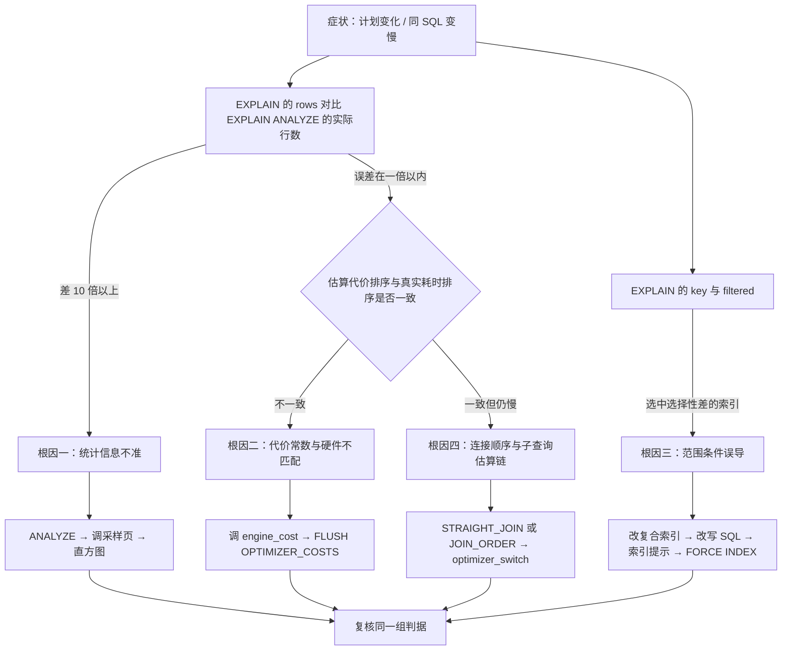
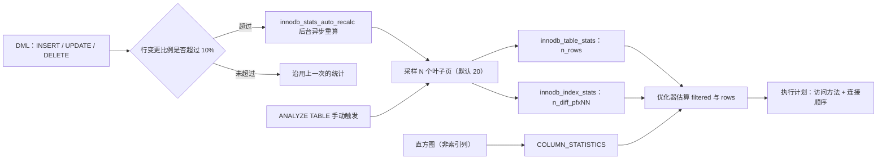
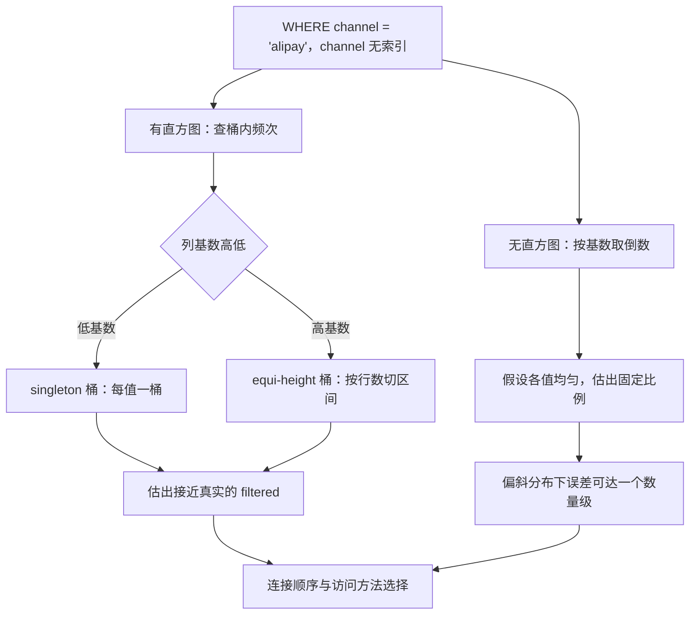
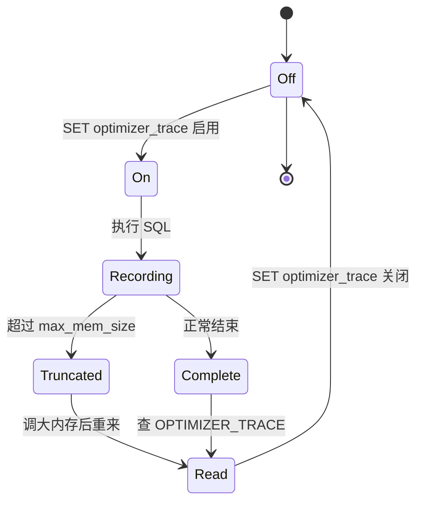

# 09 MySQL 查询优化器——从代价模型到执行计划的决策过程

**摘要：**

同一条对账 SQL，周一早上一点二秒，周三下午四十七秒，中间没有发版、没有改表结构、没有人碰过 SQL 文本，唯一的动作是归档任务跑了一轮。这类现场的处理方式通常是加索引或者 `FORCE INDEX`，而两者都有相当概率让事情更糟，因为计划变化的原因可以落在完全相反的方向上。本篇把优化器当作可测量的黑盒：先拆它的输入——`server_cost` 的六行与 `engine_cost` 的两行代价常数，以及 InnoDB 持久化统计、`ANALYZE TABLE`、直方图这三种统计来源的产生方式，其中持久化统计落在两张可以直接查、也可以手工改的系统表上；再把"选错执行计划"归成统计不准、代价常数失真、索引选择被范围条件误导、连接顺序估算偏差四个根因，每个根因给出判据（估算行数与实际行数的比值、`Handler_read_*` 增量、`optimizer_trace` 的两个段落）与处置（调采样页、改代价常数、调索引与 SQL、`STRAIGHT_JOIN` 与开关），并说明每个动作的价格。结论只有一条：先把估算误差量出来，再决定动不动手。

---

## 第 1 章 分诊：优化器为什么忽然改了主意

周一早上跑得好的 SQL，周三下午变慢，这种事在运维群里出现的频率比死锁还高。第一反应往往是加索引或者强制走索引，两个动作都便宜，但都建立在同一个未经验证的前提上——以为慢的原因是没走索引。真实情况里，慢的原因至少有一半是走了索引但走错了，还有一部分是走了索引且走对了，只是索引本身被数据分布变得不合适。

### 1.1 优化器只回答一个问题

MySQL 的优化器是基于代价的优化器（Cost-Based Optimizer，CBO），全部工作可压缩成一句话：为当前语句枚举候选执行计划，用统计信息估算每个计划的代价，取估算代价最小的那个。这里有三个环节——候选、估算、取最小——故障也只可能从三处漏出来。候选没被枚举到，是搜索与剪枝的问题；估算错了，是统计信息或代价常数的问题；而在信息与标尺都对的前提下，取最小这一步几乎不会错。

这个视角的转换把一件看起来玄学的事拆成两组可测量的量：估算行数与实际行数差多少，估算最便宜的计划在真实硬件上花了多久。前者靠 `EXPLAIN` 与 `EXPLAIN ANALYZE` 对比，后者靠 `EXPLAIN ANALYZE` 或慢查询日志；两把尺子一量，"优化器选错"就成了可以归因的工程问题。

### 1.2 四个根因

运行期能遇到的计划事故绝大多数可以归入四类，判据与处置差别很大，混在一起讨论必然得出错误的动作。

统计信息不准，这一类最常见。持久化统计是采样出来的，采样本就有方差，再加上自动重算的阈值与异步特性，表结构没变、数据分布却已经变了，优化器手里的画像是旧的。判据是估算行数与实际行数差一个数量级以上。

代价常数与硬件不匹配，这一类最容易被忽略，因为症状与第一类完全一样：估算行数是对的，计划仍然选错。代价常数描述一块磁盘相对一次行处理的昂贵程度，默认值来自机械盘时代的经验；全闪存实例上同一组常数会系统性地高估回表，让优化器保守地避开索引。

索引选择被范围条件误导，这一类发生在多条件查询上。优化器假设各条件相互独立、选择率相乘，一个选择性很差的索引配上一个看起来很有选择性的条件，估出来的行数低得离谱，于是选中了最不该走的那个索引。判据是 `key` 与 `rows`、`filtered` 的组合，加上 `optimizer_trace` 的 `rows_estimation` 段。

连接顺序与子查询的估算偏差，这一类只出现在多表语句里。搜索空间被 `optimizer_search_depth` 与启发式剪枝截断过，子查询转换又引入临时表与半连接策略，误差沿着连接链一层层放大。判据是 `considered_execution_plans` 段，以及 `EXPLAIN ANALYZE` 里的 `loops` 值。

### 1.3 分诊的顺序

四类根因不能并行排查，判据会互相污染：统计不准让代价比较失真，代价常数不匹配又让估算准确却选错的现象看起来像统计问题。笔者的顺序是先量误差、再看标尺、最后看搜索。

先量误差，用的是一条语句的两个版本：`EXPLAIN` 给估算的 `rows`，`EXPLAIN ANALYZE`（8.0.18 起）给真实的 `rows` 与 `loops`。两者在驱动表上差一个数量级，问题一定在统计，后两步都不必做。误差在一倍以内而计划仍明显更慢，才轮到第二步：把 trace 里两个候选的估算代价与真实耗时各排一次序，估算认为 A 便宜而实际 B 更快，问题在标尺。两步都不成立，才去看 `considered_execution_plans` 里有没有出现过正确路径。

下面的图把分诊路径画出来，三个判断节点对应三个方向，右侧是处置动作的先后顺序。



### 1.4 一个贯穿案例

后文用同一张表承载所有判据。某支付平台的流水表 `trade.pay_order`，约 3.2 亿行，主键自增 `BIGINT`，二级索引三个：`idx_shop_created (shop_id, created_at)`、`idx_status (status)`、`idx_channel_no (channel, channel_order_no)`；日增约 120 万行，读写比约 6:1，每天凌晨归档删除 90 天前的数据，每月初有一次对账批处理。它同时具备四种现场的条件：归档之后统计过期、实例迁到 NVMe 之后计划反而变差、`WHERE status = 3 AND channel = 'alipay'` 选中了 `idx_status`、以及一条三表对账语句的连接顺序被剪枝剪掉。

| 根因 | 主判据 | 首个动作 | 动作的主要代价 |
| :--- | :--- | :--- | :--- |
| 统计信息不准 | `rows` 与 `actual rows` 差 10 倍以上 | `ANALYZE TABLE` | 采样 I/O 与缓冲池占用，高峰期对全库执行等于一次小规模全表扫 |
| 代价常数不匹配 | 估算代价排序与真实耗时排序不一致 | 调整 `io_block_read_cost` | 全局生效，没有回归就等于赌博 |
| 索引选择偏差 | `key` 指向的索引在 `filtered` 上表现极差 | 改复合索引或改写 SQL | 一次在线 DDL，写路径与空间都要付账 |
| 连接顺序偏差 | 候选里没有正确路径，或 `loops` 远大于估算 | `STRAIGHT_JOIN` 或 `JOIN_ORDER` 提示 | SQL 与数据分布绑定，分布一变提示就是负担 |

---

## 第 2 章 代价模型：一个单位，两套常数

代价在 MySQL 里是精确的：一个无量纲数值，由若干项相加而成，最小一项大约是"在内存里处理一行记录"的成本。理解这一点，才不会被 `EXPLAIN FORMAT=JSON` 里动辄上千万的 `cost_info` 吓住——它们不是毫秒，是相对权重。

### 2.1 基本单位的选择

代价模型把"从磁盘读一个数据页"定义为 1.0。其余操作都是这个单位的倍数：Buffer Pool 里读一个页 0.25（8.0 默认），处理一行记录 0.1，比较两次键值 0.05，创建一张磁盘临时表 20。这样定义的目的是让不同方案进入同一个坐标系，不是预测真实耗时——真实耗时会被缓存命中率、介质、并发度彻底改写。

单位 1.0 是一个纯粹的选择，它假定随机块读与顺序块读同价、磁盘页读比内存页读贵四倍；换成 NVMe 之后这些比例不再成立，优化器仍按旧比例算账，这是第 7 章的主题。

### 2.2 server_cost：六行 Server 层常数

`mysql.server_cost` 存放 Server 层代价常数，8.0 里共六行。这张表比 5.7 多一列 `default_value`，用来对照默认值。

| 行 | 8.0 默认值 | 语义 | 调大的代价 | 调小的代价 |
| :--- | :--- | :--- | :--- | :--- |
| `row_evaluate_cost` | 0.1 | 判断一行是否满足条件 | 更愿走索引，倾向少返回行的计划 | 更倾向全表扫描，覆盖索引吸引力下降 |
| `key_compare_cost` | 0.05 | 比较两行键值（排序、去重） | `ORDER BY` 走索引的吸引力下降 | 排序被低估，可能选中排序量巨大的计划 |
| `disk_temptable_create_cost` | 20 | 创建磁盘临时表 | `GROUP BY` 与物化被更强烈地规避 | 物化收益被高估，临时表落盘增多 |
| `disk_temptable_row_cost` | 0.5 | 磁盘临时表每行写入 | 方向同上 | 方向同上 |
| `memory_temptable_create_cost` | 1 | 创建内存临时表 | 内存临时表计划被规避 | 临时表方案更易被选中，内存压力上升 |
| `memory_temptable_row_cost` | 0.1 | 内存临时表每行写入 | 方向同上 | 方向同上 |

`row_evaluate_cost` 最值得理解。5.7 的默认值是 0.2，8.0 调到 0.1，等于把处理一行的相对价格砍半；在 I/O 常数不变的前提下，这个改动本身就让优化器更愿意多扫行、更不愿付回表的 I/O。同一套数据与 SQL 从 5.7 升到 8.0 之后计划变化，多半不是 8.0 更聪明，只是常数变了。

### 2.3 engine_cost：两行 I/O 常数

`mysql.engine_cost` 对 InnoDB 有效的只有两行：`io_block_read_cost`（默认 1.0）与 `memory_block_read_cost`（默认 0.25）。两者的比值决定**回表次数**换算成代价时的昂贵程度，而回表是索引扫描成本的主要来源。索引扫描的代价大致是索引页读加每命中一行的回表、再加每行的 CPU，中间一项按行数计而不是按页数计，所以范围条件命中的行占比一高，它就会压过全表顺序扫描的页读总数——这就是"有索引却不用"的算术来源，与优化器是否聪明无关。

这张表还有一个 `device_type` 列，设计意图是给机械盘与固态盘分别配置代价。8.0 的官方文档写明这一列当前并未启用，唯一有效值是默认的 0（以对应版本文档为准）。看到"8.0 可以给不同存储设备配不同 IO 代价"这类说法要打个折：列在那里，能力还没接上，按设备区分的实践做法是拆实例、按实例改常数。

### 2.4 改常数的操作与生效

修改是直接写表，再用 `FLUSH OPTIMIZER_COSTS` 让内存中的常量重新加载，写 `NULL` 恢复默认值。

```sql
-- 默认引擎的磁盘块读代价从 1.0 调到 0.5
UPDATE mysql.engine_cost
SET cost_value = 0.5, last_update = CURRENT_TIMESTAMP
WHERE cost_name = 'io_block_read_cost' AND engine_name = 'default';

FLUSH OPTIMIZER_COSTS;
```

两个细节必须记住：代价常数是全局的，没有会话级隔离，改一次影响实例上所有语句的计划；它也不会自动回滚，没有版本记录，谁在何时改的只能从 `last_update` 与 `comment` 推。这意味着它是一次配置变更，要有改前基线。

### 2.5 一次示例推算

下面的数字是按固定假设推算的示例，不是基准结果。沿用 `trade.pay_order`：3.2 亿行，聚簇索引约 64GB，页 16KB、平均填充六成，约 650 万个数据页；`idx_shop_created` 叶子页按每页 300 条计。

全表扫描代价 = 650 万页 × 1.0 + 3.2 亿行 × 0.1 ≈ 650 万 + 3200 万 ≈ 3850 万。

某商户在查询区间内有 256 万行，占全表 0.8%。走 `idx_shop_created` 的代价 ≈ 索引页 8500 × 1.0 + 回表 256 万 × 1.0 + 行处理 256 万 × 0.1 + 键比较 256 万 × 0.05 ≈ 295 万，索引方案便宜一个数量级。

同一商户若占全表 80%（2.56 亿行），回表项变成 2.56 亿，加总超过 2.8 亿，而全表扫描仍是 3850 万，此时优化器选全表扫是对的。这组推算里唯一值得盯的系数就是 `io_block_read_cost`：它从 1.0 调到 0.5，索引方案近乎减半、全表扫描几乎不变，分界点于是向敢用索引的方向移动。

---

## 第 3 章 统计信息之一：持久化统计与那两张表

优化器的输入是统计信息，而 InnoDB 的统计不是数出来的，是采样推出来的。这一句决定了后面所有判据的性质：偏差是常态，准确是相对的。

### 3.1 采样：二十个页代表三亿行

InnoDB 更新统计时，对每个索引随机取 `innodb_stats_persistent_sample_pages` 个叶子页（默认 20），统计这些页上的记录数与不同值个数，再按采样页占叶子页总数的比例外推。得到两个核心数字：`n_rows`（表行数估算）与每个索引前缀的 `n_diff_pfxNN`（不同值个数估算）。

20 个页大约装 6000 行，用它推 3.2 亿行，均匀分布下误差可以接受，精度由样本量的平方根决定，量级在百分之一二。但业务分布几乎从不均匀：一个头部商户占去六成流水，采到的页里落在该商户的页数本身服从超几何分布，**方差**远大于均匀假设，`n_diff` 会系统性偏低，`n_rows` 随归档节奏漂移。

下面的图把统计从产生到消费的链路画出来，可以看清"数据变了"与"统计变了"之间隔着两道异步。



### 3.2 两张表怎么读

`mysql.innodb_table_stats` 每表一行，关键列是 `n_rows`、`clustered_index_size`、`sum_of_other_index_sizes` 与 `last_update`。`last_update` 是最便宜的判据：它比最后一次大批量变更早好几天，统计就值得怀疑。

`mysql.innodb_index_stats` 每索引若干行，`stat_name` 取值有 `size`、`n_leaf_pages` 以及 `n_diff_pfx01`、`n_diff_pfx02` 这一组前缀基数。前缀基数的读法是关键：`n_diff_pfx01` 是第一列的不同值个数，`n_diff_pfx02` 是前两列组合的不同值个数，两者的比值就是第二列带来的边际选择性。

```sql
-- 表级：行数估算、页数、统计更新时间
SELECT table_name, n_rows, clustered_index_size, sum_of_other_index_sizes, last_update
FROM mysql.innodb_table_stats
WHERE database_name = 'trade' AND table_name = 'pay_order';

-- 索引级：前缀基数，看第二列的边际选择性
SELECT index_name, stat_name, stat_value
FROM mysql.innodb_index_stats
WHERE database_name = 'trade' AND table_name = 'pay_order'
  AND stat_name LIKE 'n_diff_pfx%'
ORDER BY index_name, stat_name;
```

常见的误读是把 `n_diff_pfx02` 当作"第二列有多少个不同值"。它其实是"给定第一列之后，组合值还能分裂出多少"：`idx_shop_created` 的 `n_diff_pfx01` 是 12 万、`n_diff_pfx02` 是 9000 万，说明同一商户下按时间几乎唯一；反过来若 `n_diff_pfx02` 只有 40 万，时间维度的边际选择性很低，范围条件的估算会很粗。

### 3.3 手工改统计表

两张统计表是普通 InnoDB 表，可以直接 `UPDATE`。**手工改统计表**因此是一个有效的临时手段：大促压测前已知数据量会翻倍，与其等业务跑起来再 `ANALYZE`，不如先把 `n_rows` 改成预估上限；某个表的 `n_diff` 被采样误差带偏、反复重算纠正不过来时，手写一个接近真实的基数也是止血。

```sql
UPDATE mysql.innodb_table_stats
SET n_rows = 500000000, last_update = CURRENT_TIMESTAMP
WHERE database_name = 'trade' AND table_name = 'pay_order';

FLUSH TABLE trade.pay_order;   -- 不执行这一步，优化器缓存的还是旧值
```

风险要说清：任何一次 `ANALYZE TABLE` 或达到阈值的自动重算都会覆盖手工值，所以它是临时措施，不是修正统计的正式做法，也不解决采样机制本身的偏差。

### 3.4 量级：采样页与误差

按每页 300 行算，20 个采样页是 6000 行样本；调到 200 页是 6 万行，相对标准误大致降到三分之一以下，代价是采样 I/O 放大十倍。精度按平方根改善、成本按线性上升，这就决定了调大有上限。

决定误差的还有分布形状：均匀分布的表 20 页足够，有热点值的表，样本里落进热点的页数从 2 变成 1，估算就可能差一倍。同一套参数在 A 库够用、在 B 库不够用，不是参数选错，是数据形状不同。

---

## 第 4 章 统计信息之二：ANALYZE、自动重算与 index dive

持久化只保证重启不丢，不保证新鲜。让统计变新的手段有两个：自动重算与手动 `ANALYZE TABLE`；此外还有一条容易被忽略的旁路——range 优化器在特定条件下不走统计，直接去索引里数。

### 4.1 自动重算的阈值与异步

`innodb_stats_auto_recalc` 默认开启，触发条件是表里约 10% 的行发生变化，重算在后台异步进行。对 3.2 亿行的表，两次重算之间可能隔着 3200 万行，中间夹一次归档删除，`n_rows` 的偏离会更大。

粒度可按表覆盖：`STATS_AUTO_RECALC=1` 强制开启、`=0` 关闭。频繁批量写入的对账表单独打开，只增不改的流水表关掉。

### 4.2 ANALYZE 的真实成本

`ANALYZE TABLE` 对 InnoDB 做的是逐索引随机采样，成本约等于"索引个数 × 采样页数"次索引页读取，冷缓存下每次都是随机 I/O。`trade.pay_order` 三个二级索引加一个聚簇索引、默认采样 20 页，一次约 80 个页读；调到 200 页就是 800 个，冷缓存下接近一秒。

它持 MDL 共享读锁，不阻塞 DML，但与 DDL 互斥，也会抢占 I/O 与缓冲池。定期对全库跑一遍因此不是维护规范，而是没有窗口的批量 I/O 冲击；正确做法是按表、按需、分批。

### 4.3 index dive：统计之外的另一个数

范围估算有两条路径。等值条件个数不超过 `eq_range_index_dive_limit`（8.0 默认 200）时，range 优化器做 **index dive**——真的跳到索引里数出范围的记录数，估算是准的。条件个数超过上限（典型是几百个值的 `IN` 列表），为了不让优化阶段变成一次索引扫描，优化器退回统计估算，精度立刻掉一档。

这是根因一里最隐蔽的一条：同一张表、同一个索引，`IN (1..50)` 的计划是好的，`IN (1..500)` 突然变差，而统计一点没变。判据是 trace 的 `range_analysis` 段有无 dive 记录，或临时调大 `eq_range_index_dive_limit` 再看一次计划。

### 4.4 参数与代价

| 参数 | 默认值 | 作用 | 调大的代价 | 调小的代价 |
| :--- | :--- | :--- | :--- | :--- |
| `innodb_stats_persistent` | `ON` | 统计落盘，重启不丢 | 关掉后统计重启即失效，计划会抖 | 开启是推荐值，一般不动 |
| `innodb_stats_persistent_sample_pages` | `20` | 持久化统计每索引采样页数 | `ANALYZE` 耗时近似线性上升，冷缓存抢 I/O | 估算方差变大，计划来回切换 |
| `innodb_stats_transient_sample_pages` | `8` | 非持久化统计的采样页数 | 同上 | 只影响关闭持久化统计的表 |
| `innodb_stats_auto_recalc` | `ON` | 行变更超 10% 时异步重算 | 阈值调小会重算频繁，后台采样 I/O 上升 | 关闭后统计更易过期，估算随归档漂移 |
| `eq_range_index_dive_limit` | `200` | 等值条件个数在此以内做 index dive | 大 `IN` 列表的优化阶段变慢 | 大 `IN` 退回统计估算，精度掉档 |
| `innodb_stats_on_metadata` | `OFF` | 访问元数据时是否重采 | 每次查 `information_schema` 都可能触发采样 | 保持关闭，打开是性能事故 |

最后一行值得单说：一些监控工具建议打开 `innodb_stats_on_metadata`，理由是统计更新更及时；真实效果是每次采集表信息都触发一次索引采样，表现为"监控一开，数据库就慢"。

---

## 第 5 章 统计信息之三：直方图

索引统计只描述索引列，而且只给一个基数；对从未建过索引的列，优化器手上几乎什么都没有。8.0 引入的直方图（Histogram）补的正是这块空白。

### 5.1 非索引列的选择性估算

`WHERE channel = 'alipay'` 与 `WHERE channel = 'unionpay'` 落在同一个没索引的列上。没有分布信息时，优化器只能套经验比例，两个条件估出来的行数一样；真实分布里前者可能占七成，后者可能只占半成。偏差会沿 `filtered` 传播到连接顺序，最终表现为驱动表选反。

直方图把取值分布压缩成若干桶存进数据字典。两种形态：等宽桶（singleton）每个不同值一桶，适合低基数列；**等高桶**（equi-height）把行数均分到 N 个桶，适合高基数列，每桶记录边界与桶内不同值个数。估等值查桶内频次，估范围按桶边界插值。

下面的图对比两种估算在偏斜分布上的差别，左侧是均匀假设，右侧是分布感知。



### 5.2 建立与维护

直方图不随 DML 自动更新，需显式 `ANALYZE TABLE ... UPDATE HISTOGRAM`；桶数上限 1024，越多越准，`ANALYZE` 也越慢。

```sql
ANALYZE TABLE trade.pay_order UPDATE HISTOGRAM ON channel WITH 100 BUCKETS;

SELECT COLUMN_NAME, JSON_PRETTY(HISTOGRAM)
FROM information_schema.COLUMN_STATISTICS
WHERE SCHEMA_NAME = 'trade' AND TABLE_NAME = 'pay_order';

ANALYZE TABLE trade.pay_order DROP HISTOGRAM ON channel;
```

### 5.3 它不解决什么

直方图描述单列分布，对列间相关性无能为力。`WHERE shop_id = 100 AND status = 3` 里若该商户九成订单都是 `status = 3`，两个条件仍按独立相乘估算，偏差照旧。它在已建索引的列上边际价值也很低，因为索引统计已经给出基数。

---

## 第 6 章 根因一：统计不准的判据与处置

### 6.1 判据：估算与实际的比值

最直接的判据是把两个数放在一起：`EXPLAIN` 的 `rows` 是估算，`EXPLAIN ANALYZE` 输出的 `(actual time=... rows=N loops=M)` 是实际。比较时要注意 `loops`——被驱动表那一行的 `rows` 是每次循环的行数，实际总行数是 `rows × loops`。只看 `rows` 不看 `loops`，会把放大了一万倍的连接误读成精确估算。

经验阈值是十倍。差三到五倍仍属正常采样误差，十倍以上基本可以断定统计与真实分布脱节，此时不必再分析代价常数，先修统计。

```sql
-- 估算侧
EXPLAIN FORMAT=JSON
SELECT id, shop_id, amount FROM trade.pay_order
WHERE shop_id = 8842 AND created_at >= '2026-11-01' AND created_at < '2026-11-08';

-- 实际侧（8.0.18 起，会真实执行，只对 SELECT 用）
EXPLAIN ANALYZE
SELECT id, shop_id, amount FROM trade.pay_order
WHERE shop_id = 8842 AND created_at >= '2026-11-01' AND created_at < '2026-11-08';
```

### 6.2 判据：Handler 计数器的增量

没有 `EXPLAIN ANALYZE` 的版本上，用会话级计数器做同样的比较：`FLUSH STATUS` 清零，执行 SQL，取 `Handler_read_*` 的增量。`Handler_read_key` 大致对应索引查找次数，`Handler_read_next` 对应索引顺序扫描的行数，`Handler_read_rnd_next` 对应全表或全索引顺序扫描。配合实际返回行数算出"读多少行才返回一行"，与 `rows` 一对照，偏差就出来了。两条判据的成本只是一条语句、一次会话、几秒钟，在它给出方向之前，任何索引调整都是猜测。

### 6.3 处置的梯度

处置按侵入性排序，从最轻的开始：先 `ANALYZE TABLE`，再给这张表单独调大采样页，再给关键的非索引列建直方图，最后才是手工改统计表。这个顺序对应"统计为什么不准"的不同答案：过期就 `ANALYZE`；采样量不足调采样页；问题在无索引列上建直方图；采样机制在偏斜分布下无能为力时，手工值只能止血。

`ANALYZE` 之后要立刻复核：把 `rows` 与 `actual rows` 再对一次，确认误差回到一倍以内。不复核的 `ANALYZE` 经常是"跑过了，没变化"，下一次还是同一个现场。

### 6.4 案例闭环

回到 `trade.pay_order`。归档删除 90 天前的数据后表从 3.6 亿降到 3.2 亿，但 `innodb_table_stats` 的 `n_rows` 还是三个月前的 4.1 亿。一条按商户与时间区间取数的 SQL 因此把 `idx_shop_created` 估成扫 40 万行，实际扫了 900 多万行——索引没错，索引上的估算错了。`ANALYZE TABLE` 之后代价数字恢复正常，而真正的改善是让归档任务在删除之后显式 `ANALYZE` 这一张表。

---

## 第 7 章 根因二：代价常数与硬件

### 7.1 常数描述的是旧磁盘

`io_block_read_cost = 1.0` 与 `memory_block_read_cost = 0.25` 编码的是"磁盘随机读比内存读贵四倍"的经验。机械盘上这个比例偏保守，一次寻道加旋转与一次内存访问相差三到四个数量级；在带存储层缓存的云盘或本地 NVMe 上，随机读与顺序读的差距被压得很小，这个比例反而偏高。

失真的后果有方向：回表被系统性高估，优化器过度偏好全表扫描与覆盖索引；或反过来，`row_evaluate_cost` 相对 I/O 太小，优化器愿意为少回表而多扫行。方向取决于具体查询，不能靠统一调小解决，只能一个实例一个实例地量。

### 7.2 判据：估算排序与真实排序

这一类根因的判据只有一条：在 `optimizer_trace` 里取两个候选计划的估算代价，在 `EXPLAIN ANALYZE` 里取它们的真实耗时，比较两个排序。估算认为 A 便宜、实际 B 快，且行数估算误差在一倍以内，就可以判定标尺失真。

辅助判据是 I/O 结构：`actual time` 与 `rows` 之比能看出每次行处理的耗时量级，`iostat` 与 `Innodb_data_read` 能看出读的是缓存还是盘。一条走索引的语句若耗时里回表占绝大多数，而磁盘随机读延迟只有几十微秒，这次回表在优化器眼里就被高估了几十倍。

### 7.3 调整与它的价格

调整对象是 `io_block_read_cost`，让回表更便宜就调小、反之调大。改动是全实例的，所以必须有基线：改前记录一组代表性 SQL 的 `EXPLAIN` 与耗时，改后逐一复核，退化立刻回滚，写 `NULL` 是最快的回滚方式。

| 硬件形态 | 相对代价的量级（示例推算） | 调整方向 | 主要风险 |
| :--- | :--- | :--- | :--- |
| 机械盘 + 小内存 | 随机读远贵于顺序读 | 保持默认或调大 | 调小后大量回表，IOPS 打满 |
| 本地 SATA/NVMe SSD | 随机读与顺序读接近 | 适度调小 | 索引被过度使用，缓冲池命中率下降 |
| 云盘（带存储层缓存） | 稳态延迟低，突发有抖动 | 小幅调小并观察 | 抖动时计划没有自适应能力，只能回滚 |
| 共享存储 / 网络盘 | 延迟高且不稳定 | 保持默认，优先改架构 | 代价模型的假设完全不成立 |

代价常数是全局杠杆：用它修一条 SQL，等于用全库范围的行为改变换一个局部收益，它适合的是硬件整体换代后的基线校准，而不是某条 SQL 慢就调一下的按钮。

---

## 第 8 章 根因三：索引选择的偏差

### 8.1 范围条件如何误导

多条件查询的估算有一个结构性假设：各条件相互独立、选择率相乘。它在业务数据上经常不成立，偏差方向又恰好危险——相关性强的条件相乘后估出来的行数比真实值低，优化器便认为这个索引能过滤掉大部分数据。

`WHERE status = 3 AND channel = 'alipay'` 是典型。两个条件各有单列索引，`idx_status` 基数很低（状态只有几种），但优化器按 `1/n_diff` 估出 `status = 3` 的选择率再与 `channel` 相乘，得到一个看起来很美的行数，于是选了 `idx_status` 回表——实际这个状态占全表四成，回表量是估算的几十倍。真实执行里走 `idx_channel_no` 更快，因为它虽然选择性一般，命中的行在索引里连续。

`index_merge` 是另一个诱惑：两个单列索引做交集，估算上同时利用了条件，代价却常被低估，因为实际回表是随机的。多数情况下一个列序正确的复合索引更稳。

### 8.2 判据

三个字段一起看：`key` 是选中的索引，`rows` 是估算要扫的行数，`filtered` 是这些行里能通过其余条件的比例。`rows` 大而 `filtered` 极小，意味着索引几乎没起过滤作用，只是把全表扫换成了索引扫加全表回表。

要看候选之间的比较，得进 `optimizer_trace` 的 `rows_estimation` 段：`potential_range_indexes` 列出候选，`analyzing_range_alternatives` 给出每个候选的 `rows` 与 `cost`，`chosen` 标出最终选择。这一段是"为什么选它不选另一个"的唯一直接证据。

### 8.3 处置的梯度

顺序不能颠倒：先看复合索引列序，再看 SQL 能否改写，然后才是索引提示，`FORCE INDEX` 排最后。

复合索引列序在多数这类现场就是答案：等值条件在前、范围条件在后。`(shop_id, created_at)` 对 `shop_id = ? AND created_at BETWEEN ? AND ?` 合适，把 `status` 加进去时，`(shop_id, status, created_at)` 与 `(shop_id, created_at, status)` 的表现完全不同。列序细节在 [[中间件/MySQL/MySQL进阶使用/01 索引设计实战——从建错索引到建对索引|进阶 01]] 展开，索引的物理结构在 [[中间件/MySQL/MySQL架构与底层原理/05 InnoDB 索引结构——B+Tree 的工程哲学与页分裂机制|本列 05]] 已拆到页内组织一级，此处只取结论。

SQL 改写的空间常被低估：把 `OR` 拆成两条语句再合并、把 `!=` 换成范围、把函数从列挪到常量侧，改变的是优化器能估算什么，不只是用不用得上索引。`EXPLAIN` 如何读、SQL 如何改写，[[中间件/MySQL/MySQL进阶使用/02 SQL 调优方法论——从 EXPLAIN 到执行计划重写|进阶 02]] 有逐列拆解，本篇不重复。

### 8.4 FORCE INDEX 是手术刀

`FORCE INDEX` 的作用不是让优化器变聪明，而是让它跳过代价比较、直接采用指定索引。这一步把某一天的数据分布固化成永久决策，而分布会变。合理用法有三个前提：已经用 trace 确认优化器的估算错了、已经确认在可预见的数据变化范围内这个索引都更好、以及有一个复核机制能在分布变化后发现问题。

缺任何一个，它都是把一次可诊断的慢查询换成一次不可诊断的慢查询——因为它把"优化器为什么这么选"这条线索也掐掉了。

| 处置 | 适用判据 | 动作代价 | 回退方式 |
| :--- | :--- | :--- | :--- |
| 调整复合索引列序 | `filtered` 极低，索引没参与过滤 | 在线 DDL，写路径与空间成本 | 删索引或加回旧索引，需窗口 |
| 改写 SQL | 函数包列、`OR`、隐式转换 | 应用发版与回归测试 | 回滚版本 |
| 索引提示 `/*+ INDEX(t idx) */` | 候选存在但没被选中，分布稳定 | SQL 与索引名耦合 | 改 SQL 去掉提示 |
| `FORCE INDEX` | 上述都不成立且已验证 | 绕过代价模型，分布变化后静默变慢 | 同样要改 SQL |
| 调整 `optimizer_switch` | 某类转换整体有害 | 全局或会话级，影响面大 | 改回默认值 |

---

## 第 9 章 根因四：连接顺序与子查询

### 9.1 搜索空间是被剪过的

多表连接的计划空间是 n 的阶乘。优化器用左深树（left-deep tree）组织候选，用 `optimizer_search_depth`（默认 62）限制深度，再叠加启发式剪枝（`optimizer_prune_level` 默认 1）丢掉看起来差的分支。默认配置下穷举加剪枝效果不错，但剪枝依据同样是估算，估算一偏，正确路径可能在进入代价比较之前就被剪掉。**搜索空间**的这一层截断，是"优化器根本没考虑过那条路"的由来。

子查询是另一处偏差来源。半连接有五类策略：表拉出、首次匹配、松散扫描、物化、重复消除；派生表还有合并与物化两条路。物化建临时表，`server_cost` 里那四行临时表常数此时起作用；合并把子查询展开成连接，连接顺序的问题随之而来。策略由代价决定，代价又依赖估算，误差在两层之间放大。

### 9.2 判据：considered_execution_plans

`optimizer_trace` 的 `considered_execution_plans` 段记录优化器实际考虑过的每个计划前缀，每条包含 `plan_prefix`、`table`、`best_access_path` 里的 `rows` 与 `cost`，以及是否 `chosen`。读它能回答两个问题：正确路径有没有被考虑过；若考虑过，在哪个节点因什么代价被淘汰。

`EXPLAIN ANALYZE` 里的 `loops` 是第二个判据。驱动表估算 1000 行、实际 100 万行，被驱动表的 `loops` 就是一百万——这个数字直接告诉你偏差被放大了多少倍，也解释了为什么"每张表都走了索引"的语句仍要跑几分钟。

### 9.3 处置

`STRAIGHT_JOIN` 强制按书写顺序连接，最粗暴也最有效，适合驱动表明确且不随数据变化的场景。8.0 的 `JOIN_ORDER`、`JOIN_PREFIX`、`JOIN_SUFFIX` 提示粒度更细，可以只约束前两张表，剩下的交给优化器。

子查询侧先把语句改写成等价连接，再看是否需要物化：`EXISTS` 改 `JOIN`、`IN` 子查询改派生表加连接，改写后的计划空间更大，也更容易通过 `EXPLAIN` 看清每张表的角色。`derived_merge`、`semijoin` 这类开关是最后手段，理由与 `FORCE INDEX` 相同——全局生效，且关掉之后优化器的选择空间被永久削掉一块。

### 9.4 optimizer_switch 的常用开关

`optimizer_switch` 是逗号分隔的键值串，可以全局设置，也可以会话级 `SET`。会话级是首选，影响面可控。下面四个是排查计划时最常碰到的。

| 开关 | 默认 | 效果 | 主要风险 | 何时动它 |
| :--- | :--- | :--- | :--- | :--- |
| `index_merge` | `on` | 允许多个单索引扫描结果合并 | 估算偏乐观，实际回表随机且量大 | 确认被它拖慢后，会话级关闭 |
| `mrr` | `on` | 二级索引扫描按主键排序后批量回表 | 排序阶段占内存，代价模型未必选它 | 随机 I/O 敏感时配合 `mrr_cost_based=off` 试 |
| `batched_key_access` | `off` | 连接时批量回表（BKA），依赖 MRR | 依赖 `join_buffer_size`，内存放大 | 大表连接且被驱动表回表随机时评估 |
| `prefer_ordering_index` | `on` | `ORDER BY ... LIMIT` 优先用索引免排序 | 为排序选错过滤索引，扫描量暴涨 | 8.0.21 起可关，确认排序索引导致扫太多行时用 |

最后一条值得记：`ORDER BY created_at DESC LIMIT 20` 这类语句，优化器有时为省掉一次 filesort 而选过滤性极差的索引，然后扫几十万行再取 20 条。会话级关掉 `prefer_ordering_index` 再看 `EXPLAIN`，是很便宜的验证。改全局开关是最后的办法——一条 SQL 的收益会被几十条 SQL 的退化抵消。

---

## 第 10 章 optimizer_trace 的正确用法

`optimizer_trace` 是唯一能直接看到"优化器考虑过什么、为什么淘汰"的工具。它属于会话级诊断设施，用错的方式有两种：读不懂，以及忘了关。

### 10.1 五个步骤

```sql
-- 1. 打开，并给足内存（默认 1MB，复杂查询容易截断）
SET SESSION optimizer_trace = 'enabled=on';
SET SESSION optimizer_trace_max_mem_size = 4194304;

-- 2. 执行目标 SQL（DML 也会真实执行，先包事务并准备回滚）
SELECT id, shop_id, amount
FROM trade.pay_order
WHERE shop_id = 8842 AND created_at >= '2026-11-01'
ORDER BY created_at DESC LIMIT 20;

-- 3. 读 trace，注意两个字段
SELECT TRACE, MISSING_BYTES_BEYOND_MAX_MEM_SIZE
FROM information_schema.OPTIMIZER_TRACE\G

-- 4. 若 MISSING_BYTES_BEYOND_MAX_MEM_SIZE 大于 0 说明被截断，调大内存重来

-- 5. 必须关闭，否则这段内存跟着会话一直占着
SET SESSION optimizer_trace = 'enabled=off';
```

第五步是硬性的。trace 缓冲区在会话内累积，上限就是 `optimizer_trace_max_mem_size`；连接池复用会话时，一个忘了关的会话会把几 MB 长期占住，后续语句还都往缓冲区里写，把真正要看的片段冲掉。

下面的图把 trace 的生命周期画出来，打开与关闭之间是一个严格配对的区间。



### 10.2 rows_estimation：估算从哪来

这一段回答"这张表的行数怎么估出来"。里面通常有三块：`table_scan` 给出全表扫描的估算行数与代价；`potential_range_indexes` 列出可用索引并标明是否 `usable`；`analyzing_range_alternatives` 给出每个可用索引范围扫描的 `rows` 与 `cost`，末尾是 `chosen` 或 `ranked`。

读它的目标不是看懂每个数字，而是找到"你认为错的那个估算"出现在哪一步：`rows` 本身错，问题在统计；`rows` 对而 `cost` 排序不合理，问题在代价常数；候选里压根没有你认为更好的索引，问题在索引可用性（函数包列、类型不匹配、前缀条件不满足）。

### 10.3 considered_execution_plans：候选之间的比较

这一段只在多表语句里出现，结构是一串 `considered_execution_plans`，每个元素带 `plan_prefix`、`table`、`best_access_path`（访问方式、`rows`、`cost`）与 `chosen` 标记，记录的是搜索过程。三个读法有用：看正确顺序有没有出现在 `plan_prefix` 里，没出现说明被剪枝剪掉；看每个候选的 `rows_for_plan`，中间结果集的估算误差在此累积；看淘汰发生在哪一层，第一张表就选错驱动表，后面的顺序再优也没用。`one_line=off` 便于人读，`one_line=on` 压成一行适合 `grep` 定位。

---

## 第 11 章 8.0 的三个改进与它们的边界

8.0 对优化器做了三处实质改进，各自解决一类问题，也各自留下未解决的问题。

直方图补上非索引列的分布信息，对"条件落在无索引列上"这一大类估算偏差有效；它不解决多列相关性，也不改变索引列上以索引统计为准的事实。`EXPLAIN ANALYZE`（8.0.18 起）把估算与实际的对比从两次会话加计数器变成一条语句，是判据成本最大的一次下降；它的边界是**会真执行**，对 `UPDATE`、`DELETE` 必须包事务并回滚。hash join（8.0.18 引入，8.0.20 移除 BNL）把无索引等值连接从 O(n×m) 拉成 O(n+m)，代价是它不减少驱动表行数——驱动表估算错一万倍时，它只是把错误兑现得更快，哈希表还受 `join_buffer_size` 约束。

| 改进 | 解决什么 | 不解决什么 | 使用边界 |
| :--- | :--- | :--- | :--- |
| 直方图 | 非索引列的选择性估算 | 列间相关性、连接估算 | 桶数有上限，需手工刷新，重建后要核实 |
| `EXPLAIN ANALYZE` | 估算与实际的直接对比 | 不解释为什么没选另一个 | 真实执行，DML 需事务包裹 |
| hash join | 无索引等值连接的复杂度 | 驱动表行数的估算误差 | 受 `join_buffer_size` 限制，非等值条件不适用 |

三者的共同边界是同一条：它们改善的是估算得更准与兑现得更快，都不改变输入错了输出就错。

---

## 第 12 章 边界与反例

判据本身不难，难的是不把它当结论用。下面三条都是把判据用反方向的情形。

第一条，见慢就 `FORCE INDEX`。它跳过代价比较，把一次可诊断的偏差换成一条硬编码；该先做的是量误差，`rows` 差十倍时它只是让错误估算暂时不影响结果，下一个数据分布变化会让它更慢。

第二条，`optimizer_trace` 忘了关。会话级设施没有自动回收，连接池把会话还回去之后它继续往缓冲区写，症状是某几个连接的内存持续增长。

第三条，把 `rows` 当成精确值。`rows` 是估算，`filtered` 是在它之上再乘的比例，两者相乘才是预计参与后续连接的行数；拿 `rows` 的绝对值与结果行数比较，结论经常是反的。

---

## 第 13 章 结语：估算是承诺，执行是兑现

优化器的全部工作，是在信息不完整的前提下做一次算术，输出只是一个承诺：按估算的代价，这条路最便宜。兑现它的是执行器，兑现得好不好取决于真实分布、真实硬件与真实并发，而这三样都在优化器视野之外。

四个根因对应四种不完整：统计描述的是过去，代价常数描述的是通用硬件，索引估算假设条件独立，连接搜索假设剪枝不会剪掉最优解。它们无法被彻底消除，只能被测量、被限定、被在必要时用手工方式覆盖一层。判断一次处置是否专业，看的不是会不会写 `FORCE INDEX`，而是能不能在动手之前说出这条 SQL 的估算行数、实际行数，以及两者差在哪个环节。

**判据便宜，动作昂贵**，这个不对称在这里比在任何地方都明显：一次 `EXPLAIN ANALYZE` 的成本是秒级，一次错误的索引变更的成本是一个变更窗口加一次回归。先量误差，再决定动不动手。

---

## 参考资料

1. MySQL. Reference Manual 8.0：The Optimizer Cost Model（`server_cost`、`engine_cost`、`FLUSH OPTIMIZER_COSTS`）. https://dev.mysql.com/doc/refman/8.0/en/cost-model.html
2. MySQL. Reference Manual 8.0：Optimizer Cost Model Database（两张代价表的列定义与默认值）. https://dev.mysql.com/doc/refman/8.0/en/cost-model-database.html
3. MySQL. Reference Manual 8.0：InnoDB Persistent Statistics（`innodb_stats_persistent`、`innodb_table_stats`、`innodb_index_stats`）. https://dev.mysql.com/doc/refman/8.0/en/innodb-persistent-stats.html
4. MySQL. Reference Manual 8.0：InnoDB Startup Options and System Variables（`innodb_stats_persistent_sample_pages`、`innodb_stats_auto_recalc`）. https://dev.mysql.com/doc/refman/8.0/en/innodb-parameters.html
5. MySQL. Reference Manual 8.0：ANALYZE TABLE Statement（含 `UPDATE HISTOGRAM` 语法）. https://dev.mysql.com/doc/refman/8.0/en/analyze-table.html
6. MySQL. Reference Manual 8.0：Optimizer Statistics（直方图与 `information_schema.COLUMN_STATISTICS`）. https://dev.mysql.com/doc/refman/8.0/en/optimizer-statistics.html
7. MySQL. Reference Manual 8.0：Range Optimization（index dive 与 `eq_range_index_dive_limit`）. https://dev.mysql.com/doc/refman/8.0/en/range-optimization.html
8. MySQL. Reference Manual 8.0：Controlling the Query Optimizer（`optimizer_switch` 全部开关）. https://dev.mysql.com/doc/refman/8.0/en/controlling-optimizer.html
9. MySQL. Reference Manual 8.0：Optimizer Hints（`JOIN_ORDER`、`INDEX`、`SET_VAR`）. https://dev.mysql.com/doc/refman/8.0/en/optimizer-hints.html
10. MySQL. Reference Manual 8.0：Optimizer Trace（`optimizer_trace` 变量与 `OPTIMIZER_TRACE` 表）. https://dev.mysql.com/doc/refman/8.0/en/optimizer-trace.html
11. MySQL. Reference Manual 8.0：EXPLAIN Output Format（含 `EXPLAIN ANALYZE`）. https://dev.mysql.com/doc/refman/8.0/en/explain-output.html
12. MySQL. Reference Manual 8.0：Hash Join Optimization（8.0.18 引入、8.0.20 移除 BNL）. https://dev.mysql.com/doc/refman/8.0/en/hash-joins.html
13. MySQL. Reference Manual 8.0：Server Status Variables（`Handler_read_*` 计数器语义）. https://dev.mysql.com/doc/refman/8.0/en/server-status-variables.html
14. MySQL. Reference Manual 8.0：Block Nested-Loop and Batched Key Access Joins（BKA 与 MRR 的依赖关系）. https://dev.mysql.com/doc/refman/8.0/en/bnl-bka-optimization.html

---

> [!note] 思考题
> 1. `EXPLAIN` 的 `rows` 与 `EXPLAIN ANALYZE` 的 `actual rows` 差 10 倍，但被驱动表那一行的 `loops` 也很大，你先怀疑统计还是先怀疑连接顺序？
> 2. 一台从机械盘迁到 NVMe 的实例，迁移后部分报表变慢、部分变快，`io_block_read_cost` 该往哪个方向调？调完怎么证明没有让别的语句变差？
> 3. 某列的直方图已经建到 200 个桶，`filtered` 估算仍偏差很大，可能的原因有哪几类？
> 4. 你会把 `FORCE INDEX` 写进生产 SQL 吗？如果会，需要同时留下哪些信息，才能让三个月后的接手者判断它是否还成立？
> 5. 一条三表连接语句 `EXPLAIN` 显示每张表都走了索引，实际却跑了四分钟，`optimizer_trace` 的哪一段能解释这个矛盾？