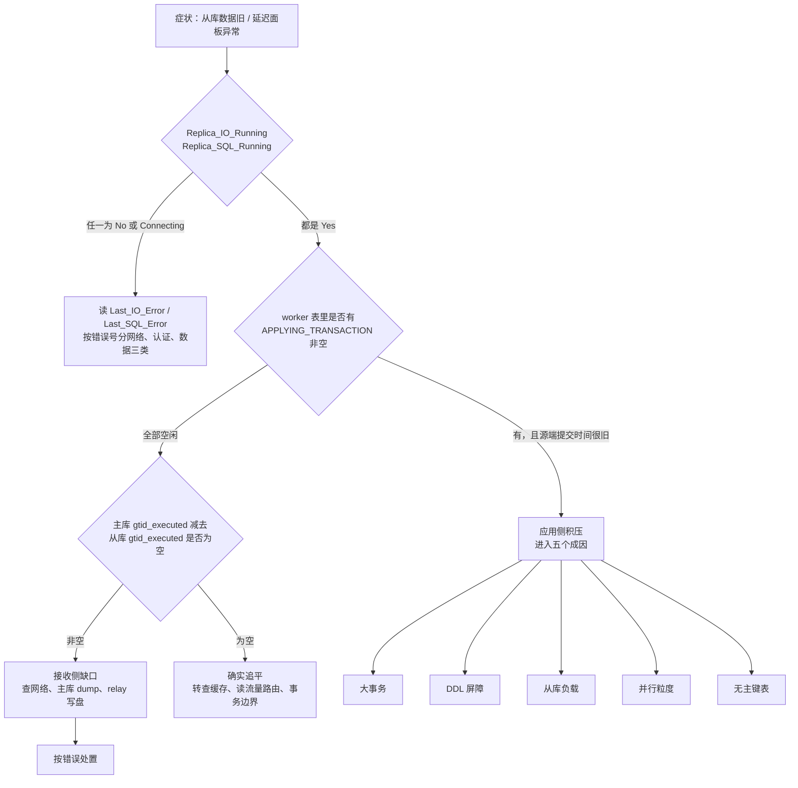
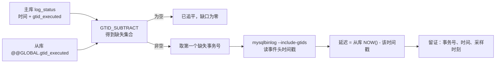
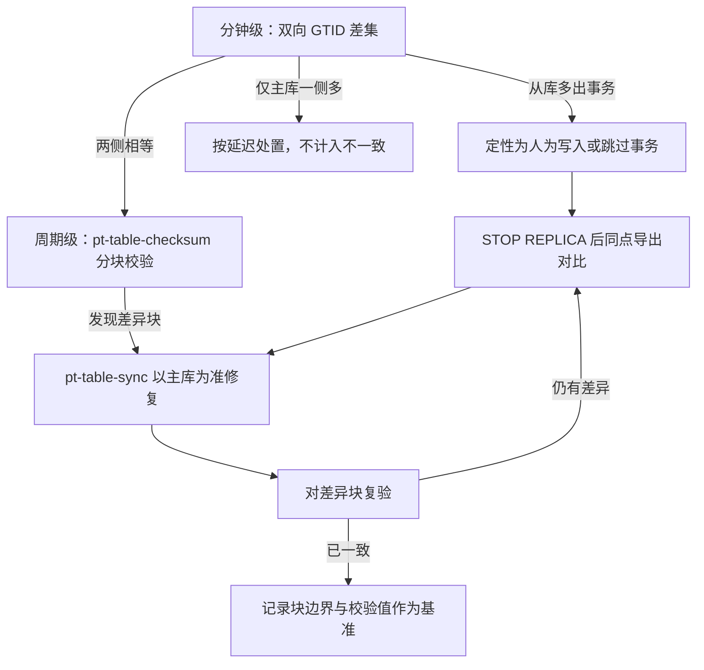
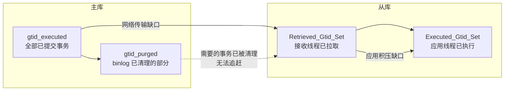
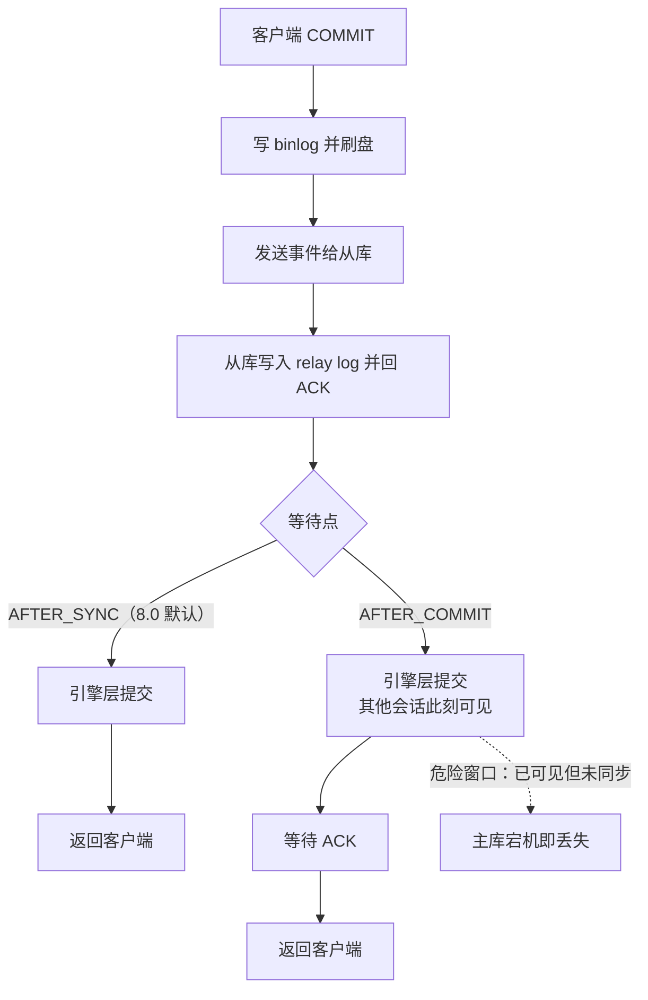

# 10 Binlog 与主从复制——数据同步的底层传动链

**摘要：**

复制排障里最常见的误判，是把监控面板上那个 0 当成"没有延迟"。`Seconds_Behind_Master` 的语义是应用线程正在回放的事件与本地时间的差，没有事件正在回放时它就是 0，应用线程停摆时它是 NULL，慢网络下它又会长期贴着 0——三个 0 对应三种完全不同的现场：真追平、接收侧落后、应用侧停摆。本篇不再讲 binlog 格式与三条线程，那些机制在源码级笔记里已拆到事件一级，这里只做路由；要交付的是一套运行期判据：用两把尺子分别量应用侧积压与端到端缺口，把延迟归入大事务、DDL、从库自身负载、并行粒度不足、无主键表五个成因，每个给出可查证的证据与动作的代价；再把主从不一致拆成三个来源，给出 `pt-table-checksum`、同事务点导出对比、`gtid_executed` 双向差集三种校验的成本对照；最后落到 GTID 的集合关系、半同步两个等待点的取舍，以及八个必须盯住的监控项与阈值。判断的顺序比结论更重要：先量对，再动手。

---

## 第 1 章 分诊：三个 0 与三条互不相同的真相

一个交易库的从库延迟面板整月贴在 0，客服侧却持续收到"刚付完款，订单页看不到"的反馈。值班的人先看 `Seconds_Behind_Master`，是 0；再看两个线程，`Replica_IO_Running` 与 `Replica_SQL_Running` 都是 Yes；结论于是落在"复制正常，去查缓存"。这个结论有一半的可能是对的，另一半的可能是错的，两种情形在同一个面板上一模一样。

复制的运行期状态由三段进度拼起来：主库写到哪个位点、接收线程拉到哪个位点、应用线程回放到哪个位点。任何一段慢下来都表现为从库数据旧，但证据与处置完全不同。`Seconds_Behind_Master` 只覆盖第三段，而且读的是正在回放的那个事件自带的源端时间戳，没有事件在回放时，这个数就失去意义。

### 1.1 三个 0 分别意味着什么

第一种 0，应用侧与接收侧都追平，面板可信。

第二种 0，应用侧追平而接收侧落后。应用线程无事可做，字段按定义取 0，真实缺口可能是几分钟。判断看接收侧：主库的 `gtid_executed` 比从库的 `Retrieved_Gtid_Set` 多，或 `Read_Source_Log_Pos` 落后于主库当前位点。

第三种 0 与 NULL 是线程状态问题。`Replica_SQL_Running` 为 No 时该字段在 8.0 返回 NULL；应用线程消费完中继日志而接收线程已停时也返回 NULL；接收线程在跑、中继日志刚好被读空则定义为 0。NULL 与 0 都不是延迟为零，而是这个指标在当前状态下无定义。

### 1.2 分诊的顺序

分诊不能从延迟数字开始，因为它本身不可靠。笔者用的顺序是：先确认两个线程都在跑，再确认应用侧有没有正在处理的事务、它的源端提交时间是多少，最后才比较主从两侧的事务集合。

下面的图把这条路径画出来，三个判断节点对应三个方向：线程状态不对的去查错误与网络，应用侧有积压的进入五个成因，应用侧空闲而集合有缺口的去查接收侧。



### 1.3 一个贯穿案例

某交易库主表 `trade.pay_order` 约 3.2 亿行，日增约 120 万行，主键自增；两台一级从库承载报表与部分读流量，GTID 复制加 `SOURCE_AUTO_POSITION=1`，`replica_parallel_workers` 为 8，`replica_preserve_commit_order` 为 ON。事故当天三件事同时落地：上午对一张 800 万行历史表加索引；下午清算任务用一个事务批量刷新当天流水，影响 240 万行；傍晚新增一张无主键中间表承接对账明细。三者分别对应第 4 章的大事务、DDL 与无主键表。

### 1.4 本篇的边界

复制机制层——binlog 三种格式、三条线程、中继日志、GTID 语义、并行回放的三代方案——已拆到事件一级，本篇只做路由，细节见 [[中间件/MySQL/读书笔记-Mysql内核架构/13. MySQL 主从复制：从异步到 WriteSet 的并行进化史|读书笔记 13]] 与 [[中间件/MySQL/MySQL内核设计与实现/9.1 第9章 MySQL主从复制|内核设计与实现 9.1]]；两阶段提交与 redo 的关系见 [[中间件/MySQL/MySQL架构与底层原理/03 InnoDB 日志系统——WAL 协议与崩溃恢复的工程实现|本列 03]]，高可用选型见 [[中间件/MySQL/MySQL进阶使用/10 MySQL 高可用方案选型——从主从到 InnoDB Cluster|进阶 10]]。本篇只回答三个运行期问题：延迟是多少、由谁造成、数据还能不能信。

---

## 第 2 章 尺子一：`Seconds_Behind_Master` 量的是什么

这个字段的官方口径可以拆成三句：应用线程正在处理事件时，显示从库当前时间与该事件在源端被记录的时间戳之差；没有事件正在处理时是 0；应用线程未运行时，8.0 里是 NULL。公式里还有一项时钟补偿，即接收线程启动时算出的主从时钟差，默认此后不变。同一批命名变化发生在 8.0.22：`SHOW SLAVE STATUS` 与 `Slave_IO_Running` 改称 `SHOW REPLICA STATUS` 与 `Replica_IO_Running`、`Replica_SQL_Running`，旧名在 8.0 系列内保留为别名，采集脚本按新名解析更稳。

三句话合起来说明它的本质：衡量的是**应用线程与接收线程**之间的时间差，而不是从库与主库之间的数据差。主库到从库之间只要有一个环节慢——网络、主库发送线程、从库接收线程的写盘——事件到达得晚，应用线程就无事可做，字段取 0，而从库确实落后。官方文档因此留了一句很克制的话：这个字段只在网络快的时候好用。

### 2.1 空闲即 0，停摆即 NULL

把空闲与停摆分开，是正确读这个字段的起点。空闲意味着应用线程在等事件，缺口由接收侧决定；停摆意味着应用侧中断，错误在 `Last_SQL_Error` 里。两者处置不同，面板上却一个是 0、一个是 NULL，容易被巡检一起归入正常。

8.0 对 NULL 的判定比 5.7 更细：应用线程未运行时为 NULL；应用线程已消费完中继日志且接收线程也未运行时为 NULL；接收线程在运行而中继日志被读空时为 0。最后一条最容易踩：主库凌晨无写入时字段稳定为 0，这是真追平；主库忙、网络抖动时它也会短暂回到 0，这就不是。

### 2.2 事件时间戳决定了分辨率

字段读的是事件头里的时间戳，而它是主库写这条事件时打的。后果有两个。链式复制下时间戳会继承：M1 又是 M0 的从库时，来自 M0 的事件在 M1 的 binlog 里保留 M0 的时间戳，M1 的从库算出的延迟就混进了两级的差。多线程复制下字段基于 `Exec_Source_Log_Pos` 计算，反映已执行到的位点，不一定对应最近一个已提交事务，于是数字会跳。

延迟从 0 跳到几百秒再跳回，原因就在这里：不是复制抖了，而是字段取了一个不代表最新已提交事务的位置。把它当阈值误报率高，当趋势看才有效。

### 2.3 它什么时候够用

它够用的场合是单线程复制的老实例、网络稳定且主库持续有写入；不够用的场合是读写分离按延迟路由、切换前的追赶判断、以及要给出定量结论的复盘，这三者都需要第二把尺子。

---

## 第 3 章 尺子二：worker 表里的源端提交时间

`performance_schema.replication_applier_status_by_worker` 每个工作线程一行，四列时间戳是关键：`APPLYING_TRANSACTION_IMMEDIATE_COMMIT_TIMESTAMP` 是当前事务在其直接上游提交的时刻；`APPLYING_TRANSACTION_ORIGINAL_COMMIT_TIMESTAMP` 是它最初被提交的时刻，链式拓扑下两者不同；`APPLYING_TRANSACTION_START_APPLY_TIMESTAMP` 是线程开始应用它的时刻；`LAST_APPLIED_TRANSACTION_*` 是上一个完成事务的同一组值。

把这四列与从库当前时间放在一起，才得到真正的延迟。取正在应用的事务里源端提交时间最旧的那一个，与 `NOW()` 相减，得到的是应用侧最旧的未完成事务已经等了多久，这是应用侧积压，与 `Seconds_Behind_Master` 的口径完全不同：后者是单点时间戳之差，前者是所有并行队列里的最大值。

### 3.1 为什么不能对全表取最大值

常见错法是直接 `MAX(...)` 扫全表。空闲工作线程也有一行 `LAST_APPLIED_TRANSACTION_*`，数值可能是一小时前，于是最旧落在没干活也没有积压的线程上，延迟凭空多出一小时。

**应用侧积压**：只统计 `APPLYING_TRANSACTION` 非空的线程，取源端提交时间的最小值，一个都没有说明应用侧已清空中继日志里的事务。**端到端缺口**：应用侧空闲时缺口来自接收侧，要拿主库的最新事务比，做法见第 3.4 节的集合差集。

### 3.2 一条能直接用的查询

下面的查询把两个量分开：`lag_seconds` 是应用侧最旧未完成事务的年龄，`busy_workers` 是真正在干活的工作线程数，后者同时是并行度是否生效的直接证据。

```sql
-- 应用侧积压：只算正在应用的事务，NULL 视为空闲
SELECT
  COUNT(*) FILTER (WHERE APPLYING_TRANSACTION IS NOT NULL) AS busy_workers,
  TIMESTAMPDIFF(SECOND,
    MIN(APPLYING_TRANSACTION_IMMEDIATE_COMMIT_TIMESTAMP),
    NOW(6)) AS lag_seconds
FROM performance_schema.replication_applier_status_by_worker;

-- 每个线程的细节：谁在应用、应用了多久、源端何时提交
SELECT WORKER_ID, SERVICE_STATE,
       APPLYING_TRANSACTION AS gtid,
       APPLYING_TRANSACTION_IMMEDIATE_COMMIT_TIMESTAMP AS src_commit,
       TIMESTAMPDIFF(SECOND, APPLYING_TRANSACTION_START_APPLY_TIMESTAMP, NOW(6)) AS applying_seconds
FROM performance_schema.replication_applier_status_by_worker
ORDER BY applying_seconds DESC;
```

第二段的 `applying_seconds` 比延迟数字更有用：某个线程在同一个事务上停留几百秒，说明它撞上了大事务或一行一行的全表扫，方向立刻收窄到第 4 章的第一与第五个成因。`FILTER` 子句 8.0 可用，5.7 上改成 `SUM(APPLYING_TRANSACTION IS NOT NULL)`。

> [!warning] 采样频率与开销
> 这几张表读的是内存结构，单次查询开销很小，但**没有历史**。要画延迟曲线必须外部采样落库，间隔建议 5 至 10 秒：再密只增加噪音，再疏会错过短时尖峰。工作线程数很多时，逐线程落库的基数会显著放大存储，落库时聚合成最旧事务年龄与忙碌线程数两个数即可。

### 3.3 时钟同步是前提，链式拓扑要选口径

这一列的时间来自上游主机的时钟，用从库的 `NOW()` 去减等于假定两台机器时钟一致，误差直接进结果。生产上必须有 NTP 把偏差压到百毫秒级；`Seconds_Behind_Master` 至少做过一次启动补偿，这一列没有。

链式拓扑下还要选口径：看相对直接上游的延迟用 `IMMEDIATE`，看相对最初写入的延迟用 `ORIGINAL`，两者之差就是中间那一级的陈旧程度。

### 3.4 GTID 与 `mysqlbinlog`：把延迟算到秒

集合差集给的是缺哪些事务，不是缺多少秒。要算秒数，需要拿到第一个缺失事务的提交时刻，工具是 `mysqlbinlog`。

第一步，在主库一侧取尽量同时的时间点与事务集合。8.0 的 `performance_schema.log_status` 一条语句就能同时拿到 `gtid_executed` 与 binlog 位点，比先后读两个变量可靠。

```sql
-- 主库：一条语句里同时取时间与事务集合
SELECT NOW(6) AS sample_time,
       JSON_EXTRACT(LOCAL, '$.gtid_executed') AS executed
FROM performance_schema.log_status;

-- 从库：自己已执行到的事务集合
SELECT @@GLOBAL.gtid_executed;
```

第二步，算出差集并挑出第一个缺失事务。

```sql
SELECT GTID_SUBTRACT('<主库 executed>', '<从库 gtid_executed>');   -- 缺失
SELECT GTID_SUBTRACT('<从库 gtid_executed>', '<主库 executed>');   -- 多余
```

第三步，用 `mysqlbinlog` 到主库上定位这个事务的提交时间戳。`--read-from-remote-server` 直接从主库读 binlog，不必先拷文件；`--include-gtids` 过滤到那一个事务，事件头里的时间就是提交时刻。

```bash
mysqlbinlog --read-from-remote-server --host=<主库> --user=<复制账号> \
  --include-gtids='<uuid>:<第一个缺失的事务号>' \
  <主库当前 binlog 文件> | head -30
# 事件头里的 #YYMMDD hh:mm:ss 与 SET TIMESTAMP= 给出该事务的源端时刻
# 延迟 = 从库当前时间 - 该时刻
```

这个方法可复算、可留证，代价是重，不适合放进分钟级巡检。它适合复盘时把那半小时差多少秒算成一个数，以及切换前验证从库真的追到了某个事务；后者用 `SELECT WAIT_FOR_EXECUTED_GTID_SET('uuid:n', 30)` 更省事，返回 0 表示 30 秒内追平。

下面的图把这条测量链路串起来，四个节点都可以在事后复现，不依赖当时的监控数据是否完整。



### 3.5 三把尺子的分工

三个量分层而非互相替代：`Seconds_Behind_Master` 回答应用线程是否在动，worker 时间戳回答压着多少活，集合差集回答缺哪些事务，巡检应同时采三个。

| 量 | 度量对象 | 何时可信 | 典型误判 |
| :--- | :--- | :--- | :--- |
| `Seconds_Behind_Master` | 应用线程与接收线程的时间差 | 网络快、主库持续写入、单线程复制 | 慢网络或空闲时恒为 0，被读成无延迟 |
| worker 表源端提交时间 | 应用侧最旧未完成事务的年龄 | 工作线程数大于 0、时钟已同步 | 全表取最大值，把空闲线程算成积压 |
| `gtid_executed` 差集 | 从库缺失的事务集合 | GTID 模式、两侧都能取到集合 | 只单向比较，漏掉从库多出事务 |

---

## 第 4 章 五个成因与它们的判据

归因的难点不在枚举，而在每个成因都能伪造出别的成因的症状。下面五个按频率乘排查成本排序，每个给出证据、动作与动作的价格。

### 4.1 大事务：并行复制对它无效

一个事务是不可再分的回放单位。无论配了多少工作线程，同一个事务只能由一个线程执行；提交顺序保持开启时，它提交之前后续事务也无法提交。于是一个在主库上跑 20 秒的批量更新，在从库上就是整条应用链被堵住的 20 秒。

判据三条，出现两条即可定性：`Relay_Log_Space` 从几十兆涨到几吉而 `Read_Source_Log_Pos` 已追平主库，说明事件全到了只是应用不动；只有一个线程的 `applying_seconds` 持续增长；主库 `SHOW BINLOG EVENTS` 里相邻两个 `Xid` 的 `End_log_pos` 差值就是事务字节数。

处置方向是拆：把 240 万行的一次性更新拆成每批几千行、按主键区间推进，代价是应用侧要接受中间态可见。已经写成大事务的任务没有运行期的银弹，只能等它跑完，这也是延迟预案通常给这类任务配可中断开关的原因。

### 4.2 DDL：一个跨不过去的屏障

DDL 在并行回放里是**屏障**：调度线程必须等已分发的事务全部完成，再执行这条语句，期间的元数据锁会挡住后续涉及该表的事务。于是一条在主库上 8 分钟完成的加索引，会让从库在这 8 分钟里把后续事务全压在中继日志里；主库因为在线 DDL 可以并发读写而感知不到，从库是实打实停住的。

判据是延迟窗口与 DDL 时间对齐，加上从库上的证据：`SHOW PROCESSLIST` 里 `system user` 线程停在 `Waiting for table metadata lock`，正文就是那条 DDL，或者停在 `altering table`。这条判据能区分 DDL 自己慢与被别的查询挡住，后者在从库上非常常见——报表的一条长 `SELECT` 持有元数据锁几十分钟，它后面的一切都在排队。

处置分两层。运行期只能找出持锁查询并让它结束，`performance_schema.metadata_locks` 与 `sys.schema_table_lock_waits` 直接给出持锁者；结构上则是把大表 DDL 挪到延迟不敏感的时间窗，或先在从库执行再切主库，两种做法都要付一次额外窗口的成本。

### 4.3 从库自身的负载：重放也是一次写入

从库不是只读副本，它在把行变更落盘，这部分 I/O 与主库同量级。从库上还跑着报表、备份、大批量导出时，重放要和它们抢同一组磁盘与同一批 buffer。判据在主库上找不到：要看 `iostat -x 1` 的 `%util` 与 `await`、`vmstat` 的 `wa`，以及 `Innodb_data_pending_writes` 这类挂起计数。

还有一条更隐蔽的：从库上的长查询与重放争同一份元数据锁。一条扫 3 亿行的报表查询在 RR 下持一致性读视图，不阻塞行级写入，但它的元数据锁会阻塞 DDL 回放，buffer 占用会把重放要用的页挤出去。判据是把延迟曲线与从库慢查询曲线叠在一起看峰是否对齐。

处置是隔离而不是调参：把重活挪到专用从库，或用 `resource_groups` 把报表查询的 CPU 限住，对重放线程也生效。调 `innodb_buffer_pool_size` 通常是错的，问题不在容量而在争用。

### 4.4 并行粒度不足：配了不等于生效

并行回放的依据是事务间的依赖关系，能并行多少由负载形态决定，配几个线程只是给了上限。判据分三步：`replica_parallel_workers` 是否大于 0；worker 表里同时 `APPLYING_TRANSACTION` 非空的线程数，长期为 1 说明并行没生效；主库侧的 `binlog_transaction_dependency_tracking` 用了哪种依赖信息。

8.0 默认 `COMMIT_ORDER`，用提交时间窗口判断两个事务是否独立，于是主库上串行提交的小事务在从库也只能串行。改成 `WRITESET` 后判据变成改了哪些行，先后提交但改不同行的事务也能并行。代价是主库要为每个事务计算并维护行哈希，写入路径多一份开销。

版本口径要分清：8.0.26 起系统变量有 `replica_*` 新名；8.0.27 起 `replica_parallel_workers` 默认 4、`replica_parallel_type` 默认 `LOGICAL_CLOCK`、`replica_preserve_commit_order` 默认 ON；8.0.29 起 `DATABASE` 分支被标记废弃；8.4 起 `binlog_transaction_dependency_tracking` 已移除，服务端直接按 WRITESET 行为处理。升级前后各采一次 `busy_workers`，才知道并行度是真变了还是数字变了。

`replica_preserve_commit_order=ON` 让从库提交顺序与主库一致，这是从库可读且可信的前提之一，代价是**并行度**受最长事务限制——先执行完的事务要排队等前序提交。关掉它能换更高并行度，代价是 `gtid_executed` 出现空洞，依赖已执行集合连续的判断（包括切换工具与 `WAIT_FOR_EXECUTED_GTID_SET` 的语义）会失灵。除非明确知道自己在换什么，这一项保持开启。

### 4.5 无主键表：最隐蔽也最常见的一条

行格式复制下，从库要按行定位目标记录。有主键或唯一键时，定位是一次索引查找；没有主键时退化为扫描——只能靠整行所有列的值去比对。于是一条改 10 万行的无主键表的 `UPDATE`，在主库上是一次全表扫描加 10 万次修改，在从库上就是 10 万次扫描，放大倍数与表行数同阶。

它之所以隐蔽，是因为在主库上完全看不出来：语句可能走了二级索引，很快；DDL 评审看不出问题；从库延迟在表小时也不明显。等表长到几百万行，延迟会突然从偶发几秒变成持续几十分钟，而此时没人会想到根因是半年前建表时没写主键。

判据要从两侧拼。表侧用 `information_schema.tables` 与 `statistics` 确认既无主键也无唯一索引。复制侧：`binlog_row_image` 只影响事件体积，不改变无主键要扫这一事实；行格式下从库回放不是 SQL 语句，`log_slow_replica_statements` 抓不到它，慢查询日志这条路走不通。可用的替代是 `sys.schema_table_statistics` 的 `rows_fetched`：对比主库该表的行事件数与从库该表的增量，比值远大于 1 就说明定位在扫表。

处置只有一个方向：加主键或唯一键。这本身是一次在线 DDL，要在延迟不敏感的时间窗做。在没加之前，能做的只有缩小这类表的单事务写入量。

### 4.6 五因对照

| 成因 | 主判据 | 首个动作 | 动作的主要代价 |
| :--- | :--- | :--- | :--- |
| 大事务 | `Relay_Log_Space` 突增而接收位点已追平；单线程 `applying_seconds` 持续增长 | 拆批，按主键区间推进 | 中间态可见，应用侧需容忍部分成功 |
| DDL | 延迟窗口与 DDL 窗口对齐；从库出现 `Waiting for table metadata lock` | 找出持锁查询并结束，或换时间窗 | 一次额外的变更窗口与回归验证 |
| 从库负载 | `iostat` 的 `%util`/`await` 高，延迟峰与慢查询峰对齐 | 报表与备份挪到专用从库 | 多一台实例与读流量重路由 |
| 并行粒度 | 忙碌 worker 数长期为 1；依赖信息为 `COMMIT_ORDER` | 开 `WRITESET`，按写入能力调线程数 | 主库多一份行哈希计算；关提交顺序会破坏集合连续性 |
| 无主键表 | 表无主键或唯一键；从库该表 `rows_fetched` 远超行事件数 | 加主键，缩小单事务写入量 | 一次在线 DDL 加一次结构同步等待 |

---

## 第 5 章 量化：并行度与大事务各贡献多少

判据之外还有一类问题需要算：线程数从 4 调到 8 能救回多少延迟，一次 240 万行的批量更新会压出多长的尾巴。严格数字只能实测，量级推算可以用来决定值不值得动手。下面两段是示例口径，说明关系式，不代表任何具体硬件的实测结果。

### 5.1 单线程上限与并行的折扣

设重放单个事务平均耗时 0.4 毫秒，一个工作线程的理论上限是 2500 事务每秒。有 8 个线程不等于 8 倍：**有效并行度**受依赖关系约束，经验上 1.5 到 3 更接近现场。若主库提交速率是 6000 事务每秒，8 线程按有效并行度 2 折算的上限是 5000，缺口 1000 会持续转化为积压。这解释了延迟为什么常是斜坡上升而不是台阶上升。

同一关系式也回答加线程有没有用：有效并行度由依赖关系决定，线程数超过它之后，增加的线程只是排同一批依赖，`busy_workers` 不涨，延迟也不降。

### 5.2 一次大事务的尾巴

设一次批量更新在主库由 8 个并发连接分摊，总耗时 20 秒；从库回放时它被记为一个或几个大事务，只能由一个线程处理。若从库单线程吞吐约为主库单连接吞吐的 0.8 倍，240 万行的回放需要 240 / 8 / 0.8 = 37.5 秒起步；若这张表没有主键，每次行定位再乘一个扫描放大，几十秒变成几十分钟都很正常。

### 5.3 参数的两个方向

| 参数 | 调大的效果 | 调大的代价 | 调小的效果 |
| :--- | :--- | :--- | :--- |
| `replica_parallel_workers` | 提升可并行事务的吞吐 | 调度与内存开销上升；超过有效并行度后无收益 | 降低资源占用，大并发负载下必然积压 |
| `replica_preserve_commit_order` | 开启保证提交顺序，并行度受最长事务限制 | 关闭可提升并行度，代价是集合空洞 | — |
| `binlog_transaction_dependency_tracking` | 设 `WRITESET` 提升从库并行机会 | 主库多一份行哈希计算与内存占用 | 保持 `COMMIT_ORDER` 省主库开销，丢弃并行机会 |
| `sync_relay_log` | 设 1 提升崩溃后中继日志可靠性 | 每次写入刷盘，接收侧吞吐下降 | 设 0 提升接收吞吐，崩溃可能丢中继日志尾部 |
| `relay_log_space_limit` | 设上限防止磁盘被中继日志打满 | 到限后接收线程停止，延迟转为持续增长 | 不设限依赖磁盘容量，风险落在磁盘 |

---

## 第 6 章 不一致：三个来源与三种校验

延迟是慢的问题，不一致是错的问题，后者严重得多，因为它不会自行恢复。复制是单向的、逻辑的：主库的变更单方向流到从库，从库自己的写入不会被纠正，缺掉的事务也不会被补上。

### 6.1 三个来源

第一个来源是在从库上写数据。凡是绕过 `read_only` 的写入——有高权限账号的运维操作、数据修复脚本、导数据时误连从库——都会让从库多出主库没有的行或值，差异只增不减。

第二个来源是主库上关闭了 binlog 的写入。会话级 `SET sql_log_bin=0` 之后的变更不进 binlog，从库自然收不到。它比直接写从库更危险：两侧从此各有一份自己认为正确的数据，后续基于 binlog 的恢复也会把这段缺口带进新实例。

第三个来源是跳过事务。复制因数据冲突中断时，最省事的处置是跳过，而跳过的本质是从库永久缺失这个事务的变更。跳过之后复制恢复、延迟归零、监控全绿，缺口留在数据里。

### 6.2 `read_only` 挡得住谁

`read_only` 只挡住没有 `CONNECTION_ADMIN`（旧版为 `SUPER`）权限的账号，不影响复制线程与临时表。带管理权限的账号连上来照样能写，而多数运维脚本用的正是这类账号。`super_read_only`（5.7.8 起）把这类账号一并挡住，一旦开启也不允许把 `read_only` 单独改回 OFF。从库的标准配置是两个一起开。

### 6.3 跳过事务的正确姿势与它的账

`sql_replica_skip_counter` 跳的是事件数而不是事务数，与 GTID 复制互斥——`gtid_mode=ON` 时不允许设为非零值。GTID 模式下想跳过，只能注入一个空事务占用那个 GTID：把 `GTID_NEXT` 设为待跳过的事务号，提交空事务，再改回 `AUTOMATIC`。这样 `gtid_executed` 里有了这个号，复制能继续，但那个事务的变更永远不会被执行。

这笔账要记清：跳过之后 `gtid_executed` 的集合是完整的，任何基于集合的追平判断都会给出一致的结论，而数据其实已经岔开。这解释了为什么跳过之后用 GTID 差集校验查不出问题——差集比的是事务集合，不是行内容。跳过之后必须补一次行级校验。

### 6.4 校验一：`pt-table-checksum` 的机制与代价

它把每张表按索引切成块，对块内行计算校验和（默认逐行 `CRC32` 再用 `BIT_XOR` 聚合，空值单独标记），把库名、表名、块边界、校验和、行数写进结果表。结果表的写入是普通 DML，会经复制流到从库，于是每个从库都有一份主库算出的校验和；工具再连到从库对同一块算一遍本地校验和做比对。

代价在三处。读放大：主库上整张表扫一遍，3 亿行的表就是一次全表扫描的 I/O 与 buffer 占用，必须用 `--chunk-time` 与 `--max-load` 压到不影响业务。复制放大：结果表写入本身要复制，块越小结果行越多。锁与漂移：切块边界要做范围查询，写入频繁的表会出现块漂移。它内置的 `--max-lag` 在有延迟的实例上必须开，否则校验本身会成为延迟源。

### 6.5 校验二：同一事务点上的数据对比

第二种校验不依赖工具链，用逻辑备份对比。前提是两侧取到同一个逻辑时刻的数据：在从库 `STOP REPLICA SQL_THREAD` 后等应用侧清空，再分别在主从执行 `mysqldump --single-transaction`（在一个一致性快照里读，不锁表），然后逐表比对。

代价是要停：应用线程停止期间延迟持续累积，只适合小库或可接受短停的场景；好处是完全可解释，差异能精确到行。实践中它常用来复核 `pt-table-checksum` 报出的差异块，而非常规巡检；`--single-transaction` 只对 InnoDB 有效。

### 6.6 校验三：GTID 的双向差集

第三种最便宜，一条语句，但它只能回答从库缺哪些事务，回答不了缺的那些事务改了哪些行。做法是双向比：主库减从库非空，说明从库没追完或连接中断；从库减主库非空，说明从库执行了主库从未有过的事务，这是不一致的强信号，正常复制流程里不会出现。

```sql
-- 在主库上执行，两个方向都要看
SELECT GTID_SUBTRACT(@@GLOBAL.gtid_executed, '<从库 gtid_executed>') AS missing_on_replica,
       GTID_SUBTRACT('<从库 gtid_executed>', @@GLOBAL.gtid_executed) AS extra_on_replica;
```

前者的常见原因是延迟或中断，后者只有三类原因：从库被写入、主库关闭过 binlog、跳过事务。这个检查适合放进分钟级巡检，成本近乎为零。

下面的图把三种校验串成闭环：先做便宜的集合比对，再有针对性地做行级校验，修复后必须复验，否则下一次校验没有基准。



---

## 第 7 章 GTID 的运行期判断

GTID 的语义在源码级笔记里讲过：它把复制进度从物理位点换成事务集合。运行期要判断的是三个集合的关系，以及它们在异常时的表现。

### 7.1 三个集合与两个维护边界

`gtid_executed` 是本机已执行的全部事务集合，持久化在 `mysql.gtid_executed` 表里，与是否开启 binlog 无关。`gtid_purged` 是本机已不在 binlog 里的事务集合，8.0 从现存最旧 binlog 的 `Previous_gtids_log_event` 推算，它是 `gtid_executed` 的子集。`Retrieved_Gtid_Set` 与 `Executed_Gtid_Set` 则是复制状态里的两个投影。

两个运行期结论。第一，`gtid_purged` 的边界决定一台从库还能追上多久之前的缺口：从库停机一周而主库 binlog 只保留三天，它需要的事务已进 `gtid_purged`，追上就不可能了。第二，从库的 `Retrieved` 与 `Executed` 之差就是已到货未回放，差值持续增长指向应用侧，停滞不动指向接收侧。

下图给出三个集合的包含关系与两个缺口的来源，判断延迟成因时先定位缺口落在哪一段。



### 7.2 从库起不来的典型形态

以 `SOURCE_AUTO_POSITION=1` 连接的从库，启动后先把本地 `gtid_executed` 发给主库，主库据此判断从哪里开始发。所需事务所在 binlog 已被清理时，主库无法定位，复制以错误号 1236 中断。这不是网络也不是权限问题，处置只有一个方向：用备份重建，并在恢复时把 `gtid_purged` 设成备份对应的事务集合。

另一种启动失败与 `gtid_purged` 的设置有关：在非空实例上手工 `SET GLOBAL gtid_purged` 会被拒绝，它只能在 `gtid_executed` 为空的实例、或所设集合能被现有执行集合覆盖时设置。用备份重建时，`xtrabackup` 这类工具会把 `gtid_purged` 一起写进恢复后的实例。

### 7.3 `AUTO_POSITION` 与文件加位点的取舍

| 维度 | `SOURCE_AUTO_POSITION=1` | binlog 文件 + 位点 |
| :--- | :--- | :--- |
| 切换后重指向 | 只改主机名，不需算位点 | 需把旧位点映射到新主库，人工易错 |
| 对 binlog 保留期 | 高：必须覆盖最久离线的从库 | 同样要高，但缺口表现更隐蔽 |
| 跳过事务 | 不可用跳过计数器，只能注入空事务 | 可用跳过计数器，代价同样是永久缺口 |
| 位点漂移 | 无 | `FLUSH LOGS`、重启、切换都可能改变位点 |
| 排障可读性 | 集合运算，能直接算差集 | 位点是数字，跨文件比较不直观 |

`AUTO_POSITION=1` 让"从库已执行到什么"变成可计算的集合，也把"主库保留多久 binlog"变成硬约束：把 `binlog_expire_logs_seconds` 从默认 30 天改成 3 天省下的空间，换来的是某台从库停机两天后再也追不上的风险。

### 7.4 集合相等不等于数据一致

`gtid_executed` 两侧相等只说明执行过的事务集合相同，不说明数据相同。三种情况下集合相等而数据不同——从库被直接写入（本地产生的事务会进 `gtid_executed` 但不传给主库，于是出现反方向的差集，这是能被发现的一类）、主库上关闭 binlog 的写入（两侧集合都不含它，永远不被发现）、跳过事务后注入的空事务（集合完整，内容缺失）。

所以 GTID 集合的正确用法是快速排除而不是证明一致：它能秒级排除事务没传完这一类原因，剩下的必须交给行级校验。

---

## 第 8 章 半同步：两个等待点与一组计数

异步复制下，主库提交成功与从库收到事件之间没有任何约定，主库崩溃时这段时间内提交的事务会丢。半同步在这条链上加了一个等待：主库等至少一个从库确认收到。

### 8.1 `AFTER_SYNC` 与 `AFTER_COMMIT`

差别只有一句话，后果差一个数量级。`AFTER_SYNC` 是 8.0 的默认：主库写 binlog 并刷盘、发给从库、收到确认，然后才在引擎层提交并返回客户端。`AFTER_COMMIT` 相反：先在引擎层提交，再等确认。

关键差别在提交之后、确认之前这个窗口。`AFTER_COMMIT` 下事务已在引擎层提交，其他会话能读到它，而它还没到任何从库；此时主库宕机并切到从库，这些已被读到过的数据在切换后消失，应用可能已经基于它做了后续动作。`AFTER_SYNC` 关掉了这个窗口：所有客户端都在确认之后才看到提交，切换时从库必然有这份数据。

下图把两个等待点画在同一条提交流上，可以看出危险窗口落在哪一步。



### 8.2 一组计数怎么读

主库侧四个状态量能直接回答运行期问题：`Rpl_semi_sync_source_status` 为 ON 表示半同步当前生效，OFF 表示已降级或插件未启用；`Rpl_semi_sync_source_no_times` 是降级次数；`Rpl_semi_sync_source_no_tx` 是未获确认的提交数；`Rpl_semi_sync_source_yes_tx` 是获确认的提交数。插件名取决于装的是哪一套：装 `rpl_semi_sync_source` 与 `rpl_semi_sync_replica` 时只有 `source` 前缀，装旧插件时只有 `master` 前缀，两套不能共存。

把 `no_tx` 与 `yes_tx` 放在一起看比例：`no_tx` 持续增长而 `yes_tx` 不动，说明长期处于**降级**状态；两者交替增长，说明网络或从库偶发抖动。`Rpl_semi_sync_source_wait_sessions` 长期大于 0，意味着提交延迟被半同步拉长了。

### 8.3 超时降级与它的恢复

`rpl_semi_sync_source_timeout` 默认 10000 毫秒。等待超过这个时间，主库放弃等待、继续提交并返回客户端，同时把状态置为 OFF，此后按异步复制运行；等到至少一个从库重新追上并回 ACK，状态才回到 ON。

降级是故障期间自动退让。从库网络断开后的头 10 秒，写入被拖慢；10 秒之后写入恢复原速，数据保护已经消失，而监控上唯一的变化是 `Rpl_semi_sync_source_status` 从 ON 变 OFF。告警若只配了复制线程状态，这个切换不会被发现，而它恰恰是主库随时可能丢数据的状态。

### 8.4 ACK 到哪一步

半同步的确认只代表从库把事件写进中继日志，不代表回放完成，也不代表落盘——落盘取决于 `sync_relay_log`。所以它保证的是主库故障时从库有这份日志，不是从库能立刻读到数据，更不是从库不丢数据。把半同步当强一致来设计读写分离，切换后会立刻遇到数据在但从库还没回放的窗口。

---

## 第 9 章 八个必盯项与阈值

以上判据落到监控上，是八个字段加一组阈值。阈值必须按实例校准，下表是经验起点。

| 监控项 | 来源 | 判读 | 经验阈值（需按实例校准） |
| :--- | :--- | :--- | :--- |
| `Replica_IO_Running` / `Replica_SQL_Running` | `SHOW REPLICA STATUS` | 任一非 Yes 即中断，`Connecting` 是重连中 | 非 Yes 持续 30 秒告警 |
| 应用侧最旧事务年龄 | worker 表 `APPLYING_TRANSACTION_IMMEDIATE_COMMIT_TIMESTAMP` | 真实的应用侧积压 | 持续 30 秒超过 60 秒告警 |
| 端到端缺口 | 主从 `gtid_executed` 差集 | 从库缺多少事务 | 非空即告警，按事务数分档 |
| `Relay_Log_Space` | `SHOW REPLICA STATUS` | 中继日志占用，突增指向大事务或应用停摆 | 超过常态 5 倍或绝对值超过 5 GB |
| `Read_Source_Log_Pos` 与 `Exec_Source_Log_Pos` 之差 | `SHOW REPLICA STATUS` | 接收与应用的字节差 | 持续增长且 worker 不忙即查接收侧 |
| `Auto_Position` | `SHOW REPLICA STATUS` | 定位方式，决定跳过与切换的处置路径 | 变更需登记，不可静默改 |
| `Retrieved_Gtid_Set` 与 `Executed_Gtid_Set` 之差 | `SHOW REPLICA STATUS` | 到货未回放量 | 持续扩大指向应用侧 |
| `Last_IO_Error` / `Last_SQL_Error`、半同步 `no_tx` 与 `status` | `SHOW REPLICA STATUS` 与状态量 | 中断原因；半同步是否在降级状态下运行 | 错误非空即告警；`status` 为 OFF 持续 60 秒告警 |

---

## 第 10 章 边界与反例

判据用反方向比不用更难发现，下面四条都是把判据当结论用的现场。

第一条，看到 `Seconds_Behind_Master=0` 就认为没有延迟。它在应用线程空闲时按定义为 0，慢网络、接收侧落后时照样是 0。可靠的替代是先看 worker 表有没有正在应用的事务，再看集合差集。

第二条，用**无主键表**承载高频更新。建表时省掉主键，主库上感觉不到代价，从库上每次行定位都是扫描。这条成因在从库侧爆发时，排查方向通常已经跑到参数与硬件上了。

第三条，从库只开 `read_only` 不开 `super_read_only`。前者挡不住带 `CONNECTION_ADMIN` 的账号，而运维脚本用的正是这类账号。两个开关一起开，才能把人这条不一致来源压到最小。

第四条，把跳过事务当作常规修复手段。跳过之后复制恢复、延迟归零、监控全绿，缺口留在数据里，而集合层面的校验已查不出它。

---

## 第 11 章 结语：先量对，再动手

复制排障的核心困难不是机制不清楚，而是度量不可靠。`Seconds_Behind_Master` 带着三个互相冲突的 0，跳过事务会留下集合层面查不出的缺口，半同步降级只改一个状态量而不报警。这三件事指向同一个方法：任何看起来好了的结论，都要用第二把尺子验一遍。

五个成因里，四个的处置落在业务与流程侧——拆批、挪窗口、隔离负载、补主键——只有一个真正落在复制参数上。这个分布说明，延迟大多不是复制配得不对，而是写进来的东西不适合复制；不一致的三个来源也全部是人与流程。判据便宜，动作昂贵，先把量测对，再决定动哪里。

---

## 参考资料

1. MySQL. Reference Manual 8.0：SHOW REPLICA STATUS Statement（`Seconds_Behind_Source` 的三种取值语义、时钟补偿、多线程下的位点依据）. https://dev.mysql.com/doc/refman/8.0/en/show-replica-status.html
2. MySQL. Reference Manual 8.0：Replication Threads（协调线程、工作线程与 `replica_parallel_workers`）. https://dev.mysql.com/doc/refman/8.0/en/replication-threads.html
3. MySQL. Reference Manual 8.0：Replica Server Options and Variables（`replica_parallel_workers`、`replica_parallel_type`、`replica_preserve_commit_order`、`sql_replica_skip_counter`）. https://dev.mysql.com/doc/refman/8.0/en/replication-options-replica.html
4. MySQL. Reference Manual 8.0：Binary Logging Options and Variables（`binlog_transaction_dependency_tracking` 与 `last_committed`/`sequence_number`）. https://dev.mysql.com/doc/refman/8.0/en/replication-options-binary-log.html
5. MySQL. Reference Manual 8.0：Performance Schema Replication Tables（`replication_applier_status_by_worker` 各列定义）. https://dev.mysql.com/doc/refman/8.0/en/performance-schema-replication-tables.html
6. MySQL. Reference Manual 8.0：Semisynchronous Replication（`AFTER_SYNC` 与 `AFTER_COMMIT` 的可见性差异、超时降级）. https://dev.mysql.com/doc/refman/8.0/en/replication-semisync.html
7. MySQL. Reference Manual 8.0：Server Status Variables（`Rpl_semi_sync_source_status`、`_no_tx`、`_no_times`、`_yes_tx`）. https://dev.mysql.com/doc/refman/8.0/en/server-status-variables.html
8. MySQL. Reference Manual 8.0：Replication and Transaction Inconsistencies（多线程复制的事务空洞与 `replica_preserve_commit_order`）. https://dev.mysql.com/doc/refman/8.0/en/replication-features-transaction-inconsistencies.html
9. MySQL. Reference Manual 8.0：GTID Concepts 与 `gtid_purged` System Variable（集合推算方式与设置约束）. https://dev.mysql.com/doc/refman/8.0/en/replication-gtids-concepts.html
10. MySQL. Reference Manual 8.0：mysqlbinlog（`--read-from-remote-server`、`--include-gtids`、`--stop-datetime`）. https://dev.mysql.com/doc/refman/8.0/en/mysqlbinlog.html
11. MySQL. Reference Manual 8.0：CHANGE REPLICATION SOURCE TO Statement（`SOURCE_AUTO_POSITION`、`GTID_ONLY`）. https://dev.mysql.com/doc/refman/8.0/en/change-replication-source-to.html
12. Percona. pt-table-checksum（分块校验和算法、`--max-lag`、`--chunk-time`、`--replicate` 结果表）. https://docs.percona.com/percona-toolkit/pt-table-checksum.html
13. Percona. pt-table-sync（以指定一侧为准修复差异块）. https://docs.percona.com/percona-toolkit/pt-table-sync.html
14. MySQL. Reference Manual 8.0：Changes in MySQL 8.0（8.0.22 复制术语、8.0.26 系统变量新名、8.0.27 并行复制默认值）. https://dev.mysql.com/doc/refman/8.0/en/upgrading-from-previous-series.html

---

> [!note] 思考题
> 1. 一台从库的 `Seconds_Behind_Master` 稳定为 0，而用它承接的读请求持续读到五分钟前的数据，你的排查顺序是什么？
> 2. 主库 `binlog_transaction_dependency_tracking` 从 `COMMIT_ORDER` 改成 `WRITESET` 后从库延迟下降、主库 TPS 也降了，这笔交换该怎么算？
> 3. 一张 500 万行、无主键的表每天被批量更新两次，加主键该现在做还是等下一个变更窗口？不做的话有什么过渡手段？
> 4. `super_read_only` 已经开启，仍然出现了主从不一致，可能的原因有哪几类，各自怎么验证？
> 5. 半同步状态从 ON 变成 OFF 时业务侧通常没有感知，你会怎么设计一条能提前发现它的告警？