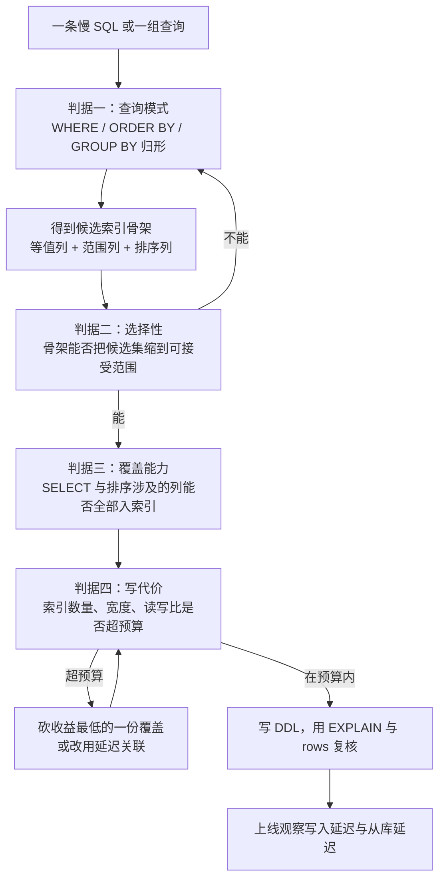
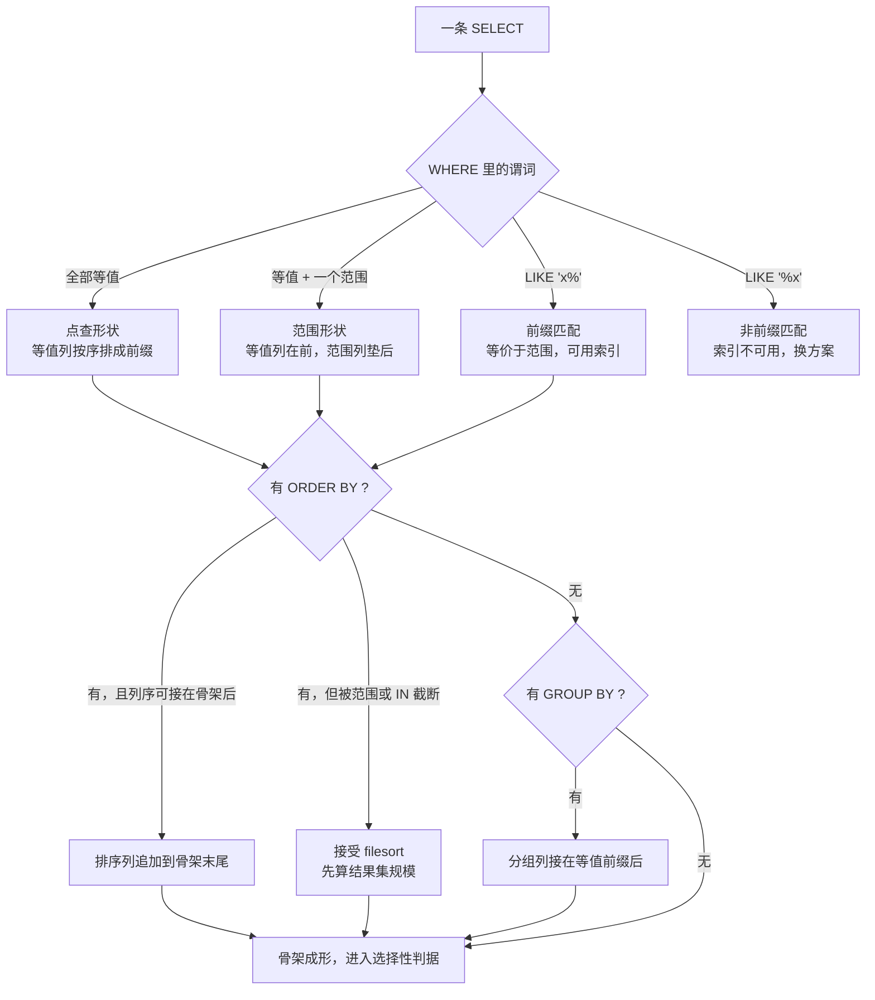
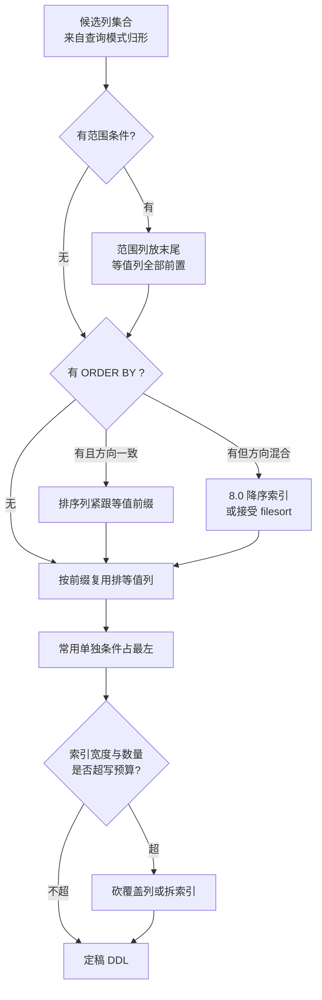
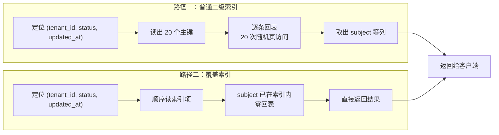
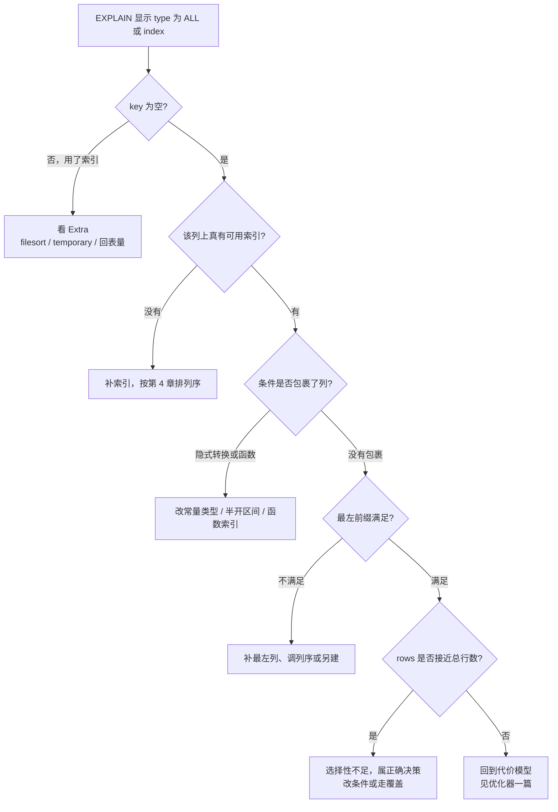

# 01 索引设计实战——从建错索引到建对索引

**摘要：**

索引设计最容易被当成一份规则清单来背：等值在前范围在后、选择性高的在前、最左前缀、覆盖索引、别在函数上建索引。这些规则单看都对，但线上真正难的地方不在记住它们，而在它们互相冲突时谁让谁，以及在什么条件下某条规则干脆不适用。本篇站在应用开发者的位置，把"该建哪个索引"拆成一道有先后顺序的判断题：先用查询模式把语句归形，算出索引骨架；再用选择性判断这个骨架能把候选集缩到多小；然后用覆盖能力判断能否省掉回表；最后用写代价判断它是否配得上所占用的一份预算。四步之后才是落地细节：复合索引的列序三原则、最左前缀的组合边界、前缀索引的长度试算、排序能否借用索引，以及六个导致索引用不上的写法与各自的改法。每条结论都配一个反例与一次改写，落点不在"记住规则"，而在"对着一条真实 SQL 能推出该建什么、不该建什么"，以及为什么。

---

## 第 1 章 建索引是一道有顺序的判断题

本篇讨论的索引只限一类：InnoDB 表上为加速 `SELECT` 而建的 B+Tree 二级索引，包含单列、复合、前缀、覆盖四种用法。分区的本地索引、全文倒排索引、空间索引各有各的规则，不在这条射程内；索引的物理结构、页分裂与碎片在 [[中间件/MySQL/MySQL架构与底层原理/05 InnoDB 索引结构——B+Tree 的工程哲学与页分裂机制|架构列 05]] 里已经从运行期角度拆过，此处只当已知前提取用。

`CREATE INDEX` 的语法只有一行，真正决定成败的动作发生在写 DDL 之前：先想清楚这条语句要索引替它做什么，再判断这份索引值不值得占掉写入路径上的一份开销。判断有先后，取舍才有依据。

### 1.1 两条 SQL 抢一个索引

笔者见过一张工单表上挂着九个二级索引，其中四个在任何一条热门 SQL 的 `EXPLAIN` 里都没出现过，写入延迟却随索引数量一起涨。问题不在索引建少了，而在索引照着列建、没照着查询建。

先看两条真实存在的语句。一条来自客户门户的工单列表：

```sql
SELECT id, subject, status, updated_at
  FROM support.ticket
 WHERE tenant_id = 10241
   AND status = 3
 ORDER BY updated_at DESC
 LIMIT 20;
```

另一条来自坐席工作台：

```sql
SELECT id, subject, priority
  FROM support.ticket
 WHERE assignee_id = 778
   AND status IN (1, 2)
 ORDER BY priority DESC, created_at DESC
 LIMIT 50;
```

按"哪个列被 `WHERE` 提到就给它建单列索引"的思路，会得到 `tenant_id`、`status`、`assignee_id` 三个索引。第一条语句能走 `tenant_id`，但这个租户名下有几十万行，索引只把区间圈出来，`status` 还要逐行过滤，`ORDER BY updated_at` 依然要排序，`LIMIT 20` 提前终止不了；第二条能走 `assignee_id`，命中几千行，排序在内存里做完，看着还过得去。

换成复合索引 `(tenant_id, status, updated_at)`，第一条语句从前缀定位到排序全部打通，`LIMIT 20` 读到 20 行就能停。第二条语句毫无变化，因为它要的是另一个形状。于是有人接着补 `(assignee_id, status, priority, created_at)`，两条都快了，写入却慢了——每个 `INSERT` 要维护三棵二级 B+Tree，外加两个索引里重复存放的长字符串列。

到这里，分歧的形态就清楚了：索引不是列的附属属性，它是某几条**查询形状**的专属基础设施；而一张表能承载的**索引预算**有上限，所以建索引的第一步不是写 DDL，而是给查询排队。

### 1.2 四个判据与它们的顺序

四个判据要依次用，顺序不能颠倒。

第一个判据是查询模式，回答"这条语句要求索引提供什么"：可能只要定位（点查），可能要定位加过滤（范围），可能要承接排序或分组，也可能希望连回表都省掉（覆盖）。同一条语句通常同时提几个要求，骨架就是把这些要求按列摆出来。

第二个判据是选择性（Selectivity），回答"这棵树能把候选集缩到多小"，它决定了索引扫描之后还剩多少行要回表，也决定了优化器愿不愿意用它；这一项算错，后两个判据一起作废。

第三个判据是覆盖能力，回答"能不能不回表"，它决定同一次查询里那些随机页访问要不要发生，代价是索引变宽。

第四个判据是写代价，回答"这份索引配不配得上预算"。读的收益是可见的延迟下降，写的成本是隐形的：每次增删改都要维护多一棵树，redo 与 binlog 跟着涨，从库回放跟着变慢。

顺序之所以重要，是因为前两个判据决定"能不能用"，第三个决定"用得多好"，第四个决定"值不值得"。反过来先算写代价，人会不自觉地保守，该建的索引不敢建，慢查询月月复发；只看读收益，索引会越建越多，最后每次写入都在维护一堆没人用的树。四步走完，一份索引才算同时通过了可行性与经济性两道关。

| 判据 | 回答的问题 | 用什么量 | 判错的后果 |
| :--- | :--- | :--- | :--- |
| 查询模式 | 索引要提供定位、过滤、排序还是覆盖 | `WHERE`／`ORDER BY`／`GROUP BY` 的列组合 | 建出与语句形状错位的索引，`EXPLAIN` 里 `key` 为空 |
| 选择性 | 候选集能缩到多小 | `COUNT(DISTINCT col) / COUNT(*)`，或条件命中行数占比 | 索引被优化器主动放弃，或回表次数吃光收益 |
| 覆盖能力 | 能不能不回表 | `Extra` 是否出现 `Using index` | 省不下随机 IO，却先付了索引变宽的代价 |
| 写代价 | 占一份预算值不值 | 索引数量、索引宽度、读写比 | 读没快多少，写路径与从库延迟先恶化 |

下面的图把四步摆成一条推进路线，注意它在"写代价"这一步会回头修正前面三步的结论：预算不够时，要退回去砍掉收益最低的那份覆盖。



### 1.3 贯穿案例与数字口径

后面的篇幅用同一张表承载所有推导，避免每节换一个例子导致结论不可比。表名 `support.ticket`，某 SaaS 客服系统的工单表，约 3000 万行，主键是 `BIGINT` 自增，日增约 8 万行，读写比大致 6:1。几个关键列：`tenant_id` 是租户编号，约 4 万个租户；`assignee_id` 是坐席编号，约 3000 个坐席；`status` 是 `TINYINT`，只有六个取值；`channel` 是来源渠道，三个取值；`subject` 是 `VARCHAR(200)` 的标题；`updated_at` 与 `created_at` 是 `DATETIME`；`priority` 是 `TINYINT` 的优先级。表上现有九个二级索引，其中四个来自三年前那次"把 `WHERE` 里出现的列都建上索引"的改造。

需要在这张表上跑的五类查询，后文反复引用：

| 编号 | 来源 | 语句要点 |
| :--- | :--- | :--- |
| Q1 | 客户门户列表 | `WHERE tenant_id = ? AND status = ? ORDER BY updated_at DESC LIMIT 20` |
| Q2 | 坐席工作台 | `WHERE assignee_id = ? AND status IN (1,2) ORDER BY priority DESC, created_at DESC LIMIT 50` |
| Q3 | 渠道报表 | `WHERE created_at BETWEEN ? AND ? AND channel = ?`，聚合后出数 |
| Q4 | 关键词搜索 | `WHERE subject LIKE '%退款%'` |
| Q5 | 幂等校验 | `WHERE tenant_id = ? AND external_id = ?` |

数字口径先说清楚：本文出现的页数、容量、IO 次数一律是示例推算，用来说明数量级关系，不是基准测试结果；参数默认值以 MySQL 8.0 文档为准，8.4 若有变化以对应版本文档为准。凡是"经验上""通常"这类措辞，指的是工程区间而不是精确阈值，换一种硬件与数据分布就该重新量一遍。

---

## 第 2 章 判据一：查询模式

### 2.1 把语句归成四种形状

判断查询模式的第一件事，是把语句拆成谓词、排序、投影三段，再看谓词段能组成什么形状。工程上常见的形状只有四种，分类的依据是"等值条件在前、最多一个范围"这个骨架能不能拼出来。

第一种是点查：谓词全是等值，命中个位数到几十行，例如 Q5 的 `tenant_id` 加 `external_id`，理想索引是把等值列按顺序排好。第二种是范围加排序，例如 Q1 的等值前缀加 `updated_at` 排序，理想索引是等值列在前、排序列在后。第三种是前缀匹配，例如 `subject LIKE '退款%'`，本质是范围查询，能用索引；Q4 的 `LIKE '%退款%'` 不是范围，第 5 章说明原因。第四种是聚合分组，例如 `GROUP BY status` 加 `COUNT(*)`，理想索引是分组列在前，配合覆盖索引做成只读索引扫描。

四类之外还有一类混合体：谓词里有等值、有范围、有 `IN`、还要排序，这种语句最常见，也最容易把设计带偏。处理办法不是找一份万能索引，而是先算每种形状各需要什么，再看能否用同一个前缀骨架同时服务几种。

### 2.2 从一个形状折出索引骨架

以 Q1 为例逐列问一遍：`tenant_id = 10241` 是等值，作用是把范围从 3000 万行收窄到某个租户的几十万行；`status = 3` 也是等值，在租户内再收窄到几千行；`updated_at` 没有条件，只出现在 `ORDER BY` 里，作用是让结果按时间倒序，而倒序加 `LIMIT 20` 意味着只要索引有序，读完 20 行就能停。三个列的作用正好对应**索引骨架**的三个位置：等值列在前，排序列在后，得到 `(tenant_id, status, updated_at)`。

如果把 `updated_at` 换成 `created_at`，骨架就变成 `(tenant_id, status, created_at)`，是另一份索引。常见浪费是"两种排序都支持"——建两份前缀相同、只有尾列不同的索引，能服务的语句集合几乎一样，写代价却翻倍。更实际的选择是把排序口径统一到一个字段，或让其中一种排序走 `filesort`：在几千行的结果集上，内存排序的代价远低于多养一棵树。

骨架拼出来之后还要回头问一句：`LIMIT 20` 真能提前终止吗？只有当索引顺序与 `ORDER BY` 完全一致、且没有前导范围截断时，优化器才能在读到 20 行后停下；否则要先取出全部匹配行排序再截取，同一个 `LIMIT` 的代价能差出几个数量级。

### 2.3 分组也要靠有序性

`GROUP BY` 常被当成与索引无关的语法，其实它比 `ORDER BY` 更依赖索引的有序性。MySQL 8.0 移除了 `GROUP BY` 的隐式排序行为，分组结果不再自动按分组列排序，但分组这个动作本身仍要解决"把相同的值归到一起"，而这正是索引顺序能提供的。没有可用的有序结构，优化器只能建临时表再聚合，`Extra` 里出现 `Using temporary`。

以 `SELECT status, COUNT(*) FROM support.ticket WHERE tenant_id = ? GROUP BY status` 为例，`(tenant_id, status)` 这个前缀能让引擎在租户范围内按 `status` 顺序读，边走边累计，不需要临时表；若索引建成 `(status, tenant_id)`，按 `status` 分组仍能借到顺序，但租户条件退化为逐项过滤，扫描量从几百行涨到全表级。这也是列序影响面比想象中大的原因：它不只影响定位，还影响排序与分组能否顺势完成。

同一个 `(tenant_id, status, updated_at)` 还能顺手服务 `SELECT COUNT(*) FROM support.ticket WHERE tenant_id = ?`，因为最左前缀已经在索引里。表上那些"疑似有用"的单列索引，往往就是某个复合索引的最左前缀，属于纯粹的重复。

### 2.4 等值集合不等于范围：`IN` 的真实行为

`IN` 是列序设计里最容易被误判的谓词。`status IN (1, 2)` 不是范围，而是两个等值的并集，优化器把它拆成多个区间分别定位。这带来两个相反的效果：`IN` 之后的列仍能参与索引定位，`(assignee_id, status, priority)` 上 `assignee_id = ? AND status IN (1,2) AND priority > ?` 可以在两个状态内部继续用 `priority` 定位；但 `IN` 会让排序失效，因为索引在 `status = 1` 与 `status = 2` 两段内部各自有序，合并之后整体无序。

Q2 正撞在这条上。建 `(assignee_id, status, priority, created_at)` 定位精确，但排序要 `filesort`，`LIMIT 50` 无法提前终止；建 `(assignee_id, priority, created_at)` 排序顺手、读到 50 行就停，但 `status IN (1,2)` 只能回表后过滤，扫描行数被放大。

选择依据是结果集规模。一个坐席名下通常几百到几千条工单，走后者扫描几千行、丢掉一部分，代价可控；若某个坐席积累上万条，回表过滤的浪费会盖过排序收益，这时该改数据而不是改索引：把已关闭工单归档到历史表，让 `IN` 的取值收敛到一两个。

下面这张图把"归形"这一步的判定顺序画出来，四种形状的分叉点在于谓词能否拼出等值前缀，以及排序、分组能否接在它后面。



### 2.5 模式判据的边界

查询模式这一层给出的只是**骨架**，边界有三处。一是语句形状太多：后台管理系统可能对同一张表发出十几种组合，穷举会得到十几份索引，预算不够，只能先按调用频率与延迟要求排序，只服务头部形状。二是语句会被改写：ORM 习惯把条件拼成 `AND (a = ? OR b = ?)`、在列上套 `DATE()`、用 `IN` 代替范围，设计之前要拿到真实执行的 SQL，否则骨架会建在一个不存在的形状上。三是数据分布会变：为"活跃工单占 5%"设计的等值条件，在活跃工单涨到四成之后收益明显缩水，骨架不必改，收益评估要定期重做。

---

## 第 3 章 判据二：选择性

### 3.1 一个比值与它的算法

选择性（Selectivity）是区分度的量化指标，定义为不同值的数量占总行数的比例：

```sql
SELECT COUNT(DISTINCT status) / COUNT(*)    AS sel_status,
       COUNT(DISTINCT tenant_id) / COUNT(*) AS sel_tenant,
       COUNT(DISTINCT external_id) / COUNT(*) AS sel_external
  FROM support.ticket;
```

在 `support.ticket` 上，`status` 的比值约等于 0.0000002，`tenant_id` 约 0.0013，`external_id` 接近唯一。单看这三个数，只有 `external_id` 像是值得建索引的列；可 Q1 只靠 `tenant_id` 加 `status` 就能把候选集收窄到一百多行，矛盾在组合。`tenant_id` 单列命中约 750 行，`status` 单列命中约 500 万行，两者组合之后约 125 行。

索引要服务的从来不是某一列的选择性，而是某一组谓词把候选集压到多小，所以正确口径是条件的联合区分度：

```sql
SELECT COUNT(DISTINCT CONCAT(tenant_id, ':', status)) / COUNT(*) AS sel_pair
  FROM support.ticket;
```

比比值更好用的是直接数行数，看条件能命中多少行、这些行要不要回表：

```sql
SELECT COUNT(*) FROM support.ticket WHERE tenant_id = 10241 AND status = 3;
```

### 3.2 选择性是条件的属性

把选择性还原成"条件命中行数"之后，复合索引的列序设计就多了一个可算的量：每一列在前一列已经收窄的基础上，还能再收窄多少。`status` 单列看是低选择性列，放在 `tenant_id` 之后，它把一个租户的 750 行再缩到 125 行，边际收益是六倍；把它放到最左边，它只能先把 3000 万缩到 500 万，收窄同样是六分之一，但剩下的 500 万行仍要逐项比对。

这个"边际"视角能解释一件常被忽略的事：低选择性列不是不能进索引，而是不能单独当骨架的起点。`status` 单独建索引，命中 500 万行还要回表，优化器几乎必然放弃；`(tenant_id, status)` 里它是第二列，只在前缀范围内做一次逐项比对，代价微乎其微。同理，`is_deleted`、`channel`、`type` 这类只有几个取值的列，在复合索引的尾部往往是有用的过滤位，在头部则是纯粹的负担。

判断边际收益时还有一个陷阱：平均值不代表每个参数。`tenant_id` 平均一个租户 750 行，但头部大租户可能各占几十万行，同一个索引对平均租户收到 125 行、对大租户收到几万行，收益差几百倍。8.0 的直方图（Histogram）能让优化器认识这种倾斜：

```sql
ANALYZE TABLE support.ticket UPDATE HISTOGRAM ON tenant_id WITH 100 BUCKETS;
```

但直方图只影响估算，不改变索引结构。真正的解法在数据侧：大租户分库分表，或走专用查询路径（路由见 [[中间件/MySQL/MySQL进阶使用/06 分库分表——何时做、怎么做、做了之后怎么办|进阶 06]]）。指望一份索引同时服务均匀租户与超级租户，等于要求优化器为每个参数值挑一个不同的计划，而它做不到。

### 3.3 三条使用边界

第一个边界是回表成本。同样命中 1000 行，走二级索引要付 1000 次随机页访问，走全表扫描是顺序读若干页；命中比例越高，顺序读越占优。这是优化器放弃索引的根本原因，与"索引失效"是两件事，第 8 章会把它们分开。

第二个边界是覆盖能力。命中 5 万行的低选择性条件，若 SELECT 与 WHERE 涉及的列全在索引里，一次索引顺序扫描就能出结果，代价从 5 万次随机读变成几千个索引页的顺序读；低选择性反而不致命，瓶颈从随机 IO 转到顺序带宽。低选择性加重覆盖，会得到一份"看起来不该建、实际很好用"的索引。

第三个边界是唯一性对写路径的影响。唯一索引的写入必须校验冲突，无法借用插入缓冲（Change Buffer），每次插入都要读目标页；普通索引可以延迟合并。这属于第 7 章的写代价，此处只记住一个判据：业务上真需要唯一性才建唯一索引，为了"查询快一点"而给一张写密集表加唯一索引，往往拆东墙补西墙。

工程上常用的经验区间大致如下表，它的用途是快速排除明显不划算的候选，而不是替代实测；换一套硬件、换一种数据分布，临界点都会移动。

| 条件命中行数占表比例 | 优化器的典型选择 | 说明 |
| :--- | :--- | :--- |
| 低于千分之一 | 优先走索引 | 回表次数有限，随机 IO 远少于全表顺序扫描 |
| 千分之一到百分之一 | 视回表成本而定 | 覆盖索引明显占优，非覆盖索引要看页的聚集程度 |
| 百分之一到一成 | 只有覆盖索引才稳定 | 非覆盖索引的回表次数开始压过顺序扫描 |
| 超过一到两成 | 倾向全表扫描 | 顺序读的优势压过索引，硬加 `FORCE INDEX` 常常更慢 |

> [!warning] 口径提醒
> 上表的比例是经验区间，不是优化器的硬阈值。真实的临界点由代价模型按页数、行宽、`innodb_page_size`、统计信息共同算出，判据应当落在 `EXPLAIN` 的 `rows` 与 `filtered` 上，而不是落在这张表的行号上。

---

## 第 4 章 复合索引的列序三原则

列序一旦定下就无法事后微调，改列序等于重建一棵树，大表上就是一次在线 DDL；而列序错位的代价不会立刻显现，只是查询比预期慢一截，慢到没人愿意为它排期。三原则就是用来在动手之前把列序定下来的。

### 4.1 原则一：等值条件在前，范围条件在后

先看一个最小的反例。假设有列 `a` 与 `b`，查询是 `WHERE a = ? AND b > ?`，两个候选索引 `(a, b)` 与 `(b, a)`，后者在语法上完全合法，也常常被随手建出来。

`(a, b)` 上的执行过程是：用 `a` 的等值条件在 B+Tree 里定位到一个连续区间，这个区间里所有记录的 `a` 都相同、`b` 按升序排列，于是 `b > ?` 直接在这个区间内部做一次范围定位，扫描的起点与终点都精确。扫描的索引项数量等于"满足两个条件的行数"。

`(b, a)` 上的执行过程完全不同：最左列 `b` 只有范围条件，引擎只能把 `b > ?` 的全部区间圈出来，其中每一条记录的 `a` 值都要逐项比对；`a` 的等值条件无法用来缩小扫描区间，只能当作过滤条件，或者在索引下推（Index Condition Pushdown）生效时在引擎层提前过滤掉一部分。扫描的索引项数量等于"满足 `b > ?` 的行数"，可能比真正命中的行数大一到两个数量级。

这就是原则一的全部理由：范围条件的作用是划定一条连续的扫描带，它一旦出现在最左列，扫描带宽度就由它单独决定；等值条件出现在最左列，扫描带宽度由"等值列的取值 + 后续范围"共同决定，收窄得最彻底。把范围列放在末尾，可以让它只作用于最后一维，前面每一维都已经由等值条件钉死。

边界也要说清。`IN` 不算范围，它是若干等值的并集，放在中间列仍允许后续列继续定位，只是排序会断（2.4 节已说明）。`BETWEEN`、`>`、`<`、`LIKE 'x%'` 都算范围，出现在哪一列，后续列就失去定位能力。8.0.13 起优化器提供**跳跃扫描**（Skip Scan），在最左列基数足够低时 `(b, a)` 也可能被用上，`EXPLAIN` 里 `type` 为 `range`、`key` 就是该索引；但它靠枚举最左列的不同取值来补救，基数一高就退化，不能当设计依据。

### 4.2 原则二：选择性高的在前，但优先级低于原则一

"把选择性最高的列放最前面"大概是流传最广的一条索引建议，它的方向大体没错，但它被当成了第一原则，而真正的第一原则是上一条。把优先级搞反的后果很具体：很多团队面对 `WHERE status = ? AND tenant_id = ?` 时，会因为 `tenant_id` 选择性高而建出 `(tenant_id, status)`，这一步碰巧是对的；但面对 `WHERE status = ? AND updated_at > ?` 时，同样的思路会推出 `(updated_at, status)`，因为时间戳的选择性接近 1，结果扫描带被 `updated_at > ?` 撑到全表的大部分，慢得莫名其妙。此时正确的建法是 `(status, updated_at)`，等值列在前，范围列垫后，与选择性排序的结论正好相反。

为什么两列都是等值条件时，列序对定位精度几乎没有影响？因为 B+Tree 的定位不是"先按第一列截一刀、再按第二列截一刀"，而是一次性按索引定义的全部等值列算出唯一键位置。`(tenant_id, status)` 与 `(status, tenant_id)` 上执行 `tenant_id = ? AND status = ?`，优化结果都是同一个点区间，扫描的索引项数量一样。有差别的只有两处：**前缀复用**与估算精度。

**前缀复用**的用处正在这里：只有把 `tenant_id` 放最左，`WHERE tenant_id = ?` 这种只带一列的语句才能复用它；反过来把 `status` 放最左，只带 `tenant_id` 的语句就得另建一份。高选择性列更常单独出现，也更适合占最左位置——理由不是"选择性高所以先截断"，而是"常单独出现所以要占最左"。

两条原则的分工因此是清楚的：原则一决定扫描带宽，管"扫描多少索引项"；原则二在两个列都是等值（或都是范围）时决定前缀复用与估算精度，管"这份索引还能顺手服务谁"。前者错了，性能差一到两个数量级；后者错了，性能差不多，只是多养一份索引。所以原则一的优先级高于原则二，顺序不能互换。

### 4.3 原则三：`ORDER BY` 的列要与索引顺序一致

第三条原则处理排序。索引本身是有序结构，`ORDER BY` 要的也是有序结果，两者能对上就能省掉一次排序，对不上就是 `Using filesort`。对上的条件比想象中严格，要同时满足四条：`ORDER BY` 之前的索引列必须全部是等值条件；`ORDER BY` 的列必须在索引里连续且顺序一致；排序方向要一致；排序列前面不能有范围条件截断。

`(tenant_id, updated_at)` 上，`WHERE tenant_id = ? ORDER BY updated_at DESC` 完全对上：`tenant_id` 定死之后，索引在租户内按 `updated_at` 升序排列，反向扫描就是降序。单列方向反转不需要专门的降序索引，B+Tree 的叶子链表可以双向遍历，这是很早以前就有的能力。`WHERE tenant_id = ? ORDER BY created_at` 对不上，因为索引里没有 `created_at`，只能把租户的行全部取出来再排。

方向不一致才是 8.0 之前真正的死角。`ORDER BY priority DESC, created_at ASC` 要求索引在这两列上的排列方向正好相反，而 8.0 之前的索引只能全部升序，反向扫描又把两列一起反转，无论如何都对不上，只能 `filesort`。8.0 引入了真正的**降序索引**，索引定义里可以为每一列单独指定方向：

```sql
ALTER TABLE support.ticket
  ADD INDEX idx_assignee_priority (assignee_id, priority DESC, created_at ASC);
```

这份索引对 `WHERE assignee_id = ? ORDER BY priority DESC, created_at ASC` 就是有序的，也能反向扫描服务 `priority ASC, created_at DESC`。要知道 5.7 及更早版本虽然接受 `DESC` 关键字，但会静默忽略、按升序建索引，所以同一句 DDL 在两个版本上的效果并不相同；从旧版本迁移过来的表，索引定义里的 `DESC` 值得逐条复核一遍。

### 4.4 三原则冲突时谁让谁

三条原则在真实语句上经常互相拉扯：排序列要求它紧跟等值前缀，选择性又要求另一列优先；范围列垫后，但它在 `ORDER BY` 里又要承接排序。裁决的办法是给冲突排一个优先级，而不是找一份"全都满足"的索引——多数情况下不存在这样的索引。

下面的表列出四类常见冲突与裁决结果，理由一列写的是代价的方向。

| 冲突场景 | 让谁 | 理由 |
| :--- | :--- | :--- |
| 范围列选择性极高，但它必须垫后 | 原则一优先 | 范围列提前会让扫描带由它单独决定，收窄效果全失 |
| 排序列与选择性高的等值列争位置 | 排序列接在等值前缀之后 | 排序省下的是结果集规模量级的开销，选择性只影响前缀复用 |
| 两个等值列都常用，谁占最左 | 更常单独出现的那列占最左 | 最左位置决定前缀复用面，选择性只影响估算精度 |
| 排序承接与范围定位不可兼得 | 按调用频率与结果集规模加权 | 结果集小则 `filesort` 可接受，结果集大则优先保排序 |

裁决之后还要回到第 1 章那张图复核写代价：一份同时接了排序、又接了范围、还顺手覆盖了几列的索引会相当宽，它的收益必须明显高于同等的两份窄索引，否则不如拆开。

下面的图把裁决过程画成一条自左向右的判定链，前三步决定骨架，最后一步回到预算。



---

## 第 5 章 最左前缀的真实含义

### 5.1 一条规则，三种解读

**最左前缀**常被讲成"索引只能从左往右用"，于是被理解成"`WHERE` 条件要按索引列的顺序写"。这个理解错在两处：条件的书写顺序与执行顺序无关，优化器会自行重排；真正受约束的是索引定义顺序与条件覆盖的连续性，缺了中间一列，后面那些列就只能过滤、不能定位。

准确的说法要回到索引内部的排序结构。`(a, b, c)` 这棵索引先按 `a` 排序，`a` 相同再按 `b`，`b` 相同再按 `c`。想靠一次连续区间定位缩小扫描的查询，条件必须在某一维上形成**连续切片**，而切片只能从第一维开始：缺了 `a`，`b` 的全局有序性不成立；`a` 用了范围，`b` 的切片只在每个 `a` 值内部成立，跨 `a` 值就不连续了。所以"最左"约束的不是写法，而是切片能否连续。

### 5.2 完整组合表

把 `(a, b, c)` 上可能出现的条件组合列全，可以得到一张判定表。"定位"指能利用 B+Tree 的有序性缩小扫描区间，"过滤"指只能在已扫描的记录上逐项比对，"排序"指 `ORDER BY` 能否直接借用索引顺序。

| 条件组合 | 定位用到的列 | 能否借索引排序 | 说明 |
| :--- | :--- | :--- | :--- |
| `a = ?` | `a` | 否 | 扫描区间由 `a` 决定，`b`、`c` 完全不可用 |
| `a = ? AND b = ?` | `a`、`b` | 否 | 两列等值，一次定位到点区间 |
| `a = ? AND b = ? AND c = ?` | 三列 | 否 | 三列等值一次定位到点区间，`key_len` 覆盖全部三列 |
| `a = ? AND b > ?` | `a`、`b` | 否 | `c` 不能定位，可过滤或覆盖 |
| `a = ? AND b = ? AND c > ?` | 三列 | 否 | 范围落在最后一维，收窄最彻底 |
| `a > ?` | `a` | 否 | 扫描带由 `a` 单独决定，后续列全失效 |
| `a = ? AND c = ?` | `a` | 否 | 缺 `b`，`c` 只能过滤（8.0 可下推） |
| `b = ?` | 无 | 否 | 缺最左列，索引不可用；基数极低时可能跳跃扫描 |
| `b = ? AND c = ?` | 无 | 否 | 同上，缺 `a` 就无法连续定位 |
| `a = ? ORDER BY b` | `a` | 是 | 等值前缀定死，`b` 顺序即为结果顺序 |
| `a = ? ORDER BY c` | `a` | 否 | 排序跳过了 `b`，只能 `filesort` |
| `a = ? AND b > ? ORDER BY c` | `a`、`b` | 否 | 范围截断，`c` 在区间内不保证有序 |
| `a IN (1, 2) AND b = ?` | `a`、`b` | 否 | 多段区间分别定位，合并后无序 |
| `a = ? AND b IN (1, 2) ORDER BY c` | 三列 | 否 | 定位可用，排序因 `b` 多值而失效 |

这张表值得对着第 4 章的三原则读一遍：带范围的行是原则一的直接体现，`ORDER BY` 那几行对应原则三，而"能不能定位"这一列与选择性无关——它只取决于连续性。

### 5.3 范围之后：定位断了，过滤还在

"范围列之后的列用不上索引"需要一次澄清，否则容易走向另一个极端。准确定义是：范围之后的列不能再参与**定位**，但可以参与过滤与覆盖。

过滤对应**索引下推**。没有 ICP 时，引擎按索引扫描出范围记录的主键，逐条回表，再由 Server 层对 `b`、`c` 判断；有 ICP 时，`WHERE` 中属于索引列、却不在定位前缀里的条件下推到引擎，在索引项上先比一遍，不合格的不回表。`Extra` 出现 `Using index condition` 说明这一步生效，它减少的是回表次数，不改变扫描区间宽度。

覆盖是另一种省法：范围之后的列值就在索引里，`SELECT` 若只取这些列，整条查询可以不回表，随机 IO 一次都不发生，代价退化为顺序读索引页。

### 5.4 `LIKE` 的两种形态

`LIKE` 能不能用索引，取决于通配符的位置，而这条规则的本质仍然是"能不能划出连续区间"。

`LIKE '退款%'` 是前缀匹配，等价于 `subject >= '退款' AND subject < '退款' + 下一个字符`，在按 `subject` 排序的索引上是一段连续区间，可以用索引。`LIKE '%退款%'` 与 `LIKE '%退款'` 找不到这样的区间：所有包含"退款"的值散落在索引各处，引擎只能整棵索引扫一遍，逐项做字符串匹配，`type` 会退化成 `index` 甚至 `ALL`。`LIKE '退款%2026'` 介于两者之间，只有开头的"退款"能形成区间，后面的部分只能过滤。

一个容易忽略的细节：8.0 默认排序规则 `utf8mb4_0900_ai_ci` 不区分大小写，`LIKE 'abc%'` 也会匹配以 `ABC` 开头的值，索引依然可用。若列与比较值的排序规则不同，比较会在转换之后进行，索引可能失效——这属于字符集层面的隐式转换。

Q4 属于第二种形态，索引帮不上忙。可选的出路有三条：把关键词拆成标签列，让标签走等值或前缀匹配；把字符串反转后另存一列，把后缀搜索变成前缀搜索；把这类查询整体挪到全文索引或外部搜索引擎。三条路的代价依次上升，判据是"这类查询的 QPS 与结果集规模"——低频的后台搜索可以接受全表扫或离线导出，高频的搜索就不该压在 OLTP 表上（搜索方案与缓存的分工见 [[中间件/MySQL/MySQL进阶使用/08 MySQL 与缓存的协作模式——Cache Aside 到数据一致性|进阶 08]]）。

### 5.5 跳跃扫描：是补丁，不是设计依据

MySQL 8.0.13 起，优化器多了一种叫跳跃扫描（Skip Scan）的访问方式，让 `(a, b)` 这种索引也能服务"只带 `b`"的查询：当最左列 `a` 的不同取值很少时，优化器可以枚举 `a` 的每一个值，在每个值内部用 `b` 的条件定位一次，最后把若干段结果合并。它把"缺最左列就完全不可用"变成了"最左列基数低时可用"，`EXPLAIN` 里表现为 `type` 为 `range`、`key` 正是那份复合索引。

但它有个与生俱来的代价：定位次数等于最左列的不同取值个数，每次定位都要从根走到叶子。`a` 有 6 个值时是 6 次定位，可以接受；有 4 万个值时是 4 万次，不如全表扫。它的适应面因此很窄——最左列基数低、后续列选择性高、表不大，三者同时成立。把它当成"最左前缀不用管了"的理由，在真实业务表上多半要翻车。

`optimizer_switch` 里的 `skip_scan` 可以开关这个特性，默认开启。若某条语句因为跳跃扫描反而变慢，可以从执行计划的 `rows` 与实际扫描量上认出来：`rows` 估得很小、实际 `Handler_read_next` 增量很大。

### 5.6 两个容易混淆的"最左"

本章讲的索引列顺序，与前缀索引截取的字符串左端，都用"最左"这个词，含义完全不同：前者约束查询条件必须覆盖索引的前若干**列**，后者约束索引只存字符串的前若干**字符**。混为一谈会得出"`LIKE '退款%'` 在前缀索引上照样能用"这类半对结论——它能定位，但不能覆盖、不能保证排序。

---

## 第 6 章 判据三：覆盖能力

### 6.1 回表是一次随机读

要判断覆盖值不值得，先得把回表的代价说清楚。走二级索引取一行数据分两步：先在二级索引的 B+Tree 上定位到叶子，拿到该行的主键值；再拿主键值去聚簇索引的 B+Tree 上定位一次，取出整行。第二步就是**回表**，它的代价与"命中行数"成正比，而行所在的聚簇索引页通常散落在不同的磁盘位置，每一次都是一次随机页访问。

缓存能缓解但不能消除。聚簇索引的上层节点几乎总在缓冲池里，叶子页则未必：一张 3000 万行、平均行宽几百字节的表，聚簇索引叶子层动辄几十 GB，比多数实例的缓冲池大。命中 1000 行的查询就可能产生 1000 次随机读，延迟被最慢的几次拉长。索引要做的，就是把这些随机读换成对索引页的顺序读。

下面的图把同一条 Q1 的两条执行路径并排放出来，差别只在最后那一步要不要回表。



### 6.2 判据在 `Extra` 里，前提在语句里

覆盖是否生效，判据只有一个：`EXPLAIN` 的 `Extra` 出现 **Using index**。前提比这个标志严格——`SELECT` 列表、`WHERE` 条件、`ORDER BY` 与 `GROUP BY` 涉及的列必须全部在索引里。任何一列缺失，哪怕只多带一个 `subject`，`Using index` 就消失，回表回来。

`SELECT *` 在这条规则下永远不覆盖，除非所有列都在索引里（那通常意味着索引比表还大，见第 7 章）。这也是"把 `SELECT *` 改成只取需要的列"经常比加索引更有效的原因：它可能让现成的索引从不覆盖变成覆盖，成本为零。

覆盖还要求语句用同一份索引。`WHERE` 走 `idx_a`、`ORDER BY` 却要 `idx_b` 的顺序时，优化器只能二选一，覆盖与排序不能同时成立。

### 6.3 代价在索引宽度上

覆盖的收益是省的，代价是付的，付在索引宽度上。每多一列，索引项就宽一点，同一个 16KB 页能放的记录就少一点。InnoDB 在顺序插入时为每页预留约十六分之一的空间，按这个规则估算，一页可用的记录空间约 15KB。

以 `(tenant_id, status, updated_at)` 为例：`tenant_id` 是 `BIGINT` 占 8 字节，`status` 是 `TINYINT` 占 1 字节，`updated_at` 是 `DATETIME` 占 5 字节，加上二级索引隐含存放的主键 `id` 8 字节与记录头约 5 字节，一条索引记录约 27 字节，一页约能放 550 条，3000 万行的索引约占 5.5 万页。若把 `subject`（`VARCHAR(200)`，utf8mb4）也加进去，平均长度按 40 字节估，一条记录涨到约 67 字节，一页只能放约 220 条，索引页数涨到 13.6 万页，体积增加一倍半以上。

这是**示例推算**，不是实测：真实页数取决于 `subject` 的长度分布、页内碎片与填充率。推算的用途是给量级感——加一个变长字符串列，索引体积可能翻倍，缓冲池里能容纳的索引页随之减半，其它查询的缓存命中率跟着下降。

### 6.4 多大的表值得为覆盖建索引

判据可以拆成三个数：一次查询平均回表多少行、这些行有多少是冷页、这张表读多还是写多。

回表行数由选择性决定：几百行以内的回表代价可控，覆盖的收益不明显；几万行以上，随机 IO 累积起来就是秒级延迟。冷页比例取决于缓冲池容量与表的热度，命中缓存时回表几乎只花 CPU，覆盖省下的只是一部分内存访问。读写比决定这份索引要付多少写代价：读远多于写的表，加宽索引几乎只赚不赔；写入密集的表，每个 `INSERT` 都要多写这几列。

| 场景 | 回表规模 | 是否值得为覆盖加宽索引 | 主要代价 |
| :--- | :--- | :--- | :--- |
| 点查取整行（`SELECT *`） | 1 到几十行 | 不值得 | 加宽后索引接近表宽，失去意义 |
| 列表页取固定几列 | 几十到几百行 | 视缓存命中而定 | 索引体积上升，写路径变宽 |
| 报表类扫描 | 数万行以上 | 通常值得 | 索引可能翻倍，DDL 窗口变长 |
| 深分页翻页 | 与页码成正比 | 值得，但优先用延迟关联 | 见第 6.5 节 |

### 6.5 覆盖的另一种用法：延迟关联

深分页是覆盖索引最典型的救场场景。`ORDER BY updated_at DESC LIMIT 100000, 20` 的痛处在于 MySQL 要先取 100020 行再丢掉前 10 万行，如果每一行都要回表，代价与页码成正比。**延迟关联**的写法是先在一个覆盖索引上把主键取出来，再回表只取这 20 行：

```sql
SELECT t.*
  FROM support.ticket t
  JOIN (SELECT id FROM support.ticket
         WHERE tenant_id = 10241 AND status = 3
         ORDER BY updated_at DESC
         LIMIT 100000, 20) x ON t.id = x.id;
```

子查询只需要 `id`、`tenant_id`、`status`、`updated_at` 四列，全在索引里，扫描 10 万行索引项不回表；外层再按 20 个主键回表。这条路径省下的正是"10 万次随机读"。分页深翻的其它变体，[[中间件/MySQL/MySQL进阶使用/02 SQL 调优方法论——从 EXPLAIN 到执行计划重写|进阶 02]] 有更完整的拆解。

> [!info] 判据小结
> 覆盖是否值得，先看回表行数是否上千，再看这些行的页是否多半在缓存里，最后看这张表的写读比是否撑得住索引变宽。三个条件都成立时，覆盖索引是全篇性价比最高的手段；任何一个不成立，它的收益都会被写代价或缓存压力吃掉一部分。

---

## 第 7 章 判据四：写代价

### 7.1 一次写入要维护几棵树

前三个判据都在算读的收益，第四个判据算写的成本。每份二级索引都是一棵独立的 B+Tree，写入路径要为每一棵做一次修改：`INSERT` 时在聚簇索引插入整行，再在每个二级索引插入一条"索引列 + 主键"；`DELETE` 时每棵树都要标记删除；`UPDATE` 时 InnoDB 逐列比对，只有被索引引用的列变化才更新对应索引，主键变更等价于删一行再插一行。

索引数量对写入的影响不是线性的，因为它还与"要修改的页是否在缓冲池里"有关。索引越多，写入触碰的页越分散，随机读比例越高，脏页分布也越散，后台刷盘效率随之下降。这就是为什么一张表从五个索引加到十个之后，写入延迟的涨幅往往超过一倍——多出来的不只是五次页修改，还有五次可能未命中缓存的随机读，以及随之放大的**写放大**。

### 7.2 唯一索引与普通索引的写路径差别

两者在写路径上有一个容易被忽略的非对称：唯一索引插入前必须读目标页确认没有冲突，这个读无法省略；普通二级索引的插入可以走**插入缓冲**（Change Buffer），先记在内存里，等后续读到该页时再合并，把多次随机写攒成一次。`innodb_change_buffering` 默认是 `all`，但它只对非唯一二级索引生效——唯一性约束必须在写入时刻就确认，绕不过去。

判据因此很直接：业务上确实需要唯一性（幂等键、单号）时才建唯一索引，它的写代价是必要的代价；只是为了"查询可能更快一点"而给写密集表加唯一索引，属于用写入换一个并不存在的读收益，因为普通索引在等值查询上的定位能力与唯一索引几乎一样，差别只在优化器能否把它当常量处理。Change Buffer 的合并机制与它的失效边界，在 [[中间件/MySQL/读书笔记-Mysql内核架构/05. InnoDB 插入缓冲：从 Insert Buffer 到 Change Buffer 的二十年演进|读书笔记 05]] 里有完整拆解。

### 7.3 给索引数量一个预算

工程上常见的经验是单表二级索引控制在五到六个以内，写密集的表更少。这个数的意义在于提醒：索引是有预算的资源，预算用完要靠删旧换新，而不是无限追加。复查手段是现成的两个视图——`sys.schema_unused_indexes` 列出从未被使用的索引，`sys.schema_redundant_indexes` 列出被更长索引覆盖的冗余索引，两者的读法与"先隐藏再删除"的流程在 [[中间件/MySQL/MySQL架构与底层原理/05 InnoDB 索引结构——B+Tree 的工程哲学与页分裂机制|架构列 05]] 里，这里只取结论。

| 索引数量（二级） | 每次写入的额外页修改 | 主要风险 | 建议 |
| :--- | :--- | :--- | :--- |
| 1 到 3 个 | 少 | 查询覆盖不足，长尾查询走全表扫 | 按查询形状补齐头部语句 |
| 4 到 6 个 | 中等 | 开始出现冗余与前缀重叠 | 定期用 `sys` 视图复查 |
| 7 个以上 | 明显 | 写放大、缓冲池被索引页挤占、DDL 变慢 | 删冗余，合并单列为复合 |

> [!warning] 预算不是配额
> "不超过六个"是经验说法，不是配额指标。读多写少、查询形状确实分散的表，八个索引也可能合理；每秒几千次写入的流水表，四个就可能太多。

---

## 第 8 章 索引失效的六个原因与改法

"索引失效"这个词把两件不同的事混在了一起：一件是索引明明存在、条件也写对了，但引擎就是用不上，这是写法或结构问题；另一件是索引完全可用，优化器算过账之后主动选择不走，这是代价判断的结果。前者要改，后者往往不该改。六个原因里前五个属于前一类，最后一个属于后一类，把它们分开是这一章的主线。

### 8.1 隐式类型转换

最常见的一种。`external_id` 是 `VARCHAR(32)`，查询写成 `WHERE external_id = 20261119001`，数字字面量没有引号，MySQL 在比较时会按规则把两侧都转成浮点数再比，等价于对列施加了 `CAST(external_id AS DOUBLE)`。列被函数包裹之后，B+Tree 上按字符串排好的顺序不再对应转换后的值，索引失效。

```sql
-- 列是 varchar，比较值是数字：列侧被转成 double，索引不可用
EXPLAIN SELECT id FROM support.ticket WHERE external_id = 20261119001;

-- 加上引号，比较在字符串层面进行，索引恢复可用
EXPLAIN SELECT id FROM support.ticket WHERE external_id = '20261119001';
```

这个转换是**不对称**的，方向记反是常见错误：列是整型、比较值是字符串 `'10086'` 时，转换发生在常量一侧，索引照样可用。真正失效的只有"字符列对数字值"这一个方向。工程上更隐蔽的是参数绑定：Java 的 `setLong` 绑到 `VARCHAR` 列、Go 的 `int64` 拼进字符串列、ORM 把 `String` 字段映射成数值类型，都能造出这种查询，而且不报错、结果正确，只是慢。判据是 `EXPLAIN` 的 `type` 从 `ref` 掉到 `ALL`，`key` 为空。

联结两侧的类型或字符集不一致也会触发同样的问题。一张表用 `utf8mb4`、另一张用 `utf8`，联结列上的索引在比较时会做字符集转换，索引失效；跨库迁移之后特别常见，`EXPLAIN` 里表现为被驱动表的 `type` 为 `ALL`。改法是统一字符集与排序规则，而不是加 `FORCE INDEX`。

### 8.2 函数包裹

`WHERE DATE(created_at) = '2026-11-01'`、`WHERE YEAR(created_at) = 2026`、`WHERE LOWER(name) = 'alice'`、`WHERE id + 1 = 100`，都属于对索引列做运算。原因与上一条相同：索引里存的是列的原始值，函数结果在索引中不存在，引擎无法用有序性定位。

改法有两条路。第一条是把运算挪到常量侧，把函数条件改写成范围条件：

```sql
-- 原写法：列被 DATE() 包裹，索引用不上
SELECT COUNT(*) FROM support.ticket WHERE DATE(created_at) = '2026-11-01';

-- 改写成半开区间，两端都是常量，索引可用
SELECT COUNT(*) FROM support.ticket
 WHERE created_at >= '2026-11-01'
   AND created_at <  '2026-11-02';
```

第二条路是 8.0.13 起支持的函数索引，直接把表达式做成索引键：

```sql
ALTER TABLE support.ticket
  ADD INDEX idx_created_date ((DATE(created_at)));
```

语法上要注意外层双括号：内层括号属于表达式，外层才是索引语法的括号，少一层会报错。函数索引不是免费的午餐，它把表达式结果另存一份，写入时要多算一次、多写一份；可用条件也更窄——表达式必须确定性，不能引用子查询或非确定性函数，优化器只认写进索引的那个表达式（`DATE(created_at)` 与 `CAST(created_at AS DATE)` 不通用）。

### 8.3 最左前缀不满足

第三种是结构问题：索引 `(tenant_id, status, updated_at)` 上执行 `WHERE status = 3`，最左列缺失，索引不可用。判据很干净——`possible_keys` 里出现了某份复合索引、`key` 却为空，说明优化器评估过它但用不上。处置只有三条：补上最左列（业务允许时）、调整列序（该查询频率高到值得改索引）、另建一份最左列匹配的索引，代价依次上升。8.0 的跳跃扫描在最左列基数足够低时能兜住一部分，但它不是通用解药，5.5 节已说明适用面。

### 8.4 `OR` 混用

`WHERE tenant_id = ? OR assignee_id = ?` 在只有一个条件有索引时会整体退化为全表扫描，因为一次索引扫描只能沿一棵树走，另一侧的记录无论如何都要另找一遍。两侧都有索引时优化器可能走**索引合并**（Index Merge），把两棵树上取到的结果做并集，`Extra` 里出现 `Using union(...)`。

索引合并并不总是划算：它要分别扫描两份索引、去重、再回表，代价模型认为不如全表扫时就不会触发。更稳的改法是手工拆成两条语句再合并：

```sql
-- 原写法：一侧无索引，整体全表扫
SELECT id, subject FROM support.ticket
 WHERE tenant_id = 10241 OR assignee_id = 778;

-- 拆成两条各自走索引，再合并
SELECT id, subject FROM support.ticket WHERE tenant_id = 10241
UNION ALL
SELECT id, subject FROM support.ticket WHERE assignee_id = 778 AND tenant_id <> 10241;
```

两个细节容易漏。一是 `UNION ALL` 不去重，第二条语句要补上 `tenant_id <> 10241` 排掉重叠，否则同一行出现两次；改用 `UNION` 则会在临时表里做一次去重排序。二是 `LIMIT` 不能简单挪到外面——原来"从并集里取前 20 条"的语义，拆开后变成每条各取 20 条再合并，结果集与顺序都可能变。

### 8.5 `!=` 与 `NOT IN`

`WHERE status != 1` 在技术上可以用索引：引擎把 `status != 1` 拆成两段区间，跳过 `status = 1` 那一段。问题在于"不等于"通常命中表的绝大部分，回表代价压过顺序扫描，优化器于是放弃索引。所以它不属于写法错误，属于条件本身的选择性差，与 8.6 节同源。

`NOT IN` 还多一个正确性陷阱：若子查询返回的集合含 `NULL`，三值逻辑会让整个条件既不真也不假，结果集为空——查询"看起来没报错但返回 0 行"，与索引无关，是 SQL 语义。稳妥的写法是 `NOT EXISTS`，或显式过滤掉 `NULL`：

```sql
-- 有 NULL 风险：子查询里只要出现一个 NULL，结果就为空
SELECT id FROM support.ticket WHERE status NOT IN (SELECT status FROM blacklist);

-- 改成 NOT EXISTS，语义清晰，也便于优化器改写
SELECT t.id FROM support.ticket t
 WHERE NOT EXISTS (SELECT 1 FROM blacklist b WHERE b.status = t.status);
```

### 8.6 选择性太低：不是失效，是正确决策

最后一条最容易被误判。条件命中的行占到表的相当比例时，走索引意味着大量随机回表，代价高于顺序扫全表，优化器选择全表扫描是正确的。判据是三个一起看：`rows` 接近表的实际行数、`filtered` 并不低、`Extra` 里没有 `Using index`；再补一条反证——加上 `FORCE INDEX` 之后更慢。

把它当失效去"修"，常见后果是 `FORCE INDEX` 上线，高峰期比原来更慢，而且掩盖了真正的问题：语句需要的行本来就多。处置方向在语句与数据侧——加更有区分度的过滤条件、用覆盖索引消掉回表、改成分页或分批取数、把报表查询挪到从库或离线链路。第 3 章的阈值表与第 6 章的覆盖判据在这里交汇。

| 原因 | `EXPLAIN` 上的症状 | 改法 | 例外 |
| :--- | :--- | :--- | :--- |
| 隐式类型转换 | `key` 为空，`type` 掉到 `ALL` | 比较值加引号，参数类型与列一致 | 列是整型、常量是字符串时不失效 |
| 函数包裹 | `key` 为空，`possible_keys` 有候选 | 改半开区间、函数索引或生成列 | 函数索引要求确定性表达式 |
| 最左前缀不满足 | `possible_keys` 有、`key` 为空 | 补最左列、调列序、另建索引 | 最左列基数极低时可跳跃扫描 |
| `OR` 混用 | `type` 为 `ALL`，无 `Using union` | 拆 `UNION ALL`，两侧都建索引 | 两侧都有索引且代价合适时 index merge |
| `!=` / `NOT IN` | `type` 为 `ALL`，命中行数占比高 | 改 `NOT EXISTS`、改写为范围 | `NOT IN` 的 `NULL` 问题是语义问题 |
| 选择性太低 | `rows` 接近总行数，`filtered` 高 | 改条件、覆盖索引、分页或换链路 | 这不算失效，不要 `FORCE INDEX` |

下面的图把六因串成一条排查路径：先看索引在不在，再看条件有没有包裹列，再看最左前缀是否满足，最后才归到选择性。



---

## 第 9 章 前缀索引：`KEY (email(20))`

### 9.1 适用面

前缀索引只对字符串列有意义，语法是在列名后加括号写长度，譬如邮箱列上的 `KEY (email(20))`，本案例写 `ADD INDEX idx_subject (subject(12))`。Q4 那条 `LIKE '%退款%'` 用不上任何 B+Tree 索引，但如果另有一类查询是 `LIKE '退款%'`，前缀索引就能接住：`subject(12)` 让引擎在索引前缀上定位到"退款"开头的连续区间，再回表验证完整值。字段该用 `VARCHAR` 还是 `TEXT`、长度开到多少，属于表设计问题，见 [[中间件/MySQL/MySQL进阶使用/05 表设计与数据类型选择——细节决定性能上限|进阶 05]]。

### 9.2 长度怎么定

长度不是拍出来的，是试出来的。做法是先算全列的选择性作为基准，再用不同截断长度逐档比较：

```sql
SELECT COUNT(DISTINCT subject) / COUNT(*)          AS sel_full,
       COUNT(DISTINCT LEFT(subject, 6))  / COUNT(*) AS sel_6,
       COUNT(DISTINCT LEFT(subject, 12)) / COUNT(*) AS sel_12,
       COUNT(DISTINCT LEFT(subject, 24)) / COUNT(*) AS sel_24
  FROM support.ticket;
```

判据是拐点：某个长度之后再翻倍，选择性提升不到一个百分点，就停在前一档。另一个可比的量是前缀冗余率，即"全列不同值数"除以"前缀不同值数"，它等于平均每个前缀上撞了几个不同的完整值，撞得越多，回表验证时要多扫的行越多。

```sql
SELECT COUNT(DISTINCT subject) / COUNT(DISTINCT LEFT(subject, 12)) AS redundancy_12
  FROM support.ticket;
```

不要把平均长度当依据。字符串长度分布通常是长尾的，平均值会被少数超长标题拉高，而索引只关心区分度——两个只有最后几个字不同的标题，截断到十二个字符后完全一样。

### 9.3 三个代价

**不能覆盖**。索引里存的是截断后的前缀，`SELECT subject` 无法从中还原完整值，必须回表；`Using index` 不会出现在这类查询上。这是前缀索引与覆盖索引天然互斥的地方。

**不能保证排序**。截断处相等的那些记录，在前缀索引内部按主键排列，与按完整值排列的顺序不一致，所以 `ORDER BY subject` 无法借用它，`EXPLAIN` 里会看到 `Using filesort`。

**命中被放大**。等值或前缀查询在前缀索引上定位之后，命中的是"前缀相同"的行，比真正相等的行多；多出来的部分要靠回表后比对完整值排除。前缀越短，放大越明显，回表次数随之上升。这三条代价合起来给了一个边界：前缀索引适合"长字符串 + 前缀查询 + 结果集不大"的场景，不适合"要覆盖、要排序、命中量大"的场景。

---

## 第 10 章 索引与排序

`Using filesort` 是执行计划里最容易被误读的标志之一。它并不必然意味着"用磁盘文件排序"：结果集小时排序在 `sort_buffer_size` 里完成，`filesort` 只是"额外排序"的代称；数据量超过缓冲区才会分裂成多段临时文件归并，判据是 `Sort_merge_passes` 的增长。

能否省掉这次排序，取决于四个条件是否同时成立，前面几章分散提过，这里集中成一条判据：`ORDER BY` 之前的索引列必须全是等值条件；排序列必须按索引定义顺序连续出现；排序方向必须一致；排序列之前不能有范围条件。四条缺一，优化器就只能排序。

| 排序写法 | 索引 `(a, b)` | 能否免排序 | 原因 |
| :--- | :--- | :--- | :--- |
| `WHERE a = ? ORDER BY b` | 可用 | 能 | 等值前缀固定，`b` 顺序即结果顺序 |
| `WHERE a = ? ORDER BY b DESC` | 可用 | 能 | 单列反向扫描即可 |
| `WHERE a > ? ORDER BY b` | 部分可用 | 不能 | `a` 是范围，`b` 在每个 `a` 值内部才有序 |
| `WHERE a = ? ORDER BY b, id` | 可用 | 不能 | `id` 不在索引里，需二次排序键 |
| `WHERE a = ? ORDER BY b DESC, id ASC` | 5.7 不接受 | 5.7 不能 / 8.0 能 | 混合方向需要降序索引，5.7 忽略 `DESC` |
| `ORDER BY b` | 不可用 | 不能 | 缺最左列，`b` 全局无序 |

还有一种情形值得单独说：提前终止。当排序能借用索引，`LIMIT 20` 读到 20 行就停；当不能借用，引擎要先把全部匹配行排完再截取，同一个 `LIMIT` 的代价可能差几个数量级。这也解释了为什么"给列表页加排序索引"经常比"加过滤索引"收益更大：过滤索引减少的是候选行数，排序索引减少的是"必须处理完整的候选集"这件事。

---

## 第 11 章 四类反例

前面各章的正向推导可以浓缩成四类最常见的建错方式，它们的共同根因是同一个：把索引当成列的附属属性，而不是查询形状的投影。

| 反例 | 症状 | 改法 |
| :--- | :--- | :--- |
| 给每个 `WHERE` 列建单列索引 | 索引数量多、写入慢，多条件查询仍走 index merge 或全表扫 | 合并为一条按形状排序的复合索引，删掉被前缀覆盖的单列 |
| 复合索引列序随意 | `key` 用上了但 `rows` 很大，或排序仍 `filesort` | 按等值在前、范围在后重排，排序列接在等值前缀之后 |
| 指望 `LIKE '%x'` 走索引 | `type` 为 `ALL`，索引存在但不用 | 改前缀匹配、标签列、反转列，或迁到全文检索 |
| 给选择性约一成的列单独建索引 | 单条件查询不走索引，多条件查询回表过量 | 放进复合索引做过滤位，或做成覆盖索引服务固定投影 |

第二类最值得展开，因为它的失败是静默的。`(status, created_at)` 与 `(created_at, status)` 都能被 `WHERE status = ? AND created_at BETWEEN ? AND ?` 用上，`EXPLAIN` 里都显示 `key` 命中，看起来都"生效了"；但前者的扫描区间是"某个状态的全部行"再按时间过滤，后者是"某个时间段的行"再按状态过滤，扫描量差多少取决于两个条件各命中多少行。列序错了不报错，只让一条本该毫秒级的查询稳定在几百毫秒，而团队看到索引被用上了，就把排查方向转向了别处。

第四类需要一次澄清。给选择性一成的列建单列索引，多数时候不划算，但若查询的投影恰好被这份索引覆盖，它就从"几乎无用的定位索引"变成"只读索引即可完成扫描的覆盖索引"，低选择性反而是优点——全索引扫描比全表扫描窄。判据仍是第 6 章那三个数，而不是列的选择性本身。

---

## 第 12 章 量化：宽度、容量与省下的 IO

设计决策最终要落到数量级上。这一章给三组示例推算，口径统一为：`innodb_page_size` 取默认 16KB，页内可用空间按预留十六分之一估算约 15KB，记录头与变长字段长度标记合计按 5 字节估，所有数字只用于比较大小关系。

第一组是**索引记录宽度**。`BIGINT` 8 字节、`DATETIME` 5 字节、`TINYINT` 1 字节、`INT` 4 字节，`VARCHAR(n)` 的索引项只存实际值加 2 字节长度标记，`utf8mb4` 下字符按 1 到 4 字节计。

| 索引定义 | 记录宽度（示例） | 每页记录数（约） | 3000 万行的页数（约） |
| :--- | :--- | :--- | :--- |
| `(tenant_id, status, updated_at)` | 8 + 1 + 5 + 8 + 5 = 27 | 550 | 5.5 万页 |
| 再加 `assignee_id` | 35 | 420 | 7.1 万页 |
| 再加 `subject`（平均 40 字节） | 67 | 220 | 13.6 万页 |

第二组是覆盖索引省下的 IO。Q1 在平均租户上命中约 125 行，非覆盖路径要回表 125 次；若这些叶子页分散且都不在缓冲池里，就是 125 次随机页读。按单次 0.1 到 0.2 毫秒估算，这部分是十几到几十毫秒；覆盖之后归零，代价是索引页数从 5.5 万涨到 13.6 万页。命中 125 行时这笔交易并不划算；换成报表式的 5 万行，回表变成 5 万次随机读，收益才压倒成本。

第三组是写代价。每次 `INSERT` 触碰的页数大致等于"1 + 二级索引数"，每页修改都要产生 redo，索引项变宽还会提高页分裂概率。索引从 3 个加到 6 个，写入路径的页修改次数大约翻倍——这是量级判断，不是基准结论。

> [!info] 口径
> 这一章所有数字都是示例推算，用途是让"加一个索引"从抽象动作变成可比较的成本。任何真实决策都应在目标库上以 `EXPLAIN`、`Handler_read_*` 增量与写入延迟曲线复核，而不是照搬这里的页数。

---

## 第 13 章 边界：这些判据什么时候不成立

判据都有适用前提，前提一变，结论就要重算。

数据倾斜会让平均选择性失去意义，前文已述。分区表与分库分表是第二个边界：分区表的二级索引默认是本地索引，每个分区一棵树，跨分区查询要逐分区定位；分片之后唯一索引只在分片内保证唯一。只读宽表与报表场景是第三个边界：这类表上覆盖索引性价比最高，甚至可以为一条报表建一份窄索引，因为它几乎不付写代价。

第四个边界是优化器不一定按你的设计执行。统计信息过期、直方图缺失、代价估算偏差，都会让它选错索引；`FORCE INDEX` 能强行扭转，但数据分布一变就可能更差。定位与处置见 [[中间件/MySQL/MySQL架构与底层原理/09 MySQL 查询优化器——从代价模型到执行计划的决策过程|架构列 09]] 与 [[中间件/MySQL/MySQL进阶使用/02 SQL 调优方法论——从 EXPLAIN 到执行计划重写|进阶 02]]。

**版本敏感项**集中在下表，写 DDL 之前值得对照一遍。

| 能力 | 起始版本 | 影响 |
| :--- | :--- | :--- |
| 真正的降序索引 | 8.0 | 8.0 之前索引定义里的 `DESC` 被忽略，混合方向排序只能 `filesort` |
| 函数索引 | 8.0.13 | 可为表达式建索引，缓解函数包裹导致的失效 |
| 跳跃扫描 | 8.0.13 | 最左列基数低时，缺最左列的查询也可能用上复合索引 |
| `EXPLAIN ANALYZE` | 8.0.18 | 能看到实际行数与耗时，判据从估算变为实测 |
| `GROUP BY` 隐式排序移除 | 8.0 | 分组结果不再自动有序，依赖隐式排序的代码要显式写 `ORDER BY` |
| 索引键前缀上限 3072 字节 | 8.0 默认行格式 | `DYNAMIC` 行格式下的上限，超长列必须用前缀索引 |

以 8.4 为目标版本时，上表行为不变，其余差异以对应版本文档为准。

---

## 第 14 章 结语：判据的顺序

索引设计之所以难，不在于规则多，而在于规则之间会冲突，而冲突的裁决依赖一个明确的先后：先用查询模式定骨架，再用选择性判断可行性，再用覆盖能力换回表，最后用写代价判断值不值得。顺序颠倒，得到的往往是一份"每条规则都照顾到、整体不划算"的索引集合。

三原则的优先级同理。等值在前、范围在后的作用是把扫描带压到最窄，错位的量级是一到两个数量级；选择性在前的真实作用是让最左位置服务最常单独出现的条件，作用面是前缀复用，量级小得多；排序与索引一致则是把"必须处理完整结果集"变成"读到即止"。按重要性排序，比逐条背下来更有用。

最后要承认判据的边界：选择性来自统计，**统计会过期**；覆盖的收益取决于缓存命中，缓存会波动；写代价取决于页的分布，而分布随数据增长改变。判据给出方向与数量级，任何方案都值得在目标库上复核一遍。

---

## 参考资料

1. MySQL 8.0 Reference Manual, "Optimization and Indexes"：https://dev.mysql.com/doc/refman/8.0/en/optimization-indexes.html
2. MySQL 8.0 Reference Manual, "Type Conversion in Expression Evaluation"：https://dev.mysql.com/doc/refman/8.0/en/type-conversion.html
3. MySQL 8.0 Reference Manual, "ORDER BY Optimization"：https://dev.mysql.com/doc/refman/8.0/en/order-by-optimization.html
4. MySQL 8.0 Reference Manual, "Range Optimization"（含跳跃扫描）：https://dev.mysql.com/doc/refman/8.0/en/range-optimization.html
5. MySQL 8.0 Reference Manual, "Index Merge Optimization"：https://dev.mysql.com/doc/refman/8.0/en/index-merge-optimization.html
6. MySQL 8.0 Reference Manual, "EXPLAIN Output Format"：https://dev.mysql.com/doc/refman/8.0/en/explain-output.html
7. Silvia Botros, Jeremy Tinley. *High Performance MySQL*, 4th Edition. O'Reilly, 2021.（前缀索引长度试算与索引选择性的工程做法）

---

> [!note] 思考题
> 1. 一张表上已有 `(tenant_id, status, updated_at)`，业务新增一条"按租户查最近创建"的列表，排序字段换成 `created_at`。你会新增一份 `(tenant_id, status, created_at)`，还是说服产品统一排序口径？判断依据是哪几个数？
> 2. `WHERE status = ? AND updated_at > ?` 有两种建法：`(status, updated_at)` 与 `(updated_at, status)`。若 `updated_at` 的选择性接近 1 而 `status` 只有六个值，第二种建法为什么反而更慢？
> 3. 覆盖索引把回表消掉，但索引变宽会挤占缓冲池。命中 200 行的列表页与命中 5 万行的报表，你分别会怎么选？如果报表跑在从库上，结论会变吗？
> 4. `NOT IN` 与 `!=` 的失效常被归为同一类，但前者可能让查询返回 0 行。这个差异属于索引问题还是 SQL 语义问题？各自的改法是什么？
> 5. 前缀索引不能覆盖、不能保证排序、还会放大命中行数。在这三条代价下，什么场景仍然值得用前缀索引？如果换成"生成列 + 哈希值索引"，代价又转移到哪里？
