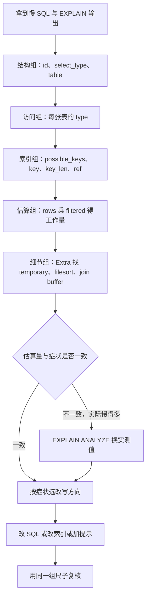
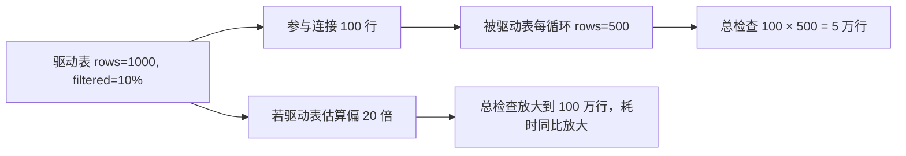
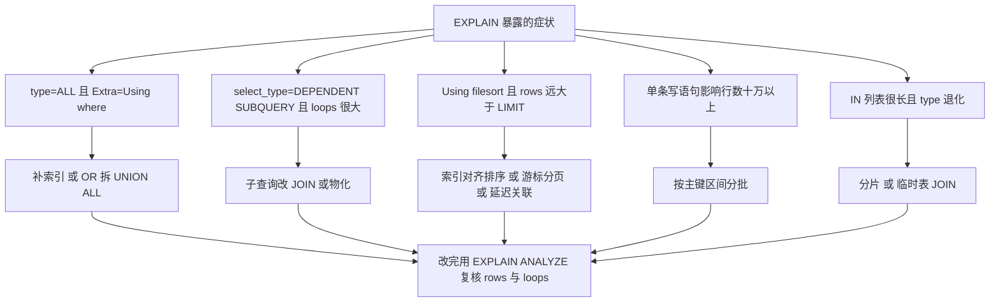
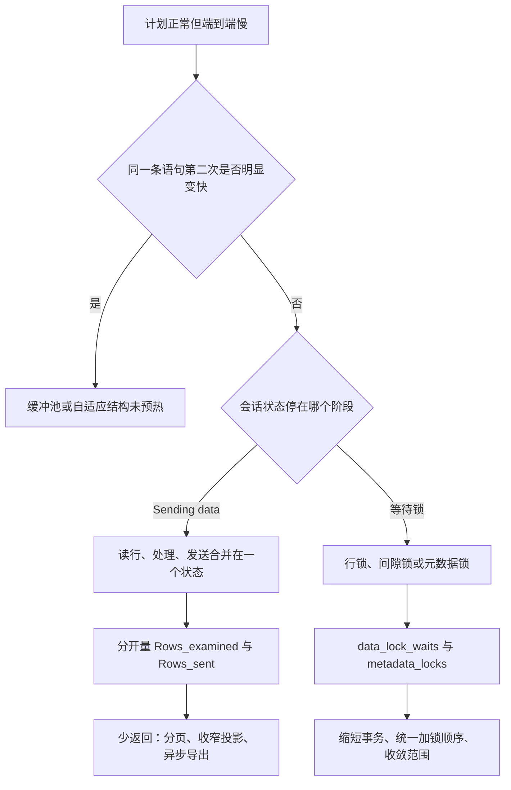

# 02 SQL 调优方法论——从 EXPLAIN 到执行计划重写

**摘要：**

一条慢 SQL 的处理通常从两条相反的路开始：有人先加索引，有人先改写法，两者的共同前提都是“已经知道 MySQL 打算怎么执行它”，而这个前提往往没有被验证。`EXPLAIN` 的价值就在这一步：它把优化器选定的计划摊成十二列——`type` 说明访问方式，`key` 与 `key_len` 说明用到了哪几列，`rows` 与 `filtered` 说明按多少行来算账，`Extra` 说明存储引擎与 Server 层之间还发生了什么。本篇以应用开发者视角逐列拆解，其中九列给出可执行的判据，三列只作背景；再对比三种输出格式的适用面——表格看形状，`FORMAT=JSON` 看代价与 `used_key_parts`，`EXPLAIN ANALYZE` 看真实行数与真实耗时，并把 `actual time`、`rows`、`loops` 三者的读法讲透，包括三个常见误读。每一列都配一组“什么算好、什么算坏”的判据：`type` 的完整阶梯，以及它为什么只是访问方式的排序而不是性能的排序；`possible_keys` 有值而 `key` 为空，意味着优化器主动放弃了索引；`rows × filtered` 才是账面上的工作量；`Using temporary` 与 `Using filesort` 同时出现，几乎一定要改。诊断之后是改写：`OR` 拆 `UNION ALL`、子查询改 `JOIN`、`LIMIT` 与排序对齐索引、大 `UPDATE` 分批、`IN` 列表控制规模，每条给出触发判据与代价。最后是三类 `EXPLAIN` 照不出的慢——`Sending data`、锁等待、缓冲池冷启动——以及四则把判据用反的现场。贯穿全文的结论只有一条：先量，再改，改完用 `EXPLAIN ANALYZE` 复核。

---

## 第 1 章 三把尺子：表格、JSON 与 ANALYZE

### 1.1 慢的责任边界

一条 SQL 变慢，原因可能落在四个互不重叠的层面：语句写法让优化器估错或选错，索引设计让某条路径走不通，数据规模与分布让统计信息失去描述力，运行环境（锁、缓存、复制延迟、网络）让同样的计划跑出不同的耗时。`EXPLAIN` 只覆盖前两层的一部分，它给出的是优化器选定的方案与基于统计的估算，既不含真实耗时，也不含真实读行数。拿它当结论用，等于拿地图当路况用——路线画对了，堵不堵是另一回事。

这决定了一套稳妥的诊断顺序：先用 `EXPLAIN` 判断“计划是不是合理”，再用 `EXPLAIN ANALYZE` 判断“合理的计划兑现得怎么样”，最后才动手改。跳过第一步直接改，改的是猜测；跳过第二步就宣布优化完成，验收的是估算。

### 1.2 三种格式各自能看到什么

MySQL 8.0 里 `EXPLAIN` 有四种输出形态，另有一个用于观察正在执行的语句的 `EXPLAIN FOR CONNECTION`。这些形态的差别不在“详略”，而在**回答的问题不同**，混着用会得出互相矛盾的判断。

| 格式 | 能看到 | 看不到 | 适用场面 | 是否执行 |
| :--- | :--- | :--- | :--- | :--- |
| 传统表格（默认） | 每张表一行的 `type`、`key`、`key_len`、`rows`、`filtered`、`Extra` | 代价、真实行数、算子的嵌套关系 | 第一次看、逐列核对、把计划贴到工单里 | 否 |
| `FORMAT=JSON` | `cost_info`（`query_cost`、`prefix_cost`）、`used_key_parts`、`attached_condition`、`rows_produced_per_join` | 真实行数与耗时 | 比较两个候选计划谁更便宜、存盘做回归 diff、确认联合索引用到第几列 | 否 |
| `FORMAT=TREE`（8.0.16 起） | 迭代器树的层级、连接顺序、每个算子的位置 | 代价、真实数据 | 讲清执行顺序、判断谁在谁的里面 | 否 |
| `EXPLAIN ANALYZE`（8.0.18 起） | `actual time`、真实 `rows`、`loops` | 代价（TREE 不带 `cost_info`） | 验证估算、定位真实瓶颈、验收改写 | 是 |

传统表格这一行有一点容易被忽略：它的“一行一表”并不等于执行顺序的线性排列。`id` 相同的一组行按连接嵌套的顺序列出，但子查询与派生表的行与主查询行混在同一张表里，行的先后不能直接读成“先做这个再做那个”。要看清嵌套关系，`FORMAT=TREE` 才是对的工具。

本篇的版本坐标是 8.0，其中 `FORMAT=TREE` 从 8.0.16 起、`EXPLAIN ANALYZE` 从 8.0.18 起、hash join 从 8.0.18 起，若干默认值也在 8.0 的小版本之间调整过；8.4 LTS 沿用同一套迭代器执行器与 EXPLAIN 输出形态。正文对涉及版本差异的条目都做了标注，落到具体实例之前，仍以对应版本文档与 `SELECT @@version` 的实际结果为准。

> [!warning] 会真执行的 EXPLAIN
> `EXPLAIN ANALYZE` 会完整执行语句并统计每个算子的耗时，它不是一个免费的观测动作。对一条跑四十秒的语句用它，付出的就是四十秒，外加它对缓冲池、临时表空间与锁的占用。生产环境上的用法有边界：语句本身要能承受再跑一次，或者用 `EXPLAIN FOR CONNECTION` 去看正在跑的那条；写语句必须包在事务里、看完回滚。

### 1.3 一条固定的读法

计划到手之后，按固定的顺序读，比“哪列显眼看哪列”可靠得多。下面的顺序把十二列分成五组，每组回答一个问题，前一组的结论决定后一组要不要继续。



结构组回答“这条语句由几个查询块组成、有没有依赖外层的子查询”。访问组回答“每张表是怎么定位行的”。索引组回答“用上了哪个索引、用到第几列”。估算组回答“按优化器的账本，这次要碰多少行”。细节组回答“在这些行上还额外做了什么——排序、建临时表、建哈希表”。五组读下来，一条语句的成本结构基本就摊平了。

### 1.4 贯穿案例：商家后台的四条 SQL

后文用一个具体的库承载所有判据。某电商的商家后台，主表 `orders` 约 800 万行，行长约 200 字节，主键自增 `BIGINT`；二级索引三个：`idx_shop_created (shop_id, created_at)`、`idx_user (user_id)`、`idx_order_no (order_no)`；另有 `users` 表 50 万行、主键 `id`。日增约 4 万单，读写比约 8:1，每月初跑一次对账导出。

四条语句覆盖了这类后台的绝大多数性能现场，后文会反复回到它们身上。

| 编号 | 场景 | 语句骨架 | 典型症状 |
| :--- | :--- | :--- | :--- |
| Q1 | 订单列表深分页 | `WHERE shop_id = ? AND status = 1 ORDER BY created_at DESC LIMIT 100000, 20` | 前面的页很快，翻到后面越来越慢 |
| Q2 | 月度对账汇总 | `SELECT COUNT(*), SUM(amount) FROM orders WHERE shop_id = ? AND status = 3 AND created_at >= ?` | 单次几十秒，回表量巨大 |
| Q3 | 批量取消超时订单 | `UPDATE orders SET status = 6 WHERE status = 1 AND created_at < ?` | 影响行数三十万，从库延迟飙升 |
| Q4 | 运营搜索 | `WHERE user_id = ? OR order_no = ?` | 两侧都有索引，但 `index_merge` 合并代价高，最坏退化成全表扫 |

后文每一章都会回到这四条语句上，看同一组列在不同语句里该读出什么。

---

## 第 2 章 type：访问方式的阶梯，不是性能的阶梯

### 2.1 结构列：id、select_type、table 与 partitions

`id` 是查询块的序号，相同 `id` 的行属于同一个查询块；`select_type` 说明这个块的身份，常见的取值有 `SIMPLE`、`PRIMARY`、`SUBQUERY`、`DEPENDENT SUBQUERY`、`DERIVED`、`UNION`、`UNION RESULT`、`MATERIALIZED`。两个取值值得单独留心：`DEPENDENT SUBQUERY` 意味着子查询引用了外层的列，优化器倾向于对每一行外层结果重跑一次；`UNCACHEABLE SUBQUERY` 意味着子查询里含 `RAND()`、`NOW()` 或用户变量，结果无法缓存，每次都要重算。

`table` 是访问的表名或派生表别名，出现 `<derived2>` 这类名字说明中间结果被物化成了一张临时表。`partitions` 只在分区表上有值，它显示分区裁剪之后命中的分区，`NULL` 表示没有分区或没有裁剪；这一列只回答“扫了哪几个分区”，不回答“每个分区里扫了多少”。

### 2.2 完整阶梯与每一级的判据

`type` 是访问方式，不是性能评分。官方给出的顺序从好到差是 `system`、`const`、`eq_ref`、`ref`、`fulltext`、`ref_or_null`、`index_merge`、`unique_subquery`、`index_subquery`、`range`、`index`、`ALL`，这个顺序表达的是“定位方式的精确程度”，把它直接当成耗时排序会出错，原因放在 2.4 节。

| type | 语义 | 什么算好 | 什么算坏 |
| :--- | :--- | :--- | :--- |
| `system` | 表只有一行（多为系统表或单行派生表） | 无需判断 | 业务表不该出现 |
| `const` | 主键或唯一索引与常量等值，优化阶段即可定值 | `rows` 为 1 | 几乎不会坏 |
| `eq_ref` | JOIN 中被驱动表用主键或唯一非空索引全列等值 | `rows` 为 1，回表一次 | 关联列类型不一致导致退化成 `ref` |
| `ref` | 非唯一索引等值，或唯一索引只用前缀 | 匹配行数小、回表少 | 选择性差的列上匹配几十万行 |
| `ref_or_null` | 等值或 `IS NULL` 的合并访问 | 多一次 `IS NULL` 扫描，通常可接受 | 列上 `NULL` 占比极高时近似全扫 |
| `index_merge` | 两个索引各取一部分再合并 | 单表无复合索引时的补救 | 常常是缺一个联合索引的信号 |
| `unique_subquery` | `IN (SELECT ...)` 被改写成唯一索引查找 | 每个值一次定位 | 子查询本身不稳定时不可依赖 |
| `index_subquery` | 同上，但子查询索引非唯一 | 定位次数可控 | 匹配行多时退化成逐值扫描 |
| `range` | 索引范围扫描 | 范围窄、回表少 | 范围宽到接近全索引 |
| `index` | 全索引扫描（遍历索引全部叶子） | 覆盖索引且索引远小于表 | 不覆盖时每行回表，常比 `ALL` 更慢 |
| `ALL` | 全表扫描 | 小表、或过滤后几乎不剩行 | 大表上还带着高选择性条件 |
| `fulltext` | 全文索引访问 | 与 `MATCH ... AGAINST` 配套 | 与普通索引混用时难以估算 |

`index_merge` 常被误认为“用了两个索引所以更快”。它有三种形态，在 `Extra` 里分别显示为 `Using intersect(...)`、`Using union(...)`、`Using sort_union(...)`。`intersect` 会对同一行做两次回表再求交，`union` 需要对两路结果去重，真正的收益只在“两个条件各自的选择性都很高、合起来又缺一个联合索引”时才成立。看到它，第一反应应该是评估补一个联合索引，而不是庆祝。

### 2.3 index 与 ALL 的真实差距

`index` 与 `ALL` 的时间复杂度都是 O(n)，差别只在 n 是索引页数还是数据页数。这个差别有多大，用贯穿案例的 `orders` 表算一遍就清楚了。以下页数与倍数为按常见行长、索引条目大小的示例推算，不是实测值。

`orders` 800 万行、行长约 200 字节，聚簇索引叶子页约 10 万页（约 1.6 GB）；`idx_shop_created` 的条目是 `shop_id` 8 字节加 `created_at` 5 字节，加上主键追加与记录头，约 25 字节，一页能放约 600 条，整棵索引约 1.3 万页。于是全索引扫描与全表扫描的页读比是 10 万比 1.3 万，大约 8 倍——同一个数量级，不是量级差异。常被引用的“index 比 ALL 快很多”，在覆盖索引场景下成立的原因是“只读 1.3 万页、不碰数据页”，而不是“索引扫描本身快”。

真正拉开差距的是回表。`idx_shop_created` 不覆盖查询需要的 `status`、`amount` 时，每一行命中都要回聚簇索引定位一次：命中 100 行是 100 次随机定位，命中 24 万行（约占表 3%）就是 24 万次随机定位，再叠加索引页的 1.3 万页顺序读。这个组合经常比顺序读 10 万页的全表扫描更贵，优化器也正是按这笔账决定“不用索引”的——`possible_keys` 有值而 `key` 为 `NULL` 的多数情形，根因就在这里。

### 2.4 判据：type 必须与 rows 一起看

单看 `type` 会得出三个错误结论。第一，小表上的 `ALL` 无害：几千行的表顺序扫几十个页，比走上千次随机回表便宜，优化器选 `ALL` 是对的。第二，`ref` 不代表快：在 `status` 这类只有几个取值的列上，`ref` 可能命中表里 60% 的行，回表量远超一次全表扫。第三，`range` 的宽窄差别极大：`created_at >= '2026-01-01'` 与 `created_at >= '2025-01-01'` 在 `type` 上是同一级，在 `rows` 上可能差一个数量级。

由此得出三条可以落地的判据：看 `type` 时同时看 `rows` 占表行数的比例；`type` 为 `index` 时确认 `Extra` 是否有 `Using index`（覆盖与否决定它是 1.3 万页，还是 1.3 万页加 800 万次回表）；`type` 为 `range` 时把范围换成最坏参数再 `EXPLAIN` 一次，因为线上慢查询往往发生在最不均匀的那批参数上。至于索引本身该怎么建、联合索引的列序怎么排、哪些索引是冗余的，属于索引设计的题目，[[中间件/MySQL/MySQL进阶使用/01 索引设计实战——从建错索引到建对索引|01 索引设计实战]] 里有逐条判据；本节只负责从计划上认出“列序不对”的形状。

---

## 第 3 章 索引四列：possible_keys、key、key_len 与 ref

### 3.1 key 为 NULL 而 possible_keys 有值

这是十二列里信息量最大的一组组合，也是最容易被跳过的一组。`possible_keys` 列出优化阶段认为“可能可用”的索引，`key` 是最终选中的那个；前者非空而后者为 `NULL`，意味着优化器看到了索引、评估之后**主动放弃**，改用全表扫描。放弃的理由有三类，处置完全不同。

第一类是代价判断。索引可用，但按估算回表成本超过顺序全扫，这在小结果集、低选择性、大范围条件上都可能出现。验证方式很简单：加一个 `/*+ INDEX(...) */` 提示或写 `FORCE INDEX` 强制走一次，比较两种计划的 `rows` 与 `filtered`。如果强制走索引之后估算回表量确实巨大，那么优化器的判断是对的，该做的是改索引（补覆盖、调列序），而不是逼它走索引。

第二类是索引不可用，常见于隐式转换与表达式。`VARCHAR` 列与数字比较（`order_no = 20261119001`）、列被函数包裹（`DATE(created_at) = '2026-11-19'`）、`LIKE '%xxx'` 前缀通配，都会让索引在语义上失效；此时 `possible_keys` 可能因为列上有索引而列出它，`key` 仍为 `NULL`。判据是人工核对比较两侧的类型与函数，再配合 `SHOW WARNINGS` 的输出——部分版本会在这里给出“无法使用索引”一类的提示，但提示并不总是出现，不能只靠它。

第三类是优化阶段主动放弃，典型是大 `IN` 列表。范围分析需要为每个等值条件记一笔，条件数量多到超过 `range_optimizer_max_mem_size`（8.0 默认 8 MB）时，优化器直接放弃范围优化、退回全表扫描，`SHOW WARNINGS` 里会出现“range optimization was not done”一类告警（具体文案以对应版本文档为准）。这类现场的特征是：`IN` 列表短的时候计划正常，长到某个规模之后突然变成 `ALL`，而统计信息没有任何变化。

> [!info] 一个常被误读的信号
> `possible_keys` 有值、`key` 为 `NULL`、`type` 为 `ALL`，如果同时 `rows` 很大而 `filtered` 很低，说明这次全表扫描确实在读大量用不上的行；如果 `rows` 不大（几千行）而 `filtered` 接近 100，优化器的选择通常是对的。同一个组合，两种结论，差别在量。

### 3.2 key_len：联合索引用到第几列

`key_len` 是实际用到的索引前缀的字节长度，它最直接的用途是判断联合索引被“截断”在第几列。计算规则记住四条就够——`INT` 4 字节、`BIGINT` 8 字节、`DATETIME` 5 字节（带小数秒的 `DATETIME(3)` 再加 2 字节）、`VARCHAR(n)` 在 `utf8mb4` 下是 `n × 4 + 2` 字节；允许 `NULL` 的列各加 1 字节。以 `(shop_id BIGINT, status TINYINT, created_at DATETIME)` 全 `NOT NULL` 为例，只用到 `shop_id` 是 8，用到前两列是 9，三列全用是 14；如果看到 8，说明 `status` 之后的列完全没参与定位。

这里有两个坑。其一，InnoDB 会在二级索引末尾追加主键列，8.0 的优化器还会把追加的主键列当作“索引扩展”用于过滤，所以 `key_len` 偶尔会比按声明列算出来的值更大，多出来的正是主键。其二，范围条件会截断后续列：`(shop_id, status, created_at)` 上，`shop_id = ? AND status = ? AND created_at > ?` 能让三列都进入范围定位（`key_len` 14），而 `shop_id = ? AND status > ? AND created_at > ?` 只能用到前两列（`key_len` 9），`created_at` 的有序性已经被 `status` 的范围打断。

`key_len` 的算术容易出错，`FORMAT=JSON` 里的 `used_key_parts` 直接把“用了哪几列”列出来，比按字节数反推省事得多。两者对照着看，还能发现一类隐蔽问题：`key_len` 显示用到了三列，但 `rows` 与只用到第一列时几乎一样，说明后两列的区分度在这个参数下没有起作用，索引的列序可能需要调整。

算术本身也有两个常见误判。一是把 `key_len` 变长当成好事：范围条件的最后一列虽然计入长度，但它只把范围收窄，行数不一定减少，长度增加了而行数没动，说明这一列的作用只是过滤而不是定位。二是忽略可变长列的长度语义：`VARCHAR(20)` 在 `utf8mb4` 下按 20 × 4 + 2 计算，可空再 +1，一条 `(a INT, b VARCHAR(20))` 的联合索引，只用 `a` 时 `key_len` 是 4，两列都用是 87，两者差着一个数量级，容易让第一次看的人误判成“用了二十多列”。

### 3.3 ref：拿什么跟索引比

`ref` 列回答“索引的等值部分是与什么比较的”，取值通常是 `const`（常量）、某个列名（连接时的外层列）、`func`（函数结果）、或 `NULL`（范围扫描时没有等值部分）。`const` 表示常量等值，最理想；出现列名说明这是 JOIN 的内层访问，需结合 `rows` 与 `loops` 判断被驱动了多少次；出现 `func` 往往意味着比较涉及函数或类型转换，值得回头检查 3.1 节的第二类问题。

### 3.4 四列的组合读法

把四列放在一起，可以回答一个具体问题：这条语句在索引上“走了多远”。`possible_keys` 列出候选，`key` 说明选择，`key_len` 说明用到第几列。三者一致（候选唯一、选中它、用满列）是好计划；候选有两个而选中了 `key_len` 更短的那个，通常是选择率估算把它们比反了，处置在“改列序”与“改条件写法”之间选；候选非空而 `key` 为空，回到 3.1 节的三类理由里定位。

---

## 第 4 章 rows 与 filtered：估算的乘法

### 4.1 rows 是每循环的估算

`rows` 是优化器预计要检查的行数，两个限定词都不能漏：它是估算，并且是**每次循环**的估算。多表连接里，被驱动表那一行的 `rows` 表示“驱动表每给一个值，被驱动表要检查多少行”，**总检查量**是驱动表参与连接的行数乘以这个值。这也是为什么 `rows` 单独看没有意义——驱动表 10 行、被驱动表 `rows` 500，总检查 5000 行；驱动表 10 万行、被驱动表 `rows` 5，总检查 50 万行，后者的 `rows` 更小，工作量却大得多。

估算的来源有四条路径：等值条件在 `eq_range_index_dive_limit`（8.0 默认 200）以内时做 index dive，真的跳到索引里数；超过上限退回索引统计；非索引列的条件只能用统计或直方图；多条件时按独立性假设相乘。这四条路径的精度差异，以及统计信息本身怎么采样、怎么重算，属于优化器内部账本，`[[中间件/MySQL/MySQL架构与底层原理/09 MySQL 查询优化器——从代价模型到执行计划的决策过程|本列 09 篇]]` 拆到了页一级，此处只取结论：`rows` 的可信度随条件形态变化，不是常数。

### 4.2 filtered 的语义与“100”的误导

`filtered` 是估算的过滤比例，取值 0 到 100，含义是“读出来的行里预计有多少百分比能通过该表的条件”。`rows × filtered / 100` 才是预计参与后续连接或返回客户端的行数。没有条件可过滤时它是 100，看到 100 不代表没有过滤发生，只代表优化器认为没有可估算的过滤。

它有三个容易踩的点。第一，它是估算，且与 `rows` 同源；`rows` 因为统计过期偏了，`filtered` 通常也一起偏。第二，多条件默认按**条件独立假设**相乘，两个强相关的列（譬如 `status` 与 `created_at` 在订单表里高度相关）会把选择性算得过低或过高，误差可以到一两个数量级。第三，`filtered` 不区分条件来自 `WHERE` 还是 `ON`，在 JOIN 的第二个表上它反映的是“该表条件加上关联条件”的综合效果，不能拿它跟 `WHERE` 里的条件个数一一对应。

误差的量级可以估出来。某订单表 `status` 有六个取值，实盘分布是 `status = 1` 占九成、`status = 6` 只占千分之四；`status` 上有索引但没有直方图时，优化器只能拿到基数（不同值的个数），按**均匀分布假设**把每个值估成约六分之一，于是 `status = 6` 的预估行数比实际高出约四十倍（示例推算，真实误差取决于采样与数据分布）。这类偏差不会改变 `type`，只会改变 `rows` 与 `filtered`，只看 `type` 的读法对它完全免疫。

`filtered` 准不准，用一次除法就能验：`rows × filtered / 100` 与语句实际返回（或实际参与连接）的行数相比，比值在一倍以内的可以采信；差十倍以上，且条件列分布明显倾斜（少数取值占了绝大多数行），说明统计已经描述不了当下，`ANALYZE TABLE` 只是重采样，直方图才是补上非索引列分布的那把工具，具体建法与维护边界的判据在 `[[中间件/MySQL/MySQL架构与底层原理/09 MySQL 查询优化器——从代价模型到执行计划的决策过程|09 篇]]` 的直方图一节。

### 4.3 乘法决定 JOIN 的工作量

把 `rows` 与 `filtered` 乘起来，再沿着连接链往外乘，就得到优化器账本上的总工作量。下面的图把这个乘法关系画出来，右侧是被估算误差放大的位置。



一条 `users` 与 `orders` 的报表语句可以把这个乘法算清楚。`users` 表 50 万行，`WHERE age > 25` 估算 `rows` 50 万、`filtered` 40%，参与连接 20 万行；被驱动表 `orders` 若在 `user_id` 上有索引，`rows` 约 16（800 万单摊到 50 万用户），总检查约 320 万行；若 `user_id` 上没有索引，被驱动表 `rows` 变成 800 万，账面上的总检查量直接涨到不可执行的数量级，优化器于是改选 hash join 把整张表读进内存建哈希表——`Extra` 里的 `Using join buffer (hash join)` 就是这么来的。

### 4.4 什么算“估错了”

估算误差要量化才有用。做法是同一条语句跑两次：`EXPLAIN` 拿 `rows` 与 `filtered`，`EXPLAIN ANALYZE` 拿每个算子的真实 `rows` 与 `loops`，逐行对比。经验判据是：驱动表上估算与实际的比值在一倍以内，统计可视为可信，计划选错的原因不在统计；比值到十倍，统计已经不足以支撑决策，先 `ANALYZE TABLE` 再看；比值到百倍以上，通常不是采样误差，而是分布估算失效（无直方图的倾斜列、多条件独立假设），需要直方图或改写。

> [!note] 估算误差与计划错误的区别
> 估算偏十倍，不一定导致计划错——两个候选计划的代价差着几十倍时，估算偏一点不影响排序。反过来，估算很准也可能选错计划，那是代价常数或搜索剪枝的问题。判据要分开看：`rows` 与实际差多少，回答“统计准不准”；计划选中的路径在真实硬件上是否更慢，回答“标尺准不准”。两者混在一起，得出的动作必然是错的。

---

## 第 5 章 Extra：七个关键值与组合判读

### 5.1 Using index：覆盖索引

`Using index` 表示查询需要的列全部在所用索引里，不需要回表。它是 `Extra` 里唯一可以单独当作好消息的值，但有两个前提要一并确认：一是索引确实比表小，宽索引覆盖了大字段时，扫索引未必比扫表便宜；二是没有为了覆盖而把不必要的大列塞进索引。**覆盖索引**不是免费的：索引体积膨胀会挤占缓冲池，写入时每行要多维护一份索引记录，`UPDATE` 频繁的表上，一个宽覆盖索引带来的写放大可能把读的收益抵掉。

`SELECT *` 永远不可能覆盖，因为聚簇索引以外的任何索引都不含全部列。这一点在改写时可以直接用：把 `SELECT *` 收窄成实际用到的列，往往就能把 `index` 型的回表扫描变成真正的覆盖扫描。

### 5.2 Using index condition：索引下推

`Using index condition` 表示启用了索引条件下推（Index Condition Pushdown，ICP）：`WHERE` 里那些“能用索引列判断、但无法用于缩小定位范围”的条件，被下推到存储引擎层，在回表之前先过滤一遍。它减少的是回表次数，不减少索引扫描行数——`rows` 不会因此变小，`filtered` 也不会因此变大，收益只体现在真实耗时上。

典型场景是联合索引被“截断”之后：`(shop_id, status, created_at)` 上执行 `shop_id = ? AND created_at > ?`，`status` 没有等值条件，定位只能用到 `shop_id`，`created_at` 无法用于缩小范围；但这两个条件都可以在引擎层用索引里的值先判断一遍，判断不通过的行不回表。ICP 由 `optimizer_switch` 的 `index_condition_pushdown` 控制，8.0 默认开启，通常不需要动它。判据是 `Extra` 里出现 `Using index condition`：它成立的前提是索引不覆盖，要回表才有下推的意义；查询本身若被索引覆盖，看到的是 `Using index`，那时下推与否只剩 CPU 上的差别。

### 5.3 Using where：Server 层过滤

`Using where` 表示存储引擎把行交给 Server 层之后，Server 层还要按条件再过滤一遍。它本身不是问题：覆盖索引上的条件过滤同样会显示 `Using where`。需要警惕的是组合——`type` 为 `ALL` 或 `index`、`rows` 很大、`filtered` 很低，三者同时出现，说明存储引擎读出了大量最终被丢弃的行，这是回表浪费或全表扫描的典型形状。

### 5.4 Using temporary：临时表

`Using temporary` 表示这条语句需要建内部临时表，常见于 `GROUP BY`、`DISTINCT`、`UNION`、窗口函数、物化派生表，以及排序与分组无法用索引完成时的中转。8.0 的内部临时表默认用 TempTable 引擎，先在内存里建，超过 `temptable_max_ram`（默认 1 GB）才落盘；`tmp_table_size` 与 `max_heap_table_size` 只在 `internal_tmp_mem_storage_engine=MEMORY` 时才是内存上限。落盘之后多一次写与一次读，耗时会出现台阶式上升。

它比 `Using filesort` 更值得警惕的地方在于成本形态：排序的代价与行数成正比，临时表还多一次“写入再读出”，并且临时表本身会占连接的内存配额，高并发下同时出现几十个临时表，会先把内存打满。`GROUP BY` 引起的临时表可以用“让分组列成为某个索引的最左前缀”消除，顺带把隐式排序也消掉。

### 5.5 Using filesort：额外排序

`Using filesort` 表示 `ORDER BY`（或 `GROUP BY` 的隐式排序）无法借助索引的有序性完成，需要额外排序。这个名字有误导性：数据量小于 `sort_buffer_size` 时排序完全在内存里做，只有超出缓冲才落盘归并，所以“看到 filesort 就以为在写磁盘”是错的。

判断它是否构成问题，看两个量：参与排序的行数（`rows`，或 `EXPLAIN ANALYZE` 里排序算子的真实行数）与 `LIMIT` 的大小。几十行的排序可以忽略；几十万行的排序很贵。`ORDER BY ... LIMIT n` 时 MySQL 用优先队列只保留前 n 行，内存占用受 `LIMIT` 约束，但**读取的行数不变**——它仍然要把所有满足条件的行读出来比较一遍。这一点是深分页慢的根本原因，也是第 7 章改写手法的依据。

8.0.20 之后，`max_length_for_sort_data` 被废弃、不再决定单路还是双路排序，排序统一走“打包附加字段”的路径（以对应版本文档为准）。旧资料里“调大 `max_length_for_sort_data` 让排序走单路”的做法在 8.0.20 之后已无意义，可调的只剩 `sort_buffer_size`。

### 5.6 Using join buffer：哈希连接与 BNL

`Extra` 显示 `Using join buffer (hash join)` 时，说明被驱动表的关联列没有可用索引，优化器把较小的表读进内存建哈希表，再扫另一张表做探测。8.0.18 引入 hash join，8.0.20 移除了等值连接上的块嵌套循环（Block Nested Loop，BNL），所以 8.0.20 之后这类形状多半由 hash join 承接；`Extra` 里括号中的算法名随版本与连接条件变化，看到 `Using join buffer` 时以括号里的实际写法为准（以对应版本文档为准）。

它比“没有任何优化”的嵌套循环好一个数量级，但仍不如被驱动表上有索引：建哈希表要读完整个被驱动表，受 `join_buffer_size` 约束，超出会分区落盘；哈希连接也不能像索引查找那样“凑够 `LIMIT` 就停”，驱动表多大就要探测多少次。看到它，处置顺序是“先补被驱动表的关联索引，补不了再考虑改写”。

### 5.7 Using MRR：多范围读

`Using MRR` 表示启用了多范围读（Multi-Range Read）：二级索引范围扫描得到的行，先按主键排序，再按主键顺序批量回表，把随机 I/O 变成接近顺序的 I/O。它只在“范围扫描 + 需要回表 + 命中行数较多”的组合下有收益；行数少时排序本身的成本超过收益，`mrr_cost_based` 就是让代价模型决定要不要用它。不同小版本的默认值有过变化，以 `SELECT @@optimizer_switch` 的实际输出为准。

### 5.8 组合判读

单个值只是线索，组合才构成判据。`Using temporary` 与 `Using filesort` 同时出现，几乎一定要改：它意味着数据先被写进临时表，再在临时表上排序，等于把一次分组和一次排序串起来做，成本是两者的和。`Using index` 与 `Using where` 同时出现，通常是“覆盖索引 + Server 层过滤”，可以接受；`Using where` 与 `type: ALL`、大 `rows`、低 `filtered` 同时出现，则是回表浪费或全表扫描的形状。`Using index condition` 单独出现是好事，与 `Using filesort` 同时出现说明过滤之后还要排序，优化方向在排序一侧。

---

## 第 6 章 EXPLAIN ANALYZE：把估算换成实测

### 6.1 输出的三个数字

`EXPLAIN ANALYZE` 的输出是一棵迭代器树，每个节点后面跟着一组括号，形如 `(actual time=0.25..37.98 rows=4000 loops=1)`。三个数字各自含义明确：`actual time` 的两个值是“取到第一行的时间”与“取完所有行的时间”，单位毫秒，**都是每次循环的平均值**；`rows` 是每次循环输出的行数，也是平均值；`loops` 是该节点被执行的次数。

下面是贯穿案例 Q2 在加覆盖索引前后的两段输出，数字为便于说明结构的示意值，不构成基准。

```text
-- 改写前：范围扫索引，逐行回表
-> Aggregate: count(0), sum(orders.amount)
    (actual time=0.12..812.40 rows=1 loops=1)
    -> Filter: (orders.status = 3)  (actual time=0.10..790.15 rows=4000 loops=1)
        -> Index range scan on orders using idx_shop_created
            (actual time=0.09..640.30 rows=120000 loops=1)
```

```text
-- 改写后：覆盖索引，索引范围本身就只有 4000 行
-> Aggregate: count(0), sum(orders.amount)
    (actual time=0.08..22.60 rows=1 loops=1)
    -> Covering index range scan on orders using idx_cover
        (actual time=0.06..18.40 rows=4000 loops=1)
```

两段输出的差别不在耗时数字，而在最下面一层的 `rows` 与形状：改写前沿索引扫出 12 万行、逐行回表，再过滤到 4000 行；改写后索引范围本身就只覆盖 4000 行，不再回表，`Aggregate` 之上也少了一层 `Filter`。瓶颈节点从“范围扫描加回表”换成了“覆盖扫描”。`EXPLAIN` 在两种情况下都能显示 `type: range`，只有 `ANALYZE` 能把 12 万与 4000 的差别摊出来。

### 6.2 三个误读

第一个误读是把 `actual time` 的第二个数当成节点总耗时。它是每次循环的平均值，`loops` 大于 1 时，总耗时约等于“第二个数字 × `loops`”，多个循环之间还有调度开销，实际值只会更大。看到 `loops=20` 而 `actual time=15..30`，这个节点总共花掉的是几百毫秒，不是 30 毫秒。

第二个误读是把 `rows` 当总行数。同样要乘 `loops`。一个被驱动表的节点显示 `rows=1 loops=50000`，它处理了 5 万行，而不是 1 行。

第三个误读是拿父节点的 `actual time` 与子节点逐个相加比较。树的耗时本身是累积的，父节点的“取完所有行”包含子节点的全部时间，上层与下层的差值是父节点自己的开销。判断瓶颈要看“哪一层的耗时比它的子层多出最多”，而不是把整棵树的数字加起来。

### 6.3 用它验证“优化器估错了”

把 `EXPLAIN` 与 `EXPLAIN ANALYZE` 的输出按节点对齐，逐行做四件事，就能把“估错”定位到具体节点。

| 观察点 | 说明什么 | 下一步 |
| :--- | :--- | :--- |
| 驱动表上估算 `rows` 与实际 `rows` 差十倍以上 | 统计信息或分布估算失效 | `ANALYZE TABLE`，倾斜列考虑直方图 |
| 某节点 `loops` 远大于外层行数 | 子查询或关联被重复执行 | 检查 `select_type` 是否 `DEPENDENT SUBQUERY` |
| 某节点 `actual time` 占比最高且 `rows` 与估算相符 | 量本身大，不是估算问题 | 改索引或改写法减少该节点的量 |
| 上层 `actual time` 明显小于下层之和 | `LIMIT` 提前停止生效 | 说明账面 `rows` 并未真的全部读到，别被吓住 |

第四行值得展开：`EXPLAIN` 的 `rows` 是“预计检查的行数”，带 `LIMIT` 且能**提前停止**时，这个数字不会真的发生。Q1 的深分页里 `rows` 几十万，但前几页执行得很快，正是因为“排序 + 过滤 + `LIMIT`”能沿索引边走边停；一旦 `OFFSET` 变大，停下来之前要跳过的行数变多，账面数字才开始兑现。判断“账面数字会不会兑现”，`ANALYZE` 的 `rows` 比 `EXPLAIN` 的 `rows` 可靠得多。

两边的 `rows` 语义还有一层差别，对不齐时不要急着判定“估错”。`EXPLAIN` 的 `rows` 是优化期基于统计的**预计检查行数**，`ANALYZE` 的 `rows` 是执行期该算子实际**向上层输出的行数**；一个范围扫描如果被上层提前截断（`LIMIT`），它的实际输出行数会小于“检查过的行数”，于是两边数字对不上，却并不存在估算错误。对齐的方法是用不带 `LIMIT` 的同一条件做对照，或者只比较驱动表节点的 `rows`——那里的语义最接近。

### 6.4 生产环境上的边界

`EXPLAIN ANALYZE` 的代价等于语句本身的代价，所以能用的前提是“这条语句可以再跑一次”。只读查询、带小 `LIMIT` 的分页、能在从库上执行的语句，都在这个范围内。写语句要包在 `BEGIN ... ROLLBACK` 里，且要确认表上没有会阻塞业务的锁；大范围 `UPDATE` 即使回滚，产生的 undo 与锁也要等事务结束才释放。

看正在跑的语句，用 `EXPLAIN FOR CONNECTION <connection_id>`，它不重新执行，直接取该连接当前语句的计划，代价接近零，缺点是没有真实行数与耗时。两条命令配合的用法是：慢查询现场先用 `FOR CONNECTION` 看形状，确认语句可以安全重跑之后，再决定要不要 `ANALYZE`。另需注意，`EXPLAIN ANALYZE` 支持的语句范围在不同小版本间扩展过，跑写语句之前先确认当前版本是否支持（以对应版本文档为准）。

---

## 第 7 章 五类改写与它们的判据

改写不是凭经验套模板，每一种手法都有触发它的计划形状，也有它自己的代价。下面五种按“触发频率从高到低”排列，每种给出判据、手法与代价。

| 手法 | 触发判据 | 收益 | 代价 |
| :--- | :--- | :--- | :--- |
| `OR` 拆 `UNION ALL` | `type: ALL`，`OR` 两侧只有一侧有索引 | 两侧各自走索引，避免全表扫 | 两次往返、去重语义要自己保证 |
| 子查询改 `JOIN` | `DEPENDENT SUBQUERY` 且 `loops` 等于外层行数 | 子查询只算一次 | 派生表物化可能带来临时表 |
| `LIMIT` 与排序对齐索引 | `Using filesort` 且 `rows` 远大于 `LIMIT` | 排序量从全量降到 `LIMIT` | 索引列序被查询绑定 |
| 大 `UPDATE` 分批 | 影响行数十万以上、从库延迟上升 | 短事务、延迟可控 | 应用侧要写循环与幂等判断 |
| `IN` 列表分片 | `IN` 超过 `eq_range_index_dive_limit` 或触发范围内存告警 | 估算恢复精确、避免全表扫 | 多次往返、结果合并 |

### 7.1 OR 改 UNION ALL

`OR` 的麻烦在于优化器必须找一个能同时满足两侧条件的访问路径。两侧列各有索引时，优化器可以走 `index_merge`——`Extra` 里显示 `Using union(...)`，代价是两路结果各自回表后还要去重；只有一侧有索引时，另一侧只能全表扫，整个语句直接退化成 `ALL`。Q4 属于前一种：两侧各有索引，但合并要两次回表再去重，估算稍有波动就掉到 `ALL`。

```sql
-- 改写前：两侧各有索引，但 OR 让优化器要么走 index_merge、要么直接全表扫
SELECT id, order_no, status, created_at FROM orders
WHERE user_id = 8888 OR order_no = 'SO20261119001';

-- 改写后：两支各走各的索引，第二支显式排除重叠
SELECT id, order_no, status, created_at FROM orders
WHERE user_id = 8888
UNION ALL
SELECT id, order_no, status, created_at FROM orders
WHERE order_no = 'SO20261119001'
  AND (user_id IS NULL OR user_id <> 8888);
```

第二支的 `AND (user_id IS NULL OR user_id <> 8888)` 不能省。`UNION`（不带 `ALL`）会去重，但去重本身要建临时表、做全量比较，在几十万行的结果集上，这笔开销可能超过省下来的扫描。用 `UNION ALL` 的前提是自己保证两支不重叠，而 `user_id <> 8888` 对 `NULL` 不成立——`user_id` 可空时，漏掉 `IS NULL` 分支会丢行。

代价也要算清楚：两次解析、两次执行、两段结果在客户端或外层合并，如果外层还带 `ORDER BY`，排序量变成两支之和。判定它值得做的条件只有一个：改写后两支的 `type` 都不低于 `range`，且合计扫描量明显小于原来的全表扫。`EXPLAIN` 一次就能确认。

### 7.2 子查询改 JOIN

8.0 的优化器已经能把 `WHERE` 里的 `IN (SELECT ...)`、`EXISTS (SELECT ...)` 转成半连接（semi-join），策略有首次匹配、松散索引扫描、物化、去重后连接几种，`optimizer_switch` 的 `semijoin`、`firstmatch`、`loosescan`、`materialization` 控制它们。这类子查询要**先看计划再改**：如果 `EXPLAIN` 里已经没有 `DEPENDENT SUBQUERY`，或者 `ANALYZE` 的 `loops` 是 1，说明优化器已经处理好了，手改只是把优化器的工作换成人工的。

需要手改的是另一类：标量子查询与带聚合的相关子查询。`WHERE amount > (SELECT AVG(amount) FROM orders WHERE shop_id = o.shop_id)` 这种写法不在半连接的处理范围内，优化器只能对每一行外层结果算一次聚合。

```sql
-- 改写前：外层每一行都跑一次聚合
SELECT o.id FROM orders o
WHERE o.amount > (SELECT AVG(o2.amount) FROM orders o2 WHERE o2.shop_id = o.shop_id);

-- 改写后：聚合一次，再按索引连接
SELECT o.id FROM orders o
JOIN (SELECT shop_id, AVG(amount) AS avg_amount FROM orders GROUP BY shop_id) t
  ON t.shop_id = o.shop_id
WHERE o.amount > t.avg_amount;
```

改写后派生表只算一次，物化结果按 `shop_id` 建索引后与 `orders` 做 `ref` 连接。判据是 `ANALYZE` 里子查询节点的 `loops`：改写前它等于外层行数（几十万行的订单表上就是几十万次），改写后是 1。代价是派生表物化要占内存或落盘，分组数很大时（例如按用户分组）物化结果可能比预期大得多，此时分批算或者用临时表承接更稳。

### 7.3 LIMIT 与排序的配合

`ORDER BY ... LIMIT n` 有两种执行形态。索引能同时满足过滤与排序时，MySQL 沿索引顺序读，没有 `OFFSET` 时凑够 n 行就停，带 `OFFSET` 时仍要走过前面那些行、逐行回表；索引满足不了排序时，先取出所有满足条件的行、排序、再取前 n 行，成本与满足条件的总行数成正比。`Extra` 里有没有 `Using filesort`，以及 `rows` 与 `LIMIT` 的比值，是判断的依据。

Q1 的深分页属于第二种形态的变体：排序本身能借索引，但 `OFFSET` 要求先跳过 10 万行，跳过的每一行都要回表，成本与 `OFFSET` 成正比。两种改法各有用处。

```sql
-- 游标分页：用上一页末行的排序键作为下一页起点，成本与页码无关
SELECT id, order_no, amount, created_at FROM orders
WHERE shop_id = 8888 AND status = 1
  AND (created_at < '2026-11-01 10:30:00'
       OR (created_at = '2026-11-01 10:30:00' AND id < 50000))
ORDER BY created_at DESC, id DESC
LIMIT 20;
```

```sql
-- 延迟关联：先在覆盖索引上定位主键，再回表取 20 行
SELECT o.id, o.order_no, o.amount, o.created_at
FROM orders o
JOIN (
    SELECT id FROM orders
    WHERE shop_id = 8888 AND status = 1
    ORDER BY created_at DESC
    LIMIT 100000, 20
) t ON o.id = t.id;
```

游标分页把“跳过”变成“从某个位置开始”，代价是丢掉了随机跳页能力，只适合无限滚动式的列表。延迟关联保住了 `OFFSET` 语义，代价是子查询仍要沿索引走 10 万行，只是不回表——如果 `LIMIT` 里用到的列都在索引里，这段扫描是**覆盖扫描**，省下的正是 10 万次回表。两种改法都要用 `EXPLAIN` 确认 `Extra`：游标分页的排序列要与索引一致、不再出现 `Using filesort`，延迟关联的子查询则应是 `Using index`。

还有一类容易被忽略的形态：`status IN (1, 2)` 与 `ORDER BY created_at DESC` 同时出现时，索引 `(shop_id, status, created_at)` 上两个 `status` 值的范围各自有序，合并之后整体无序，优化器只能排序。把两个分支拆成 `UNION ALL`、各自带 `LIMIT`，外层只对 40 行做排序，是这里的标准解法。

### 7.4 大 UPDATE 与 DELETE 分批

Q3 一次要改三十万行。单条语句的事务里，undo 要保留三十万行的旧版本，binlog 要写三十万行的变更，主库的行锁要持有到提交，从库要串行回放这一个大事务——延迟往往表现为“从库突然落后几分钟，然后瞬间追上”。分批的收益不只是“不锁太久”，更是把不可控的延迟曲线换成可预测的。

```sql
-- 应用侧循环：每批按主键区间推进，批间留出让从库追赶的时间
UPDATE orders
SET status = 6, updated_at = NOW()
WHERE id BETWEEN ? AND ?            -- 每批 1000 个主键区间
  AND status = 1
  AND created_at < '2026-09-01';
```

用主键区间而不是 `LIMIT` 有两个原因：`UPDATE ... LIMIT` 每批都要从索引起点重新扫描，批数越多总扫描量越大；主键区间是确定性的，重跑与断点续跑都好处理。批大小按“单批执行时间”标定，常见取值 500 到 5000 行，判据是单批耗时稳定在几十毫秒、从库延迟没有持续累积。8.0.22 之后 `SHOW SLAVE STATUS` 的术语改为 `SHOW REPLICA STATUS`，旧写法仍兼容，判据看 `Seconds_Behind_Source` 的走势而不是单点值。

分批的代价要提前想清楚：批与批之间业务可能有新的行满足条件，最终影响行数会略大于首次估算；应用侧要写成幂等循环，避免重启后重复处理；如果语句里有 `ORDER BY` 或复杂的 `WHERE`，主键区间的选择要配合索引，否则每批都是一次范围扫描加回表。

### 7.5 IN 列表的规模

`IN` 列表不是越长越好，也不是越短越好，它的行为在几个阈值上会变。等值条件个数在 `eq_range_index_dive_limit`（8.0 默认 200）以内，优化器做 index dive，逐个值跳进索引数行数，估算是准的；超过这个数，为了不让优化阶段变成一次索引扫描，退回统计估算，精度掉一档。条件多到范围分析的内存超过 `range_optimizer_max_mem_size`（8.0 默认 8 MB），优化器直接放弃范围优化，`type` 从 `range` 掉到 `ALL`。

运营批量查订单号是最典型的现场：500 个 `order_no` 放进 `IN`，如果 `order_no` 上有索引且列表长度没超内存，计划是 `range`；列表变成 5000 个，可能先掉估算精度、再掉成全表扫。改法有三种：按 200 个一组分片查询、把值灌进临时表再 `JOIN`、或者在应用侧改成“批量拉取 + 本地匹配”。分片最简单，代价是多次往返与结果合并；临时表 `JOIN` 适合值集合复用的场景，代价是建表与清理；应用侧匹配适合结果集本来就不大的场景。

判据很直接：`EXPLAIN` 一次长列表，看 `type` 是否还是 `range`；`SHOW WARNINGS` 看有没有范围优化被跳过的告警；`ANALYZE` 看 `rows` 与实际的比值。三条里任意一条不通过，就该分片。



---

## 第 8 章 optimizer_switch 与优化器提示

### 8.1 开关的读与改

`optimizer_switch` 是一组用逗号分隔的开关，读用 `SELECT @@optimizer_switch`，改可以分级：`SET GLOBAL` 影响新连接，`SET SESSION` 只影响当前会话，`SET_VAR` 提示只影响当前语句。诊断时优先用会话级或语句级，别动全局——全局改动没有回归验证，等于给所有语句同时换标尺。

| 开关 | 8.0 默认 | 作用 | 关掉或改动的代价 |
| :--- | :--- | :--- | :--- |
| `index_condition_pushdown` | on | 索引条件下推 | 回表次数上升，范围扫描变慢 |
| `mrr` | on | 二级索引范围扫描批量回表 | 随机 I/O 增加，范围扫描回表变慢 |
| `mrr_cost_based` | 以实际输出为准 | 是否让代价模型决定用 MRR | 关闭后 MRR 无条件生效，可能在小结果集上变慢 |
| `batched_key_access` | off | BKA 连接，依赖 MRR | 打开后连接缓冲压力上升 |
| `block_nested_loop` | on | 连接缓冲类算法（8.0.20 后等值连接由 hash join 承接） | 关闭后部分连接退回逐行匹配 |
| `semijoin` | on | `IN`、`EXISTS` 转子查询半连接 | 关闭后退回 `DEPENDENT SUBQUERY` |
| `materialization` | on | 子查询物化 | 关闭后退回逐行执行 |
| `derived_merge` | on | 派生表合并进外查询 | 关闭后多出物化临时表 |
| `skip_scan` | on | 8.0.13 起的索引跳扫 | 关闭后缺最左前缀的查询退化 |
| `prefer_ordering_index` | on（8.0.21 起） | `ORDER BY` 加 `LIMIT` 时偏好索引序 | 关闭后更容易出现 filesort |

这张表的用法不是“逐个调优”，而是“确认某个优化没生效”。譬如怀疑 ICP 没生效，先读 `@@optimizer_switch` 确认它是 `on`，再看 `Extra` 有没有 `Using index condition`；怀疑半连接没触发，看 `select_type` 是否还是 `DEPENDENT SUBQUERY`。开关是诊断的旁证，不是性能旋钮。

### 8.2 8.0 的优化器提示

8.0 支持在语句里写优化器提示（optimizer hint），语法是 `/*+ ... */`，必须紧跟在 `SELECT`、`UPDATE`、`DELETE`、`INSERT`、`REPLACE` 关键字之后。常用的几类如下。

```sql
-- 建议使用某个索引（等价于 USE INDEX 的语义，不是强制）
SELECT /*+ INDEX(orders idx_shop_created) */ id, order_no FROM orders
WHERE shop_id = 8888 AND created_at >= '2026-11-01';

-- 建议不用某个索引
SELECT /*+ NO_INDEX(orders idx_status) */ id FROM orders WHERE status = 1;

-- 指定连接顺序
SELECT /*+ JOIN_ORDER(u, o) */ o.id FROM users u JOIN orders o ON o.user_id = u.id;

-- 只对本条语句生效的参数
SELECT /*+ SET_VAR(sort_buffer_size = 32M) */ id FROM orders ORDER BY amount LIMIT 1000;

-- 限制单条语句的执行时间
SELECT /*+ MAX_EXECUTION_TIME(2000) */ COUNT(*) FROM orders;
```

`SET_VAR` 是这批提示里最实用的一个：它把“临时把某个会话参数调大”从两次 `SET` 变成语句的一部分，不用管连接池把会话还回去之后参数怎么恢复，也不影响同连接上其他语句。它对系统变量有要求——只支持会话级可改的变量，`innodb_buffer_pool_size` 这类只读或全局参数写进去会被忽略。

`INDEX` 提示与 `FORCE INDEX` 有一个容易混淆的差别：`FORCE INDEX` 会把全表扫描的代价抬到极高，逼迫优化器使用指定索引；`INDEX` 提示的语义接近“建议”，优化器评估后认为全表扫更便宜时仍会忽略。这个差别决定了 `INDEX` 提示更安全，也更容易“写了但没生效”——所以两者都必须用 `EXPLAIN` 复核，不能写完就走。

### 8.3 提示的边界

提示把决策固化进 SQL，收益是“这次一定按我想要的走”，代价是“数据分布变了它不会自己改”。它适合三种场景：统计信息短期无法修正、索引变更要走 DDL 窗口、以及需要临时验证“换一条路径会不会更快”。不适合当作常规手段：一条生产 SQL 里躺着三个 `FORCE INDEX`，三个月后没人说得清它们当时在解决什么问题，删又不敢删。


上面这条阶梯的顺序不是随意的：越靠左，改动越局部、越可回滚；越靠右，影响面越大、越需要回归验证。改写法只影响一条语句，改索引影响所有使用该表的写入，改代价常数影响全实例，改硬件影响预算。调优的专业性很大程度上体现在“停在阶梯的哪一级”——能用改写解决的，不要用索引；能用索引解决的，不要用提示。

---

## 第 9 章 EXPLAIN 看不出的三类慢

计划合理而语句依然慢，是另一类现场。它的共同特征是：`EXPLAIN` 怎么看都没有问题，`ANALYZE` 也显示各节点耗时不高，但端到端的耗时就是很长。三类原因最常见。从发现慢查询到定性归因的完整链路——慢日志、`performance_schema`、指标与阈值——属于诊断体系的范畴，`[[中间件/MySQL/MySQL进阶使用/07 慢查询诊断与性能监控体系|07 慢查询诊断]]` 有系统化的流程；本章只补计划照不见的那三个盲区。分诊的顺序是先确认“是不是缓存”，再看“卡在哪一段”，最后才回到数据库里找答案。



| 现象 | EXPLAIN 显示 | 真正原因 | 怎么证实 |
| :--- | :--- | :--- | :--- |
| 会话状态长期停在 `Sending data` | 计划正常 | 读行、处理、发送被合并在一个状态里 | 看 `Rows_examined` 与 `Rows_sent` 的比值、`Bytes_sent` 增量 |
| 计划很好但并发下变慢 | 计划正常 | 锁等待，不在计划里 | `performance_schema.data_lock_waits`、`sys.innodb_lock_waits` |
| 同一条 SQL 第一次慢、第二次快 | 计划不变 | 缓冲池冷、自适应结构未建立 | `Innodb_buffer_pool_reads` 与 `read_requests` 增量、连跑两次 `ANALYZE` |

### 9.1 Sending data 不是网络问题

`Sending data` 是线程状态，不是网络阶段。官方对它的描述是“正在为 `SELECT` 读取并处理行，同时向客户端发送数据”，三件事合在一个状态里，所以看到它只能说明语句还在跑，不能说明卡在网络上。真正的判据是行数与字节数的对比：`Rows_examined` 远大于 `Rows_sent`，慢在处理与过滤；`Rows_sent` 很大而 `Bytes_sent` 增长缓慢，才轮到网络或客户端消费能力。

大结果集是这一类的常见来源：查询返回几十万行、每行几百字节，网络传输与客户端反序列化的时间可能超过数据库执行时间。处置不在 SQL 层，而在“少返回”——分页、投影收窄、把明细导出挪到异步任务。这也解释了一个反直觉的现象：加索引之后 `EXPLAIN` 显示计划完美，但业务侧感知的耗时没降，因为瓶颈从来不在数据库里。

### 9.2 锁等待不在计划里

`EXPLAIN` 描述的是“打算怎么读”，锁等待发生在“真的去读的时候”。同一个计划，低并发时几十毫秒，高并发时几秒，差别全在等待。8.0 的判据用 `performance_schema.data_lock_waits` 与 `data_locks`（它们取代了 5.7 的 `information_schema.innodb_locks` 与 `innodb_lock_waits`），`sys.innodb_lock_waits` 是前者的可读封装；`SHOW ENGINE INNODB STATUS` 的 `TRANSACTIONS` 段能看到等待关系与持有者的语句。

锁等待的处置不在执行计划里，而在事务边界与访问顺序里：事务尽量短、加锁顺序统一、范围条件收敛。这一层属于并发控制的范畴，`[[中间件/MySQL/MySQL进阶使用/04 锁与并发控制——开发者必须理解的死锁问题|04 锁与并发控制]]` 有完整的复现与规避手法。要提醒的是另一类锁：`ALTER TABLE` 期间的元数据锁（MDL）会让查询排队，表现同样是“计划很好、执行很慢”，判据是 `performance_schema.metadata_locks`。

### 9.3 缓冲池未命中：同一条 SQL 两次不一样

同一条语句第一次跑 8 秒、第二次跑 0.2 秒，计划一模一样，区别只在数据在不在内存里。`EXPLAIN ANALYZE` 连跑两次就能看到这个现象：第一次的真实耗时远高于第二次，而 `rows` 完全一致。判据是状态变量的增量比——`Innodb_buffer_pool_reads`（物理读）与 `Innodb_buffer_pool_read_requests`（逻辑读）的增量比值，比值高说明命中率低；`Innodb_buffer_pool_wait_free` 增长说明脏页刷不过来，读请求在等空闲页。

这类现场最容易被误判成“优化生效了”。改完 SQL 第一次测得慢、第二次测得快，很容易得出“改写有效”的结论，实际上只是缓存热了。要排除这个干扰，测法固定为：改前跑三次取稳定值，改后跑三次取稳定值；或者直接比 `ANALYZE` 的 `rows` 与 `loops`——它们与缓存无关，是计划层面的客观差异。想人为制造冷缓存只有重启实例之类的重手段，生产环境不现实，工程上更可靠的做法是把“多次测量的稳定值”当作判据，而不是单次结果。

介于计划与执行之间还有两个可量化的中间环节：内部临时表落盘与排序落盘。它们的**出现**由计划形状决定（`Using temporary`、`Using filesort`），**是否落盘**却取决于运行期的数据量与内存上限，`EXPLAIN` 看不出。判据是状态变量的增量：`Created_tmp_disk_tables` 与 `Created_tmp_tables` 的比值、`Sort_merge_passes` 的增量。比值高说明同一套计划在不同参数下走出了两种成本形态，这也是“同一条 SQL 时快时慢”的另一个来源。

---

## 第 10 章 四则反例

判据本身简单，难的是不把它当结论用。下面四条现场都是把判据用反了方向。

第一则，只看 `type` 不看 `Extra`。看到 `type: range` 就认为“走索引了，没问题”，忽略了 `Extra` 里的 `Using filesort` 与 `Using temporary`。Q1 的深分页正是这种形状：`type` 是 `range`，索引也走对了，慢的原因是沿索引回表十多万次加排序。只看 `type` 会得出“索引没问题”的错误结论，方向也就跟着错了。

第二则，把 `rows` 当真实值。`rows` 是估算，`filtered` 是在它之上再乘的比例，两者相乘才是账面上的工作量；账面上的工作量还只是“预计检查”，带 `LIMIT` 时实际检查量可能远小于它。拿 `rows` 的绝对值与最终返回行数比较，结论经常是反的——`rows` 一百万、返回二十行，可能只是估算保守，也可能真的扫了一百万行，必须用 `ANALYZE` 才能分辨。

第三则，把 `FORCE INDEX` 当常规手段。它的作用是跳过代价比较，把一个可诊断的偏差换成一条硬编码。代价比较之所以得出“不该用索引”，往往是因为回表成本真的高；强行走索引等于让优化器闭嘴，数据分布下一次变化时，这条语句会更慢，而且没人知道原因。合理用法只有两种：临时验证“换路径会不会更快”，以及索引变更窗口之前的临时兜底。

第四则，改完不看 `EXPLAIN ANALYZE` 就宣布完成。改写的收益要落在真实行数与真实耗时上，而不是“计划看起来更好了”。至少三件事要复核：`EXPLAIN` 的 `key`、`type`、`Extra` 是否按预期变化；`ANALYZE` 的 `rows` 与 `actual rows` 是否接近、`loops` 是否下降；以及同一语句在冷缓存与热缓存下的耗时是否都改善。少做一步，就有把“缓存热了”当成“改写有效”的风险。

---

## 第 11 章 边界：什么时候不必读执行计划

判据有适用范围，把它套到所有语句上是另一种形式的浪费。

小表上的全表扫描不值得管。几千行的表顺序扫几十个页，比走上千次随机回表便宜，优化器选 `ALL` 是对的；为它建索引，收益抵不过写入维护成本。判据是表的页数：表小到几页、几十页时，访问方式已经不重要。

一次性报表与离线导出也不值得在业务库上优化计划。它们的正确处置是换执行位置——从库、只读实例、数仓，而不是在业务库上反复调索引。为一个月跑一次的语句建索引，等于让每分钟都在发生的写入替它付账。

分区表需要单独看。`partitions` 列显示的是裁剪结果，单个分区内的 `ALL` 可能完全正常，因为分区已经把扫描范围缩到很小；反过来，`partitions` 显示命中了全部分区而业务预期只命中一两个，说明分区键与查询条件没对齐，这比 `type` 严重得多。分区表的执行计划还有一层限制：跨分区的并行与合并逻辑不在 `EXPLAIN` 里体现，实测耗时可能与计划给人的印象相差很远。

视图与派生表看到的是改写后的计划。视图展开、`derived_merge` 合并之后，`EXPLAIN` 显示的形状可能与 SQL 文本对不上；反过来，看到 `DERIVED` 行说明派生表被物化了，通常是因为里面含聚合、`UNION`、`LIMIT` 或窗口函数，合并做不成。判断“改写有没有生效”，看的是展开后的计划，不是 SQL 文本。

主从之间的计划可能不同。统计信息在主库与从库各自维护，数据分布也可能因为归档、延迟而不同，同一条 SQL 在从库上是 `range`、在主库上是 `ALL` 并不罕见。排查“为什么从库上这条慢”时，要在从库上取计划，不要拿主库的计划推断。ORM 生成的动态 SQL 还有一层：参数不同会导致计划不同，按最坏参数评估，不要按开发环境里那组刚好均匀的参数评估。

---

## 第 12 章 结语：先量，再改

`EXPLAIN` 的价值不在于它给出了答案，而在于它把“MySQL 打算怎么做”变成一个可以逐列核对的陈述。十二列里，`id`、`table`、`partitions` 只是背景，剩下九列各自回答一个问题：结构、访问方式、候选索引、选中索引、用了几列、拿什么比较、估算多少行、过滤多少比例、额外做了什么。九个问题答完，一条语句的成本结构就摊开了，改写方向也跟着确定了。

`EXPLAIN ANALYZE` 补上的是另一半：估算与实测的差。它把“优化器估错”从一句猜测变成一组可对齐的数字——驱动表的 `rows` 差多少、哪个节点的 `loops` 异常、耗时集中在哪一层。这两把尺子的分工是明确的：前者判断计划合不合理，后者判断计划兑现得怎么样。少了任何一把，结论都只有一半。

改写的五种手法没有高下，只有适用与否。`OR` 拆 `UNION ALL` 解决的是“一侧没索引”，子查询改 `JOIN` 解决的是“被重复执行”，排序与 `LIMIT` 对齐解决的是“排序了不该排的量”，分批解决的是“事务太长”，`IN` 分片解决的是“估算退化”。每一种都有代价，代价都要在改写之前算清楚，而不是改完再说。

三类“照不出的慢”提醒的是边界：计划描述的是访问路径，不描述锁、不描述缓存、不描述网络。计划完美而端到端慢，问题就在这三处，继续在 SQL 里找答案是白费力气。

最后落到权衡上。索引能让读变快、让写变慢；提示能让这次稳定、让下次失控；分批能让延迟可控、让步数与幂等变复杂。调优的专业性不在于会不会写 `FORCE INDEX`，而在于动手之前能不能说出这条语句的估算行数、实际行数、以及两者差在哪个环节——**判据便宜，动作昂贵**，这个不对称决定了顺序只能是先量、再改、改完复核。

---

## 参考资料

1. MySQL. Reference Manual 8.0: EXPLAIN Output Format. https://dev.mysql.com/doc/refman/8.0/en/explain-output.html
2. MySQL. Reference Manual 8.0: The EXPLAIN Statement（含 `FORMAT=JSON`、`FORMAT=TREE`、`EXPLAIN FOR CONNECTION`）. https://dev.mysql.com/doc/refman/8.0/en/explain.html
3. MySQL. Reference Manual 8.0: Optimizer Hints（`INDEX`、`NO_INDEX`、`JOIN_ORDER`、`SET_VAR`、`MAX_EXECUTION_TIME`）. https://dev.mysql.com/doc/refman/8.0/en/optimizer-hints.html
4. MySQL. Reference Manual 8.0: Controlling the Query Optimizer（`optimizer_switch` 全部开关与默认值）. https://dev.mysql.com/doc/refman/8.0/en/controlling-optimizer.html
5. MySQL. Reference Manual 8.0: Range Optimization（index dive 与 `eq_range_index_dive_limit`、`range_optimizer_max_mem_size`）. https://dev.mysql.com/doc/refman/8.0/en/range-optimization.html
6. MySQL. Reference Manual 8.0: Index Condition Pushdown Optimization. https://dev.mysql.com/doc/refman/8.0/en/index-condition-pushdown-optimization.html
7. MySQL. Reference Manual 8.0: Multi-Range Read Optimization. https://dev.mysql.com/doc/refman/8.0/en/mrr-optimization.html
8. MySQL. Reference Manual 8.0: Hash Join Optimization（8.0.18 引入、8.0.20 移除 BNL）. https://dev.mysql.com/doc/refman/8.0/en/hash-joins.html
9. MySQL. Reference Manual 8.0: Block Nested-Loop and Batched Key Access Joins. https://dev.mysql.com/doc/refman/8.0/en/bnl-bka-optimization.html
10. MySQL. Reference Manual 8.0: ORDER BY Optimization（filesort 与 `sort_buffer_size`）. https://dev.mysql.com/doc/refman/8.0/en/order-by-optimization.html
11. MySQL. Reference Manual 8.0: Optimizing Subqueries, Derived Tables, and View References（半连接与物化策略）. https://dev.mysql.com/doc/refman/8.0/en/subquery-optimization.html
12. MySQL. Reference Manual 8.0: Internal Temporary Table Use in MySQL. https://dev.mysql.com/doc/refman/8.0/en/internal-temporary-tables.html
13. MySQL. Reference Manual 8.0: Server Thread States（`Sending data` 的官方描述）. https://dev.mysql.com/doc/refman/8.0/en/general-thread-states.html
14. MySQL. Reference Manual 8.0: Performance Schema Lock Tables（`data_locks`、`data_lock_waits`）. https://dev.mysql.com/doc/refman/8.0/en/performance-schema-lock-tables.html

---

> [!note] 思考题
> 1. 同一张表、同一条 SQL 的两个参数：一个 `shop_id` 只对应 200 单，另一个对应 80 万单。为什么 `EXPLAIN` 可能给这两次执行选出完全不同的计划，而你只有一份 SQL 文本？
> 2. `possible_keys` 有两个候选，`key` 选了其中 `key_len` 更短的那个，`rows` 却比另一个候选的估算更小。你会先怀疑统计信息还是先怀疑列序？
> 3. `EXPLAIN ANALYZE` 里某个被驱动表节点显示 `rows=1 loops=50000`，父节点耗时却只占整条语句的一小部分。这个组合说明什么？
> 4. 一条语句 `type: range`、`Extra: Using where`，`rows` 八十万而返回二十行。可能的解释有哪几种，各自该用哪个动作区分？
> 5. 把大 `UPDATE` 拆成每批 1000 行之后，总耗时反而变长了，从库延迟也没有改善。批大小、索引、锁竞争三者中，你先查哪一个，判据是什么？
> 6. 一条查询在从库上 `type: ALL`，在主库上同样的表结构却是 `type: range`。除了统计信息，还有哪些可能让两个实例的计划分岔？