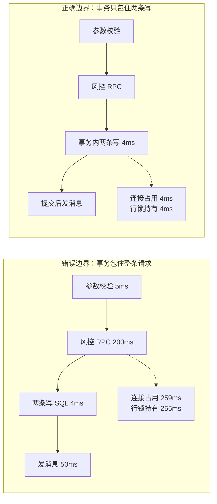
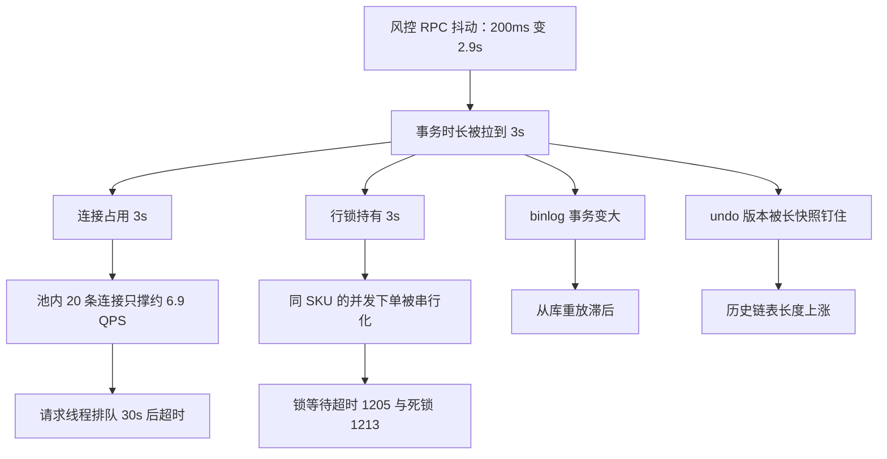
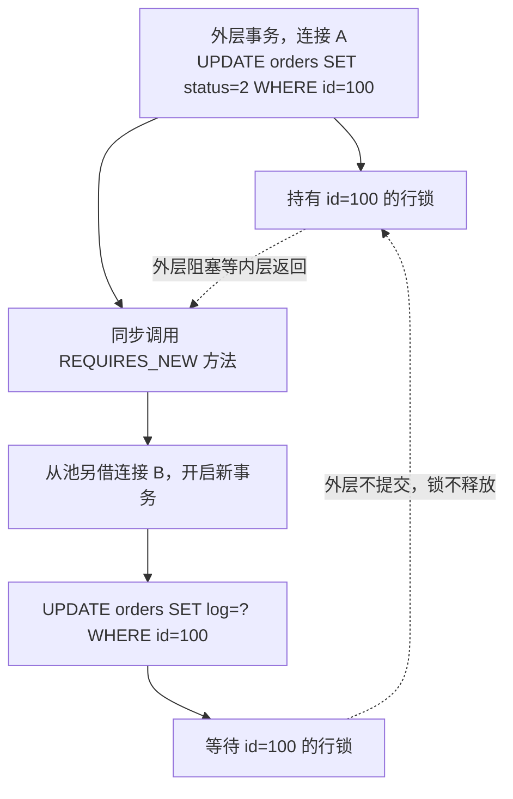
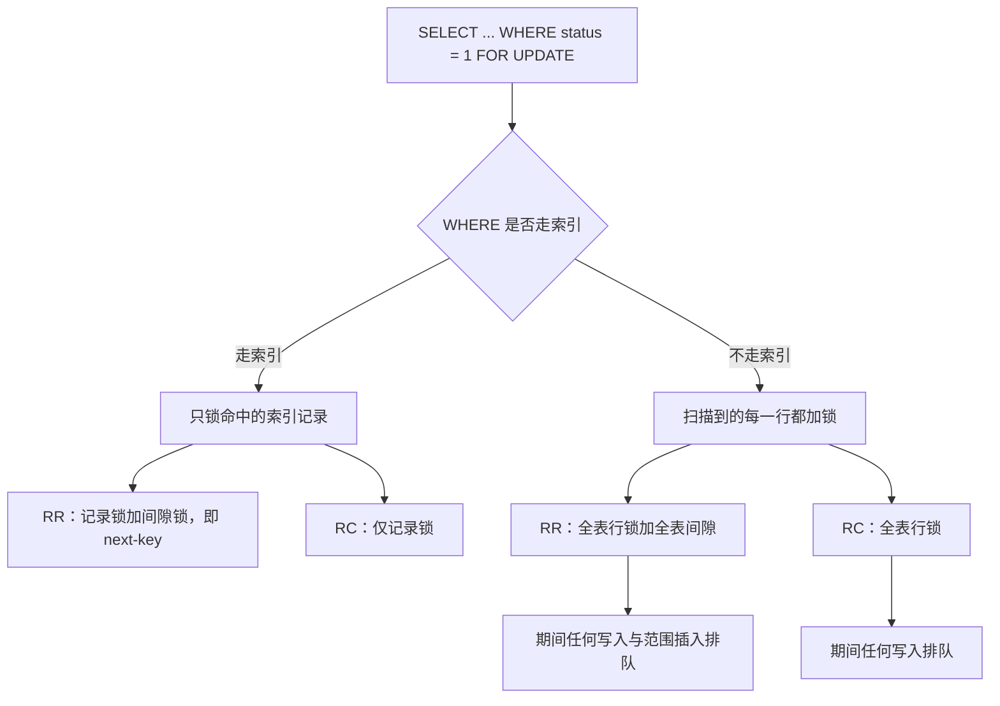
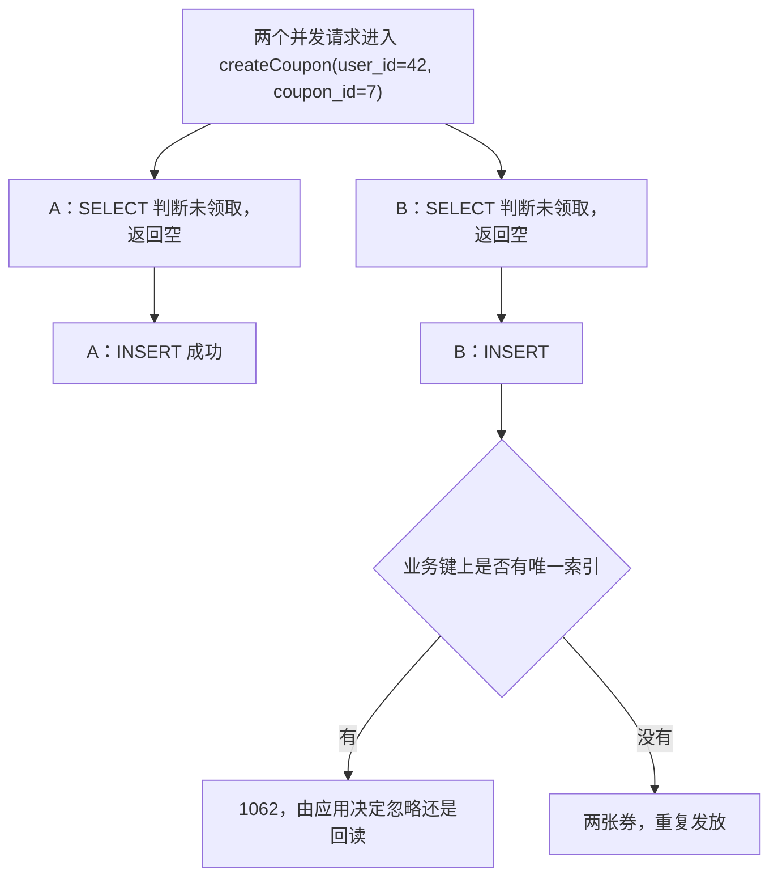

# 03 事务与隔离级别的正确打开方式

**摘要：**

应用开发者写事务，出错的从来不是语法，而是边界：`BEGIN` 与 `COMMIT` 之间到底圈住了什么。本文把事务边界当作一段代码结构来审查，先给出三条判定线——原子性最小写集、行锁持有时长、连接归还时刻，再用四个错误形态逐一对照：事务里调 RPC 与 HTTP（生产事故的头号来源）、事务里做耗时计算与文件 IO、`SELECT` 不开事务与 `UPDATE` 忘了 `COMMIT`、把 `SAVEPOINT` 与 Spring 传播行为误当成嵌套事务。接着处理两个最隐蔽的现场：连接池借还过程中 `autocommit` 状态的继承，上一个请求未提交的事务如何被下一个请求"接住"并一起提交；以及"先查后插"在并发下必然失效的机制，与三种兜底写法各自的副作用。隔离级别与加锁读只从代码视角写：RR 带来的旧快照与间隙锁死锁怎么在代码层规避，`FOR UPDATE` 什么时候该用、锁的范围由访问路径决定，以及 1213 死锁的重试边界与幂等底座。贯穿案例是一个日订单量三十万的交易服务，它在大促里两次栽在同一类问题上。

---

## 第 1 章 事务边界的三条判定线

### 1.1 一次大促的 P99 曲线

笔者参与过的一次大促，下单接口的 P99 在十分钟内从 90 毫秒涨到 3.2 秒，报错率不到 1%，但吞吐掉到原来的十分之一。值班时第一反应是数据库慢了，可监控里 SQL 的平均执行时间仍是 4 毫秒，慢查询日志一条都没多。真正的原因要等三样东西凑齐才看清：应用侧线程 dump 显示 20 个工作线程全部停在 `HikariPool.getConnection` 的等待上；数据库侧 `INNODB_TRX` 里有 20 条年龄超过 30 秒的活跃事务，`trx_query` 都是同一句 `UPDATE inventory`；再取 `performance_schema.data_lock_waits`，等待链的头部是一条跑了三分钟的事务。

把这条事务的调用栈还原出来，结构非常朴素：

```java
@Transactional(rollbackFor = Exception.class)
public Order createOrder(CreateOrderCmd cmd) {
    Order order = orderDao.insert(buildOrder(cmd));
    inventoryDao.deduct(cmd.getSkuId(), cmd.getQuantity()); // 4 毫秒
    riskClient.check(cmd);          // 风控 RPC，超时设为 3 秒
    couponClient.lock(cmd);         // 优惠券服务，HTTP
    messageService.send(buildMessage(order));  // 消息发送
    return order;
}
```

四条外部调用里有三条跨进程，其中风控在大促期间抖动到 2.9 秒。于是每个事务的时长被拉到三秒左右，连接池 20 条连接全部被这批事务占住，连接池的容量决定了下单接口的吞吐上限约为每秒 6.7 个请求，而实际进来的流量是这个数字的十几倍，请求在连接池门口排队，排队超过 30 秒就抛 `Connection is not available`。数据库端什么都没坏，它只是被一条被撑长的事务按住了。

这个案例里没有一个"错误 SQL"，问题全部出在边界上：事务圈住的东西比它该圈住的多。

### 1.2 三条线必须同时对齐

把事务当成一个时间窗口会更容易看清代价。同一个窗口里同时发生三件事：原子性承诺覆盖的写入集合、行锁持有的时间、一条物理连接被占用的时间。三者的边界由同一对 `BEGIN` 与 `COMMIT` 决定，这就意味着任何一处调整都会连带另外两处。

- **原子性最小集**：哪些写必须同生共死。下单这条链路里是订单行、库存扣减、优惠券核销三张表，少了任何一条都会出现"钱收了货没出"或者"券用了单没成"。
- **锁的持有时长**：InnoDB 的行锁不随语句结束释放，只随事务结束释放，窗口里每多待一毫秒，其他事务在热点行上的排队就多一毫秒。
- **连接归还时刻**：连接是在事务结束（提交或回滚）后才还给池的，窗口长度直接等于连接占用时长，而连接池是全局资源，不是某个接口的私有资源。

三条线的交集，就是事务边界该画的位置。线上问题的形态可以归纳成一句：边界画在了业务方法的边界上，而不是三条线的交集上，业务方法里混着的参数校验、外部调用、消息发送、文件处理，都被圈进了锁与连接的窗口。

### 1.3 五种把窗口拉长的写法

下表把常见的错误形态摆在一起，读法不是记结论，而是记住每一行的代价落在谁头上：连接池、锁等待、从库延迟，或者下一个请求。

| 形态 | 典型症状 | 放大机制 | 代价落在谁头上 | 首要观测入口 |
| :--- | :--- | :--- | :--- | :--- |
| 事务里调 RPC 与 HTTP | 连接池打满、线程等连接 | 一次抖动乘以并发数 | 连接池与同行的锁等待 | 线程 dump 加 `INNODB_TRX` 年龄 |
| 事务里做耗时计算与文件 IO | 事务时长随数据量线性增长 | 计算与 IO 不可中断 | 锁与 undo 空间 | 应用侧事务时长分布 |
| `UPDATE` 未提交、事务跨请求 | 数据串号、多扣少扣 | 池内连接承载了上一个请求的状态 | 下一个请求 | `INNODB_TRX` 起始时间早于请求开始 |
| 嵌套事务误用 | 内层等锁超时、连接池双倍占用 | 物理连接与事务语义错位 | 自己与自己成环 | 死锁日志与等待超时 |
| 批量大事务 | 主从延迟、undo 膨胀 | 事务体积与行数成正比 | 从库与 purge 线程 | 历史链表长度、binlog 事务大小 |

### 1.4 机制底座压成三句话

不必重做源码级推导，三句话够用。快照读的可见性由 read view 决定，事务在什么时刻拿到哪份快照，决定了它会不会读到旧值；当前读与所有写操作不走快照，直接读最新已提交版本并在索引记录上加锁，锁的类型与范围由访问路径决定；旧版本在 undo 里排队等 purge 回收，回收边界被最老的活跃快照钉住。三条分别对应后文的隔离级别、加锁读与大事务，推导见《[[中间件/MySQL/读书笔记-Mysql内核架构/12. InnoDB 事务实现：ACID 的内核代价与 MVCC 的时间旅行|读书笔记 12：InnoDB 事务实现]]》与《[[中间件/MySQL/MySQL架构与底层原理/04 Undo Log 与 MVCC——多版本并发控制的实现真相|04 Undo Log 与 MVCC]]》。

下图把错误边界与正确边界画在同一条请求时间线上，虚线是代价窗口。事务窗口越长，连接占用与行锁持有就越长，而这两者都不属于单个请求的私有资源。



### 1.5 `@Transactional` 的粒度不等于业务粒度

声明式事务把边界藏进注解，于是有注解被误读成这次请求有一个事务。实际要按调用链看：三个带 `REQUIRED` 的方法会合并进同一个物理事务，第一个打开、最后一个提交，中间的提交是空操作；同类自调用会绕过代理，注解上的隔离级别、超时、回滚规则全不生效。判断一次请求开了几个事务，可靠办法是打开 `org.springframework.transaction.interceptor` 的 TRACE 日志，数 `Creating new transaction` 与 `Initiating transaction commit` 是否成对。

那个案例里还有一个细节：`riskClient.check` 的超时与网关的读超时都是三秒，事务最长活到三秒零几毫秒，恰好等于上游愿意等待的全部时间，没给提交留余量。边界设计的第一条经验是写操作加提交的开销必须显著小于上游超时。

---

## 第 2 章 错误形态之一：事务里做 RPC 与 HTTP

### 2.1 为什么这是生产事故的头号来源

事务里调用外部服务，等于把不可控的远程延迟接到自己数据库的锁与连接上。本地 SQL 的延迟有上界，远程调用的延迟分布是长尾的：P50 只有 20 毫秒，P99 是 800 毫秒，超时上限三秒，网络分区时挂到超时。事务时长由链路里最慢的一环决定。

这解释了一个反直觉的现象：数据库的 QPS 与 CPU 都很闲，应用却报连接池耗尽。数据库并不闲，只是每个事务在两条 SQL 之间空等了三秒；池与锁这两样资源被等待消耗掉了，而不是被计算。

### 2.2 量化：一个抖动如何变成全站故障

用排队论里最朴素的一条式子做示例推算：稳定状态下，系统内正在处理的事务数等于到达率乘以停留时间，`L = λ × W`。连接池的大小就是 `L` 的上限，`W` 是事务时长，`λ` 是可支撑的吞吐。

以那个案例的参数代入：连接池 20，事务时长 205 毫秒（两条 SQL 5 毫秒，外呼 200 毫秒），则可支撑吞吐约为 20 ÷ 0.205 ≈ 97 请求每秒；风控抖动到 2.9 秒后，事务时长 2.905 秒，可支撑吞吐降到 20 ÷ 2.905 ≈ 6.9 请求每秒。同一套代码、同一台数据库，吞吐掉了十四倍，原因只是窗口长度变了。反过来，把外呼移出事务后事务时长回到 5 毫秒，同样 20 条连接的理论上限是 4000 请求每秒，瓶颈转移到了别处。

这个式子还有第二层用途：它给出了事务里可以放多慢的判据。接口目标吞吐 500 QPS、池大小 20 时，平均事务时长必须小于 40 毫秒；把这 40 毫秒作为事务预算，再去量每一条外部调用的 P99，超预算的就必须移出去。

### 2.3 三个串联的放大器

单个慢调用本身只影响一个请求，让它变成故障的是三个放大器。

第一个是连接池排队。等待队列在业务语义上没有上界，只有 `connectionTimeout`（HikariCP 默认 30 秒），请求在池门口堆三十秒才失败，期间工作线程被占住，故障从数据库层扩散到 Web 容器。

第二个是锁等待串联。事务持有热点行的锁，其他事务在 `UPDATE` 上排队，排队时间又被 `innodb_lock_wait_timeout`（默认 50 秒）截断，一旦超过就报 1205；若两个事务互相持有对方要的行，就是 1213。锁等待不消耗 CPU，但它让"事务时长"这个数字自我放大：等锁的事务自己也变成了长事务。

第三个是复制链路。binlog 里一个事务是一个整体，从库重放期间后续事件要等它结束，事务越大越慢，延迟越明显，读到的旧数据越多，缓存与对账跟着出问题。

下图把这条放大链路串起来，四条支路各自对应一类可观测指标。



### 2.4 修法一：把外呼移出边界

最常见的改法是把事务方法收窄成"只做必须原子的写"，所有跨进程调用挪到事务外。案例里的重构结果如下，事务里只剩两条写，风控挪到事务前，消息挪到提交后。

```java
public Order createOrder(CreateOrderCmd cmd) {
    riskClient.check(cmd);                    // 事务外：风控不过就不进入写流程
    Order order = transactionTemplate.execute(status -> {
        Order o = orderDao.insert(buildOrder(cmd));
        inventoryDao.deduct(cmd.getSkuId(), cmd.getQuantity());
        couponDao.markUsed(cmd.getCouponId(), o.getId());
        return o;
    });
    afterCommit(() -> messageService.send(buildMessage(order)));  // 事务外
    return order;
}
```

顺序上有一处必须交代清楚：风控前置到事务外之后，"风控通过"与"库存扣减"之间出现了一个可能被其他事务插队的窗口。这个窗口不能靠事务补回来，只能靠数据库的原子约束兜底——库存扣减写成带条件的更新（`UPDATE inventory SET available = available - ? WHERE sku_id = ? AND available >= ?`），用影响行数确认扣减成功，而不是先查再减。这与第 7、8 章讨论的"先查后写"是同一类问题。

### 2.5 通讯与通知：提交之后发，还得防止丢

把发消息挪到事务外，立刻引入一个新的不一致窗口：数据库提交成功、消息没发出去，下游永远不知道这笔订单存在。三种常见处理各有代价。

- **`afterCommit` 钩子**（`TransactionSynchronization#afterCommit`）：实现最轻，但进程在提交后、发送前崩溃会丢消息；钩子里也不能再用同一条连接写库，稳妥做法是只做投递这类非数据库动作。
- **本地消息表**：消息与业务写同库同事务落 outbox 表，由投递器轮询发送并标记已投递，天然可重试；代价是多一张表、多一次写、多一个组件。
- **事务消息**：把 outbox 的可靠性做进中间件，代价是与具体中间件绑定、回查要幂等。

三种方案的共同前提是**下游必须幂等**：至少一次投递意味着重复投递一定会发生，去重键要跟着消息走，落地方式见第 9 章。

### 2.6 修法二：确实必须同步调用的场景

支付预授权、库存中心、券中心的跨服务调用，业务上要求"失败就整体失败"，这类场景不能简单外移。可行的做法有三条，选择取决于失败后能否补偿。

一是**短超时加降级**：把外呼超时压进事务预算（譬如 200 毫秒），超时后走降级分支（风控异步复核、预占失败直接拒绝），且降级分支要能兜底，不能当作成功。

二是**预占加确认**：事务外先在远程系统预占资源，事务内只写本地状态、提交后确认，确认失败由补偿任务按预占凭证回滚；这是把两阶段提交拆成两个可重试的单阶段。

三是**本地状态加异步推进**：事务内只把订单写成待风控，风控结果通过事件回写状态机；代价是接口失去同步语义。

### 2.7 反例：把异常吞进事务里继续提交

比慢调用更糟的是"调用失败但事务继续"。

```java
@Transactional(rollbackFor = Exception.class)
public void settle(long orderId) {
    orderDao.markPaid(orderId);
    try {
        riskClient.report(orderId);   // 失败只记日志
    } catch (Exception e) {
        log.warn("report risk failed", e);
    }
    accountDao.addFlow(orderId);      // 仍会提交
}
```

这段代码的后果取决于 `riskClient.report` 内部有没有事务。若它自身带 `REQUIRED` 事务并抛出异常，异常穿过代理时已把外层事务标记为 rollback-only，即使 `catch` 住，提交时仍抛 `UnexpectedRollbackException`，结果是日志显示上报失败、账也记不上。若它没有事务，异常被吞后事务照常提交，留下钱记了、风控没上报的静默不一致。

还有一层叠加：很多 RPC 客户端自带重试（默认三次），每次三秒超时，最坏情况把事务撑到九秒。事务边界审查时要把客户端的重试配置一并算进时间预算，只看业务代码里的超时值是不够的。

---

## 第 3 章 错误形态之二、之三：耗时计算与丢失的事务

### 3.1 事务里的耗时计算

第二类错误形态不涉及网络，纯本地计算也能把窗口撑长：价格与优惠的实时试算、Excel 或 CSV 解析、图片压缩、PDF 生成、大对象序列化与加解密、正则回溯、规则引擎求值。它们的共同特征是耗时随数据规模线性甚至超线性增长，而事务时长没有上界。

一个常见的变形是事务内的 N+1 查询：

```java
@Transactional(rollbackFor = Exception.class)
public void importOrders(List<OrderCsvRow> rows) {
    for (OrderCsvRow row : rows) {
        Long skuId = skuDao.selectIdByCode(row.getCode());  // 每条一行查询
        orderDao.insert(buildOrder(row, skuId));
    }
}
```

一万行的导入文件会产生一万次查询加一万次插入，全在同一个事务里：行锁随循环累积，undo 随写入累积，连接被独占几分钟，期间任何人改同一批 SKU 都要排队；测试环境跑一千行只要几百毫秒，看不出问题。

处理方式与外部调用相同，先把不需要原子性的工作挪出去：解析与校验在事务外，SKU 编码到 ID 的映射一次性批量查询成 `Map`，写库按批切分（每次 500 到 1000 行、一个事务），失败行单独重试。批量写把巨大 undo 链拆成若干短链，purge 才有机会跟上。

### 3.2 事务里的文件与对象存储 IO

对象存储的 SDK 调用、本地磁盘写入、NAS 挂载写，同样是不可控延迟。同步上传一个 20MB 附件到对象存储，网络好时 300 毫秒，网络差时重试三次共十几秒，而这段时间事务一直开着、锁一直持有。

更麻烦的是两个方向的半成品：文件已上传、数据库事务回滚，留下孤儿文件；数据库已提交、文件上传失败，留下指向不存在文件的记录。常见处置是先写临时位置、事务提交后再转正（重命名或标记为可用），失败则留待清理任务扫描；或者反过来先落库再异步上传，用状态字段标示"上传中"，由补偿任务推进。两条路都要接受"存在中间态"这个事实，区别只在中间态由谁清理。

### 3.3 `SELECT` 不开事务：三件事要分开说

"`SELECT` 要不要开事务"这个问题本身混淆了三件事。

第一件，单条 `SELECT` 在 `autocommit=1` 下自成一个事务，读完即结束，不需要显式 `BEGIN`。这是"安全"的，但安全的原因不是没开事务，而是它没有跨语句的一致性问题。

第二件，多条 `SELECT` 分处不同事务时，"读到什么"就不再有保证。先查用户状态、再查订单、再判断能否退款，这三条查询各自看到的是不同时刻的快照，中间被并发修改就会得出错误结论。这类逻辑要么放进同一个事务（并接受快照的时效性），要么改成带条件的原子更新。

第三件，一条跑得很久的 `SELECT` 本身就是长事务。RR 下它在开始时建立快照，快照活到语句结束，期间产生的所有 undo 版本都不能被 purge——导出报表、跑对账、全表统计这类查询如果放在主库的在线连接上，会直接把 undo 历史链表顶起来，同时占住一条连接几分钟。正确的做法是把这类读放到只读实例或专用连接池，用 `START TRANSACTION READ ONLY` 显式限定语义，并且对查询时长设上限。

### 3.4 `UPDATE` 忘记 `COMMIT`：连接不还，事务不散

框架托管连接时，"忘记提交"通常不是字面意义上的漏写 `commit`，而是三种更隐蔽的形态。

第一种是自调用与代理失效。事务注解加在同类方法上、加在 `private` 方法上、加在接口实现类的非接口方法上，代理拦截不到，事务从未开启，每条语句自动提交，回滚语句什么也回滚不了。这种 bug 的特征是"代码里明明写了 `@Transactional`，测试环境一切正常，只在异常路径上数据不一致"。

第二种是异常被吞。方法内部 `try/catch` 住异常并继续执行，事务照常提交，前半截写入生效、后半截没有。

第三种是连接没还。手写 JDBC 的路径里，`setAutoCommit(false)` 之后若在异常分支里 `return`，而 `finally` 只关了 `ResultSet` 与 `Statement` 没关 `Connection`，或者关了但池没做重置，这条连接会带着一个未结束的事务回到池里，成为第 5 章的主角。它的应用侧症状是连接池活跃数持续高于并发请求数，最终报 `Connection is not available, request timed out after 30000ms`。

判断这三类问题，日志比代码可靠：Spring 的 TRACE 日志里 `Creating new transaction` 与 `Initiating transaction commit` 的数量应当与请求量成固定比例，出现"开了没提"的缺口就说明有路径漏了；连接池的活跃连接数与 QPS 的比值若随运行时间缓慢上升，说明有连接没归还。

### 3.5 隐式提交：事务里的 DDL 会把事务悄悄提交

MySQL 有一批语句在执行前会隐式提交当前事务，`START TRANSACTION`、`SET autocommit=1`、`LOCK TABLES`、`UNLOCK TABLES`、`ANALYZE TABLE`、`OPTIMIZE TABLE`、`REPAIR TABLE`、`FLUSH`、`RESET`、账户与权限类语句，以及所有 DDL（`CREATE`、`ALTER`、`DROP`、`RENAME`、`TRUNCATE`）。这些语句出现在事务中间时，前面已经做的写入会被直接提交，后面再抛异常也回滚不了。

一个真实的写法长这样：归档任务在一个事务里先删明细、再 `TRUNCATE` 归档表、再写归档记录，中途任何一步失败，删除已经提交、归档没写，数据凭空消失。8.0 的原子 DDL 保证的是 DDL 自身的原子性（要么全成要么全不成），它并不让 DDL 获得事务语义，这条边界经常被混为一谈。

审查手法很直接：在 `@Transactional` 方法体里搜索 `ALTER`、`TRUNCATE`、`LOCK TABLES`、`ANALYZE` 这些关键字；更彻底的做法是把 DDL 全部收拢到迁移脚本与变更窗口，业务代码里不出现 DDL。

---

## 第 4 章 错误形态之四：嵌套事务的误解

### 4.1 MySQL 层：只有 `SAVEPOINT`

MySQL 没有真正的嵌套事务。`BEGIN` 在已有事务中执行只会隐式提交前一个事务，不会产生内层；唯一能实现"局部回滚"的手段是保存点。

```sql
BEGIN;
INSERT INTO orders (id, user_id, amount) VALUES (1001, 42, 199.00);
SAVEPOINT sp_coupon;
UPDATE coupon SET status = 1 WHERE id = 7 AND status = 0;
-- 若券核销失败，回到保存点，订单写入仍在
ROLLBACK TO SAVEPOINT sp_coupon;
INSERT INTO order_log (order_id, action) VALUES (1001, 'COUPON_SKIPPED');
COMMIT;
```

保存点有三条容易被忽略的语义。其一，`ROLLBACK TO SAVEPOINT` 只回滚数据修改，**不释放保存点之后获得的锁**，手册对此有明确说明，所以"回滚到保存点"换不来锁的释放，热点行仍然被按着。其二，保存点之后若又执行了隐式提交语句，保存点失效，`ROLLBACK TO` 会报"保存点不存在"。其三，`RELEASE SAVEPOINT` 只是删除标记，不做提交，也不释放锁。

保存点的适用场景很窄：同一个事务内"某一段写入可以放弃、其余必须保留"。譬如订单主表必须写成功，赠品明细写失败可以跳过；或者批量导入里允许个别行失败而整体成功。它不适合用来模拟"独立子事务"，因为锁与连接仍然是外层的。

### 4.2 Spring 层：七种传播行为里只有一种接近嵌套

Spring 的传播行为经常被当成"嵌套事务开关"，实际语义要按物理连接来分辨。下表按"是否复用外层连接""内层回滚是否影响外层"两个维度列，最后一列是各自的真实代价。

| 传播行为 | 物理连接 | 内层回滚的影响 | 典型代价 |
| :--- | :--- | :--- | :--- |
| `REQUIRED`（默认） | 复用外层，无外层则新建 | 内层标记 rollback-only，外层提交时整体回滚 | 内层"提交"是空操作，异常被吞也会炸 |
| `REQUIRES_NEW` | 从池另借一条 | 内层独立回滚，外层不受影响 | 连接占用翻倍，可能自锁 |
| `NESTED` | 复用外层，靠 `SAVEPOINT` | 回滚到保存点，外层可继续 | 仅 JDBC 与 `DataSourceTransactionManager` 支持，锁不释放 |
| `MANDATORY` | 必须已有事务 | 同 `REQUIRED` | 无外层直接抛异常，适合强制约束 |
| `SUPPORTS` | 有则加入、无则裸跑 | 视外层而定 | 没有事务时写入不受保护，容易被误用 |
| `NOT_SUPPORTED` | 挂起外层，不用事务 | 与事务无关 | 挂起期间外层连接仍被占着 |
| `NEVER` | 必须无事务 | 无 | 与外层事务冲突时直接抛异常 |

最需要纠正的一条是 `REQUIRED` 的语义：它是"加入外层事务"，不是"新开一个事务"。这带来三个后果，几乎每一个都在生产里出现过。

其一，内层的提交不落库。内层正常返回时什么都不会发生，真正的提交要等外层；外层此后抛异常，内层以为成功的写入一起消失，内层返回成功即代表落库的假设不成立。

其二，内层异常会毒化整个事务。内层抛出未捕获的运行时异常时，Spring 把事务标记为 rollback-only，外层即使 `catch` 住，提交阶段仍抛 `UnexpectedRollbackException`；想让内层失败不影响外层，靠 `catch` 没用，得换传播行为。

其三，内层的事务属性被忽略。`timeout`、`readOnly`、隔离级别在加入外层时不生效，物理事务只有一个，属性在外层打开时就定了；在内层写 `@Transactional(timeout = 3)` 期望三秒后中断，结果取决于外层。

### 4.3 `REQUIRES_NEW` 的两个坑

`REQUIRES_NEW` 看起来是"独立子事务"的正解，代价却比想象中大。

第一个坑是自己等自己。外层事务更新了订单行，持有该行锁，然后在同一个线程里调用 `REQUIRES_NEW` 方法再去更新同一行；新事务借了另一条连接，读到的是最新已提交版本（看不到外层未提交的修改），执行 `UPDATE` 时请求该行的锁，而锁在外层手里，外层又在等内层返回。这个环路没有任何一方会主动退让，只能等 `innodb_lock_wait_timeout` 到期，默认 50 秒，期间两条连接、两个事务全部卡住，环路的形态如下图。



第二个坑是连接占用翻倍。一个请求里外层加内层就要两条连接，池大小 20 时，理论并发从 20 掉到 10；若所有请求都这样调用，池会在两层之间互相等待——内层等连接，外层握着连接不放，形成池级死锁，表现为应用整体挂起而数据库毫无异常。判断依据很直接：`SHOW PROCESSLIST` 里活跃连接数等于池上限，但 `INNODB_TRX` 里的事务数只有一半左右，说明有一半连接被"等待中的外层"占着。

第三个代价是孤儿数据。内层提交、外层回滚时，内层写入的记录会永久留下。审计日志、操作流水可以接受这种语义，业务主数据不能；把两者混在同一个内层方法里，是数据对不上的常见起点。

### 4.4 判据：什么时候用哪种

- 默认用 `REQUIRED`，并把"内层异常不得吞掉"写进规范。绝大多数业务方法属于这一类。
- 需要"内层失败不影响外层，且仍要读外层未提交的修改"——这在物理上做不到，`NESTED` 也只能回滚到保存点，读到的仍是外层自己的修改，因为连接是同一条。这条判据常被误解，值得单独记：同一连接内的读能看到自己的未提交修改，跨连接的读看不到。
- 需要"内层独立提交"（审计、流水、去重表）用 `REQUIRES_NEW`，但必须保证内层不碰外层已锁的行，且池容量按两倍并发预留。
- 需要"内层局部回滚"用 `NESTED`（JSON 参数 `nestedTransactionAllowed` 默认开启），接受锁不释放与仅 JDBC 支持的约束。

---

## 第 5 章 `autocommit` 与连接池：最隐蔽的串数据

### 5.1 三个配置位

`autocommit` 这个开关在链路上有三个位置，彼此的默认值、修改者与重置者都不同，混乱就出在这里。

| 位置 | 默认 | 谁来改 | 是否随请求重置 | 观测方式 |
| :--- | :--- | :--- | :--- | :--- |
| 服务端全局 `autocommit` | `ON` | DBA、参数模板 | 否 | `SELECT @@global.autocommit` |
| 会话级 `SET autocommit` | 继承全局 | SQL、初始化脚本、连接池 | 取决于池 | `SELECT @@session.autocommit` |
| JDBC `Connection#setAutoCommit` | 保持服务端值 | 框架、业务代码 | 取决于池 | 连接对象的 `getAutoCommit` |

关键在于第三行：连接池初始化每条物理连接时会按自己的配置设一次 `autoCommit`（HikariCP 的 `autoCommit` 默认 `true`，Tomcat JDBC 的 `defaultAutoCommit`、Druid 的 `defaultAutoCommit` 同理），此后这条连接在池里流转，会话状态跟着物理连接走，不跟着请求走。连接池的意义是把建立连接的成本摊薄，代价就是会话状态被长期保留——这既是性能的来源，也是串数据的来源。

### 5.2 事故：下一个请求接住了上一个请求的事务

这是笔者见过最难定位的一类 bug，因为它要求三个条件同时成立：池里有连接带着未结束的事务、池在归还时没有清理它、下一个请求恰好复用了这条连接。

事故经过大致如下。一个内部补数据工具用 `JdbcTemplate` 拿连接后手工 `setAutoCommit(false)`，执行了一条库存修正的 `UPDATE`，在异常分支里只记了日志就返回，连接被还回池；池的 `autoCommit` 配置是 `false`（历史原因），归还时没有对脏提交状态做回滚。下一个下单请求借到这条连接，在事务里查库存，读到的是那条未提交的修正值，判断库存充足后扣减并提交，这次提交把补数据工具的 `UPDATE` 一起提交了，库存被多扣了一份。事后核对，两笔业务各自看都成功，账却对不上。

这个 bug 的隐蔽性来自三层：所有 SQL 都是对的，错的是会话状态；复现需要并发与池复用，测试环境池小、请求少，撞上的概率极低；出问题时数据库侧看到的是一个正常提交的事务，没有报错、没有慢查询、没有锁等待。

下图把连接的流转画成状态机，虚线是"未重置"这条危险路径。


### 5.3 池的重置逻辑覆盖不到什么

主流连接池在归还连接时做的清理，通常只覆盖"它自己通过 API 改过的状态"：`autoCommit`、`readOnly`、事务隔离级别、catalog，而且各家策略不同。HikariCP 在连接关闭时会对"自己标记为脏的提交状态"做回滚；Tomcat JDBC 提供 `rollbackOnReturn` 开关（默认关闭）；Druid 侧重复用与 `removeAbandoned` 是另一套思路。具体行为以对应版本源码与配置文档为准，判据只有一条：从池里取一条连接，实测 `@@autocommit`、`@@transaction_isolation` 与是否处于事务中。

重置逻辑覆盖不到的，正是通过 SQL 直接改会话状态的那一类：

- `SET autocommit = 0/1` 绕过了 JDBC 的 `setAutoCommit`，池的脏标记完全不知道；
- `SET SESSION transaction_isolation`、`SET SESSION sql_mode`、`SET time_zone`、`SET NAMES` 这类会话变量；
- 用户变量（`@x`）、临时表、开着的 `SAVEPOINT`、未释放的预处理语句；
- `LAST_INSERT_ID()` 的会话值，跨请求读到上一个插入的 ID 是另一类经典事故。

这些状态在池里活得比请求长，等于把"局部变量"变成了"全局变量"。规模一旦上去，表现就是"偶发、不可复现、换台机器就好"，因为它依赖池内部的调度顺序。

### 5.4 判据与修法

观测上有三条入口：`INNODB_TRX` 里存在 `trx_started` 早于当前请求开始时间的事务；`SHOW PROCESSLIST` 里连接处于 `Sleep` 却有活跃事务；`performance_schema.events_transactions_current` 的线程对不上业务线程。更彻底的是看 binlog：打开一个事务，若事务内出现两个来源不同的业务更新，基本可以确定状态串了。

修法按成本从低到高：

1. **业务代码不碰连接**。统一走框架的声明式或编程式事务，代码里不出现 `getConnection`、`setAutoCommit`、`commit`、`rollback`。
2. **必须手写时用 try/finally**。`finally` 里先 `rollback`（安全兜底，已提交的事务上回滚是空操作），再恢复 `setAutoCommit(true)`，最后 `close`。
3. **池配置显式化**。`autoCommit=true`（把开事务的责任交给框架）、HikariCP 的 `leakDetectionThreshold` 设为大于 P99 且小于 `connectionTimeout` 的值（它只打日志告警，不会自动回滚）、Tomcat JDBC 的 `rollbackOnReturn=true`。
4. **启动自检**。应用启动时从池里取一条连接，断言 `@@autocommit`、`@@transaction_isolation` 与预期一致，不一致直接启动失败。
5. **代码扫描**。把 `SET autocommit`、`setAutoCommit`、`START TRANSACTION` 列为巡检规则，出现即要求说明理由。

---

## 第 6 章 隔离级别的开发者视角：RR 的三个实际影响

### 6.1 影响一：不可重复读被"解决"，代价是可能读到旧值

RR 用一份固定的快照换来事务内的一致性，代价是事务看到的世界停在开始那一刻。对"读-算-写"型逻辑，这恰恰是危险的：校验时读到的值已经过期，写入却基于它。

一个具体的 bug 形态：用户下单用券，事务开始后读到券状态为未使用，校验通过；随后调用券服务确认可用性（几百毫秒），再回到本地更新券状态。这段时间里另一个请求已经把这张券用掉了，RR 下第二次读仍是未使用，于是两张订单都用了同一张券，直到对账才发现。

修法不在隔离级别，而在写法：把"判断"与"修改"合并成一条带条件的更新，用影响行数确认抢到了这次状态迁移。

```sql
UPDATE coupon
SET status = 1, order_id = 1001, used_at = NOW()
WHERE id = 7 AND status = 0 AND user_id = 42;
-- 影响行数为 1 才算核销成功，为 0 说明被别人抢先
```

这条写法在 RR 与 RC 下都成立，因为它不依赖快照的时效性，只依赖单行更新的原子性。反过来说，凡是"先读后判、再写"的结构，都要问一句：这两步之间别人改了怎么办。

### 6.2 影响二：间隙锁带来的死锁

RR 下范围条件会加 next-key 锁，成环概率随范围重叠上升，机制与死锁日志的读法在《[[中间件/MySQL/MySQL架构与底层原理/08 InnoDB 事务隔离级别——从脏读到幻读的防御工程|08 InnoDB 事务隔离级别]]》第 2 章与《[[中间件/MySQL/MySQL进阶使用/04 锁与并发控制——开发者必须理解的死锁问题|04 锁与并发控制]]》里展开，这里只留代码侧的三条约束。

一是把范围条件换成等值条件，`WHERE status = 1 AND id = 100` 比 `WHERE status = 1` 锁得少一个数量级。二是让并发事务以相同顺序访问资源，批量更新按主键排序、跨表操作按固定表序，把交叉成环变成排队等待。三是让范围条件走索引，没有索引的范围更新会扫描并锁定全表。

### 6.3 影响三：长事务钉住 undo

快照活到事务结束，期间所有旧版本都不能回收。这个代价由 `history list length` 体现，具体回收机制与阈值见《[[中间件/MySQL/MySQL架构与底层原理/04 Undo Log 与 MVCC——多版本并发控制的实现真相|04 Undo Log 与 MVCC]]》，从代码视角只需要记住一条：事务的时长要按"它多久释放一次快照"来审计，任何超过秒级的事务都值得单独看一眼。

### 6.4 该不该改成 RC 的判据

改隔离级别是配置动作，但真正的工作量在代码。下表按业务形态给判据，最后一列是"改之前必须补的代码改造"，缺这一列的决定基本都会在灰度期翻车。

| 业务形态 | 关键判据 | 级别建议 | 必须同步补的改造 |
| :--- | :--- | :--- | :--- |
| 下单、支付、券核销，短事务高并发 | 事务内无跨语句一致读需求 | 可改 RC | 读-算-写改成条件更新；唯一索引兜底 |
| 报表、对账、批量结算 | 需要跨语句同一时刻快照 | 保留 RR | 事务时长上限；读走只读实例 |
| 依赖"范围不被插入"的逻辑 | 例如名额控制、编号分配 | 保留 RR 或加锁读 | 改用唯一索引或 `FOR UPDATE` |
| 迁移自 Oracle、PostgreSQL | 源库默认 RC，行为要对齐 | 倾向 RC | 重跑并发一致性用例 |
| 分库分表多实例 | 各实例级别必须一致 | 统一 | 参数模板加启动自检 |

改成 RC 之后有四处代码要重新过一遍：读-算-写改成条件更新；事务内重复读同一行改成一次读入局部变量（并接受它可能过期）；MyBatis 的一级缓存会让同一 `SqlSession` 内的重复查询仍返回第一次的结果，详见《[[Java/Mybatis/06 一级缓存与二级缓存——命中条件、失效场景与生产陷阱|Mybatis 06：一级缓存与二级缓存]]》；复制侧确认 `binlog_format` 为 `ROW`，相关历史约束见架构列 08 第 5 章。

### 6.5 反例：全局改 RC 而代码仍按 RR 写

最常见的事故形态是"参数改了、代码没改"。开发者在测试环境把隔离级别调成 RC，跑通了主流程，上线后发现偶发超卖，回头查代码，每一处都是"先查库存判断够不够、再扣减"的写法。这类逻辑在 RR 下被快照掩盖了（虽然也不完全可靠），切到 RC 后集中暴露，而且暴露的形态是低并发正常、高并发偶发，排查成本极高。

第二个反例是用 `SERIALIZABLE` 兜底事务边界设计。把所有 SELECT 转成共享锁读确实能消掉大部分并发异常，代价是读写互斥，热点行上的吞吐塌到接近串行，而真正的问题——事务里调 RPC、先查后插——一个都没解决。

---

## 第 7 章 加锁读：`FOR UPDATE` 的正确用法与代价

### 7.1 四种写法的语义边界

MySQL 8.0 的加锁读有四种组合，`LOCK IN SHARE MODE` 作为兼容写法保留。

| 写法 | 加锁强度 | 遇到已加锁的行 | 适用场景 | 代价 |
| :--- | :--- | :--- | :--- | :--- |
| `FOR UPDATE` | 排他锁 | 等待 | 读后要写、状态机迁移 | 锁范围由访问路径决定 |
| `FOR SHARE` | 共享锁 | 与其他共享锁兼容 | 读后要保证不被改 | 写者被阻塞，易成环 |
| `FOR UPDATE NOWAIT` | 排他锁 | 立即报 3572 | 宁可失败也不要排队 | 调用方必须处理失败 |
| `FOR UPDATE SKIP LOCKED` | 排他锁 | 跳过 | 任务队列领取 | 结果集不稳定，语句复制不安全 |

`NOWAIT` 与 `SKIP LOCKED` 都是 8.0 引入的，前者把"等锁"变成"快速失败"，适合对延迟敏感、可以重试的路径；后者让多个消费者各取一批互不重叠的任务，是队列型表的常用手法。需要注意的是，两者在 `binlog_format=STATEMENT` 下对复制不安全，会产生告警，行格式复制不受影响。

### 7.2 锁的范围由访问路径决定，不由结果集决定

这是 `FOR UPDATE` 最容易被低估的一点：它锁的是扫描过的记录，不是返回的记录。走主键等值时只锁一条；走二级索引时先锁二级索引记录、再回表锁聚簇索引记录；WHERE 没有可用索引时全表扫描，扫描到的每一行都要加锁——RC 下是全表行锁，RR 下是全表行锁加间隙。

```sql
-- 假设 orders 上只有主键，status 无索引
SELECT * FROM orders WHERE status = 1 FOR UPDATE;
-- 10 万行的表，这条语句会给 10 万行加锁，期间所有写入排队
```

下图把"走索引"与"不走索引"两种路径的加锁范围画出来，下半部分是两类代价。



判断一条加锁读会不会锁全表，`EXPLAIN` 就够了：`type` 为 `ALL` 或 `key` 为 `NULL` 时，锁的范围等于整张表。更精确的观测是 `performance_schema.data_locks`，它把每一条锁的 `LOCK_MODE`、`LOCK_DATA` 都列出来，行数就是本次语句实际加的锁数量。

```sql
-- 执行加锁读之后，在另一个会话里看锁了什么
SELECT ENGINE_TRANSACTION_ID, OBJECT_NAME, INDEX_NAME,
       LOCK_TYPE, LOCK_MODE, LOCK_DATA
FROM performance_schema.data_locks
ORDER BY ENGINE_TRANSACTION_ID;
```

索引选择的完整方法见《[[中间件/MySQL/MySQL进阶使用/02 SQL 调优方法论——从 EXPLAIN 到执行计划重写|02 SQL 调优方法论]]》，这里只需要记住判据：加锁读之前先 EXPLAIN，`type` 不是 `ref`、`eq_ref`、`range` 时不要在生产上跑。

### 7.3 RR 与 RC 下同一句 `FOR UPDATE` 的差别

差别集中在一个场景：**目标行不存在时**。

RR 下，`SELECT ... WHERE phone = '138...' FOR UPDATE` 若没有命中任何行，InnoDB 会锁住该值所在的间隙，因此并发的另一个事务想插入同一个 phone 会被挡住——"先查后插"在 RR 下靠这个机制勉强成立（但并不可靠，见第 8 章）。

RC 下没有间隙锁（外键与唯一键检查除外），不存在的行没有记录可锁，于是两个并发事务都能查到"不存在"，然后都去插入。这意味着 RC 下"先查后插 + `FOR UPDATE`"完全挡不住并发插入，唯一可靠的兜底是唯一索引。

这条差异直接决定第 8 章三种解法的适用范围：靠锁来防重复插入，只在 RR 且索引选择正确时成立；跨隔离级别都成立的只有唯一约束。

### 7.4 什么时候该用加锁读

该用的判据可以压缩成一句话：需要在一次事务内"读到最新值、基于它做决定、并把决定写回去"，且这个决定无法用单条 SQL 表达。典型场景有四个。

状态机迁移。订单从待支付到已支付，需要先确认当前状态，再写新状态并附带业务动作。用条件更新（`WHERE id = ? AND status = 0`）加影响行数判断更轻；若迁移前要读多个字段做分支判断，加锁读更直观。

余额与库存的"先读后扣"。当扣减规则复杂（阶梯价、多仓分配、组合商品）无法写成一条更新时，先 `FOR UPDATE` 锁住主记录，再在内存里算，最后写回。

任务队列领取。多个消费者从任务表取任务，`FOR UPDATE SKIP LOCKED` 让各自拿到互不重叠的一批，避免"抢到同一条再互相等锁"。

批量处理的一致性快照。一批数据要基于同一时刻的状态处理，先 `FOR UPDATE` 锁住这批行，处理完再提交。

不该用的判据同样清晰。凡是能写成一条条件更新的，就不要先读再写：多一次往返、多一次锁持有、多一个成环窗口，收益只是代码读起来更直白。只读展示不需要加锁读，用快照读即可。能用唯一索引兜底的并发问题，优先用索引，不要用锁。

### 7.5 影响行数：一个被 JDBC 默认值改掉的判据

用条件更新做并发控制，判据通常是"影响行数是否为 1"。这个判据在 MySQL Connector/J 上有一个默认值陷阱：`useAffectedRows` 默认为 `false`，驱动会带上 `CLIENT_FOUND_ROWS` 标志，于是 `getUpdateCount()` 返回的是**匹配行数**而不是实际修改行数。当一条 `UPDATE` 匹配到了行、但新值与旧值相同时，返回值是 1 而不是 0。

后果是"幂等更新"误判：把状态从 1 改成 1 的重复请求被当成"抢到了这次迁移"，后续动作重复执行。规避方式有三条：把条件写成能保证值一定变化的形式（状态机迁移里天然满足，因为状态不同）；用版本号字段自增（`SET version = version + 1 WHERE version = ?`），保证 changed rows 恒为 1；或者显式把连接参数 `useAffectedRows=true` 打开，让返回值语义回到"实际修改行数"，但要评估其他依赖返回值的代码。

`INSERT ... ON DUPLICATE KEY UPDATE` 的返回值是另一套语义：插入 1、更新 2、命中但无变化 0（开了 `CLIENT_FOUND_ROWS` 则为 1）。依赖这个数字做分支判断的代码，换驱动版本或换连接参数就会变行为，稳妥的做法是不依赖它，改为读回记录判断。

### 7.6 加锁读与死锁

加锁读把"读"也纳入了锁的范畴，两条 `FOR UPDATE` 语句以不同顺序扫过同一批行，就会成环。1213 的处置与重试见第 9 章，代码侧能做的三件事是：固定访问顺序、把范围缩小到等值、把多条加锁读合并成一条语句（一条 `UPDATE ... WHERE id IN (...)` 的加锁顺序由索引决定，比两次单行 `FOR UPDATE` 更可预测）。

---

## 第 8 章 先查后插：最经典的并发陷阱

### 8.1 最小复现

两个会话，同一张表，同一个业务键。先看没有唯一索引时会发生什么。

```sql
-- 会话 A 与会话 B 同时执行
BEGIN;
SELECT id FROM user_coupon WHERE user_id = 42 AND coupon_id = 7;  -- 两边都返回空
-- 两边都认为"没领过"，都去插入
INSERT INTO user_coupon (user_id, coupon_id, created_at) VALUES (42, 7, NOW());
COMMIT;
-- 结果：两张券
```

若 `user_id` 与 `coupon_id` 上有唯一索引，第二个 `INSERT` 会报 1062，业务侧要么捕获后当作"已领取"，要么直接失败——两种处理都要求代码提前想好，而多数实现里这一步是缺失的。

有人会问：RR 的间隙锁能不能挡住？不能。第一个事务的 `SELECT` 是快照读，不加任何锁；间隙锁只在当前读（`FOR UPDATE`、`FOR SHARE`、DML）时产生。两个事务都快照读，谁都看不到对方，然后都插入，插入动作本身才会去申请插入意向锁，而两个插入意向锁之间并不冲突（它们落在不同位置时）。即使两个事务插的是同一个唯一键，冲突也要等到第二条 `INSERT` 执行时才由唯一索引报出来，不是间隙锁挡住的。

下图是这条时间线的形态，下方是两种结局。



### 8.2 为什么这个模式如此普遍

"先查后插"几乎是人类描述业务规则的默认语序：先看看有没有，没有就创建。它在单线程下完全正确，在并发下必然错误，而错误率与并发度成正比、与事务隔离级别无关。数据库能提供的唯一保证是约束：唯一索引让"第二条"在物理上无法存在，其他一切都是应用层的协调，协调就有窗口。

这类逻辑的分布比想象中广：注册去重（手机号、邮箱）、领券与报名、创建唯一单据号、幂等去重表、首次登录初始化、库存预占记录、权限绑定关系。凡是"每个用户只能有一条"的语义，落地时都需要唯一索引，而不是一个 `SELECT` 判断。

### 8.3 三种解法与各自的副作用

| 解法 | 前提 | 冲突时的行为 | 主要副作用 |
| :--- | :--- | :--- | :--- |
| 唯一索引 + `INSERT ... ON DUPLICATE KEY UPDATE` | 有业务唯一键 | 转为更新或空更新 | 自增跳号、返回值语义复杂、批量 upsert 易死锁 |
| `INSERT IGNORE` | 有唯一约束 | 静默跳过 | 吞掉的不只是重复键；无法区分失败原因 |
| `SELECT ... FOR UPDATE` 后插入 | 走唯一索引，RR | 第二个事务等锁 | 锁持有到下个事务结束；RC 下失效 |
| 直接 `INSERT`，捕获 1062 后回读 | 有唯一索引 | 报错后回查 | 需要处理"回读也读不到"的时序 |

**唯一索引加 `ON DUPLICATE KEY UPDATE`** 是工程上最常用的兜底，语义是冲突则更新，适合存在即幂等的场景。副作用有三处：自增 ID 会跳号（冲突发生在插入阶段，自增值已分配，`innodb_autoinc_lock_mode=2` 下批量插入按 2 的幂预分配，跳号幅度更大但不影响唯一性）；返回值语义复杂（1/2/0），不宜作为分支判据；并发批量 upsert 极易死锁，因为冲突行的加锁顺序由唯一索引与主键索引的相对顺序决定，键顺序不同就交叉成环。

8.0.20 起 `VALUES()` 函数被弃用，改用在 `INSERT` 后声明行别名：

```sql
INSERT INTO user_coupon (user_id, coupon_id, created_at)
VALUES (42, 7, NOW()) AS new
ON DUPLICATE KEY UPDATE updated_at = new.created_at;
```

**`INSERT IGNORE`** 的语义是"把可忽略的错误降级为警告"，看起来正好，实际用途要窄得多。它跳过的不只是重复键，还包括一部分数据转换与截断错误，于是字段超长被截断这类问题会被静默吞掉，留下内容不完整的数据；它也不提供区分能力，调用方无法知道是重复了还是数据有问题。外键约束失败这类错误不在忽略范围内，具体以对应版本文档为准。它适合数据质量由前置校验保证、这里只做去重的场景，不适合作为通用兜底。

**`SELECT ... FOR UPDATE` 后插入** 是最贴近原语序的写法，代价前面已经算过：锁要持有到事务结束，而事务里通常还有别的写入；RR 下靠间隙锁挡住并发插入，前提是查询条件走了唯一索引且隔离级别确实是 RR。RC 下这条方案无效，因为不存在的行没有记录可锁。

**直接插入并捕获 1062** 反而是笔者更推荐的默认写法：先尝试写，撞了唯一键再回读，读不到就重试一次。它把检查从业务逻辑里去掉，只留一条插入，冲突由数据库报出，代码路径最短，锁持有时间也最短；代价是异常流成为常规流的一部分，日志里会有可预期的 1062，需要与真正的错误区分开。

### 8.4 判据：选哪一条

- 业务键天然唯一（手机号、邮箱、身份证、`(user_id, coupon_id)`）→ 建唯一索引，直接插入，捕获 1062 后回读。
- 需要存在则更新、不存在则插入 → `ON DUPLICATE KEY UPDATE`，接受返回值语义复杂与自增跳号。
- 冲突要基于旧值计算 → 先 `FOR UPDATE` 锁住再判断，注意隔离级别与索引。
- 没有业务唯一键又必须防重 → 生成幂等键（`request_id`、`biz_no`）并建唯一索引；这是第 9 章重试机制的基础。
- 以上都不成立、只能靠分布式锁 → 先确认失效时间、续约与脑裂处理。

### 8.5 三个容易踩空的细节

第一，唯一索引建在可空列上等于没建。MySQL 的唯一索引允许多个 `NULL`，若业务键允许为空（譬如 `email` 可空），多条 `NULL` 不会冲突，去重就漏了。落地方式是把关键列设为 `NOT NULL` 并给默认值，或者用函数索引/生成列把 `NULL` 归一化。

第二，`INSERT ... SELECT ... WHERE NOT EXISTS` 看起来是一条语句完成的"先查后插"，实际在多语句复制格式下不安全，在 RR 下也可能因间隙锁与唯一键检查产生死锁，且它同样依赖唯一索引才能保证不重复。它不是一个"绕过约束"的方案，只是把两条语句合成了一条。

第三，软删除与唯一索引的冲突。业务上删了还能重建时，唯一索引会把已软删的记录也算进去，导致删了也插不进来。常见处理是把删除标记并入唯一键（`(user_id, coupon_id, deleted_at)`，`deleted_at` 用 `0` 表示未删除），代价是唯一键变宽、索引变大。

---

## 第 9 章 幂等与重试：哪些错误必须重试

### 9.1 错误码的处置分类

重试不是"遇错就再来一次"，能不能重试由错误的语义决定，而不是由错误码看起来严不严重决定。

| 错误 | 含义 | 事务是否已回滚 | 处置 |
| :--- | :--- | :--- | :--- |
| 1213 | 死锁，InnoDB 主动回滚牺牲者 | 整个事务已回滚 | 必须重试，从整个事务重放 |
| 1205 | 锁等待超时 | 默认只回滚当前语句 | 先显式回滚再重试 |
| 1062 | 唯一键冲突 | 当前语句失败 | 按语义：幂等写可忽略，业务唯一冲突不可重试 |
| 1452 | 外键约束失败 | 当前语句失败 | 不可重试，属于数据或顺序问题 |
| 1406 | 字段超长 | 当前语句失败 | 不可重试，截断或改类型 |
| 1317 | 查询被主动中断 | 未提交部分回滚 | 不重试，结果不确定 |
| 1040 | 连接数超限 | 未进入事务 | 退避后重试，或直接拒绝 |

表里有两行的细节值得单独说。1213 是"事务已经被回滚"，连接仍可用，但事务上下文已经结束，此时若在同一个 `@Transactional` 方法里 `catch` 住异常继续执行，后续语句会以自动提交方式落地，形成"半截写入"，这是把死锁处理写错时最常见的样子。1205 的默认行为取决于 `innodb_rollback_on_timeout`（默认 `OFF`），关闭时只回滚造成超时的那条语句，事务还开着、锁还拿着，重试前必须先显式 `rollback`，否则重试会叠在旧事务上。

### 9.2 1213 必须能重试，且只能在事务外层重试

死锁是并发系统的正常产物，不是异常状态。InnoDB 检测到环路后立即回滚代价较小的那个事务并返回 1213，被回滚的一方只要重放就能成功——前提是重放的是整个事务。

```java
public Order createOrder(CreateOrderCmd cmd) {
    return retryTemplate.execute(ctx -> transactionTemplate.execute(status -> {
        Order o = orderDao.insert(buildOrder(cmd));
        inventoryDao.deduct(cmd.getSkuId(), cmd.getQuantity());
        return o;
    }));
}
```

结构上有两条硬约束。重试必须包在事务外面：事务方法内部 `catch` 1213 后重试，旧事务已被回滚、新语句在自动提交下执行，等于把半个事务又做了一遍。重试必须幂等：整个事务重放意味着前半截写入会再做一次，没有唯一约束兜底就会产生重复数据。

Spring 里对应的写法是 `@Retryable` 加在带 `@Transactional` 的方法外层，且不能同类自调用（否则重试与事务两个代理都会失效）；更稳的是显式用 `RetryTemplate` 包 `TransactionTemplate`，边界在代码里可见。两套注解叠加时还要注意顺序：事务提交发生在方法返回时，若重试包在事务内层，重试时事务已经因为异常被标记回滚，重试的写入会被一起回滚掉。

### 9.3 重试参数与预算

次数上，两到三次足够。死锁是即时检测的，重试一次基本就能过；超过三次仍失败，说明存在结构性冲突（访问顺序、范围过大、热点集中），继续重试只是把压力放大。

间隔上，用指数退避加随机抖动：50 毫秒、100 毫秒、200 毫秒，各加 ±30% 的抖动。固定间隔的重试会把并发请求排成节拍，形成"重试风暴"——同一批请求在被回滚的同一时刻一起重来，再次撞在一起。

预算上，重试的总耗时加上事务耗时必须小于上游超时。以上游 3 秒、事务 200 毫秒为例，三次重试加退避约 350 毫秒，留出的余量还够；若事务本身就是 1 秒，三次重试就要 3 秒多，重试变成了超时的制造者。

还要区分可重试的并发冲突与不可重试的通信失败。连接中断、读超时发生时，事务可能已经提交、只是响应丢了，盲目重试会造成重复写入，这类错误只能靠幂等键解决。

### 9.4 幂等键：重试的安全底座

幂等键是一个由调用方生成、在重试时保持不变的业务标识：前端生成的 `request_id`、订单号、外部流水号。服务端把它作为唯一索引的一部分写入，重试时冲突即视为"已处理"，直接返回首次结果。

```sql
CREATE TABLE payment_request (
  request_id  VARCHAR(64) NOT NULL,
  order_id    BIGINT      NOT NULL,
  amount      DECIMAL(12,2) NOT NULL,
  status      TINYINT     NOT NULL DEFAULT 0,
  created_at  DATETIME    NOT NULL DEFAULT CURRENT_TIMESTAMP,
  PRIMARY KEY (request_id),
  KEY idx_order (order_id)
) ENGINE=InnoDB;
```

要点有三个。幂等键必须在"业务动作之前"生成并落到请求上下文，不能由服务端在重试时重新生成；写入幂等键与业务写入要在同一个事务里，否则出现"键写了、业务没写"或反之；幂等键要能查到首次的处理结果，否则重试只能返回"成功"而不能返回真实数据。完整形态还包括状态机与结果快照，本质上是一张请求级去重表。

### 9.5 反例

把 1213 直接抛给用户，是最常见的一种错。用户看到系统繁忙，重试后成功，从体验上只是慢了一次，但客服侧会收到工单；真正的成本在于这类错误本可以被代码消化，抛出去等于把并发控制的代价转移给业务方。

在同一个事务里 `catch` 1213 后继续执行是第二种错，后果是半截写入，比直接失败更糟。无幂等的自动重试是第三种错：客户端超时重试、网关重试、消息重投三重叠加，一笔支付被扣三次。对 1062 盲目重试是第四种错，唯一键冲突不会因为重试而消失。

---

## 第 10 章 大事务：三个代价与"多大算大"

### 10.1 三个代价各自落在哪里

undo 膨胀落在磁盘与 purge 线程上。事务越大，产生的旧版本越多，最老快照把它钉住的时间越长，历史链表长度上涨，undo 表空间跟着涨，机制细节见《[[中间件/MySQL/MySQL架构与底层原理/04 Undo Log 与 MVCC——多版本并发控制的实现真相|04 Undo Log 与 MVCC]]》。

主从延迟落在复制链路上。一个事务在 binlog 里是一个整体，从库重放它期间无法推进到后续事件，事务越大重放越久，延迟越明显，详见《[[中间件/MySQL/MySQL架构与底层原理/10 Binlog 与主从复制——数据同步的底层传动链|10 Binlog 与主从复制]]》与《[[中间件/MySQL/读书笔记-Mysql内核架构/13. MySQL 主从复制：从异步到 WriteSet 的并行进化史|读书笔记 13：MySQL 主从复制]]》。

锁持有时间落在并发请求上。大事务通常是批量更新，涉及的行多、持锁久，其他事务的等待时间随之变长，锁等待超时与死锁率一起上升。

还有第四项常被忽略：崩溃恢复时间。未提交事务越多，重启后要回滚的 undo 越多，恢复窗口越长。

### 10.2 多大算大：四个判据

| 维度 | 建议阈值 | 观测入口 | 超限处置 |
| :--- | :--- | :--- | :--- |
| 行数 | 单事务写入 1000 行以内 | 业务埋点或 `trx_rows_modified` | 按主键分批，每批独立事务 |
| 时长 | OLTP 事务 P99 小于 100ms，超过 1s 必须解释 | 应用侧事务耗时直方图 | 拆分，或把耗时动作移出 |
| binlog 体积 | 单事务 10MB 以内 | `mysqlbinlog` 单事务大小、`INNODB_TRX` 行数估算 | 分批提交 |
| undo 与锁 | `history list length` 不持续上涨，锁等待不持续超过阈值 | `SHOW ENGINE INNODB STATUS` 事务段 | 定位最老事务并处理 |

行数阈值给的是数量级，不是精确值。1000 行的单事务在普通硬件上是毫秒级，代价可以接受；10 万行的单事务意味着几十毫秒到几秒的锁持有，以及一个从库要重放很久的 binlog 事件。

binlog 体积还需要一条约束说明：MySQL 8.0 提供 `binlog_row_event_max_size`（默认 8192 字节），把一行的大字段拆成多个 event，但拆的只是事件粒度，事务仍然是一个。事务整体还要受 `max_binlog_cache_size` 与 `max_allowed_packet` 的约束，超过限制会直接报错失败。

### 10.3 一组示例推算

以每秒 1000 行的更新速率、每行 undo 约 100 字节计，一个持续 10 分钟的事务会产生约 60MB 的 undo，并把这 10 分钟内的所有旧版本钉住；同一时段从库要重放的 binlog 事务大小约在几十 MB 量级。这些数字随行宽、索引数量与更新类型变化，只能作为量级参考，不能当阈值用。

连接侧的推算更直接：同一批任务若拆成每批 500 行、每批独立提交，单事务时长从分钟级降到几十毫秒，锁持有时间同比例下降，从库看到的是若干可并行重放的小事务，而不是一个要顺序重放的大事务。

### 10.4 拆分手法

最常用的是按主键分片、循环提交，直到影响行数为 0：

```sql
-- 每批 500 行，独立事务，直到没有可更新的行为止
UPDATE inventory
SET reserved = 0
WHERE reserved = 1
ORDER BY sku_id
LIMIT 500;
```

分片键要选有索引的列，`ORDER BY` 加 `LIMIT` 保证每批都是索引区间扫描而不是全表扫描，这一点不做，拆分反而变成 N 次全表扫描。循环的终止条件用影响行数判断，不要用"总数除以批大小"，后者在并发修改下会算错。

第二种手法是游标加断点。把"处理到哪个主键"记在任务表里，失败后从断点续跑，适合几百万行级别的数据修复。第三种是把批量作业从在线库挪到专用连接或用只读副本读、主库只写增量，减少主库上的大事务与长查询。

### 10.5 反例

一次性 `UPDATE ... WHERE create_time < '2020-01-01'` 更新几百万行，是最典型的写法，执行计划走全表扫描、锁住扫描到的所有行、事务持续几分钟，期间在线业务在这个表上的写入全部排队。

用 `DELETE FROM t` 清空表也是同类问题：它逐行删除并写 undo，几百万行要跑很久；清空整表应当用 `TRUNCATE`，它是 DDL，不可回滚也不写行级 undo，代价是它不能在事务里用，且会隐式提交。

把 DDL 混进业务事务，前面第 3 章已经说过；在批量作业里它更常见：先建临时表、再导数、再换表名，三步里每一步都是隐式提交，中途失败留下半成品状态。

---

## 第 11 章 事务边界的代码审查清单

清单覆盖"边界、连接、隔离、并发、重试、体积"六个方面，每一项都对应前文一个具体判据，可以直接贴进评审模板。

1. 事务方法内是否有 RPC、HTTP、消息、对象存储、文件读写；若有，是否确属必须原子。
2. 事务内是否有循环查询或循环写入；单事务写入是否超过 1000 行。
3. 事务方法内是否有 DDL、`TRUNCATE`、`LOCK TABLES` 这类隐式提交语句。
4. 是否有 `catch` 吞异常后继续提交的路径；是否有 `UnexpectedRollbackException` 的隐患。
5. 业务代码是否直接 `getConnection`、`setAutoCommit`、`commit`、`rollback`；若有，`finally` 是否先回滚再恢复再关闭。
6. 连接池的 `autoCommit`、隔离级别、`leakDetectionThreshold` 是否显式配置并启动自检。
7. 是否存在 `SET autocommit = 0`、`SET SESSION transaction_isolation` 这类绕过 API 的会话改写。
8. `REQUIRES_NEW` 内层是否触碰外层已锁的行；池容量是否按两倍并发预留。
9. `FOR UPDATE` 前是否 EXPLAIN 过，`type` 是否为 `ref`、`eq_ref` 或 `range`。
10. 先查后插的业务键是否有唯一索引；唯一键列是否 `NOT NULL`。
11. 1213 与 1205 是否在事务外层重试；重试是否幂等；1205 重试前是否显式回滚。
12. 批量作业是否分批、可断点续跑；报表与导出是否走只读实例。

---

## 第 12 章 结语

事务边界是代码结构问题，不是数据库配置问题。那个日订单三十万的交易服务，两次事故的根因都不是"MySQL 不够快"，而是把不可控的等待接进了数据库的锁与连接：一次接的是风控 RPC，一次接的是上一个请求遗留的会话状态。前者靠调整边界可以解决，后者要靠"连接不归业务代码管"这条纪律。

隔离级别与加锁读的选择，本质上是在"锁的成本"与"可见性的成本"之间分配预算。RR 把钱花在快照与间隙锁上，换来事务内一致与范围保护，代价是旧值可能过期、死锁概率上升；RC 把预算从锁这一侧挪走，代价是读-算-写要逐处改成条件更新。改与不改都能成立，前提是把代码侧的改造清单同步做完，而不是只改一个参数。

并发正确性的底座只有两样东西：数据库的约束（唯一索引、外键、条件更新）与可重放的事务（幂等键加外层重试）。凡是绕过这两样、用应用层"先查一下"来保证正确性的写法，都会在某个并发度上失效——失效的时刻不由代码质量决定，由流量决定。这也解释了为什么这类事故总在大促出现：不是代码变了，是并发变了。

---

## 参考资料

1. MySQL 8.0 Reference Manual, 17.7.2.1 Transaction Isolation Levels：<https://dev.mysql.com/doc/refman/8.0/en/innodb-transaction-isolation-levels.html>
2. MySQL 8.0 Reference Manual, 17.7.2.2 autocommit, Commit, and Rollback：<https://dev.mysql.com/doc/refman/8.0/en/innodb-autocommit-commit-rollback.html>
3. MySQL 8.0 Reference Manual, 15.7.2.3 Locking Reads（`FOR UPDATE`、`FOR SHARE`、`NOWAIT`、`SKIP LOCKED`）：<https://dev.mysql.com/doc/refman/8.0/en/innodb-locking-reads.html>
4. MySQL 8.0 Reference Manual, 13.3.4 SAVEPOINT, ROLLBACK TO SAVEPOINT, and RELEASE SAVEPOINT：<https://dev.mysql.com/doc/refman/8.0/en/savepoint.html>
5. MySQL 8.0 Reference Manual, 13.3.1 START TRANSACTION, COMMIT, and ROLLBACK（含隐式提交语句清单）：<https://dev.mysql.com/doc/refman/8.0/en/commit.html>
6. MySQL 8.0 Reference Manual, 13.2.6.2 INSERT ... ON DUPLICATE KEY UPDATE Statement：<https://dev.mysql.com/doc/refman/8.0/en/insert-on-duplicate.html>
7. MySQL 8.0 Reference Manual, 15.7.5.1 An InnoDB Deadlock Example 与 15.7.5.3 How to Minimize and Handle Deadlocks：<https://dev.mysql.com/doc/refman/8.0/en/innodb-deadlocks-handling.html>
8. MySQL 8.0 Reference Manual, 15.15.4 InnoDB INFORMATION_SCHEMA Transaction and Locking Information（`INNODB_TRX`、`data_locks`、`data_lock_waits`）：<https://dev.mysql.com/doc/refman/8.0/en/innodb-information-schema-transactions.html>
9. MySQL Connector/J 8.0 Reference, Configuration Properties（`useAffectedRows`）：<https://dev.mysql.com/doc/connector-j/8.0/en/connector-j-reference-configuration-properties.html>
10. Spring Framework Reference, Transaction Propagation：<https://docs.spring.io/spring-framework/reference/data-access/transaction/declarative/tx-propagation.html>
11. Spring Framework Reference, Using `@Transactional`（回滚规则与 `TransactionSynchronization`）：<https://docs.spring.io/spring-framework/reference/data-access/transaction/declarative/annotations.html>
12. HikariCP 配置项与连接归还行为（`autoCommit`、`leakDetectionThreshold`）：<https://github.com/brettwooldridge/HikariCP>

---

> [!note] 思考题
> 1. 事务里调用的风控接口本身支持"异步结果回查"，你会把风控放在事务前、事务后还是拆成状态机？三种方案的补偿入口分别在哪里？
> 2. 连接池 `autoCommit=false` 是历史配置，短期不能改，你在不改配置的前提下如何保证"未提交事务不会跨请求"？
> 3. 同一个事务里既要写业务表又要写审计表，审计表要求"只要业务动作发生就必须留痕"，你选 `REQUIRES_NEW` 还是 outbox 表？孤儿数据与丢审计，哪个代价更可以接受？
> 4. `FOR UPDATE` 在 RC 下挡不住不存在的行，如果一个业务确实无法加唯一索引（譬如历史数据有重复），你会怎么兜底？
> 5. 重试 1213 时事务会整体重放，若事务内有"发消息"这类副作用，重放会不会重复发送？你的幂等键该放在哪一层？
> 6. 批量修复脚本拆成每批 500 行后仍然引起主从延迟，你会先怀疑事务粒度还是先怀疑重放并行度？各自的观测入口是什么？