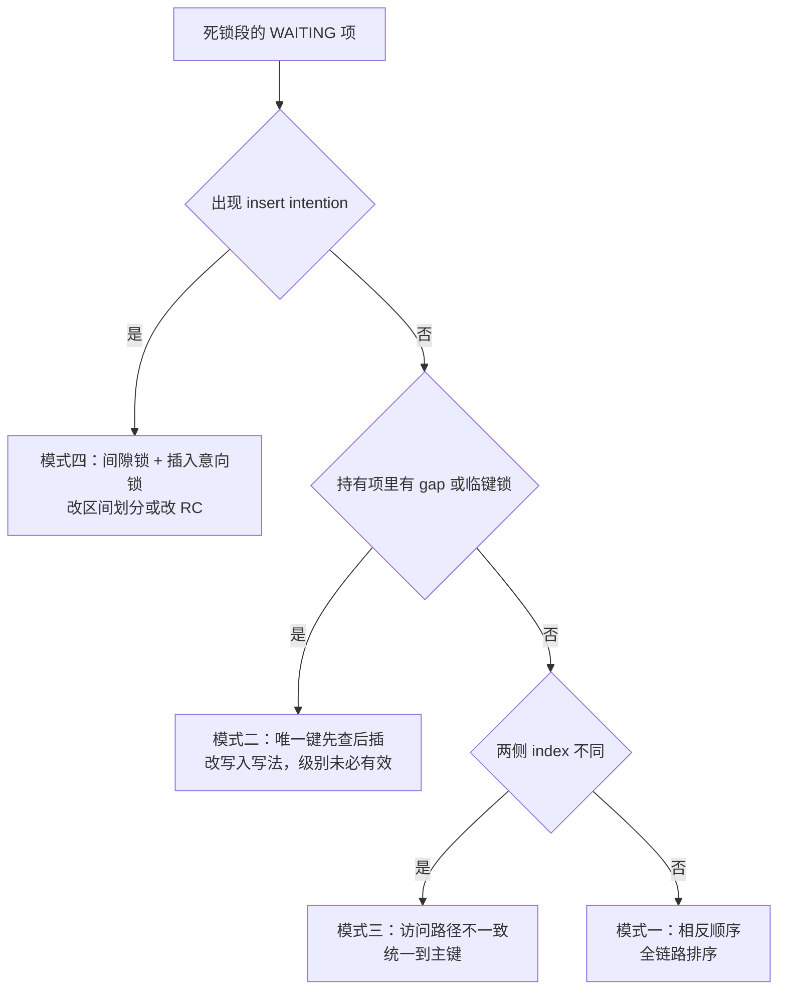
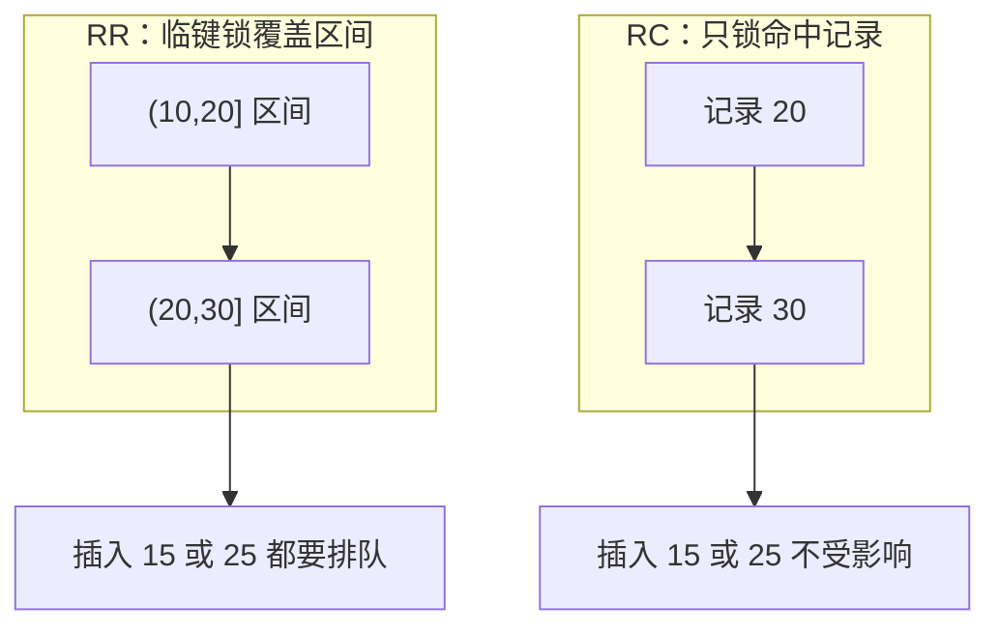
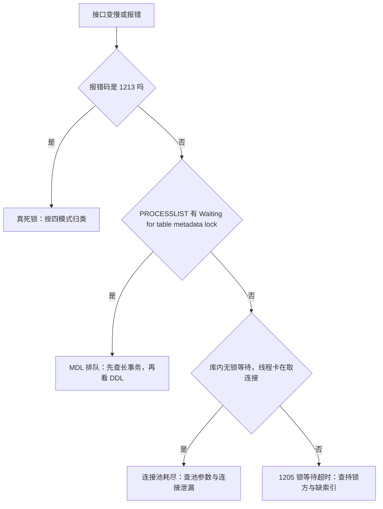

# 04 锁与并发控制——开发者必须理解的死锁问题

**摘要：**

死锁日志只有一份，能写出它的代码路径却可能有十几条，所以"又死锁了"这句话本身没有信息量，真正要回答的是三条：哪两个事务、各自走到哪一步、为什么恰好成环。本篇不谈锁类型的教科书定义，而是把开发者最常撞上的四种死锁形态拆成可复现的场景——相反顺序、唯一索引冲突下的先查后插、`UPDATE` 走了不同索引、间隙锁撞插入意向锁，每一种都给出复现 SQL、成环机制与落到代码层的改法，并交代改完之后拿什么验证。四者之上回答一个绕不开的问题：为什么同一个系统切到 `READ COMMITTED` 之后死锁率会明显掉下来，又为什么有些死锁换了级别依然故我，判据落在业务能不能承受读语义变化上。再往下是两件最实用的事，一是 `1213` 与 `1205` 的回滚语义差别，以及重试的三个前提、一份能照着写的中文伪代码与五个常见错误实现；二是把"像死锁但其实不是"的锁等待超时、元数据锁排队、连接池耗尽三者分开。收尾给出处置的三步骤、减少冲突的五个手段、死锁计数的正确取法（`SHOW GLOBAL STATUS` 里并没有那个常被引用的变量），以及六个反例。

---

## 第 1 章 从一次 1213 说起

### 1.1 报警文本里其实什么都没有

夜里两点十七分，订单服务的错误率抬到 3%，日志里刷的是同一行：

```text
java.sql.SQLException: Deadlock found when trying to get lock; try restarting transaction
    at com.mysql.cj.jdbc.exceptions.SQLError.createSQLException(SQLError.java:129)
    at ...OrderRepository.deductStock(OrderRepository.java:88)
```

这行文本能告诉我们的只有一件事：InnoDB 的等待图里出现了环，而当前这个事务被选为牺牲者回滚了。它没说对手是谁，没说双方各自持了哪把锁，更没说这两段代码为什么会以相反的顺序去碰同一批行。运维同学把这条日志当成"偶发抖动"，开发同学把它当成"数据库的问题"，两边各自散去，同一段代码在下一个大促继续死锁。

真正的取证材料不在应用日志里，而在数据库那一侧的 `LATEST DETECTED DEADLOCK` 段：它会把两个事务的完整 SQL、各自持有的锁、正在等的锁，连同最终回滚了哪一方，一并打出来。那一段怎么读、`performance_schema.data_locks` 与 `data_lock_waits` 怎么连成等待链，属于值班视角的运行期判据，[[中间件/MySQL/MySQL架构与底层原理/07 InnoDB 锁机制——从记录锁到间隙锁的底层实现|InnoDB 锁机制]] 讲得更细；本篇站在另一侧，只问一个问题：拿到那段日志之后，代码要改哪一行。

### 1.2 四个必要条件里，只有一环是代码能彻底拆掉的

教科书说死锁需要四个条件同时成立，这句话在 InnoDB 里可以逐条落到具体机制上。互斥是行锁的本质，`UPDATE` 拿到的排他锁不可能同时被别人拿到，这一条删不掉；持有并等待是事务语义的一部分，事务既然承诺要么全做要么全不做，就不能在中途把已经改过的行的锁交还出去；不可抢占也是硬约束，InnoDB 不会为了一个等在门口的事务强行剥夺别人手里的锁，它能做的只有把某一方整个回滚。

剩下的一环是**循环等待**，也是唯一能在应用代码里彻底消除的。所谓循环等待，在实现上就是等待图里出现了一个环：事务 A 等事务 B 持有的锁，事务 B 等事务 C，事务 C 又等回事务 A。只要环存在，无论等多长时间都不会有谁先放手，所以 InnoDB 必须在进入等待之前就检测一遍，发现成环立刻回滚代价小的一方，这就是 `ERROR 1213` 的来源。它也解释了为什么死锁不是"数据库卡死了"，恰恰相反，死锁是数据库主动把死结剪开的动作，代价是牺牲掉一个事务。

下图把四个条件与可干预面摊开，第四格是全文的靶心。


### 1.3 本篇的边界

行锁、间隙锁、临键锁分别锁住了什么，等值查询命中与未命中为什么一个退化为记录锁、一个退化为间隙锁，这些机制在 [[中间件/MySQL/MySQL架构与底层原理/07 InnoDB 锁机制——从记录锁到间隙锁的底层实现|InnoDB 锁机制]] 里已经拆到加锁规则一级，本篇只在需要解释成环路径时给一句结论。隔离级别在运行期该选哪个、切换级别之后 purge 与快照的账怎么算，[[中间件/MySQL/MySQL架构与底层原理/08 InnoDB 事务隔离级别——从脏读到幻读的防御工程|事务隔离级别]] 从值班角度算过一遍；本篇只用它来回答"该不该为了降死锁改 `RC`"这一个决策。事务边界怎么划、长短事务的代价，[[中间件/MySQL/MySQL进阶使用/03 事务与隔离级别的正确打开方式|事务与隔离级别]] 展开得更完整，本篇只保留"缩短事务"与死锁率的关系。

一句话概括分工：机制一句话加双链，代码怎么写说透。

---

## 第 2 章 四个经典模式

死锁的形态再多，落到代码层看，绝大多数都能归到四个模式上。这四个模式的共同点是"可复现"——只要两个会话按指定顺序执行，不需要压测工具也能让 `1213` 稳定出现。可复现这件事很重要，因为改法是否有效，唯一的验收方式就是把同一段复现脚本再跑一遍，看它还能不能死。

后面所有例子都建在同一套订单库上，表结构与数据如下，读者可以照抄到本地实例验证（隔离级别为默认的 `REPEATABLE READ`，版本口径 `8.0`）。

```sql
CREATE TABLE t_account (
  id      BIGINT PRIMARY KEY,
  balance INT NOT NULL
) ENGINE=InnoDB;

CREATE TABLE t_order (
  id      BIGINT PRIMARY KEY,
  user_id BIGINT NOT NULL,
  status  TINYINT NOT NULL,
  amount  INT NOT NULL,
  KEY idx_user (user_id),
  KEY idx_status (status)
) ENGINE=InnoDB;

INSERT INTO t_account VALUES (1, 1000), (2, 1000);
INSERT INTO t_order VALUES (1, 300, 1, 100), (2, 200, 1, 100), (3, 100, 1, 100);
```

### 2.1 模式一：相反顺序

这是流传最广的一类，也是最容易在业务代码里长出来的一类。它的温床是"对称的业务动作"：转账的 A 到 B 与 B 到 A、两个人互相点赞、库存从一个仓调到另一个仓，这些动作在数据层表现为对同样的几行执行加减，而参数顺序天然相反。

复现只需要两个窗口，各自按对方相反的方向更新两行：

```sql
-- 会话 1：账户 1 转 100 给账户 2
BEGIN;
UPDATE t_account SET balance = balance - 100 WHERE id = 1;
UPDATE t_account SET balance = balance + 100 WHERE id = 2;
COMMIT;

-- 会话 2：账户 2 转 50 给账户 1
BEGIN;
UPDATE t_account SET balance = balance - 50 WHERE id = 2;
UPDATE t_account SET balance = balance + 50 WHERE id = 1;
COMMIT;
```

会话 1 执行完第一句后持有 `id=1` 的记录锁，会话 2 执行完第一句后持有 `id=2` 的记录锁；接下来两句各自去要对方手里那一把，于是一个最小的二元环成形。日志里两侧的等待项都是 `lock_mode X locks rec but not gap waiting`——没有间隙锁参与，纯粹是记录锁之间互等。

为什么会死，用一句话讲清楚：两段代码对同一组资源的访问顺序不一致，而锁要等到各自事务结束才释放，环就闭合了。这个模式**与隔离级别无关**，切换 `RC` 对它毫无作用，因为这里根本没有间隙锁。

改法的核心是让所有写入路径按同一个键排序，先锁低后锁高。落到代码上，转账不应该"按业务方向"直接扣加，而应该先按主键升序把两行占住：

```java
// 两行按主键升序预锁；两个方向的事务都走这一段，环路无法闭合
long low  = Math.min(fromId, toId);
long high = Math.max(fromId, toId);
lockRow(conn, low);   // SELECT id FROM t_account WHERE id = ? FOR UPDATE
lockRow(conn, high);

// 到这里两行都已持锁，后面的扣减与增加不会再被第三方插队
debit(conn, fromId, amount);
credit(conn, toId, amount);
```

只要有一笔行数固定的多行写，也可以直接压成一条语句，由 InnoDB 在一次语句执行内部按索引顺序加锁：

```sql
-- 单语句把扣减与增加合一，扫描顺序由主键决定，与参数书写顺序无关
UPDATE t_account
SET balance = CASE id WHEN 1 THEN balance - 100 ELSE balance + 100 END
WHERE id IN (1, 2);
```

这里有两个常被误解的边界，值得单独点出来。第一个边界是"在 `IN` 列表里把参数排好序"不起作用：`WHERE id IN (2, 1)` 与 `WHERE id IN (1, 2)` 的执行计划完全一样，InnoDB 是按主键索引的物理顺序定位记录的，不是按参数出现的先后。排序要排在语句这一层——先执行哪条语句、每条语句碰哪一段键区间，这才是决定加锁顺序的东西。第二个边界是"只改一侧不成立"：如果转账流程改了排序，而退款流程仍然按业务方向先动 `toId`，环还是会闭，只是换了一对参与者。所以模式一的改法天然是**全链路审计**，改动之前先把所有碰这两张表的写入口列出来，漏一个等于没改。

| 写法 | 实际加锁顺序 | 两个方向并发是否成环 |
| :--- | :--- | :--- |
| 两条 `UPDATE`，按业务方向 | 由代码书写顺序决定 | 会 |
| 两条 `UPDATE`，都按主键升序 | 固定为低键到高键 | 不会 |
| 单条 `UPDATE ... WHERE id IN (...)` | 由主键索引物理顺序决定 | 单语句层面不会 |
| 先 `SELECT ... FOR UPDATE` 升序预锁再更新 | 固定为低键到高键 | 不会 |

表里最后一行是工程上最通用的做法：把"锁定"和"修改"分开，锁的阶段顺序可控，修改的阶段自然也就顺序可控。代价是多一轮往返，在网络延迟敏感的场景里这笔开销要用批量合并来摊薄。

### 2.2 模式二：唯一索引冲突 + 加锁读

这个模式在注册、发券、幂等表、订单去重里反复出现，形态是"先查一下在不在，不在就插"。开发者以为这是在防重复，实际上是在给死锁铺路。

先看复现，两个会话各自三步就够，前提是 RR 级别下对一个不存在的唯一键做加锁读：

```sql
-- 表：t_user(id BIGINT PK AUTO_INCREMENT, mobile VARCHAR(20), UNIQUE KEY uk_mobile(mobile))
-- 会话 1
BEGIN;
SELECT id FROM t_user WHERE mobile = '13900000001' FOR UPDATE;   -- 值不存在

-- 会话 2
BEGIN;
SELECT id FROM t_user WHERE mobile = '13900000001' FOR UPDATE;   -- 同一个不存在的值

-- 会话 1
INSERT INTO t_user (mobile) VALUES ('13900000001');

-- 会话 2
INSERT INTO t_user (mobile) VALUES ('13900000001');              -- ERROR 1213
```

这段复现能成立，靠的是两个容易被忽略的细节。细节一是唯一索引上的等值查询未命中时，InnoDB 加的不是记录锁而是间隙锁，因为它要阻止的正是"我查的时候不存在、下一秒被别人插进来"这种幻影。细节二是间隙锁之间彼此兼容——两个事务可以对同一个间隙同时持有间隙锁，谁也不挡谁。于是两个事务都顺利走完了 `SELECT`，都以为自己拿到了"这个手机号还没有被注册"的独占结论。

真正的冲突出现在 `INSERT`。插入之前，事务要为目标位置挂一把**插入意向锁**（`INSERT_INTENTION`），而插入意向锁与间隙锁不兼容：会话 1 的插入要等会话 2 的间隙锁释放，会话 2 的插入要等会话 1 的间隙锁释放，两边都不肯先交出对方想要的那一把，环就成了。日志里的特征很好认，两侧的等待项都带 `insert intention`，而持有项里能看到没有记录锁、只有间隙锁。

> [!warning] 反直觉的一点
> 两个事务可以同时持有同一个间隙的间隙锁，彼此不冲突。所以"我拿到了锁"在这里并不等于"别人进不来"，真正挡住插入的是插入意向锁与间隙锁的不兼容——这也是这类死锁最容易被误判成"没加锁怎么会死"的原因。

改法的方向很清楚：不要用"先查后插"去实现唯一性，让唯一索引自己去裁决。一种写法是裸插，冲突就捕获 `ERROR 1062`：

```java
try {
    jdbc.update("INSERT INTO t_user (mobile) VALUES (?)", mobile);
} catch (SQLIntegrityConstraintViolationException e) {
    // 1062 只说明这一行已经存在，事务可以继续；读回来即可，不必回滚
    return findByMobile(mobile);
}
```

另一种写法是 `INSERT ... ON DUPLICATE KEY UPDATE`，把判重与写入压成一条语句，代价是它在并发插入同一个键时并不可靠——检查重复与更新行的两步次序仍可能被并发打乱，反而更容易在热点键上撞出死锁，以对应版本文档和本地压测为准。`INSERT IGNORE` 的语义更干净一些，冲突直接吞掉，但要注意它会顺带吞掉其它可忽略错误（譬如数据截断告警），需要确认业务能接受。

还有一层边界需要提前说清：把隔离级别切到 `RC` 对这个模式**并不总是有效**。`RC` 取消了大部分间隙锁，但唯一键重复检查这一条路径上仍会用到间隙锁，外键检查同理；所以模式二在 `RC` 下可能变得"没那么容易死"，却不会像模式四那样彻底换一幅图景。判断办法是看日志：两侧都在 `insert intention` 上等待，且持有项里是唯一索引的间隙锁，那级别不是主要矛盾，改写法才是。

### 2.3 模式三：UPDATE 走了不同索引

前两个模式的冲突都发生在同一批行上，模式三的麻烦在于冲突发生在同一批行、但加锁的顺序由不同的索引决定。开发者看 SQL 觉得"两条语句改的是同一批订单，能有什么顺序问题"，可 InnoDB 的锁是加在索引记录上的，走哪个索引就等于**按索引的物理顺序**逐条上锁。

复现用前面建好的 `t_order`。三行数据的主键是 1、2、3，而 `user_id` 分别是 300、200、100，于是 `idx_user` 的物理顺序恰好是主键顺序的倒序：

```sql
-- 会话 1：按主键批量加钱，扫描顺序 1 → 2 → 3
BEGIN;
UPDATE t_order SET amount = amount + 1 WHERE id IN (1, 2, 3);

-- 会话 2：按用户批量加钱，扫描顺序 3 → 2 → 1
-- 小表上优化器很可能选全表扫描，那样加锁顺序又回到主键序，复现不出来；
-- FORCE INDEX 只用于固定复现路径，不是生产建议
BEGIN;
UPDATE t_order FORCE INDEX (idx_user)
SET amount = amount + 1 WHERE user_id IN (100, 200, 300);
```

会话 1 拿到主键 `id=1` 的记录锁后去要 `id=2`；会话 2 先按 `idx_user` 定位到 `user_id=100` 对应的 `id=3`，再回表拿到主键 `id=3` 的记录锁，接着要 `id=2`，拿到后再要 `id=1`。两条路径在 `id=2` 上交错，环在 `id=1` 与 `id=2` 之间闭合。日志与模式一的区别在于 `HOLDS THE LOCK(S)` 段：一侧只出现 `index PRIMARY`，另一侧会同时出现 `index idx_user` 与 `index PRIMARY` 两组记录锁，这种"两个索引混在一起"的样子就是访问路径不一致的指纹。

为什么这种模式比前两个更隐蔽，原因有三层。第一层，它往往出现在"同一份业务逻辑的两个入口"上——运营后台按主键改，定时任务按用户维度扫，两边都觉得自己是对的。第二层，它不要求两段代码写着相反的顺序，只要两个索引的物理顺序相反，代码里的书写顺序完全一致也能死。第三层，`UPDATE` 改的若是索引列，还要在二级索引上做删除加插入，锁的范围会比 `WHERE` 命中的行更大，日志里会看到 `lock_mode X` 这种带间隙的临键锁而不是干净的 `REC_NOT_GAP`。

改法的原则是让访问路径**收敛到一条**。批量任务不要用业务维度直接 `UPDATE`，而是先查主键、再按主键批量更新：

```sql
-- 第一步：只读，把要处理的行主键取出来（快照读，不加锁）
SELECT id FROM t_order WHERE user_id IN (100, 200, 300) ORDER BY id;

-- 第二步：按主键排序后分批加锁写，所有入口共用同一顺序
UPDATE t_order SET amount = amount + 1 WHERE id IN (?, ?, ?);
```

这个改法有一个隐含前提，就是"取主键"与"按主键更新"之间存在时间窗口，中间可能有新行满足条件。对可重入的批量任务来说这不是问题——下一轮会补上；对要求严格一次性的任务，则需要在取主键时把状态一并改掉，用状态机而不是范围条件来界定工作集。这一点在 [[中间件/MySQL/MySQL进阶使用/05 表设计与数据类型选择——细节决定性能上限|表设计]] 里讲状态字段选型时提过，状态机驱动的批量任务天然比范围扫描驱动的更好收敛。

| 访问路径 | 加锁顺序由谁决定 | 典型写法 | 与其他路径并发时的风险 |
| :--- | :--- | :--- | :--- |
| 主键等值与 `IN` | 主键物理顺序 | `WHERE id IN (...)` | 低，只要所有入口都走主键 |
| 二级索引范围 | 二级索引物理顺序 + 回表 | `WHERE user_id IN (...)` | 高，顺序与主键常常相反 |
| 二级索引等值 + 回表 | 命中行数决定 | `WHERE status = ?` | 高，命中面大时接近范围扫 |
| 无索引 | 全表扫描顺序 | `WHERE remark LIKE '%x%'` | 极高，等价于锁全表 |

表里最后一行的"极高"不是夸张。没有可用索引时，`UPDATE` 只能扫全表并在扫过的每条记录上加锁，此时任何并发写都可能撞上，这类死锁的日志里两侧的 `WAITING` 项往往指向不同的记录，看起来毫无规律，实际是同一次全表扫描把整张表都圈了进去。

### 2.4 模式四：间隙锁撞插入意向锁

这是 `RR` 独有的形态，也是很多"补数据脚本一跑就死锁"的真正原因。它的场景长这样：一段批处理先按范围更新历史数据，再往同一张表插一条流水或汇总行；另一段批处理处理相邻的范围，动作一样。两个事务各自持有的不是某一条记录，而是**一段区间**，随后又各自要往对方的区间里插东西。

复现需要一个带二级索引的表，数据里留出空隙：

```sql
CREATE TABLE t_coupon_log (
  id      BIGINT PRIMARY KEY AUTO_INCREMENT,
  user_id BIGINT NOT NULL,
  used    TINYINT NOT NULL DEFAULT 0,
  KEY idx_user (user_id)
) ENGINE=InnoDB;
-- 已有数据：user_id 为 10、20、30、40

-- 会话 1：处理 [15, 25) 这一段
BEGIN;
SELECT * FROM t_coupon_log FORCE INDEX (idx_user)
WHERE user_id >= 15 AND user_id < 25 FOR UPDATE;

-- 会话 2：处理 [35, 45) 这一段
BEGIN;
SELECT * FROM t_coupon_log FORCE INDEX (idx_user)
WHERE user_id >= 35 AND user_id < 45 FOR UPDATE;

-- 会话 1：往自己没覆盖的位置补一条流水
INSERT INTO t_coupon_log (user_id, used) VALUES (38, 0);

-- 会话 2：也往对方的地盘补一条
INSERT INTO t_coupon_log (user_id, used) VALUES (18, 0);   -- ERROR 1213
```

两个 `SELECT ... FOR UPDATE` 都能成功，因为范围不重叠；问题出在后续插入。会话 1 的范围扫描在 `idx_user` 上落下了 `(10,20]` 与 `(20,30]` 两段临键锁（扫描到 30 时虽然 30 不满足 `< 25`，但它是停止扫描的那条记录，同样会被锁住），于是 `user_id=38` 的插入要先挂插入意向锁，等会话 2 释放 `(30,40]`；会话 2 的 `user_id=18` 则要等会话 1 释放 `(10,30]`。两个方向都对，环也就成了。

这个模式与模式二的区别在触发条件：模式二要一个"不存在的唯一键"和一次加锁读，模式四只要一次范围扫描加一次插入，哪怕表上没有唯一索引。它也与模式一不同：模式一的环由代码的语句顺序造成，模式四的环由区间覆盖关系造成，改语句顺序没有用，得改"谁碰哪段区间"。

改法有四种，按侵入性从低到高排。第一种是把范围收敛到等值：如果补数据的粒度是单个用户，就不要用范围扫描去圈区间，直接按 `user_id = ?` 逐条处理，且按 `user_id` 升序执行，环就没有闭合的空间。第二种是把"先更新后插入"改成"先插入后更新"，让所有事务在插入阶段就按同一个方向排队——插入意向锁彼此不冲突，多个事务往同一个间隙的不同位置插入不会互等，只有撞上别人已经持有的间隙锁才排队。第三种是把插入与更新拆到不同事务里，让持有区间的那一段尽早提交，缩短区间与插入的交叠窗口。第四种是改 `RC`，让范围扫描不再留下间隙锁，代价与判据放在第 3 章。

还有一条常被忽略的边界：不是所有插入都会在这种场景下排队。多个事务同时往同一个间隙的不同位置插入，各自的插入意向锁并不冲突，不会因为"都想往这段空隙写"而死；只有当插入位置重合、撞上同一个唯一键值时才排队，而那类等待通常以 `1062` 收场而不是死锁。真正造成本模式环路的是间隙上已经存在着一把间隙锁或临键锁——理解这一点，才能解释为什么同一段补数据脚本有时飞快、有时死锁，差别在于当时旁边有没有另一个范围扫描在跑。

### 2.5 把四个模式归到一起

四个模式在日志上的指纹不一样，处置动作也不一样，把判别路径画出来，值班时按图走比凭记忆靠谱。



| 模式 | 日志指纹 | 常见业务形态 | 代码改法 | 改 `RC` 是否有效 |
| :--- | :--- | :--- | :--- | :--- |
| 一、相反顺序 | 两侧都是 `REC_NOT_GAP`，各持一把互等 | 转账、互关、双向调拨 | 全链路按主键升序，或合并单语句 | 无效，与间隙锁无关 |
| 二、先查后插 | 两侧 `insert intention`，持有项是唯一索引间隙锁 | 注册、发券、幂等表 | 裸插捕获 1062，或让唯一索引裁决 | 部分有效，唯一键检查仍带间隙锁 |
| 三、走不同索引 | 一侧 `index PRIMARY`，另一侧混有二级索引 | 后台与定时任务两个入口 | 先查主键，再按主键批量写 | 部分有效，锁集合变小但顺序仍不同 |
| 四、间隙 + 插入 | 两侧 `insert intention`，持有项是范围临键锁 | 补数据、对账、汇总流水 | 收敛区间、先插后更、改 `RC` | 有效，范围扫描不再留间隙锁 |

这张表可以直接当成审查清单：拿到一段死锁日志，先在 `WAITING` 项里找 `insert intention`，有就往模式二、四走；再看两侧的 `INDEX_NAME` 是否一致，不一致就是模式三；剩下的按模式一处理。归类之后，改代码的范围就定了，不必把整条链路通读一遍。

---

## 第 3 章 为什么 RR 下死锁多得多

### 3.1 锁的对象从记录扩到了区间

四个模式里有两个半与间隙锁有关，这不是巧合。`REPEATABLE READ` 要防幻读，防幻读就得阻止"我查过的范围里凭空多出一行"，而记录锁只能锁住已经存在的行，锁不住"还不存在的行"，于是 InnoDB 把索引上相邻记录之间的空隙也一并锁上，这就是间隙锁与临键锁的由来。机制细节在 [[中间件/MySQL/MySQL架构与底层原理/07 InnoDB 锁机制——从记录锁到间隙锁的底层实现|InnoDB 锁机制]] 里拆过，这里只取对代码有影响的三个推论。

推论一，锁的粒度不由 `WHERE` 的精确度决定，而**由扫描路径决定**。等值命中唯一索引可以退化成记录锁，等值未命中就是间隙锁，范围扫描则是一条临键锁加上停止位置那一把。同样一句 `UPDATE ... WHERE user_id = 15`，值存在时锁一行，值不存在时锁一段区间，这件事在代码里看不出来，只有日志能证明。

推论二，扫描过程里**被过滤掉的记录也会被锁**。RR 下 InnoDB 不会因为某条记录不满足 `WHERE` 就立刻放锁，它要保证扫描路径上的行在事务结束前不被别人改掉，于是锁集合往往比"最终修改的行"大一圈。这个"大一圈"在并发写场景里就是冲突面的放大器。

推论三，同一段区间可以被多个事务以间隙锁的形式同时持有，但任何人想往里插入都得排队。间隙锁的这种"只挡插入、不挡彼此"的性质，正是模式二与模式四能同时成立的前提：两个事务都以为自己锁住了这块地，实际上只是都拿到了"禁止别人动土"的牌子，等到各自要动土时才发现对方的牌子挡着自己。

下图把两种级别在同一段索引上的覆盖差异画出来，注意 `RC` 下只剩记录本身。



### 3.2 成环概率的抬升可以估个方向

死锁率没有普适的绝对数字，它取决于表结构、索引、并发梯度与数据分布，任何人给出"切 `RC` 死锁降 80%"这种结论都值得怀疑。但方向可以估，而且估算方式对决策有用。

把一次事务持有的锁看成 k 把，另一个事务也持 k 把，两者发生冲突的组合数大致随 k 的平方增长；环要闭合，需要两组冲突里恰好存在互相指向的一对，概率也随 k 的平方抬升。RR 下同一段逻辑的锁集合常常是 RC 的**两到三倍**——记录锁之外多出间隙锁，改了索引列还要多出二级索引维护的锁——按平方关系折算，成环机会落在四到九倍的量级。上面这组倍数属于示例推算，用来说明"值不值得动手"，不是实测基准；真实差异只能在自己的压测环境里，用同一份脚本、同一份数据分布、同一个并发梯度跑两遍对比。

另一个方向性的推算与间隙的大小有关，同样属于示例推算。间隙锁的范围由索引上相邻两条记录的距离决定，而不是由查询条件的宽度决定。若 `idx_user` 上的值是 10 与 30，那么一句本来只想要 [15, 25] 的范围查询，实际圈住的是 (10, 30] 这二十个单位的宽度，比查询意图宽了一倍；若相邻记录相距很远，这个倍数还会更大。所以索引上的值越稀疏，范围扫描圈住的地盘就越大；反过来，写入集中在相邻键上的表（譬如自增主键、雪花 ID 顺序写入），相邻记录挨得近，一次范围扫描圈住的区间也窄，冲突面自然小。

| 观察项 | 采集方式 | 对比口径 | 怎么解读 |
| :--- | :--- | :--- | :--- |
| 死锁次数 | `information_schema.INNODB_METRICS` 的 `lock_deadlocks` | 相同时长的增量 | 只看趋势与拐点，不看绝对值 |
| 锁等待次数与时长 | `Innodb_row_lock_waits`、`Innodb_row_lock_time` | 迁移前后各取一周 | 平均值被长尾拉高时要看分位 |
| 锁集合大小 | `performance_schema.data_locks` 按事务计数 | 抽样同一条语句 | `LOCK_MODE` 含 `GAP` 的行数明显更多 |
| 吞吐 | 压测工具的并发梯度 | 固定数据量与热点分布 | 死锁下降不等于吞吐上升 |

表里最后一行是必须提醒的：切到 `RC` 之后死锁次数掉下来了，但若瓶颈原本在锁等待而不在死锁，吞吐未必改善；反过来，若日志显示死锁集中在唯一键冲突（等待项全是 `REC_NOT_GAP`），换级别几乎不会有任何变化。

### 3.3 改 RC 降不了什么

把 `RC` 当成"死锁开关"是一种常见误解。它能降的是**范围扫描型加锁**那一部分：`UPDATE ... WHERE status = 1` 这类语句在 `RC` 下只对命中的行加记录锁，扫描过程中遇到不匹配的行直接放锁继续走，锁集合立刻小一圈；模式四那种"范围加锁、别人插入"的环也随之消失，因为根本没有间隙可被持有。

它降不了的部分有几类，需要逐项认清。第一类是唯一键重复检查与外键检查，这两条路径在 `RC` 下依然会用间隙锁，所以模式二未必消失。第二类是同记录冲突，两个事务抢同一行，与级别无关。第三类是元数据锁排队，MDL 是 Server 层的锁，与 InnoDB 的隔离级别毫无关系。第四类是应用侧的连接池耗尽、慢 SQL 排队，这些看起来像死锁的现象，切级别不会有任何帮助。

还有两笔账要一起算。`RC` 下同一事务内的两次读可能看到不同版本，因为每次读都重新取一次快照，业务若依赖"事务内读到一致快照"来做判断（先统计再决策、先读余额再核对流水），就可能被这个差别咬到。`RC` 还启用了半一致性读，`UPDATE` 在扫描时遇到被锁住且不满足 `WHERE` 的行会直接跳过，这会影响 `ROW_COUNT()` 的返回值，凡是拿受影响行数当业务判断的地方都要复核。这两点的运行期细节在 [[中间件/MySQL/MySQL架构与底层原理/08 InnoDB 事务隔离级别——从脏读到幻读的防御工程|事务隔离级别]] 里算过，本篇只需要记住结论：换级别**不是零成本**。

### 3.4 该不该改 RC 的判据

把上面几节收成一张判据表。判断的对象不是"哪个级别更先进"，而是"当前死锁里有多大比例来自范围加锁，以及业务能不能承受 `RC` 的读语义"。

| 现状特征 | 判据 | 建议 |
| :--- | :--- | :--- |
| 死锁日志里过半的等待项带 `GAP` 或 `insert intention` | 主要矛盾是间隙锁 | 改 `RC`，收益最直接 |
| 业务依赖事务内多次读到同一份快照做决策 | `RC` 会破坏这个前提 | 保留 `RR`，改代码顺序 |
| 死锁集中在唯一键冲突与同记录争抢 | 与级别无关 | 不改级别，改写入写法 |
| 有范围 `UPDATE` 的批处理与在线写入混跑 | 批处理是放大器 | 可改 `RC`，同时把批处理改成主键游标 |
| 已依赖 `ROW_COUNT()` 判断更新是否生效 | 半一致性读会改变返回值 | 改判据或保留 `RR` |
| 分库分表或复制链路对隔离级别有既定要求 | 中间件与配置约束 | 以链路的既有约定为准 |

判据落到操作上还有两个工程细节。一是切换方式，`transaction_isolation` 是全局与会话变量，`SET GLOBAL` 只影响之后新建的连接，连接池里的老连接不会自动跟着变，所以线上切换必须配合连接池回收或重启应用，`5.7` 时代的 `tx_isolation` 变量名在 `8.0` 已经不可用，改配置时容易踩空。二是验证方式，切换前后各取一周的 `lock_deadlocks` 与 `Innodb_row_lock_waits` 增量对比，同时跑一遍复现脚本，确认模式四确实不再触发——只看总数容易被别的因素干扰。

---

## 第 4 章 死锁的处置三步骤

### 4.1 第一步：从死锁段里把两个事务的 SQL 读出来

`SHOW ENGINE INNODB STATUS` 的输出里，`LATEST DETECTED DEADLOCK` 段是唯一能同时给出"谁、在等什么、执行了哪条 SQL"的地方。它只保留最近一次，下一次死锁会把它覆盖掉，所以发现报警之后第一件事是把这段输出落盘，而不是先重启服务。

下面是段结构（字段顺序与行数会随版本浮动，事务号与页号都是示例值）：

```text
*** (1) TRANSACTION:
TRANSACTION 4821, ACTIVE 3 sec starting index read
LOCK WAIT 3 lock struct(s), heap size 1136, 2 row lock(s), undo log entries 1
MySQL thread id 1288, OS thread handle 123145, query id 88213 10.20.3.17 orderapp updating
UPDATE t_order SET amount = amount + 1 WHERE id IN (1, 2, 3)

*** (1) HOLDS THE LOCK(S):
RECORD LOCKS space id 23 page no 5 n bits 80 index PRIMARY of table `order_db`.`t_order`
trx id 4821 lock_mode X locks rec but not gap

*** (1) WAITING FOR THIS LOCK TO BE GRANTED:
RECORD LOCKS space id 23 page no 5 n bits 80 index PRIMARY of table `order_db`.`t_order`
trx id 4821 lock_mode X locks rec but not gap waiting

*** (2) TRANSACTION:
TRANSACTION 4820, ACTIVE 4 sec
MySQL thread id 1275, OS thread handle 123140, query id 88190 10.20.3.18 orderapp updating
UPDATE t_order SET amount = amount + 1 WHERE user_id IN (100, 200, 300)

*** (2) HOLDS THE LOCK(S):
... index idx_user ... lock_mode X ...
... index PRIMARY ... lock_mode X locks rec but not gap ...

*** (2) WAITING FOR THIS LOCK TO BE GRANTED:
RECORD LOCKS ... index PRIMARY of table `order_db`.`t_order`
trx id 4820 lock_mode X locks rec but not gap waiting

*** WE ROLL BACK TRANSACTION (1)
```

读法分四步，顺序不要乱。第一步看两段 `TRANSACTION` 头里的 SQL，这是日志里**唯一给出语句原文**的地方，`performance_schema` 的锁表给不出它。第二步看 `HOLDS THE LOCK(S)` 与 `WAITING FOR THIS LOCK TO BE GRANTED`，前者是已经拿到的，后者是卡住的地方，两侧的 `index` 名字与 `lock_mode` 短语就是归类依据。第三步看 `WE ROLL BACK TRANSACTION` 选了谁，被选中的一方通常是修改行数更少、权重更小的那个，理解这一点有助于判断"为什么总是我的事务被回滚"。第四步把 `MySQL thread id` 与来源 IP 拿去比对应用的连接池配置，很多时候能直接定位到是哪台机器上的哪个服务在批量跑。

| 日志片段 | 含义 | 对应本篇哪个模式 |
| :--- | :--- | :--- |
| `lock_mode X locks rec but not gap` 两侧互等 | 纯记录锁冲突 | 模式一、模式三 |
| `lock_mode X locks gap before rec` | 只锁间隙，不锁记录 | 模式二、模式四 |
| `lock_mode X`（无 `rec but not gap` 后缀） | 临键锁，记录加其前间隙 | 模式四 |
| `lock_mode X locks gap before rec insert intention waiting` | 插入意向锁等间隙释放 | 模式二、模式四 |
| 两侧 `index` 不同 | 访问路径不一致 | 模式三 |

表里第二行与第三行的区别值得多说一句：`locks gap before rec` 只锁了记录之前的间隙，记录本身没锁；无后缀的 `lock_mode X` 才是"记录加间隙"的临键锁。这两种在日志里长得很像，判断错就会把范围问题误诊成单行问题。

### 4.2 第二步：打开 print_all_deadlocks 拿全量

只看最近一次只能治显眼的那个死锁，要判断"是偶发还是结构性"，得拿到一段时间内的全部样本。`innodb_print_all_deadlocks` 打开后，每次死锁都会写进 MySQL 错误日志，`SHOW ENGINE INNODB STATUS` 仍然只留最后一次，两者互为补充。

| 参数 | 默认值 | 作用域与动态性 | 打开或调大的代价 | 关闭或调小的代价 |
| :--- | :--- | :--- | :--- | :--- |
| `innodb_print_all_deadlocks` | `OFF` | 全局，动态 | 死锁高频时错误日志膨胀，磁盘与采集链路承压 | 只能看到最后一次，无法判断频率与形态分布 |
| `innodb_lock_wait_timeout` | `50` 秒 | 全局、会话，动态 | 等待方长时间占连接，连接池被吃光 | 正常的长事务被误判超时，重试风暴放大下游压力 |
| `innodb_rollback_on_timeout` | `OFF` | 全局，仅启动参数 | 超时也回滚整个事务，回滚成本随事务体量上升 | 超时只回滚当前语句，应用要自己收拾残局 |
| `innodb_deadlock_detect` | `ON` | 全局，动态 | 高并发下检测遍历占用 CPU | 真死锁不再立即失败，秒级失败拖成分钟级挂起 |

打开之后要配合两件事才算完整。一件事是日志轮转与采样窗口，死锁高峰往往只持续几十分钟，长期开启的成本要用"只在排障窗口开"来控制，或者把错误日志接进集中采集后按关键词聚合。另一件事是给日志加上能对齐业务的上下文，比如在事务开始处打一行包含业务单号的日志，靠时间戳与 `thread id` 把死锁段与应用日志对上——没有这一步，日志里那两条 SQL 只能说明"哪两条语句撞了"，说明不了"哪个业务动作同时在跑"。

### 4.3 第三步：按模式归类，改一处，再复现

归类之后不要急着大改。改法有效的唯一证据是**复现脚本跑不通了**，所以流程应当是闭环的：先按第 2 章的表把死锁归到某个模式，然后只改这一个模式里被确认为成因的那一处，再用第 2 章的复现脚本（或压测脚本）验证死锁不再出现，最后看 `lock_deadlocks` 的增量是否下降。

下面这张图是闭环的形状，顺序不能颠倒——先改再归类，等于在噪声里猜。


### 4.4 一次完整的处置

把前面几步串成一个真实形状的例子。某订单库在晚高峰出现零星 `1213`，日志显示一侧执行的是按主键的批量加钱，另一侧执行的是按 `user_id` 的批量加钱，`HOLDS` 段一侧只有 `PRIMARY`，另一侧混着 `idx_user` 与 `PRIMARY`。归到模式三之后，改动是把定时任务从"按用户维度直接 `UPDATE`"改成"先查主键、按主键分片更新"，同时把运营后台的批量入口也收敛到同一个按主键排序的工具方法上。

改完之后验证两件事。一件是把复现脚本再跑一遍：两个会话分别按主键与按 `user_id` 更新同一批行，看是否还会 `1213`。另一件是观察一周的 `lock_deadlocks` 增量与 `Innodb_row_lock_waits`，确认死锁归零而锁等待次数没有异常抬升——有时候死锁消失是假象，实际是等待时间变长、超时替代了死锁，所以这两个指标要一起看。

---

## 第 5 章 重试的正确实现

### 5.1 1213 与 1205 差在哪里

重试这件事最容易出错的地方，是把两个错误码当成一类。它们的错误信息都以 `try restarting transaction` 结尾，长得很像，但数据库侧的回滚范围完全不同。

| 错误码 | SQLSTATE | 触发条件 | InnoDB 回滚范围 | 应用该做什么 |
| :--- | :--- | :--- | :--- | :--- |
| `1213` | `40001` | 等待图检出环，被选为牺牲者 | 整个事务，无残留 | 直接重开事务重试，前提是逻辑幂等 |
| `1205` | `HY000` | 等锁超过 `innodb_lock_wait_timeout` | 默认只回滚当前语句，事务仍存活 | 先显式回滚整个事务，再决定是否重试 |

区别的后果很具体。`1213` 之后数据库已经回到事务开始前的状态，客户端拿到的错误是干净的，重试不会叠加任何副作用；`1205` 之后事务里先前执行的语句仍然有效，如果应用照着提示把整段逻辑再跑一遍，等于在一个已经改过前几步的事务上重新执行，重复扣减、重复插入都可能出现。要把两者语义对齐，可以把 `innodb_rollback_on_timeout` 设为 `ON`，让超时也回滚整个事务，代价是大事务回滚要重放更多 undo，而且这个参数不是动态的，改配置要重启。

所以"必须重试的是 1213"这句话要理解成两层：1213 是结构性的并发冲突，靠重试能跨过去；1205 是等待方或者持锁方本身有问题（长事务、缺索引、批处理过大），重试只是把问题往后推，真正要修的是持锁的那一侧。

### 5.2 重试的三个前提

重试不是套一个循环那么简单，它成立需要三个**前提**，缺一个就会把问题从数据库搬到业务上。

前提一是幂等。重试意味着同一段逻辑可能执行两次以上，所以事务内的每一次写入都必须可以重复执行而不产生叠加效果：扣库存是写成 `balance = balance - ?` 这样的相对更新，还是先读到值再写回绝对值，取决于有没有带条件的约束兜底，插入要用唯一键兜底，外部副作用（发消息、调支付、推缓存）要么移出事务，要么用 outbox 与幂等键保护。没有幂等前提的重试是**把一次死锁变成一次资损**。

前提二是边界。重试的范围应该**恰好包住数据库事务**那一段，而不是把整个业务方法包进去。业务方法里往往还有远程调用、文件写入、本地缓存更新，这些操作没有事务语义，跟着一起重试就会重复执行。正确的层次是：业务方法内用 `TransactionTemplate` 划出事务段，重试循环包在这一段外面，远程调用留在循环外面。

前提三是预算。重试有次数上限，也要有总时长上限，还要有退避。次数三到四次足够，再多说明冲突是结构性的，重试只会延长故障；总时长必须小于上游调用方给本服务的超时预算，否则本服务重试成功、上游早已放弃，资源白烧。退避要带抖动，否则同一时刻被回滚的一批事务会在同一毫秒一起重开，形成第二波冲突——这就是常说的**重试风暴**。

### 5.3 一份可以照着写的中文伪代码

下面这段代码把三个前提都落到了位置上（Java 加 Spring 的编程式事务，换成其它语言的思路一致）。

```java
private static final int MAX_ATTEMPTS = 4;
private static final long TOTAL_BUDGET_MS = 800;   // 必须小于上游超时预算

public OrderResult createOrder(Cmd cmd) {
    long start = System.currentTimeMillis();
    int attempt = 0;
    while (true) {
        try {
            // 事务边界只包数据库这一段；远程调用、发消息都在循环外或提交后异步做
            return txTemplate.execute(status -> doCreateOrderInTx(cmd));
        } catch (DataAccessException e) {
            // 只认 1213；1205 与其它异常一律上抛，交给上层按超时语义处理
            if (!isDeadlock(e) || ++attempt >= MAX_ATTEMPTS
                    || System.currentTimeMillis() - start > TOTAL_BUDGET_MS) {
                throw e;
            }
            sleepQuietly(backoffMs(attempt) + jitterMs());
        }
    }
}

private static boolean isDeadlock(DataAccessException e) {
    Throwable cause = e.getMostSpecificCause();
    if (cause instanceof SQLException se) {
        // 1213 的 SQLSTATE 是 40001；不要靠异常类名判断，跨版本改过
        return se.getErrorCode() == 1213 || "40001".equals(se.getSQLState());
    }
    return false;
}

// 指数退避 + 抖动：第 1 次约 20ms，第 2 次约 40ms，第 3 次约 80ms，抖动打散同一批重试
private static long backoffMs(int attempt) {
    return 20L << (attempt - 1);
}

private static long jitterMs() {
    return ThreadLocalRandom.current().nextLong(10);
}
```

这段代码里有几个刻意为之的点。`isDeadlock` 按错误码与 SQLSTATE 判断而不是按异常类名，是因为 Spring 的异常翻译在不同版本里对这两类错误的归类做过调整，`DeadlockLoserDataAccessException` 在较早版本里是死锁的专属类型，后续版本收敛到了更宽的父类体系里，以对应版本文档为准；**错误码是协议层的契约**，稳定得多。重试循环里没有 `finally` 去手动回滚，因为 `TransactionTemplate` 在抛出异常时已经完成回滚，而且 1213 场景下数据库侧本来就回滚干净了。退避放在循环体尾部而不是头部，保证第一次尝试没有延迟。

还有一处取舍值得说明：重试次数与总预算都设了上限，超过就上抛。上抛之后的处理不属于事务范围，可以走降级（返回"稍后重试"）、可以走异步补偿，但不要让请求线程继续等——死锁高峰里线程池被打满，往往就是没有这道上限。

### 5.4 五个常见的错误实现

第一个错误是把 `@Retryable` 与 `@Transactional` 放在同一个方法上。两个注解都靠代理生效，同一个方法上谁在外层取决于框架的实现细节，很容易变成"事务先开、重试在事务内部"，于是每次重试都在同一个事务里，`1213` 之后事务已经被回滚，再执行只会拿到"Transaction is already completed"之类的错误。正确做法是把重试**放在调用方**，让每次重试都开一个新事务。

第二个错误是捕获 `Exception` 一律重试。把所有异常都重试一遍，会把 `1062` 唯一键冲突、`1205` 超时、甚至 SQL 语法错误都重试三次，既放大故障面又掩盖真因。判据只认错误码。

第三个错误是没有幂等前提的重试。事务内已经调用过支付扣款或发出过消息，重试就会重复执行。这类场景要先做幂等改造，或者把外部调用移到事务提交之后。

第四个错误是把重试包在远程调用外层。重试范围一旦覆盖 RPC，对端的超时、重试、幂等能力都要重新评估一遍，链路复杂度成倍上升。

第五个错误是无限重试或者无退避重试。前者在结构性冲突下会把线程池占满，后者会让被回滚的一批事务在同一时刻重开，冲突概率不降反升。

### 5.5 让重试次数变少的设计

重试是兜底，不是设计目标。真正把重试次数压下来的，是让冲突在数据库层面就不可能发生的那些设计：唯一索引把"先查后插"变成一次写入裁决，状态机把"范围扫描"变成"按主键推进"，幂等键把"重复提交"变成"命中已有记录"，以及把大事务拆成小批让持锁时间变短。这些手段会在第 7 章集中列一遍。

---

## 第 6 章 不是死锁但表现像

### 6.1 锁等待超时（1205）

表现与死锁几乎一样：接口变慢、日志里出现 `Lock wait timeout exceeded; try restarting transaction`、线程堆栈停在 JDBC 调用上。区别在错误码与数据库侧的状态：`1205` 的现场里没有环，只有一个（或一串）事务在老老实实排队，排到 50 秒还没轮到。

这种情形下最该看的不是等待方，而是**持锁方**。持锁方可能是一个忘了提交的长事务、一个没有索引导致扫了全表的 `UPDATE`、一个跑批脚本，也可能是连接池里的空闲连接开着一个没关的事务。判别办法是查 `information_schema.INNODB_TRX` 找 `TRX_STATE='RUNNING'` 且 `TRX_STARTED` 很早的事务，再顺着它的 `TRX_MYSQL_THREAD_ID` 去 `PROCESSLIST` 看它最后在做什么。

处置分两层：止血是把持锁的长事务找出来终止，治本是把等待方与持锁方各自的成因改掉——等待方多半是缺索引或者范围太大，持锁方多半是事务边界划错。事务边界怎么划在 [[中间件/MySQL/MySQL进阶使用/03 事务与隔离级别的正确打开方式|事务与隔离级别]] 里讲得更细。

### 6.2 元数据锁排队

DDL 引发的故障有一种典型的形状：某个会话执行 `ALTER TABLE`，它要拿元数据锁（Metadata Lock，MDL），而表上还有一个没提交的长事务持有 MDL 的共享锁，于是 DDL 开始排队；DDL 一排上队，后面所有访问这张表的语句也跟着排，因为它们要拿的共享 MDL 与等待中的排他 MDL 冲突。表现是"这张表的所有查询都卡住了"，看起来比死锁严重得多，但 `data_locks` 里看不到任何 InnoDB 行锁等待。

判别的关键是 `SHOW PROCESSLIST` 里那一行 `Waiting for table metadata lock`，以及 `performance_schema.metadata_locks` 里等待中的 MDL 记录。MDL 的排查路径在 [[中间件/MySQL/MySQL架构与底层原理/07 InnoDB 锁机制——从记录锁到间隙锁的底层实现|InnoDB 锁机制]] 里单独讲过一节，本篇只保留代码侧的三条改法：DDL 走在线变更工具或在低峰执行；业务侧避免长事务挂着不放；DDL 前后给 `lock_wait_timeout` 设一个合理的会话级上限，让 DDL 快速失败而不是挂一整天。

### 6.3 连接池耗尽

第三种"像死锁"的情形**根本不在数据库里**。请求进来取不到连接，线程全部阻塞在 `getConnection()` 上，调用方看到的是超时与错误率上升，和死锁的观测面几乎重合。判别方法很直接：去看数据库侧，如果 `PROCESSLIST` 里没有大量活跃语句、也没有锁等待，而应用的线程池里堆着一批等连接的线程，那问题就在池子上。

连接池的参数里，`connectionTimeout`（等连接的时长）、`maximumPoolSize`（池上限）、`leakDetectionThreshold`（借出未还的告警阈值）是三个最该调的旋钮。它们与死锁的关系在于：一旦有事务卡在锁等待上，连接就被占住不还，池子很快见底，于是"部分请求锁等待"升级成"全部请求拿不到连接"。

| 参数 | 常见默认 | 调大的代价 | 调小的代价 |
| :--- | :--- | :--- | :--- |
| `maximumPoolSize` | 10 | 数据库连接数与线程数上涨，锁竞争与上下文切换加剧 | 并发吞吐受限，排队时间变长 |
| `connectionTimeout` | 30 秒（各实现不同） | 故障时请求挂得久，线程池被占满 | 误伤慢查询，正常请求被判超时 |
| `leakDetectionThreshold` | 关闭 | 频繁告警噪声 | 连接泄漏长期潜伏，直到池子耗尽 |

表里第二行与死锁的关系最直接：把 `connectionTimeout` 调大，相当于让锁等待这把火烧到整个线程池；调小则会把正常的慢查询误判成故障。合理的做法是让它小于上游超时、大于本服务 P99 的数据库耗时，并配合第 5 章的总重试预算一起算。

### 6.4 判别顺序

四类现象混在一起时，按下面的顺序走能最快分流。



| 判别项 | 1213 | 1205 | MDL 排队 | 连接池耗尽 |
| :--- | :--- | :--- | :--- | :--- |
| 应用侧错误码 | `40001` | `HY000` | 通常无 SQL 错误，表现为超时 | 取连接超时 |
| 库内锁等待 | 有，且已成环后被剪断 | 有，单向排队 | 无 InnoDB 行锁等待 | 无 |
| 典型持有者 | 另一个并发事务 | 长事务、无索引扫描 | 未提交的长事务 | 无（但可能由锁等待间接引起） |
| 处置入口 | 改代码顺序 | 缩事务、补索引 | 杀长事务、调整 DDL 窗口 | 调池参数、查泄漏 |

---

## 第 7 章 减少锁冲突的五个手段

把前面几章的改法收成一份可执行的清单。五个手段的覆盖面不同，优先级也不同，绝大多数系统按这个顺序做，死锁率会先掉一个台阶。

| 手段 | 主要治哪个模式 | 改动成本 | 副作用与边界 | 优先级 |
| :--- | :--- | :--- | :--- | :--- |
| 缩短事务 | 全部（缩短重叠窗口） | 低 | 事务边界外移后要保证补偿逻辑 | 高 |
| 按主键顺序操作 | 模式一、模式三 | 低到中 | 需全链路审计，漏一个入口即失效 | 高 |
| 用唯一索引代替先查后插 | 模式二 | 低 | 需要处理 `1062`，并核对索引设计 | 高 |
| 大事务拆小批 | 模式四、长事务类 | 中 | 分批本身要按主键游标，否则引入新顺序 | 中 |
| 改 `RC` | 模式四、范围扫描类 | 中到高 | 读语义变化，需回归业务假设 | 按判据 |

### 7.1 缩短事务

事务越长，持锁时间越长，两个事务的持锁窗口重叠的概率越高。这一条对所有模式都有效，因为它不改变加锁顺序，只改变"撞上的机会"。落地方式是三件事：把远程调用移出事务、把非必要的读提前或推后、用编程式事务把边界画在确实需要原子的那一小段上。

代价是边界外移之后，"事务内一致"的保证没了，凡是原本依赖事务里读到的中间状态做判断的逻辑都要重新设计。这一点在 [[中间件/MySQL/MySQL进阶使用/03 事务与隔离级别的正确打开方式|事务与隔离级别]] 里讨论过长事务的代价与边界的划法，这里只提醒一个死锁特有的观察：很多看起来是"顺序问题"的死锁，把事务缩到只包一句 `UPDATE` 之后自然就消失了，因为根本不存在第二个事务能插进中间的机会。

### 7.2 改 RC

判据在第 3 章。这里补充落地的两个细节：一是切换只影响新连接，老连接要回收；二是切完要复核 `ROW_COUNT()` 与事务内多次读的语义，尤其是有"先统计再扣减"逻辑的地方。

### 7.3 按主键顺序操作

这一条的价值在于它把"顺序"这个隐式的东西变成了**显式的约定**。落地时建议把它收进一个统一的数据访问工具方法：传入一组主键，内部排序、分批、按升序加锁，所有写入口都调它。约定一旦集中，审计只需要看一个地方。

边界有两个。一是跨表操作时，排序键要在表之间也可比——同一笔业务涉及订单与流水两张表，顺序应当先定"表之间的顺序"，再定"表内的主键顺序"，只排表内不够。二是当某个入口必须按二级索引批量处理时（譬如按用户维度对账），要先把主键取出来再走统一方法，而不是让二级索引的顺序直接进入加锁阶段。

### 7.4 用唯一索引代替先查后插

把唯一性交给数据库裁决，代码侧只处理结果。落地时值得配套三件事：给所有"业务上唯一"的字段补唯一索引（不只是主键）、把 `1062` 当成正常分支而不是异常、以及在幂等表上用唯一键实现"同一请求只处理一次"。

边界是唯一索引的粒度要与业务粒度一致。若业务上的唯一是"同一用户同一活动只能领一张券"，唯一索引就应当是 `(user_id, activity_id)` 这样的组合，而不是分别建两个单列唯一索引——后者会把两个独立的约束叠在一起，冲突面反而变大。索引怎么建、组合顺序怎么定，[[中间件/MySQL/MySQL进阶使用/01 索引设计实战——从建错索引到建对索引|索引设计]] 讲得更系统。

### 7.5 大事务拆小批

分批的目标是把"一次持锁几万行"变成"每次持锁几百行"，让区间覆盖的时间与空间都变小。落地时用**主键游标**而不是 `LIMIT offset`：`WHERE id > ? ORDER BY id LIMIT 500` 这种写法每批的主键区间单调递增，加锁顺序天然一致；而 `LIMIT 100000, 500` 的偏移分页会随着偏移量增大越扫越慢，并且每批的范围可能重叠。

边界是分批带来的一致性代价：批与批之间事务已提交，中途失败会留下"做了一半"的状态，所以每一批都要能重入，并且任务本身要有一个可断点续跑的进度标记。这一点与第 5 章的重试前提是同一件事的两面——可重入的分批天然可重试。

### 7.6 边界讨论：乐观锁能不能替代上面这些

还有一条常被拿来当"终极方案"的思路，是把悲观锁换成乐观锁。它的典型写法是给表加一个 `version` 列，读的时候不加锁，写的时候带条件：

```sql
-- 读：普通快照读，不加任何锁
SELECT stock, version FROM t_stock WHERE id = 1;

-- 写：版本号对不上就影响 0 行，由应用决定重读还是放弃
UPDATE t_stock SET stock = stock - 1, version = version + 1
WHERE id = 1 AND version = 5;
```

这个写法与死锁的关系是间接的：它把"读的时候就持有行锁"改成了"写的时候短暂持锁"，事务里那段持锁窗口被压缩，模式一与模式二赖以成环的时间重叠随之减少。冲突概率低的业务（读多写少、同一行很少被并发改）用它很划算，一次更新失败重来即可。

但它不能被当成"免疫死锁"的方案，这里有三条边界。第一，条件更新本身仍然是行锁，多行批量更新时顺序问题照旧存在，只是冲突概率低、不容易被观测到，一旦观测到往往更难复现。第二，冲突激烈时它的代价从"等锁"变成"反复重试"，而重试次数是有预算的，秒杀这类场景用乐观锁会出现大量影响 0 行的更新，反而不如悲观锁稳定。第三，`WHERE` 里的版本条件必须真的带上并检查影响行数，漏了这一步就变成静默覆盖，数据错了而错误码里什么都不会出现。

所以它更适合被理解为"用重试成本换持锁成本"的一次交换，而不是五个手段之外的第六条捷径：冲突率低时换得划算，冲突率高时换亏。判断依据还是那几个指标——同一行的并发更新频率、`Innodb_row_lock_waits` 的量级、以及业务能不能接受"更新失败、稍后重试"这种结果。

---

## 第 8 章 监控死锁

### 8.1 计数在哪里

死锁的累计计数在 `information_schema.INNODB_METRICS` 里，名字是 `lock_deadlocks`：

```sql
SELECT NAME, COUNT, STATUS
FROM information_schema.INNODB_METRICS
WHERE NAME = 'lock_deadlocks';
```

`COUNT` 是自实例启动以来的累计值，重启会清零，所以只能按增量用。若查出来的 `STATUS` 是 `disabled`，说明这个计数器没启用，需要先打开：

```sql
SET GLOBAL innodb_monitor_enable = 'lock_deadlocks';
```

采集侧的做法是每分钟取一次值做差，落成时间序列。只看绝对值没有意义——一台跑了半年的实例累计几十次死锁未必有问题，而一台刚发布的服务十分钟内出现三次就值得立刻查。

### 8.2 指标名上的常见笔误

不少排查手册和面试题里会写 `SHOW GLOBAL STATUS LIKE 'Innodb_deadlocks'`，这条语句在 MySQL `8.0` 上返回空结果。`Innodb_deadlocks` 这个状态变量属于 MariaDB 的口径，MySQL 的状态变量清单里并没有它；MySQL 侧的死锁计数只有 `INNODB_METRICS` 的 `lock_deadlocks` 这一条路径，`SHOW ENGINE INNODB STATUS` 与错误日志提供的是明细而不是计数。锁等待相关的 `Innodb_row_lock_waits`、`Innodb_row_lock_time`、`Innodb_row_lock_time_avg` 倒是确实在 `SHOW GLOBAL STATUS` 里，这两类指标不要混着记。

这个错误之所以常见，是因为它抄起来毫无成本，跑起来才发现空结果，然后被误读成"没有死锁"。以对应版本文档为准，写监控脚本时先用一条 `SELECT` 验证取到值，比在事故现场怀疑自己更省时间。

> [!warning] 这条 SQL 不报错，只是会骗人
> `SHOW GLOBAL STATUS LIKE 'Innodb_deadlocks'` 的返回是空结果集，不是语法错误。事故现场把空结果读成"零死锁"，比指标本身写错更难发现。

### 8.3 告警怎么设

| 指标 | 采集方式 | 建议阈值（示例，需按业务标定） | 说明 |
| :--- | :--- | :--- | :--- |
| 死锁增量 | `INNODB_METRICS.lock_deadlocks` 差分 | 十分钟内超过个位数即告警 | 低频死锁可只记录，突增才告警 |
| 锁等待次数 | `Innodb_row_lock_waits` 差分 | 与基线比涨幅 | 反映冲突面，不区分是否成环 |
| 平均锁等待时长 | `Innodb_row_lock_time_avg` | 超过基线数倍 | 长尾被拉高时改看分位 |
| 活跃长事务 | `INNODB_TRX` 中 `TRX_STARTED` 超过阈值 | 按业务定，通常几十秒级 | 死锁与 1205 的共同上游原因 |
| 错误日志关键词 | `Deadlock found`、`print_all_deadlocks` 输出 | 按条数 | 提供形态样本，供归类 |

阈值一列标注为示例，是因为死锁的"正常水平"完全取决于业务写入模型：秒杀系统每分钟几次死锁可能完全可以接受，而后台管理系统一天一次就说明批处理设计有问题。可用的基线做法是发布前压测一轮拿到参考值，上线后按同一口径对比，而不是套用别人的数字。

### 8.4 次数之外还要看形态

**次数下降不等于解决**。若一个月内死锁从 200 次降到 20 次，但剩下的 20 次集中在同一对热点语句上，那说明改法解决的是分散的那部分，热点还在。反过来，即便次数没降，只要形态从"随机分布在几十条语句上"收敛到"集中在一条已知的批处理上"，也已经把不可控变成了可控。

所以监控的最小闭环是三个东西：一个计数（知道有没有）、一份日志样本（知道是什么形态）、一张归类表（知道改哪里）。第 2 章那张模式表就是第三样的雏形，随着系统演进应当补充自己的条目，而不是每次从零分析。

---

## 第 9 章 反例

第一个反例是把 `1213` 直接抛给用户。死锁是并发系统的常态，牺牲者被回滚是设计内的行为，把它当成系统错误返回 500，等于把数据库的正常调度暴露成业务故障。正确做法是判错误码重试，重试失败再降级。

第二个反例是重试不幂等。事务里已经发过消息、扣过支付、写过缓存，重试就重复执行一遍。这类问题的破坏力远大于死锁本身，因为死锁只影响一次请求，重复执行影响的是账。

第三个反例是只改一侧顺序。转账的下单方向按主键排序了，退款方向还按业务方向走，环依然会闭。死锁的改法必须全链路审计，把所有碰同一组资源的写入口列全，否则改完只是把冲突挪到另一对参与者身上。

第四个反例是用 `SELECT ... FOR UPDATE` 做普通查询。读数据本来用快照读就够了，加了 `FOR UPDATE` 就把一次无锁读变成了范围加锁，锁的还是一批可能根本不会改的行。判断标准很简单：这段读之后的写入是否依赖读到的值不被别人改，不依赖就**不该加锁**。

第五个反例是用应用层判重代替唯一索引。先 `SELECT` 判断在不在、不在再 `INSERT`，这正是模式二的温床；即便不并发，这种写法在两次操作之间也存在窗口，唯一索引能一次解决正确性问题与死锁问题，没有理由绕开。

第六个反例是关掉死锁检测指望超时兜底。`innodb_deadlock_detect=OFF` 之后，真死锁不会被立刻剪断，而要等到 `innodb_lock_wait_timeout` 到期，秒级失败变成分钟级挂起，连接池承受的压力反而更大。它适用的场景很窄：短事务、极高并发、且日志已证明环路集中在少数几对语句上。

---

## 第 10 章 结语

死锁这件事，难的不是读懂机制，而是把机制翻译成"代码该改哪一行"。四个模式之所以值得背下来，是因为它们覆盖了绝大多数真实成因，而且每一个都能用几行 SQL 复现——能复现，就能验证改法是否奏效，这比争论"要不要上分布式锁"有用得多。

三条判据可以带走。第一，先看 `1213` 还是 `1205`，前者重试有效、后者要修持锁方，混为一谈是最常见的误判。第二，**先归类再改代码**，看日志里的 `insert intention` 与 `index` 名字，四个模式各有指纹，猜着改只会把问题挪位置。第三，`RC` 能降的是范围扫描型的冲突，降不了唯一键检查与同记录争抢，换级别之前先确认主要矛盾在哪一类。

至于那五个手段，它们的分量并不相同：缩短事务与按主键排序几乎**零成本**、收益立竿见影，应当先做；拆批与改 `RC` 影响面更大，要按判据来。并发控制从来不是"配一个参数就解决"的问题，它更像一种习惯——写每一段多行写入时都问一句"另一个事务如果反着来会怎样"，多数死锁在这一问里就被拦住了。

---

## 参考资料

1. MySQL 8.0 Reference Manual, [17.7.5 Deadlocks in InnoDB](https://dev.mysql.com/doc/refman/8.0/en/innodb-deadlocks.html)
2. MySQL 8.0 Reference Manual, [17.7.5.1 An InnoDB Deadlock Example](https://dev.mysql.com/doc/refman/8.0/en/innodb-deadlock-example.html)
3. MySQL 8.0 Reference Manual, [17.7.1 InnoDB Locking](https://dev.mysql.com/doc/refman/8.0/en/innodb-locking.html)
4. MySQL 8.0 Reference Manual, [17.7.2.1 Transaction Isolation Levels](https://dev.mysql.com/doc/refman/8.0/en/innodb-transaction-isolation-levels.html)
5. MySQL 8.0 Reference Manual, [26.4.27 The INFORMATION_SCHEMA INNODB_METRICS Table](https://dev.mysql.com/doc/refman/8.0/en/information-schema-innodb-metrics-table.html)
6. MySQL 8.0 Reference Manual, [innodb_print_all_deadlocks](https://dev.mysql.com/doc/refman/8.0/en/innodb-parameters.html#sysvar_innodb_print_all_deadlocks)
7. MySQL 8.0 Reference Manual, [innodb_lock_wait_timeout](https://dev.mysql.com/doc/refman/8.0/en/innodb-parameters.html#sysvar_innodb_lock_wait_timeout)

---

> [!note] 思考题
> 1. 模式二的复现里，两个事务各自持有一段间隙锁却互不阻塞，真正冲突发生在插入意向锁上。如果把唯一索引换成普通索引，这个死锁还会出现吗，形态会变成什么样？
> 2. 第 3 章用"锁集合大小 k 的平方"估算成环概率。这个估算在什么条件下会明显偏离实际，压测时应当怎样设计才能让观察到的差异有意义？
> 3. 重试伪代码把总预算设成 800 毫秒，这个数字应当由哪些上游约束推导出来，如果上游没有给出超时预算又该怎么定？
> 4. 一个批量对账任务按 `user_id` 范围扫表并更新，改造成"先查主键再按主键更新"之后死锁消失，但任务耗时涨了。这笔性能换稳定性的账在什么规模下不划算，有没有折中方案？
> 5. 切到 `RC` 之后死锁归零，但业务侧偶发"同一事务内两次查询结果不一致"的报障。如何判断这是隔离级别切换的合理代价，还是代码里本来就有依赖快照一致性的隐患？