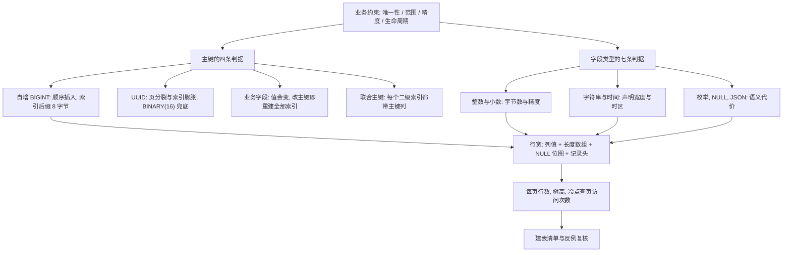
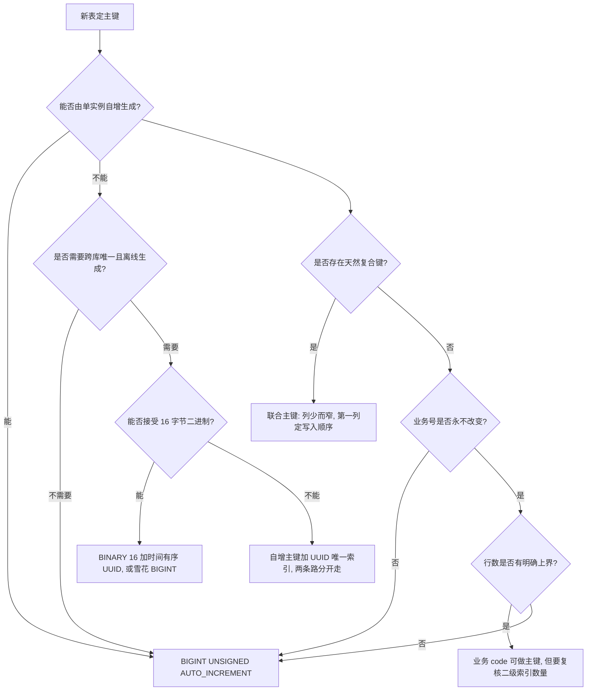
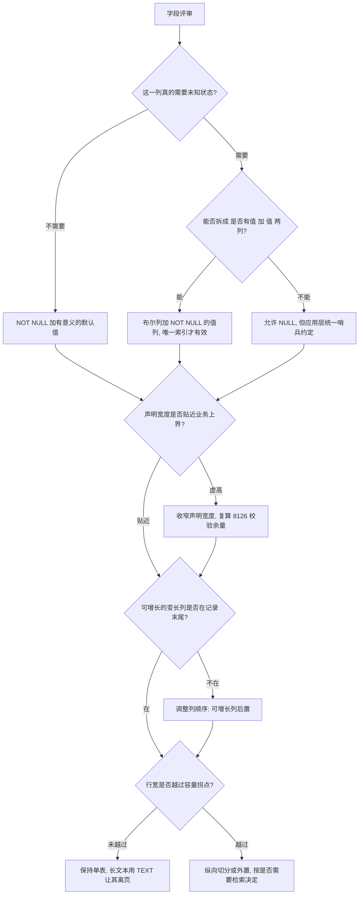

# 05 表设计与数据类型选择——细节决定性能上限

**摘要：**

表设计是少数几个一旦落库就很难回头的决定：字段类型还能靠加列绕过，主键却几乎不能换；行宽还能靠拆表补救，字符集则要重建整张表。本文站在写 DDL 的人这一侧，把这两类决定拆成可以照着问的判据。主键部分给四条：自增 `BIGINT` 为什么是默认答案，UUID 的随机性如何在页分裂与索引膨胀上收到账单、`CHAR(36)` 与 `BINARY(16)` 差在哪里、8.0 的 `UUID_TO_BIN` 能救回多少，业务字段做主键为什么在值变更时连锁重建全部二级索引，联合主键又怎样给每个二级索引加价，`AUTO_INCREMENT` 的不连续与锁模式一并厘清。字段部分给七条类型判据，把整数、小数、字符串、时间、枚举、`NULL` 与 JSON 的字节数与失效边界逐项对齐，再落到三条设计原则、一份建表清单与一组反例。第 8 章把两条主线的结果接起来：约 100 字节与约 1 KiB 的两种行宽，在一亿行下分别是约 150 行与 15 行每页，页数与缓冲池可缓存行数相差十倍。文中所有字节数、页数与树高都按同一套口径推算，可以替换成自己的表重算，八个反例则把判据被绕过时的现场收在一张表里。

---

## 第 1 章 十分钟与一个季度的差价

### 1.1 表设计只在两个时刻被认真讨论

表设计这项工作只在两个时刻被认真讨论：建表之前，和已经改不动的时候。前者一般占掉评审会的十分钟，后者一般占掉一个季度。

十分钟里能定的事无非是把业务字段翻译成列、给每列挑一个类型、再选一个主键。翻译的动作太顺手，顺手到没人会停下来问：这个 `VARCHAR(32)` 的订单号当主键，三年后业务规则变了要不要改？这个 `FLOAT` 存的金额什么时候会差一分钱？这个没写字符集的表，迁到另一个实例上会按什么规则比较字符串？

这三句问不出来的话，代价都落在后面。改主键不是改一行 DDL，是把聚簇索引连同它所有的二级索引重排一遍；`FLOAT` 丢掉的精度事后没法靠改类型找回；不写字符集的表会继承服务器默认值，而两个实例的默认值不一定相同，同一张表在不同环境里的唯一索引判定就不一样。所以本篇写判据，不写"应该用什么类型"的清单。

### 1.2 三种不可逆程度

表结构上的改动并不在同一档。第一档可以事后补救：加索引、加可空列、把冷字段拆到副表，这些在 8.0 里多数能走 `ALGORITHM=INPLACE`，或者交给 `pt-online-schema-change`、`gh-ost` 搬表，业务侧最多是一次短暂的延迟抖动。第二档是一次重建能补救、但代价明确：改列类型、改字符集、给已有列补 `NOT NULL`，这类改动通常落到 `ALGORITHM=COPY`，全表重写，期间不允许并发 DML。

第三档几乎不能补救：主键已经选了随机 UUID、行宽已经撑到 2 KiB、业务字段做了主键而业务规则正在变——补救路径都要动到每一行和每一个索引，且没法在线完成。本篇只处理后两档；第一档属于索引与改表的操作问题，索引怎么建见[[中间件/MySQL/MySQL进阶使用/01 索引设计实战——从建错索引到建对索引|本列 01：索引设计]]，改表怎么排窗口见[[中间件/MySQL/MySQL进阶使用/09 数据迁移与版本升级——零停机变更的工程实践|本列 09：零停机变更]]。

### 1.3 判据地图与列际分工

两条主线、十来个判据之间有先后：先定主键，它决定每一行存在哪里、每个二级索引带什么后缀；再定字段类型，它决定行宽；行宽最后决定每页行数、树高与冷查询的页访问次数。图 1 是这条主线。



行格式的字节级结构、8,126 字节的半页上限、从叶页数到树高的完整推导，都在[[中间件/MySQL/MySQL架构与底层原理/06 InnoDB 行格式与数据页结构——数据在磁盘上的真实样貌|本列 06：行格式与数据页]]里做完了，本篇只在第 8 章借用它的结论。这里要带走的一句是：**聚簇索引把行存在主键里，二级索引把主键复制一份**。主键与字段类型之所以"定下来就难改"，全部来自这一句。

---

## 第 2 章 主键的四个判据

### 2.1 主键为什么是唯一的强约束

InnoDB 的主键索引不是"额外的一个索引"，它就是**表本身**：叶子节点上放完整的行记录，非叶节点上放主键值与页号。这个结构一旦确定，三件事同时被绑死：行的物理位置由主键值决定，主键随机则插入随机，页分裂跟着来；每个二级索引都带主键，叶子记录是"索引列的值加主键值"，回表就是拿它回聚簇索引定位，主键有多宽这份冗余就复制多少份；二级索引的唯一性也依赖主键，主键一变化，索引列相同的记录在二级索引里的位置全要重排。

不指定主键时，InnoDB 会造一个 6 字节的隐藏列 `DB_ROW_ID` 顶上，并为它维护一个**全局共享计数器**，于是二级索引都带这个看不见的 6 字节，且计数器在高并发插入下是一个争用点。页分裂的机制推导见[[中间件/MySQL/MySQL架构与底层原理/05 InnoDB 索引结构——B+Tree 的工程哲学与页分裂机制|本列 05：B+Tree 与页分裂]]。

### 2.2 判据一：自增 `BIGINT` 是默认答案

自增 `BIGINT` 成为默认答案，理由不是"大家都这么用"，而是它同时满足三件事：插入只碰最右页、索引后缀只要 8 字节、值单调递增便于范围查询与游标分页。

自增值单调递增，新行永远大于已有主键，插入位置永远在 **B+Tree 最右端**，最右页没满就追加，满了就开新页追加，不存在把满页劈成两半的动作，填充率能长期维持在九成以上。8 字节的整数后缀在一亿行、五个二级索引下，冗余总量是 8 乘以 10⁸ 再乘 5，约 4 GB；自增值的大小顺序又与写入顺序大体一致，按 ID 区间归档、按 ID 做游标分页这些运维动作才成立。

真正的争议是为什么用 `BIGINT` 而不是 `INT`。`INT UNSIGNED` 上限 42.9 亿，按每天 100 万条能用 11.7 年，按每天 1000 万条只能用 1.2 年。判据倾向于现在换：把 `INT` 改成 `BIGINT` 是 `ALGORITHM=COPY`，全表重建，一亿行的表要一份额外磁盘加一段不允许写入的窗口；而 `BIGINT` 比 `INT` 多的 4 字节，在一亿行、五个二级索引下总共约 2.4 GB（行数据 0.4 GB，五个索引各 0.4 GB）。用 2.4 GB 的常驻开销换掉一次不可预知的全表重建，这笔交易几乎总是划算的。

`UNSIGNED` 要不要加，取决于应用层映射。加上之后上限翻倍到 1.84 乘以 10¹⁹，实际项目永远到不了；代价是 Java 的 `long` 上限 9.2 乘以 10¹⁸ 与之不重合，部分 ORM 会把 `UNSIGNED` 映射成 `BigInteger` 或 `BigDecimal`，序列化与缓存都要跟着调。团队已有大量 `long` DTO 不愿改时，有符号 `BIGINT` 也够用。还有一条容易被忽略的一致性要求：同一列在不同表里的类型必须完全一致，包括符号位，否则 JOIN 时隐式转换、索引失效，而这种失效在单表数据量小时完全看不出来。

### 2.3 判据二：UUID 的账单

UUID 作为主键的问题不在"它是字符串"，而在**它是随机的**。

随机主键让插入落在 B+Tree 的任意位置，页分裂持续发生，分裂出的空位很难再被填满，于是同一份数据占更多页、树更高、冷查询的页访问次数更多，页在磁盘上也更分散。这份代价还会被二级索引放大：聚簇索引上的随机插入，在每个二级索引上都要再发生一次，只是随机的维度换成了"索引列加主键"的复合键。

宽度问题与随机性问题要分开看，表 1 把两种常见存法放在一起。

| 口径 | `CHAR(36)` | `BINARY(16)` |
| :--- | :--- | :--- |
| 声明宽度 | 144 字节（36 × 4） | 16 字节 |
| 页内实际占用 | 36 字节（全为 ASCII 时） | 16 字节 |
| 每个二级索引的后缀 | 36 字节 | 16 字节 |
| 比较方式 | 逐字节比较字符串，受排序规则影响 | 16 字节定长比较 |
| 可读性 | 直接可读 | 需要 `BIN_TO_UUID` 转换 |

MySQL 8.0 提供了 `UUID_TO_BIN(uuid, 1)`，第二个参数是 `swap_flag`。对 v1 格式的 UUID，它把时间低位与时间高位交换，使生成的二进制按时间单调递增，`BIN_TO_UUID(bin, 1)` 做反向转换。这一招把随机插入变成趋势递增插入，页分裂频率大幅下降。要注意两点：对 v4 没有意义，因为 v4 里没有时间位；对 v7 这类本身时间有序的格式也不需要交换。

即便用了 `UUID_TO_BIN`，UUID 主键仍比自增 `BIGINT` 贵：16 字节对 8 字节，二级索引后缀翻倍，且"趋势递增"只是把随机性拉直，各节点的时间位仍可能交错，不严格等于全局单调。务实做法有四种。

第一种，保留自增 `BIGINT` 做主键，把 UUID 降级成业务唯一列加唯一索引：聚簇索引仍然顺序插入，随机性只落在那一个唯一索引上，代价是多一个 8 字节列与一份 16 字节的唯一索引，换来全局唯一与顺序插入兼得，这是分库分表场景下最常见的折中。第二种，主键必须是全局唯一 ID 时，用 `BINARY(16)` 加时间有序格式。第三种，把 ID 的生成位置从数据库挪到应用，8.0 的 `UUID()` 生成 v1 且每次调用都要走函数求值，应用侧生成并批量提交还能顺带控制提交节奏。第四种，如果唯一的目的只是不暴露业务量级，用雪花 ID 这样的趋势递增 `BIGINT` 就够了。

> [!warning] 一个组合起来的反例
> 用 `CHAR(36)` 的 UUID 做主键，再给这张表建五个二级索引。每个二级索引条目都要带 36 字节的随机后缀，五份冗余合计超过 180 字节；每次插入在六个 B+Tree 上都要找一次随机位置。这笔账在建表时只表现为"主键写了个 VARCHAR(36)"，一亿行之后会表现为缓冲池命中率持续下降与插入延迟抖动。

### 2.4 判据三：业务字段不能做会变的主键

订单号、身份证号、手机号、邮箱有一个共同的毛病：业务规则会变，而它们又天然唯一，于是很容易被顺手写成主键。

问题出在"主键不能改"。InnoDB 不支持原地修改主键值：`UPDATE t SET id = ...` 在实现上是聚簇索引删一条插一条，同时每个二级索引里带旧主键的副本要删、带新主键的要插，五个二级索引就是十二次 B+Tree 定位与页修改，而这次 `UPDATE` 在业务上只改了一行。

更常见的场景是主键的定义要换。原来的规则是"渠道前缀加日期加六位序号"，业务扩张后发现六位不够，这时只能 `ALTER TABLE t DROP PRIMARY KEY, ADD PRIMARY KEY (...)`，在 8.0 里落到 `ALGORITHM=COPY`，整表与全部二级索引一起重建。

除变更成本，还有两笔隐性开销：宽度上，`VARCHAR(64)` 的业务号做 `主键`，utf8mb4 下每个二级索引条目都要带 64 到 256 字节的后缀，与 8 字节的自增主键差一到两个数量级；比较上，字符串逐字节比、整数一条指令比，差异会被 JOIN 与范围扫描的行数放大。

正确做法是把代理键与业务键分开：整数自增做聚簇索引的主键，业务键加唯一索引，唯一性由数据库保证，查找走唯一索引回表，**多一次索引定位**换掉"永远不能改主键"这条锁链。边界也要说清——行数有界、值永不变、且不被大量二级索引引用的字典表与配置表，用业务 code 做主键是合理的，省下的那次 JOIN 是真省下来了。

### 2.5 判据四：联合主键的加价

联合主键不是坏东西，很多场景天然是复合键：多对多关联表的 `(user_id, role_id)`、多租户系统的 `(tenant_id, order_id)`、明细表的 `(order_id, line_no)`。它省掉单独的自增列，也让"同一组合只能出现一次"由主键直接承担。

代价是"二级索引带主键"这条规则被乘了列数。主键从一列 `BIGINT` 的 8 字节变成 `(INT, BIGINT)` 的 12 字节，每个二级索引条目的后缀就从 8 涨到 12；如果联合主键里混进一个 `VARCHAR(64)`，后缀直接涨到 70 字节以上。表 2 用一亿行、五个二级索引把这个差价摊开。

| 主键形态 | 每行主键宽 | 一亿行 × 5 索引的冗余 | 插入局部性 |
| :--- | :--- | :--- | :--- |
| `BIGINT` 单列自增 | 8 字节 | 约 4 GB | 最好，永远追加在最右页 |
| `(INT, BIGINT)` 联合 | 12 字节 | 约 6 GB | 取决于第一列的顺序性 |
| `CHAR(36)` 的 UUID | 36 至 144 字节 | 约 18 至 72 GB | 随机，除非用有序格式 |
| `VARCHAR(64)` 业务号 | 64 至 256 字节 | 约 32 至 128 GB | 随机，且比较昂贵 |

关于列顺序有一条常见误解值得澄清：把 `(a, b)` 换成 `(b, a)` 并不会减少字节数，因为两列都要存。顺序真正影响的是三件事。一是写入的局部性：明细表用 `(order_id, line_no)`，同一订单的多行落在相邻键空间，插入按订单号到达，基本是顺序的；换成 `(line_no, order_id)`，全局按行号排序，多行被打散到全树，写入立刻变成随机。二是聚簇索引能覆盖哪些查询：`(tenant_id, created_at)` 做主键，"某租户按时间范围查最近订单"可以直接走聚簇索引，顺序反过来就要另建二级索引，多一份随机写入与一份存储。三是范围扫描的剪枝效率：扫描沿叶子链表走，第一列选择性越好，越能一次定位到连续的页区间，第一列若是低基数列，范围条件几乎无法剪枝。

### 2.6 四条判据放在一起

表 3 把四条判据的适用条件与代价并排摊开，图 2 是建表时可以直接照着走的决策路径。

| 判据 | 典型形态 | 插入局部性 | 二级索引后缀 | 什么时候选它 |
| :--- | :--- | :--- | :--- | :--- |
| 自增整数 | `BIGINT UNSIGNED AUTO_INCREMENT` | 顺序，只碰最右页 | 8 字节 | 默认答案，绝大多数业务表 |
| 时间有序二进制 | `BINARY(16)` 加 `UUID_TO_BIN(uuid, 1)` 或 v7 | 趋势递增 | 16 字节 | 需离线生成、跨系统合并、不暴露量级 |
| 随机字符串 | `CHAR(36)` 的 v4 UUID | 随机，持续分裂 | 36 至 144 字节 | 只有在无法改造历史系统时 |
| 业务字段 | 订单号、身份证号、手机号 | 取决于业务号规则 | 与业务号等宽 | 行数有界、值永不变、极少被 JOIN |
| 联合主键 | `(tenant_id, order_id)`、`(order_id, line_no)` | 取决于第一列顺序性 | 各列之和 | 天然复合键，且列尽量少而窄 |



---

## 第 3 章 AUTO_INCREMENT 的四个坑

### 3.1 坑一：号段不连续是设计的一部分

自增值不连续不是 bug，而是这套分配机制的必然结果，至少三个来源。回滚：自增计数器在语句申请号段时就已经递增，事务回滚不会把号段还回去。批量插入的预分配：多值 `INSERT` 知道要插几行，会一次性申请 n 个号，语句中途失败，剩下的号作废。`INSERT ... ON DUPLICATE KEY UPDATE` 与 `REPLACE`：前者在冲突时走更新分支但号已申请，后者在实现上是删除加插入，可能消耗一个甚至两个号。

> [!info] 8.0 的一处改进
> 8.0 之前自增计数器不持久化，实例重启后会重新取 `MAX(id) + 1` 作为起点，于是可能复用已分配但未提交的号。8.0 起自增计数器持久化到重做日志，重启后从持久值继续，不会回退。这让"重启后 ID 变小"这类怪现象消失，也让主从切换后的号段衔接更可预测。

### 3.2 坑二：锁模式的三种取值与一段复制史

`innodb_autoinc_lock_mode` 控制"申请号段要加什么锁"，三档取值对应三种并发行为，表 4 是它们的对照。

| 取值 | 名称 | 简单插入的加锁方式 | 批量插入的加锁方式 | 号段连续性 | 代价 |
| :--- | :--- | :--- | :--- | :--- | :--- |
| 0 | traditional | 表级 `AUTO-INC` 锁，持有到语句结束 | 同左 | 严格连续 | 并发插入被表锁串行化，高并发写入下是硬瓶颈 |
| 1 | consecutive | 轻量互斥量，语句内一次申请 | 表级 `AUTO-INC` 锁 | 单语句内连续 | 批量插入仍会被串行化 |
| 2 | interleaved | 轻量互斥量 | 轻量互斥量 | 可能出现交错 | 同一条语句的号段可能与其他语句交错 |

"简单插入"指插入行数在语句解析时就已确定的语句，普通 `INSERT` 与多值 `INSERT` 属于这一类；"批量插入"指行数要到执行时才知道的语句，`INSERT ... SELECT` 与 `LOAD DATA` 属于这一类。

8.0 的默认值是 2，这个默认值在历史上是不能设的。5.1 与 5.5 时代默认是 1，原因是当时的复制以 `STATEMENT` 格式为主：一条 `INSERT ... SELECT` 在从库上重放时，从库的自增分配完全独立于主库，如果主库用了交错模式，同一条语句在主从两侧分配到的号可能不一样，行与行的主键就对不上。`ROW` 格式把"具体写入了哪些值"直接写进二进制日志，从库不再需要自己分配，这条约束才彻底消失。

判据是：只要 `binlog_format` 保持 8.0 的默认 `ROW`，就**保持锁模式为 2**；如果有人把 `binlog_format` 改回 `STATEMENT`，必须同时把锁模式降回 1，否则主从数据会在批量插入上静默分叉。交错模式还有一个操作性后果：同一条批量插入语句生成的主键不再保证连续，代码里"同一批数据的主键区间可用来判断归属"的假设会失效。

### 3.3 坑三：号段用尽之后不是溢出，是主键重复

自增号用尽之后的表现，很多人以为是溢出成负数，实际是插入直接失败。有符号 `INT` 的自增列涨到 2147483647 之后，下一次插入尝试写入这个值而它已存在，于是报 `Duplicate entry '2147483647' for key 'PRIMARY'`。这个报错极具误导性，看起来是数据重复，与容量用尽毫无关系。

判据是提前算而不是等报错：`information_schema.TABLES` 的 `AUTO_INCREMENT` 列给出下一个待分配的值，用它与类型上限的差额除以近期增长速度就是剩余时间。剩一年以内就该排期升级，剩三个月以内就是在窗口上赌运气。至于上限够不够，`BIGINT` 有符号是 9.2 乘以 10¹⁸，按每秒 100 万次插入算能用 29 万年，`BIGINT UNSIGNED` 能用 58 万年——这两个数字在现实项目里都等于够，所以主键类型的选择不该是"能省 4 字节就省"，而是"要不要为省 4 字节预留一次全表重建"。

### 3.4 坑四：分库分表之后自增不再唯一

单库单表时自增是全局唯一的，水平拆成多个实例后每个实例的计数器各管各的，冲突立刻出现；步长自增、数据库号段、雪花算法这三代方案都是围绕这件事展开的。本篇只处理"选型落到主键类型上"的那一部分：无论用哪种方案，落到表结构里的都该是一个 8 字节整数列，用字符串存雪花 ID、用 `VARCHAR(32)` 存号段 ID，等于把前面三节讨论的宽度代价白白接回来一遍。分库分表该在什么阶段做、拆分键怎么选，见[[中间件/MySQL/MySQL进阶使用/06 分库分表——何时做、怎么做、做了之后怎么办|本列 06：分库分表]]。

### 3.5 观测口径与参数取舍

表 5 列了与本篇相关的参数与调整代价。

| 参数 | 8.0 默认 | 建议 | 调大或改动的代价 | 回退的代价 |
| :--- | :--- | :--- | :--- | :--- |
| `innodb_autoinc_lock_mode` | 2 | 保持 2 | 无，但依赖 `binlog_format=ROW` | 回退到 1 会让批量插入重新拿表锁，写入吞吐下降 |
| `binlog_format` | `ROW` | 保持 `ROW` | 日志体积变大 | 改成 `STATEMENT` 必须同时降锁模式，否则主从不一致 |
| `sql_require_primary_key` | `OFF` | 新库可开 | 建表与改表可能被拒，需人工确认 | 关闭后仍可能出现无主键表，隐藏 `row_id` 争用回来 |
| `auto_increment_increment` | 1 | 单库保持 1 | 大于 1 会让单库 ID 出现规律性空洞 | 分库实例回退到 1 会立刻与邻实例冲突 |
| `innodb_strict_mode` | `ON` | 保持 `ON` | 无 | 关闭后超长、超宽、非法默认值会静默截断 |

---

## 第 4 章 整数与小数：先把字节数对齐

### 4.1 五种整数的字节与范围

MySQL 的整数类型只有五种，取值只取决于字节数，与声明时括号里的数字无关。表 6 把它们摊开。

| 类型 | 字节 | 有符号范围 | 无符号范围 | 什么时候选它 |
| :--- | :--- | :--- | :--- | :--- |
| `TINYINT` | 1 | -128 至 127 | 0 至 255 | 状态码、布尔、0 到 100 的比例值 |
| `SMALLINT` | 2 | -32768 至 32767 | 0 至 65535 | 年份、小范围计数、端口号 |
| `MEDIUMINT` | 3 | -8388608 至 8388607 | 0 至 16777215 | 介于两者之间的计数，很少用到 |
| `INT` | 4 | -2147483648 至 2147483647 | 0 至 4294967295 | 有明确上界的小表主键、外键、计数 |
| `BIGINT` | 8 | -9.22 × 10¹⁸ 至 9.22 × 10¹⁸ | 0 至 1.84 × 10¹⁹ | 主键默认答案、分布式 ID、大额累计值 |

### 4.2 显示宽度：`INT(11)` 里的 11 从哪来

`INT(11)` 是建表语句里最常见的迷信。这个 11 的来历很朴素：有符号 `INT` 的最大值是 2147483647，共十位，加一个负号位，显示宽度就是 11。它只告诉客户端"要补齐就补到 11 个字符宽"，与能存多大的数**没有任何关系**。`INT(1)` 与 `INT(11)` 的存储能力完全一致，都是 4 字节、21 亿的上限。

显示宽度在 8.0.17 被标记为废弃，随后版本里 `SHOW CREATE TABLE` 已不再保留它（带 `ZEROFILL` 的列除外），具体表现以对应版本官方文档为准。新版本里写 `INT(11)` 与写 `INT` 等价，唯一区别是前者会让读 DDL 的人误以为存在一个"11 位"的约束。要真正限制取值范围，8.0 支持 `CHECK` 并且会实际执行：`CHECK (status BETWEEN 0 AND 3)`、`CHECK (amount >= 0)` 都是有效的表级约束。

### 4.3 `DECIMAL`：按九位一组打包

`DECIMAL(M, D)` 的 M 是总位数、D 是小数位数，整数部分最多 M 减 D 位。它的存储不是字符串，而是把十进制数字按**九位一组**打包，每组占 4 字节；不足九位的零头按位数查表：1 到 2 位占 1 字节，3 到 4 位占 2 字节，5 到 6 位占 3 字节，7 到 9 位占 4 字节。整数部分与小数部分分开打包，各自补齐到组边界。

按这个规则手算三个常见声明：`DECIMAL(10, 2)` 整数部分八位占 4 字节、小数部分两位占 1 字节，合计 5 字节；`DECIMAL(12, 2)` 整数部分十位拆成九位加一位占 5 字节、小数部分 1 字节，合计 6 字节；`DECIMAL(14, 2)` 整数部分十二位拆成九位加三位占 6 字节、小数部分 1 字节，合计 7 字节。

### 4.4 `FLOAT` 与 `DOUBLE`：不能碰金额

`FLOAT` 4 字节、`DOUBLE` 8 字节，都是 IEEE 754 二进制浮点，无法精确表示十进制小数：`0.1` 与 `0.2` 在二进制里都是无限循环小数，相加之后不等于 `0.3`，在 MySQL 里执行 `SELECT 0.1 + 0.2 = 0.3` 会得到 0。这不是 MySQL 的缺陷，是二进制浮点的定义。

金额计算不能容忍这种误差。一次累加可能只差 0.0000000001，但金额要参与四舍五入、要对账、要在两个系统之间传递，误差会被放大成"账对不上"。所以金额字段必须用 `DECIMAL`，或者用整数存最小货币单位。

`FLOAT(M, D)` 与 `DOUBLE(M, D)` 这种带精度的写法在 8.0.17 同样被标记废弃，原因是它做的是"存储时四舍五入"，看起来像定点数，实际仍是二进制浮点，只是把误差藏到舍入之后。看到历史表里有 `FLOAT(10, 2)`，就该知道这一列的数据已经不可信，需要逐行重算。表 7 把金额的三种存法放在一起。

| 方案 | 声明 | 单值字节 | 精度 | 运算代价 | 适用场景 |
| :--- | :--- | :--- | :--- | :--- | :--- |
| 定点小数 | `DECIMAL(14, 2)` | 7 | 精确十进制 | 定点运算，聚合略慢 | 默认方案，账目、发票、余额 |
| 整数最小单位 | `BIGINT`，存"分" | 8 | 精确 | 整数运算，最快 | 高频计算、需要与外部系统对账 |
| 二进制浮点 | `FLOAT` 或 `DOUBLE` | 4 或 8 | 有二进制误差 | 最快 | 只用于统计口径的近似值，如评分、坐标 |

---

## 第 5 章 字符串与时间：另一半字节

### 5.1 `CHAR` 与 `VARCHAR`：认声明宽度，不认感觉

`CHAR` 与 `VARCHAR` 的差别在文档里只有两句话：`CHAR` 定长补齐，`VARCHAR` 变长加长度前缀。落到容量表上却有两个口径同时在生效，只算一个就会得出错误结论。

第一个是声明宽度。`CHAR(10)` 在 utf8mb4 下声明 40 字节，`CHAR(255)` 是 1,020 字节，`VARCHAR(64)` 是 256 字节。声明宽度不是空话：建表时的 65,535 字节总行长校验按声明宽度求和，InnoDB 的 8,126 字节行内上限在定长列上按声明宽度计入，索引键前缀上限也按声明宽度算。一个只存四个汉字的 `CHAR(255)`，在校验里仍然是 1,020 字节。

第二个是页内实际占用。utf8mb4 下 InnoDB 会把 `CHAR(N)` 压到 N 字节以内——去掉尾部空格后按实际字节存，同时至少预留 N 字节，这样短值变长时不必重排整页，所以 `CHAR(10)` 存四个汉字在页内大约占 12 字节。两个口径的完整对照在[[中间件/MySQL/MySQL架构与底层原理/06 InnoDB 行格式与数据页结构——数据在磁盘上的真实样貌|本列 06：行格式与数据页]]里有逐项拆解。

建表时的判据因此是两句话：容量规划看页内占用，上限与索引看声明宽度。只看页内占用，会排出一堆宽列然后在建表阶段撞上 8,126；只看声明宽度，会把本该用 `CHAR` 的定长编码改成 `VARCHAR`，白白多一个长度字节。定长编码（两位的省份代码、三位的货币代码、固定 32 位的十六进制 MD5、固定长度的哈希前缀）才是 `CHAR` 的唯一用武之地。

### 5.2 长度前缀的一字节与两字节分界

`VARCHAR` 的长度前缀占 1 字节还是 2 字节，取决于**最大字节长度**是否超过 255，与字符数无关。这一点最常被算错。

一个流传很广的说法是"`VARCHAR(255)` 与 `VARCHAR(256)` 的分界在 1 字节与 2 字节之间"。这句话在 latin1 下成立，因为一个字符就是一个字节；在 utf8mb4 下完全不成立：`VARCHAR(63)` 的最大字节长度是 252，用 1 字节前缀，`VARCHAR(64)` 是 256，已经要用 2 字节前缀，分界线落在字符数 63 与 64 之间。这个差异看起来只有 1 字节，意义在于 `VARCHAR(255)` 是一个没有物理依据的习惯值：它既不是长度前缀的分界点，也不是索引键长的分界点，唯一作用是让声明宽度变成 1,020 字节，把 8,126 那道门的余量提前吃掉。

### 5.3 `TEXT` 与 `BLOB` 的边界

`TEXT` 与 `BLOB` 从 `TINYTEXT` 的 255 字节排到 `LONGTEXT` 的 4 GiB，存储机制与 `VARCHAR` 相同，差别落在三处：不能作为完整的索引列，只能建前缀索引，而前缀索引无法覆盖查询；内容超过一定长度会离页，行内只留 20 字节指针，读取要额外一次 IO；`TEXT` 列不能有普通默认值。什么时候该把长文本从主表移出去，判据是"它是否出现在高频查询的列清单里"，不是"它是不是 TEXT"——DYNAMIC 行格式下全表扫描不会去读溢出页，除非查询的列清单里带上了这一列，一旦带上，扫描十万行就是十万次额外随机 IO。拆表的算术与观测口径见[[中间件/MySQL/MySQL架构与底层原理/06 InnoDB 行格式与数据页结构——数据在磁盘上的真实样貌|本列 06]]的第 2.3 节。

### 5.4 时间类型的字节账

时间类型的宽度经常被记错，其中一个流传较广的错误是把 `DATETIME` 记成 8 字节。表 8 是按官方文档口径整理的宽度，带小数秒的列在基础宽度上再加 0 到 3 字节。

| 类型 | 基础字节 | 范围 | 是否受时区影响 | 常见误记 |
| :--- | :--- | :--- | :--- | :--- |
| `DATE` | 3 | 1000-01-01 至 9999-12-31 | 否 | — |
| `TIME` | 3 | -838:59:59 至 838:59:59 | 否 | — |
| `YEAR` | 1 | 1901 至 2155 | 否 | — |
| `DATETIME` | 5 | 1000-01-01 00:00:00 至 9999-12-31 23:59:59 | 否，存什么读什么 | 常被记成 8 字节 |
| `TIMESTAMP` | 4 | 1970-01-01 00:00:01 UTC 至 2038-01-19 03:14:07 UTC | 是，写入转 UTC，读取转回 | — |

`DATETIME` 的 5 字节是这个类型的优势：范围覆盖到 9999 年，又不做时区转换，代价只比 `TIMESTAMP` 多 1 字节。所谓"`DATETIME` 8 字节"的说法，是把 `DATETIME(6)` 的宽度当成了默认宽度——带六位小数秒的确实是 8 字节，默认精度的是 5 字节。小数秒的代价按位数分三档：1 到 2 位加 1 字节，3 到 4 位加 2 字节，5 到 6 位加 3 字节；这个代价不只是存储，它进入每一个以该列为键的索引，也进入每一次行比较。业务上只需要秒级的时间列，不要为了"看起来精确"加三位小数。

### 5.5 2038 与时区：`TIMESTAMP` 的两笔账

`TIMESTAMP` 的问题有两个，且互相独立。

第一个是范围。它内部存的是 32 位 Unix 时间戳，上限是 **2038-01-19 03:14:07 UTC**，这个限制在 8.0 与 8.4 里仍然存在，没有开关能把它扩成 64 位。对生命周期超过十几年的系统，这不是"到时候再说"，而是"这一列从建表起就选错了"。

第二个是时区。它写入时把会话时区下的时间转成 UTC 存下、读取时再转回，表达的是"绝对时刻"，语义比 `DATETIME` 更明确；问题在于它依赖两端时区配置始终一致，一旦实例的 `time_zone` 被改过、主从两侧时区不一致、或者数据被导到另一个时区的实例，同一个值读出来就不再是同一天同一时刻。这类问题最难排查，因为数据本身没变，变的只是解释方式。`DATETIME` 存字面时间不做转换，把时区责任交给应用层：约定全系统存 UTC，写入前转换，读出后按用户时区渲染。表 9 把判据收在一起。

| 判据 | 选 `DATETIME` | 选 `TIMESTAMP` |
| :--- | :--- | :--- |
| 生命周期是否跨过 2038 | 跨过或不确定，必须 `DATETIME` | 确定只在短期系统内使用 |
| 是否需要跨时区部署 | 需要，且应用层统一存 UTC | 单一时区，且实例时区不会再变 |
| 是否希望数据库强制转换 | 应用层自律足够时用 `DATETIME` | 希望由数据库承担转换时用 `TIMESTAMP` |
| 行宽是否极度敏感 | 每行多 1 字节 | 每行省 1 字节 |
| 是否会做历史数据迁移 | 迁移后语义不变 | 迁移时两端时区必须一致 |

落点很清楚：默认用 `DATETIME`，把时区统一交给应用层；只有当系统确定单时区、确定不跨 2038、且行宽敏感时，`TIMESTAMP` 的 1 字节才值得。`created_at`、`updated_at`、业务发生时间都该是 `DATETIME`。

### 5.6 `ENUM` 与 `SET`：省字节但把约束锁进 DDL

`ENUM` 把枚举值集合声明在列定义里，每行只存一个序号：取值不超过 255 个时占 1 字节，255 到 65535 个时占 2 字节。`SET` 允许一行取多个值，按位图存储，1 到 8 字节，最多 64 个成员。相比 `VARCHAR(20)`，它们的存储优势是压倒性的。

代价有四个。**排序按定义顺序**而不是字母序，`ORDER BY status` 得到的是列表里的书写顺序；改枚举要 `ALTER`，往末尾追加新值在 8.0 后期版本可以走 `ALGORITHM=INSTANT`（8.0.29 起支持，具体以对应版本官方文档为准），插到中间、删除值或调整顺序都要重建表；内部序号 0 保留给"错误值"，非严格 SQL 模式下写非法值会落成空字符串；应用层枚举与数据库枚举要维护两遍。

判据是：状态机用一个 `TINYINT` 加应用层常量表，把取值范围放在 `CHECK` 与应用层，读写两端都不依赖 DDL；只有枚举值极少、几乎不会扩展、且希望数据库承担约束时才用 `ENUM`。`SET` 的适用范围更窄，它在一列里存多个值，违反第一范式，查询要用 `FIND_IN_SET` 之类函数，索引也帮不上忙。

---

## 第 6 章 `NULL` 与 JSON：两个看起来省钱的选择

### 6.1 `NULL` 的位图与语义代价

`NULL` 在存储上只花一位。InnoDB 在每行记录开头放一张 NULL 位图，长度是可空列数除以八向上取整：30 个可空列就是每行 4 字节，一亿行是 400 MB。这笔钱不多，但它是每一行都要付的固定开销，且与这些列实际有没有存 `NULL` 无关——把列定义成可空，位图就按可空列数预留，哪怕一亿行里一个 `NULL` 都没有。位图口径在[[中间件/MySQL/MySQL架构与底层原理/06 InnoDB 行格式与数据页结构——数据在磁盘上的真实样貌|本列 06]]的 4.4 节。

比位图更贵的是语义：`NULL` 表示未知，任何与它的比较结果都是未知而不是真假，于是 `WHERE col != 'x'` 不会返回 `col` 为 `NULL` 的行，`NOT IN` 的子查询里只要出现一个 `NULL`，整个条件就永远不成立，`COUNT(col)` 跳过 `NULL` 而 `COUNT(*)` 不跳。这些规则散落在每一条业务 SQL 里，写错不报错，只悄悄少几行数据。

### 6.2 `NULL` 让唯一索引失效

唯一索引的规则是：值相同的行不允许存在，但 `NULL` **不算值相同**。因此可空的唯一列上可以插入任意多个 `NULL`，唯一性约束对这些行完全不起作用。

后果在业务上很直接。给 `users.email` 建唯一索引、列允许 `NULL`，多个"还没填邮箱"的用户都能写进去（这本身合理），但如果"邮箱可为空、一旦填了就不能重复"的语义要靠数据库保证，就必须写成 `NOT NULL` 加一个约定的空值，或者把邮箱拆到另一张"已验证邮箱"表里。用空字符串代替 `NULL` 也不是免费的：空字符串是真实的值、参与唯一索引，第二个空邮箱又冲突，于是不得不造出 `''`、`'-'`、`'unknown'` 这类假值，语义开始变脏。

### 6.3 JSON：二进制文档、虚拟列与索引路径

MySQL 8.0 的 `JSON` 类型不是"把字符串存进去"，而是解析成二进制文档保存：对象与数组的成员按排序后的顺序存储，重复键会被去重，读取时按需取出路径。它的体积与 `LONGBLOB` 同量级，上限受 `max_allowed_packet` 约束。

`JSON` 列本身不能直接建索引。要在文档内部做等值或范围查询，有两条路。第一条是生成列加索引：声明一个 `VIRTUAL` 或 `STORED` 的生成列把 JSON 路径抽成标量，再在生成列上建索引；`VIRTUAL` 不占存储、不参与行宽计算（只在索引里出现），是首选。第二条是 8.0.17 引入的多值索引，可以对 JSON 数组的每个元素建索引，语法是 `CAST(... AS ... ARRAY)`，索引条目数与数组长度成正比。

还有一条容易忽略的限制：`JSON` 列不能有普通默认值，不能作为主键或整体索引，不能直接被 `CHECK` 约束内部字段，也不能参与外键。数据库对这些约束的缺席，都要由应用层补回来。

### 6.4 什么时候不该用 JSON

`JSON` 的价值在于"结构真的不定"，而不在于"现在懒得设计列"。判据可以写成一组否命题：如果某个字段需要出现在 `WHERE` 条件里、需要 `JOIN`、需要 `ORDER BY`、需要聚合、需要唯一约束，它就不该放在 JSON 里。

适合留在 `JSON` 里的是这几类：外部系统透传的原始报文、结构随业务方变化的扩展属性、只需整份读取不需检索的快照、短期内无法确定 schema 的试验性字段，共同特征是读取时整份取出、不参与查询条件。这个边界一旦被突破，`JSON` 就从灵活性变成了债务。

### 6.5 七条判据的总表

表 10 把本章与前两章的七条类型判据收在一起，最后一列是每条判据最容易被忽略的失效边界。

| 判据 | 核心结论 | 关键字节或范围 | 最容易被忽略的边界 |
| :--- | :--- | :--- | :--- |
| 整数 | 按业务上界选最小类型，主键例外 | 1、2、3、4、8 字节 | `INT(11)` 的 11 只是显示宽度，8.0.17 起废弃 |
| 小数 | 金额必须精确，浮点只用于近似 | `DECIMAL` 每九位 4 字节 | `FLOAT(M, D)` 仍在做二进制浮点舍入 |
| 字符串 | 声明宽度决定上限，页内占用决定容量 | utf8mb4 每字符最多 4 字节 | 前缀分界按字节算，落在 63 与 64 之间 |
| 时间 | 默认 `DATETIME`，时区交给应用层 | `DATETIME` 5 字节，`TIMESTAMP` 4 字节 | `TIMESTAMP` 上限 2038，且随会话时区变化 |
| 枚举 | 省字节但把约束锁进 DDL | `ENUM` 1 或 2 字节，`SET` 1 至 8 字节 | 排序按定义顺序，加值要 `ALTER` |
| `NULL` | 位图便宜，语义与唯一性昂贵 | 每列 1 位，按字节向上取整 | 唯一索引允许多个 `NULL`，等于放弃约束 |
| JSON | 只放不参与检索的附加结构 | 与 `LONGBLOB` 同量级 | 无统计、无直接索引、更新粒度粗 |

---

## 第 7 章 字段设计的三条原则

### 7.1 能不用 `NULL` 就不用

"能不用 `NULL` 就不用"这条原则常被误解成"所有列必须 `NOT NULL`"，准确表述是：先证明这一列确实需要"未知"这个状态，再决定是否允许 `NULL`。

绝大多数可空是设计偷懒的产物。创建时间、更新时间、状态、金额、数量、外键，这些列在业务上都有确定的初始值，用 `NOT NULL` 加默认值表达更准确，也让唯一索引与统计真正生效。真正需要 `NULL` 的是"这个值在语义上不存在"的列，比如"取消时间"对一张未取消的订单、"父级 ID"对一棵树的根节点、"关单原因"对一张正常完结的订单。判据落在成本上：位图的成本只有每行几位，可以忽略；唯一索引失效与三值逻辑的代价会在数据涨到百万级之后显形，且很难通过改代码消除，所以 `NOT NULL` 该在定表那天一次定完。

### 7.2 字段尽量定长且小

"定长"在这里指的不是 `CHAR`，而是**长度有确定上界且不会随业务增长**。一个 `VARCHAR(32)` 的订单号，如果业务规则保证永远是 20 到 24 个字符，它在设计意义上就是定长的；一个 `VARCHAR(200)` 的备注，即使今天平均长度只有 30 个字符，它仍然是变长的，且会随用户习惯变长。

这条原则有三层含义。声明宽度要贴近业务上界，每虚高一倍，8,126 与索引键长的余量就少一半；变长列的位置有讲究，行内布局里长度数组在记录头之后、列值按顺序排列，位于记录中部的变长列一旦变长，它后面的列全要后移，本页容纳不下就触发行迁移，把可增长的变长列放在记录末尾是建表时就能做到且代价为零的事。

综合起来：业务上界能被一句话说清的列，用定宽声明；上界说不清的列，用 `VARCHAR` 并接受它变长；确实可能很长的列，用 `TEXT` 并准备拆表。

### 7.3 大字段拆表

大字段该不该拆到副表，判据不是"它大不大"，而是"它是否出现在高频查询的列清单里"。

主表被大字段撑宽之后，受损的是所有针对主表的操作：每页行数下降，树变高，全表扫描要读更多页，缓冲池能缓存的行数下降。这些损害与"这条 SQL 有没有用到那个大字段"无关——只要行宽超了，所有行都要为它付页数；而大字段一旦离页，读它才有额外 IO，不读它就是 20 字节的指针。

所以真实判据是两条的组合：这一列是否让行宽越过了容量拐点，以及它是否高频出现在查询里。前者指向必须拆，后者指向拆了才有收益；两条都不满足时，把字段改成 `TEXT` 让它离页，比拆表便宜得多——拆表要付一次 JOIN、一个跨表事务边界、一套"主表写成功、副表写失败"的补偿逻辑。拆表之后的形状有两种：纵向切分把冷字段搬到 `order_ext` 这样的副表用同一主键关联，可以在线做；彻底外置把正文放对象存储、主表只留对象键，代价是失去事务与一致性。判断标准是这一列是否需要被检索。

### 7.4 三条原则打架时怎么排

三条原则会打架：改 `NOT NULL` 要默认值而默认值可能污染数据，挪列顺序会与团队规范冲突，拆表会引入 JOIN。排序的依据是**改动的可逆性**。`NOT NULL` 与默认值可以在建表时定好，事后修改要重建表，优先级最高；列顺序同样一改就要重建，在建表时一并决定；拆表可以在线做（新建副表、双写、回填、切读），优先级最低，可以留到行宽真的构成瓶颈时再做。图 3 是这条排序的落地路径。



---

## 第 8 章 行宽如何变成 IO 次数

### 8.1 一条可以复算的传导链

前七章都在讨论"单个字段该多宽"，但字段宽度的后果不在字段上，而在页上：字段声明求和得到行宽，行宽除出每页行数，再除出叶页数与树高，树高与每层页访问相乘就是一次冷点查的 IO 次数。图 4 是这条链。


这三个常数都在[[中间件/MySQL/MySQL架构与底层原理/06 InnoDB 行格式与数据页结构——数据在磁盘上的真实样貌|本列 06]]里推导过：页内可用 16,252 字节，半页上限 8,126 字节，8 字节主键下扇出保守取 900。下面的数字都是示例推算，可以替换成自己的表重走一遍。

### 8.2 一百字节与一千字节的对照

把三种行宽放在一起，容量表的分野就一目了然。算例 A 是 107 字节的窄表（订单主表），算例 B 是约 1,030 字节的宽表（含快照与属性列），算例 C 是把快照列再扩 1,000 字节的超宽表。表 11 是这组对照。

| 指标 | 算例 A：约 100 字节行 | 算例 B：约 1 KiB 行 | 算例 C：约 2 KiB 行 |
| :--- | :--- | :--- | :--- |
| 每页行数 | 约 150 行 | 约 15 行 | 约 8 行 |
| 一亿行的叶页数 | 约 666,700 页 | 约 6,670,000 页 | 约 12,500,000 页 |
| 叶页占用 | 约 10.2 GiB | 约 102 GiB | 约 191 GiB |
| 树高 | 3 层 | 4 层 | 4 层 |
| 冷点查的页访问次数 | 3 次 | 4 次 | 4 次 |
| 三层树的容量上限 | 约 1.2 亿行 | 约 1,215 万行 | 约 648 万行 |
| 8 GiB 缓冲池可缓存行数 | 约 7,860 万行 | 约 786 万行 | 约 419 万行 |

行宽差十倍，每页行数就差十倍；每页行数差十倍，同一份数据占的页也差十倍；页数差十倍，缓冲池能装下的行数同样差十倍。从 1 KiB 涨到 2 KiB 时树高没变，但每页行数从 15 掉到 8、叶页占用从 102 GiB 涨到 191 GiB——行宽越过 1 KiB 之后，损害的主要形态从"树高"换成了"体积与缓存密度"。

### 8.3 把行宽拆到字段级

行宽这个数字本身没有操作性，有操作性的是"哪几列贡献了这一千字节"。表 12 把算例 B 拆开。

| 列 | 声明 | 页内占用 | 占行宽比例 | 处置判据 |
| :--- | :--- | :--- | :--- | :--- |
| 12 个商品属性列 | `VARCHAR(40)`，各存 40 字节 | 504 字节 | 约 49% | 高频筛选的留主表，其余整体转 JSON 或副表 |
| 快照列 | `VARCHAR(2048)`，存 300 字节 | 302 字节 | 约 29% | 换 `TEXT` 让其离页，或搬到副表 |
| 标题 | `VARCHAR(200)`，存 60 字节 | 62 字节 | 约 6% | 保留，声明宽度可从 200 收到 128 |
| 商品编码 | `VARCHAR(64)`，存 24 字节 | 26 字节 | 约 3% | 保留，若定长则改 `CHAR` |
| 订单号 | `VARCHAR(32)`，存 20 字节 | 22 字节 | 约 2% | 保留，作为唯一索引而非主键 |
| 其余 26 列 | 整数、`DECIMAL`、时间、三个 `TINYINT` 等 | 116 字节 | 约 11% | 逐列核对上界，主键保持 `BIGINT` |

两列占掉近八成的行宽，而它们恰好是大多数查询用不到的列。12 个属性列若只是详情页整份展示的一部分，就不该以 12 个独立标量列的形式躺在主表里；把平均行长当行宽指标会得出相反结论，因为页内排布按实际字节算，而变长列的长度分布还决定行内能否原地更新。

---

## 第 9 章 字符集与排序规则

### 9.1 `utf8` 的三字节历史

MySQL 里的 `utf8` 是历史上的一段弯路。这个名字本应指完整的 UTF-8 编码，实际实现只支持最多 3 字节的字符，也就是基本多文种平面（BMP）之内的码点。四字节的字符——emoji、一部分生僻汉字、部分音乐与数学符号——写进去会报 `Incorrect string value`，或在非严格模式下被替换成问号。

真正完整实现的字符集叫 `utf8mb4`，最多 4 字节；`utf8mb3` 是那个三字节实现的正名，8.0.28 起 `utf8` 作为 `utf8mb3` 的别名被标记为废弃，具体表现以对应版本官方文档为准，新建库表应当一律用 `utf8mb4`。这段历史留下的坑不是选择题，而是存量数据的清理：一张 `utf8` 的表里四字节字符要么从未写入，要么已被替换成问号，改字符集只能把列声明改对，救不回丢掉的内容。

### 9.2 `utf8mb4_0900_ai_ci` 是什么

8.0 的默认排序规则是 `utf8mb4_0900_ai_ci`，名字里三段信息都要读懂：`0900` 指它基于 UCA 9.0.0（Unicode Collation Algorithm）实现；`ai` 是 accent insensitive，重音不敏感，`'e'` 与 `'é'` 算相等；`ci` 是 case insensitive，大小写不敏感，`'A'` 与 `'a'` 算相等。与 5.7 时代的 `utf8mb4_general_ci` 相比，`0900` 系列对多语言的排序更正确，代价是比较时的计算量略大；更关键的差别在填充属性，`0900` 系列属于 NO PAD，`general_ci` 与 `utf8mb4_bin` 属于 PAD SPACE。

### 9.3 `ci` 与 `bin` 对唯一索引与查询的影响

排序规则决定两件事：两个字符串是否相等，以及排序时谁在前。前一件事直接决定唯一索引的判定，后一件事直接决定 `ORDER BY` 与 `GROUP BY` 的结果。

在 `ai_ci` 下，唯一索引把大小写变体当成重复：给 `users.username` 建唯一索引、排序规则是 `utf8mb4_0900_ai_ci`，注册 `Alice` 之后再注册 `alice` 会被拒绝。对用户名这通常是想要的行为；对存 base64、JWT、哈希摘要、外部系统主键的列来说就是错的——这些列的大小写是信息本身的一部分，被折叠掉等于数据被改写。反过来，在 `_bin` 下比较按码点逐字节进行，`'A'` 与 `'a'` 是两个不同的值，对令牌、签名、文件路径、需要区分大小写的外部 ID 正确，对人名与标题则过于严格。表 13 把四种常见排序规则的语义摊开。

| 排序规则 | 大小写 | 重音 | 尾部空格 | 适用场景 |
| :--- | :--- | :--- | :--- | :--- |
| `utf8mb4_0900_ai_ci` | 不敏感 | 不敏感 | 参与比较（NO PAD） | 8.0 默认，人名、标题、通用文本 |
| `utf8mb4_0900_as_cs` | 敏感 | 敏感 | 参与比较（NO PAD） | 需要严格按语言习惯比较的文本 |
| `utf8mb4_0900_bin` | 敏感 | 敏感 | 参与比较（NO PAD） | 令牌、哈希、外部 ID、需要逐码点相等 |
| `utf8mb4_bin` | 敏感 | 敏感 | 忽略尾部空格（PAD SPACE） | 历史表沿用，与新默认行为不一致，需复核 |

判据是：**列的语义决定排序规则**，而不是让服务器默认值决定一切。需要"相等即同一实体"的列（用户名、邮箱、手机号）用 `ai_ci` 或 `as_cs`；需要"逐字节相等"的列（令牌、摘要、外部主键、URL）显式写 `utf8mb4_0900_bin`。一张表里两种列都存在时，按列指定排序规则。

### 9.4 尾部空格：NO PAD 与 PAD SPACE

尾部空格是 8.0 迁移里最容易被漏掉的差异。PAD SPACE 的排序规则在比较时把字符串补齐到等长再比，等于忽略尾部空格，所以 `'abc'` 与 `'abc '` 相等；NO PAD 不补齐，尾部空格参与比较，两者不相等。

### 9.5 隐式转换让索引失效

索引失效有三种最常见的触发方式，共同点是转换发生在列上。一是比较两侧都是列且字符集不同：`utf8mb3` 的旧表 `JOIN` 一张新的 `utf8mb4` 表，连接列上无法用索引，执行计划退化成全表扫描或哈希连接。它的表现是"这条 JOIN 昨天还好，今天变慢了"，而变的只是新表被建成了 `utf8mb4`。二是类型不匹配：用字符串列与数字比较，`WHERE order_no = 20260001`，MySQL 会把两侧都转成浮点数，字符串列上的索引完全用不上。三是显式包装：`CONVERT(col USING utf8mb4)` 或 `col COLLATE utf8mb4_bin`，任何把列包进函数的写法都会让索引失效，与 `WHERE DATE(created_at) = ?` 是同一种病。

判据是四层一致：库的默认字符集、表的默认字符集、列的字符集、连接的 `character_set_client` 与 `character_set_connection`，四层都是 `utf8mb4` 且排序规则在同一套语义下；四层一致之后再加一条纪律，列不与函数比较、字符串列不与数字比较。表 14 是相关参数的取舍。

| 参数 | 8.0 默认 | 建议 | 改动的收益 | 改动的代价 |
| :--- | :--- | :--- | :--- | :--- |
| `character_set_server` | `utf8mb4` | 保持 | 与 8.0 默认一致，减少隐式转换 | 改成 `utf8mb3` 会让新表存不下四字节字符，且与旧表混用引发比较转换 |
| `collation_server` | `utf8mb4_0900_ai_ci` | 保持，或按业务改 `as_cs` | 排序更符合语言习惯 | 与 5.7 的 `general_ci` 语义不同，唯一索引判定会变 |
| `innodb_default_row_format` | `DYNAMIC` | 保持 | 长变长列整列离页，页内只留 20 字节 | 回退到 `COMPACT` 会在页内留 768 字节前缀，长文本表体积暴涨 |
| `explicit_defaults_for_timestamp` | `ON` | 保持 | `TIMESTAMP` 行为可预期 | 关闭后回到 5.7 老行为，掩盖 DDL 缺省问题 |
| `innodb_page_size` | 16 KiB | 保持 | 行上限与键前缀最宽松 | 只能在初始化实例时指定，运行期改不了，迁就要重建实例 |

`innodb_page_size` 值得单独说一句：它只能在初始化实例时指定，运行期没有修改办法，想改就得重建实例并把数据导进去，所以"页大小不合适"这件事在实例初始化那一刻就定了，与表设计同属"定下来就难改"的一类。

---

## 第 10 章 建表规范清单

### 10.1 必备字段

一张业务表至少要有三列：`id`、`created_at`、`updated_at`。`id` 用 `BIGINT UNSIGNED AUTO_INCREMENT`，理由见第 2 章——它不只是为了唯一，更是为了让聚簇索引有一个窄而顺序的主键，让所有二级索引的后缀只有 8 字节。后两列用 `DATETIME(3)` 加 `DEFAULT CURRENT_TIMESTAMP(3)` 与 `ON UPDATE CURRENT_TIMESTAMP(3)`，由数据库填而不是应用填：应用服务器的时钟可能不同步，而 `created_at` 一旦写错就无法回溯。

### 10.2 字符集与注释

每张表的 DDL 都要显式写 `DEFAULT CHARSET=utf8mb4 COLLATE=utf8mb4_0900_ai_ci`。不依赖服务器默认值的理由很实际：一个库的默认值随实例初始化参数变化，同一套 DDL 在开发、测试、生产三个实例上可能建出三种字符集的表，这类差异在功能测试里完全不可见，只在某天上线一段含 emoji 的文案时爆发。表级指定之外还有两处要显式：需要逐字节相等的列单独写 `COLLATE utf8mb4_0900_bin`；应用的连接串要显式设置字符集参数，不依赖驱动默认值。

表注释与列注释都必填。这不是形式主义：DDL 是唯一一份不会被代码重构带走的文档，三年后接手的人看到的只有列名与注释。一个 `status TINYINT COMMENT '0 待支付 1 已支付 2 已取消 3 已退款'`，比在代码里找枚举定义快得多；一个 `amount DECIMAL(14,2) COMMENT '订单金额，单位元'`，能避免下一个人把它当成分。注释还出现在 `information_schema.COLUMNS` 与 `SHOW FULL COLUMNS` 里，可以被脚本采集用于生成数据字典。

### 10.3 外键该不该用

外键在 InnoDB 上可用，行为也正确：插入子表行时检查父表，删除或更新父表行时按级联规则处理。但它的普及度远低于正确性，原因有四条：外键检查会在父表上加共享锁，高并发写入下让原本不相关的写入互相等待；级联删除不可控，删除动作发生在存储引擎层，应用的审计与软删除逻辑被绕过；分库分表之后跨实例的约束无法由数据库维护；存在外键引用时，某些 DDL 只能走 `COPY`。

判据可以这样给：单库、单体、数据量不大、一致性要求高的系统可以用，它替应用挡住一类脏数据；分库分表、高并发写入、有逻辑删除的系统不要用，把约束交给应用层加定期核对任务。混合形态（核心表用、日志表不用）也是负责任的选择，前提是这条界线被写进规范并被遵守。

### 10.4 一份可以照着改的建表模板

把前面九章的决定落成 DDL，形状大致如下。

```sql
CREATE TABLE `order_item` (
  `id`         BIGINT UNSIGNED NOT NULL AUTO_INCREMENT COMMENT '主键',
  `order_id`   BIGINT UNSIGNED NOT NULL COMMENT '订单主键，与 order 表同类型同符号位',
  `order_no`   VARCHAR(32)     NOT NULL COMMENT '订单号快照，业务唯一，不做主键',
  `sku_code`   CHAR(16)        NOT NULL COMMENT '商品编码，定长编码',
  `qty`        INT UNSIGNED    NOT NULL DEFAULT 0 COMMENT '数量',
  `amount`     DECIMAL(14,2)   NOT NULL DEFAULT 0.00 COMMENT '金额，单位元，精确到分',
  `status`     TINYINT UNSIGNED NOT NULL DEFAULT 0 COMMENT '0 待支付 1 已支付 2 已取消',
  `props`      JSON            NULL COMMENT '扩展属性，仅整份读取，不参与检索',
  `created_at` DATETIME(3)     NOT NULL DEFAULT CURRENT_TIMESTAMP(3) COMMENT '创建时间，UTC',
  `updated_at` DATETIME(3)     NOT NULL DEFAULT CURRENT_TIMESTAMP(3) ON UPDATE CURRENT_TIMESTAMP(3) COMMENT '更新时间，UTC',
  PRIMARY KEY (`id`),
  UNIQUE KEY `uk_order_sku` (`order_id`, `sku_code`) COMMENT '同一订单内商品唯一',
  KEY `idx_status_created` (`status`, `created_at`) COMMENT '状态加时间的组合查询',
  CONSTRAINT `chk_qty` CHECK (`qty` >= 0)
) ENGINE=InnoDB DEFAULT CHARSET=utf8mb4 COLLATE=utf8mb4_0900_ai_ci COMMENT='订单明细';
```

几处是刻意写的：`order_no` 用 `VARCHAR(32)` 而不是 `CHAR(32)`，因为它是一串可能变化的业务号而不是编码；`sku_code` 用 `CHAR(16)` 因为它是定长编码，省掉长度前缀；`props` 用 `JSON` 且注释写明"仅整份读取"，等于把使用边界写进 DDL；`order_id` 与父表主键类型完全一致，`updated_at` 显式写了 `ON UPDATE`。

### 10.5 清单

表 15 是建表评审时可以逐条打勾的清单。

| 序号 | 检查项 | 不合格的后果 |
| :--- | :--- | :--- |
| 1 | 主键是否存在，是否为窄而顺序的整数 | 隐藏 `row_id` 争用，或页分裂 |
| 2 | 同一列在不同表里的类型与符号位是否一致 | JOIN 时隐式转换，索引失效 |
| 3 | 每列是否有 `NOT NULL` 或明确的默认可空理由 | 位图开销、唯一索引失效、三值逻辑 |
| 4 | 字符集与排序规则是否表级显式指定 | 继承实例默认值，跨环境行为不一致 |
| 5 | 需要逐字节相等的列是否用 `_bin` 排序规则 | 大小写被折叠，令牌与摘要碰撞 |
| 6 | 金额是否 `DECIMAL` 或整数分单位 | 浮点误差，对账不平 |
| 7 | 时间列是否 `DATETIME`，是否显式 `DEFAULT` 与 `ON UPDATE` | 2038 问题，或时间列不再更新 |
| 8 | 声明宽度是否贴近业务上界 | 建表校验余量被吃掉，内存临时表浪费 |
| 9 | 可增长的变长列是否在记录末尾 | 变长更新触发页内重排与行迁移 |
| 10 | 是否有大字段混在主表且出现在高频查询里 | 行宽越过拐点，缓冲池密度下降 |
| 11 | 表注释与列注释是否齐全 | 数据字典失效，状态值含义丢失 |
| 12 | 索引列是否都来自高频查询，是否有冗余索引 | 写放大，二级索引后缀重复付费 |
| 13 | 是否使用了外键，理由是单库还是分片 | 锁竞争、级联删除、在线改表受限 |
| 14 | 主键的剩余容量是否够用三年以上 | 到期后只能做 `COPY` 级别的类型升级 |
| 15 | 状态列是否用 `TINYINT` 加 `CHECK` 或注释的取值表 | `ENUM` 加值要改表，或非法值静默落库 |

### 10.6 改一次表要付多少

清单能挡住新建表的问题，挡不住存量表的演进。表 16 是常见改表操作的算法与代价，判断依据是"要不要重建表"与"重建期间能不能写"。

| 操作 | 算法 | 阻塞 DML | 代价与注意事项 |
| :--- | :--- | :--- | :--- |
| 加可空列 | `INSTANT` | 否 | 秒级完成，8.0.12 起支持，只在元数据里记录 |
| 加索引 | `INPLACE` | 否 | 全表扫描建索引，IO 与临时空间上升 |
| 删列、改列顺序 | `INSTANT` | 否 | 8.0.29 起支持，更早版本要 `COPY` |
| 加 `NOT NULL` 并给默认值 | `INPLACE` | 否 | 全表扫描校验，行数越多耗时越长 |
| 扩 `VARCHAR` 长度 | `INPLACE` 或 `COPY` | 视情况 | 长度前缀字节数变化时要 `COPY` |
| 改列类型（`INT` 到 `BIGINT`） | `COPY` | 是 | 全表重写，需要双份空间与只读窗口 |
| 改字符集 | `COPY` | 是 | 全表重写，行宽可能变大，索引键长重新校验 |
| 改主键 | `COPY` | 是 | 聚簇索引与全部二级索引重建，代价最高 |

---

## 第 11 章 反例集

前面十章都是判据，这一章是判据失效时的现场。表 17 把八类现场收在一起，每一行的根因都能追溯到前面某一章的判据。

| 反例 | 错误写法 | 现象 | 根因 | 正确做法 |
| :--- | :--- | :--- | :--- | :--- |
| 显示宽度当长度上限 | `code INT(11)` | 存不进 11 位，或误以为够用 | `11` 只是显示宽度，8.0.17 起废弃 | 按取值范围选类型，范围约束用 `CHECK` |
| 浮点存金额 | `amount FLOAT(10, 2)` | 对账差几分，聚合误差累积 | 二进制浮点无法精确表示十进制小数 | `DECIMAL(14, 2)` 或整数存分 |
| `TIMESTAMP` 存未来 | `expire_at TIMESTAMP` | 2038 年后的值写不进去 | 32 位 Unix 时间戳上限是 2038-01-19 | `DATETIME` |
| 大 `TEXT` 与主表混存 | 主表含五个 `TEXT` 列 | 列表页扫描变慢，命中率下降 | 行宽被撑大，每页行数下降 | 纵向切分，不检索的移出主表 |
| 不指定字符集 | 只写 `ENGINE=InnoDB` | 不同环境唯一索引判定不同 | 继承实例默认值，`utf8mb3` 与 `utf8mb4` 混用 | 表级显式 `utf8mb4` 与排序规则 |
| UUID 做 `CHAR(36)` 主键 | `id CHAR(36) PRIMARY KEY` | 插入延迟抖动，索引膨胀 | 随机插入持续页分裂，36 字节后缀复制到每个索引 | `BIGINT` 主键加 `BINARY(16)` 唯一索引 |
| `ENUM` 存状态 | `status ENUM('a','b')` | 加值要改表，排序不合预期 | 定义锁在 DDL 里，排序按定义顺序 | `TINYINT` 加注释或 `CHECK` |
| 可空列做业务唯一键 | `email VARCHAR(64) NULL UNIQUE` | 重复邮箱被写入 | 唯一索引允许多个 `NULL` | `NOT NULL` 加哨兵值，或拆表 |

---

## 第 12 章 收束：三个长期决定

把十二章收拢，表设计里真正长期、真正难改的决定只有三个。

第一个是主键。它决定每一行的物理位置、每个二级索引要复制多少字节、改一次表要付多少代价。自增 `BIGINT` 之所以成为默认答案，不是它在任何场景都最优，而是它在绝大多数场景下都不犯错：顺序插入、8 字节后缀、单调递增便于归档与分页。偏离这个默认值需要理由，理由通常是"必须跨库唯一"或"业务键永不改变且行数有界"，而不是"UUID 看起来更现代"。

第二个是行宽。它决定每页能装几行，进而决定树高、缓冲池密度与冷查询的 IO 次数。行宽在字段评审阶段就基本定死了，后面所有的拆表、压缩、加内存，都是在为那个决定付账。

第三个是字符集与排序规则。它们决定两个字符串什么时候算相等，而"相等"直接影响唯一索引的判定、`WHERE` 的命中与 `GROUP BY` 的分组。层与层之间（库、表、列、连接）的不一致不会报错，只会让索引在某一天失效；`ci` 与 `bin` 的选择不会报错，只会让某一类数据被静默地当成重复。

这三件事的共同点是代价从建表那一刻开始计息，而还款只能通过重建表。索引怎么建、执行计划怎么读，见[[中间件/MySQL/MySQL进阶使用/01 索引设计实战——从建错索引到建对索引|本列 01]]与[[中间件/MySQL/MySQL进阶使用/02 SQL 调优方法论——从 EXPLAIN 到执行计划重写|本列 02]]；行格式与容量算术的完整推导见[[中间件/MySQL/MySQL架构与底层原理/06 InnoDB 行格式与数据页结构——数据在磁盘上的真实样貌|本列 06]]；表大到单机撑不住之后怎么拆，见[[中间件/MySQL/MySQL进阶使用/06 分库分表——何时做、怎么做、做了之后怎么办|本列 06：分库分表]]。

---

## 参考资料

1. MySQL 8.0 Reference Manual, "Integer Types (Exact Value)"：五种整数类型的字节数与取值范围。<https://dev.mysql.com/doc/refman/8.0/en/integer-types.html>
2. MySQL 8.0 Reference Manual, "Fixed-Point Types (Exact Value) - DECIMAL, NUMERIC"：九位一组打包规则、65 位精度与 30 位小数上限。<https://dev.mysql.com/doc/refman/8.0/en/fixed-point-types.html>
3. MySQL 8.0 Reference Manual, "The CHAR and VARCHAR Types"：声明宽度、长度前缀的一字节与两字节分界、尾部空格语义。<https://dev.mysql.com/doc/refman/8.0/en/char.html>
4. MySQL 8.0 Reference Manual, "Date and Time Data Types"：各时间类型的存储宽度、取值范围与小数秒开销。<https://dev.mysql.com/doc/refman/8.0/en/date-and-time-types.html>
5. MySQL 8.0 Reference Manual, "The ENUM Type"：枚举的 1 或 2 字节存储、按定义顺序排序与非法值处理。<https://dev.mysql.com/doc/refman/8.0/en/enum.html>
6. MySQL 8.0 Reference Manual, "The JSON Data Type"：二进制文档存储、生成列索引、多值索引与更新粒度。<https://dev.mysql.com/doc/refman/8.0/en/json.html>
7. MySQL 8.0 Reference Manual, "Miscellaneous Functions"：`UUID_TO_BIN` 与 `BIN_TO_UUID` 的 `swap_flag` 语义。<https://dev.mysql.com/doc/refman/8.0/en/miscellaneous-functions.html>
8. MySQL 8.0 Reference Manual, "AUTO_INCREMENT Handling in InnoDB"：三种锁模式、简单插入与批量插入的区分、复制格式的约束。<https://dev.mysql.com/doc/refman/8.0/en/innodb-auto-increment-handling.html>
9. MySQL 8.0 Reference Manual, "Online DDL Operations"：各操作的 `INSTANT`、`INPLACE`、`COPY` 归类与并发 DML 支持。<https://dev.mysql.com/doc/refman/8.0/en/innodb-online-ddl-operations.html>
10. MySQL 8.0 Reference Manual, "Character Sets, Collations, Unicode"：UCA 9.0.0 排序规则、NO PAD 与 PAD SPACE 的差异。<https://dev.mysql.com/doc/refman/8.0/en/charset.html>
11. MySQL 8.0 Reference Manual, "InnoDB Limits"：行内上限、索引键前缀上限随行格式与页大小的变化。<https://dev.mysql.com/doc/refman/8.0/en/innodb-limits.html>

---

> [!note] 思考题
> 1. 一张 20 亿行、带 5 个二级索引的表要把主键从 `INT` 改成 `BIGINT`。估算额外磁盘与只读窗口长度；如果能接受长时间双写而不接受只读窗口，外部搬表工具把风险转移到了哪一步？
> 2. 把 `CHAR(36)` 的 UUID 主键改成自增 `BIGINT` 加 `BINARY(16)` 唯一索引，聚簇索引变成顺序插入，但那个唯一索引本身仍随机分裂。这份剩余的随机性要怎么估量，什么情况下它会让改造的净收益变成负的？
> 3. `VARCHAR(63)` 与 `VARCHAR(64)` 在 utf8mb4 下差一个长度前缀字节。按一亿行、5 个二级索引估算差价，再估算一次 `COPY` 级改表的时间与空间成本，这笔交易成立的门槛在哪里？
> 4. 如果全系统约定时间一律存 UTC，`TIMESTAMP` 的时区转换就与 `DATETIME` 加应用层转换等价，剩下的差别只有 2038 与 1 字节。这个判断在哪些部署形态下会失效？
> 5. 8.0 没有部分索引，可空列做唯一键时唯一性会失效。除了"哨兵值"与"拆表"，还有哪些方案能让"未删除行内唯一"由数据库而不是应用层保证？
> 6. 虚拟生成列上的索引把 JSON 路径抽成标量之后可以等值查询。生成列是 `VIRTUAL` 时它不在行内，那么重建主表、在线改表、从库应用日志时，这份计算分别发生在哪一侧，代价落在谁身上？