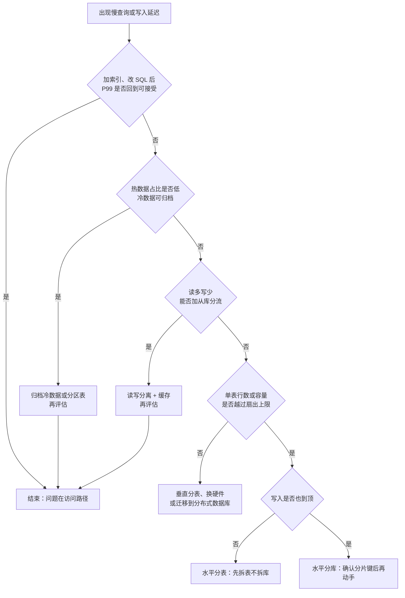
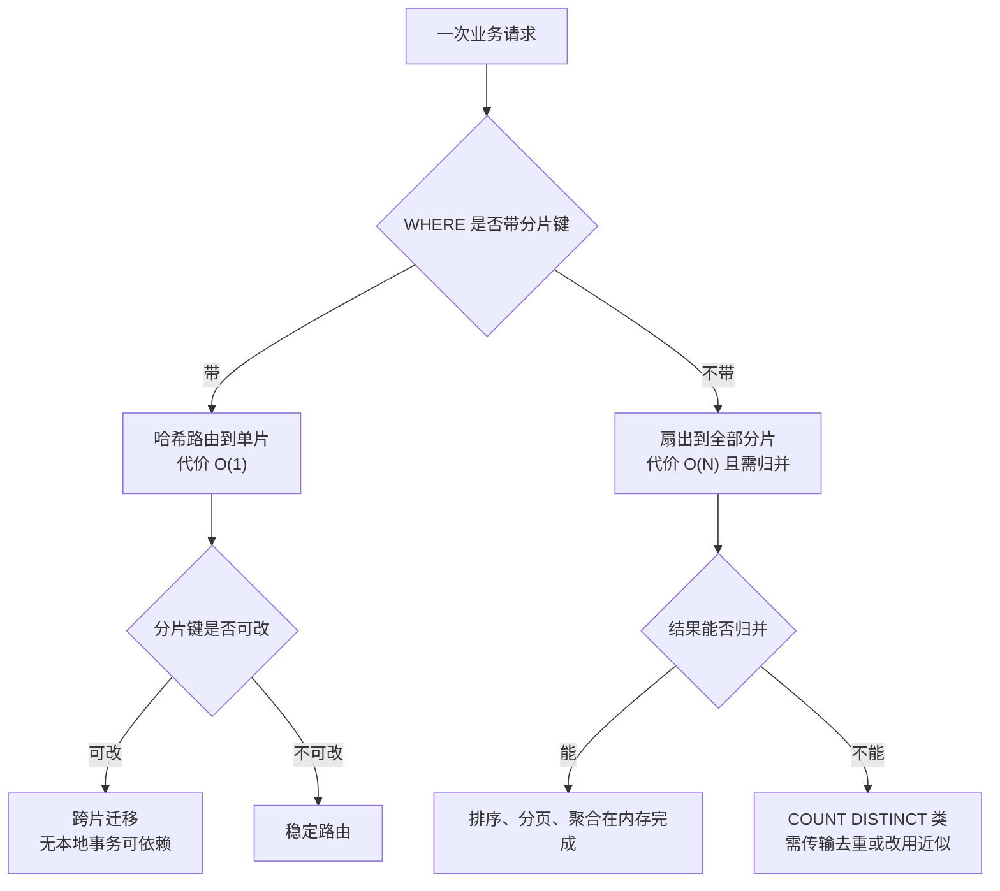
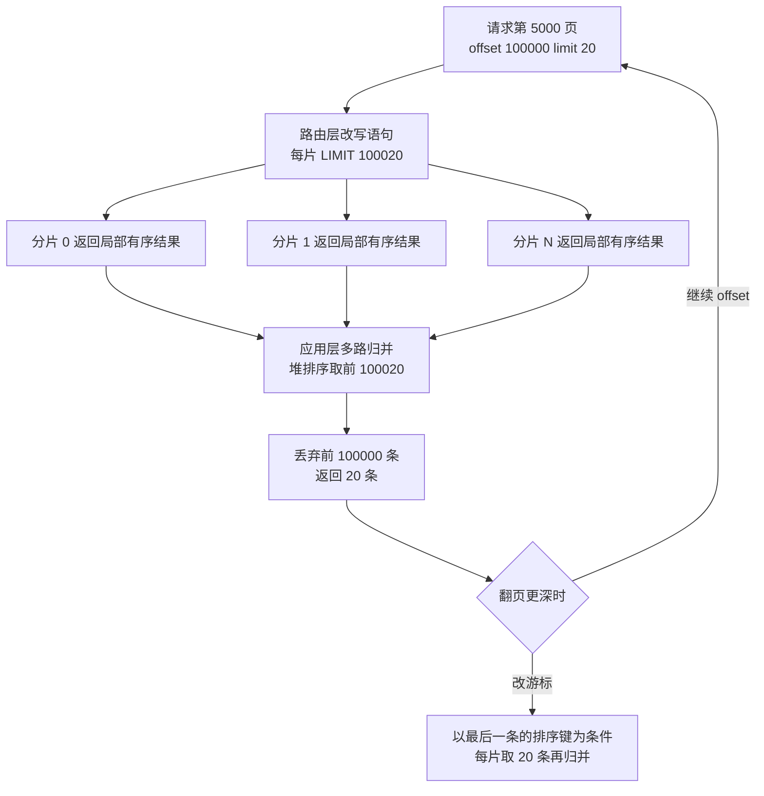
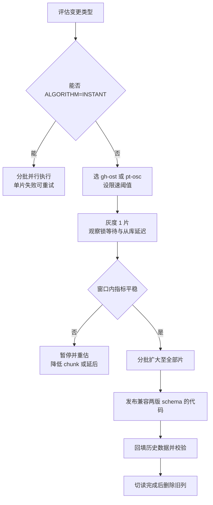
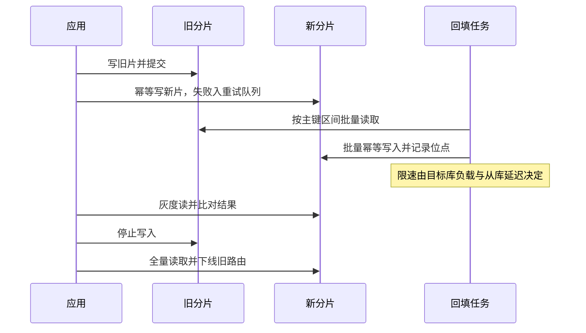

# 06 分库分表——何时做、怎么做、做了之后怎么办

**摘要：**

分库分表常被当成一项能力来学，实际它更接近一笔按年计息的负债。本文把重心放在题目后半句：分完之后哪些事会变难、难到什么量级、有没有不改架构就能绕开的余地。第 1 至第 3 章回答该不该分，先把三条量化判据摆出来（单表行数与容量、单库 QPS 与连接数、单库写入吞吐），再把流传很广的"两千万行"还原成一次可自行重算的扇出推算，然后给出分之前该按顺序做完的五件事，并说明每一件的收益上限。第 4 至第 5 章回答怎么分：四种切分方式的判据表与组合顺序，分片键的三条判据、三种常见选择的失败模式，以及分片键选错之后要付的三笔账。第 6 章是主体，逐项拆开六件变难的事——跨片 JOIN、跨片事务、跨片分页、全局唯一 ID、跨片聚合、多分片 DDL，每项给放大倍数的量级、规避判据与代码形态。第 7 至第 9 章讨论中间件与应用层分片的取舍、扩容重分片的搬迁量公式与双写步骤，以及四个反复出现的反例。

---

## 第 1 章 该不该分，比怎么分更难回答

### 1.1 一个典型的分片起点

设想一张 `orders` 表，攒了三年总计三千万行，日增八万行，慢查询日志里反复出现按时间范围取最近订单、带 `ORDER BY id DESC LIMIT 100000, 20` 的深翻页。团队的第一反应几乎都是"该分了"：挑一个中间件，按 `user_id` 取模切成 64 片，两周上线。

麻烦从第二个迭代开始显形。运营报表按时间跨全部分片扫；客服凭订单号查单，却不知道订单落在哪一片；每日对账要把 64 个片的数据拉回内存再排序；大促前加一列，得在几十个库、上百张物理表上各跑一遍 DDL，还要保证线上两种 schema 版本同时可用。

这些麻烦没有一项来自"分"这个动作，全部来自分之后系统的形状。分片把一张可以用 SQL 自由查询的表，变成一组只能按分片键高效访问的集合；原先由优化器承担的 JOIN、排序、聚合与事务边界，被移交给应用层或中间件，而这两者手上都没有全局统计信息，也没有代价模型。

### 1.2 单机问题收敛，分布式问题不收敛

单机 MySQL 的瓶颈是可枚举的：CPU、内存、磁盘 IOPS、网络带宽、连接数、单表行数。每一种都有边界清楚的解法——加索引、改 SQL、加缓存、加从库、换 NVMe、归档冷数据；收益有明确上限，但路径确定，投入资源换一段时间余量，代价可预算。

分片之后，瓶颈的种类没有减少，反而多出一类不可枚举的问题：**部分失败**。一次跨两片的写，第一片提交成功、第二片超时，库里就留下一个既非成功也非失败的中间态，而没有任何单机机制能收拾它——没有 undo 回滚已提交的分支，没有锁挡住并发读这个中间态。用 2PC 补要引入协调者单点，用补偿补要在业务里加状态机、幂等键与对账任务。

这个差别的实质是：单机问题花钱，分布式问题花**协议与补偿**。后者的账单会一直存在到系统下线。

### 1.3 代价为什么不可逆

分片的不可逆性有三层，一层比一层难退。

数据层最直观：数据已按新规则散落在 N 个库，要退回去得再做一次反向搬迁，而这次的窗口比初次分片更窄——业务已经在跑。

代码层更隐蔽：分片键会渗透进代码的每个角落，成为一类隐式约定。DAO 方法假定必须带 `user_id`，缓存 key 里拼了分片号，异步任务参数带着路由信息，报表 SQL 里写着表名后缀。这些知识散落在几百个文件里，没有清单，也没有编译期检查，只能靠改一处、跑起来、看哪里报错来发现。

组织层最难量化：运维对象从"一个实例"变成"一组实例加一个中间件集群"，备份、监控、升级、扩缩容、故障演练的单元成倍增加。这些能力一旦建立就沉在团队里，即便数据量回落，也少有人主动提议把它们拆掉。

---

## 第 2 章 三条量化判据

### 2.1 判据一：单表行数与容量

流传最广的数字是"单表超过两千万行就该分"。这个数字不是凭空来的，它来自一次可以自己重算的扇出推算，也因此会随行宽与索引数量变化。

InnoDB 的聚簇索引是一棵 B+Tree，非叶子节点只存主键值与页指针。主键为 `BIGINT` 时每条索引项 8 字节，加 6 字节页指针约 14 字节，16KB 的页可用约 14.7KB，能放约 1170 条指针。三级树是根页 1 个、中间层 1170 个、叶子层 1170 × 1170 个，叶子总数约 137 万个；若单行平均 1KB，每个叶子页约放 14 行，整棵树可索引约一千九百万行——这就是"两千万"的来源。

同一个公式换个行宽，结论立刻不同。下表按上述口径重算，取"三级树刚好装满"作为判据，数字为示例推算，实际以行格式、页填充率与索引数量为准。

| 单行平均字节 | 每叶页可放行数 | 三级树可索引行数（示例推算） | 对应的常见表 |
| :--- | ---: | ---: | :--- |
| 256 | 约 57 | 约 7,800 万 | 只存 ID 与状态的流水表 |
| 512 | 约 28 | 约 3,800 万 | 窄字段订单表 |
| 1024 | 约 14 | 约 1,900 万 | 常规业务宽表 |
| 2048 | 约 7 | 约 960 万 | 带若干 `VARCHAR(255)` 的表 |
| 4096 | 约 3 | 约 410 万 | 含 `JSON`、`TEXT` 的表 |

这张表真正想说的是：判据应该按"这棵树还能不能装得下、装下之后叶子层扫描代价多大"来定，而不是按一个固定行数。一千万行的宽表可能比五千万行的窄表更早撑爆 Buffer Pool，因为两者占用的页数不同。

容量判据同理。50GB 这个数字通常指聚簇索引加二级索引的总占用，它决定三件事：备份与恢复时长的量级、一次 DDL 重建要写多少页、Buffer Pool 还能不能装下热数据。若 Buffer Pool 是 64GB 而数据量已到 200GB，命中率就成了比行数更紧的约束——此时该先做垂直分表把冷列拆走，而不是水平分片。

### 2.2 判据二：单库 QPS 与连接数

连接数打满有两个成因，混淆它们会做出相反的决策。一种是请求量真的高，`Threads_running` 长期贴着 CPU 核数；另一种是连接占着不还，`Threads_connected` 逼近 `max_connections` 而 `Threads_running` 很低，多数连接卡在业务计算、外部接口等待或连接池泄漏上。

区分方法很直接：看两者比值随时间的变化，再对 `performance_schema.threads` 按状态分组统计。大量连接停在业务侧等待时，加从库、分库都无用，只会把浪费复制到更多实例；`Threads_running` 持续数倍于核数且伴随锁等待时，瓶颈在锁与热点行。

判据可以写得朴素：`Max_used_connections` 长期高于上限七成、连接池出现获取超时、`Aborted_connects` 上升，三条同时出现即容量到顶。此时优先做连接池调优、缩短事务、拆长查询，分库排在后面——分库会让连接数按分片数成倍增长，64 片、每片 20 连接就是 1280 个连接，恰好可能把新实例重新打满。

### 2.3 判据三：单库写入吞吐

写瓶颈比读瓶颈难掩盖。读可以加缓存、加从库、加并行度，写只能落在同一个主库上。

InnoDB 的一次提交默认要落两次盘：`innodb_flush_log_at_trx_commit=1` 时 redo 需 fsync，`sync_binlog=1` 时 binlog 也需 fsync。两次 fsync 串在提交路径上，这就是单机写入上限的物理来源，与磁盘的 fsync 延迟直接相关。把这两项调松确实能提升吞吐，代价是崩溃时可能丢最近若干秒的事务与复制位点，属于用数据安全换指标，不应作为扩容的替代方案。

写放大还有第二个来源：每多一个二级索引，一次插入就要多维护一棵 B+Tree，随机插入时页分裂带来的额外写入随之上升。一张带八个二级索引的表，写入的物理代价远高于表结构看起来的样子。

判据上盯三条信号：主库 `Innodb_data_written` 的增长接近磁盘写带宽上限；`Innodb_row_lock_time` 在高峰期陡增且集中在少数热点行；从库延迟在主库高峰时被拉长并迟迟不收敛。三条同时成立，说明单库写入成了瓶颈，水平分库才对症。

### 2.4 判据表与决策顺序

把三条判据合起来是一棵决策树。下图是判定顺序："是"分支都指向低成本手段，只有收益上限被吃满之后才落到分片。

判据表把上面的推理压成可查的形式，其中"不解决什么"一列比"解决什么"更有用。

| 判据 | 触发信号 | 观测入口 | 常见误判 |
| :--- | :--- | :--- | :--- |
| 单表行数 | 三级树装不下，叶子层扫描页数过多 | `information_schema.TABLES` 的 `TABLE_ROWS`、`DATA_LENGTH` | 只看行数不看行宽与索引数 |
| 单表容量 | 备份恢复时长、DDL 时长、Buffer Pool 装不下热数据 | `DATA_LENGTH + INDEX_LENGTH` 与 `innodb_buffer_pool_size` 之比 | 把大字段表的容量问题当成行数问题 |
| 单库 QPS 与连接 | `Max_used_connections` 逼近上限、池获取超时 | `SHOW GLOBAL STATUS`、`performance_schema.threads` | 把连接泄漏当成容量不足 |
| 单库写入 | 两次 fsync 打满、锁等待集中在热点行 | `Innodb_data_written`、`Innodb_row_lock_time` | 忽略二级索引数量带来的写放大 |

---

## 第 3 章 分之前该先做的五件事

### 3.1 第一件：加索引

索引是投入产出比最高的一步，也是最容易被跳过的一步，因为跳过的成本不在当下，而在"反正要分片了"这个账本里。

判据很简单：把慢查询日志里占 `Query_time` 总量前 80% 的语句捞出来，逐条看执行计划。多数是 `type=ALL` 或 `key=NULL` 时，加索引与改 SQL 通常能把 P99 拉回可接受区间；此时分片的动机从"性能不够"退化为"预防未来"，而预防性分片的收益当下无法验证。索引怎么建、哪些写法会让索引失效，见《[[中间件/MySQL/MySQL进阶使用/01 索引设计实战——从建错索引到建对索引|01 索引设计实战]]》。

收益上限也要说清楚：索引让点查与范围查从 O(n) 降到 O(log n)，但降不了全表聚合与全表导出的代价，也降不下写入放大。瓶颈若是每日全量对账扫描，加索引无效。

### 3.2 第二件：优化 SQL

加索引解决访问路径，改 SQL 解决访问范围。典型的三类浪费是取了用不到的列、算了用不到的行、扫了用不到的分区：`SELECT *` 让覆盖索引失效并放大网络传输；在应用层做本应由 SQL 做的过滤，把百万行拉进内存再 `filter`；用 `OR` 把两条各自能走索引的条件拼成一条走不了索引的语句。

判据是 `Rows_examined / Rows_sent` 的比值。它长期在百倍以上，说明扫描量与产出量严重失配，改 SQL 的空间很大。执行计划怎么读、语句怎么重写，见《[[中间件/MySQL/MySQL进阶使用/02 SQL 调优方法论——从 EXPLAIN 到执行计划重写|02 SQL 调优方法论]]》与《[[中间件/MySQL/MySQL进阶使用/07 慢查询诊断与性能监控体系|07 慢查询诊断与性能监控体系]]》。

### 3.3 第三件：加缓存

缓存解决重复读，不解决首次读，更不解决写。读多写少的场景里，把命中率做到九成以上，数据库读压力立刻降一个数量级；但缓存对写路径完全无效，写瓶颈上分片仍是唯一解。

加缓存有自己的账单，形态与分片相似：一致性。Cache Aside 下的删除失败、并发读写导致的旧值回填、多级缓存之间的版本漂移，都要额外机制兜底。与分片的账单放在一起比，多数读瓶颈场景里缓存的账更便宜。协作模式与一致性方案见《[[中间件/MySQL/MySQL进阶使用/08 MySQL 与缓存的协作模式——Cache Aside 到数据一致性|08 MySQL 与缓存的协作模式]]》。

### 3.4 第四件：读写分离

读写分离把读流量摊到从库，是单库读瓶颈的标准解法，代价是读到旧数据。复制是异步的（半同步也只保证 binlog 已送达，不保证已重放），从库延迟在高峰期可能从毫秒级涨到秒级。业务上要区分必须读主的路径——支付结果、库存扣减后的回查、刚提交就要展示的表单——与可以读旧的路径。

收益上限同样明确：写仍是单点，主库的写入吞吐与连接数一点没减。瓶颈在写时，读写分离只是把问题往后推。主从拓扑、延迟监控与切换方案见《[[中间件/MySQL/MySQL进阶使用/10 MySQL 高可用方案选型——从主从到 InnoDB Cluster|10 MySQL 高可用方案选型]]》。

### 3.5 第五件：归档冷数据

多数业务表的数据分布极度倾斜：三年数据里九成是历史，热数据只有最近几个月。把这部分搬走，剩下的表立刻变"小"，行数、容量、索引高度、备份时长、DDL 时长同时改善。

两种落地方式。第一种是按主键或时间分批搬迁到归档表或归档库，用 `pt-archiver` 这类工具做限速与批量提交，搬完再删原表数据；注意别把删除做成一个大事务，否则 undo 膨胀与从库延迟会比原来的慢查询更难受。第二种是按时间做分区表，用 `DROP PARTITION` 秒级清掉整段历史，用 `EXCHANGE PARTITION` 把一段数据换出到独立表。

分区表有硬约束，容易在落地时撞上：分区列必须包含在每个唯一键（含主键）里，因此"按 `create_time` 分区、主键只有 `id`"的设计不成立，得改成联合主键；InnoDB 分区表不支持外键；分区数不是越多越好，裁剪失效时会退化成全分区扫描。这些限制以 MySQL 8.0 官方文档为准，8.4 沿用同一套约束。

给一个量级算例：订单表十亿行、单行 1KB、热数据只覆盖最近 90 天（约占一成），归档后主表剩一亿行、约 100GB。原来一次全量备份要处理 1TB，归档后只需十分之一；原来加索引要重建十亿行，归档后只需重建一亿行。这类收益是乘性的，**冷热分层**同时改善容量、备份、DDL 与缓存命中率；分片拿不到这类收益——分片之后每片仍要各自经历一遍 DDL 与备份。

### 3.6 五件事的收益上限

下表把五件事的边界列清楚，"不解决什么"一列就是决策依据：瓶颈落在哪一列上，前面四件就都无效，只剩归档与分片两条路。

| 手段 | 解决什么 | 不解决什么 | 典型收益量级 | 新增代价 |
| :--- | :--- | :--- | :--- | :--- |
| 加索引 | 点查与范围查的访问路径 | 全表聚合、写入放大、容量 | 劣化查询可降一到两个数量级 | 写放大、Buffer Pool 占用、DDL 变慢 |
| 优化 SQL | 扫描范围与传输量 | 结构性的数据量问题 | 依语句而定，常见数倍 | 改代码、回归测试 |
| 加缓存 | 重复读、热点读 | 首次读、写、容量 | 命中率九成时读压力降一个数量级 | 一致性机制、缓存运维 |
| 读写分离 | 读并发与读吞吐 | 写瓶颈、连接数总量、容量 | 读能力随从库数近线性 | 主从延迟、读旧值、切换复杂度 |
| 归档冷数据 | 容量、备份、DDL、缓存命中 | 热数据本身的写并发 | 数据量按热数据比例缩减 | 搬迁窗口、归档查询链路 |
| 换硬件 | IOPS、内存、带宽 | 单表行数、单库写上限 | 依硬件代差，常见数倍 | 成本、有天花板 |
| 分布式数据库 | 单机上限整体外移 | 迁移成本与团队能力 | 容量与吞吐随节点扩展 | 兼容性、运维体系重建 |

### 3.7 还有一条替代路径

五件事都做完了仍然不够，除了分片还有一条路：把数据迁到分布式数据库（TiDB、PolarDB 这类）。它更像"换一个数据库"，而不是"在应用层加一层路由"——扩容、分片、跨节点事务由数据库自己处理，应用代码基本不动。

代价是另外三项：SQL 与事务语义的兼容性逐条验证，尤其是复杂查询的执行计划、跨节点 JOIN、悲观锁与隔离级别的行为差异；运维体系重建，监控、备份、故障处理流程都与单机不同；团队里要有人能定位"分布式执行计划为什么选错"。它适合数据量已大到分片也解决不了，或团队没有精力长期维护自研分片逻辑的场景。

---

## 第 4 章 四种切分方式与它们的顺序

### 4.1 垂直分库：按业务域切

垂直分库把一个库里的表按业务域拆到不同实例：用户、订单、商品、支付各自一个库。它的价值不在性能，而在耦合——一个业务的慢查询不再拖垮另一个业务，一个业务的扩容不影响其他业务，权限与审计可以按库收紧。

判据是业务域的边界是否真实存在，而不是表名前缀是否不同。真实边界的标志是：两边的写很少落在同一个事务里，查询很少 JOIN，团队与发布节奏不同。反过来，若订单与支付共享同一个事务边界（下单即扣款、退款即反向记账），把它们拆到两个库等于主动制造跨库事务，这笔账通常不划算。

它还有一个容易被忽略的收益：与团队结构对齐。库的边界一旦与团队边界一致，每次跨库改动都会自然变成一次跨团队协调，这件事本身会抑制不必要的数据耦合；代价是组织变动之后库的边界显得别扭，而这层别扭没有技术手段能消除。

### 4.2 垂直分表：把冷列拆出去

垂直分表处理的是宽表。InnoDB 按整行读取，即使 `SELECT` 只要三个字段，聚簇索引的叶子页里仍然躺着其余几十个字段；行越长，每页装的行越少，同样的扫描要读更多页，Buffer Pool 能缓存的行也更少。

判断该不该拆，看两件事。一是列的使用频率分布，前十个字段覆盖九成以上访问时，剩下的值得搬走。二是大字段的存在，`TEXT`、`BLOB`、`JSON` 在行内只存前缀与 20 字节的溢出页指针，真正的数据在外部页，读取时多一次跳转；把这部分拆到扩展表，主表行变短、页变密、扫描变快。

拆分是一对一：主表保留主键与热列，扩展表用同一个主键关联。常被忽略的细节是——两张表在同一实例上，写入仍可放进同一个本地事务，所以垂直分表不引入分布式事务；它引入的是查询次数，读一个完整对象要发两条 SQL，或者用一次 JOIN 换回来。表结构与类型选型见《[[中间件/MySQL/MySQL进阶使用/05 表设计与数据类型选择——细节决定性能上限|05 表设计与数据类型选择]]》。

### 4.3 水平分表：先拆表不拆库

水平分表把同一张表的行按规则分散到同实例的多张子表，例如 `orders_0` 到 `orders_63`。它解决两件事：单表 B+Tree 的深度与单表 DDL 的时长。两亿行的表拆成 64 张三百万行的表，加索引时每次重建都可控，逐张灰度也比一次重建两亿行安全。

它不解决的事同样明确：子表仍在同一个实例上，磁盘 IOPS、Buffer Pool、连接数、写入吞吐的上限一点没变。拆成 64 张只会让文件句柄与表数量增加，让 `information_schema` 查询变慢，让运维脚本从"处理一张表"变成"处理 64 张表"。

适用判据是单表太大但实例还有余量：容量没到顶、写入没到顶、连接没到顶，只是行数或 DDL 窗口成了问题。这种场景先分表是理性的，因为它解决了最痛的那件事，而把跨片查询、跨片事务留到以后——只是这个"以后"不会自己变便宜。

### 4.4 水平分库：把写入也摊开

水平分库把分片放到多个实例上，才真正解决单机的存储与吞吐。代价随之升级：跨片操作从"同一实例的不同表"变成"不同实例的不同表"，本地事务不再能覆盖，JOIN 彻底不可用，连接池要按分片数配置，监控、备份、DDL 的对象数量按分片数翻倍。

一个常被低估的细节是连接数。应用侧通常按"每个库一个池"配置，64 个分片就是 64 个池；每池最小空闲 5 个、最大 20 个，光空闲连接就吃掉 320 个，高峰可能到 1280 个。这些连接分散到多个实例上单看不显眼，但代理层往往还要再占一份，容量规划时容易漏掉。

### 4.5 判据表与组合顺序

四种方式不是互斥选项，而是一条有顺序的路径。下图给出常见组合顺序，箭头方向上每一层都比上一层更贵，且一旦进入下一层，前面的层不会被撤销。

判据表按"要先解决什么"组织，最后一列是常见误用。

| 方式 | 适用判据 | 不解决什么 | 主要代价 | 常见误用 |
| :--- | :--- | :--- | :--- | :--- |
| 垂直分库 | 业务域边界真实、团队边界一致、事务耦合弱 | 单表行数、单库写上限 | 跨库 JOIN 与事务消失 | 把强事务耦合的订单与支付拆开 |
| 垂直分表 | 宽表、热列集中、含大字段 | 行数总量、写入吞吐 | 多一次查询、需维护一对一关系 | 把热列也拆散，JOIN 变多 |
| 水平分表 | 单表过大但实例有余量、DDL 窗口紧张 | IOPS、连接数、写吞吐 | 表数量膨胀、运维脚本变多 | 以为分表能解决写入瓶颈 |
| 水平分库 | 单库写入或连接打满、容量到顶 | 跨片查询与事务 | 连接池成倍、跨片一致性 | 分片键未定就动手 |
| 分区表 | 按时间归档、范围查询为主 | 写入热点、跨分区唯一约束 | 分区列必须在唯一键内 | 用分区表替代水平分片做在线业务 |

---

## 第 5 章 分片键：一个改不动的决定

### 5.1 三条判据

分片键（Sharding Key）决定一条记录属于哪个分片，它的选择比中间件选型重要一个数量级：中间件可以换，分片键换不掉。判据有三条，必须同时成立。

第一条是**分布均匀**。分片键取值经哈希或范围映射后，各分片的数据量与请求量应大致相当。它取决于基数与偏斜度：基数太低（状态、类型这类枚举列）会让数据挤进少数分片；偏斜度太高（头部客户占一半数据）哈希也救不回来，因为哈希只打散键值，不打散权重。

第二条是**查询能带上**。绝大多数在线查询的 `WHERE` 应包含分片键，路由层才能把语句精确发到一片。判断这条不能凭印象，要拿慢查询日志或网关埋点统计：把 QPS 前二十的查询列出，看带分片键的比例。低于九成时跨片查询成为常态，第 6 章的代价会被高频触发。

第三条是**不可变**。分片键一旦写入不能再改，因为改值等于改分片，而跨片的行迁移放不进本地事务：先插新片、再删旧片，中间这段时间两个分片各有一份数据，读到任何一份的请求都可能拿到不一致的结果。用户 ID、订单号、租户 ID 恒定，而"所属区域""负责人""状态"这类会变的东西不能当分片键。

### 5.2 三种常见选择与各自的失败模式

三种选择覆盖了多数业务：按用户维度哈希、按时间范围、按业务维度（商家、租户、门店）。它们的优劣不是绝对的，失败模式却相当固定。

下图是路由的判定路径与三种选择各自的后果：带分片键走单片，不带则扇出全部分片，结果能否归并决定了代价落在传输上还是归并内存上。

按用户 ID 哈希最常见，均匀性最好，单用户的所有数据落在同一片，按用户维度的查询与事务都是本地的。失败模式在后台侧：运营、客服、风控、对账往往按时间、按订单号、按金额区间查，全都不带 `user_id`，于是每条查询都要扇出全部分片。缓解办法是给这些维度建冗余索引表或同步到搜索系统，而不是指望 SQL 层解决。

按时间范围分片在日志、流水、账单这类场景里很自然，范围查询只打连续几片，历史可以整片归档。失败模式是**末尾热点**：所有新写入都落在最新那一片，其余片只读不写，写入能力被单片的物理上限锁死；到了下个周期，前一片又突然变成主写片。

按业务维度（商家、租户、门店）分片在多租户系统里最常见，隔离性好，单个租户的数据聚在一起。失败模式是**头部倾斜**：少数大租户的数据量与请求量可能是中小租户的百倍，哈希对权重无效。缓解手段有三级：大租户单独映射到专属分片、对大租户做二级拆分、业务上限额与限流；三级都要求先能识别谁是大租户，这需要一张动态路由表。

| 分片键 | 均匀性 | 范围查询 | 热点风险 | 典型失败模式 |
| :--- | :--- | :--- | :--- | :--- |
| 用户 ID 哈希 | 好 | 差，需扇出全部片 | 低，除非有超级用户 | 后台按时间或订单号查全跨片 |
| 时间范围 | 好 | 好 | 高，写入集中最新片 | 单写片打满、分片数持续膨胀 |
| 业务维度 | 依赖分布 | 中等，按维度内可范围查 | 高，头部租户倾斜 | 大租户独占一片、其余片闲置 |

### 5.3 冗余列与基因法

分片键固定，查询维度却是多元的，解法是在数据里多带一份路由信息，而不是在查询时猜。

最常见的是**冗余分片键列**。订单表按 `user_id` 分片，表里就必须存 `user_id`；业务习惯用订单号查询时，让订单号本身携带用户信息——生成时把 `user_id` 的低若干位拼进去，查询时反解出来再路由。这个手法通常叫基因法，代价是订单号结构从此固定，且泄露了用户 ID 的低位。

另一种是**映射表**。当分片键无法拼进业务单号（比如外部渠道给的流水号），就维护一张"业务单号到分片键"的表，查询先查映射再路由。它要能扛 QPS，通常放在缓存或一个数据量很小的独立库里；新问题是与主数据的一致性——插入主数据时映射写入失败，就会出现查得到却路由不到的孤儿单号。

还有一种是**广播表**。字典表、配置表、城市表这类数据量小、几乎不变的表，每个分片存一份全量副本，JOIN 就不需要跨片。代价是写入要同步到所有分片，一致性靠中间件或应用层保证，更新频繁的表不适合这么处理。

### 5.4 选错分片键的三笔账

第一笔是跨片查询的归并账。不带分片键的查询要发往 N 个分片，各自执行、各自返回，应用层再归并。N 为 64 时，一条毫秒级语句变成 64 次往返加一次内存归并；若带 `ORDER BY` 或 `LIMIT`，还要额外做一次全局排序。

第二笔是跨片事务的协议账。一次业务写涉及两个分片，本地事务不再覆盖边界，只能上 2PC、TCC 或最终一致。三种方案的代价在第 6.2 节展开，但它们的存在本身说明：一个选错的分片键，会把一条 `BEGIN ... COMMIT` 的代码变成一套带状态机、补偿与对账的子系统。

第三笔是跨片分页的放大账。深翻页在单片上只是慢，在 64 片上是指数级的资源消耗。这笔账最隐蔽，因为功能测试里它从不出现——测试数据只有几百行时，任何分页都很快。

### 5.5 一个可以执行的验证方法

选分片键之前，做一次数据侧测算，而不是拍脑袋：从慢查询日志或审计日志导出最近一周的查询样本，按语句模板聚合并按总耗时排序；对每个模板标注是否带候选分片键；统计带键查询覆盖的 QPS 与总耗时比例；再用候选键的历史数据算一次分布直方图，看最大分片与平均分片的比值。

两个数字就能定案：带键比例低于九成，这个键不配做在线业务的主分片键，要么补冗余列，要么换键；最大最小分片比值超过二比一，哈希压不住倾斜，需要路由表或二级拆分。输入全在现有数据里，不需要先分片再验证。

---

## 第 6 章 分了之后变难的六件事

第 5 章说了分片键选错的三笔账，本章把账单逐项摊开。这六件事的共同结构是：原本由数据库在单机内用成熟机制解决的问题，现在要在应用层用工程手段重建，而重建的版本在正确性、性能、可运维性上都不如原版。

### 6.1 跨片 JOIN

JOIN 消失是分片最直接的后果。原本一条 `orders JOIN users` 的语句，现在两张表在不同的库，只能换四种手法之一。

第一种是冗余字段，把 JOIN 需要的列在写入时复制过来。订单项里直接存商品名与下单时价格，查订单详情就不需要访问商品库。它最有效，也最容易腐化：冗余字段没有机制保证一致，商品改名后历史订单要不要跟着改是业务决策；更常见的是字段被写错、漏写，或在批量修数据时被遗忘。

第二种是应用层拼装，先查主表拿到关联 ID，再用一次批量 `IN` 查从表，最后在内存里组装。关键在"批量"二字：逐条查会退化成 N+1，一次请求变成 1 + N 次数据库往返；批量查则要控制 `IN` 列表的长度，几百到一千个 ID 一批，避免超长 SQL 与执行计划抖动。

第三种是绑定同一分片。让有 JOIN 关系的表使用同一个分片键，落在同一片，JOIN 就退化为本地操作：订单与订单项都按 `user_id` 分片，两者总在同一片。中间件里这通常叫绑定表，要求两张表的分片算法与分片键完全一致；限制是只对共享分片键的关系有效，用户与商品这种没有共同分片键的关系绑定不了。

第四种是同步到分析系统。多维度、跨业务域的复杂查询，把数据通过 binlog 同步到 Elasticsearch 或 ClickHouse，在那边做 JOIN 与聚合。代价是数据链路多了一条、延迟多了一段、一致性从"强"降为"最终"，且查询结果要接受"可能比库里的数据晚几秒"。

| 手法 | 适用关系 | 一致性 | 主要代价 |
| :--- | :--- | :--- | :--- |
| 冗余字段 | 读多写少、允许快照语义 | 由业务定义，通常最终一致 | 字段腐化、更新遗漏 |
| 应用层拼装 | 任意关联，结果集不大 | 强，单次请求内一致 | 往返次数、内存组装、N+1 风险 |
| 绑定同一分片 | 共享分片键的父子表 | 强，本地事务覆盖 | 要求分片键一致、关系受限 |
| 同步到分析系统 | 多维度复杂查询 | 最终一致 | 链路与延迟、额外存储 |

### 6.2 跨片事务

跨片写的第一反应是上 2PC，但它通常是错的第一个答案。正确的顺序是先问"能否让它们落在一片"：能，就用**绑定分片**把跨片写降级为本地事务；不能，再在三种协议里选。

2PC（两阶段提交）在 MySQL 里对应 XA，`XA START`、`XA END`、`XA PREPARE`、`XA COMMIT` 四步，正确性由协调者与参与者的日志共同保证。代价在提交路径上：prepare 之后参与者的行锁一直持有到 commit，网络抖动会把锁持有时间从毫秒级拉到秒级；协调者成了单点；MySQL 的 XA 与 binlog 之间还有若干边界情况要按版本核实。它适用场景很窄：强一致、跨片写频率低、事务短小。

TCC（Try-Confirm-Cancel）把一次业务拆成三个接口，由业务自己实现预留、确认、取消。它没有长时间持锁的问题，但有三个固定的坑：空回滚（Try 没执行成功，Cancel 却收到调用）、悬挂（Cancel 先于 Try 到达，迟到的 Try 又占住资源）、幂等（重试导致 Confirm 或 Cancel 执行多次）。三个坑都要在业务代码里显式处理，靠一张事务状态表加状态机迁移约束兜底。

最终一致把跨片事务拆成一串本地事务，用可靠消息串起来。最稳妥的形态是**本地消息表**：业务写与消息写放在同一个本地事务里，保证业务成功则消息一定在，后台任务扫表投递，消费端做幂等。它的缺点是链路长、延迟不确定、需要对账兜底，但对允许短暂不一致的业务，这是三选一里最便宜的。

一句判断可以先立在这里：跨片事务的成本由"跨片写占全部写的比例"决定，而不是由数据量决定。若跨片写只有千分之几，2PC 的延迟可以忍受；若超过百分之几，就该回头审视分片键，因为那说明分片键与业务边界不匹配。

协议细节、TCC 状态机、消息表与事务消息的差异不在此展开，可参看《[[分布式架构/分布式事务/02 2PC 两阶段提交协议深度解析|02 2PC]]》、《[[分布式架构/分布式事务/04 TCC 柔性事务模型原理与实践|04 TCC]]》与《[[分布式架构/分布式事务/06 基于消息队列的最终一致性方案|06 基于消息队列的最终一致性]]》。

### 6.3 跨片分页与排序

分页是分片之后退化最严重的一项能力。单机上 `LIMIT offset, n` 是一次索引定位加顺序扫描，代价与 `offset` 近似线性；分片之后，每个分片都必须取到 `offset + n` 条，因为全局第 `offset+1` 条可能来自任意一片。

放大倍数可以算出来。取 64 个分片、`offset=100000`、`limit=20`，每片要取 100020 行，总行数约 640 万；按单行 500 字节估算，跨网络传输约 3GB，还要在应用层对 640 万行做全局排序。同一语句在单机上只扫 10 万行、约 50MB，代价被放大六十倍左右，而它天然出现在导出报表、翻到最后一页这类低频但必然发生的路径上。以上为示例推算。

下图是一次跨片分页的完整路径，注意归并发生在应用侧，数据库只负责各片内的局部有序。

三种改法按代价从低到高排。最省的是游标分页：把 `offset` 换成"上一页最后一条的排序键"，语句变成 `WHERE (create_time, id) < (?, ?) ORDER BY create_time DESC, id DESC LIMIT 20`，每片只取 20 条，归并后取前 20。代价是不能跳页，且排序键必须唯一（或补唯一列做 tie-break），否则边界处会重复或丢行。

第二种是二次查询法，把"取多少条"从 `offset + n` 降到 `offset/分片数 + n`。第一轮各片取 `offset/分片数 + n` 条，收集排序键上界，推出全局第 `offset` 条的键值下界；第二轮各片以该下界重查再归并。总传输量从 `N × (offset + n)` 降到约 `offset + N × n`，前面那个例子从 640 万行降到约 10 万行，代价是多一轮往返与实现复杂度。

第三种是放弃在数据库里分页：把需要复杂排序与筛选的字段同步到 Elasticsearch，分页由搜索引擎的 `search_after` 承担。这等于把分页能力从数据库迁走，代价是数据链路的最终一致与额外的运维对象。

禁止项也很明确：不要在分片系统上允许无上限的深翻页。业务层设置一个最大页码，超过之后引导用户改条件收窄范围，这条限制比任何算法优化都有效。

### 6.4 全局唯一 ID

分片之后自增主键首先失效：各片独立自增，值必然重复。四种方案覆盖了绝大多数需求，取舍集中在"是否有序""依赖什么""失败时怎么办"三点上。

| 方案 | 结构与长度 | 有序性 | 外部依赖 | 主要代价 |
| :--- | :--- | :--- | :--- | :--- |
| UUID v4 | 128 位，文本 36 字符 | 完全无序 | 无 | 随机插入导致页分裂、主键变大并放大所有二级索引 |
| 雪花算法 | 64 位整数 | 趋势递增 | 机器号分配 | 时钟回拨、机器号管理 |
| 数据库号段 | 64 位整数 | 段内递增 | 一个号段服务或一张表 | 重启丢一段、号段有空洞 |
| Redis 自增 | 64 位整数 | 严格递增 | Redis 可用性 | 持久化策略决定是否会重复 |

UUID 的问题不在长度而在随机性。聚簇索引按主键排序，随机主键意味着每次插入都可能落在任意叶子页，页分裂与随之而来的写放大比顺序插入高得多；主键会复制到每个二级索引的叶子节点，从 8 字节变成 16 字节，所有二级索引一起变大。用 UUID 做业务幂等键没问题，用它做聚簇索引主键要付这笔账。

雪花算法把 64 位切成符号位、41 位毫秒时间戳、10 位机器号、12 位序列号，趋势递增、单机每毫秒四千个、可用约 69 年。机器号分配是落地难点：容器副本数动态变化，配置文件写死会冲突，需从注册中心或数据库申请；时钟回拨必须写代码处理，回拨幅度小就等、大就报错拒绝服务——继续发号会破坏递增性并可能重复。

号段模式把"每次取一个 ID"换成"每次取一段 ID"，服务从数据库或独立服务一次拿 1000 个，在内存里发，快用完时异步预取下一段。它把数据库压力降低三个数量级，换来的是重启时未用完的号段被丢弃，ID 出现有界空洞；只要业务不要求连续，这是最实用的方案。

Redis 自增最轻，但正确性绑在持久化上。`appendfsync everysec` 下进程崩溃可能丢失最后一秒的写，重启后计数回退，之前发出去的 ID 会重复；用 `INCRBY` 一次取一段能大幅降低窗口概率，但仍要接受极端情况下的空洞。要求严格不重复时，Redis 只能做号段分配器，不能做最终发号源。

选型的判据压成两句：ID 要作为聚簇索引主键时，优先趋势递增的整型；要暴露给外部且不可猜测时，用独立的外部标识列而不是复用主键。

### 6.5 跨片聚合

聚合的可行性取决于聚合函数是否满足可结合性。`COUNT`、`SUM`、`MAX`、`MIN` 满足，各片先算局部值，再在归并侧算一次，结果精确且代价可线性分摊。`AVG` 不满足，但可以拆成 `SUM` 与 `COUNT` 分别归并再做除法。

`COUNT(DISTINCT col)` 是真正的难点，因为它不满足可结合性——两个分片的去重结果相加会重复计数。三条路：把各片去重后的值集合传回归并侧合并，传输量与内存随基数增长，千万级即不可用；用近似算法，各片返回 HyperLogLog 或位图草图，误差可控制在一成以内；预聚合，写入时维护按维度汇总的宽表，把去重计数变成读一行。

跨片排序取全局前 N 是另一种常被忽视的聚合。它要求每个分片只返回局部前 N 条，归并侧再取前 N——注意是各片 `LIMIT N` 而不是 `LIMIT 1`，因为全局前 N 可能全部来自同一片。中间件能识别 `ORDER BY` 加 `LIMIT` 时会自动改写，不能时应用层要自己写。

还有一类查询应当直接禁止：跨片的 `GROUP BY` 加 `HAVING` 加排序。它要求把所有分组的中间结果收回归并侧，内存占用与分组数成正比，分组数一爆（譬如按用户 ID 分组），归并侧就成了新的单点。

### 6.6 多分片 DDL

这是最容易被低估的一项。单机上改一张表已经够紧张，分片之后要改 N 个库上的 M 张表，且要保证这 N × M 次变更之间存在一个"全部完成"的时刻，而在那之前，线上同时跑着两种 schema 的代码与数据。

先看能不能不重建。MySQL 8.0 的在线 DDL 分 `ALGORITHM=INSTANT`、`INPLACE`、`COPY` 三档，添加列在 8.0.12 起支持 INSTANT（早期只能在表末尾加），8.0.29 起支持任意位置，加索引走 INPLACE 但仍要扫描构建索引。能走 INSTANT 的变更不搬数据、秒级完成，几百张表可并行跑完；走 INPLACE 的时长与表大小成正比。支持矩阵以对应版本文档为准，落地前用显式的 `ALGORITHM` 与 `LOCK` 子句预检。

走不了 INSTANT 时，gh-ost 与 pt-online-schema-change 是两条主流路径。pt-osc 用触发器把变更同步到影子表，兼容性好，代价是每张表要建三个触发器，额外写在高温表上不可忽略，且会与应用自身的触发器冲突。gh-ost 不建触发器，改读 binlog 把增量应用到影子表，负担更可控，提供 `--max-load`、`--critical-load`、`--chunk-time` 等限速旋钮，切换用原子 rename，中断可续跑。

下图是一次跨分片 DDL 的编排形态，注意"兼容窗口"跨在两次发布之间，而不是在 DDL 之内。

编排要点有四：并行度受最慢的分片与从库延迟、主库负载共同约束；灰度先在一两个分片跑完并观察足够长的窗口，确认无锁等待、无从库延迟、无业务报错，再扩到全量；兼容走**扩展-收缩**两段式，每一步都必须同时兼容 N 与 N+1 两个版本；禁止在有损变更上并行，改类型、缩长度、改字符集一旦在部分分片完成，两个版本的数据语义就不同了。

### 6.7 六件事的代价汇总

把六件事放在一张表里，代价并不均等：分页与 JOIN 是高频低成本的持续开销，事务与 DDL 是低频高成本的突发事件。

| 事项 | 触发频率 | 放大形式 | 可否规避 | 规避手段 |
| :--- | :--- | :--- | :--- | :--- |
| 跨片 JOIN | 高 | 往返次数、内存归并 | 可 | 冗余字段、绑定分片、同步到分析系统 |
| 跨片事务 | 低 | 延迟、锁持有时间、补偿代码 | 部分可 | 调整分片键让写落一片 |
| 跨片分页 | 高 | 传输量按分片数放大，深翻页更甚 | 可 | 游标分页、二次查询、搜索系统 |
| 全局唯一 ID | 持续 | 页分裂写放大、外部依赖 | 可 | 雪花、号段、Redis 号段模式 |
| 跨片聚合 | 中 | 归并内存、去重传输量 | 部分可 | 预聚合、近似算法、限制分组维度 |
| 多分片 DDL | 突发 | 时长按分片数累加、双版本兼容 | 部分可 | INSTANT、限速、灰度、扩展收缩 |

---

## 第 7 章 中间件分片还是应用层分片

### 7.1 三种形态

第一种是客户端分片，代表是 ShardingSphere-JDBC。它以 jar 的形式嵌在应用里，SQL 解析、路由、改写、归并都在应用进程内完成，没有额外一跳网络；代价是绑定 JVM 生态，所有 SQL 都要过它的解析器，解析不了的语法会退化成广播或直接报错。

第二种是代理分片，代表是 ShardingSphere-Proxy、MyCat、Vitess 的 vtgate。应用只连一个逻辑库，代理负责路由；好处是语言无关、可以不改代码接入存量系统，代价是多一跳网络、代理自身要做高可用与容量规划，且它成了全站强依赖。

第三种是自己写路由。分片算法、路由表、SQL 改写全在应用代码里，没有中间件帮忙，也没有中间件限制。

### 7.2 能力边界

中间件能做的事比宣传的少，不能做的事比文档里写的多，选型要逐项验证而不是看功能列表。

SQL 兼容性是第一道坎。`JOIN`、子查询、`UNION`、窗口函数、`GROUP BY` 加 `HAVING`、`INSERT ... SELECT` 在单机上是普通语法，在分片中间件里支持程度各不相同，且跨片与单片的执行路径可能完全不同——数据落一片时走快速路径，落多片时走归并路径，性能差异可达数量级。上线前要拿全量 SQL 做兼容性回归。

分布式事务是第二道坎。多数中间件提供 XA 与本地事务两种模式，部分提供基于补偿的柔性事务。选型前要确认：跨片写失败时的回滚行为、悬挂事务如何清理、事务超时与连接池如何交互。

在线重分片是第三道坎，也是区分工具代际的关键。ShardingSphere 与 Vitess 都提供了迁移与双写能力（Vitess 的 `MoveTables`、`Reshard` 基于 VReplication），早期中间件多数只提供静态分片配置，扩容要靠停机或自研脚本。

可观测性是第四道坎。分片之后，一条慢查询要定位到"哪个分片、哪条改写后的 SQL、耗时分布如何"，中间件是否输出路由结果与各片耗时，直接决定排障效率。这一点在选型文档里几乎不被提及，却是上线后最常被抱怨的。

### 7.3 选型判据

判据落回团队与场景，而不是性能排名。

| 条件 | 倾向 | 理由 |
| :--- | :--- | :--- |
| 单一 JVM 技术栈、追求最低延迟 | 客户端分片 | 少一跳网络，路由在进程内 |
| 多语言、存量系统不能改代码 | 代理分片 | 应用只改连接串 |
| 需要在线重分片、K8s 环境、规模大 | Vitess | 迁移与流量切换工具成熟 |
| 分片规则特殊、需要灰度路由 | 应用层自研 | 中间件的路由策略表达力有限 |
| 团队没有中间件运维能力 | 客户端分片 | 少一个需要高可用的组件 |

### 7.4 应用层分片的代码形态

自己写路由并不意味着每次查询都手写 `if (userId % 64)`。可维护的形态是把路由抽成三层。

第一层是路由接口，输入分片键值，输出数据源标识与物理表名，实现可以是哈希、范围查表或动态路由表；这层要有单测，覆盖边界值与路由表变更。第二层是数据访问模板，负责按路由结果选数据源、拼表名、执行、收集异常。第三层是治理约束，用静态检查或框架拦截禁止不带分片键的查询，把它变成启动期就能发现的问题。

自研的优势最清楚：路由规则是普通代码，可以按业务做例外、可以灰度（新老路由并行、按比例切换）、可以打日志，出问题能单步调试。劣势同样清楚：跨片查询、分页、聚合的归并逻辑全要自己实现，中间件里打磨过的边界处理——结果集去重、排序键比较、内存上限——要重新踩一遍。

---

## 第 8 章 扩容与重分片

### 8.1 取模扩容要搬多少数据

取模是最直观的分片算法，也是扩容时最容易踩坑的算法：它的搬迁量可以精确算出来，而这个数字通常比预想的大。

设原分片数为 N、目标分片数为 M，键值取模后仍落在原分片的概率等于最大公约数与 M 的比值，因此需要搬迁的比例是 1 减去 `gcd(N, M) / M`。成倍扩容时 `gcd(N, 2N) = N`，搬迁比例恒为一半；非成倍扩容则几乎全量搬。

下表按这个公式给出几条常见路径，最后一列以总数据量 4.8TB 为例折算，数字为示例推算。

| 扩容路径 | 搬迁比例 | 搬迁数据量（总计 4.8TB 时） |
| :--- | ---: | ---: |
| 4 库扩到 8 库 | 50% | 约 2.4TB |
| 8 库扩到 16 库 | 50% | 约 2.4TB |
| 4 库扩到 6 库 | 66.7% | 约 3.2TB |
| 4 库扩到 5 库 | 80% | 约 3.84TB |
| 8 库扩到 9 库 | 88.9% | 约 4.27TB |

搬迁时长还要再算一层。以 2.4TB 为例，若端到端有效吞吐为每秒 100MB（受目标库写入、网络、索引维护共同限制），需约 6.7 小时；降到每秒 50MB 则约 13 小时。这还只是搬运，不含校验与切流，而整个过程中双写一直在跑。扩容的代价不在那几小时，而是这几小时里系统要**多扛一份写入**。

实践判据：扩容尽量走成倍路径；能预分片就不要依赖取模扩容。

### 8.2 预分片与槽位

预分片的思路是：分片数第一天就定得很足，物理库很少，逻辑分片到物理库的映射表放在配置中心。扩容时改映射，只搬需要改动的逻辑分片，其余原地不动。

举例来说，一次定义 1024 个逻辑分片，初始映射到 4 个物理库（每库 256 片），扩到 8 个库时只需把每库一半的逻辑分片迁走，搬迁比例仍是 50%，但迁移按逻辑分片整体进行，每个分片的数据可用一条范围条件圈出，过程可中断、可续跑、可按片灰度，而不是"重新计算每个键该去哪"。

槽位是更粗的一层抽象，Redis Cluster 用 16384 个槽把"键到节点"收敛成"槽到节点"。槽的好处是映射表很小、变更可原子广播、客户端缓存容易失效；代价是多一层间接，每次路由要两次查表，且槽的数量决定了扩容的最小粒度。

### 8.3 一致性哈希的取舍

一致性哈希把节点与键都映射到一个环上，键归属于顺时针方向最近的节点。增删节点只影响相邻区间的键，迁移量约为总键数的节点分之一，这是它在弹性扩容场景被反复推荐的原因。

它有三个必须一起接受的代价。均匀性要靠虚拟节点，一个物理节点通常映射成一两百个虚拟节点，实现与排障更难；它只回答"键属于哪个节点"，不回答"某个范围的数据在哪些节点"，范围查询几乎不可用；可运维性也差，要知道某用户的数据在哪台机器，得跑一遍哈希。

因此一致性哈希适合"键到节点"的解耦，不适合作为在线业务表的分片算法；后者更适合**预分片**加映射表，既能得到一致性哈希的迁移粒度，又能保留范围查询与可读的路由规则。

### 8.4 双写迁移的步骤

重分片与一次数据库迁移在流程上同构，差别只在目标是一组新分片而不是一个新实例。步骤可以固定成七步。

建新分片：表结构、索引与约束与旧片完全一致，先建表后加索引会在回填阶段造成大量随机 IO。双写：旧片先写、新片后写，旧片失败则请求失败，新片失败进重试队列；两者跨片不能用同一个本地事务，所以新片写入必须幂等。存量回填：按主键区间分批扫旧片、批量写新片并记录位点，限速按目标库负载与从库延迟调整。校验：先比行数与主键集合，再抽样比对内容，不通过就停在双写阶段修数据。灰度读：按分片键哈希取一小部分流量读新片并做影子比对。停旧写之后才下线旧路由与双写代码——这一步常被跳过，结果是临时双写变成永久双写。

下图是双写迁移的主干时序，回填与双写是并行的两路，校验夹在切读之前。

三条禁令要写进流程：不要在搬迁的同一次变更里同时改 schema；不要在双写期间跑长事务或大批量任务；不要省略校验与灰度，把"应该没问题"当作校验结果。

### 8.5 停机窗口搬迁的教训

典型的事故形态是"停机窗口内全量搬迁"：选一个业务低峰，停写四小时，把 4.8TB 按新规则重新分布，再切流。停写期间上游全部积压，恢复后的补偿流量可能把新分片打满；四小时是估算值，超窗要么硬切出数据缺口、要么继续停写；这套流程也无法演练。

---

## 第 9 章 四个反例

### 9.1 一上来就分

最常见的版本是：表三千万行、慢查询持续三个月，团队决定分 64 片，上线后发现慢查询仍在——因为根因是缺索引，分片只是把一条慢查询变成了 64 条更快的慢查询，总额还变大了。更糟的是此时索引也不好加：64 个分片，每个都要单独评估执行计划。

重来一次的顺序很清楚：先用第 2 章的三条判据确认瓶颈类型，再用第 3 章的五件事逐项排除，只有在"归档后仍不够、且写入也到顶"的组合下才进入分片。判据的作用不是阻止分片，而是把动机从"感觉数据量大"变成"某条信号越过了某条线"。

### 9.2 分片键用时间

日志、订单、账单类表用创建时间做分片键，第一直觉都很顺：按时间查是主路径，历史可以整片归档。上线后出现的现象是每个周期的写入全压在最新分片，其余分片空转；到下个周期重复同一过程，而旧分片突然从写负载变成纯读负载，容量规划失去意义。

更麻烦的是分片数随时间线性增长：一年十二片，三年三十六片，而合并历史分片要搬数据、改路由、处理跨片查询。正确做法是把时间用在归档与分区表上，分片键留给有基数、且查询会带上的业务列。

### 9.3 深翻页用大 offset

功能测试里分页永远正常，因为测试数据只有几百行。数据量上来之后，某一页的响应时间涨到十几秒，数据库 CPU 打满，而这条语句在慢查询日志里的 `Rows_examined` 大得离谱。第 6.3 节的算例已经说明代价来源：64 个分片各取十万行，传输几个 GB。

修法不是加机器，而是改接口语义：**游标分页**替代 `offset`，或者给翻页设上限、引导用户收窄条件。这两条都要动接口与前端，所以必须在分片方案设计阶段写进接口约定，而不是等费用账单出来再改。

### 9.4 以为中间件能透明解决

把存量系统的 300 多条 SQL 直接指向代理，改完连接串就上线，是最省事也最危险的做法。上线后陆续出现的现象是：部分语句报语法不支持；部分语句能跑但走了广播，延迟翻十几倍；`COUNT(DISTINCT)` 结果偏大；带 `ORDER BY` 的分页在归并时内存上涨；原本的单表事务变成分布式事务，提交失败率上升。

中间件是路由与改写的工具，不是分布式的魔法。它能透明化的是按分片键的单片查询，不能透明化的是跨片语义——JOIN、事务、聚合、排序恰好是分片最难的部分。接入前要拿全量 SQL 做兼容性回归并标注每条语句的执行路径（单片、广播、归并），对归并类语句逐条评估代价，对跨片写逐条确认事务语义。

---

## 第 10 章 结语

分库分表的全部争议，都可以还原成一句话：它用一次性的架构改造，换掉了单机问题的可枚举性。单机的瓶颈有清单，每一项都有对应的解法与预算；分片之后瓶颈没有清单，因为它的形态取决于分片键、查询分布与业务边界三者的组合，而这个组合在每家公司都不一样。

所以判据要前置。三条量化判据把"要不要分"从经验判断变成可复核的结论：行数与容量决定单表还能不能撑，QPS 与连接数决定读侧余量，写入吞吐决定写侧是否到顶。五件事把这些判据逐项推回边界——索引、SQL、缓存、读写分离、归档，每项都有明确上限，上限没吃满就分片，等于把能分期偿还的债一次还清，还多付了利息。

分片键的选择决定这笔债的利率。分布均匀决定容量是否浪费，查询能带上决定跨片查询的频率，不可变决定数据是否会被迫迁移；三者中最容易低估的是第三条，一个会变的分片键意味着每次更新都可能触发跨片迁移，而跨片迁移没有本地事务可用。

六件变难的事不是分片的缺陷，而是分布式的固有代价。它们都在把数据库原本在单机内解决的问题，用协议、状态机与对账在应用层重新实现一遍。能做的不是消灭代价，而是让触发频率落在可接受范围内——这又回到分片键与查询设计。

扩容的账要提前算。取模扩容在非成倍路径下搬迁量接近全量，预分片把它压到可控粒度，双写迁移让整个过程可停、可续、可校验。这些机制都不新，价值在于把一次不可逆的变更拆成若干可回滚的小步。

行文至此，判断可以收束成一条：**分库分表是最后一招**，而不是第一招；决定分之后，真正要花心思的不是路由算法，而是分片键与那六件难事在自身业务里的具体形态。这两处想清楚了，剩下的都是工程。

---

## 参考资料

1. MySQL 8.0 Reference Manual, 15.6.3.2 AUTO_INCREMENT Handling in InnoDB：<https://dev.mysql.com/doc/refman/8.0/en/innodb-auto-increment-handling.html>
2. MySQL 8.0 Reference Manual, 15.12.1 Online DDL Operations（INSTANT、INPLACE、COPY 与并发 DML 支持矩阵）：<https://dev.mysql.com/doc/refman/8.0/en/innodb-online-ddl-operations.html>
3. MySQL 8.0 Reference Manual, 15.3.8.2 XA Transactions：<https://dev.mysql.com/doc/refman/8.0/en/xa.html>
4. MySQL 8.0 Reference Manual, 26.6 Restrictions and Limitations on Partitioning：<https://dev.mysql.com/doc/refman/8.0/en/partitioning-limitations.html>
5. MySQL 8.0 Reference Manual，`information_schema.PARTITIONS` 表（分区元数据查询）：<https://dev.mysql.com/doc/refman/8.0/en/information-schema-partitions-table.html>
6. MySQL 8.0 Reference Manual, Performance Schema `threads` Table（连接与状态诊断）：<https://dev.mysql.com/doc/refman/8.0/en/performance-schema-threads-table.html>
7. Apache ShardingSphere 官方文档，Overview：<https://shardingsphere.apache.org/document/current/en/overview/>
8. Apache ShardingSphere 官方文档，ShardingSphere-JDBC 用户手册：<https://shardingsphere.apache.org/document/current/en/user-manual/shardingsphere-jdbc/>
9. Vitess 官方文档（`vtgate`、`VReplication`、`MoveTables`、`Reshard`）：<https://vitess.io/docs/>
10. GitHub gh-ost 仓库（在线 schema 变更工具，含限速与切换参数说明）：<https://github.com/github/gh-ost>
11. Percona Toolkit, pt-online-schema-change：<https://docs.percona.com/percona-toolkit/pt-online-schema-change.html>
12. Percona Toolkit, pt-archiver（冷数据归档）：<https://docs.percona.com/percona-toolkit/pt-archiver.html>
13. Twitter Snowflake 归档仓库（64 位 ID 的位分配与时钟回拨处理）：<https://github.com/twitter-archive/snowflake>

---

> [!note] 思考题
> 1. 拿你们线上最大的一张表，按 2.1 节的扇出公式重算一次"三级树可索引行数"，结果与两千万相差多少？这个差异会改变你"该不该分"的结论吗？
> 2. 列出后端 Top 20 的查询，统计其中带候选分片键的比例。若这个比例只有七成，剩下三成的跨片查询会给系统带来多少额外往返？
> 3. 若一笔业务写必须落两个分片，你先尝试用绑定分片消解，还是直接上最终一致？判断依据是跨片写占比，还是业务对不一致窗口的容忍度？
> 4. 你们的分页接口是否允许无上限翻页？若要改成游标分页，前端与开放 API 分别要怎么兼容？
> 5. 现有 4 个分片要扩到 6 个，搬迁比例是多少？如果改成先扩到 8、再缩到 6，总搬迁量是变多还是变少？为什么？
> 6. 下一次加列或加索引，能否走 `ALGORITHM=INSTANT`？若不能，跨分片编排的并行度、灰度顺序与回滚点分别怎么设计？
