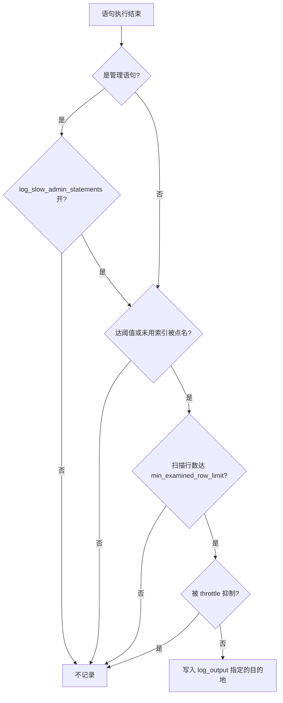
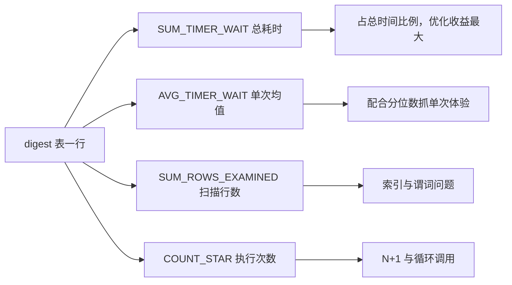
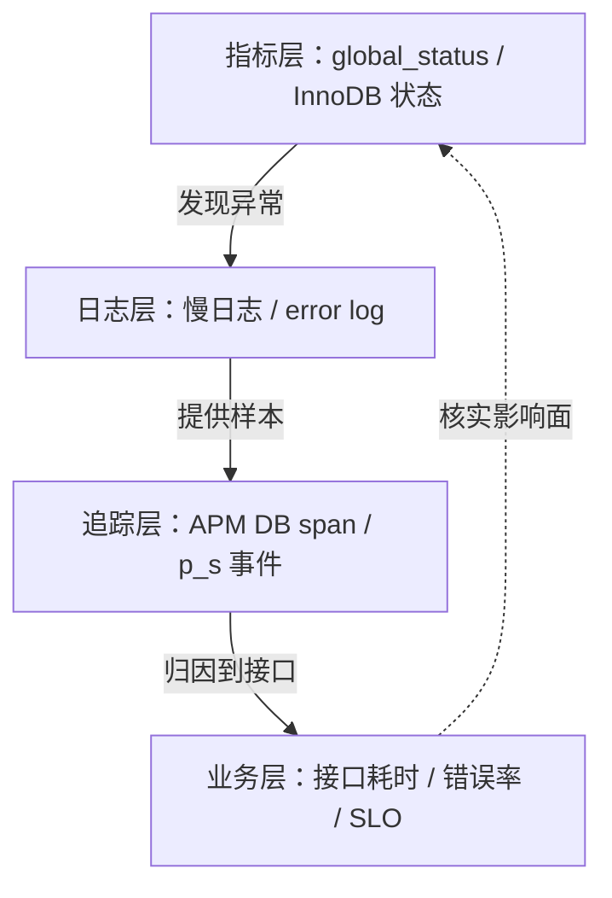
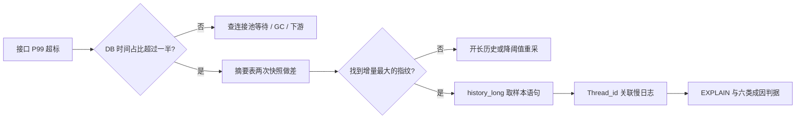
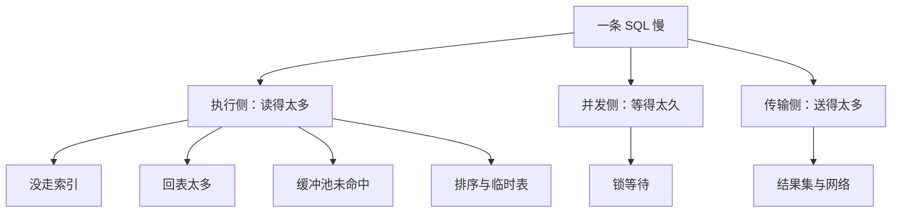

# 07 慢查询诊断与性能监控体系

**摘要：**

一次接口变慢，通常会同时出现三种说法：业务说接口卡，DBA 说实例很闲，慢日志里一条记录都没有。三方都没有说错，问题出在默认值与体系——`slow_query_log` 默认关闭，`long_query_time` 默认十秒，该看的聚合表没人看，证据在采集环节就断了。

本篇按采集、聚合、定位、预防四段，搭一套能持续运转的体系。采集段拆慢查询日志的各个开关与它们之间的相互约束，包括 `log_slow_extra` 为何是 8.0 最实用的诊断改进、写文件与写表的代价差；聚合段以摘要表为主入口，给出总耗时、单次平均、扫描行数、执行次数四种排序口径与各自对应的优化动作；定位段把「接口慢」还原到「哪一条 SQL 慢」，并给出慢的六类成因判据；预防段讨论怎样把慢查询挡在上线之前。文中涉及开销与内存的数字一律标注为示例推算，落到自己实例上必须重新采样。读完应当能回答两个问题：为什么你的实例看起来「没有慢查询」；一条慢 SQL 该按什么顺序被找出来。

---

## 第 1 章 三个默认值：为什么你的实例「没有慢查询」

### 1.1 一次典型的值班对话

活动日晚上八点，订单列表接口的 P99 从 120 毫秒涨到 2.4 秒，告警响了。业务方说接口卡；中间件同学看了一眼监控，CPU 30%，QPS 与昨日同时段持平，`SHOW GLOBAL STATUS LIKE 'Slow_queries'` 返回 0，慢日志文件只有几兆，于是结论是「数据库没问题，去查应用」。应用同学把链路翻了一遍，服务自身耗时 40 毫秒，剩下 2.3 秒全部落在数据库调用上。

两边的数据都是真的。中间件同学看到的是一台确实不忙的实例——2.3 秒的等待摊到几百个并发连接上，CPU 占用可以毫无波澜；应用同学看到的是发生在数据库侧的等待。矛盾不在数据，在采集口径：`slow_query_log` 出厂状态是关闭的，即便有人打开过，`long_query_time` 的出厂值也是 10 秒，而这条语句只需要 2.3 秒。于是它既不会进日志，也不会进 `Slow_queries`，从观测面上彻底消失。把阈值改成 0.5 秒之后，同一个接口十分钟内产生一万两千条记录，`Rows_examined` 动辄八十万，`Rows_sent` 只有二十。答案一直摆在那里，只是没人把镜头对准它。

### 1.2 默认值是保守的，不是正确的

MySQL 的出厂配置面向「装上就能跑」，不是「装上就能诊断」。其中有三个设置与慢查询直接相关，每一个都在削弱证据：

| 默认设置 | 出厂值 | 造成的观测后果 |
| :--- | :--- | :--- |
| `slow_query_log` | OFF | 一条记录都不产生，`Slow_queries` 恒为零 |
| `long_query_time` | 10 秒 | 只有「页面已经打不开」级别的语句才够格被记录 |
| `log_queries_not_using_indexes` | OFF | 未走索引的语句不进日志，索引缺失没有清单可循 |

三者的组合很坏：你既看不到慢语句，也看不到「本可以不慢」的语句，还能得到一个「零慢查询」的安心读数。判断观测是否有效，第一步不是看数，而是确认产生这个数的开关有没有打开——这一点在 [[中间件/MySQL/MySQL架构与底层原理/01 MySQL 全局架构——一条 SQL 的完整生命周期|架构列 01 篇]]已有系统交代。本篇要往前走一步：不只要打开开关，还要让产物可聚合、可对比、可告警。

### 1.3 四段闭环

把慢查询诊断当成工具箱是不够的。工具箱里放着 `EXPLAIN`、慢日志、`performance_schema` 和一堆脚本，遇到问题随手抓一个用——这是很多团队的真实状态，也是「同一个坑每季度复现」的根源。体系与工具箱的区别在闭环：每一段有明确的输入输出，上一段的产物是下一段的原料。


四段各自回答一个问题：采集回答「有没有留下证据」，聚合回答「证据里谁占大头」，定位回答「这一条为什么慢」，预防回答「下一次还会不会犯」。缺任何一段，体系就退化成一次性排查。采集最容易做成形式主义——装个采集器、把慢日志打开，一小时内完成，接下来一年没人看，日志占满磁盘再被关掉。所以采集段的设计必须连带回答：谁来消费、按什么频率看、看到什么要动。

### 1.4 一条贯穿全文的案例

案例取自订单中台，库名 `trade`，表 `orders` 约三千万行，主键 `id`，联合索引 `idx_shop_created(shop_id, created_at)`，`status` 列上没有索引。列表接口走一条范围加排序的查询：

```sql
SELECT id, order_no, user_id, amount, status, created_at
FROM orders
WHERE shop_id = ? AND status IN (?, ?)
ORDER BY created_at DESC
LIMIT 20;
```

优化器只能沿 `idx_shop_created` 按 `shop_id` 定位、按 `created_at` 倒序扫，每读一行回表判断 `status`。平时店铺单量不大，扫几千行就凑够二十条；活动期间头部店铺数据涨了一个量级，加上 `status` 过滤掉的比例很高，扫描行数直接冲到几十万。同一时间，详情接口的「补用户信息」在列表页被循环调用，一次列表请求打两百次小查询，每次八毫秒。

这两个形态构成本篇反复引用的两类问题：一类次数不多但单次极慢，一类总耗时不高但次数极多。它们的排序口径、优化动作、告警阈值全都不同，第 4 章会用它们把四种排序口径讲透。

---

## 第 2 章 慢查询日志：最便宜的数据源与它的代价

### 2.1 一条语句被写进日志的四个条件

慢查询日志的判定不是「执行时间超过阈值」一句话，手册给出的是一套依次生效的条件。记住顺序，很多「明明慢却没记录」的困惑自然消解。



第一个条件决定有没有资格参与：管理语句默认不参与，必须显式打开 `log_slow_admin_statements`。第二个条件是「或」——执行时间达阈值，或打开了未走索引记录且这条语句确实没走索引。第三个条件是「与」，扫描行数不达 `min_examined_row_limit` 就放弃记录，它对前两种情况一视同仁，第 3 章会展开它带来的误伤。第四个条件是限速。

两处细节值得记住。语句必须执行完、锁全部释放后才写日志，所以日志顺序不等于执行顺序。初始获取锁的时间不计入 `Query_time`，等行锁的时长单独记在 `Lock_time`——一条被锁住的语句可能日志里只显示 0.3 秒，实际挂了五分钟，锁等待要另外找证据。

### 2.2 `long_query_time`：从 10 秒降到 0.1 到 1 秒

默认值 10 秒是历史遗留，对应「一条报表查询跑一晚上」的年代，与今天的接口式访问完全不匹配。手册写明它的最小值为 0、默认为 10 秒，且可精确到微秒，0.1 甚至 0.05 都是合法取值。

设多少的判据不是别人家的数字，而是接口的延迟预算。某接口 SLO 是 P99 小于 300 毫秒，数据库占其中一半，那么一条 150 毫秒的语句就已经在消耗预算；此时 1 秒的阈值只能抓到事故级语句，抓不到慢性病级语句。笔者的经验口径是**长期 0.5 到 1 秒、定位期 0.1 秒**，定位期通常持续几天到一周，用来看清延迟分布的形状。

调小的代价按延迟分布的尾部形状增长：P99 是 80 毫秒的系统，降到 0.1 秒增加不多；P99 是 900 毫秒的系统则可能把 5% 的请求全部落盘。所以每次调阈值都要连着看落盘速率，设完就走等于给自己埋一颗磁盘告警。

另有一个被低估的用法：`long_query_time` 是全局与会话双级变量，可以在单条连接上单独降低。灰度新代码时把灰度实例调到 0.05 秒，只观察灰度流量，出问题立刻恢复，不污染生产日志的整体分布。

### 2.3 两个容易被忘的开关

`log_slow_admin_statements` 管管理语句，覆盖 `ALTER TABLE`、`ANALYZE TABLE`、`CHECK TABLE`、`CREATE INDEX`、`DROP INDEX`、`OPTIMIZE TABLE`、`REPAIR TABLE`。它默认关闭，理由是这些语句不产生结果集，属于运维动作。但高峰期一次执行的 `ALTER TABLE` 或误触发的 `OPTIMIZE TABLE`，破坏力不亚于一条烂 SQL，而它在慢日志里完全隐形。打开它代价很低，值得常开。

`log_slow_replica_statements` 管从库回放语句是否记录，8.0.26 起由它取代旧的 `log_slow_slave_statements`。这里有个必须知道的前提：它**只在基于语句的复制**格式下有效。`binlog_format=ROW` 时从库回放的是行变更而非 SQL 文本，这个开关开了也不会有任何记录。今天多数生产集群用 ROW 格式，所以它在很多环境里处于「开着但无效」的状态；要在从库上定位慢查询，靠的是从库本地的 `performance_schema`，复制链路的判据见 [[中间件/MySQL/MySQL架构与底层原理/10 Binlog 与主从复制——数据同步的底层传动链|架构列 10 篇]]。

### 2.4 `log_slow_extra`：把 `EXPLAIN` 需要的信息写进日志

8.0.14 引入的 `log_slow_extra` 是这一代 MySQL 在诊断上最实用的一项改进。在此之前慢日志只有四行头部：`Query_time`、`Lock_time`、`Rows_sent`、`Rows_examined`。四个数字能说明「慢」和「扫得多」，说明不了「怎么扫的」——同样是 `Rows_examined` 五十万，可能是全表扫描，也可能是索引范围扫加大量回表，两者修法相反，只能把语句捞出来手工 `EXPLAIN`。

打开之后，服务端把一批按语句统计的计数器直接写进头部，字段与 `Handler_read_*`、`Sort_*` 一一对应，只是从会话累计变成了本条语句的增量。

| 附加字段 | 对应的状态变量 | 读它判断什么 |
| :--- | :--- | :--- |
| `Thread_id` | 无 | 与 `SHOW PROCESSLIST` 的 `Id` 同源，用于反查连接与事务 |
| `Errno` / `Killed` | 无 | 是否报错、是否被 `KILL`，被杀的语句不该算进真慢 |
| `Bytes_received` / `Bytes_sent` | 同名 | 结果集规模与网络成本 |
| `Read_first` / `Read_last` | 同名 | 是否全索引扫描、是否反向读索引 |
| `Read_key` | `Handler_read_key` | 索引定位次数，嵌套循环内层应接近行数 |
| `Read_next` / `Read_prev` | 同名 | 索引范围扫描的步进次数，回表量的近似值 |
| `Read_rnd` / `Read_rnd_next` | 同名 | 前者需按行号随机定位，后者是全表扫描的直接证据 |
| `Sort_merge_passes` | 同名 | 排序发生多轮归并，非零即意味着排序数据落过盘 |
| `Sort_rows` / `Sort_scan_count` / `Sort_range_count` | 同名 | 排序多少行、由全表扫还是范围扫触发 |
| `Created_tmp_tables` / `Created_tmp_disk_tables` | 同名 | 两者相等说明临时表全部落盘 |
| `Start` / `End` | 无 | 语句开始与结束时间戳，用于与 APM、应用日志对齐 |

有了这组字段，慢日志本身带上了执行计划的影子。`Read_rnd_next` 远大于 `Read_key`，基本可断定全表扫描；`Read_next` 与 `Rows_examined` 同量级而 `Rows_sent` 很小，说明沿索引扫了大量行却没命中谓词，问题在索引列序而不是「没建索引」；`Sort_merge_passes` 非零，说明排序缓冲区不够、`ORDER BY` 没被索引覆盖。这些判断都不必连数据库，`grep` 一遍日志就能做初筛，只有可疑对象才需要 `EXPLAIN` 复核——这正是它的价值：把逐条 `EXPLAIN` 变成**先筛后验**。

两处容易踩空。其一，附加字段只对文件目的地生效，`log_output` 设成 `TABLE` 时这批字段一律不写，这是手册明确写着的；也就是说「用表存慢日志」与「用附加字段」不可兼得。其二，不少文章把 `Rows_affected` 也算进这组字段，但手册列出的二十项里没有它，受影响行数要去 `performance_schema` 的事件表取 `ROWS_AFFECTED`。

两个版本细节也值得记住：8.0.14 起头部 `SET timestamp` 记录语句**开始执行**的时间，此前是写入日志的时间，跨越这个版本做时间序列对比会错位；8.0.29 起无法解析的语句不再写入慢日志，语法错误的语句不会再来污染样本。

### 2.5 写文件还是写表，以及轮转里的静默失效

`log_output` 决定日志落到哪里，取值可以是 `FILE`、`TABLE`、`NONE` 的组合，未显式配置时默认 `FILE`。两种落法不是风格差异，而是两套代价结构完全不同的实现。

| 目的地 | 写入路径 | 主要好处 | 主要代价 |
| :--- | :--- | :--- | :--- |
| `FILE` | 追加写纯文本文件 | 开销最低，附加字段可用，可直接交给外部工具 | 需自己做轮转与采集，不能远程查询 |
| `TABLE` | 每次写入一行到 `mysql.slow_log` | 可用 SQL 过滤、可远程读 | 写放大明显，CSV 引擎无索引，反复开关可能句柄耗尽 |
| `NONE` | 丢弃 | 临时彻底关掉 | 什么也留不下 |

选 `TABLE` 有几条硬约束：日志表默认用 `CSV` 引擎，可改成 `MyISAM`，不接受别的引擎；表上不能执行 `INSERT`、`UPDATE`、`DELETE`，只有服务端内部能写，清理只能用 `TRUNCATE`；不能被分区，也不能加锁；写入的记录不写 binlog，因此不会被复制到从库。最后一条对运维很关键——「主库写、从库读」的集中日志方案在这种情况下不成立。

写表的开销比表面大：一条慢查询落表要走一次引擎写入、一次 CSV 序列化、一次文件系统操作，还要维护元数据，而 `mysql.slow_log` 没有索引，事后按时间过滤是全表扫。查询量级一大，这项开销就变成「为了观测而制造的负载」。`FILE` 的代价则落在我方：轮转、采集、解析都要自己搭。整套体系里我更倾向 `FILE` 加外部采集，理由不是性能，而是 `TABLE` 与附加字段互斥——放弃附加字段等于放弃慢日志最有价值的部分。

`log_timestamps` 默认是 UTC，只影响文件目的地。这条看起来无害，实际是按时间窗口对齐时的头号杀手：应用侧 APM 是本地时区，慢日志的 `# Time` 是 UTC，差八小时，运维照时间戳对照，怎么都对不上，于是得出「日志里没有那段时间的记录」。设成 `SYSTEM`，或者做关联时显式换算，这个坑就避开了。轮转要用 `logrotate` 加 `FLUSH SLOW LOGS` 重开文件，不要在 `postrotate` 里用 `copytruncate`——它先复制再清空，清空那一刻若服务端正在写，被截断的正是日志头，整条作废且不报错。

### 2.6 慢日志的开销

慢日志的开销不在 CPU，在**写放大**、磁盘与分析成本三处，其中分析成本往往最高。下面这组数字是示例推算，用来说明量级关系而非实测基准：实例稳定在三千 QPS，阈值 1 秒，命中率 0.05%，则每秒落盘约 1.5 条，单条按 1 KB 计，一天 130 MB 量级，这个量级人眼可以翻、脚本可以全量跑。同样的实例把 `log_queries_not_using_indexes` 打开而不设扫描行数下限，命中率可能升到 20%，每秒六百条，一天五十 GB 量级，此时日志从「可分析」变成「只能采样」，磁盘也要单独规划。

阈值与开关的调整本质上是一次容量决策：先估命中率，再定落盘规模与保留天数；按天保留、按周归档，是多数团队能承受的折中。

---

## 第 3 章 未走索引清单：一个开关的正确用法

### 3.1 它判定的是路径，不是时间

`log_queries_not_using_indexes` 的语义容易被名字带偏。它记录的不是慢语句，而是没有通过索引做行查找的语句，与执行时间无关：一条只花 0.2 毫秒的语句，只要行查找没走索引，照样写进日志；反过来，一条在索引上扫了八十万行、耗时两秒的语句，因为「用了索引」，不会被它点名。

手册还给了两个边界：小于两行的表即使全表扫也不记录，服务端认为这种表加索引没有收益；被记录的语句里全表扫与索引扫描都可能出现，判定依据是行查找是否使用索引。这就解释了为什么打开之后的日志既多又杂——它是一份索引路径清单，不是一份性能问题清单。

### 3.2 为什么会爆

不加约束地打开它，日志量会以「所有小表查询」的规模增长。原因很朴素：小表全表扫是正常且最优的访问方式。字典表、状态码表、配置表，几十行到几千行，一个数据页就能装下，全表扫的成本比走二级索引再回表还低——索引要多读一棵 B 树，还要回表取剩余列。优化器选择全表扫是对的，开关记下它也是对的，错的是把这条记录当问题。

量级可以算：一张一百行的状态表，某接口每次请求查一次，接口 QPS 两千，一天就是一点七亿条记录（示例推算）。打开开关的第一天收到日志暴涨告警，第二天磁盘水位异常，第三天开关被关掉，第四天得出「这个参数不能用」的结论。参数没有问题，用法有问题。

### 3.3 `min_examined_row_limit` 的取值

配套的过滤参数是 `min_examined_row_limit`，含义是扫描行数达到该值才记录，默认 0 表示不限，全局与会话都可设置。设成 100 到 1000，正好滤掉小表全表扫这一层噪声，同时保留大表没走索引这类真问题——一百行以上，已超出「一个数据页就能解决」的范围。

取值取决于业务里最大的正常小表有多少行。最大的字典表八百行，设 100 仍会漏进一些，设 1000 又可能把「扫九百行的那条」也滤掉。折中做法是先按 200 或 500 试跑一天，看剩下的样本是否都已超出小表范畴，再微调。

但这里有一个必须点破的陷阱：扫描行数下限对所有慢查询生效。手册的判定顺序里，扫描行数达标是独立于超时的第三个条件，所以一条执行五秒、只扫描十行的语句同样会被滤掉。哪些语句符合这个特征？等锁五秒的语句扫描行数为一行；返回大结果集、推动引擎读取行数很少的语句也可能只有个位数的扫描行数。这两类恰恰是慢查询里最难查、最需要现场的两类。为了滤掉小表噪声而把这两类信号一起丢掉，代价远大于收益。

### 3.4 限速是另一种妥协

`log_throttle_queries_not_using_indexes` 给未走索引的记录限速，默认 0 表示不限，正数表示每分钟最多记录多少条。机制值得一提：第一条未走索引的语句开启一个六十秒窗口，窗口内记录到上限为止之后抑制；窗口结束时若发生过抑制，服务端补写一行汇总，写明被抑制的条数与这些语句的总耗时；下一个窗口从下一条未走索引的语句开始计时。

这个设计适合「长期开启、只留样本」的场景，代价是丢掉样本而不是丢掉统计：被抑制的语句只剩一行汇总数字，无法反查具体语句。所以限速值要按「排查时需要多少样本」来定，五十到一百是能用的区间，设到个位数就只剩趋势。

顺带纠正一个误解：MySQL 官方版本并没有 `log_slow_filter` 这类按语句类型过滤的参数，那组参数是 Percona Server 与 MariaDB 的扩展。在官方版本上做「只记录某类语句」，要么用会话级阈值，要么直接依赖 `performance_schema`。

### 3.5 四组配置的后果对照

把开关、行数下限、限速组合起来，能画出四种典型配置。

| 配置组合 | 记录内容 | 日志量 | 适用场景 |
| :--- | :--- | :--- | :--- |
| 开关关 + 下限 0 | 只记超阈值语句 | 小 | 稳定期，专注真正的慢语句 |
| 开关开 + 下限 0 | 超阈值语句 + 全部未走索引语句 | 极大，可能每天几十 GB | 不建议，只适合极短期的全量摸底 |
| 开关开 + 下限 200 到 1000 | 超阈值语句 + 大表未走索引语句 | 中 | 索引治理专项，为期数周 |
| 开关关 + 用聚合表找未走索引 | 不落盘，按指纹聚合 | 零日志增量 | 长期运行的首选，见第 4 章 |

第四组是我更推荐的做法，理由是：未走索引这件事本质上是统计问题，不是事件问题。它关心「哪些语句在多大比例上没有走索引、累计扫了多少行」，这些恰好是聚合表擅长回答的；慢日志擅长的是「这一条语句当时的现场」。两者分工不该混，用开关去回答统计问题，等于拿消防水龙头接一杯水。

如果确实要用开关做一轮索引治理，别把它当日志，把它当待办清单：每天跑一次聚合，按未走索引次数排序取前二十条，逐条看样本语句做 `EXPLAIN`，再决定加索引、改写法，还是认定为「正常的全表扫」并加进白名单。白名单这一步很关键——治理总会走到「有些语句就是应该全表扫」的结论上，若不记录这个判断，下一轮治理会把同样的语句重新讨论一遍。索引怎么建、建了之后怎么体检，见 [[中间件/MySQL/MySQL进阶使用/01 索引设计实战——从建错索引到建对索引|本列 01 篇]]与 [[中间件/MySQL/MySQL架构与底层原理/05 InnoDB 索引结构——B+Tree 的工程哲学与页分裂机制|架构列 05 篇]]。

---

## 第 4 章 `performance_schema`：从事件流到按指纹聚合

### 4.1 摘要表能工作的三个前提

`performance_schema` 的价值不在于记录得多，而在于**按指纹聚合**。同一张表上，`WHERE id = 1` 与 `WHERE id = 2` 在事件流里是两条记录，在摘要表里是一行——服务端对语句做归一化，字面量替换成占位符，算出一个哈希，再按哈希累加统计量。这解决了慢日志的根本缺陷：慢日志按条记录，参数不同就是不同记录，聚合要靠外部工具，而工具的结果又不能与实例实时状态对齐。

摘要表要工作，三个前提缺一不可。第一，`statements_digest` 消费者必须开启，它在 8.0 默认是 YES；关掉时摘要表不更新，`sys` 视图跟着一起空，而空集不报错，只显示「一切正常」。第二，指纹要能算出来：`DIGEST_TEXT` 为 `NULL` 有两种情况，语句文本超出 `performance_schema_max_digest_length` 被丢弃，或者摘要表已满、这条语句被塞进 `DIGEST` 为 `NULL` 的兜底行。第三，行数上限要够用，上限由 `performance_schema_digests_size` 决定，默认自动估算。

**兜底行**最值得警惕，因为它会掩盖「表满了」这个事实。判断方法很直接：算兜底行的 `COUNT_STAR` 占全表总量的比例。手册的口径是，5% 左右说明摘要很有代表性，到 50% 就说明只能覆盖一半语句，该调大上限了。这一条应该做成日常巡检项，长期被兜底行吞掉的语句不会自己冒出来。

### 4.2 摘要表的字段读法

`events_statements_summary_by_digest` 的每一行是一次按指纹的汇总，字段分四组：标识（`SCHEMA_NAME`、`DIGEST`、`DIGEST_TEXT`）、次数与时间（`COUNT_STAR`、`SUM_TIMER_WAIT`、`MIN_TIMER_WAIT`、`AVG_TIMER_WAIT`、`MAX_TIMER_WAIT`）、行数与副作用（`SUM_ROWS_AFFECTED`、`SUM_ROWS_SENT`、`SUM_ROWS_EXAMINED`、`SUM_CREATED_TMP_TABLES`、`SUM_CREATED_TMP_DISK_TABLES`、`SUM_SORT_ROWS`、`SUM_NO_INDEX_USED`）、时间窗与分位（`FIRST_SEEN`、`LAST_SEEN`、`QUANTILE_95`、`QUANTILE_99`、`QUANTILE_999`）。

时间单位是皮秒，除以一万亿才是秒，这是第一次查这张表最容易犯的错——不换算，所有耗时看起来都大得离谱，反而失去量级感。`QUANTILE_*` 三列是 8.0 才有的，8.4 沿用，用来判断分布形状：平均值高而 P99 接近平均值，说明每条都慢；平均值低而 P99 高出两个数量级，说明是长尾偶发，此时优化「平均」没有意义。

8.0 还多给了一组采样列：`QUERY_SAMPLE_TEXT`、`QUERY_SAMPLE_SEEN`、`QUERY_SAMPLE_TIMER_WAIT`，用处是把归一化后的指纹还原成一条真实语句，直接拿去 `EXPLAIN`。以前要看真实语句得去慢日志里捞，现在一条 SQL 就能拿到样本。样本展示长度受 `performance_schema_max_sql_text_length` 限制，默认 1024 字节，长语句会被截断到取不出完整谓词。

### 4.3 四种排序口径

同一张摘要表，换一个 `ORDER BY`，得到的「最慢 SQL」就是另一批语句。这不是排序技巧，而是四个不同的问题共用了一张表。



**按总耗时排序**回答「谁吃掉了最多时间」，这是资源再分配时唯一有意义的排序：一条语句占全部语句时间 40%，优化它的收益可预期，哪怕单次只有二十毫秒。它的误判风险是优化了总量最大的语句而用户无感——那条语句可能是与用户路径无关的后台任务。

**按单次平均排序**回答「哪条语句单次最伤人」，与接口延迟关系最直接。风险在长尾：平均值被少数极值拉高的语句，优化它未必改善 P99；平均值不高的语句也可能有极端的 `MAX_TIMER_WAIT`，要配合分位数列一起看。

**按扫描行数排序**回答「哪里在做无用功」，扫描行数直接对应 CPU 与缓冲池消耗。一条扫八十万行只返回二十行的语句，无论耗时多少都是索引问题的候选。风险是把「大范围扫描本来就该扫这么多」当成问题，譬如对账任务的全表扫描。

**按执行次数排序**回答「谁在重复」。次数高说明问题在调用模式，不在 SQL 写法：单次八毫秒的语句执行两百万次，一天就是四点四小时的数据库时间。这类问题用 `EXPLAIN` 永远查不出来，只能从次数与业务量的比值反推。

| 排序口径 | 关键字段 | 典型判据 | 对应优化动作 | 常见误判 |
| :--- | :--- | :--- | :--- | :--- |
| 总耗时 | `SUM_TIMER_WAIT` | 单条占比超过 10% | 优化语句，或移出同步路径 | 优化了后台任务，用户无感 |
| 单次平均 | `AVG_TIMER_WAIT` 与分位 | 平均值高且分位接近 | 减少扫描、消除排序、加覆盖索引 | 平均值被极值拉高，实际是偶发 |
| 扫描行数 | `SUM_ROWS_EXAMINED` | 与 `SUM_ROWS_SENT` 比值悬殊 | 调整索引列序、收敛谓词 | 把对账、报表全表扫当缺陷 |
| 执行次数 | `COUNT_STAR` | 单位时间次数远超业务量 | 消除 N+1、加缓存、合并调用 | 把健康的点查当问题 |

### 4.4 最耗 CPU 不等于最慢

一条语句「占 CPU」与「慢」不是同一件事，差距可能非常大。CPU 消耗近似正比于扫描行数：走缓冲池的每一行都要过服务端判断谓词、组装结果，这是纯 CPU；而「慢」度量墙上时间，包含 IO 等待、锁等待、网络等待。一条扫八十万行、全部命中缓冲池的语句可能只花三百毫秒，它消耗的 CPU 相当于一条只扫一百行、却因随机 IO 卡了两秒的语句的两万倍。用实例 CPU 使用率去找慢查询，找到的往往是另一类东西。

用案例的数字看更清楚。列表查询单次 2.3 秒、每分钟六百次，一天累计四小时；被循环调用的用户点查单次八毫秒、一天两百四十万次，累计五点三小时，总量上甚至更大。前者的动作是改建联合索引，后者是把循环改成批量查询。只按「单次最慢」排序，第二轮永远进不了视野；只看 CPU，后者才是第一名。

### 4.5 环形缓冲与它丢掉的证据

摘要表擅长回答「谁占大头」，不擅长回答「刚才那三秒发生了什么」——一旦跨过一分钟，某个指纹的增量已混进累计值，无法还原出某一刻的十条语句。补这段证据的是 `events_statements_history_long`，它按事件保存全实例最近的一批语句，**环形缓冲**，满了覆盖最旧的行。它默认关闭，需要在 `setup_consumers` 里打开；行数由 `performance_schema_events_statements_history_long_size` 控制，默认自动估算，也可显式指定，但那是启动期变量，改了要重启。

用它有三个技巧。永远带 `ORDER BY EVENT_ID DESC LIMIT`，`EVENT_ID` 单调递增，按它排序等价于按时间倒序。按 `DIGEST` 过滤而不是按 SQL 文本过滤，文本在表里被截断，参数不同也对不上。避开把 `TIMER_START` 当墙钟用的陷阱——手册明确说过计时器零点在 `performance_schema` 初始化时，用它估算「距今多久」并不可靠，它可靠的地方是排序。要把事件关联到墙钟，用摘要表的 `LAST_SEEN`、采样列的 `QUERY_SAMPLE_SEEN`，或者慢日志的 `Start` 与 `End`。

它丢掉的证据是超出容量的旧记录，无法事后补救，所以排查期打开、排查完关掉是标准做法：长期开着既多占内存，覆盖速度快时缓冲里也只剩最近几秒。

### 4.6 等在哪里：等待事件摘要

语句摘要回答「哪条语句耗时长」，等待摘要回答「时间花在等什么」，两者互补。`events_waits_summary_global_by_event_name` 按事件名汇总等待次数与时间，`EVENT_NAME` 前缀就是分类：`wait/io/file/` 是文件层 IO，`wait/io/table/` 是表级 IO（含缓冲池读），`wait/lock/` 是锁，`wait/io/socket/` 是网络，`wait/synch/` 是内部同步原语。看排名先看前缀，某一类占绝对多数，大方向就定了。

用它的前提是该类等待的 instrument 处于开启状态，多数默认开启但被单独关掉的实例不少，查 `setup_instruments` 是第一步。另一个前提是**要有对照窗口**：实例启动以来的累计等待时间没有解释力，必须在故障窗口前后各取一次做差。

### 4.7 `sys` schema 与内存代价

`sys` schema 是一组建在 `performance_schema` 之上的视图，把常用的连接、排序、百分比算好了。它不能替你做判断，但能省掉大量重复 SQL。

| 视图 | 回答什么问题 | 使用提示 |
| :--- | :--- | :--- |
| `sys.statement_analysis` | 按指纹给出次数、总延迟、平均延迟、扫描行数、是否全扫 | 一站式汇总，适合每日排名 |
| `sys.statements_with_full_table_scans` | 哪些语句在扫全表，占比多少 | 索引治理的入口 |
| `sys.statements_with_sorting` | 哪些语句在额外排序、排序多少行 | 排序问题初筛 |
| `sys.statements_with_temp_tables` | 哪些语句用了临时表、多少落盘 | 临时表问题初筛 |
| `sys.schema_tables_with_full_table_scans` | 哪些表被全表扫描最多 | 定位到表而不是语句 |
| `sys.innodb_lock_waits` | 当前锁等待双方与阻塞语句 | 与 `data_lock_waits` 互为补充 |
| `sys.processlist` | 线程、当前语句、当前等待、事务状态拼成一行 | 值班第一眼 |

视图的边界要说清楚：它们只是把已采到的数据重新排列，`performance_schema` 没开或消费者关掉，视图会返回空集而不报错。空集在值班场景里极其危险，因为它长得像「没有问题」。每次用视图下结论前，先确认它背后的表有数据。

内存开销由「表行数上限乘以行宽」决定，摘要表行数由 `performance_schema_digests_size` 控制，历史表行数由各自的 `_size` 变量控制，SQL 文本展示长度由 `performance_schema_max_sql_text_length` 控制。这些变量大多是启动期变量，运行期改不了，容量规划必须在上线前做。下面这组数字是示例推算：把 `events_statements_history_long` 开到十万行，单行按 1 KB 估算，这张表就是一百 MB 量级；摘要表留一万行、单行按 1.5 KB 估算，是十几 MB 量级；若把等待事件的长历史表也开到同等规模，行宽更大、开销更高。三项叠加到几百 MB，在 8.0 上并不罕见。

代价的另一面是写入路径：每采集一次事件就要在内存写一行、更新若干聚合计数器，这部分与流量成正比。默认配置下这套开销便宜，全开长历史表时不便宜，而收益只落在很窄的排查场景里。更细的内存测量方法在 [[中间件/MySQL/MySQL架构与底层原理/01 MySQL 全局架构——一条 SQL 的完整生命周期|架构列 01 篇]]有专门一节。

---

## 第 5 章 监控体系的四层

### 5.1 分层判据

前面几章讲的都是工具，这一章讲组织：按「回答什么问题」分层，每层只回答一类问题，层与层之间靠下钻连接。分层判据不是数据来源，而是它把问题缩小到了什么范围。



顺着这条链往下走，指标层回答「有没有异常、方向是什么」，日志层回答「异常长什么样」，追踪层回答「异常属于哪个请求、哪条语句」，业务层回答「异常影响了谁」。两层之间的连接点是「缩小范围」；如果一层给出的结论无法缩小范围，这一层在体系里就是装饰。

### 5.2 指标层：累计值必须做差

`SHOW GLOBAL STATUS` 与 `performance_schema.global_status` 给出的大多是自实例启动以来的累计值，直接读只能回答「历史上发生过多少次」，回答不了「现在以多快的速度发生」。判断趋势的唯一正确用法是两次读数做差。这条纪律在 [[中间件/MySQL/MySQL架构与底层原理/01 MySQL 全局架构——一条 SQL 的完整生命周期|架构列 01 篇]]已经立过，这里给出可直接跑的采样脚本。

```bash
#!/usr/bin/env bash
# qps.sh：固定间隔采样两次 global_status 并做差，输出每秒速率
# 用法：./qps.sh 10   （采样间隔 10 秒）
set -eu
INTERVAL="${1:-10}"
FIELDS="'Uptime','Questions','Com_commit','Com_rollback','Slow_queries',
        'Threads_connected','Threads_running','Innodb_buffer_pool_reads',
        'Innodb_buffer_pool_read_requests','Innodb_row_lock_waits',
        'Innodb_row_lock_time','Bytes_sent'"
Q="SELECT VARIABLE_NAME, VARIABLE_VALUE
   FROM performance_schema.global_status
   WHERE VARIABLE_NAME IN ($FIELDS)"

snap() { mysql -N -B -e "$Q" | sort; }
A=$(mktemp); B=$(mktemp)
snap > "$A"
sleep "$INTERVAL"
snap > "$B"

# join 需要两侧都按第一列排好序；负差值一律视为实例重启，本轮作废
join -j 1 -o 0,1.2,2.2 "$A" "$B" | awk -v d="$INTERVAL" '
  $3-$2 < 0 { printf "  %-38s 计数器回退，疑似重启\n", $1; bad=1; next }
  { printf "  %-38s %12.2f /s\n", $1, ($3-$2)/d }
  END { if (bad) exit 1 }'
rm -f "$A" "$B"
```

脚本里有三处刻意设计：排序是为了 `join`，两侧字段集合必须完全一致；负差值直接判为重启，因为全局状态变量存在内存里，重启即清零；间隔由调用方给定并在命令行回显，避免拿十秒的数据当一分钟的平均用。生产上采样间隔取 10 秒到 60 秒。

指标本身也要选对口径。QPS 用 `Questions` 的增量，它统计客户端发来的语句；`Queries` 还包含存储程序内部执行的语句，重存储过程与触发器的系统里两者会差出数倍。TPS 用 `Com_commit` 与 `Com_rollback` 的增量，它只统计显式事务——自动提交的语句不计入，所以纯读写接口的 TPS 可能远低于 QPS，这不是异常。

| 指标 | 采集来源 | 口径 | 告警口径 | 备注 |
| :--- | :--- | :--- | :--- | :--- |
| QPS | `Questions` 增量 | 每秒客户端语句数 | 与基线同比偏离超过 50% | 结合业务流量解释 |
| TPS | `Com_commit` 与 `Com_rollback` 增量 | 每秒显式事务数 | 同上 | 自动提交不计入 |
| 并发线程 | `Threads_running` | 非 Sleep 线程数 | 持续高于 CPU 核数两倍 | 单机阈值需校准 |
| 连接水位 | `Threads_connected` 与 `max_connections` | 百分比 | 80% 预警、95% 告警 | 含空闲连接 |
| 缓冲池命中 | `1 - ΔInnodb_buffer_pool_reads / ΔInnodb_buffer_pool_read_requests` | 窗口内比例 | 低于 99% 观察、95% 告警 | 冷启动会偏低 |
| 行锁等待 | `Innodb_row_lock_waits`、`Innodb_row_lock_time` 增量 | 次数与总时长 | 单窗口时长超业务容忍 | 与锁视图同看 |
| 临时表落盘 | `Created_tmp_disk_tables` 增量 | 每秒落盘数 | 非零且持续 | 排序与分组问题信号 |
| 复制延迟 | `SHOW REPLICA STATUS` 的 `Seconds_Behind_Source` | 秒 | 10 秒观察、60 秒告警 | 8.0.22 起用新语法 |
| 磁盘水位 | 操作系统 | 百分比 | 85% 预警 | 慢日志与 binlog 共用 |

阈值一列写的是经验口径，不是标准答案。可用的阈值必须来自自己的基线：同一个 `Threads_running` 在四核与六十四核实例上含义完全不同，同一个命中率在冷启动与稳态下也不可比。做法是先采集两周，按分位数定基线，把「超过基线三倍」作为告警线；硬判据（非零即异常的那些）单独列出直接告警。

### 5.3 日志层：慢日志与错误日志

慢日志的配置在第 2 章讲完了，这一层要说的是消费方式：日志层的产物不是文件本身，而是落盘速率趋势、Top 指纹的每日排名、异常模式的出现与消失。前两样靠定时任务，第三样靠关键字匹配。

错误日志常被当成「出了事才看」的东西，实际上它是唯一能记录「没有返回结果集的那类故障」的地方：连接被拒绝、认证失败、表空间写满、复制中断。采集方式很简单，按 `[ERROR]` 级别与错误码匹配关键字，命中即计数告警。要注意错误日志格式随版本调整过（组件化之后多段输出），解析必须按模式匹配而不是固定行号。

| 错误日志关键字 | 指向的问题 | 处理方向 |
| :--- | :--- | :--- |
| `Too many connections` | 连接数打满 | 查连接池配置与泄漏 |
| `Deadlock found` | 死锁回滚 | 与锁视图同看，改加锁顺序 |
| `Aborted connection` | 客户端异常断开 | 查超时配置与网络 |
| `No space left on device` | 磁盘写满 | 清 binlog 与日志，查增长源 |
| `Cannot allocate memory` | 内存耗尽 | 查缓冲池与连接级缓冲 |

### 5.4 追踪层：把请求切开

追踪层的价值是归属：指标告诉你异常存在，追踪告诉你异常属于哪个请求、哪个服务、哪条语句。数据库侧的追踪有两条路，一条在应用侧（APM 的数据库 span），一条在服务端（`performance_schema` 的事件表），各有盲区。

APM 的数据库 span 记录「这次调用花了多久、执行了什么语句、影响多少行」，天然与接口、trace_id、用户维度关联，缺点是采样率——采样 10% 时，一次只有几百个请求的异常可能一条都没采到。服务端的事件表记录「实例上实际发生了什么」，不受应用采样影响，缺点是没有业务维度、只有线程号。两者的连接点是语句文本与时间窗。追踪侧的工程细节，见 [[可观测/链路追踪/08 链路追踪工程实践落地经验|链路追踪 08 篇]]。

### 5.5 业务层：接口耗时与数据库耗时的换算

业务层是唯一直接对用户负责的层，也是判断「该不该动数据库」的地方。判据很朴素：把一次接口调用拆成数据库时间与应用时间，看数据库占多少。占比低于 30%，优先查应用侧（序列化、GC、下游调用、连接池等待）；超过 50%，数据库侧才值得作为主战场。没有这个拆分，排查会退化成两边互相举证。

拆分靠 APM 的 span 时长与应用侧的 SQL 日志。两者都没有时，一个低成本的替代是在 SQL 里注入注释，把接口名与请求标识带进数据库，注释会原样出现在慢日志与 `SQL_TEXT` 里，反查就能对上。用这个方案前要先确认注释不会破坏语句指纹的归一化，同一接口的不同请求必须归并到同一行摘要，否则摘要表会被注释撑爆——这一点必须在自己实例上实测，不能想当然。

业务层还有一个常被忽略的指标：错误率。数据库超时、连接池耗尽、锁等待超时最终都表现为业务错误，而这些错误在数据库侧可能完全没有体现（超时是客户端行为）。所以业务错误率应与数据库指标并列看待，任何一方单独告警都可能漏掉真实故障。

### 5.6 三类阈值，不要混用

阈值定得对不对，决定这套体系是被信任还是被静音。可行做法是按可信度分三类。

第一类是**硬判据**，非零即异常。`Connection_errors_max_connections`、`Innodb_row_lock_waits` 在正常情况下应为零，一旦出现就说明某个具体失败发生了，不需要基线也不需要经验值。

第二类是**基线判据**，看相对变化。慢查询条数、`Threads_running`、扫描行数总量没有绝对标准，只能与自己比：与昨日同时段比、与上周同日比、与滚动七天分位数比。偏离三倍告警，五倍升级。

第三类是**容量判据**，看水位百分比。连接数占 `max_connections` 的比例、磁盘使用率、脏页比例属于这一类，绝对值有意义，因为天花板已知。

把三类混用会出两种典型错误：拿经验值否定硬判据（锁等待次数不多就说没事，其实大于零就有事务被阻塞），或拿硬判据的严格程度要求容量指标（连接数一到 60% 就告警，噪声压垮值班）。分开处理，告警可信度才能建立。巡检清单同理，要写成「查什么、期望什么、不满足怎么办」的条目，缺一项，条目在交接后就会失效。

---

## 第 6 章 从接口慢到 SQL 慢：四步链路

### 6.1 链路总览

分层解决「哪一层」，这一节解决「层与层怎么走」。把它固化成路径，是因为真实排障中最耗时的不是分析，而是「下一步做什么」的犹豫。



四个步骤各有产出：该不该在数据库侧继续查、可疑指纹清单、这一条语句的现场、成因归属与处置方案。任何一步拿不到产出，就要回头改观测配置，而不是硬着头皮往下猜。

### 6.2 第一步：确认时间花在数据库上

先看 APM 的 span 分解：一次调用里数据库占多少、应用内部占多少、下游调用占多少。案例里的接口总耗时 2.4 秒，数据库 span 合计 2.25 秒，占 94%，结论明确。

这一步最常见的误判是**连接池等待**。埋点包在连接池外层时，线程拿不到连接的等待会被算进数据库调用，于是数据库看起来慢，实际是池子太小或有慢语句占着连接不还。判据是连接池自身的指标：活跃连接数、等待队列长度、超时次数；等待队列非零而实例 `Threads_running` 很低，基本可确定是池子问题。连接池与事务边界的关系，见 [[中间件/MySQL/MySQL进阶使用/03 事务与隔离级别的正确打开方式|本列 03 篇]]。

### 6.3 第二步：按时间窗口捞增量

摘要表是累计值，累计值不能回答「刚才发生了什么」，必须做差。做法是窗口前后各取一次快照，按指纹做差，按耗时增量排序。下面的脚本把快照落到采集端临时文件，不在主库建表，避免观测动作本身给主库添负担。

```bash
#!/usr/bin/env bash
# digest_diff.sh：5 分钟窗口内按指纹做差，按耗时增量排序
set -eu
SQL="SELECT SCHEMA_NAME, DIGEST, COUNT_STAR, SUM_TIMER_WAIT,
            SUM_ROWS_EXAMINED, SUM_ROWS_SENT, SUM_NO_INDEX_USED,
            REPLACE(LEFT(DIGEST_TEXT, 90), '\t', ' ')
     FROM performance_schema.events_statements_summary_by_digest
     WHERE SCHEMA_NAME = 'trade'"
A=$(mktemp); B=$(mktemp)
mysql -N -B -e "$SQL" > "$A"
sleep 300
mysql -N -B -e "$SQL" > "$B"

# 输出：次数增量  耗时增量(秒)  扫描行增量  未用索引增量  指纹
awk -F'\t' '
  NR==FNR { k=$1"|"$2; c[k]=$3; t[k]=$4; e[k]=$5; n[k]=$7; s[k]=$8; next }
  { k=$1"|"$2
    if (!(k in c)) next
    dc=$3-c[k]; if (dc<=0) next
    printf "%8d\t%10.2f\t%12d\t%8d\t%s\n", dc, ($4-t[k])/1e12, $5-e[k], $7-n[k], s[k] }' \
  "$A" "$B" | sort -t$'\t' -k2,2nr | head -20
rm -f "$A" "$B"
```

三个细节决定它能不能用。快照必须包含 `SCHEMA_NAME` 与 `DIGEST` 两列做联合键，只按 `DIGEST` 会在多库同名语句上串行。`SUM_TIMER_WAIT` 要除以一万亿换算成秒，直接看差值会误判量级。增量小于等于零要跳过——摘要在窗口内被 `TRUNCATE` 过或实例重启过，都会出现零增量甚至负增量，此时数据不可用。

另一个办法是 `TRUNCATE` 摘要表后跑一个短窗口，代价是丢掉历史累计值与 `FIRST_SEEN`，事故排查中通常可接受。两种办法都行，关键是窗口要短，短到能把异常窗口与正常窗口分开。

### 6.4 第三步：还原现场

拿到可疑指纹后，去 `events_statements_history_long` 按 `DIGEST` 捞最近的样本，能看到单条语句的完整行数与临时表指标，比累计值更接近现场。

```sql
SELECT THREAD_ID, EVENT_ID,
       ROUND(TIMER_WAIT / 1e12, 4)          AS sec,
       ROWS_EXAMINED, ROWS_SENT,
       NO_INDEX_USED, SORT_ROWS,
       CREATED_TMP_DISK_TABLES,
       LEFT(REPLACE(SQL_TEXT, '\n', ' '), 120) AS sql_head
FROM performance_schema.events_statements_history_long
WHERE DIGEST = '0x7f3a1c2d9b4e5f60'
ORDER BY EVENT_ID DESC
LIMIT 50;
```

如果查不到，先确认消费者是否打开，再看保留行数够不够。环形缓冲的覆盖速度取决于流量，两万行在高并发下可能只够十几秒，排查窗口一旦错开就没有记录。这也是排查期要临时调大它或改用慢日志的原因：慢日志虽杂，至少按时间完整落盘。

### 6.5 第四步：用 `Thread_id` 关联慢日志

摘要与历史表给的是语句，慢日志给的是现场，两者最可靠的连接键是线程号：`performance_schema` 的 `THREAD_ID` 是内部编号，`PROCESSLIST_ID` 才对应 `SHOW PROCESSLIST` 的 `Id`，而慢日志在打开 `log_slow_extra` 之后会直接写出 `Thread_id`。

```bash
# 在慢日志里定位某个线程的记录，并连带取出语句原文
grep -n -A 12 'Thread_id: 48213' /var/log/mysql/slow.log | tail -60
```

这条链路的用法是双向的：从摘要表出发，可以找到这条语句在慢日志里的原始上下文（谁、什么时间、什么用户、耗时多少、扫描多少行）；从慢日志出发，可以反查这条语句属于哪个指纹、累计执行多少次。后者在值班时更常用——看到一条奇怪的慢日志，先确认它是个例还是常态。

关联时要注意时间基准。慢日志的 `# Time` 受 `log_timestamps` 影响，而 `TIMER_START` 不是墙钟，两者不能直接相减。可靠的锚点是 `Start` 与 `End`（同样需要附加字段），以及摘要表的 `LAST_SEEN`。跨机器关联还要确认时钟同步。

### 6.6 走一遍案例与链路的断点

案例的事实是这样还原的。第一，APM 显示列表接口的数据库 span 占 94%，确认战场在数据库侧。第二，五分钟窗口做差，`trade` 库耗时增量最大的指纹是列表查询，占窗口内总耗时 61%，次数增量 2900；第二名用户点查占 22%，次数增量 120 万。第三，按 `DIGEST` 捞历史表，列表查询的样本显示 `ROWS_EXAMINED` 在三十万到八十万之间、`ROWS_SENT` 恒为 20、`NO_INDEX_USED` 为 0、`SORT_ROWS` 接近扫描行数。第四，慢日志同线程号的记录带着 `Read_next` 三十余万、`Read_rnd_next` 为零、`Sort_merge_passes` 非零。

四个证据合起来指向一个结论：语句走了索引（`NO_INDEX_USED` 为零、`Read_next` 主导），但沿索引扫了大量行、每行都回表过滤 `status`，最后排序还要落盘。成因是索引列序——`status` 是等值过滤却没进索引，优化器只能先扫再排。处置是把联合索引扩成 `(shop_id, status, created_at)`，扫描行数会从几十万降到几十。

用户点查是另一条线：所有单条指标都健康，唯一异常的是次数——一百二十万次对应六万次列表请求，正好二十倍，处置动作在调用方式而不在 SQL。

这条链路在五类环境会断，遇到时换证据源而不是加大采样。托管实例可能不暴露 `performance_schema`，退回慢日志加厂商工具。代理与分库分表会改写语句，代理看到的 SQL 与后端指纹可能不是同一条，逻辑表与物理表的对应见 [[中间件/MySQL/MySQL进阶使用/06 分库分表——何时做、怎么做、做了之后怎么办|本列 06 篇]]。事务边界跨接口时，单次调用都不慢、合起来很慢，要靠 trace 的父子关系还原。

短连接与连接风暴的开销不进语句耗时，也不进 `Slow_queries`，判据在 `Aborted_connects` 与 `Connections` 的增量上。最后一种是观测链自身没开全，链路的第一步就断在空集上。

---

## 第 7 章 「慢」的六类成因与判据

### 7.1 分类的依据

排障到最后要回答「到底是什么原因慢」，答案能归类，处置就有章可循。按「时间被谁消耗」来分，一条语句变慢只有三个方向：读得太多、等得太久、送得太多。三个方向再细分，得到六类可以独立观测、独立处置的成因。



分类的好处是每一类都有独立的计数器指纹，不需要靠猜。下面逐类给出判据、采样位置与处置方向。

### 7.2 没走索引

判据最硬：摘要表的 `SUM_NO_INDEX_USED` 增量为正，慢日志的 `Read_rnd_next` 远大于 `Read_key`，`EXPLAIN` 的 `type` 为 `ALL` 或 `index`，三者任一成立即可定性。处置是让谓词走到索引上：补索引、调整列序、把隐式类型转换与函数调用从索引列上挪走。常见误判是 `Rows_examined` 一大就断定没走索引，实际可能是走索引但回表多，区别在 `Read_*` 的构成上。索引怎么写见 [[中间件/MySQL/MySQL进阶使用/01 索引设计实战——从建错索引到建对索引|本列 01 篇]]。

### 7.3 走了索引但回表太多

判据是 `Read_next` 与 `Rows_examined` 同量级而 `Rows_sent` 很小，`NO_INDEX_USED` 为零，`EXPLAIN` 的 `type` 是 `range` 或 `ref` 且 `Extra` 里没有 `Using index`。索引定位是对的，但沿索引扫出的行大部分被过滤掉，每一行还都回了表。处置分两层：让索引覆盖，把需要的列加进联合索引；改列序，把等值过滤列放在范围列之前，让扫描起点更精确。案例里的列表查询属于这一类的变种。

### 7.4 锁等待

判据是 `Lock_time` 占 `Query_time` 的比例，以及 `Innodb_row_lock_waits` 与 `Innodb_row_lock_time` 的增量。占比超过一半基本可以认定时间主要花在等锁上，此时优化 SQL 写法毫无意义——语句本身可能只需要一毫秒。处置方向是把等待链找出来：谁在阻塞、持锁事务在做什么、为什么迟迟不提交。`performance_schema.data_lock_waits` 与 `sys.innodb_lock_waits` 给出当前等待关系，`SHOW ENGINE INNODB STATUS` 的 `TRANSACTIONS` 段给出持锁事务的完整语句。最隐蔽的情况是阻塞源不在数据库里——应用线程已崩溃但连接没断，事务挂在那里不动。锁与事务的用法见 [[中间件/MySQL/MySQL进阶使用/04 锁与并发控制——开发者必须理解的死锁问题|本列 04 篇]]与 [[中间件/MySQL/MySQL架构与底层原理/07 InnoDB 锁机制——从记录锁到间隙锁的底层实现|架构列 07 篇]]。

### 7.5 缓冲池未命中

这一类的判据与前几类不同，它不是语句级的：缓冲池未命中是实例级现象，只是恰好由某些语句触发。判据是 `Innodb_buffer_pool_reads` 相对 `Innodb_buffer_pool_read_requests` 的比例在窗口内升高，同时 `Threads_running` 上升、IO 等待占比上升。语句级的间接证据是同一条指纹的 `AVG_TIMER_WAIT` 稳定而 `MAX_TIMER_WAIT` 频繁触及高位，说明大部分时候命中、偶尔落盘。

处置要分清对象。触发者是少数几条大范围扫描语句，它们把热数据挤出了缓冲池，动作是收敛这些语句的扫描范围，而不是无脑扩大缓冲池；触发者是整体数据量超过内存容量，那是容量问题，方向是扩容或冷热分离。缓冲池的内部结构见 [[中间件/MySQL/MySQL架构与底层原理/02 InnoDB Buffer Pool——内存与磁盘之间的桥梁|架构列 02 篇]]。

### 7.6 排序、临时表与结果集

排序的判据是 `Sort_merge_passes` 非零、`Created_tmp_disk_tables` 与 `Created_tmp_tables` 接近、`EXPLAIN` 的 `Extra` 出现 `Using filesort` 或 `Using temporary`。`Sort_merge_passes` 非零意味着排序数据超过排序缓冲区、发生多轮归并，这部分开销完全在磁盘上。处置有三条：让排序走索引（把 `ORDER BY` 的列接到联合索引尾部，且前面列都是等值条件）、减少参与排序的行数（先过滤再排序）、避免在大结果集上做分组。`EXPLAIN` 各列怎么读，见 [[中间件/MySQL/MySQL进阶使用/02 SQL 调优方法论——从 EXPLAIN 到执行计划重写|本列 02 篇]]。

结果集与网络的判据是 `Rows_sent` 与 `Bytes_sent` 的量级，以及线程状态停在 `Sending to client`。这一环最容易被误读，因为有个 `Sending data` 状态看起来像网络，实际包含从引擎读行并处理的全过程，真正卡在发送的是 `Sending to client`。处置方向是收敛结果集：加 `LIMIT`、去掉 `SELECT *`、分页而不是全量导出、把大字段拆表。另一头是客户端消费速度——服务端每写一行都要等 socket 可写，客户端读得慢就占住服务端线程，表现是「CPU 不高、磁盘不忙、连接全在超时」，判据是 `Aborted_clients` 增长与连接数高企的组合。

### 7.7 一张判据总表

| 成因 | 核心判据 | 采样位置 | 处置方向 | 归口 |
| :--- | :--- | :--- | :--- | :--- |
| 没走索引 | `NO_INDEX_USED` 增量为正、`Read_rnd_next` 主导 | 摘要表、慢日志 | 补索引或改谓词 | 本列 01 篇 |
| 回表太多 | `Read_next` 与扫描行同量级、`Rows_sent` 很小 | 慢日志、`EXPLAIN` | 覆盖索引、改列序 | 本列 01 篇 |
| 锁等待 | `Lock_time` 占比过半、行锁等待计数增长 | 慢日志、锁视图 | 缩短事务、统一加锁顺序 | 架构列 07 篇 |
| 缓冲池未命中 | 物理读比例升高、均值稳定而最大值飙升 | 状态变量窗口、摘要表 | 收敛扫描范围或扩容 | 架构列 02 篇 |
| 排序与临时表 | `Sort_merge_passes` 非零、临时表落盘 | 慢日志、`EXPLAIN` | 排序走索引、先过滤 | 本列 02 篇 |
| 结果集与网络 | `Bytes_sent` 大、停在 `Sending to client` | 状态变量、`sys.processlist` | 收敛列与行、分页 | 架构列 01 篇 |

用法是排除法：先看 `Lock_time` 占比排掉锁等待；再看 `NO_INDEX_USED` 与 `Read_*` 构成，区分没走索引与回表多；然后看排序与临时表；最后看结果集与网络。越靠前的成因越容易在单条语句上定性，越靠后的越需要实例级证据配合。

---

## 第 8 章 预防：把慢查询挡在上线之前

### 8.1 预防段的三个位置

前三段解决「已经慢了怎么办」，这一段解决「还没慢但会慢」。缺少这一段，体系只是救火队：每次事故都能查清，但每次事故都会重演。抓手在三个位置：上线前的语句评审、上线中的定向观测、上线后的回归对比。

### 8.2 上线前：评审执行计划而不是 SQL 文本

代码评审看 SQL 文本，能看到「有没有 `SELECT *`」「有没有 `LIKE '%x'`」，看不到执行计划。真正决定这条语句会不会在三个月后变慢的，是它在大表上的访问路径。所以评审的物料应该是三样：`EXPLAIN` 输出、估算的扫描行数、该表当前的规模与增长速度。

清单可以很短但要能挡住大多数问题：`type` 是否退化为 `ALL` 或 `index`；`rows` 估算是否超出可控范围；`Extra` 是否出现 `Using filesort` 或 `Using temporary`；谓词是否在索引列上做了函数或类型转换；`ORDER BY` 与 `LIMIT` 是否有索引支撑。任一不满足，结论定为「需要修改」而不是「上线后观察」。

另一个容易忽略的检查项是数据分布假设。开发环境十万行，任何计划都很快；生产三千万行，同一条语句的访问路径可能完全不同。评审要用生产的统计信息去看，或者至少在相似规模的预发环境跑一次。统计信息准确性与计划翻转的机理，见 [[中间件/MySQL/MySQL架构与底层原理/09 MySQL 查询优化器——从代价模型到执行计划的决策过程|架构列 09 篇]]。

### 8.3 上线中：对灰度流量定向采样

灰度期是成本最低的观测窗口。做法是在灰度实例上把 `long_query_time` 降到 0.05 秒、打开 `log_slow_extra`，只观察灰度流量，确认无异常后恢复。流量小、落盘量可控，而覆盖面是新代码的全部访问路径。

没有独立灰度实例时，可用会话级阈值达到类似效果：应用侧给灰度请求打标，命中标记的连接执行 `SET SESSION long_query_time = 0.05`。这要求连接是独占的，不能复用池里混合了生产流量的连接，否则标记会污染其他请求——会话级变量的作用域是连接而不是请求，实施前必须想清楚。

### 8.4 上线后：建一条回归基线

上线后的观测重点是「新指纹有没有异常」。摘要表天生适合做这件事：按 `FIRST_SEEN` 找出最近一周新出现的指纹，看它们的次数、平均耗时、扫描行数是否落在同类语句的基线区间内。

```sql
-- 最近七天新出现的指纹，按平均耗时降序，用于上线回归
SELECT SCHEMA_NAME,
       LEFT(DIGEST_TEXT, 100)              AS digest_text,
       COUNT_STAR,
       ROUND(AVG_TIMER_WAIT / 1e12, 4)     AS avg_sec,
       SUM_ROWS_EXAMINED,
       SUM_NO_INDEX_USED,
       FIRST_SEEN, LAST_SEEN
FROM performance_schema.events_statements_summary_by_digest
WHERE SCHEMA_NAME = 'trade'
  AND FIRST_SEEN >= NOW() - INTERVAL 7 DAY
  AND COUNT_STAR > 10
ORDER BY AVG_TIMER_WAIT DESC
LIMIT 20;
```

这条查询要配合「预期清单」使用：上线前已知道会新增哪几条语句，上线后核对清单是否齐全、指标是否在预期内。没有预期清单，结果只是一批陌生指纹，判断不了是新增还是早就存在但刚被采样到。

长期看，预防段还要回答周期性问题：未走索引的清单是否在缩短、冗余与未使用索引是否在增加、大表扫描量是否随数据增长而同步上升。这几件事合起来叫索引治理，难点不在技术，而在持续投入——索引会腐化，加的时候有理由，删的时候没人负责，几年下来表上挂着一堆互不相关的联合索引，写路径成本被悄悄抬高。体检判据与重建代价见 [[中间件/MySQL/MySQL架构与底层原理/05 InnoDB 索引结构——B+Tree 的工程哲学与页分裂机制|架构列 05 篇]]；长事务是另一项要定期看的指标，它让 undo 无法回收、版本链变长，表现为「平常很快的点查偶尔变慢」，判据在最老事务与 `history list length` 上，见 [[中间件/MySQL/MySQL架构与底层原理/04 Undo Log 与 MVCC——多版本并发控制的实现真相|架构列 04 篇]]。

### 8.5 这套体系什么时候会失灵

三种情况会让体系失效，识别它们比增加工具更重要。

第一种是观测被静音。日志轮转写错、采集器挂了、告警被批量屏蔽、阈值调高后忘了调回来——这些都不报错，只让值班看到一片绿色。对策是给观测链路本身加监控：采集器心跳、最近一次成功采集时间、日志增长速度。没有这一层，「监控正常」这个结论本身不可信。

第二种是口径被改。团队换人后，新人不清楚阈值为什么是这个数，按自己的理解改了一版。对策是把口径写进值班文档，让每个数字后面都有一句「为什么」可追溯。

第三种是增长把判据拖过期。三个月前合理的扫描行数，现在数据涨五倍已不合理，但阈值没动。对策是把容量类指标与数据量挂钩，而不是与绝对值挂钩。

---

## 第 9 章 反例与边界

### 9.1 反例一：`long_query_time = 10`

这是最普遍的一个。阈值 10 秒意味着只有已在造成事故的语句会被记录，而绝大多数真实问题发生在 200 毫秒到 3 秒之间——它们足以让 P99 超标、让用户抱怨，但一条都不会进慢日志。更糟的是它会自我强化：日志里没东西，团队就认为数据库健康。判断办法只需一条语句：查 `@@long_query_time`，看它是否大于接口的延迟预算；大于预算，这个阈值就没有诊断意义。

### 9.2 反例二：开了未走索引记录却不设下限

打开 `log_queries_not_using_indexes` 而不设扫描行数下限，等于把所有小表查询倒进日志。第一天日志暴涨，第二天磁盘告警，第三天开关被关掉，第四天结论是「这个参数不能用」。正确用法在第 3 章：下限设到 200 至 1000，配合限速，只在治理专项期间开启；长期运行则关掉开关，改用摘要表的 `SUM_NO_INDEX_USED` 做差分。把一个统计问题当成事件问题处理，是这类反例的共同根源。

### 9.3 反例三：只看慢日志不看聚合表

慢日志是事件流，聚合表是统计表。只看慢日志会漏掉两类问题：一是单次不慢但次数极多的语句，它们永远进不了慢日志，却可能占掉一半的数据库时间；二是总量占比高但每次都刚好卡在阈值之下的语句。反过来只聚合也不够：聚合表告诉你哪条语句有问题，给不出这一条语句当时的现场。两张表的分工是找对象与看现场，缺一不可。

### 9.4 边界：判据在哪些环境失效

第一类是托管数据库。部分云服务不暴露 `performance_schema` 的完整能力，只暴露聚合后的性能洞察，方法要换成厂商工具，判据本身仍成立，取数方式变了。

第二类是分库分表与代理。逻辑 SQL 与物理 SQL 不同，一个逻辑查询可能落到十几个分片，摘要表里看到的是十几条物理语句，判断「这条逻辑查询慢」要靠应用侧的分片耗时汇总。

第三类是非 InnoDB 表。`Innodb_rows_read` 这类指标对它们无效，判据退回 `Handler_read_*`。

第四类是只读副本。副本上的慢查询成因可能完全不同：并行回放、大事务回放、回放期间的锁竞争，这些在主库上不存在，照搬主库结论会走偏。

第五类是短命实例。容器化部署下实例可能只活几天，累计值还没积累出统计意义就被销毁，此时应把指标外送到长期存储，而不是依赖实例本地。

---

## 第 10 章 结语：体系的价格

慢查询诊断这件事，工具的获取成本很低，`EXPLAIN`、慢日志、`performance_schema` 都是现成的，真正稀缺的是把工具组织成闭环的耐心：采集时想清楚谁来消费，聚合时想清楚排哪个序，定位时想清楚证据链怎么串，预防时想清楚下一次怎么不被同一个写法绊倒。

体系是有价格的。慢日志的价格是磁盘与分析成本，`performance_schema` 的价格是内存，监控四层的价格是采集器与值班人力，阈值的价格是误报带来的信任损耗。这些价格都要提前算，否则体系会在第一次「日志占满磁盘」或「告警太吵」时被拆掉一半——拆掉容易，重建时团队已经不相信它了。

所以合理的做法不是一开始就搭全套，而是从最便宜的一段开始：把 `long_query_time` 降到有诊断意义的量级，打开 `log_slow_extra`，让摘要表有人看，把「接口慢」到「哪条 SQL 慢」的路径走通一次。走通之后再补告警、补巡检、补预防。体系是一层层长出来的，不是一次性设计出来的。

---

## 参考资料

1. MySQL 8.0 Reference Manual, [The Slow Query Log](https://dev.mysql.com/doc/refman/8.0/en/slow-query-log.html)
2. MySQL 8.0 Reference Manual, [Selecting General Query Log and Slow Query Log Output Destinations](https://dev.mysql.com/doc/refman/8.0/en/log-destinations.html)
3. MySQL 8.0 Reference Manual, [Server System Variables](https://dev.mysql.com/doc/refman/8.0/en/server-system-variables.html)
4. MySQL 8.0 Reference Manual, [Statement Summary Tables](https://dev.mysql.com/doc/refman/8.0/en/performance-schema-statement-summary-tables.html)
5. MySQL 8.0 Reference Manual, [Performance Schema Statement Digests and Sampling](https://dev.mysql.com/doc/refman/8.0/en/performance-schema-statement-digests.html)
6. MySQL 8.0 Reference Manual, [Performance Schema System Variables](https://dev.mysql.com/doc/refman/8.0/en/performance-schema-system-variables.html)
7. MySQL 8.0 Reference Manual, [The sys Schema](https://dev.mysql.com/doc/refman/8.0/en/sys-schema.html)
8. MySQL 8.0 Reference Manual, [Server Status Variables](https://dev.mysql.com/doc/refman/8.0/en/server-status-variables.html)
9. MySQL 8.0 Reference Manual, [Replication and Binary Log System Variables](https://dev.mysql.com/doc/refman/8.0/en/replication-options.html)
10. Percona Toolkit Documentation, [pt-query-digest](https://docs.percona.com/percona-toolkit/pt-query-digest.html)

---

> [!note] 思考题
> 1. 你的实例上 `long_query_time` 是 10 秒，业务接口的 P99 预算是 300 毫秒。把它改成 0.5 秒之后，慢日志的落盘速率会涨多少，你怎么在改之前估出来？
> 2. `min_examined_row_limit` 设成 200 之后，哪些真实慢查询会被一起过滤掉？请举出至少两种扫描行数很少、但耗时很长的语句形态。
> 3. 摘要表里一条语句的 `AVG_TIMER_WAIT` 很低，但 `QUANTILE_99` 高出两个数量级。这条语句该按总耗时优化还是按单次优化，你的判据是什么？
> 4. `DIGEST` 为 `NULL` 的兜底行占了全表 `COUNT_STAR` 的三成，这说明什么？要动哪个参数，动了之后有什么代价？
> 5. 一条语句的 `Lock_time` 占 `Query_time` 的 80%，另一条语句的 `Rows_examined` 是 `Rows_sent` 的两万倍。如果只能先修一条，你选哪条，依据是什么？
> 6. 为什么在 `binlog_format=ROW` 的集群上，打开 `log_slow_replica_statements` 通常看不到从库回放的慢语句？要从库定位慢查询应该改用什么手段？