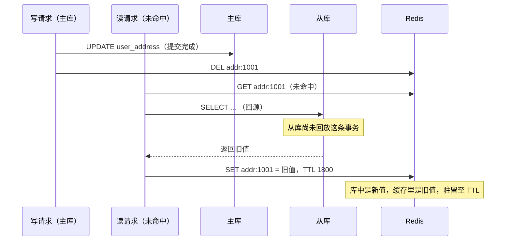
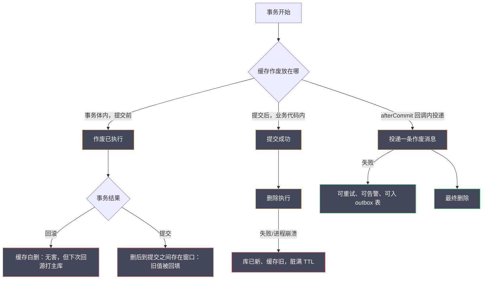
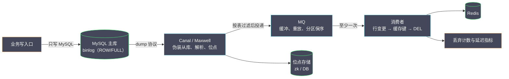
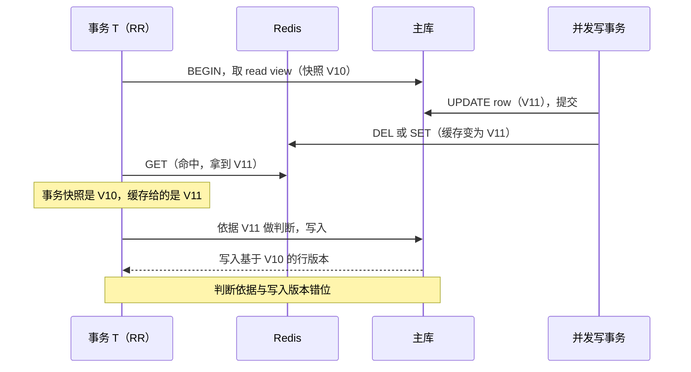

# 08 MySQL 与缓存的协作模式——Cache Aside 到数据一致性

**摘要：**

缓存与数据库的协作，被讨论得最多的部分在缓存那一侧：模式怎么选、键怎么设计、穿透击穿雪崩怎么防。本文换一个方向，只写以 MySQL 为源、缓存为副本时，数据库这一侧特有的约束。第 1 章先把方向立住——缓存是派生视图，一切"以缓存为准"的判断都是错位；第 2 章把四种更新策略放回 MySQL 的提交流水线上，给出每种策略的错误窗口具体长什么样，而不是只给名字。第 3 章是全篇的第一个骨架：三个延迟双删治不了的机制，主从延迟导致的旧值回填、binlog 订阅链路的固有窗口、事务未提交而缓存已失效，三者作用的位置都不在"延迟"上，所以调大 `sleep` 无解。第 4 章交付 MySQL 生态特有的做法：用 Canal/Maxwell 订阅 binlog、经 MQ 驱动缓存失效，拆开行变更到缓存键的翻译、幂等与顺序、端到端延迟量级、DDL 变更的连带成本，并给一张该不该上的判据表。第 5 章把 MySQL 侧的强一致手段与代价摆开：读主库、半同步 `AFTER_SYNC`、等 GTID 执行到位、组复制一致性级别。第 6、7 章处理两个只有写过代码才会遇到的现场：`SELECT ... FOR UPDATE` 与缓存并用时锁根本没执行，以及事务内先读缓存再写库如何绕开 MVCC。第 8、9 章收在五个反例与一份代码审查清单上。

---

## 第 1 章 缓存的另一侧：把 MySQL 当源

### 1.1 先把方向立住

设计文档里最常见的一句是"缓存与数据库保持一致"。这句话把一个方向性的事实抹平了：MySQL 是源，**缓存是它的派生视图**，任何一个缓存值都只是某次回源时刻那一行数据的一份拷贝。方向一旦确定，两边就不再对称——缓存里出现库里没有的值是事故，库里有的值缓存暂时没有只是延迟；缓存丢了可以从库重建，库被人改错了缓存只能陪着错。

笔者习惯用一个比喻：缓存是抄在便利贴上的账本摘要，便签丢了重抄一遍即可，账本被抄错才是问题。抄写这件事本身带时差，任何想让便签与账本永远停在同一瞬间的设计，最后都要在抄写路径上加锁或者加等待。而加锁与等待的代价，最终由读的吞吐来付。

这个方向决定了两件事的判据不同。缓存侧的判据是"命中率与回源成本"，数据库侧的判据是"这次读能不能容忍读到旧值、能容忍多久、超时之后拿什么兜"。前者是性能问题，后者才是本文要写的一致性问题。

### 1.2 三个时钟与三条异步边界

一次写从提交到"缓存里再也看不到旧值"，中间要跨过三个时间点：数据库事务在引擎层提交的时刻、这条变更落进 binlog 并且被下游取走的时刻、从库（如果有）把它回放完成的时刻。缓存失效动作只能挂在这三个点之后的某一处，挂在哪儿决定了留下多长的窗口。


三个时间点之间都不是零距离，而每一段距离都会变成一个"读到旧值"的窗口。位置一窗口最短，但它发生在业务线程里，与数据库事务不共享原子性；位置二把窗口交给一条异步链路，换来业务代码零侵入；位置三窗口最长，通常只在极少数强一致场景里用。

理解这张图的价值在于排查：现场出现脏缓存时，先问"**脏值从哪个位置进来的**"。如果回源落在从库，那么位置一做得再准也会被位置三的滞后重新注污；如果失效走了订阅链路，那么调大业务代码里的 `sleep` 根本不在这条路径上。

### 1.3 与缓存侧的分工

Cache-Aside 的七步流程、三层一致性（时序、副本、业务）的划分、延迟双删的失效条件、穿透击穿雪崩的机制与解法，已经在 [[中间件/Redis/Redis进阶教程/04 缓存设计模式与一致性问题|Redis 04：缓存设计模式与一致性问题]] 里逐条校准过，本篇不重复；那里给的是"缓存作为副本该怎么用"，本篇给的是"当这个副本的源是一套带主从、带 binlog、带事务的 MySQL 时，源这一侧额外压过来什么约束"。两者的衔接点有三处：回源路径落在哪个实例上、失效事件由谁产生、事务边界与缓存动作谁先谁后。这三处全部落在数据库侧。

机制层面的推导同样只给结论。复制的三条线程与积压、binlog 事件的结构、半同步插件的等待点、`read view` 与 undo 链的构造，在 [[中间件/MySQL/MySQL架构与底层原理/10 Binlog 与主从复制——数据同步的底层传动链|架构列 10：Binlog 与主从复制]] 与源码级笔记里已经拆到事件一级，本篇引用时只取一句结论加一条路由。

### 1.4 一个贯穿案例

后面各章共用同一个现场：一个履约服务，日订单十万上下，`order_info`（订单主表）与 `user_address`（收货地址）读多写少，主库写、两台从库承接读，热点查询前面挂了一层 Redis，TTL 三十分钟。上线半年都正常，第一个大促当天开始出现两类报障：用户改完收货地址、刷新订单页仍是旧地址；运营在后台改了商品标题、前台详情页要过十几分钟才变。两类报障的频率都不高，复现不稳定，值班时最容易得到的结论是"缓存有延迟，正常"。

把它们分开看，第一类属于典型的写后读失败：写的是主库，读的是从库，缓存未命中时回源又落到从库，于是从库的滞后被写进了缓存，并且带着三十分钟的 TTL。第二类属于订阅链路的失效丢失：详情页缓存依赖行变更事件作废，而那次变更恰好是一列改名之后的事件，解析规则没跟上，事件被丢弃，缓存没人删。两类问题的共同点是：代码里"先写库再删缓存"的顺序完全正确，问题出在删之外的地方。

---

## 第 2 章 四种更新策略在 MySQL 下的真实窗口

### 2.1 为什么是作废而不是更新

缓存侧讲这个选择，理由通常是"更新缓存要维护完整字段、并发下会乱序"。放到 MySQL 上，还有一层更硬的理由：`UPDATE` 语句不返回行内容。业务代码执行完一条 `UPDATE order_info SET status = 2 WHERE id = ?`，手里只有受影响行数，要更新缓存就必须再发一条 `SELECT` 把整行读回来，而这次读落在哪儿、读到的是哪个版本，又回到第 3 章要处理的问题上。

**作废不需要内容，只需要键**。`DEL order:12345` 的执行结果只有两种，删掉了或者本来就没有，两种都不会把错值写进缓存。这是一次幂等操作，重试无害、乱序无害，而"把某个值赋进缓存"既需要完整的行快照，也不幂等——两次并发更新谁最后落地就决定了缓存里留哪个版本。

代价也很直接：作废之后的第一批读会同时回源。这把压力从"写"挪到了"写之后的读"上。如果缓存的是热点键，作废就等价于一次小规模的击穿，缓解手段（互斥重建、逻辑过期）在缓存侧那篇里已经写过，这里只需记住：作废策略把一致性成本换成了回源成本，而回源成本能不能承受，取决于这个键的读 QPS。

### 2.2 先删缓存后写库：窗口长度由提交流水线决定

这个顺序的问题在教材里被画成一张三行的时序图，实际窗口的长度**由提交流水线决定**。一次 `COMMIT` 在 8.0 上要顺序走完：redo 刷盘（`innodb_flush_log_at_trx_commit=1`）、binlog 写入并刷盘（`sync_binlog=1`）、若开了半同步还要等从库 ACK、组提交队列排队。业务代码从 `redis.del()` 到"数据库确认成功"之间，隔着这整条流水线。

窗口期内到达的读请求会走完整的未命中路径：查库读到旧值、把旧值回填进缓存、设置 TTL。此后数据库里已经是新值，缓存里是旧值，直到 TTL 到期才纠正。窗口的真实长度不是"几毫秒"这个量级，而是"这次提交在流水线上排了多久"——大促时组提交排队、半同步等 ACK 超时、主库 CPU 饱和，都能把它拉到几十毫秒乃至秒级。

有一个容易被忽略的细节：`redis.del()` 不在数据库事务里。把它放进 `@Transactional` 方法体，删与提交就没有任何原子关系——事务回滚时，删已经发生且不可撤销；事务提交时，删可能失败且没人补偿。所以"先删缓存"在事务语义上从来没有成立过，它只是在多数时候没出事。

### 2.3 先写库后删缓存：两个窗口，一长一短

这个顺序被广泛推荐，因为它把窗口压到了"提交完成到删除完成"这一小段。但它的两个窗口性质完全不同，值得分开记。

短窗口是经典的并发交错：读请求在缓存未命中的瞬间回源读到旧值，写请求此时完成提交并删除缓存，读请求随后把旧值回填。这个窗口的宽度等于一次回源耗时，而回源耗时没有上界——慢查询、锁等待、从库延迟叠加起来可以到秒级。它要求读写恰好卡在毫秒级的交错上，概率不高，但一旦发生，脏值要留到 TTL 到期。

长窗口是删除这一步本身失败：网络超时、Redis 主从切换丢掉刚写的命令、连接池里那条连接被复用前状态异常。删除失败没有重试时，旧值会完整地驻留一个 TTL 周期。这是旁路模式下唯一可能"长期脏"的路径，也是它比短窗口更值得投入防护的原因——短窗口靠概率自愈，**长窗口不会自愈**。

### 2.4 更新缓存：把幂等操作换成不幂等赋值

更新缓存在单写场景下看起来更省事，省掉的正是每次都不命中的那一次回源。但它在 MySQL 上要额外付出两笔钱。

第一笔是数据完整性。业务代码更新的是部分字段，缓存里存的是聚合对象，直接 `SET` 等于用"部分新 + 部分旧"拼出一个从未存在过的版本。要么每次更新都把整行读回来重新序列化（多一次读，且这次读可能落到从库），要么缓存里只存被更新的那几个字段（缓存结构随业务变化而变）。

第二笔是并发下的失序。两个写线程同时更新同一行，A 写库得到版本 2、B 写库得到版本 3，若 A 的缓存写入因为网络重试最后落地，缓存里就是版本 2、库里是版本 3，且这个错位不会自愈——除非缓存值带版本号并且写入时比较。而版本号比较本身就是一个需要原子性的操作，通常落到 Redis 的 Lua 脚本上，等于在缓存里重建了一层乐观锁。

### 2.5 异步失效：区别只在事件由谁产生

把删除动作从业务线程挪到异步侧有三种做法：业务线程投递一条消息、由 binlog 订阅链路产生事件、定时对账扫描差异。三者的差别不在"异步"这个字上，而在"事件里包含的是不是已提交的新值"。

业务线程投递消息，消息可能在事务提交前发出（那就要处理回滚后的幽灵删除），也可能在提交后发出（那就要处理发送失败）；binlog 订阅天然只包含已提交事务，这个优势在第 4 章展开；定时对账不产生事件，只修正差异，它的价值是把"不一致"变成可观测的指标，而不是把窗口缩到零。

| 策略 | 错误窗口的具体形态 | 窗口长度由谁决定 | 长期脏的路径 | 修复位置 |
| :--- | :--- | :--- | :--- | :--- |
| 先删缓存后写库 | 删后回源读到旧值并回填 | 提交流水线（redo/binlog/半同步 ACK/组提交） | 无（TTL 自愈），但窗口大 | 改成先写库，或延迟双删 |
| 先写库后删缓存 | 回源与删除交错，旧值在删除后回填 | 一次回源耗时（无上界） | 删除失败，脏满一个 TTL | 删除补偿、binlog 兜底、对账 |
| 更新缓存 | 部分字段拼接、并发写入失序 | 两次写的落地顺序 | 版本错位不自愈 | 改作废，或带版本号比较 |
| 异步失效 | 事件到达前的整段链路延迟 | 端到端链路（毫秒到秒级） | 事件解析丢弃、位点失效 | 链路监控、全量重放、TTL 兜底 |

表里最后一列的"修复位置"值得单独看：四种策略的修复点没有一处落在数据库配置上，全部落在代码结构或链路上。这也是本篇不讨论 `sync_binlog`、`innodb_flush_log_at_trx_commit` 调优的原因——那些参数决定崩溃时丢不丢数据，不决定缓存里留的是哪个版本。

---

## 第 3 章 三个延迟双删治不了的机制

延迟双删的第二次删除，解决的是"删之后到写库完成之间被回填的旧值"。它假设脏值的来源是同一时刻的并发读，于是用"再删一次"把时间窗盖住。下面三个机制的脏值来源不在这个假设里，三者的关系有点像调慢排水速度去对付三个不同的进水口：不管把等待时间拉多长，水都从另外的地方进来。

### 3.1 主从延迟：旧值从回源路径重新流回缓存

这是读写分离架构下最常见、也最容易被误判为"缓存问题"的一类。时序如下。



第一层时序已经做对了：先写库、后删缓存，没有并发交错。脏值是从第二层进来的——回源那条连接指向从库，而从库还没回放这条事务。此时延迟双删帮不上忙，因为第二次删除之后，只要还有读请求回源落在这台从库上，旧值就会再进来一次；把 `sleep` 从 500 毫秒调到 5 秒，只是把循环的周期拉长。

判断这一层只需要一个动作：把回源路径的连接池翻出来，看它指向主库还是从库。**回源指向从库，这一层就存在**；指向主库，问题退化成第一层。读写分离代理（ProxySQL、MySQL Router）上通常有"强制主库"的路由标记，回源路径应当单独走这个标记，而不是复用业务读的连接池。

监控上要避开的第一个坑是用 `Seconds_Behind_Master` 当判据。它的语义是"正在回放的事件自带的源端时间戳与本地时间之差"，没有事件在回放时它按定义为 0，接收线程落后但应用线程空闲时它是 0，慢网络导致事件其实很旧时它也可能贴着 0。三个不同的现场给出同一个 0，拿它决定"要不要延后删缓存"，等于用一个可能假阴性的量当开关。这个指标的三个 0 与它的替代尺子，在 [[中间件/MySQL/MySQL架构与底层原理/10 Binlog 与主从复制——数据同步的底层传动链|架构列 10]] 里拆过，这里只留两个可直接用的替代：`performance_schema.replication_applier_status_by_worker` 里 `APPLYING_TRANSACTION_IMMEDIATE_COMMIT_TIMESTAMP` 的最旧值，得到应用侧积压的年龄；主从两侧 `gtid_executed` 求差集，得到端到端缺口，非空即落后。

**半同步也挡不住这一层**，这一点必须说清。`AFTER_SYNC`（8.0 的默认等待点）下，主库等的是"至少一个从库把事件写进 relay log 并刷盘"的确认，确认发出时回放还没发生。所以它保证的是主库故障时这份日志不丢，不保证任何一台从库此刻能读到这个新值，更不保证你读的那台正是被确认的那台。

三档解法按代价从低到高：回源路径强制主库（最便宜，代价是主库多扛一份回源读）；缓存值带版本或时间戳，回填时比较后写入，低版本不覆盖高版本（不需要改路由，但需要缓存里存版本，且比较要原子）；从库侧等 GTID 执行到位（最精确，代价与延迟见第 5 章）。

### 3.2 binlog 订阅链路：窗口在"事件到达之前"

用订阅方式失效缓存，第 4 章会完整拆。这里只取它的一处时序性质：从 binlog 落盘到缓存被删除，中间隔着 dump 推送、解析、消息投递、消费、执行 `DEL` 五个环节，每个环节都有延迟。在整条链路跑完之前，缓存里一直是旧值，而这段时间里所有读请求都会命中这个旧值——不是"偶尔读到"，是"确定地读到，直到事件到达"。

链路内部还有一处与第一层同源的竞争：消费者删缓存的时刻，可能有读请求正拿着从库读回的旧值在回填。删除先执行、回填后落地，旧值就活到了 TTL；回填先落地、删除后执行，这次删除是对的。两种顺序的区分只在毫秒之间，而这个竞争靠"再删一次"同样只能缩小概率，不能消除。

链路最危险的状态不是延迟，**而是静默停止**。解析规则与表结构不匹配时，事件解析失败、位点照样推进、告警如果只配了"消费者进程存活"，故障可以持续几天不被发现。第 4.6 节会把 DDL 的连带成本展开，此处先记结论：订阅链路的可观测性必须包含"事件被丢弃的数量"，而不只是进程与位点。

### 3.3 事务未提交时缓存已失效

这一类问题的形态取决于删除动作放在事务的哪个位置，三种放法对应三种后果。



第一种，作废放进事务体。回滚时缓存已经被删，这是一次白删——不会造成错值，代价是下一次回源打穿到主库，写多的表上等于把缓存命中率周期性打掉。更麻烦的是提交场景：删除发生在事务体末尾、提交之前，从删除到提交完成这段时间里回源的读请求会读到旧值并回填，而这个窗口正是 2.2 节讨论的提交流水线长度。

第二种，作废放在业务代码里、提交之后。这是最常见的写法，也是被低估的一种：`COMMIT` 返回之后进程崩溃、删除请求超时、连接池断连，都会让"库已提交、缓存未作废"永久留下，只能等 TTL。它与 2.3 节的长窗口是同一件事，但它更容易被忽略，因为它看起来"顺序完全正确"。

第三种，把作废挂在事务的回调里。Spring 侧对应 `TransactionSynchronization#afterCommit` 或 `@TransactionalEventListener(phase = AFTER_COMMIT)`，回调只做一件事：投递一条作废消息，不在这里做真正的删除。这样投递失败可以重试、可以告警、可以先落一张 outbox 表再由后台补发。事务边界的完整划分与 `afterCommit` 里抛异常的后果，在 [[中间件/MySQL/MySQL进阶使用/03 事务与隔离级别的正确打开方式|进阶 03：事务与隔离级别]] 里已经写过，本节只补它与缓存的关系：缓存动作永远不能成为事务的一部分，**只能成为事务的回调**，而回调里能做的最可靠的事是"把意图留下来"。

还有第四种放法，不在上面那张图里，因为它把"作废"换成了"更新"：在事务提交之前就把新值写进缓存。此时缓存里是新值、库里还没提交，读请求会拿到一个尚未生效、也可能被回滚的版本；一旦事务回滚，缓存里留下的是库里从未存在过的值。三种作废放法最坏的结果是"旧值驻留"，而这种放法能产出"错值驻留"，两者的性质不同——旧值会被下一次回源纠正，错值不会，因为库里的行从来没有变成过那个值。

### 3.4 三条机制的共同点

三条机制的脏值来源分别是路径（回源落从库）、链路（订阅延迟）、边界（事务未提交或回调丢失），没有一条是**删得太早或删得太晚**。延迟双删调的是一个时间参数，而这三条要改的是路由、是链路、是代码结构。分不清这一点时，最容易做的动作是把 `sleep` 调大，然后在大促里失败得更彻底——因为睡得越久，持锁与占连接的时间越长，回源窗口反而更大。

---

## 第 4 章 用 binlog 驱动缓存失效

### 4.1 这条链路为什么只在 MySQL 生态里成立

因为三件事同时具备：binlog 是已提交事务的有序变更流；`ROW` 格式的记录里带行级前后镜像；dump 协议允许第三方作为从库接入。三件事合起来，"不改业务代码就能准确知道哪一行变了"才成为可能。`STATEMENT` 格式做不到，因为它记的是 SQL 文本，下游要重放一遍才知道改了哪行；没有主从协议也做不到，因为只能靠业务自己上报。

这条链路有四个前置条件，**缺一个就不成立**。`binlog_format=ROW`（8.0 默认为 ROW）；`binlog_row_image=FULL`（默认即 FULL，改成 `MINIMAL` 之后旧镜像只剩主键，二级索引列变更时算不出旧键，失效就会漏）；`binlog_expire_logs_seconds` 要覆盖消费者最长停机时间（位点过期只能全量重来）；订阅账号要有 `REPLICATION SLAVE` 与 `REPLICATION CLIENT` 权限，且 `server_id` 与集群内任何实例不冲突。

### 4.2 组件与各自的责任

整条链路有四个角色，责任边界比选型更重要：选 Canal 还是 Maxwell 影响的是运维复杂度，而责任划分错了，换哪个组件都会漏。



四个角色的分工可以拿物流分拨打比方：分拨中心只按目的地分件，不拆开包裹判断里面值不值钱；一旦分拨中心开始替收货人挑拣，任何一次业务规则变化都要改分拨线。落到这套链路上，订阅端只负责"把变更变成事件"，不做任何业务解释；MQ 负责缓冲与重放，不保证去重；消费者负责"事件变键、键变 `DEL`"，且只做删除不做更新；位点存储负责重启后的续跑位置。把"行变更到键"的翻译逻辑放在消费者而不放在订阅端，是一个关键的架构选择——它让翻译规则可以独立发布、独立回滚，不必重启订阅链路。

订阅范围也要显式配置，而不是订阅全库。Canal 侧用 `canal.instance.filter.regex` 限定库表，Maxwell 与 Debezium 各有等价配置。订阅范围过宽的代价不是带宽，是 DDL 噪音与无关表的失效放大；过窄的代价是漏订阅，而漏订阅的表现是"某些入口改了数据、缓存不失效"，这种缺陷在测试里极难发现。

### 4.3 行变更到缓存键的翻译

这一步是整个方案里唯一无法自动化、**必须人工设计**的地方，也是最容易留下漏网之鱼的地方。行变更给的是"哪张表、哪个主键、哪些列从什么变成什么"，缓存键给的是"业务查询能命中的那个字符串"，两者之间没有通用映射。

| 变更形态 | binlog 里能拿到什么 | 需要失效的键 | 漏掉的后果 |
| :--- | :--- | :--- | :--- |
| 主键行更新 | 新旧两版整行镜像 | `order:{id}` | 单键旧值，TTL 内不纠 |
| 二级索引列变更 | 新旧值都在（`FULL` 镜像） | `order:{id}` 与 `order:status:{旧}`、`order:status:{新}` | 按状态建的列表缓存留旧值 |
| 唯一业务键变更 | 新旧值都在 | 旧键与新键两条 | 旧键可被命中，查到已不存在的实体 |
| 关联表行变更 | 两张表各一条事件 | 聚合对象键，如 `order:detail:{id}` | 只订主表时，明细改动不失效 |
| 列表、分页、聚合缓存 | 无法从单行推导 | 前缀键或标签键 | 只能粗粒度失效，命中率下降 |
| 含大字段的行 | `FULL` 镜像会把大字段带上 | 若缓存不含该字段，应过滤 | 无关变更引发无谓失效，放大回源 |

表格第三行值得单独强调：唯一键变更后，如果只失效新键，旧键对应的缓存仍然可被查询命中，而数据库里那个实体已经不存在。这类脏值不会因为"数据被更新"而自愈，因为没有任何后续事件会指向旧键，只能等 TTL。

列表与聚合缓存的处理方式决定这套方案的收益上限。行变更无法告诉你"第三页的第 7 条变了"，只能告诉你"某个用户的一条订单变了"，于是要么把列表键设计成可推导的形式（`order:list:{uid}:{status}:{page}`，一条行变更失效该用户所有页），要么在缓存里放标签集合，按标签整组失效。前者简单、失效面大；后者精细、实现复杂。实践中的折中是：列表缓存 TTL 设短（分钟级），接受它靠 TTL 收敛，订阅链路只保证详情类键的实时性。

### 4.4 幂等、顺序与位点

MQ 的投递语义通常是至少一次，重复消费必然发生。`DEL` 是幂等的，重复删除不产生错值，这一点让这套方案在重复面前很稳。但三种非重复的问题需要单独处理。

第一，**消费者只删除，不赋值**。只要有一个消费者版本把事件翻译成 `SET key = 新值`，旧事件重放就会把旧值写回去，而 `DEL` 不会。删与写的差别在重放面前被放大：删除的可重复性来自"结果与次数无关"，赋值的可重复性要求"最后一次赋值恰好是最新那次"。这条规则要在团队里写成硬约束，而不是留在某个人的记忆里。

第二，"删除"与"回填"的竞争依然存在。消费者删完缓存，一个正拿着从库旧值的读请求随后回填，脏值活到 TTL。这条与 3.2 节是同一件事，订阅方式改变的是触发者，不是竞争本身。缓解手段仍是那三样：回源强制主库、缓存值带版本比较后写入、TTL 收紧。

第三，乱序。同一行的两条事件被两个消费者并发处理时，后发的删除先执行、先发的删除后执行，结果相同，因为都是删除。真正需要顺序的是"删除"与"回填"之间，而这两者不在同一条链路里，所以按主键 hash 分区、保证单键事件局部有序就够了，不需要全局有序。

位点要落盘且与消费动作绑定。常见错误是"消费成功、位点先提交"或"位点提交、消费失败"，两者都会留下永久缺口。位点提交放在 `DEL` 之后，允许重复、不允许漏。

### 4.5 端到端延迟的量级

这一段给的是示例推算，不是实测基准：按同机房 RTT 0.2 至 0.5 毫秒、事件单条处理、无积压的常态估。

| 环节 | 常态量级 | 抖动来源 |
| :--- | :--- | :--- |
| 事务提交到 binlog 可被 dump | 亚毫秒至数毫秒 | `sync_binlog`、组提交批次 |
| dump 线程推送到订阅端 | 0 至 10 毫秒 | 网络、dump 线程调度 |
| 解析单条事件 | 亚毫秒至数毫秒 | 行宽、大字段、批量大小 |
| 投递到 MQ | 1 至 10 毫秒 | 批量与 ack 策略 |
| MQ 到消费者 | 1 至 50 毫秒 | 推送模式、消费组重平衡 |
| 消费并执行 `DEL` | 亚毫秒至数毫秒 | Redis RTT、连接池 |
| 端到端合计 | 约 10 至 100 毫秒 | 积压、重平衡、GC、网络抖动 |

积压时的量级完全不同：订阅端重启后追赶、消费者扩缩容触发重平衡、某张表突发批量更新，都能让端到端延迟涨到秒级甚至分钟级。所以这条链路的 SLO 不能写"平均 50 毫秒"，要写"P99 小于 1 秒，且积压量与消费者 lag 上监控"。第 9 章会把这两个指标列进清单。

与"直接读主库"相比，这套方案的延迟大两个数量级；与"TTL 自然过期"相比，它把三十分钟压到了一百毫秒。它解决的从来不是强一致，而是把"陈旧的默认时长"从分钟压到百毫秒，并且把失效这件事从"每个写入口都要记得做"变成"一处配置管全部"。

### 4.6 DDL 与 schema 演进的连带成本

订阅链路把表结构变成了隐式的接口。任何一次 DDL 都要问一句：解析规则还对不对。

加列最轻：`FULL` 镜像多一个字段，按列名映射的解析器无感，按列序映射的自研解析器则会整体错位——错位之后某个字段取到的是邻列的取值，翻译出的键落在一批与它无关的键上，真正该删的那个键始终没人动。只有键被算成一个不存在的字符串时，这种错位才碰巧无害；而它通常不会这么走运。

改列名最重：事件里的列名变了，按旧名取值的解析逻辑拿到空值，翻译出的键为空，删除被跳过，而且日志上一切正常。这类缺陷的典型表现是"某次发版之后，某个页面的数据开始要等十几分钟才更新"，而发版内容与缓存毫无关系。

改主键或改缓存键的构成规则，等价于换了一套寻址方式，需要双写过渡：新键与旧键同时写、同时失效，等读路径全部切到新键之后再停旧键。这与分库分表里的双写迁移是同一套手法，只是对象从表变成了缓存键。

表重建类 DDL 要额外注意：用 `gh-ost`、`pt-online-schema-change` 做在线变更时，变更期间的写入落在影子表上，binlog 里的事件指向影子表名。订阅端若只订了原表，这段时间的变更全部丢失；换了表名之后旧订阅也收不到事件。所以在线变更工具的切换时刻要纳入发布流程，与订阅规则同步调整。

一条实操结论：把"订阅规则与 DDL 的同步"写进建表规范与变更流程，比事后靠对账发现要便宜得多。DDL 评审表里加一行"是否影响 binlog 订阅的键推导"，成本几乎为零。

### 4.7 该不该上这套方案

| 判据 | 倾向订阅方案 | 倾向业务内作废 |
| :--- | :--- | :--- |
| 写入口数量 | 三个以上，且持续增加 | 一两个，集中在同一个服务 |
| 一致性要求 | 秒级可接受，且要能观测 | 毫秒级（此时应读主库，不是靠缓存） |
| 团队能力 | 已有 MQ 与订阅链路运维经验 | 无 MQ，也无人值守这条链路 |
| DDL 频率 | 低频，变更走评审 | 每周多次改表，且无同步机制 |
| 缓存键可推导性 | 以主键或唯一键查询为主 | 大量列表、搜索、聚合缓存 |
| 回源成本 | 回源贵（多表 JOIN、慢查询） | 回源便宜（单表主键查） |
| 已有基础设施 | 已有 Canal/Debezium 在跑 | 从零引入两个组件 |

判据的核心不是"方案先不先进"，而是"漏一处失效的代价，与多维护两个组件的代价，哪个更大"。写入口少、团队小、DDL 频繁的系统，把这套链路引入之后，最大的风险反而不是延迟，是没人盯着它的丢弃计数。

---

## 第 5 章 MySQL 侧的强一致手段与代价

有些读不能等：用户刚提交的订单要立刻看到、运营刚改的价格要立刻生效。这类读的正确做法不是把缓存 TTL 调短，而是在路径上做选择。下面四种手段，保证的东西各不相同——把它们想成路面上高度不同的减速带会更直观：抬得越高，车过得越慢，而你需要判断的只是这一辆车值不值得被减速。

### 5.1 读主库：最便宜的正确性

把"写后立刻读同一实体"的那几条路径指向主库，是最简单、最少引入新组件的做法。它不需要额外协议，不需要版本号，只需要路由层支持按 SQL 或按方法名打标。

代价有两笔。一是主库的读容量：主库的 CPU 与连接池要同时服务写与这部分读，写的延迟对读敏感，反之亦然，两者互相抬高尾延迟。二是它不总是成立：读主库读到的是主库引擎层已提交的值，这一点与半同步选哪个等待点无关，但组复制的多主模式下，本节点提交不代表其他节点可见，读主库的前提是读同一个节点。

判据很直接：把写后读的路径单独列出来，只给这些路径加主库标记，不要全局读主。全局读主等于放弃了读写分离的全部收益，也把主库从"写瓶颈"变成"读写双瓶颈"。

### 5.2 半同步：保证日志不丢，不保证读到

`AFTER_SYNC` 与 `AFTER_COMMIT` 两个等待点的差别、超时降级与 `Rpl_semi_sync_source_status` 的读法，在 [[中间件/MySQL/MySQL架构与底层原理/10 Binlog 与主从复制——数据同步的底层传动链|架构列 10]] 第 8 章拆过，这里只留一句结论加一个推论。

结论：`AFTER_SYNC` 下主库等到至少一个从库把事件写进 relay log 并刷盘，才在引擎层提交并返回客户端；`AFTER_COMMIT` 相反，先提交再等确认。

推论：半同步不解决"读到自己写的"。两个原因叠在一起。第一，确认发生在 relay log 落盘之后、回放之前，从库此刻还读不到这个新值。第二，确认来自"至少一个"从库，而你的读请求可能被路由到另一台——它既没有被等待，也不在确认集合里。把半同步当成读写分离的一致性保障，切换或故障时立刻会撞上"数据在但从库还没回放"的窗口。

它真正保证的是 RPO：主库故障时，已返回客户端的事务在从库上有日志，切换不丢。这是一条关于持久性的承诺，不是关于可见性的承诺。

### 5.3 等 GTID 执行到位

真正意义上的"读自己刚写"，在 MySQL 侧是靠 GTID 集合实现的：客户端记住自己那次写的 GTID，读之前让目标实例等到该集合执行完毕。

```sql
-- 写之前先记一次位点，写之后取差集，得到"我这次写"的 GTID 集合
SELECT @@GLOBAL.gtid_executed;                    -- 写前：记为 before
-- ... 执行业务写入并提交 ...
SELECT GTID_SUBTRACT(@@GLOBAL.gtid_executed, '<before>');   -- 写后：得到本次事务集合

-- 在目标从库上等这个集合执行到位；0 表示已到位，1 表示超时
SELECT WAIT_FOR_EXECUTED_GTID_SET('3f9c8a11-...:1-1843', 2);
```

这段写法的关键不在函数，而在三处设计。

第一处是 token 从哪来。取整库 `gtid_executed` 最简单，但等待面宽，会把别人的事务也一起等；取差集更精确，代价是写路径上多一次查询。并发写时差集里可能混入其他会话的 GTID，无害——等得更多，但不会等错。

第二处是在哪儿执行。这个等待必须发生在**目标实例**上，也就是读的那台从库，而不是在主库上等、也不是在应用侧 `sleep`。放在应用侧 `sleep` 等于用一个猜出来的常数替代真实进度，这正是延迟双删的老问题。

第三处是超时之后怎么办。**方向必须是回主库读**，不能是返回旧值。等不到说明这台从库落后超过预算，此时正确的降级是"读贵一点但读对的"，而不是"读便宜一点但读错的"。

还有两个版本边界要记住。`WAIT_FOR_EXECUTED_GTID_SET()` 从 5.7.5 起提供，8.0/8.4 通用，前提是 `gtid_mode=ON`（没有 GTID 就没有 token）；更早的 `WAIT_UNTIL_SQL_THREAD_AFTER_GTIDS()` 在 8.4 已被移除，升级时要一并替换。另外，MySQL 侧并没有一条名为 `WAIT FOR EXECUTED` 的独立语句，实现这个语义的就是上面这个函数——按名字搜文档时会空手而归，这一点值得在团队内网里纠正一次。

不想自己实现的话，现成的实现有三处。MySQL Router 在读写分离模式下的会话级选项 `wait_for_my_writes`（配 `wait_for_my_writes_timeout`，默认 1 秒）就是把这件事做进了路由层：它记录会话上一次写的 GTID，只读查询先等目标实例追上，超时再回 `read_write` 目标。MariaDB/Galera 侧的对应物是会话变量 `wsrep_sync_wait`（位掩码，置 1 表示读之前等本节点追平）与 Galera 4 的 `WSREP_SYNC_WAIT_UPTO_GTID()`。自研中间件则通常借用连接初始化时的一条 `SELECT` 做同样的事。

代价要如实说：每次写后读多一次往返或一次阻塞，从库落后多少，这次读就慢多少。落后 200 毫秒时，所有启用了等待的读都慢 200 毫秒，这台从库实际退化为"半同步从库"。所以只对"写后立即读"的路径启用，别做成全局开关。

### 5.4 组复制的一致性级别

InnoDB Cluster / MGR 把这件事做成了参数。`group_replication_consistency`（8.0.14 起）有四档：`BEFORE` 让本节点上的读等自己队列里的事务应用完，`AFTER` 让写等所有节点应用完再返回，`BEFORE_AND_AFTER` 两者都等，`BEFORE_ON_PRIMARY_FAILOVER` 在新主库上等积压清空后才接受读。

四档的代价差别很大。`BEFORE` 的额外延迟等于本节点队列长度乘以应用速度，通常很小，适合"本节点读自己刚写"；`AFTER` 的额外延迟等于最慢那个节点的应用时间，等于把写延迟绑在集群最慢成员上，吞吐会明显下降，只在极少数强一致场景开。组复制与单主多主的取舍在 [[中间件/MySQL/MySQL进阶使用/10 MySQL 高可用方案选型——从主从到 InnoDB Cluster|进阶 10：高可用方案选型]] 里有完整对照，本节只留一句：一致性级别是会话/全局参数，改它之前先算清楚有多少写会因此慢一个数量级。

### 5.5 手段对照

| 手段 | 保证的是什么 | 额外延迟 | 应用侵入 | 失效条件 |
| :--- | :--- | :--- | :--- | :--- |
| 读主库 | 读到主库已提交的最新值 | 无（代价在主库容量） | 路由或注解打标 | 路由失效实际打到从库；MGR 多主 |
| 半同步 `AFTER_SYNC` | 至少一台从库有日志（RPO） | 一个 RTT 到 ACK | 无 | 不保证回放，不保证读的那台 |
| `WAIT_FOR_EXECUTED_GTID_SET` | 指定实例执行到位 | 落后量，可能到秒级 | 需传 token、需改读路径 | 超时；`gtid_mode=OFF` |
| MGR `BEFORE` | 本节点读到自己写 | 本节点队列清空时间 | 参数或会话设置 | 单主切换窗口、多主可见性 |
| MGR `AFTER` | 所有节点应用完 | 最慢节点应用时间 | 同上 | 成员故障期吞吐骤降 |
| 会话粘性 | 同一会话落同一实例 | 无 | 路由层 | 重连、扩缩容、故障转移 |

表里的延迟量级同样是示例推算：一个往返按同机房 0.2 至 0.5 毫秒计，落后量按从库的端到端缺口计，真实值随拓扑与负载变化。

这张表的读法是自上而下：**越往下保证越强，代价越大**；而"读主库"与"会话粘性"这两行并不算真正的一致性手段，它们只是把概率压小。真正能做承诺的是第三、第四、第五行，而三者都要求 token 或参数作为前提条件，不是加一行代码就能生效的。

---

## 第 6 章 加锁读与缓存并用

### 6.1 缓存命中，锁根本没执行

`SELECT ... FOR UPDATE` 与缓存放在一起时，最典型的一种写法长这样。

```java
// 反例：缓存命中时，加锁读从未执行
public Stock loadForUpdate(long skuId) {
    String cached = redis.get("stock:" + skuId);
    if (cached != null) {
        return parse(cached);          // 锁在这里被完全跳过
    }
    Stock s = mapper.selectForUpdate(skuId);   // 只有未命中才真的加锁
    redis.set("stock:" + skuId, toJson(s), 60);
    return s;
}
```

问题不在缓存，也不在 `FOR UPDATE`，而在两者被串成了同一条读路径。锁装在数据库那扇正门上，缓存却是一扇侧门，从侧门进来的请求从来没有经过那把锁。加锁读的语义是"读最新已提交版本并在索引记录上加锁"，它之所以能保护后续计算，是因为锁一直持有到事务结束；而缓存命中时这条语句根本没有发到数据库，**事务里没有任何锁**，后续的计算与写入就失去了保护。这条路径在缓存命中率高的时候几乎不会走到数据库，于是问题在测试和压测里都不出现，只在缓存过期或首个请求上偶发。

### 6.2 加锁读之后写缓存

第二种形态更隐蔽：加锁读本身执行了，读完把结果写进缓存。

```java
// 反例：把加锁读到的值写成缓存，锁外即失效
@Transactional
public void adjust(long skuId, int delta) {
    Stock s = mapper.selectForUpdate(skuId);   // 锁住这一行
    int next = s.getQty() + delta;
    mapper.updateQty(skuId, next);
    redis.set("stock:" + skuId, toJson(next), 60);  // 锁内写缓存
}
```

缓存里存的是"锁持有期间算出的值"，这把锁保护的是数据库行，不保护缓存键。事务提交之后，另一个事务可能立刻改了同一行、同样写了缓存，两者谁最后落地由网络与执行顺序决定。缓存于是可能长期停留在某个中间版本——它既不是数据库的当前值，也不是任何一次写入的最终值。

同样的道理反过来也成立：在事务里读数据库、在事务外写缓存，两者之间必然隔着一个"数据库已被别人改动"的窗口。

### 6.3 库存扣减的三种正确形态

回到库存这个最常见的场景，三种形态各有明确的适用条件。

条件更新，不读不锁，只判受影响行数。`UPDATE stock SET qty = qty - ? WHERE sku_id = ? AND qty >= ?`，`ROW_COUNT()` 为 0 即扣减失败。这条语句在数据库内部完成了"读、判、写"的原子化，不依赖任何外部锁，也不受缓存影响。缓存只用于展示，展示值与可售值不要求一致。

加锁读，但整条路径穿透缓存。`loadForUpdate` 里不查缓存，直接走数据库，锁持有到事务结束；缓存只在这条路径之外被使用，且只做失效不做更新。代价是这条路径的 QPS 完全由数据库承担。

缓存做前置判断，但扣减必须回数据库复核。这是高并发大促的常见组合：缓存里放"可售量"用于快速拦截明显无货的请求，通过初筛的请求再到数据库做条件更新，最终以数据库的 `ROW_COUNT()` 为准。缓存里的值只影响"拦截多少请求"，不影响"是否超卖"。**把缓存值当准就会超卖**，把缓存值当粗筛只是少卖一点。

第三种形态的边界要写进注释：缓存里的可售量为 0 时，请求被直接拒绝，这是可以接受的一次误判（补货或缓存刷新的瞬间）；缓存里的可售量大于 0 时，请求被放行到数据库，这是唯一正确的方向。

---

## 第 7 章 缓存作为前置读时的事务隔离

### 7.1 缓存值没有事务身份

数据库里的每一行在事务内都有一个确定的版本，由 `read view` 与 undo 链决定，两次读同一行在 RR 下必然一致。缓存里的值没有这层身份：它既不属于任何快照，也没有 undo 链，它是"某次回源那一瞬间"的一份拷贝，之后被谁改、改成什么，事务无从知晓。事务手里拿的是一张定格的照片，缓存递过来的是一张随时会被换掉的照片。下图把两条时间线并排放在一起。



这张图的错位不是数据库的缺陷，而是应用自己引入了第二个数据源：事务的可见性由一个快照决定，缓存的值由另一条时间线决定。两者在正常负载下多数时候恰好接近，于是问题只在并发窗口里出现。

### 7.2 三种后果

第一种，读到比快照更新的值。事务在 V10 的快照上判断"余额是否足够"，缓存里是 V11 的余额，判断通过；写库时数据库按当前版本执行，结果与判断不符。这类错位在业务上表现为"校验通过了但更新失败"，或者更糟——"校验通过、更新也成功，但结果不对"。

第二种，同一事务内两次读不一致。第一次命中缓存拿到某个版本，第二次未命中回源读到另一个版本，RR 的可重复读语义在这里失效。失效不是数据库违约，而是应用绕过了数据库去读第二个源。这类缺陷最难排查，因为日志上看不出任何异常，两次读的 SQL 甚至可能完全相同。

第三种，读到的值与后文写的行版本不匹配。这在"读-算-写"型的业务里最危险：读用缓存、写用条件更新，条件更新的 `WHERE` 里带的是从缓存读来的旧值，于是更新影响 0 行，业务被判定为"并发冲突"而重试——重试若干次之后失败，用户看到的是莫名的失败率。

### 7.3 判据与写法

判据只有一条：**事务内不读缓存**。事务一开始就把需要的字段从数据库一次读入，之后的判断全用这些局部变量；缓存只在事务之外的查询路径上使用。

这条规则的理由不是"缓存不可靠"，而是"两个数据源在同一个事务里无法建立共同的可见性基准"。数据库能保证的是一致性快照，缓存能保证的是最终收敛，两者的保证级别不同，混在同一个事务里就只能取两者的交集——也就是什么都不保证。

确实需要在事务内用缓存的场景（譬如读一个几乎不变的城市字典），要么把它一次性加载到进程内的不可变结构里，等于把缓存从"事务内的读"变成"事务外的配置"；要么把它显式标注为例外并接受陈旧，在代码注释里写清理由。例外可以有，但不能是默认。

隔离级别在这里只影响错位的程度，不改变方向。RC 下每次读重新取快照，错位窗口更分散；RR 下快照固定，错位更集中。两档的区别与它们对长事务的影响，见 [[中间件/MySQL/MySQL进阶使用/03 事务与隔离级别的正确打开方式|进阶 03]] 与 [[中间件/MySQL/MySQL架构与底层原理/08 InnoDB 事务隔离级别——从脏读到幻读的防御工程|架构列 08]]，本节只需要记住结论：问题不在级别，在第二个数据源。

---

## 第 8 章 五个反例

### 8.1 用 `Seconds_Behind_Master` 做缓存一致性判据

把 `Seconds_Behind_Master` 读到 0 当作"从库已追平、可以放心读"，再据此决定"要不要延迟删缓存"。这个量在应用线程空闲时按定义为 0、在接收侧落后时照样是 0、在慢网络下也会长期贴 0，三个不同的现场给出同一个数字。用它当开关，等于用一个假阴性率未知的指标决定数据正确性。

正确的做法是双尺子：worker 表的时间戳回答应用侧压着多少活，`gtid_executed` 差集回答端到端还缺哪些事务。两把尺子在 [[中间件/MySQL/MySQL架构与底层原理/10 Binlog 与主从复制——数据同步的底层传动链|架构列 10]] 里都校准过阈值。

### 8.2 在事务内删缓存

`@Transactional` 方法体里写 `redis.del()`。回滚时白删，提交时留下"删后到提交"的窗口，两个方向都不对。正确的挂点是提交之后的回调，且回调里只投递意图、不执行删除，让投递可重试、可告警、可入 outbox。

### 8.3 Canal 方案不做幂等

以为"binlog 是精确一次，所以消费者不用幂等"。MQ 的投递是至少一次，重放是常态；重放时若消费者做的是"更新缓存"而非"删除缓存"，旧事件就会把旧值写回去。幂等的代价接近零（`DEL` 天然幂等），不做幂等的代价是一个只在重平衡或重启后才出现的脏值。

### 8.4 以为 `AFTER_COMMIT` 半同步能保证读到自己写的

`AFTER_COMMIT` 下事务已提交、其他会话可见，但确认还没到；这个窗口里主库宕机切从库，已可见的写会消失。即便是默认的 `AFTER_SYNC`，它保证的也只是"日志到了某台从库"，不是"回放完成"，也不是"你读的那台在确认集合里"。半同步是**持久性手段，不是可见性手段**，把它当可见性用，读写分离一上线就会撞墙。

### 8.5 订阅规则与 DDL 不同步

列名改了、表重建了、影子表切换了，订阅端的事件解析静默失败，位点照样推进。表现是某些页面的数据要等十几分钟才更新，而且只在特定的写入口出现。防护手段有三样：把"是否影响订阅键推导"写进 DDL 评审；给消费者加"解析失败计数"与"空键计数"告警；把 TTL 当作最后一道兜底，而不是可选的优化。

---

## 第 9 章 落地清单与监控

### 9.1 代码侧十二问

1. 每个写入口是否都对应一次缓存作废，有没有漏掉的入口（定时任务、后台工具、数据修复脚本）。
2. 作废挂在事务的哪个位置，是否用了 `afterCommit` 之类的提交后回调。
3. 回调里是直接删除还是投递消息，投递失败是否有重试与告警。
4. 回源路径的连接池指向主库还是从库，读写分离代理上是否单独打了强制主库标记。
5. 缓存里是否存了版本号或时间戳，回填时是否比较后写入。
6. 作废方式是删除还是赋值，团队内是否已把"只删不更"写成硬约束。
7. 写后立即读的路径是否单独列出，是否有明确的强一致手段（读主、等 GTID、MGR 级别）。
8. 加锁读路径是否穿透了缓存，缓存命中时锁是否被跳过。
9. 事务内是否读缓存，读到的值是否被用作写库的判断依据。
10. 订阅范围是否覆盖了所有参与聚合对象的表，列表类缓存是否有可推导的键或标签。
11. 缓存键的推导规则是否随 DDL 一起评审，改列名与改主键是否有发布清单。
12. 每个缓存的 TTL 是否能说出"超时之后业务损失是什么"，而不是随手一个 1800。

### 9.2 需要盯住的指标

| 指标 | 采集来源 | 判读 | 处置方向 |
| :--- | :--- | :--- | :--- |
| 订阅链路端到端延迟 P99 | 事件源端提交时间与 `DEL` 完成时间之差 | 常态 100 毫秒内，超 1 秒说明积压 | 查消费 lag、重平衡、订阅端重启 |
| 消费者 lag 与位点滞后 | MQ 消费组、位点存储 | 单调增长即积压 | 扩容消费者、查单条慢消费 |
| 解析失败与空键计数 | 消费者自定义埋点 | 非零即异常，通常与 DDL 相关 | 核对表结构与解析规则 |
| 从库端到端缺口 | 主从 `gtid_executed` 差集 | 非空即落后 | 见架构列 10 的成因分类 |
| 应用侧积压年龄 | `replication_applier_status_by_worker` | 持续超过 60 秒告警 | 查大事务、DDL、从库负载 |
| 回源 QPS 与回源耗时 | 数据访问层埋点 | 突增指向作废放大或失效丢失 | 查发布时间点与失效日志 |
| 缓存命中率与 TTL 分布 | Redis 监控 | 命中率骤降先怀疑作废放大 | 核对是否有批量作废 |
| 删除失败率 | Redis 客户端埋点 | 任何非零都值得追 | 网络、主从切换、连接池 |

八项里最容易缺的是第二项与第三项：进程存活与位点推进看起来"一切正常"，而事件正在被丢弃。缺失的代价不是慢，**是静默的错**。

### 9.3 一次发布的自检顺序

改动涉及缓存与写路径时，按这个顺序过一遍：先确认写入口清单有没有新增（新增入口最容易漏作废），再看作废位置是否仍在提交之后，然后看订阅范围是否需要跟着改，最后确认监控上这八项都在。这个顺序与第 8 章的反例对得上一半——8.2、8.3、8.5 在清单上各有一问可以拦住，8.1 与 8.4 拦不住，它们不是漏了检查项，而是把指标与机制当成了结论。

---

## 第 10 章 结语

缓存与 MySQL 的协作，难处不在写对那几行代码，而在认清楚代价被挪到了哪里。作废代替更新，把一致性成本换成了回源成本；异步失效代替同步删除，把即时成本换成了链路延迟与可观测性成本；读主库代替读从库，把正确性成本换成了主库容量成本；等 GTID 代替猜时间，把延迟成本从"不可控的 sleep"换成了"可测量的落后量"。四笔交易里没有一笔是免费的，选哪一笔取决于业务能容忍什么。

本篇反复出现的三个机制——主从延迟、订阅链路窗口、事务边界——有一个共同点：它们的脏值来源都不在"删得早晚"上。所以延迟双删在这三条面前失效，不是因为参数没调好，而是因为它治的是并发交错，而这三条根本不是并发交错。分清"窗口由谁造成"，比背下四种策略的名字有用得多。

另一条贯穿全篇的判断是：缓存侧的方案与数据库侧的约束必须一起看。以 binlog 订阅为核心的失效链路之所以在 MySQL 生态里成立，是因为源端恰好提供了有序、行级、已提交的变更流；换一个没有等价物的源，这套方案就得退回业务内作废。反过来，源的复制形态（异步、半同步、组复制）决定了失效之后读到的到底是新值还是旧值，这一层无法靠缓存侧的设计弥补。

复杂性不会消失，只会转移。把失效从业务代码里搬走，它就搬到了订阅链路上；把一致性从缓存里搬走，它就搬到了读路径与 GTID 等待上。能做的选择只是把它放在团队看得见、测得出、兜得住的地方。

---

## 参考资料

1. MySQL 8.0 Reference Manual, Semisynchronous Replication（`AFTER_SYNC` 与 `AFTER_COMMIT`、ACK 发生在 relay log 刷盘之后）：<https://dev.mysql.com/doc/refman/8.0/en/replication-semisync.html>
2. MySQL 8.0 Reference Manual, Functions Used with Global Transaction Identifiers（`WAIT_FOR_EXECUTED_GTID_SET()`、`GTID_SUBTRACT()`）：<https://dev.mysql.com/doc/refman/8.0/en/replication-gtids-functions.html>
3. MySQL 8.0 Reference Manual, Replication Functions（函数清单与返回语义）：<https://dev.mysql.com/doc/refman/8.0/en/replication-functions.html>
4. MySQL 8.4 Reference Manual, Replication Functions（`WAIT_UNTIL_SQL_THREAD_AFTER_GTIDS()` 已移除）：<https://dev.mysql.com/doc/refman/8.4/en/replication-functions.html>
5. MySQL 8.0 Reference Manual, Understanding Transaction Consistency Guarantees（`group_replication_consistency` 四档语义）：<https://dev.mysql.com/doc/refman/8.0/en/group-replication-understanding-consistency-guarantees.html>
6. MySQL 8.0 Reference Manual, Binary Logging Formats 与 `binlog_row_image`：<https://dev.mysql.com/doc/refman/8.0/en/binary-log-formats.html>、<https://dev.mysql.com/doc/refman/8.0/en/replication-options-binary-log.html>
7. MySQL 8.0 Reference Manual, Locking Reads（`FOR UPDATE`、`FOR SHARE`、`NOWAIT`、`SKIP LOCKED`）：<https://dev.mysql.com/doc/refman/8.0/en/innodb-locking-reads.html>
8. MySQL 8.0 Reference Manual, Performance Schema Replication Tables（`replication_applier_status_by_worker`）：<https://dev.mysql.com/doc/refman/8.0/en/performance-schema-replication-tables.html>
9. MySQL Router Reference Manual, Read-Write Splitting（`access_mode`、`wait_for_my_writes`、`wait_for_my_writes_timeout`）：<https://dev.mysql.com/doc/mysql-router/8.4/en/router-read-write-splitting-configuration.html>
10. MariaDB Documentation, Galera Cluster System Variables（`wsrep_sync_wait` 的位掩码语义与因果读）：<https://mariadb.com/docs/galera-cluster/reference/galera-cluster-system-variables>
11. Alibaba Canal, GitHub 仓库与文档（binlog 订阅、`canal.instance.filter.regex`、位点管理）：<https://github.com/alibaba/canal>
12. Debezium Documentation, MySQL Connector（行级变更事件、`binlog_row_image` 要求）：<https://debezium.io/documentation/reference/stable/connectors/mysql.html>
13. Zendesk Maxwell, GitHub 仓库（binlog 转 JSON 的另一种实现）：<https://github.com/zendesk/maxwell>

---

> [!note] 思考题
> 1. 回源路径强制主库之后，主库的连接数与 CPU 都被回源读占掉一部分。你会用哪两个指标判断这笔代价是否可接受，超过了改走哪条路？
> 2. 一个高频写、低频读的表也挂了缓存，binlog 订阅每秒产生上千条失效事件，其中多数键根本没人读。这个放大该怎么削，削掉之后一致性还剩什么保证？
> 3. `wait_for_my_writes` 的超时默认是 1 秒，超时后回主库。如果从库长期落后 2 秒，这个配置会让所有写后读都回主库——此时它与"这几条路径直接读主库"还有区别吗？
> 4. 列表缓存只能按标签整组失效，一次行变更会让该用户所有分页缓存同时失效。这个"失效放大"与"允许列表陈旧到 TTL"之间，你会用什么量来决定？
> 5. 事务内不读缓存这条规则，遇到"缓存里放的是不可变字典"时怎么处理才不算破例？把你的判断写成代码注释，看它是否说得清楚。