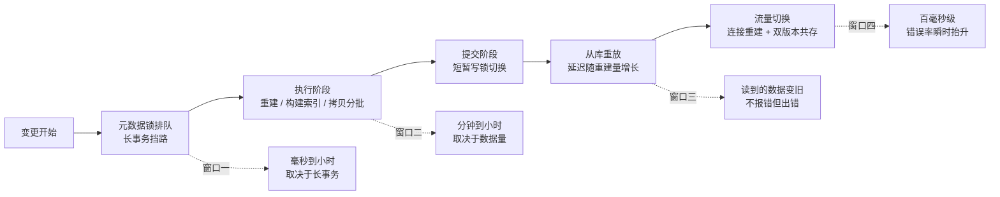
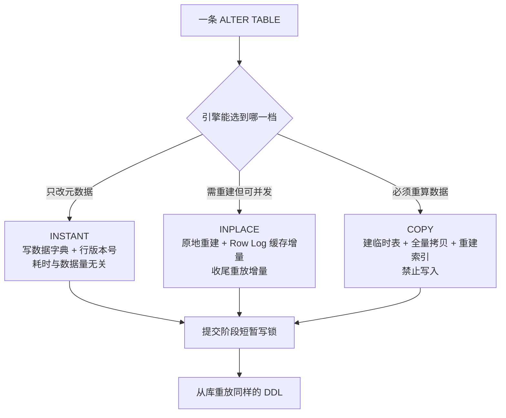
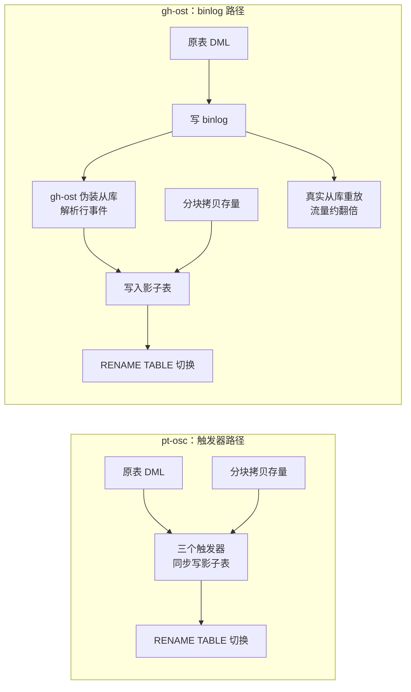
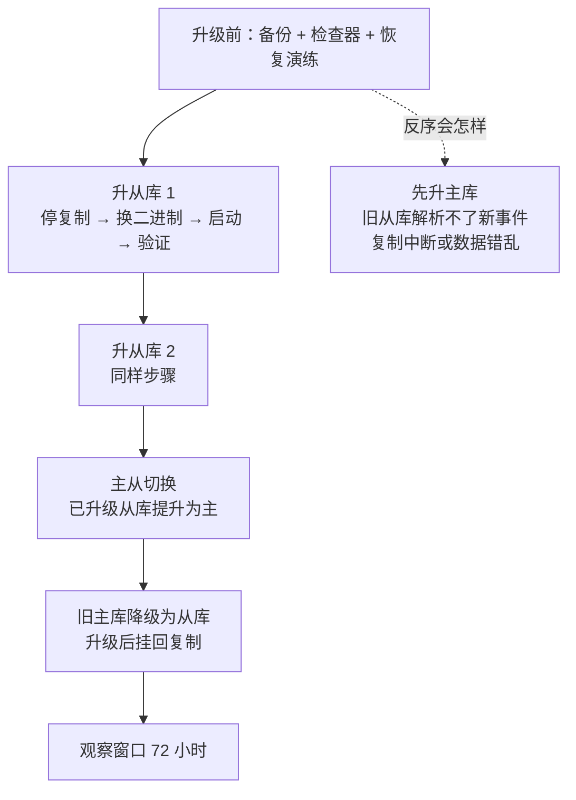
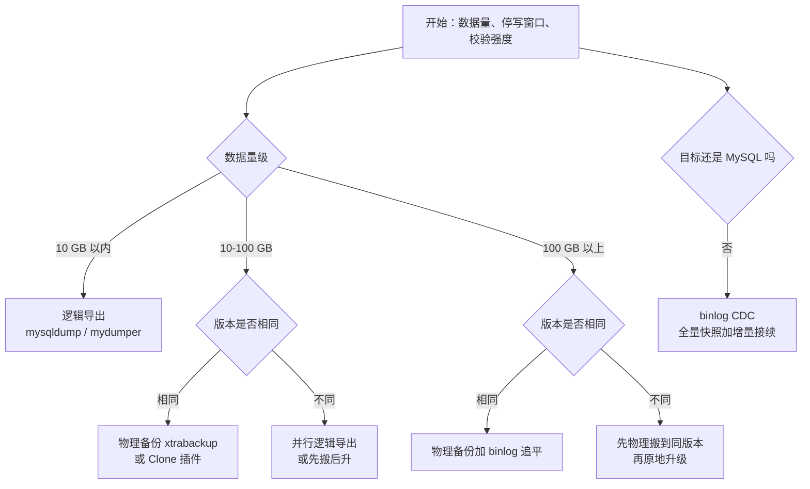

# 09 数据迁移与版本升级——零停机变更的工程实践

**摘要：**

给一张五亿行的订单表加一列，把三个库从 8.0 升到 8.4，把一套自建集群搬到新机房，这三件事在工单系统里叫三个不同的名字，但真正的风险是同一个：线上会出现多长的一段不可用窗口，这段窗口压不下去时最坏停在哪一步。本文按四个骨架展开。第一是 DDL 的三档在线能力，用官方矩阵给出常见变更各属 `INSTANT`、`INPLACE`、`COPY` 哪一档，说明显式声明 `ALGORITHM` 与 `LOCK` 为什么不是可选项，以及 `INSTANT` 那笔被忽略的账，也就是行版本上限与读路径代价。第二是大表变更的三条路径，原生分阶段 `ALTER`、`pt-online-schema-change`、`gh-ost`，给出选型判据，并点出三者共同、最常被漏算的从库延迟。第三是版本升级，核心事实是数据字典升级不可逆，升级只能升不能降，唯一退路是升级前的备份。第四是迁移的四种场景与三种"零停机"实现各自做不到的事，最后落到回滚判据与五个反例。文中的耗时与吞吐数字均按示例推算标注，只用于给方案排序，落地前须在预发实例上实测。

---

## 第 1 章 三个动作，一条共同的时间轴

### 1.1 贯穿案例

设想一个不算极端的电商库：`orders` 表五亿行，净数据一百二十 GB，三个二级索引，写入峰值三千 TPS，读流量靠两个从库分担，复制是异步的。接下来三个月有三件事要做：给表加一个渠道字段并回填历史数据；把 `user_id` 从 `INT` 改成 `BIGINT`；把整套实例从 8.0 升到 8.4 LTS。三个动作分别属于改表、改良数据、改版本，工具链完全不同，但它们共享同一条时间轴：任何一个动作，都有若干瞬间会让写入停下来，而停多久、停几次、停在哪一步，决定了这次变更能不能在业务低峰一个窗口内做完。

把这三个动作放在一起看，工程上真正需要回答的问题只有三个：这会阻塞多少读写、阻塞多久；中途出问题时能不能退回去，退回去的代价是多少；有没有一步做完就再也退不回来的位置，如果有，那一步之前的验证要做多厚。

### 1.2 "零停机"的可操作定义

业界说的"零停机"，几乎没有一次是真的零。更准确的定义是：单次不可用时长小于应用已有的**失败重试预算**。一个配置了连接池、请求超时两秒、失败重试三次的服务，对下层数据库的容忍窗口大致在几百毫秒到两秒之间，超过这个尺度，重试会耗尽、用户会看到错误页、上游会开始熔断。所谓零停机方案，做的是把数据库侧的不可用时间压进这个预算里，而不是消灭它。

这个定义有一个很重要的推论：接受一个上限，比追求零更实际。做变更方案时先写下这个数，比如"切换瞬间允许 500 毫秒不可写、允许 1 秒内 3% 的请求失败"，后面所有的取舍都围绕这个数来做。反过来，如果方案设计者从来没有写下这个数，评审时一定会陷入"到底会不会有影响"这种无法收敛的争论。

### 1.3 四个不可用窗口来源

数据库侧的不可用时间有四个来源，它们的作用方式不同，对应手段也不同。

第一个来源是元数据锁（Metadata Lock，MDL）。任何 DDL 在执行前后都要短暂拿一次写锁，执行期间持有读锁。拿写锁的那一瞬间极短，但只要表上存在长事务或长查询，`ALTER` 就会一直等锁，而排在它后面的普通 DML 也会跟着等（详见 2.6 节）。这是最容易被误判成"数据库卡死"的一类故障。

第二个来源是数据重建。需要重建表的变更，在重建期间要么彻底禁止写入，要么用行日志把期间的变化缓存下来。前者是明确的停写窗口，后者有缓存上限，超过上限直接失败，回滚重来。

第三个来源是复制延迟。主库上的变更执行完不等于结束，从库要把同一条 DDL 或同一批行事件重放一遍。重建型 DDL 在从库上同样要花几十分钟，这段时间读流量打到的是一份落后的数据。

第四个来源是切换瞬间。主从切换、影子表改名、双写切读，这些动作都有一个"两个世界同时存在"的短窗口，期间可能有连接断开、可能有写只落到一边、可能有旧连接继续访问被改名的表。

下面这张图把四个来源放在一条时间轴上，横轴是一次变更的生命周期。



### 1.4 本篇的判据与边界

后续四章各给一套判据：第 2 章判断一次 DDL 属于哪一档、要付多大代价；第 3 章判断大表变更用哪条路径；第 4 章判断升级能不能做、做到哪一步不可退；第 5 章判断迁移场景该用哪种工具。第 6 章把三种"零停机"实现的真实边界摊开，第 7 章给回滚判据，第 8 章收五个反例。

复制链路的延迟口径、`Seconds_Behind_Source` 的读数含义、GTID 集合的比对方法，属于运行期判断，见 [[中间件/MySQL/MySQL架构与底层原理/10 Binlog 与主从复制——数据同步的底层传动链|架构列 10 篇]]；分片之后一次 DDL 要在 N 个库上编排的问题，见 [[中间件/MySQL/MySQL进阶使用/06 分库分表——何时做、怎么做、做了之后怎么办|本列 06 篇]]；切换方案本身的选型（MHA、Orchestrator、InnoDB Cluster 的取舍）见 [[中间件/MySQL/MySQL进阶使用/10 MySQL 高可用方案选型——从主从到 InnoDB Cluster|本列 10 篇]]。本章只回答一件事：这一次动作，能不能在不超出预算的前提下做完。

---

## 第 2 章 DDL 的三档在线能力

### 2.1 三档的本质

InnoDB 的在线 DDL 不是一个开关，是三个成本量级完全不同的实现路径，MySQL 把选择权做成了 `ALGORITHM` 参数，把并发策略做成了 `LOCK` 参数。

`INSTANT` 只改数据字典里的元数据。表的物理数据一个字节都不动，新列的默认值记在字典里，读取那些早于该列定义的行时，服务层按行版本信息把默认值补出来。它的耗时与表大小无关，提交一次字典事务就结束。

`INPLACE` 在同一个表空间里就地重建。它不建独立的临时表，一边读旧数据一边写新结构，同时在内存里维护一块行日志（Online DDL Row Log），把执行期间对原表的 DML 记下来，收尾阶段再重放到新结构上。它允许并发 DML，但重建本身是实打实的全量读写，耗时与数据量成正比，行日志写满则整个语句失败（上限由 `innodb_online_alter_log_max_size` 控制，默认 128 MB）。

`COPY` 走最老的路：建一张符合新定义的临时表，把原表数据逐行拷过去，重建所有索引，期间禁止写入（在 8.0 里默认允许并发读），拷完再做一次改名替换。它是唯一能处理"列类型变了、数据要重算"这类变更的路径，也是最贵的路径。

下图把三档的数据流向画在一起，注意 `INSTANT` 根本没有数据流，`INPLACE` 是原地读写加行日志回放，`COPY` 是两套数据并存后在文件层交换。



三档不是并列的三个选项，而是一个降级序列：`INSTANT` 优先，不行退 `INPLACE`，再不行退 `COPY`。工程上的判断顺序应该是先确认"这一档够不够用"，而不是先写 SQL 再祈祷它落在最快的那一档。

### 2.2 判据表：常见 DDL 属于哪一档

下表按 MySQL 8.0 官方在线 DDL 操作矩阵整理，列的是"引擎支持到哪一档"，不是"你写哪一档"，因为有些操作虽然落在 `INPLACE`，实际仍要重建整张表。

| 变更操作 | 可用档位 | 是否重建 | 并发 DML | 落地判据 |
| :--- | :--- | :--- | :--- | :--- |
| 表末尾加列（8.0.12 起） | `INSTANT`（默认） | 否 | 允许 | 首选；`COMPRESSED` 行格式、含全文索引、临时表不支持 |
| 任意位置加列（8.0.29 起） | `INSTANT` | 否 | 允许 | 8.0.28 及以前只能加在末尾，其他位置退 `INPLACE` 重建 |
| 删列（8.0.29 起默认） | `INSTANT` | 否 | 允许 | 8.0.29 以前默认走 `INPLACE` 并重建整表 |
| 改列默认值、加删虚拟列 | `INSTANT` | 否 | 允许 | 纯元数据；分区表上的虚拟列不支持 `INSTANT` |
| 加 `STORED` 生成列 | `COPY` | 是 | 禁止 | 表达式要由服务层逐行求值，只能全量重算 |
| 重命名列（8.0.28 起） | `INSTANT` | 否 | 允许 | 被其他表的外键引用时只能 `INPLACE` |
| 扩展 `VARCHAR` 长度 | `INPLACE` | 否 | 允许 | 仅在长度前缀字节数不变时成立；跨 256 字节边界要 `COPY` |
| 改列类型、缩小 `VARCHAR` | `COPY` | 是 | 禁止 | 数据要按新类型重算，没有在线路径 |
| 加二级索引 | `INPLACE` | 否 | 允许 | 收尾要等所有访问该表的事务结束，长事务会拖住最后一步 |
| 删索引、重命名索引 | `INPLACE` | 否 | 允许 | 纯元数据操作，代价接近零 |
| 加全文索引 | `INPLACE` | 视情况 | 禁止 | 表上没有用户定义 `FTS_DOC_ID` 时首个全文索引会重建表 |
| 加主键 | `INPLACE` | 是 | 允许 | 聚簇索引重排，开销接近一次全量重写，尽量建表时就定 |
| 删主键 | `COPY` | 是 | 禁止 | 只有 `COPY` 支持单独删主键；换主键可以 `INPLACE` 一步完成 |
| 列 `NULL` 与 `NOT NULL` 互转 | `INPLACE` | 是 | 允许 | 要求严格 `sql_mode`；列中已有 `NULL` 时语句直接失败 |
| 转换表字符集 | `INPLACE` | 是 | 禁止 | 允许并发查询但不允许写入，实质仍是一个停写窗口 |
| 改行格式、`KEY_BLOCK_SIZE` | `INPLACE` | 是 | 允许 | 页结构变了，全表重写不可避免 |
| 加外键约束 | `INPLACE` 或 `COPY` | 否 | 允许 | `foreign_key_checks=0` 时才能 `INPLACE`，否则退 `COPY` |
| 重命名表 | `INSTANT` | 否 | 允许 | 元数据加文件改名，影子表切换的收尾就靠它 |

这张表最值得记住的不是哪一行更快，而是三个"看起来能在线、实际要停写"的位置：转换字符集、加全文索引、加 `STORED` 生成列。它们都能在没有显式 `COPY` 的情况下让写入停下来，只在文档矩阵的"并发 DML"一列里露出一个 `No`。

### 2.3 为什么要显式声明 ALGORITHM 与 LOCK

MySQL 对 `ALGORITHM` 的处理有两种完全相反的行为，这正是本章最实用的一条判据。

不指定 `ALGORITHM` 时，服务器会静默地挑一个能用的档位。8.0.12 起，支持 `INSTANT` 的操作默认就走 `INSTANT`；如果某条 `ALTER` 里混进了一个不支持 `INSTANT` 的子句，整条语句会整体降级到 `INPLACE` 甚至 `COPY`，而语句照样成功返回。也就是说，"我加了列"和"我在十分钟内重建了整张表"可以是同一条 SQL，区别只在它有没有混进别的子句。

显式指定时行为反过来：指定的档位不支持，语句直接报错，不会静默换一条更慢的路。错误形如 `ER_ALTER_OPERATION_NOT_SUPPORTED`（1845）与 `ER_ALTER_OPERATION_NOT_SUPPORTED_REASON`（1846），信息里会明确建议改用 `INPLACE` 或 `COPY`。

这两种行为的组合恰好给出一个可靠的预检手段：把 `ALGORITHM=INSTANT, LOCK=NONE` 写死在语句里，它在生产上要么**秒级成功，要么立刻报错退出**，不存在"以为秒级、实际跑了半小时"的第三种结果。`LOCK=NONE` 的作用同理，它要求引擎保证不出现禁止并发 DML 的阶段，不支持就报错。

```sql
-- 判据写法：两个显式声明一起给，成功即在线，失败即停写，不留模糊地带
ALTER TABLE orders
  ADD COLUMN channel_code VARCHAR(32) NOT NULL DEFAULT '',
  ALGORITHM=INSTANT, LOCK=NONE;

-- 需要多个子操作时拆开执行：混在一条语句里会按最慢的那个子操作整体降级
ALTER TABLE orders ADD COLUMN channel_code VARCHAR(32) NOT NULL DEFAULT '',
  ALGORITHM=INSTANT, LOCK=NONE;
ALTER TABLE orders ADD INDEX idx_channel_code (channel_code),
  ALGORITHM=INPLACE, LOCK=NONE;
```

反过来，在生产上执行"不确定档位"的 `ALTER` 是一种赌博。赌注是这次变更的时长从毫秒变成小时，而裁判是服务器对语句的算法选择逻辑，不是写 SQL 的人。

### 2.4 预检：把"以为"变成"验证"

判定档位不能靠记忆，行数那么多、版本那么杂，正确的做法是在结构相同的探针表上真跑一次。类型变更是否支持某个算法，取决于表与列的定义，不取决于数据量，所以拿一张结构一致的小表验证算法可用性是有效的；只有失败条件（譬如 `NOT NULL` 转换撞上已有的 `NULL` 值）才依赖真实数据分布。

```sql
-- 结构一致、数据极小，只验证算法与锁是否可用
CREATE TABLE orders_probe LIKE orders;
INSERT INTO orders_probe SELECT * FROM orders LIMIT 1000;

-- 类型变更：这条会报 1845，正好证明它没有在线路径，只能安排停写窗口
ALTER TABLE orders_probe MODIFY user_id BIGINT, ALGORITHM=INPLACE, LOCK=NONE;

-- 加索引：这条应当成功，说明它可以在线做
ALTER TABLE orders_probe ADD INDEX idx_channel_code (channel_code),
  ALGORITHM=INPLACE, LOCK=NONE;
```

探针表只能验证算法能不能用，验证不了要跑多久。时长要到真实数据量上估：拿从库或预发实例的一份全量数据跑一次并计时，或者按 2.7 节的速率模型推算。另外三件事值得在预检阶段一并确认。

其一，`INSTANT` 的剩余额度。`INFORMATION_SCHEMA.INNODB_TABLES` 的 `TOTAL_ROW_VERSIONS` 记录已积累的行版本数，`INSTANT_COLS` 记录即时列数，接近上限的表下一次秒级变更会突然变成重建（见 2.5 节）。

其二，表上有没有长事务。`INFORMATION_SCHEMA.INNODB_TRX` 按 `trx_started` 排序，最老的事务决定 DDL 要等多久；`sys.schema_table_lock_waits` 能看到当前谁在等谁。

其三，DDL 会话自己的耐心。`lock_wait_timeout` 默认 31536000 秒，等锁的 `ALTER` 不会自己放弃，只会一直堵住后面的请求，所以要把它改短。

```sql
-- 最多等 30 秒锁，宁可失败重排，也不要把队列堵死
SET SESSION lock_wait_timeout = 30;
```

### 2.5 INSTANT 的隐藏代价

`INSTANT` 把加列从 `O(数据量)` 变成 `O(1)`，这是 8.0 对应用开发最友好的一项改进，但它不是免费的，账记在三个地方。

第一笔账是**行版本上限**。每次 `INSTANT` 加列、删列（同一条语句里加删多个列算一次操作）都会在表上新增一个行版本，`INNODB_TABLES.TOTAL_ROW_VERSIONS` 随之加一，上限是 64。达到上限后，`INSTANT` 加删列会被拒绝，报错信息明确要求改用 `COPY` 或 `INPLACE`，也就是说这张表的下一次结构变更会退化成长时间的重建，而重建完成（或执行一次 `OPTIMIZE TABLE`）后行版本计数归零。这个机制解释了一类难查的现象：季度初的加列都是秒级，某个季度末的同一条加列突然跑了四十分钟。

第二笔账是读路径的补值开销。早于某个列定义写入的行，物理上没有这个列，读取时要按行版本信息把默认值补出来。单个行版本的代价可以忽略，但累积到几十个行版本时，每读一行都要多走几步元数据判断；对于本来就靠覆盖索引避免回表的查询，这点开销会被放大成可见的 CPU 上升。

第三笔账是兼容面。`INSTANT` 在若干表上直接不支持：`ROW_FORMAT=COMPRESSED` 的表、含全文索引的表、系统字典表空间里的表、临时表；含函数索引的列不能 `INSTANT` 删除。8.0.29 起加列时会检查行大小限制，超限报 4092 并建议改用 `INPLACE`/`COPY`；单表列数达到内部表示上限 1022 时报 4158。还有一条容易踩的规则：一条 `ALTER` 里不允许把加列与其他不支持 `INSTANT` 的动作混在一起，混了就整条降级。

版本差异同样要留意。8.0.29 才支持任意位置加列与删列走 `INSTANT`，8.0.28 才支持重命名列走 `INSTANT`；在一个主库 8.0.32、从库还是 8.0.27 的混合拓扑里，同一条 `INSTANT` DDL 到从库会退化成 `INPLACE` 重建，主库秒级完成、从库跑半小时，复制延迟就是这么来的。备份工具也要对齐：`INSTANT` 列依赖数据字典与行版本元数据，物理备份工具对它的支持是逐版本补齐的，上生产前应当拿含 `INSTANT` 列的表做一次备份加恢复演练。

### 2.6 MDL：两端加锁，中间排队

Online DDL 的"在线"是指执行阶段不挡 DML，不是指全程不拿锁。一次 `ALTER` 至少要在两个位置拿元数据写锁：准备阶段，用来确认表定义并登记变更；提交阶段，用来切换新旧结构。执行阶段持有的是元数据读锁，它不挡 DML，但挡其他 DDL。

真正的事故形态出在排队规则上。假设一个长事务已经持有了某张表的元数据读锁，此时一个 `ALTER` 到达，它要写锁，只能等；而元数据锁的等待队列是**先来先服务**且不区分优先级的，紧跟着到达的普通 `SELECT`/`UPDATE` 也要读锁，它们会排在 `ALTER` 后面。于是整个表在 `ALTER` 等到锁之前，对所有请求都不可用。MySQL 8.0 可以在 `performance_schema.metadata_locks` 与 `sys.schema_table_lock_waits` 里看到这条队列，`SHOW PROCESSLIST` 里表现为一片 `Waiting for table metadata lock`。

处置这类故障的顺序是固定的：先找到持有锁的长事务（`information_schema.innodb_trx` 里最老的 `trx_started`，或 `performance_schema` 里没提交的会话），判断能否 kill；能 kill 就 kill 长事务救全站，不能 kill 就 kill 掉排队的 DDL，让队列散开；事后给 DDL 会话设短 `lock_wait_timeout`，避免下一次同样的雪崩。

### 2.7 三档的耗时模型

估算时长时，`COPY` 与需要重建的 `INPLACE` 可以用同一个模型：总耗时约等于表数据量与二级索引数据量之和除以重建速率，再加收尾阶段的增量重放。重建速率取决于磁盘、缓冲池命中率与索引数量，机械盘上的随机写会把速率压到个位数 MB/s，NVMe 上一百 MB 每秒量级并不罕见。

| 档位 | 耗时与什么成正比 | 写阻塞 | 从库影响 | 典型量级（示例推算） |
| :--- | :--- | :--- | :--- | :--- |
| `INSTANT` | 与数据量无关 | 无 | 从库同样秒级（版本一致时） | 毫秒到秒 |
| `INPLACE` 建索引 | 表数据量 | 无（收尾短暂） | 从库重放建索引，延迟同量级 | 百 GB 表约十几到几十分钟 |
| `INPLACE` 重建表 | 表数据加索引数据 | 无（收尾短暂） | 从库重放，延迟同量级 | 百 GB 表约半小时到两小时 |
| `COPY` | 表数据加索引数据，外加两次写放大 | 全程禁止写入 | 从库重放，延迟同量级，期间读不到新数据 | 百 GB 表约一到一个半小时起 |

以上速率均按 30–100 MB/s 的重建带宽推算，只用于给方案排序，不能当作 SLA。真实数字必须在预发实例上量一次；量的时候别只看主库耗时，还要记录从库把这条 DDL 重放完花的时间，那才是业务真正感知到的窗口。

---

## 第 3 章 大表变更的三条路径

### 3.1 原生分阶段 ALTER

第一种路径不借助任何外部工具，靠的是把一次不可在线的变更翻译成若干次可在线的变更。这套方法在业界叫扩展与收缩（expand and contract），三步走。

第一步扩展：只做能在线完成的部分。加新列走 `INSTANT`，加新索引走 `INPLACE`，两者都不阻塞写入。第二步回填：应用双写新旧两处，同时用后台任务按主键区间分批把历史数据填进新列。第三步收缩：读全部切到新列并稳定运行之后，删掉旧列（8.0.29 起可以 `INSTANT` 删除）与不再使用的索引。

这个方法的好处是每一步都可在线、可中断、可重来，代价是会引入一个"新旧两版同时存在"的时间窗，应用必须连续发布两个版本，代码在窗口内要同时兼容两种结构。它只适用于能被分解的变更：加列、加索引、删列、改默认值、扩长度都属于这一类；改列类型、换字符集、加 `STORED` 生成列、删主键没有可分解的在线子步骤，这类变更只能走 `COPY` 或者下面两种影子表方案。

### 3.2 pt-online-schema-change 的触发器路径

Percona Toolkit 里的 `pt-online-schema-change`（下称 pt-osc）是最早被广泛使用的一套方案，思路是建影子表加触发器同步。它先按新定义建一张 `_orders_new`，在原表上建 `INSERT`、`UPDATE`、`DELETE` 三个触发器，把执行期间落在原表的变更同步进影子表；然后按主键区间分块把存量数据拷进影子表；拷完后做一次一致性检查，再用 `RENAME TABLE` 原子地把原表换成影子表，最后删触发器、删旧表。

它的旋钮集中在节奏控制上。`--chunk-size` 与 `--chunk-time` 决定每批拷多少行、每批最多耗时多久；`--max-load` 与 `--critical-load` 读 `SHOW GLOBAL STATUS` 里的负载指标，超过前者就暂停、超过后者就退出；`--max-lag` 保护从库；`--dry-run` 与 `--print` 用来先在预发环境看清楚它要执行什么。

它的前提条件比宣传材料上写的多。表上必须有主键或唯一索引，否则分块没有依据，工具会直接拒绝；原表已经存在触发器时，必须加 `--preserve-triggers`，并依赖 MySQL 5.7.2 之后支持同表同类型多触发器的能力；有外键时要用 `--alter-foreign-keys-method` 处理，否则改名会失败或留下悬空引用；任务中断后不能续跑，只能从头再来。

它的账记在触发器和切换两步。每个 DML 要在三个触发器里各多执行一次逻辑，写入密集的表上这部分开销不可忽略，行锁持有时间也变长；切换阶段要一个元数据写锁，表上只要有长事务，`RENAME TABLE` 就停在最后一步等锁，工具可能判定负载超标退出，前面几小时的拷贝白做。

### 3.3 gh-ost 的 binlog 路径

GitHub 开源的 `gh-ost` 换了一条路：不建触发器，改为读 binlog。它把自己伪装成一个复制从库，向主库发起复制连接，一边分块拷贝存量数据，一边把 binlog 里碰到的行事件应用到自己的影子表上，等影子表追上主库后就切换。

这条路换来的是可观测与可控。`--max-lag-millis` 与 `--throttle-control-replicas` 直接看从库延迟，超阈值就暂停拷贝；`--serve-socket-file` 允许运行期间通过 socket 动态调速；`--postpone-cut-over-flag-file` 让工具在"数据已经同步完"之后挂在那里不切，等人挑一个合适的时间点放行；`--panic-flag-file` 一键中止。它还有一条别的方案没有的能力：中断后可以从 `_ghc` 表记录的位点续跑，不必从头拷。

代价是前置条件更硬。主库必须开启 binlog 且 `binlog_format=ROW`、`binlog_row_image=FULL`，否则解析不出完整的行镜像；连接账号需要复制相关权限；在从库上跑还要 `log_slave_updates`；影子表的写入同样产生 binlog，复制链路要能承担这部分额外流量。切换阶段同样需要一次元数据写锁，长事务一样会让它卡在最后一步。

下图把两条路径放在一起对比，触发器方案在每次 DML 上付代价，binlog 方案在复制链路上付代价。



### 3.4 选型判据

| 维度 | 原生分阶段 `ALTER` | pt-osc | gh-ost |
| :--- | :--- | :--- | :--- |
| 对原表的额外写入 | 无 | 每个 DML 多三次触发器执行 | 无触发器，但多一路 binlog 解析 |
| 原表已有触发器 | 不冲突 | 需 `--preserve-triggers`，否则不可用 | 不冲突 |
| 前置条件 | 变更可分解为在线子操作 | 表有主键或唯一索引 | `binlog_format=ROW` 且 `binlog_row_image=FULL` |
| 中断后能否续跑 | 天然可续（每一步独立） | 不能，需重来 | 能从位点续跑 |
| 限速与暂停 | 靠回填任务自身控制 | `--max-load`、`--chunk-time` | `--max-lag-millis`、socket 动态调速、挂起切换 |
| 额外磁盘 | 无（`INSTANT` 不产生副本） | 约一倍表数据 | 约一倍表数据，另加 `_ghc` 元数据 |
| 切换动作 | 无（每步本身就是最终状态） | `RENAME TABLE` 加短锁 | `RENAME TABLE` 加短锁 |
| 适用变更 | 加列、加索引、删列、扩长度 | 任意可重建的变更 | 任意可重建的变更 |
| 团队成本 | 要改应用、发两版 | 工具成熟，参数多 | 原理多一层，排障要看 binlog 位点 |

判断顺序建议固定成四问：变更能不能拆成在线子步骤，能就原生分阶段，这是唯一不需要额外磁盘、不引入第三方组件的路径；拆不开看表有没有主键或唯一索引，没有则两种影子表工具都不可用，只能选窗口做 `COPY`；都能用时看写入压力，触发器带来的延迟在超高并发表上比 binlog 解析更难接受；最后一问是团队排障能力，选熟悉的那一个。

### 3.5 三者的共同代价：从库延迟

三条路径在讨论时几乎都只谈主库：主库的 IO 涨了多少、`Threads_running` 有没有超阈值、切换锁等了多久。但真正被漏算的是**从库延迟**，而它恰恰是变更期间最脆弱的一环。

原因有三层。第一层，所有方案的额外写入都要进 binlog。分块拷贝是 `INSERT ... SELECT`，在 `binlog_format=ROW` 下会以行事件写到从库；影子表的每一次同步写入也产生行事件；gh-ost 读 binlog 再写影子表，等于把同一份变更在复制链路上放大成两倍流量。第二层，从库重放 DDL 无法并行。大表 DDL 在从库是一次完整重建，这期间从库的 SQL 线程被这个"大事务"占住，后面的行事件全排队。第三层，混合版本拓扑会把差异放大，8.0.29 的 `INSTANT` 变更在 8.0.27 的从库上退化成重建，主库秒级、从库半小时。

这三层叠起来的结果是：主库一切正常，从库延迟从半秒爬到二十分钟，只读流量全部打在旧数据上。业务侧看到的现象不是报错，而是"刚下的单查不到"，比报错更难定位。

缓解手段有四条，按有效性排序。把变更安排在业务低峰，让延迟的绝对值不落在用户路径上；给 gh-ost 设 `--max-lag-millis` 与真实从库列表，让它主动降速；变更前把从库延迟的告警阈值临时调高，并让值班同学知道这是预期；如果读流量对延迟零容忍，就把这段时间的读全部压到主库或走缓存，接受主库读压力上升的代价。

### 3.6 限速旋钮怎么设

`--max-load` 与 `--critical-load` 常被误当成限速开关，它们其实是熔断阈值：前者触发暂停，后者触发退出，都不控制速度。真正决定速度的是 `--chunk-size` 与 `--chunk-time`。

一个可用的起步配置是 `--chunk-size=1000`、`--chunk-time=0.5`、`--max-load=Threads_running=30`、`--critical-load=Threads_running=200`、`--max-lag-millis=1500`，并显式给出 `--throttle-control-replicas`。观察两条曲线：拷数据期间 `Threads_running` 稳定在阈值一半以下，从库延迟没有单调上升的趋势；延迟持续爬升时先减半 `--chunk-size`，而不是调 `--max-lag-millis`，后者的作用是刹车，不是减负。

---

## 第 4 章 版本升级：只能升，不能降

### 4.1 不可逆点：数据字典升级

MySQL 8.0 把表定义、账号、列信息从散落的 `.frm` 文件收进了一个统一的数据字典（Data Dictionary，DD），存放在 `mysql` 系统表空间里，由 InnoDB 管理。服务器启动时会比对字典版本与二进制版本，发现字典较旧就自动执行升级；8.0.16 起 `mysql_upgrade` 不再需要，改由 `--upgrade` 选项控制升级粒度（`AUTO`、`FORCE`、`MINIMAL`、`NONE`）。

这次升级写的是系统表空间里的字典结构与系统表定义，属于单向迁移：旧版本的二进制读不懂新版本的字典，把二进制文件换回去再启动，服务器会拒绝启动或者启动后表全部不可见。这就是本篇最重要的一个**不可逆点**。回退二进制不等于回退数据，唯一能把版本退回去的路径是升级前的备份或存储快照。

官方支持的回退只有一种：同一发行系列内的小版本降级，譬如 8.0.41 回到 8.0.37，还要满足没有使用新版本特性、没有执行过只在新版本支持的操作等前提。跨系列的升级没有官方降级路径，5.7 到 8.0、8.0 到 8.4 都属于这一类。

升级路径本身也有约束。8.0.37 到 8.4.x 可以直接原地升级、逻辑导出导入或者通过复制滚动升级；5.7 到 8.4 不允许跳系列，必须先升到 8.0 再升 8.4；克隆插件只支持同系列内使用。这些限制决定了升级方案的第一条判据：先确认起点与终点在不在一条允许的路径上，再谈用哪种方法。

### 4.2 8.4 的五个门槛

从 8.0 升到 8.4，真正会让人在升级后第二天发现业务异常的门槛有这样几项，它们都不在"能不能启动"的层面，而在"启动之后行为变了"的层面。

| 门槛 | 具体变化 | 不处理的后果 | 检测与处置 |
| :--- | :--- | :--- | :--- |
| `mysql_native_password` | 8.0.34 起标记弃用，8.4 默认不再加载，可用 `--mysql-native-password=ON` 临时打开，9.0 移除 | 使用该插件的账号升级后无法登录，应用连接全部失败 | `SELECT user,host,plugin FROM mysql.user`；提前改成 `caching_sha2_password` 并验证驱动支持 |
| `default_authentication_plugin` | 8.0.27 起弃用，8.4 移除，改由 `authentication_policy` 控制 | 参数文件里有这一项时启动失败 | 配置里删掉该项，改用 `authentication_policy` |
| `utf8mb3` 字符集 | `utf8` 是 `utf8mb3` 的别名，官方已弃用并推荐 `utf8mb4` | 新表继续生成本应淘汰的字符集，未来升级再次受阻 | 统计 `information_schema.columns` 里 `utf8`/`utf8mb3` 的列，按第 2 章的重建路径逐步迁移 |
| 新增保留字 | `RANK`、`ROW_NUMBER`、`GROUPS`、`WINDOW`、`RECURSIVE`、`LATERAL`、`CUME_DIST` 等 | 用它做列名、表名、别名的 SQL 报语法错 | `checkForServerUpgrade` 会列出冲突对象，逐个加反引号或改名 |
| 已移除的工具与函数 | `mysqlpump`、`mysql_upgrade`、`mysql_ssl_rsa_setup`、`WAIT_UNTIL_SQL_THREAD_AFTER_GTIDS()` | 备份脚本、初始化脚本、监控脚本调用即失败 | 全量搜运维脚本，换成 `mysqldump`、`WAIT_FOR_EXECUTED_GTID_SET()` 等替代品 |

还有一类门槛不在表里，影响面却最大：8.4 调整了一批默认值。`innodb_adaptive_hash_index` 由 `ON` 改 `OFF`，`innodb_change_buffering` 由 `all` 改 `none`，`innodb_io_capacity` 由 200 改 10000，`innodb_flush_method` 在支持的系统上改 `O_DIRECT`，`innodb_log_buffer_size` 由 16 MB 提到 64 MB，`temptable_max_ram` 改为内存的 3%（1 到 4 GB 之间），`innodb_numa_interleave` 由 `OFF` 改 `ON`，组复制的 `group_replication_consistency` 由 `EVENTUAL` 改 `BEFORE_ON_PRIMARY_FAILOVER`。

这些默认值单独看都合理，叠在一起会改变整机性能曲线：自适应哈希索引关掉后等值点查延迟可能上升，IO 容量从 200 跳到 10000 后刷脏节奏完全不同，临时表不再走 mmap 也改变了大排序的落盘行为。所以升级验证不能只看服务起来了、SQL 能跑，要拿升级前的基线逐项对照，尤其是 P99 延迟与 `Threads_running` 的分布。

### 4.3 升级前的检查清单

检查分四层，从表到应用逐层收窄。

第一层是表的兼容性。`mysqlcheck -u root -p --all-databases --check-upgrade` 会检查所有表的存储格式与新版本是否兼容，并顺带做一致性检查。它要读完所有表，大库上耗时以小时计，必须放进维护窗口，不能在生产高峰跑。

```bash
# 表级兼容性检查：8.4 目标下先确认没有旧格式表、损坏表
mysqlcheck -u root -p --all-databases --check-upgrade
```

第二层是服务器与配置的兼容性。官方的升级检查器在 MySQL Shell 里，能一次性列出保留字冲突、废弃特性、账号插件、配置项、分区与索引的问题，输出还可以存成 JSON 留档。

```bash
# 官方升级检查器：8.0 升 8.4 时把 target-version 换成 8.4
mysqlsh -- util checkForServerUpgrade root@127.0.0.1:3306 \
  --target-version=8.4 --output-format=JSON --output-file=/tmp/upgrade-84.json
```

第三层是复制拓扑。要确认 GTID 是否开启、`enforce_gtid_consistency` 与 `gtid_mode` 的先后顺序、复制账号的认证插件、半同步插件是否安装、有没有 `replicate-*` 过滤规则会在版本变化后失配。5.7 升 8.0 的混合期还有一个细节：5.7 主库不认识 `caching_sha2_password` 的账号，复制账号必须暂时保持 `mysql_native_password`，等全部实例升到 8.0 再改。

第四层是应用侧。驱动的版本是否支持 `caching_sha2_password`；ORM 或手写 SQL 里有没有把新增保留字当别名用；`ONLY_FULL_GROUP_BY` 是否已在 5.7 时代就打开；`ZEROFILL`、`utf8` 别名、`sql_mode` 的差异是否影响结果；有没有依赖 8.4 已移除函数的存储过程或定时任务。

清单跑完还要做一件事：验证备份。升级前的全量备份必须做一次恢复演练，确认恢复出来的实例能启动、能查询、能被应用连上，才算这份退路存在。

### 4.4 滚动升级的顺序与验证点

复制拓扑的升级顺序**只有一种正确写法**：先升所有从库，最后处理主库。

原因是复制兼容性的方向性。MySQL 支持较旧的源向较新的副本复制，不支持较新的源向较旧的副本复制，因为旧副本可能解析不了新版本产生的事件。如果先升主库，从库立刻会处在"用旧版本应用新版本事务"的位置，轻则复制中断，重则写入脏数据。官方的复制拓扑升级文档也明确要求先升全部副本，再升源库。

下图是标准顺序：从库逐个升级并验证，然后通过一次切换把主库角色转移到已升级的从库，最后把旧主库升级后挂回。



每一步都有明确的验证点，缺一步就不要进入下一步。

| 步骤 | 关键动作 | 验证点 |
| :--- | :--- | :--- |
| 升级前 | 全量备份并恢复演练、跑两个检查器、记录性能基线 | 恢复实例可启动可查询；检查器无阻断项；基线数字留档 |
| 升从库 | 停复制、停实例、替换二进制、启动、等字典升级完成、开复制 | `SELECT @@version` 符合预期；`SHOW REPLICA STATUS` 两个线程为 `Yes`；错误日志无字典升级报错 |
| 复制追平 | 观察该从库与主库的位点差 | `Seconds_Behind_Source` 归零且稳定；GTID 差集为空；延迟曲线没有长期抬升 |
| 主从切换 | 把读流量与写入切到已升级的从库，旧主只读 | 应用错误率无抬升；`read_only` 状态正确；新主的半同步状态正常 |
| 旧主升级 | 旧主停写、升级、作为从库挂回 | 旧主能作为新主的副本正常追平；`Replica_IO_Running` 与 `Replica_SQL_Running` 为 `Yes` |
| 观察窗口 | 不改任何配置，只观察 | 慢查询数量、P99 延迟、复制延迟、`Threads_running`、错误日志里的弃用告警 |

有两个细节值得提前写进方案。8.0.23 之后复制相关语句改了名字，`CHANGE MASTER TO` 变成 `CHANGE REPLICATION SOURCE TO`，`START SLAVE` 变成 `START REPLICA`，`SHOW SLAVE STATUS` 变成 `SHOW REPLICA STATUS`，旧名字在 8.0 里作为别名保留，但混用会让脚本在不同版本上行为不一致，升级期间应当统一成新名字。另一个是升级后要重算统计信息，版本变化带来的优化器改动会让部分执行计划改变，`ANALYZE TABLE` 加一轮慢查询复核，比坐等业务报异常成本低得多。

### 4.5 观察窗口与回退

升级完成不等于风险结束。版本变化带来的问题往往在业务高峰才显形，观察窗口按 72 小时安排，重点盯四项：慢查询数量与 P99 延迟是否偏离基线、复制延迟是否趋势性抬升、错误日志有没有新的弃用告警、连接池错误率与重连次数。

确认必须回退时，可选手段其实很少：恢复升级前的备份或快照，数据退到备份点，中间写入用 binlog 补回或接受丢失；问题只在应用侧且新版本兼容旧逻辑时，回滚应用而不是回滚数据库；同系列小版本降级只在少数前提下成立。方案里必须写明回退需要多久、会丢多少数据，这两个数在事故现场没有时间现算。

---

## 第 5 章 数据迁移的四类场景

### 5.1 四类场景与三个指标

把迁移当成一件事会混乱，它至少有四种形态，工具链、风险点、可用窗口都不同：同版本换机器、跨版本升级、跨引擎转换、跨库或跨产品搬运。判断一个迁移任务怎么做，先看三个指标：数据总量、能接受的停写时长、需要的校验强度；任意一个极端，方案就会被推到固定位置。

### 5.2 同版本换机器

这是最常见也最简单的一类：版本不变，把库从旧硬件、旧机房或旧云搬到新位置。三件事决定方案。

数据量决定用物理还是逻辑。物理备份直接复制数据文件，恢复速度接近磁盘带宽，百 GB 以上的库基本没有别的选择；逻辑导出要经过"读行、拼 SQL、写文本、再解析、再插入"，同一份数据要多走两遍且单线程，规模一大就不可接受。

一致性靠备份点加 binlog 追平。物理备份恢复出来的实例停在一个确定的日志序列号（LSN）上，备份期间产生的新写入要靠 binlog 从那个点补上，补齐之后再切流量。这条路径必须配一次复制并验证追平，不能假设恢复完就完事。

工具版本要匹配。`xtrabackup` 与 MySQL 的版本是成对发布的，用 8.0 的工具备 8.4 的库通常不被支持；克隆插件要求发起端与接收端版本一致、页大小一致、`lower_case_table_names` 一致，且接收端必须是空实例。这些限制让物理方案在"跨大版本"的场景里直接失效，只能退回逻辑导出或者"先物理搬到同版本、再原地升级"。

### 5.3 跨版本迁移

跨版本迁移其实不是一种独立的搬运方式，而是"搬运"与"升级"两个动作的组合，组合顺序有两种。

第一种是先搬后升：把数据用物理方式恢复到与源同版本的新实例，验证数据完整，再在这个新实例上做原地升级或滚动升级。它适合目标环境可控、能接受多花一轮升级时间的场景，也是跨大版本时唯一能利用物理备份的顺序。

第二种是直接逻辑导出到新版本实例。它把搬运与升级合并成一步，代价是全程逻辑吞吐，只在数据量小、或者顺便要重建表结构与字符集时才划算。

无论哪种顺序，校验都要做两次：搬完之后比对一次，确认搬运无损；升级之后再比对一次，确认升级没有改变数据语义。类型转换、排序规则变化、`ZEROFILL` 之类的差异不会在"表能查"这一步暴露，只会在业务比对结果时暴露。

### 5.4 跨引擎迁移

MyISAM 到 InnoDB 的转换在今天的存量系统里仍然常见，尤其是十几年前建的分析表与日志表。转换本身只有一条路：`ALTER TABLE t ENGINE=InnoDB, ALGORITHM=COPY`，整表重建，期间停写；或者导出后把建表语句里的引擎改掉再导入，好处是可以并行、可以在目标实例上分批做。

转换前要确认四件事。第一，索引前缀长度限制变了，InnoDB 的索引键长度上限与 MyISAM 不同，超长的 `VARCHAR` 前缀索引可能建不起来。第二，全文索引的行为不同，MyISAM 的全文索引与 InnoDB 的全文索引在分词、最小词长、停用词上都有差异，依赖全文检索的功能要重新验证。第三，应用对表锁的假设失效，MyISAM 是表级锁，很多老代码靠"整表锁住再改"保证逻辑正确，换到行锁之后并发行为变了，原来不会出现的并发问题会出现。第四，`COUNT(*)` 不再有缓存，MyISAM 保存精确行数，InnoDB 要扫描索引，把这个查询当监控指标用的地方会突然变慢。

转换的窗口判据很直接：能不能接受一次与表大小成正比的停写。不能接受就只能分批搬（按主键区间把数据搬到新表，应用双写一段时间），但跨引擎没有在线 DDL 路径，分批搬的复杂度要自己承担。

### 5.5 跨库迁移

从 MySQL 搬到 Elasticsearch、ClickHouse、Kafka、对象存储，或者搬到另一个厂商的数据库，工具链从"备份恢复"换成了"变更数据捕获"（Change Data Capture，CDC）。做法是订阅 binlog，把行事件按主键合并后写入目标系统；全量部分用一次快照导出，增量部分从快照对应位点接上，之后长期运行。

这条路的三个坑都在细节里。位点对齐：必须先记录位点再导出全量，或者导出的快照本身带位点信息，否则全量与增量之间会有一段空白或重叠。无主键表：行事件里没有能唯一定位一行的键，目标端无法做幂等覆盖，只能全列匹配或者放弃这张表，迁移前要把无主键表清出来。元数据：`binlog_row_metadata=FULL` 能让行事件带上列名，否则下游只能靠列序号猜字段，一旦加列就会错位；这个参数在 8.0 里可配，值得在迁移前打开。

与前三类不同，跨库迁移通常没有"结束"这个时刻：目标系统要长期与源库保持一致，校验便从一次性动作变成持续任务，定期比对行数与抽样内容，发现漂移就重放那一段 binlog。这一条不写进方案，半年后没人知道那套同步链路还在跑。

### 5.6 工具判据与量级分界

| 工具 | 机制 | 并行能力 | 一致性手段 | 适用量级（示例推算） | 主要代价 |
| :--- | :--- | :--- | :--- | :--- | :--- |
| `mysqldump` | 逻辑导出 SQL 文本 | 单线程 | `--single-transaction` 快照 | 10 GB 以内 | 导出与导入都慢，索引逐条维护 |
| `mysqlpump` | 逻辑导出，表级并行 | 多线程 | 与 `mysqldump` 同源 | 已不推荐 | 8.0.34 起弃用，8.4 已移除 |
| `mydumper` / `myloader` | 逻辑导出，分块并行 | 多线程 | `--trx-consistency-only` | 10 GB 到数百 GB | 一致性窗口依赖参数，需自行确认 |
| `xtrabackup` | 物理热备，复制数据文件 | 受磁盘与网络带宽限制 | 备份点 LSN 加 binlog 追平 | 百 GB 到 TB 级 | 版本必须匹配，需要等量额外空间 |
| Clone 插件 | 物理克隆到另一个实例 | 受网络带宽限制 | 克隆时点 | 同系列内、百 GB 级 | 接收端必须为空实例，不能跨系列 |
| binlog CDC | 订阅变更持续同步 | 按分片并行 | 全量快照加位点接续 | 任意，适合持续同步 | 需要目标端幂等与位点管理 |

量级的分界可以用三个数粗略记住：十 GB 以内，逻辑单线程够用，方案越简单越好；十 GB 到百 GB，要么并行逻辑，要么物理；百 GB 以上，物理备份加 binlog 追平是**唯一现实的选择**，逻辑方案的时间成本会超过维护窗口。这些数字是经验量级，具体还要看行宽、索引数量与目标端写入能力。

下图是选工具的决策路径，先看量级，再看版本关系，最后看目标系统是否还是 MySQL。



### 5.7 一致性：`--single-transaction` 的前提与位点参数

逻辑备份用得最多的是 `mysqldump`，它的一致性依赖 `--single-transaction`。这个参数的作用是在导出开始时开一个可重复读事务，用一致性快照读数据，整个过程不锁表；代价是它只对 InnoDB 有效，对 MyISAM 表无效，而且它保护不了 DDL——导出进行到一半有人给表加了列，快照里的表定义与数据就对不上了。所以迁移窗口内必须冻结 DDL，这一条要写进变更单。

位点参数决定了导出之后能不能接上复制。8.0.26 起 `--source-data` 取代旧名字 `--master-data`，把导出时点的 binlog 文件名与位置以注释形式写进 SQL 文件；旧名字在 8.0 里作为别名保留，跨版本环境统一用新名字更稳。取值为 1 时直接生成 `CHANGE REPLICATION SOURCE TO` 语句，取值为 2 时写成注释，便于人工核对后决定是否启用。

```bash
# 一致性导出：InnoDB + 窗口内冻结 DDL，并把位点写进文件头
mysqldump -h source -u backup -p \
  --single-transaction --source-data=2 \
  --set-gtid-purged=OFF --routines --triggers --events \
  --default-character-set=utf8mb4 \
  ecommerce orders > orders.sql
```

GTID 模式下还要处理 `--set-gtid-purged`。默认值 `AUTO` 在源库开了 GTID 时会往导出文件里写入 `SET @@GLOBAL.GTID_PURGED`，导入到一个已有 GTID 历史的实例上会直接报错；迁移到新实例一般显式设为 `OFF`，或者确认目标实例是干净的空实例再保留。

物理备份的一致性口径不同：备份复制的是不断变化的数据文件，一致性由恢复阶段的 `--prepare` 保证，它用 redo 日志把数据文件回滚到同一个一致点，`xtrabackup_checkpoints` 里的 `to_lsn` 就是恢复点，对应的 binlog 位置要单独记下用于追平。

### 5.8 校验的三级

迁移最容易出的事故不是搬不过去，而是搬过去了但少了一部分或者错了一部分，而且没人发现。

校验分三级。第一级比行数与主键集合，速度快，能发现漏表、漏行、重复行，发现不了内容错误。第二级按主键取模抽样，比对关键列的哈希，能在可接受的时间内覆盖大部分数据。第三级做全量校验，逐行计算校验和，成本最高，只在关键库上做，并且放在低峰。

校验的时机同样重要：全量搬完后一次，切流前一次，切流后的观察期内再一次。三次对象不同，第一次校验搬得对不对，第二次校验追平后一致不一致，第三次校验切过去之后有没有新的写入丢在一边。

`CHECKSUM TABLE` 不适合跨版本跨引擎的比对，它对行格式与存储细节敏感；靠谱的做法是抽出主键与关键列自己算哈希，或者用 `pt-table-checksum` 这类按块比对的工具。**只比行数是形式主义**，行数一致而内容错位的情况在真实事故里并不罕见。

---

## 第 6 章 "零停机"的三种实现与它们做不到什么

### 6.1 主从切换

主从切换是所有方案里最成熟的一种：平时维护一个与主库同步的副本，需要变更时把副本提升为主库，把流量切过去，适合换机器、换机房、换版本这类整套环境换掉的场景。

它的窗口由三部分组成：决定切换、副本追平与提升、流量切换与连接重建。前两项可以压到秒级，第三项取决于接入层是 VIP、DNS 还是客户端多地址，DNS 缓存可能把窗口拉到分钟级。

它做不到三件事。切换瞬间必然有连接中断，除非客户端层做了多地址与自动重试；异步复制下存在数据丢失窗口，主库上已提交但未传到从库的事务会消失，半同步只能把这个窗口缩小到已确认但未应用的范围；多实例场景无法原子切换，一个业务涉及两个库时，两次切换之间必然有一个不一致的瞬间。

判据是两个数：恢复时间目标（RTO）与恢复点目标（RPO）。方案里要写明这次切换允许丢多少秒的写入，超过这个数就必须先等复制追平再切。

### 6.2 双写迁移

当目标结构变化大到复制搬不动时——换分片规则、换主键、目标库结构不同——只能让应用同时写两边。步骤在 [[中间件/MySQL/MySQL进阶使用/06 分库分表——何时做、怎么做、做了之后怎么办|本列 06 篇]] 里给过，这里只谈它做不到什么。

双写是两套系统，不是一次事务，所以它做不到强一致。同一行在两边被并发修改时，最终留下哪一份取决于写入顺序与冲突处理策略；唯一键冲突、删除与插入乱序、自增主键不一致，都会产生需要人工兜底的脏数据。可以做的收敛手段有三条：按主键归属确定唯一写方，让某一行永远只从一个方向写；带版本号或时间戳比较，旧版本不覆盖新版本；写操作做成幂等，重试不会产生重复行。

它还做不到没有成本。双写期间写放大一倍，两套存储的容量与备份成本同时存在，代码里要长期保留双写分支与开关；项目结束后如果没人清理，这套双写会变成永久性的技术债，半年后接手的人不敢删。

### 6.3 影子表切换

pt-osc 与 gh-ost 的切换动作都是 `RENAME TABLE`，原子操作，正常在毫秒级完成，所以不可写窗口看起来几乎为零；但它做不到的事情同样明确。

第一，它处理不了不兼容的变更。删列、改类型、改语义这类变更，切换之后旧代码立刻失效，必须靠应用侧"扩展与收缩"两段式发布来过渡，工具只负责把表换成新结构，不负责让两个版本的代码都能跑。

第二，切换仍然要一次元数据写锁。表上有长事务时，`RENAME TABLE` 会等锁，等待期间所有请求排队，这与第 2 章讲的 MDL 雪崩是同一个机制；工具能做的只是设一个切换超时并在超时后放弃，把问题留给人。

第三，切换会让连接层的元数据缓存失效。在线连接里缓存的预编译语句对应的是旧表定义，切换后第一次执行可能报出需要重新预编译的错误，应用如果没处理这个错误码，表现就是切换后一批请求失败。

第四，表级授权不会跟着改名走。官方文档写明：为旧表单独授予的权限不会迁移到新名字，需要手工补。只给某张表授过权的系统，切换后会突然出现权限错误，而这个问题在预发环境往往测不出来，因为预发用的是全局权限。

### 6.4 三种实现的能力对照

| 实现 | 不可写窗口 | 数据风险 | 适合的变更 | 主要成本 |
| :--- | :--- | :--- | :--- | :--- |
| 主从切换 | 秒级 | 异步复制有丢失窗口 | 换机器、换机房、换版本 | 需要一套完整冗余实例 |
| 双写迁移 | 逻辑上为零 | 冲突需要收敛，可能产生脏数据 | 换分片规则、结构差异大 | 写放大一倍、代码长期挂双写 |
| 影子表切换 | 百毫秒级 | 增量同步延迟，切换锁等待 | 单表结构变更 | 额外一倍磁盘与主库负载 |

把三种实现的窗口与成本放在一起看，会得到一条并不令人愉快的曲线：窗口从分钟压到秒靠冗余，从秒压到亚秒靠应用侧的重试与幂等，再往下压只能改协议语义。这意味着**零停机的极限不在数据库**，而在应用对失败与延迟的容忍度；数据库侧能做的，是把不可用时间压进应用已有的预算里，并让这段窗口**可观测、可回滚**。

---

## 第 7 章 回滚的判据

### 7.1 能回滚的

回滚能力不是二元的，它按对象分成四档，每一档的代价与前提都不同。

应用版本可以回滚，前提是旧版本代码仍能读写当前表结构。这条前提在扩展与收缩的两段式发布里天然成立，在删列、改类型的变更里立刻失效，所以第 2 章强调把不可逆动作放到最后一步。

未切换的工具任务可以回滚。gh-ost 在切换前中止，影子表与 `_ghc` 表还在，删掉即可；pt-osc 中止后原表未被改名，删掉影子表与触发器就恢复原状。这是三种方案里最安全的一段窗口，代价只是浪费已拷贝的时间与磁盘。

索引的增删可以回滚，代价是重建时间；只改元数据的变更大多也能来回改，譬如加列后删列、改默认值、加删虚拟列。但删列会丢数据，若加列之后已经写入业务数据，回滚就等于丢那部分数据，此时它已不是可逆动作。

### 7.2 不能回滚的

数据字典升级是第一类不可逆，跨系列升级后旧二进制无法读新字典，退回去只能用备份。

`DROP`、`TRUNCATE`、无界 `DELETE` 是不可逆的第二类，与变更方案无关，却常出现在迁移收尾：新库验证完就把旧库删掉，这一步执行后，之前所有双写与校验都失去兜底。

切流之后的停旧写是不可逆的第三类，旧库从此只能作为历史快照，任何回退到旧库的诉求都会丢掉停写之后的新数据，所以它必须放在验证通过、观察窗口结束之后，且单独审批。

### 7.3 回滚成本与演练

回滚的成本用两个数衡量：**恢复时间与数据缺口**。恢复时间取决于备份形态，物理备份恢复到可用通常以十分钟到小时计，逻辑备份与数据量成正比且慢得多；数据缺口取决于备份点与故障点隔了多久，以及这段时间的 binlog 是否完整。

方案里必须写出这两个数，并做一次演练。演练的意义不是测能不能恢复，而是测出真实耗时——解压、`--prepare`、追平 binlog、应用连接验证，每一步都比预想的长；没有演练过的回滚方案，在事故现场只能算一个愿望。

| 动作 | 可回滚性 | 回滚代价 | 前提 |
| :--- | :--- | :--- | :--- |
| 应用版本发布 | 可 | 分钟级 | 旧版本兼容当前表结构 |
| gh-ost / pt-osc 未切换 | 可 | 删除影子表与触发器 | 切换动作尚未开始 |
| 加索引 / 删索引 | 可 | 重建索引的时长 | 磁盘与时间预算足够 |
| `INSTANT` 加列后删列 | 部分可 | 丢失已写入的数据 | 该列尚无业务数据 |
| 改列类型 | 部分可 | 重建整表，超出旧类型范围的值会丢 | 旧类型容得下现有数据 |
| 转换字符集 | 部分可 | 重建整表，四字节字符回不到 `utf8mb3` | 目标字符集能表示全部数据 |
| 数据字典升级（跨系列） | 不可 | 恢复备份，回到升级前 | 有升级前备份与恢复演练 |
| `DROP` / `TRUNCATE` / 无界 `DELETE` | 不可 | 恢复备份并补 binlog | 备份与 binlog 完整 |
| 双写迁移中停旧写 | 不可 | 丢失停写后的新数据 | 无 |

---

## 第 8 章 五个反例

### 8.1 直接在主库上 ALTER 大表

最常见的形态是：开发写了一条 `ALTER TABLE orders ADD COLUMN ...`，评审时没人问档位，执行时也没带 `ALGORITHM`，语句在业务高峰跑起来，落在 `COPY` 上，写入被挡住四十分钟。更糟的变体是语句本身很快，但表上有一个长事务，`ALTER` 排队等锁，把后面所有请求一起堵住——这次连"执行慢"都算不上，故障是从排队开始的。

正确做法在第 2 章已经给全：显式档位、探针预检、查长事务、DDL 会话设短 `lock_wait_timeout`、挑低峰，这几分钟的准备换的是几十分钟的停写风险。

### 8.2 先升主库

反例的版本很朴素：运维图省事，先把主库升到 8.4，想着从库随后跟上。从库立刻报复制错误，因为旧版本解析不了新版本主库写入的事件；此时主库已是新版本、字典已升级，退回去只能恢复备份，而从库还停在旧版本，整个拓扑卡在中间。

正确的顺序只有一种：先把所有从库升上去，再处理主库。顺序不是最佳实践，是复制兼容性的硬约束。

### 8.3 以为 ALGORITHM=INSTANT 一定生效

这条反例有两个变种。一个是不写 `ALGORITHM`，以为 8.0 默认就是 `INSTANT`，实际上只有支持 `INSTANT` 的操作才默认走它，语句里混进不支持的子句还会整体降级。另一个是写了 `ALGORITHM=INSTANT`，但表是 `ROW_FORMAT=COMPRESSED`、含全文索引，或者行版本已攒到 64 次上限，语句直接报错——前两者报算法不支持，后者报 4092。

两个变种的共同点是把文档上支持当成这张表上支持；判据是探针表加 `TOTAL_ROW_VERSIONS` 查询，**两次操作就能确认**，比事后复盘便宜。

### 8.4 迁移只校验行数

搬迁完成后比一次 `SELECT COUNT(*)`，两边一样，于是切流。三天后业务发现部分订单状态字段是错的，原因是导出时字符集不一致，`utf8mb4` 的某些字符在导入时被替换。行数一个不少，内容已经变形。

行数只能证明没有丢行，证明不了内容正确；校验至少要走到抽样比对，关键表要做全量哈希比对。

### 8.5 把工具当成零影响

gh-ost 在主库上跑得很稳，`Threads_running` 一直在阈值以下，主库 IO 只涨了两成，于是团队认为这次变更"几乎无感"。但复制链路上，影子表的写入让 binlog 流量翻倍，从库 SQL 线程被这块额外流量占满，延迟从半秒爬到十几分钟，只读流量读到的是十几分钟前的数据，用户投诉刚支付完就查不到订单。

这个反例的教训是：变更的影响面不止主库。判断一次变更是否无感，要同时看主库负载、从库延迟、复制带宽，以及读流量打到哪一边。

---

## 第 9 章 一次变更的编排

把贯穿案例的三个动作串起来，可以看到它们并不是三次独立的手术，而是一条有先后依赖的流水线。下面这张时间线是一份可以直接套用的骨架，T 表示变更窗口的开始。

| 时间点 | 动作 | 关键验证 |
| :--- | :--- | :--- |
| T-7 天 | 跑两个检查器；清点保留字、认证插件、字符集 | 无阻断项；`mysql.user` 里无 `mysql_native_password` 账号 |
| T-7 天 | 加列走 `INSTANT`；探针验证；记录 `TOTAL_ROW_VERSIONS` | 表未重建；行版本有余量 |
| T-5 天 | 发版双写新列，后台按主键区间回填 | 回填速率；主库 `Threads_running`；从库延迟 |
| T-3 天 | 抽样比对新旧列，通过后切读 | 抽样一致率；错误率；P99 延迟 |
| T-1 天 | 全量备份加恢复演练；记录基线；冻结 DDL | 恢复实例可用；基线留档 |
| T | 升从库 1、从库 2，逐台验证追平 | `SHOW REPLICA STATUS` 两线程为 `Yes`；延迟归零 |
| T | 主从切换，读流量切到已升级从库 | 应用错误率；新主半同步状态 |
| T+1 天 | 旧主升级后挂回；删除旧列（`INSTANT`） | 旧主复制正常；删列后表未重建 |
| T+3 天 | 观察窗口结束，清理双写代码与旧索引 | 慢查询与延迟回基线；双写开关已删 |

这张表的重点不在顺序，而在每一行都有验证点。变更方案里没有验证点的步骤，等同于没有做。

---

## 第 10 章 结语

把四件事放在一起看，会发现它们回答的是同一个问题：这一次动作的不可逆点在哪，窗口有多长。DDL 的三档能力决定窗口量级，`INSTANT` 把窗口压到毫秒，`INPLACE` 把停写变成变慢，`COPY` 则要求一个真实的停写时段；三条大表变更路径决定用什么代价换这个窗口，而它们的共同代价是从库延迟，一个主库指标看不出来的位置；版本升级提供的是一个完全不可逆的点，数据字典一旦升级，退路只剩备份；迁移的四种场景各有工具边界，数据量决定工具，一致性决定校验强度。

"零停机"这个词容易让人误以为存在消灭窗口的方案。实际存在的只有三种把窗口压小的手段：复制冗余、应用双写、影子表切换，每一种都要在别处付成本——双写付一致性与代码复杂度，影子表付磁盘与从库延迟，主从切换付秒级中断与丢失窗口。选型的落点不是哪个更先进，而是这次变更的窗口落在业务的哪个容忍区间。

最后一条判据留给回滚：任何一次变更，如果在方案里写不出回退需要多久、会丢多少数据，就不应该进入执行。架构上的稳妥不靠一次做对，而靠每一步都可停、可退、可验证。

---

## 参考资料

1. MySQL 8.0 Reference Manual, Online DDL Operations（三档算法与常见变更的官方矩阵）：<https://dev.mysql.com/doc/refman/8.0/en/innodb-online-ddl-operations.html>
2. MySQL 8.0 Reference Manual, Online DDL Performance and Concurrency（行日志上限与并发控制）：<https://dev.mysql.com/doc/refman/8.0/en/innodb-online-ddl-performance.html>
3. MySQL 8.0 Reference Manual, Online DDL Limitations：<https://dev.mysql.com/doc/refman/8.0/en/innodb-online-ddl-limitations.html>
4. MySQL 8.0 Reference Manual, `ALTER TABLE` Statement（改名不迁移表级授权等限制）：<https://dev.mysql.com/doc/refman/8.0/en/alter-table.html>
5. MySQL 8.4 Reference Manual, Upgrade Paths（跨系列升级与不可跳系列）：<https://dev.mysql.com/doc/refman/8.4/en/upgrade-paths.html>
6. MySQL 8.4 Reference Manual, Changes in MySQL 8.4（不兼容变更与默认值变化）：<https://dev.mysql.com/doc/refman/8.4/en/upgrading-from-previous-series.html>
7. MySQL 8.4 Reference Manual, Native Pluggable Authentication（`mysql_native_password` 的弃用与移除时间线）：<https://dev.mysql.com/doc/refman/8.4/en/native-pluggable-authentication.html>
8. MySQL 8.0 Reference Manual, Upgrading a Replication Topology（先升副本再升源）：<https://dev.mysql.com/doc/refman/8.0/en/replication-upgrade.html>
9. MySQL Shell Utilities, Upgrade Checker（`util.checkForServerUpgrade`）：<https://dev.mysql.com/doc/mysql-shell/8.4/en/mysql-shell-utilities-upgrade.html>
10. MySQL 8.0 Reference Manual, Clone Plugin（同系列克隆的前提条件）：<https://dev.mysql.com/doc/refman/8.0/en/clone-plugin.html>
11. Percona Toolkit, `pt-online-schema-change`：<https://docs.percona.com/percona-toolkit/pt-online-schema-change.html>
12. GitHub, `gh-ost`（限速、挂起切换与续跑参数）：<https://github.com/github/gh-ost>
13. Percona XtraBackup 文档（物理备份与 prepare 流程）：<https://docs.percona.com/percona-xtrabackup/8.4/>
14. mydumper / myloader（并行逻辑备份）：<https://github.com/mydumper/mydumper>
15. Debezium MySQL Connector（binlog 行事件与快照位点）：<https://debezium.io/documentation/reference/stable/connectors/mysql.html>

---

> [!note] 思考题
> 1. 你们线上最大的表 `TOTAL_ROW_VERSIONS` 现在是多少？按 64 次上限算，还剩几次"秒级变更"的额度，超过之后下一次加列要多长时间？
> 2. 把最近一次大表变更期间从库的延迟曲线调出来，业务有哪些读路径会读到旧数据？这些路径里哪几条是可接受的，哪几条必须切到主库？
> 3. 你们的升级方案里写没写"回退需要多久、会丢多少数据"？如果没写，现在能算出来吗？
> 4. 一主两从的拓扑里，如果只有一台从库硬件规格与主库相当，滚动升级的顺序该怎么设计，切换点放在哪一步？
> 5. 双写迁移中的冲突收敛，按主键归属单写、版本号比较、幂等写入这三条，你们会选哪一种，为什么？
> 6. 影子表切换后表级授权不会自动迁移，这个现象在预发环境为什么通常测不出来？怎么设计一次能测出来的验证？