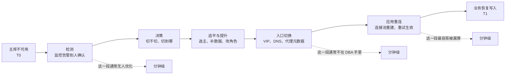
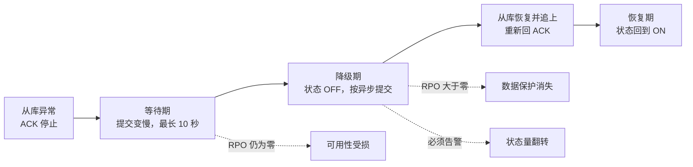
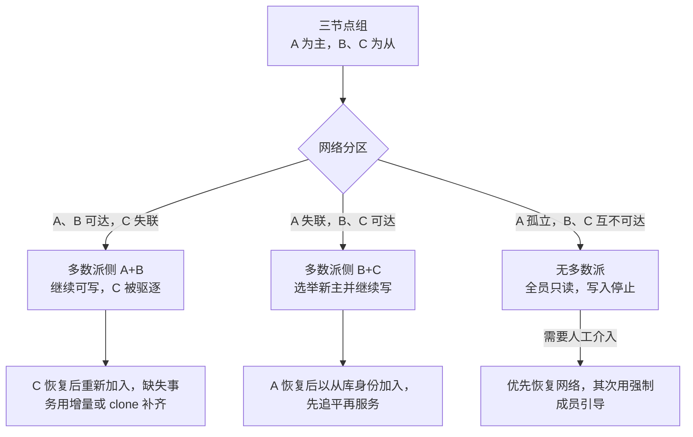
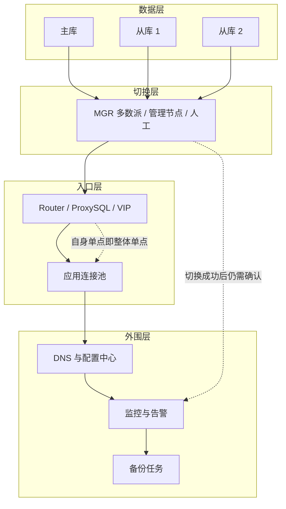
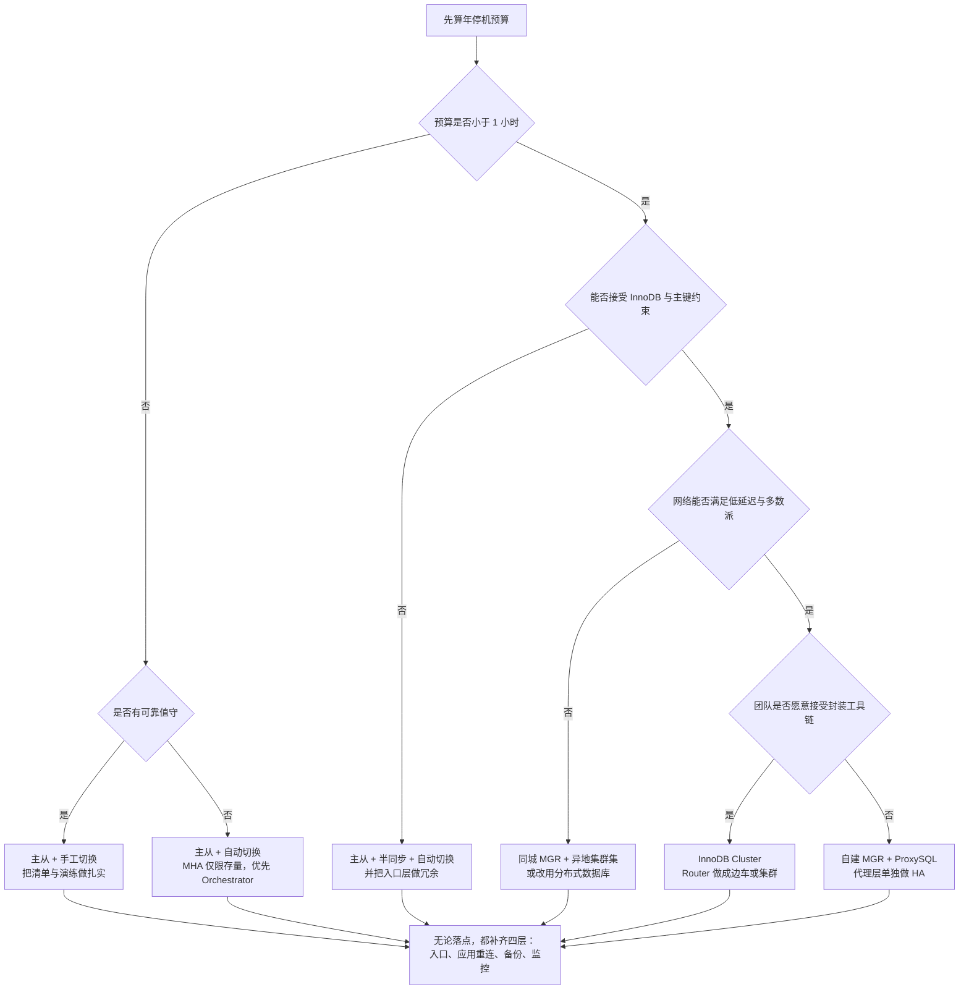

# 10 MySQL 高可用方案选型——从主从到 InnoDB Cluster

**摘要：**

高可用选型最常见的失败，是把厂商宣传里的切换时间当成自己的恢复时间。本文把选型收窄成两个必须回答的问题：主库不可用到业务恢复写入要多久，主库故障时已提交但未同步的事务有多少。第 1 章拆这两个数的口径，把 RTO 拆成检测、决策、追平提升、入口切换、应用重连五段，把 RPO 拆成三种基准；第 2 章给出五类方案的 RTO/RPO 对照表与分项测算，这是全文的中心。第 3 至第 7 章逐个拆开五类方案的机制与判据，其中两条选型事实需要按现状更新：MHA 停在 2018 年的 0.58 版，Orchestrator 官方仓库在 2025 年归档。第 8 至第 9 章处理代理层的四种选择、故障检测粒度，以及脑裂与双主的检查清单。第 10 至第 11 章是两件交付物：切换后必须验证的五件事，以及最容易被忽略的四个非数据库部分。第 12 章列反例，第 13 章把整篇压成两张可以直接贴到墙上用的表。文中数字均为示例推算，须用自家演练数据校准。

---

## 第 1 章 两个必答问题：切换要多久，会丢多少

把"数据库挂了怎么办"这句话拆到底，只剩两个数：从主库不可用到业务重新写得进数据，中间要多久；主库挂掉的那一刻，有多少已经提交的事务没有同步出去。第一个数决定用户和老板感受到的停机，第二个数决定事后要不要向业务方解释"为什么少了一笔订单"。

所有方案介绍都会给这两个数起名字，叫**恢复时间目标（RTO，Recovery Time Objective）**与**恢复点目标（RPO，Recovery Point Objective）**。名字好记，麻烦在于这两个数不是方案自带的属性，而是"方案 × 你的部署 × 你的演练次数"三者相乘的结果。同一个 MGR 三节点，在应用能自动重连、代理层能自动摘除、监控秒级发现的部署里能做到二十秒恢复；在应用把 IP 写死在配置文件、切换要登机器改配置、监控五分钟一轮的部署里，照样是半小时。

### 1.1 一个凌晨的时钟

设想一个订单库，一主两从，同城两个机房，主库在 A 机房。凌晨两点十四分，承载主库的宿主机失联，从业务侧看是连接超时。

把那一夜的时钟摊开：两点十五分监控告警，值班手机响了；两点二十二分值班 DBA 上线，先排除网络再确认机器不响应；两点三十一分决定切换，候选是 GTID 集合最全的从库 B；两点三十六分候选追平、提升、可写；两点四十一分应用第一批写请求成功；两点五十二分最后一批应用实例完成连接池重建。整段三十八分钟。

这三十八分钟里，工具真正负责的只有追平、提升、改角色这五六分钟，其余分布在两头：前面是发现与判断，后面是入口与重连。把 RTO 当成软件参数来谈的人，都会在第一次真实故障里被后面这三十多分钟教一遍。

### 1.2 先算可用性预算，再谈方案

可用性目标可以换算成分钟预算。下表按三十天一个月折算，第三列是按一年四次故障摊下来的单次切换上界，超过它方案就撑不住目标。

| 可用性目标 | 年停机预算 | 单次可接受上界（按年 4 次故障摊） | 对 RTO 的隐含要求 |
| :--- | ---: | ---: | :--- |
| 99.9% | 约 8.8 小时 | 约 2.2 小时 | 手工切换可以支撑，但要有人值守 |
| 99.95% | 约 4.4 小时 | 约 1.1 小时 | 手工切换已无余量，需自动或半自动 |
| 99.99% | 约 52.6 分钟 | 约 13 分钟 | 自动切换，且计划内维护要另找窗口 |
| 99.999% | 约 5.3 分钟 | 约 1.3 分钟 | 单靠数据库切换做不到，要把连接层与检测一起算 |

这张表是**从业务目标反推约束**，而不是从工具能力正推结论。99.99% 的系统一年只允许停机五十四分钟，一次手工切换就吃掉三分之一到全部预算；一个 99.9% 的内部系统为五秒级切换上三节点 MGR，则是把复杂度加在了不需要它的地方。

还有一处容易漏算：计划内维护也算停机，升级、搬迁、重启只要影响写入，都在同一个预算里；两类加在一起，很多团队会发现真正需要的是**切换足够快**，而不是永不出故障。

### 1.3 RTO 的五段

RTO 从主库不可用开始计，到业务恢复写入结束。中间五段几乎串行，且归属不同的团队，下图把它们摆在同一根时间轴上。

检测段由采集周期、告警延迟、值班响应相加，秒级采集加电话告警能压到一分钟内，五分钟采集加邮件通知常常十几分钟。决策段在手工方案里最长，因为要判断主库是不是真挂了、哪个从库最全、原主还能不能救；自动方案把它压到秒级，代价是把判断权交给算法。追平与提升段是各种工具真正的差别所在。入口切换段由应用连的是 IP、VIP、域名还是代理决定，常常不在数据库团队职责内，于是被默认很快。应用重连段由连接池、重试策略与熔断阈值决定。

五段里只有第三段是数据库工具能自动完成的。压 RTO 的杠杆按改造成本与收益之比排：先把入口收敛到一个可切换的地址，再把应用重连改成幂等重试，然后才谈自动选主与秒级检测；反过来做，工具再快也会卡在入口和应用上。

### 1.4 RPO 的三种基准

RPO 比 RTO 更容易被说糊。同一句"我们的 RPO 是零"，可能指三件不同的事：客户端已收到提交成功的数据不会丢；主库已提交的数据不会丢；任意从库都能无条件提升。三者对应的机制强度差一个数量级。

以客户端已确认为界，是第一种基准。异步复制下，主库返回成功之后、binlog 到达从库之前崩溃，客户端看到成功的事务会丢；半同步的 `AFTER_SYNC` 把确认点挪到从库收到 binlog 之后，这一侧才真正做到零。

以主库已提交为界，是第二种，比第一种更严，因为存在"主库提交了但客户端没收到确认"的窗口。这个窗口在半同步的 `AFTER_COMMIT` 模式下是危险的：事务已在引擎层提交、其他会话能读到，但客户端看到的是失败，切换后这份数据消失，读到过它的会话已经基于它做了动作。

第三种基准是提升动作本身不引入丢失。半同步只保证至少一个从库收到日志，切换工具若把另一个没收到日志的从库提升上来，丢失照样发生；MGR 的多数派把这件事写进了协议，被提升的成员必然拥有已提交事务。

| 复制方式 | 客户端已确认的数据可能丢 | 主库已提交的数据可能丢 | 提升任意成员是否安全 |
| :--- | :--- | :--- | :--- |
| 异步复制 | 可能丢，窗口随延迟变化 | 可能丢 | 不安全，必须先比 GTID 集合 |
| 半同步 `AFTER_COMMIT` | 不丢 | 可能丢，有"读到过又消失"的窗口 | 不安全，需提升收到 ACK 的那个 |
| 半同步 `AFTER_SYNC` | 不丢 | 不丢，前提是提升收到 ACK 的从库 | 需按集合选主，选对即零丢失 |
| MGR 单主 | 不丢 | 不丢，前提是多数派存活 | 安全，协议保证新主拥有已提交事务 |
| MGR 多主 | 不丢 | 不丢，冲突事务在认证阶段回滚 | 安全，成员本身都在线 |

每一行都藏着前提，失效方式各不相同；选型要问的是**前提失效的后果**，而不是正常情况下能到几个九。

---

## 第 2 章 五类方案的 RTO/RPO 对照表

对照表把主线摊开。RTO 给两段：理想值是故障检测到新主可写，现实值从主库不可用算到业务恢复写入，含入口与应用重连；RPO 按已提交事务的口径。数字均为示例推算，须用自家演练实测替换。

### 2.1 主表

| 方案 | 故障检测 | RTO（理想 / 现实） | RPO | 主要代价 | 适用判据 |
| :--- | :--- | :--- | :--- | :--- | :--- |
| 主从 + 手工切换 | 监控告警，人工确认 | 1-5 分钟 / 15-60 分钟 | 异步窗口，秒到分钟 | 依赖值守，凌晨故障代价最高 | 小规模、非核心、能接受计划外停机 |
| 主从 + MHA | 管理节点秒级探测 | 10-30 秒 / 30 秒-2 分钟 | 异步窗口，可用 binlog 补全 | 工具停维护，GTID 下位点对齐困难 | 存量 5.6/5.7 系统，且已有熟练运维 |
| 主从 + Orchestrator | 拓扑轮询，默认 5 秒级 | 10-30 秒 / 20 秒-1.5 分钟 | 异步窗口，选主按集合 | 组件多，官方仓库已归档 | 已有主从、需要自动切换与可视化 |
| 半同步 + 自动切换 | 同切换工具 | 同切换工具 / 同上 | 至多一个事务，降级窗口除外 | 写入延迟被最慢从库放大 | 能接受故障期间写入变慢十秒 |
| MGR 单主 | 组内失败检测，约 10 秒 | 5-15 秒 / 10-40 秒 | 零，前提是多数派存活 | 网络与事务大小受限，需三节点 | 新项目、能接受 InnoDB 与主键约束 |
| MGR 多主 | 同上 | 无需选主，5-15 秒 / 10-30 秒 | 零，冲突事务回滚 | 冲突是应用可见错误，写扩展有限 | 多地域就近写，且业务能处理冲突 |
| InnoDB Cluster | 同 MGR | 5-15 秒 / 10-30 秒 | 零 | 封装的复杂度转移，Router 需另行 HA | 团队小、想要官方工具链 |
| InnoDB ReplicaSet | 无自动检测 | 需人工 / 5-30 分钟 | 异步窗口 | 无自动切换，写操作要人工 | 中小业务、要工具不要协议 |

### 2.2 三条读法与事实源

**区间宽窄本身就是判据**。手工切换的区间是十五分钟到一小时，方差极大，取决于故障在白天还是凌晨；MGR 是十秒到四十秒，方差主要来自应用重连。选型不只看中位数，还要看最坏值，因为 SLO 往往被最坏值击穿。

RTO 的瓶颈在表外。八行方案里理想值的差异是十秒到五分钟，现实值的差异却有二十秒到一小时，被放大的地方全在入口和应用两段，而这两段在方案对比表里从不出现。这也是很多团队换了更先进的方案之后，恢复时间几乎没有变化的原因。

RPO 的瓶颈在选主决策。异步复制下，选错从库丢的是小时级数据，选对只丢秒级；半同步下，选错从库等于把零丢失的机制白白浪费。选主逻辑是否按 GTID 集合而不是按 `Seconds_Behind_Master` 判断，直接决定 RPO 落在哪一档。复制的延迟口径、集合比对与半同步判据在 [[中间件/MySQL/MySQL架构与底层原理/10 Binlog 与主从复制——数据同步的底层传动链|架构列 10：Binlog 与主从复制]] 里已经写透，此处只取结论。

三者的差别不在快慢，而在谁是事实源：手工方案是人，工具方案是一台管理节点，MGR 是多数派。事实源越多，判定谁是主越容易出错；事实源越少，越依赖那一个组件的存活。后文讨论脑裂时，这条线索还会出现。

### 2.3 RTO 分项测算

把五段拆开，各方案的差别会变得具体。下表是示例推算，每一格都要用演练数据校准；做这件事最有效的方式是在心跳表上打时间戳，让业务侧和数据库侧共用一个时钟。

| 方案 | 检测 | 决策 | 追平与提升 | 入口切换 | 应用重连 | 合计（示例） |
| :--- | :--- | :--- | :--- | :--- | :--- | :--- |
| 手工切换 | 1-5 分钟 | 3-15 分钟 | 1-3 分钟 | 1-5 分钟 | 1-5 分钟 | 15-60 分钟 |
| MHA | 3-10 秒 | 自动 | 5-30 秒 | 1-3 秒 | 5-30 秒 | 20 秒-2 分钟 |
| Orchestrator | 5-15 秒 | 自动 | 5-20 秒 | 1-5 秒 | 5-30 秒 | 20 秒-1.5 分钟 |
| 半同步 + 自动 | 同工具 | 同工具 | 同工具，可能多一次追平 | 同工具 | 同工具，写入重试更贵 | 同上，波动更大 |
| MGR 单主 | 约 10 秒 | 自动选举，1-5 秒 | 1-10 秒 | 1-3 秒 | 5-30 秒 | 10-40 秒 |
| InnoDB Cluster | 同 MGR | 同 MGR | 同 MGR | Router 自动 | 5-30 秒 | 10-30 秒 |

表的用法是找出自己能压缩的那一段。多数团队卡在第四、第五段；监控粒度若是五分钟，第一段就注定大于五分钟，此时谈选主算法没有意义。

---

## 第 3 章 主从 + 手工切换：最低成本的那一档

手工切换常被当成落后方案，其实定位很清楚：用人的判断力换掉一整套自动化组件的运维成本。故障频率低、能接受计划外停机的场景里，它依然最划算，前提是把流程写成清单，而不是留在某个人脑子里。

### 3.1 两个必须人做的判断

第一件是选候选。看到主库挂了，第一反应通常是挑延迟最小的从库，而延迟指标只反映应用线程最近的状态，不反映集合缺多少事务。可靠判据是 GTID 集合：先取故障前最后一次采集的原主 `gtid_executed` 快照，再对每个候选算差集，差集最小的那个才是候选；没有快照时，退一步看各从库的 `Retrieved_Gtid_Set` 与 `Executed_Gtid_Set`，再比对中继日志的完整性。

第二件是判断原主还能不能救。宿主机失联和 MySQL 进程崩溃是两回事：机器还能 SSH、日志还在，就可以把未发送给任何从库的那段 binlog 取出来，在候选上回放，RPO 从秒到分钟压到零；机器彻底不可达，这段事务必然丢失，此时要做的是尽快让业务知道丢了哪些单号，而不是继续等机器恢复。

这两个判断都不难，难在凌晨三点做得对；写成带判据的清单并每季度演练，是把风险压到可接受水平的唯一办法。

### 3.2 提升动作的五步与四种失误

步骤不复杂：确认候选已应用完中继日志；停止复制线程并确认位点；解除只读，把候选变成可写；把其余从库的复制源重新指向候选；把入口指过去并通知应用。

每一步都有对应的失误。只解除 `read_only` 没解除 `super_read_only`，高权限账号照样写不进去；忘了重指其余从库，它们会挂在已变成从库的旧主上反复重连失败；入口指过去了但连接池还握着旧连接，报错形态是连上了但写不了，而监控看起来一切正常。

还有一步经常被跳过：**隔离旧主**。旧主恢复后若自动启动、`read_only` 又是关的，它就会以主库身份重新出现在网络里，等一部分流量连上去，双主就形成了。手工方案里这步由人执行，清单上必须写明：旧主恢复后先以 `super_read_only` 启动，确认拓扑后再决定重建为从库还是下线。

### 3.3 判据

手工切换适合的团队有三个特征：实例数在个位数到十几个；计划外故障一年不超过一两次；有人能在一刻钟内上线。三条同时成立时，为自动切换引入的管理节点、Raft 集群、代理层与钩子脚本，负担大于收益。任何一条不成立就该升级：实例超过二十个，人肉判断拓扑开始出错；故障频率高，每次切换都在消耗同一个人；没有稳定值守，凌晨故障会拖到白天。

它还有一个不可替代的价值：是所有自动方案的兜底——切换失败、切换后不一致、管理组件故障，最后都要回到这份清单上。

---

## 第 4 章 主从 + MHA / Orchestrator：自动选主这一档

自动切换工具解决的是第三段：检测、选主、提升、重指向。它们不解决入口，也不解决应用重连，这两段要么配合脚本，要么配合代理层。记住这一点，后面所有 RTO 数字才不会被误读。

### 4.1 MHA 做过的三件事

MHA 是一个管理节点加若干被管节点，被管节点跑 node 程序，管理节点通过 SSH 免密登录执行动作。三个能力在当年是先进的：持续探测主库并在确认前观察一段时间；在所有从库中挑中继日志与 binlog 位点最新的作为候选；原主机器还能登录时，把尚未被任何从库接收的 binlog 取出来应用到候选，然后再提升。

第三件事最有价值，也是它至今仍被部分团队留恋的原因：它把异步复制的 RPO 从一个延迟窗口压到机器是否还能登录这个更小的范围。代价是整条链路依赖 SSH 互信，管理节点持有所有数据库机器的登录能力，在今天的安全审计里通常过不了关。

### 4.2 停止维护的四个后果

MHA 的最后一个版本是 0.58，发布于 2018 年 3 月，此后仓库再无版本发布。这条事实不是"工具不好用"，而是四个具体的工程后果。

第一，版本支持面停在老版本：0.58 时代的主力是 5.6 与 5.7，8.0 的默认认证插件、复制变量重命名、原子 DDL 带来的事件形态变化都没有在工具里适配过。第二，GTID 模式下的位点对齐很别扭：补全逻辑建立在 binlog 文件名与位点之上，而位点在不同实例上**不可直接比较**，实践中往往退回位点复制，或者放弃补全。

第三，运行依赖过时：Perl 模块与 Python 2 环境要在新发行版上额外维护，安全补丁无人跟进。第四，没有 quorum：管理节点是单点，它自身故障时要么人工接管，要么出现两个管理节点各自认为该切的局面，后者正是双主的来源之一。

结论应当直白：存量的 5.6/5.7 系统继续用是合理的过渡，但要把迁移列进计划，升级路径与回退见 [[中间件/MySQL/MySQL进阶使用/09 数据迁移与版本升级——零停机变更的工程实践|进阶 09：数据迁移与版本升级]]；8.0 及以后的新项目不应再把 MHA 作为选型起点。

### 4.3 Orchestrator 的机制与现状

Orchestrator 的起步定位是复制拓扑的可视化与修复工具，后来长成拓扑感知的故障切换器。它持续轮询各实例、推断复制关系、画成拓扑图；切换时按拓扑与配置选主，执行提升与重指向，并通过钩子在恢复流程的各阶段调用外部脚本。

它相比 MHA 的三个改进值得记住：拓扑模型完整，支持级联与多主等形态；自身可用 Raft 做高可用，多实例中只有持有领导权的一个执行恢复，从架构上排除了两个管理节点同时切换；提供 HTTP API 与钩子，能把代理层更新、告警、审计串进恢复流程。

不过官方仓库 openark/orchestrator 在 2025 年 2 月被归档为只读，社区维护转到 Percona 的 fork。这对选型的影响是实质性的：新部署要明确用哪个分支、跟哪个版本适配、出问题找谁；没有维护 Go 项目 fork 的能力，把它当作长期基础设施就有风险。

### 4.4 判据

| 维度 | MHA | Orchestrator | 自研脚本 + 代理 |
| :--- | :--- | :--- | :--- |
| 维护状态 | 2018 年后无版本 | 官方仓库归档，社区 fork 维护 | 自己维护，可控 |
| GTID 支持 | 弱，补全基于位点 | 较强，按集合选主 | 取决于实现 |
| 自身高可用 | 单点 | Raft 多实例 | 取决于实现 |
| 入口集成 | 靠脚本 | 钩子，可对接代理 | 天然集成 |
| 运维门槛 | 低，但知识在衰减 | 中，组件多 | 高，要自己写对 |
| 适用判据 | 存量 5.6/5.7 过渡 | 已有主从、要自动与可视化 | 有平台团队、场景固定 |

RTO 上这两个工具的差别没有宣传里那么大：检测周期与确认次数决定前段，选主与追平决定中段，钩子脚本决定后段。现实里三十秒到两分钟都算正常；要压到二十秒以内，瓶颈往往不在工具，而在代理层能否毫秒级摘掉旧主、应用能否秒级重连。

---

## 第 5 章 半同步：把 RPO 压到一个事务

半同步不是切换工具，是复制模式，它和第 3、4 章的方案正交：可以手工切换配半同步，也可以自动切换配半同步。单独讲它，是因为它决定 RPO 这一侧的天花板，而很多人把它当成"打开就零丢失"的开关。

### 5.1 从一段窗口到一个事务

异步复制下，RPO 是一个随时间变化的窗口：主库提交后立刻崩溃，丢的是一瞬间；延迟累积了五分钟，丢的是五分钟。这个窗口没有上界，只有平均值。

半同步在提交路径上加了一个等待：主库把 binlog 刷盘、发给从库、等到至少一个从库确认收到，才返回客户端。`AFTER_SYNC` 模式下这个等待点在引擎层提交之前，于是"客户端看到成功"与"至少一个从库有这份日志"被绑在了一起。RPO 从一段窗口变成一个正在等待的事务，且这个事务对客户端是失败而非成功。

### 5.2 三个前提，缺一不可

切换工具必须**提升那个收到 ACK 的从库**。半同步只承诺至少一个从库有日志，如果集群里有三个从库而只有 C 收到 ACK，工具却把延迟最小的 A 提升上来，丢失照样发生。选主必须按 GTID 集合算差集，不能按延迟排序。

半同步必须处于生效状态。`Rpl_semi_sync_source_status` 为 OFF 时机制已经降级，此后的提交不再等待确认，RPO 退回异步口径。这个状态变化在业务侧没有感知，监控上只有一个状态量翻转，是最容易漏掉的告警项。

从库收到的必须是落盘之后的日志。ACK 发生在从库把事件写入中继日志之后，而中继日志是否落盘取决于 `sync_relay_log`；如果从库在这之后立刻断电且中继日志没落盘，主库以为的"已确认"其实不存在。这一条在机房级故障里才显形，日常演练不会暴露。

### 5.3 降级窗口：用可用性换来的空白

半同步的核心取舍体现在超时上。主库等待 ACK 超过 `rpl_semi_sync_source_timeout`（默认 10000 毫秒）后放弃等待、按异步继续提交，并把状态置为 OFF。这个设计避免"一个从库网络抖动拖死整个主库"，代价是从超时那一刻起数据保护消失，直到至少一个从库追上并重新回 ACK。

下图把这段空白画出来：只有降级期那段 RPO 大于零，而它恰恰最不容易被监控发现。

降级期的长度不由数据库决定，由从库恢复的速度决定。从库磁盘故障、网络分区、大事务把应用线程卡住，都会让降级期从秒级延长到分钟级。要压短它，只能靠从库侧快速发现与自动摘除，以及恢复后的追平速度。

### 5.4 代价在写延迟上

半同步把主库的提交延迟绑在最慢的那个从库上。同机房往返零点几毫秒，影响可忽略；跨机房往返一到几毫秒，写入 P99 明显抬升；跨地域往返几十毫秒，半同步基本不可用。

还有一个不对称的代价：从库故障的瞬间，主库上正在等待的提交会卡住直到超时，第一个受害者不是读流量而是写流量。这一点要写进降级预案：**写延迟会先跳一次**，随后才因降级恢复。

### 5.5 观测与判据

| 观测项 | 来源 | 判读 | 处置方向 |
| :--- | :--- | :--- | :--- |
| `Rpl_semi_sync_source_status` | `SHOW STATUS` | OFF 即降级，数据保护已消失 | 告警，查从库与网络 |
| `Rpl_semi_sync_source_no_times` | `SHOW STATUS` | 降级次数，持续增长说明网络不稳 | 查链路质量与从库负载 |
| `Rpl_semi_sync_source_no_tx` 与 `yes_tx` | `SHOW STATUS` | 两者比例反映确认成功率 | 比例失衡即排查从库 |
| `Rpl_semi_sync_source_wait_sessions` | `SHOW STATUS` | 正在等待确认的会话数 | 长期大于零说明提交被拖慢 |
| `rpl_semi_sync_source_timeout` | 变量 | 默认 10000 毫秒，决定降级前最长等待 | 调小则降级更快、保护更早失效 |

版本口径要注意两处：8.0.26 起引入 `source` / `replica` 命名的新插件与变量，旧的 `master` / `slave` 命名保留但已废弃；8.4 起旧命名的半同步插件不再提供，升级时配置项要整批替换，具体以对应版本文档为准。

最后一条判据：半同步不提供 quorum，也不阻止脑裂。它保证"至少一个从库有日志"，不保证"只有一个主库能写"。把它当成高可用的全部，是用错了地方。

---

## 第 6 章 MGR：多数派与两种模式

组复制（Group Replication，MGR）把"谁是主"交给了协议。它与前几章的根本差别不在复制速度，而在事实源：前几章的事实源是人或一台管理节点，MGR 的是组内多数派。

### 6.1 机制的三句话

事务在主库执行后不是直接提交，而是把变更集广播给组内所有成员；多数派成员完成认证（冲突检测）并通过后，事务才允许提交；组内按全局顺序传递事务，任何成员看到的前缀都一致。

机制细节在源码级笔记里已经拆到 Paxos 变种与认证过程一级，[[中间件/MySQL/读书笔记-Mysql内核架构/14. MySQL 组复制：从 Paxos 变种到分布式强一致集群|读书笔记 14：MySQL 组复制]] 有完整推导，此处只取三条对选型有影响的结论：提交路径多了一次组内往返；组的大小决定容错能力；成员间的网络质量直接进入提交延迟。

### 6.2 单主模式：零丢失的前提

单主模式是 8.0 的默认配置，也是绝大多数生产部署的形态：一个成员可写，其余只读，主成员故障后剩余成员选举出新主。

零丢失的前提有三个。多数派必须存活：三节点组掉一个还能选主，掉两个就没有多数派，剩下那个只能只读，业务写不进去，这是可用性归零、数据仍在的形态。崩溃安全参数必须打开：`sync_binlog=1` 与 `innodb_flush_log_at_trx_commit=1`，否则已提交事务可能在崩溃时随日志一起丢。新主必须在服务前追平：`group_replication_consistency` 设为 `BEFORE_ON_PRIMARY_FAILOVER` 可以让它先应用完积压的已认证事务，避免切换成功但读到旧数据。

故障检测到提升的时长由两个参数共同决定：组内先在五秒左右的检测期内收不到消息就产生怀疑，再由 `group_replication_member_expel_timeout`（8.0.21 起默认 5 秒，8.0.20 及更早默认 0）决定怀疑之后等多久驱逐。两者相加是十秒量级的检测延迟，这也是 MGR 方案 RTO 的现实下限——宣传里的"五秒切换"通常只算选举与提升，不含这十秒。

### 6.3 多主模式：能写多个成员不等于性能翻倍

多主模式下所有成员都能写，冲突在认证阶段检测，后到的事务被回滚。它解决的是多地域就近写这类需求，不是写性能不够。

原因有两层。认证是组内的串行点，所有事务都要经过同一套流程，写并发上限并不随成员数线性增长；冲突回滚是应用可见的错误，两个地域同时改同一行，其中一个会收到冲突错误并需要重试或人工处理，把原本跑在单主上的应用直接切到多主，先炸的往往是错误处理逻辑。

还有一条容易被忽略的配置：`group_replication_enforce_update_everywhere_checks` 在多主模式下应为 ON，它检查语句是否会在成员间造成不一致。关掉它换取能跑起来，等于把一致性检查交给运气。

判据很直接：业务能接受写入偶尔失败并重试、写热点天然按地域隔离、团队能读懂冲突日志，才考虑多主；否则单主加只读扩展更稳，继续加写入的下一站是分片，判据见 [[中间件/MySQL/MySQL进阶使用/06 分库分表——何时做、怎么做、做了之后怎么办|进阶 06：分库分表]]。

### 6.4 五条代价

| 代价 | 具体约束 | 判据与应对 |
| :--- | :--- | :--- |
| 只支持 InnoDB | 非事务引擎不可用；表必须有主键，否则写入被拒绝 | 上线前普查无主键表，补主键或改表 |
| 至少三节点 | 两节点组掉一个就没有多数派，写不可用 | 三节点是最低容错配置，五节点用于同城双活 |
| 网络要求高 | 提交多一次组内往返，成员间延迟直接进提交路径 | 同机房或同可用区部署，跨地域改用集群集 |
| 大事务受限 | 事务超过 `group_replication_transaction_size_limit`（默认 150000000 字节）被回滚 | 批处理拆小批，单事务控制在几十 MB 内 |
| DDL 与运维受限 | 单主模式下 DDL 只在主成员执行；成员加入依赖 clone 或增量恢复 | 变更窗口统一，成员用 clone 插件补数据 |

### 6.5 大事务为什么拖住整个组

组复制按全局顺序传递事务，一个事务在组内是不可分割的传递单元。事务越大，从广播到各成员应用完成的时间越长，期间后续事务全部排队；应用慢的成员触发流控，流控反过来限制所有成员的提交速度，直到最慢的成员追上。结果是"一个成员慢，全组慢"。

物理上界是 `group_replication_transaction_size_limit`，默认约一百四十三兆字节，超过的事务直接被回滚并报错，不进入组播。这条限制在正常业务里碰不到，但批量更新、删历史数据、大表变更前的数据回填、数据导入都很容易越线，而报错形式常常只是"事务被回滚"，看不出与复制有关。

### 6.6 分区行为与 expel 超时的双刃

网络分区是 MGR 最值得演练的场景。多数派一侧继续可写，少数派一侧进入只读并停止服务写请求，这就是 MGR 天然防脑裂的机制：少数派拿不到多数派认证，无法提交。

`group_replication_member_expel_timeout` 在这张图里是双刃。设得太小，网络抖一下就驱逐成员；设得太大，真正故障的成员长期留在组里，拖慢流控、延迟选举。跨可用区部署时要按机房间往返时延与丢包率往上调，而调大之后检测延迟与 RTO 也跟着变大。这是 MGR 方案里最需要实测的参数。

### 6.7 网络要求的量化

提交路径比异步复制多一次组内广播与认证，若成员间往返时延为 R，则每次提交至少多出一次 R 的等待；组内 N 个成员时，每个事务的变更集要发给 N-1 个成员，出向带宽约为写入速率的 N-1 倍。

| 部署形态 | 成员间 RTT（示例） | 每笔提交的额外延迟（推算） | 结论 |
| :--- | ---: | ---: | :--- |
| 同机架 | 0.1-0.3 毫秒 | 0.1-0.3 毫秒 | 影响可忽略 |
| 同可用区跨机架 | 0.3-1 毫秒 | 0.3-1 毫秒 | 可接受，注意带宽放大 |
| 同城跨可用区 | 1-2 毫秒 | 1-2 毫秒 | 需压测，expel 超时要上调 |
| 跨地域 | 30 毫秒以上 | 30 毫秒以上 | 不建议单组跨地域，改用集群集 |

上表是示例推算，真实值要用压测校准。它说明的是：MGR 的写延迟不是常数，而是网络时延的函数，把两个机房的产品放进一个组，等于把跨机房往返加进了每一笔提交。跨地域的正确形态是同城一个完整组、异地另一个组，用集群集（ClusterSet）做单向复制。

---

## 第 7 章 InnoDB Cluster 与 InnoDB ReplicaSet

InnoDB Cluster 不是新协议，是 MGR 加一层封装。它把建组、加节点、切换、状态查询、故障恢复收进 MySQL Shell 的 AdminAPI，再配一个 MySQL Router 把客户端接进来。理解这一点之后，"该不该用 Cluster"就变成了两个更具体的问题：要不要这层封装，以及要不要 Router。

### 7.1 三个组件的分工

| 组件 | 负责什么 | 不负责什么 | 运维含义 |
| :--- | :--- | :--- | :--- |
| MGR | 数据同步、多数派认证、成员选举 | 客户端接入、入口切换 | 与自建 MGR 完全一致，限制也一样 |
| MySQL Shell | 建组、加节点、切换、状态与修复 | 自动处理业务侧连接 | 是集群元数据的唯一权威，绕过它改拓扑会留下不一致 |
| MySQL Router | 客户端接入、读写端口、元数据感知的路由 | 数据同步、选主 | 本身是新的组件，需要单独做高可用 |

第三行值得多说一句。AdminAPI 会在目标实例上维护**集群元数据**（库名 `mysql_innodb_cluster_metadata`），Router 通过轮询这份元数据知道当前主是谁。这意味着两件事：手工用 SQL 改复制关系而不通过 Shell 同步元数据，会让 Router 的目标与实际拓扑对不上；元数据刷新有延迟，主切换之后 Router 需要一小段时间才发现，这段延迟会计入 RTO。

### 7.2 Router 到底解决什么

Router 解决的是"应用不需要知道主库 IP"。应用连 6446 端口拿读写连接，连 6447 端口拿只读连接，主库换了，Router 把新连接指向新主，应用只要重连即可。

它有三个边界。第一，Router 不迁移已建立的连接：主库故障时旧连接全部断开，应用必须能重连，所谓透明切换只对新建连接成立。第二，8.0 及更早的 Router 不做 SQL 解析，读写分离靠应用连不同端口；8.2 起增加 `access_mode=auto`，可按语句类型路由，但版本与后端类型都有要求，以对应版本文档为准。第三，Router 自身是单点，一台挂掉，数据库再健康应用也连不上；生产要么把 Router 与应用同机部署成边车，要么在它前面再加一层负载均衡。

### 7.3 ReplicaSet：没有自动切换的那一档

ReplicaSet 是同一套工具链里的另一条产品线：底层是普通异步复制加 GTID，用 Shell 管理拓扑，用 Router 接客户端，但没有 MGR 的多数派，也就没有自动故障转移。官方文档写得很明确，主库不可用时需要人工执行切换，`setPrimaryInstance()` 是计划内切换，`forcePrimaryInstance()` 是灾难下的强制提升，后者可能与仍然存活的旧主形成双写，属于最后手段。

它的价值在于把一主多从的拓扑管理、切换步骤与客户端接入标准化了，同时不需要三节点、不需要低延迟网络、不受大事务限制。RPO 退回异步口径，RTO 退回人工口径：中小业务、读多写少、能接受分钟级恢复，用它比自建脚本加 VIP 省事。

### 7.4 该用 Cluster 还是自建 MGR 加代理

| 判据 | 选 InnoDB Cluster | 选自建 MGR + 代理 |
| :--- | :--- | :--- |
| 团队规模 | 小，希望少维护自研组件 | 有平台团队，能维护代理与脚本 |
| 代理需求 | 只要读写分离与故障转移 | 需要查询规则、连接池、缓存、分片路由 |
| 变更习惯 | 愿意把拓扑变更全部交给 Shell | 已有成熟的变更流程与自研工具 |
| 版本节奏 | 跟随官方 LTS 升级 | 需要长期停留在某个版本 |
| 跨机房 | 用 ClusterSet 做异地 | 已有跨机房代理层方案 |

四条判据里若有三条落在左列，用 Cluster；三条落在右列，自建更合适。中间状态最常见的做法是：数据层用 MGR 单主，接入层用 ProxySQL，因为查询规则与连接池能力是 Router 不具备的，而协议保证一致。

---

## 第 8 章 代理层的四个选择

前七章讨论的都是"数据在哪、谁能写"。业务实际连的是入口，入口的选择决定了检测粒度、切换速度与读写分离能力。四个常见选择各有明确边界，混用它们的代价通常比选错更大。

### 8.1 四个方案的定位

| 方案 | 工作层次 | 检测粒度 | 读写分离 | 自身高可用 | 典型代价 |
| :--- | :--- | :--- | :--- | :--- | :--- |
| MySQL Router | 元数据感知的四层代理 | 读集群元数据，知道主从角色 | 8.0 靠端口，8.2 起可语句级 | 需自行部署多实例 | 绑定 InnoDB Cluster 生态 |
| ProxySQL | 七层代理，解析并匹配 SQL | SQL 探测加 `read_only` 状态 | 规则匹配，可做事务内固定 | 支持多节点互相同步 | 规则复杂，需要专人维护 |
| HAProxy | 四层，可做 MySQL 握手检查 | 端口或握手，不知角色 | 不支持，需上游分端口 | 主备加 VIP 成熟 | 无法感知只读与复制状态 |
| VIP + keepalived | 网络层地址漂移 | 脚本探测，粒度自定义 | 不支持 | VRRP，需二层网络 | 角色提升与地址漂移要自己串 |

### 8.2 故障检测的四个粒度

同样是"检测主库是否可用"，四个粒度看到的完全不是一件事。

端口探测只看 TCP 能不能连上。MySQL 进程还在但已经进入只读、磁盘满了拒绝写入、复制线程全断，端口一律正常。这是最快的检测，也是最容易误判的检测。

协议握手探测往前走一步，确认对面是能完成 MySQL 握手的服务，能排除端口被别的进程占用，但仍然看不出是否可以写。SQL 探测执行一条轻量查询，比握手更接近真实可用性，但一条 `SELECT 1` 成功不代表能写，也不代表数据是新的。

**语义探测**看的是角色与状态：`read_only` 是否为关闭、复制线程是否在跑、GTID 集合是否落后、是否仍是 MGR 的主成员。只有这一档能把"端口活着但库已经不能写"识别出来，而这一档也正是 VIP 加脚本方案最容易做错的地方。

| 粒度 | 能发现 | 发现不了 | 误判方向 | 典型实现 |
| :--- | :--- | :--- | :--- | :--- |
| 端口 | 进程消失、端口不通 | 只读、磁盘满、复制中断 | 把不可写的库当成健康 | HAProxy 四层检查、VIP ping 脚本 |
| 协议握手 | 端口被占、服务不响应握手 | 只读、复制状态 | 同上，概率略低 | HAProxy 的 MySQL 检查 |
| SQL 查询 | 连接数耗尽、语句超时 | 只读、数据落后 | 把只读库接进写入口 | ProxySQL 监控、脚本探测 |
| 语义状态 | 只读、复制中断、角色变化 | 应用层语义 | 抖动导致频繁摘挂 | ProxySQL 的 `read_only` 监控、Router 元数据 |

粒度越细，代理越可能因为一次抖动把节点摘掉，所以必须配 fall 与 rise 的防抖参数。常见现场是探测间隔一秒、失败一次就摘：主库一次短暂锁等待就让代理摘掉写入口，业务侧偶发写入失败，数据库侧毫无异常。

### 8.3 读写分离放在哪一层

应用层最清楚。写后立即读自己的数据、支付结果确认、库存扣减后的校验，只有业务代码知道该走主库。代码里的路由或分库分表中间件的强制主库注解能表达这类语义，代价是每个语言、每个框架都要接一遍。

代理层最统一。ProxySQL 的规则可以按语句模式路由，并且支持"事务内固定"——一个事务开始后，后续语句都留在同一个 hostgroup，避免事务里的读跑到从库上读到不一致的快照。这个选项叫 `transaction_persistent`，不开它，事务内的 `SELECT` 会被规则送到从库，读到什么取决于延迟，属于隐蔽的一致性缺陷。

元数据层最省事。Router 依赖集群元数据知道主从角色，读写端口分开，8.2 起还能按语句类型自动路由。代价是它只理解读写这个粗粒度，不理解哪一次读必须读主。

判据一句话：读多写少、以报表和列表页为主，代理层分流就够；有强一致读需求，必须在应用层留一个能按请求粒度指定走主库的口子。主从延迟本身怎么度量、读到旧数据会以什么形态出现，[[中间件/MySQL/MySQL进阶使用/08 MySQL 与缓存的协作模式——Cache Aside 到数据一致性|进阶 08：MySQL 与缓存的协作模式]] 里有一套完整判据。

### 8.4 VIP 的代价

VIP 加 keepalived 是成本最低的方案，也是陷阱最多的方案。它用 VRRP 把同一地址在两台机器之间漂移，应用只认地址。代价有四个：需要二层网络可达，跨网段要额外配置；地址漂移与角色提升是两个动作，必须用通知脚本串起来，脚本写错就是双主的来源；没有读写分离能力，读流量还是压在主库上；脚本探测粒度通常很粗，写得好才有语义探测，写得不好就是 ping。

它适合的场景很窄：实例少、同机房、只要地址跟着主库走、不要求读写分离。超过这个范围，加代理的收益会很快超过成本。

代理自身的可用性另见第 11 章：两台数据库配一台代理，整体可用性由代理决定，这是很常见的架构失衡。

---

## 第 9 章 脑裂与双主

脑裂指的是两个实例同时认为自己是主库并接受写入。它的后果不是切换失败，而是数据分叉：两边各自有对方没有的事务，GTID 集合互不包含，事后无法用工具自动合并。这是所有高可用故障里唯一可能造成**永久性数据错误**的形态。

### 9.1 MGR 为什么天然不脑裂

多数派机制把谁是主变成了一个需要过半数同意的命题。网络分区时，少数派成员拿不到多数派认证，事务提交不了，会自动进入只读；多数派一侧继续工作，选出的新主被协议承认。两侧不会同时可写，因为那需要两个互不相交的多数派，在数学上不成立。

这条性质有个前提：组必须是奇数个成员，或至少多数派定义清晰。两节点组掉一个就没有多数派，全组停写；四节点组掉两个同样没有多数派。节点数不是越多越好，但必须**能凑出多数派**。

### 9.2 主从架构下的三种双主

主从架构没有多数派，只有"谁被提升"这个人工或工具给出的事实。双主因此有三种形态，成因各不相同。

配置型：两台实例互为复制源，双向复制，`log_replica_updates` 打开，两边都能写。这种配置有时是历史遗留，有时是为了双活而设，本质上靠应用层写入约束维持一致，约束一旦失效，冲突立刻出现。

故障型：切换工具或人的判断失误，在原主仍存活时提升了新主。典型场景是管理节点单点故障后重启、按旧拓扑又恢复一次，或网络分区让两边都以为对方死了。MHA 单管理节点、无 Raft 的 Orchestrator、自研脚本都有这个风险。

回归型：切换完成后旧主恢复上线，`read_only` 没有被重新打开，或者入口里还留着指向旧主的路由，一部分流量连过去写入。这种最隐蔽，因为它发生在"故障已经处理完"之后，所有人都在看新主。

### 9.3 会导致双主的配置清单

| 配置或现象 | 为什么会双写 | 检查入口 | 处置 |
| :--- | :--- | :--- | :--- |
| 两台实例互为复制源 | 双向复制，两侧都可写 | 两侧 `SHOW REPLICA STATUS` 均有运行中的接收线程 | 拆除一个方向，或改成单向写 |
| `auto_increment_increment=2` 且 offset 分别为 1、2 | 这是双主时代的典型配置 | `SHOW VARIABLES` | 切换为单主后改回 1、1 |
| 主库 `read_only=OFF`、从库也 `OFF` | 从库可被直接写入 | 逐台检查两个只读变量 | 从库常态开启 `super_read_only` |
| 旧主恢复后未隔离 | 恢复的旧主重新接受写入 | 检查恢复流程里是否有隔离步骤 | 恢复即 `super_read_only`，确认拓扑后再放行 |
| 代理元数据未刷新 | 旧主仍被当成写入口 | Router 元数据、ProxySQL hostgroup | 切换脚本必须包含代理更新与校验 |
| VIP 同时在两台机器上 | 两台都收到写请求 | 两台都执行 `ip addr` 查看 VIP | 排查 keepalived 脑裂，加 fencing |
| 管理节点双活且无 quorum | 两个管理节点各自切换 | 检查是否配置了 Raft 或选主 | 只允许一个实例执行恢复 |
| 数据目录克隆导致 `server_uuid` 重复 | 复制关系异常，拓扑判断失真 | 比较各实例 `server_uuid` | 重新初始化或改 UUID 后重建复制 |

最后一条值得单独说。用物理备份或 clone 插件复制数据目录时若操作不当，两台实例会带着同一个 `server_uuid` 上线；复制线程因 UUID 冲突报错只是表象，更麻烦的是拓扑工具会把两台当成同一台，切换判断随之失真。上线前逐台核对 `server_uuid` 是个便宜动作。

### 9.4 已经双主了怎么收敛

先定权威侧，通常是承接了更多已确认写入的那一侧；再对两侧的 `gtid_executed` 互做差集，非空部分就是分叉的事务集合，按差集定位到表与块、人工裁决冲突行；最后才重建复制方向。最不该做的是直接 `RESET` 掉一侧然后重指，那会把已确认的写入静默丢掉；差集算法在架构列 10 的第 6 章有推导。

### 9.5 判据

防双主的有效手段只有一条：让"提升"与"隔离"成对出现。提升新主的同时，必须把旧主置为不可写（`super_read_only` 加网络隔离或停机），并且这个动作要由工具执行、有日志、失败时阻断整个流程。任何"先切过去，旧主回头再处理"的流程，都在给回归型双主留门。

第二条判据是事实源唯一。主从方案里，事实源必须收敛到一个管理节点或一个 Raft 组；MGR 方案里天然是多数派。两个事实源并存，等于没有事实源。

---

## 第 10 章 切换后必须验证的五件事

**切换完成不等于切换成功**。业务能连上、能写进去，只是第一层；数据是否完整、角色是否正确、外围是否跟上，是另外三层。下面五件事按顺序做，前一件不通过就不要做后一件。

### 10.1 `gtid_executed` 是否覆盖原主

这是唯一能回答丢没丢的检查。拿故障前最后一次采集的原主 `gtid_executed` 快照与新主做差集：为空说明原主提交过的事务新主都有；非空则缺的每个事务都要能解释清楚，是原主提交后未发送的（可接受并记录），还是新主本不该缺的（说明选主错了）。

反方向的差集同样要看。新主若有原主没有的事务，说明这台实例在某段时间里被写过，要么是配置型双主留下的，要么是有人绕过只读直接写入。两个方向都干净，才可以往下走。

这条检查有个前提：故障前有快照。没有快照只能用中继日志与 binlog 反推，代价高且容易漏。监控里应当有一条周期性采集每台实例 `gtid_executed` 并留存的任务，成本极低，价值在切换当天体现。

### 10.2 只读状态是否正确

新主必须两个只读变量都关闭，旧主两个都打开。只关 `read_only` 不关 `super_read_only`，高权限账号仍然写不进去，表现为应用报错 1290 但 DBA 手动能写。

从库侧同样要查：所有从库都应是 `read_only=ON` 且 `super_read_only=ON`。只开前者，带 `CONNECTION_ADMIN` 权限的账号可以绕过，而这类账号在运维脚本里到处都是；从库被写脏之后，下一次切换就会把脏数据带上主位。

### 10.3 应用是否真的连到了新主

数据库侧的证据有两条：新主连接数在切换后上升并稳定，来源是应用服务器地址；旧主的应用连接归零，只剩复制连接。

看不到的证据更关键：应用是否把"连上了"当成"能写了"。判断办法是在新主上放一张写探针表，由监控每秒写入一行并记录时间戳，业务侧的健康检查读这张表；两个时间戳对齐，才说明写入链路真的通了。这张表同时是 RTO 的度量工具，切换演练时它就是"业务恢复写入"的时刻戳。

还有一种半通的状态：一部分实例连到新主，另一部分还握着旧主连接池，写入随机失败。特征是错误率约等于旧实例占比，而数据库侧看两台都正常；定位靠对比两台的连接来源分布。

### 10.4 自增与序列是否回退

自增的判据不是连续，而是不回退。`innodb_autoinc_lock_mode=2` 下本来就会跳号，批量插入的预分配、事务回滚都会留下空洞，把连续性当成正确性判据会得到大量假告警。

真正要看的是三件事：新主上各表的 `AUTO_INCREMENT` 是否大于等于原主同表的当前值；`auto_increment_increment` 与 `auto_increment_offset` 是否都是 1（不是的话说明这套实例曾按双主配置过，要确认业务能否接受跳号）；依赖自增做业务编号的系统是否已在切换前记录最大号。8.0 起自增计数器持久化，重启不会回退，但跨实例切换仍要看这三项。

### 10.5 监控与备份是否指向新主

监控侧要看两件事：新主是否已被采集（角色标签、复制状态、慢日志），旧主是否已从主库面板上摘掉。切换后最常见的失明是新主没进监控、旧主还在报警，值班的人看着一堆红点，却看不到新主的真实状态。

备份侧要确认备份任务已指向新目标。脚本里写死 IP 的团队，切换后备份会继续从旧主拉数据，而旧主此时是落后从库，备份出来的是一份过期数据；更糟的是备份若在旧主上锁表，会把已经从库的实例锁住，复制延迟被拉长。

五件事的检查入口与通过判据，压成一张可以直接执行的验收单，放在第 13 章。

---

## 第 11 章 高可用的四个非数据库部分

数据库切完了，业务还没恢复，这类事故的共同点是：**故障点不在数据库里**。下面四个部分各自都能让一次完美的数据库切换变成一次完整的停机，而它们在方案对比表里一个都不会出现。

### 11.1 连接串与域名解析

应用连数据库的方式决定了切换成本，五种入口差别很大。

| 入口方式 | 切换动作 | 生效时间 | 主要风险 |
| :--- | :--- | :--- | :--- |
| 写死 IP | 改配置并重启应用 | 分钟级到小时级 | 漏改、配置漂移 |
| 域名 | 改 DNS 记录 | 受 TTL 与客户端缓存影响 | 缓存不失效，部分实例连旧地址 |
| VIP | 地址漂移 | 秒级 | 需二层网络，脚本要串角色提升 |
| 代理 | 代理更新路由 | 秒级 | 代理自身单点 |
| 多地址连接串 | 驱动自动尝试下一个 | 取决于驱动与超时 | 驱动行为差异大，语义不统一 |

域名看起来最优雅，实际最不可控。DNS 的 TTL 只能约束遵守它的解析器，操作系统缓存、JVM 地址缓存、容器内 DNS 缓存各有各的规则，其中一些默认长期缓存。切换后一部分实例连新主、一部分连旧主的现场，多半是域名加缓存造成的。把 DNS 当作主备切换入口，只在 TTL 很短且所有客户端都验证过缓存行为时才成立。

结论是：切换入口要么是 VIP，要么是代理，要么是应用侧能感知拓扑的连接串。域名适合做指向 VIP 或代理的稳定名字，不适合做在主备之间改指向的开关。

### 11.2 代理层自身的高可用

代理层的可用性必须不低于数据库。两台数据库配一台代理，整体可用性由那台代理决定，这是很常见的失衡。

三种做法各有边界。与应用同机部署成边车，每个实例跑一个本地 Router 或本地代理：没有额外单点，配置随应用发布，代价是每台机器都要维护代理进程。代理集群，ProxySQL 多节点互相同步配置：配置集中、可水平扩展，代价是要维护集群自身的一致性。代理主备加 VIP：最省事，但 VIP 的脑裂问题被带到了代理层。

判据是代理层故障时业务的表现：代理挂掉若等同数据库挂掉，这层就没做完。至少要保证任意单点故障不影响写入，恢复也不需要人工改应用配置。

### 11.3 备份任务的指向

备份任务最容易被遗忘，因为它平时安静、失败率低、没人天天看。切换之后它有三个失效形态。

第一种是继续备份旧主。旧主此时是落后从库，备份数据缺一段，而任务自己不知道。第二种是备份锁打到新主：某些备份方式需要短暂锁表，脚本仍按主库这个角色选目标时，锁就落在承载写入的新主上。第三种是备份位点与拓扑脱节，产物记录旧主的文件名与位点，恢复时按位点接复制会对不上，按 GTID 才安全。

正确做法是把备份目标从主库改成专用的备份从库或代理的只读端口，让产物记录 `gtid_executed` 而不是文件名加位点。恢复演练要验证的不只是能恢复，还有恢复出来的实例能作为从库加入当前拓扑并追平。

### 11.4 监控与告警的切换

监控在切换时刻会同时出现两个问题：噪音与失明。

噪音是告警风暴。主库不可用的那一分钟，连接数、QPS、复制延迟、慢查询、备份失败一起报警，几十条告警涌进来，真正的业务错误被淹掉。处置办法是拓扑感知的告警抑制：主库不可用这条告警成立时，抑制从属指标的告警，只保留业务侧错误率与延迟。

失明是采集目标没跟上。监控若以 IP 为维度组织面板，切换后新主的数据落在从库面板里，主库面板一片空白，值班的人会误以为新主没有流量。处置办法是让采集以角色为维度：`SHOW REPLICA STATUS` 为空且 `read_only` 为关就是主库，MGR 直接读组内主成员标识；角色由数据库自己声明，不由 CMDB 标签声明。

还有一条常被忽略：切换后要主动确认新主已被监控覆盖。这件事只需一分钟，却能避免切换成功但没人看得见的状态。

### 11.5 四层结构

把数据、切换、入口、外围四层画在一起，可以看到故障点分布。

四层里任何一层没做切换设计，整体 RTO 就等于那一层的时间。这也解释了为什么把主从升级到 MGR 之后恢复时间没变化：**瓶颈在入口层或外围层**。

---

## 第 12 章 反例与判据

### 12.1 六条反例

第一条，用 MHA 支撑 8.0 的新系统。工具停在 2018 年，GTID 下补全不可靠，依赖过时，管理节点无 quorum；它可继续服务存量 5.6/5.7，但不该出现在新架构的图纸上。

第二条，开双主当高可用。双主不是高可用，是把谁是主这个决策推迟到冲突发生的那一刻：双向复制加两台都可写，冲突会以唯一键冲突、自增交叉、同主键不同内容的形式出现，GTID 分叉之后没有工具能自动合并。

第三条，切换后不验 GTID。提升了一个落后从库，业务侧看到切换成功，几天后对账才发现少了一批订单；更糟的是后续从库无法与新主对齐，复制报错被当成网络问题。

第四条，只做主从而不做入口层的高可用。数据库切了入口没切，RTO 等于人工改配置的时间；或者入口只切一半，一部分流量连到已变成从库的旧主，写入报错 1290。

第五条，把半同步当成零丢失的全部。降级窗口内提交的事务照样丢，把未收到 ACK 的从库提升上来也照样丢，它还不防脑裂；它的位置是降低 RPO 的一个环节。

第六条，演练只做计划内切换。这类切换永远暴露不出检测延迟、选主错误、入口失效；真正要演练的是计划外故障、网络分区与旧主恢复回归。

### 12.2 决策路径

从可用性预算出发，决策路径可以画成一棵树。每个分支的落点都是先补齐最弱的一层，而不是换更先进的方案。

---

## 第 13 章 一页纸：选型表与验收单

第 2 章的对照表用于选型，第 10 章的五项检查用于验收。两者压成两张表，可以直接放进团队操作手册。

### 13.1 选型表

| 方案 | 现实 RTO（示例） | RPO 口径 | 一句话判据 |
| :--- | :--- | :--- | :--- |
| 主从 + 手工 | 15-60 分钟 | 异步窗口 | 故障少、有人值守、能接受停机 |
| MHA | 30 秒-2 分钟 | 异步窗口，可补日志 | 仅存量 5.6/5.7 过渡 |
| Orchestrator | 20 秒-1.5 分钟 | 异步窗口 | 已有主从、要自动与可视化 |
| 半同步 + 自动切换 | 同上，波动更大 | 至多一个事务 | 能接受写入变慢，且有按集合选主的能力 |
| MGR 单主 | 10-40 秒 | 零，多数派存活为前提 | 新项目、同城、表有主键 |
| MGR 多主 | 10-30 秒 | 零，冲突回滚 | 多地域就近写且能处理冲突 |
| InnoDB Cluster | 10-30 秒 | 零 | 小团队、接受官方工具链 |
| InnoDB ReplicaSet | 5-30 分钟 | 异步窗口 | 要工具不要协议 |

### 13.2 切换验收单

| 项 | 通过判据 | 谁来做 |
| :--- | :--- | :--- |
| 事务完整性 | 原主快照与新主集合的差集为空 | DBA |
| 反向差集 | 新主无原主不知道的事务 | DBA |
| 只读状态 | 新主双关，旧主与从库双开 | DBA |
| 应用连接 | 连接来自应用网段，旧主应用连接归零 | 应用 + DBA |
| 写入探针 | 探针表时间戳连续，无断点 | 监控 |
| 自增回退 | 自增值不小于原主，增量为 1 | DBA |
| 入口一致 | 所有应用实例连同一入口，无残留旧地址 | 应用 |
| 代理健康 | 代理层无单点，路由指向新主 | 平台 |
| 监控覆盖 | 新主已采集，告警抑制规则已生效 | 监控 |
| 备份指向 | 备份任务指向新目标，产物记录 GTID | DBA |

两张表的关系是：第一张决定平时怎么建，第二张决定出事时怎么验。选型再对，第二张不执行，切换只是一次看起来成功的操作；验收单再细，第一张选错方向，也只是重复劳动。

---

## 参考资料

1. MySQL. Reference Manual 8.0：Group Replication（单主与多主、认证过程、成员管理）. https://dev.mysql.com/doc/refman/8.0/en/group-replication.html
2. MySQL. Reference Manual 8.0：Group Replication System Variables（`group_replication_member_expel_timeout`、`group_replication_transaction_size_limit`、`group_replication_consistency`）. https://dev.mysql.com/doc/refman/8.0/en/group-replication-system-variables.html
3. MySQL. Reference Manual 8.0：Group Replication Failure Detection and Expel Timeout（五秒怀疑期与驱逐等待期）. https://dev.mysql.com/doc/refman/8.0/en/group-replication-failure-detection.html
4. MySQL. Reference Manual 8.0：Semisynchronous Replication（`AFTER_SYNC` 与 `AFTER_COMMIT`、超时降级）. https://dev.mysql.com/doc/refman/8.0/en/replication-semisync.html
5. MySQL. Reference Manual 8.0：Semisynchronous Replication Administration（8.0.26 起的 source / replica 命名与默认超时）. https://dev.mysql.com/doc/refman/8.0/en/replication-semisync-interface.html
6. MySQL. MySQL Shell 8.0：InnoDB Cluster 与 AdminAPI（`createCluster`、`setPrimaryInstance`、`rebootClusterFromCompleteOutage`）. https://dev.mysql.com/doc/mysql-shell/8.0/en/mysql-shell-innodb-cluster.html
7. MySQL. MySQL Shell 8.0：InnoDB ReplicaSet（无自动故障转移、`forcePrimaryInstance` 的风险）. https://dev.mysql.com/doc/mysql-shell/8.0/en/mysql-shell-innodb-replicaset.html
8. MySQL. MySQL Router 8.0 与 8.2（读写端口、元数据缓存；8.2 起的 `access_mode=auto` 与读写分离）. https://dev.mysql.com/doc/mysql-router/8.0/en/ 与 https://dev.mysql.com/blog-archive/mysql-8-2-transparent-read-write-splitting/
9. MySQL. Reference Manual 8.0：Replication and Binary Log System Variables（`sync_binlog`、`read_only`、`super_read_only`）. https://dev.mysql.com/doc/refman/8.0/en/replication-options-binary-log.html
10. MySQL. Reference Manual 8.0：GTID 同步函数（`WAIT_FOR_EXECUTED_GTID_SET`、`GTID_SUBTRACT`、`GTID_SUBSET`）. https://dev.mysql.com/doc/refman/8.0/en/replication-functions-sync.html
11. GitHub. yoshinorim/mha4mysql-manager Releases（0.58，2018 年 3 月；此后再无版本）. https://github.com/yoshinorim/mha4mysql-manager/releases
12. GitHub. openark/orchestrator（官方仓库已归档，2025 年 2 月起只读）与社区维护的 Percona fork. https://github.com/openark/orchestrator 与 https://github.com/percona/orchestrator
13. ProxySQL. Documentation（`mysql_replication_hostgroups`、`read_only` 监控、查询规则与 `transaction_persistent`）. https://proxysql.com/documentation/
14. HAProxy. Configuration Manual（`option mysql-check`、`agent-check` 与健康检查参数）. https://docs.haproxy.org/2.9/configuration.html
15. keepalived. User Guide（VRRP 实例、`vrrp_script`、`notify` 脚本与脑裂防护）. https://www.keepalived.org/doc/

---

> [!note] 思考题
> 1. 你们系统今年的可用性预算折算是多少分钟？按"一年三次故障加两次计划内维护"摊下来，单次切换的上界是多少？
> 2. 上一次切换演练里，检测、决策、追平提升、入口切换、应用重连这五段各花了多久？最长的那一段落在谁手里？
> 3. 如果半同步的 `Rpl_semi_sync_source_status` 在一个夜班里从 ON 变成 OFF 又变回 ON，你会看哪几个指标确认数据没有丢？
> 4. 三节点 MGR 里两台同时故障，剩下那台为什么不能写？此时业务应当降级到什么状态，恢复顺序应该怎样？
> 5. 切换完成后，新主的 `gtid_executed` 比原主快照少了一个事务。你如何判断这个事务是"本来就没发出去"还是"被丢掉了"？
> 6. 备份任务如果继续指向旧主，下一次演练做恢复时会遇到什么问题？这个问题的暴露时间有多晚？