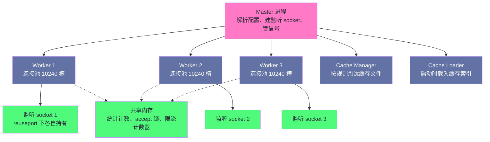
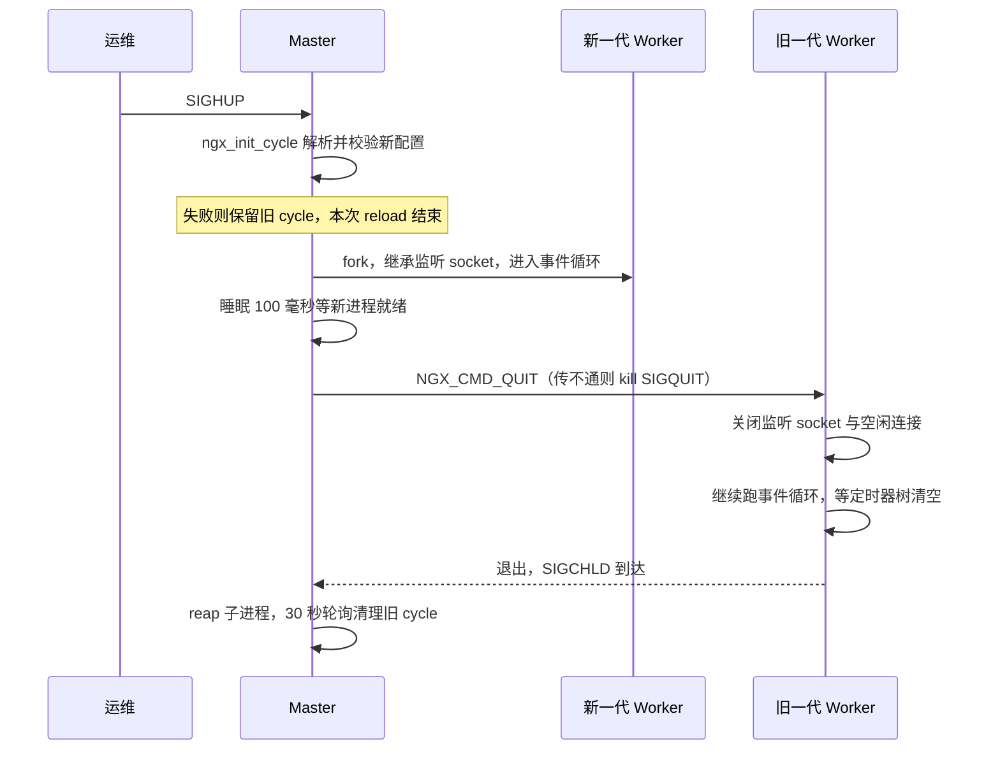
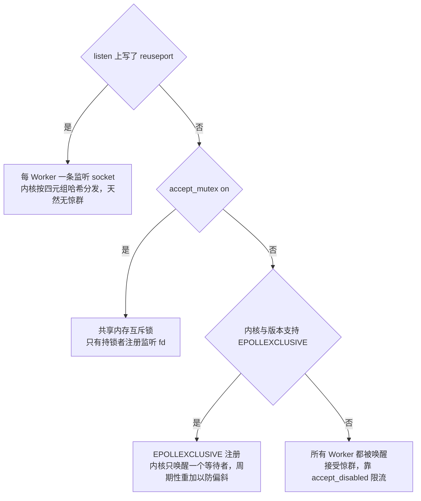
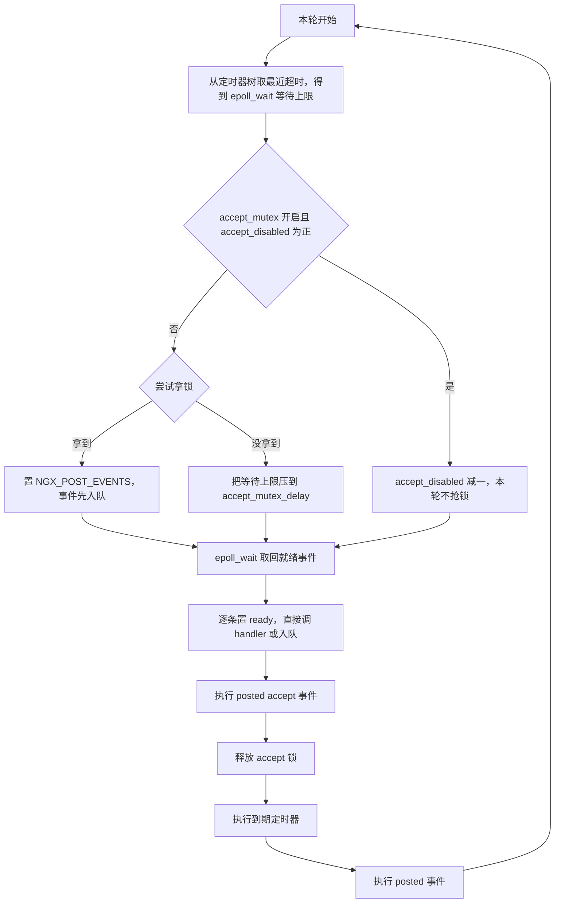
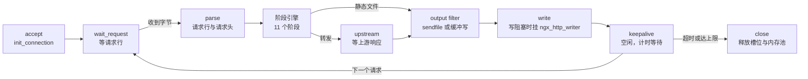

# 01 事件驱动模型：epoll 与 Master-Worker 进程架构

**摘要：**

一台八核机器上的 Nginx 可以同时挂着几万条连接，负载却长期贴着零，这件事常被当成"事件驱动很高效"的一句话结论带过。本文要拆的是这句结论背后的完整因果链：内核里的 epoll 就绪链表如何把"找出哪个连接有数据"从每轮遍历变成入队通知，Nginx 又如何用边缘触发、非阻塞 fd 和每连接状态机把这条通知变成可以无限叠加的连接；Master 与 Worker 之间的分工、`reload` 时新旧进程的交接时序、`worker_connections` 这个池子究竟被哪些东西占用、`SO_REUSEPORT` 与 `EPOLLEXCLUSIVE` 如何替代旧的 `accept_mutex`，都会落到源码级的执行路径上。文章的后半段反过来问：这套模型在什么情况下会崩。阻塞型调用、连接池耗尽、CPU 饱和、磁盘 IO 四类失效各有其日志与指标指纹，`stub_status` 的 `active`/`reading`/`writing`/`waiting` 四列正是把这些指纹读出来的入口，但它们的语义常被误读成"队列长度"。读完本文，读者应当能回答两个问题：单个 worker 为什么能撑住一万个连接，以及撑住之后它最先从哪里开始塌。

---

## 第 1 章 一个进程盯住一万个连接，靠的是什么

### 1.1 两本不同的账

C10K 问题之所以在 2002 年前后被反复讨论，根子在于早期 Web 服务器把"并发连接"与"活跃连接"记成了一本账。Apache 的 prefork 模型让一条连接独占一个进程，进程池的规模近似等于它能同时服务的连接数，这条等式在连接数上千之后就不成立了：内存按进程数线性增长，调度器要在大几千个可运行实体之间切换，而绝大多数进程此刻只是在 `read()` 上阻塞着等人。

真实的流量形态并非如此。一条 HTTP 长连接在它的生命周期里，真正有字节需要搬运的时间可能只占百分之一到千分之一，其余时间它只是在内核里占着一个 socket 结构和一个接收缓冲区。于是问题从"如何同时服务一万条连接"变成了"如何用少量执行流同时照看一万个 socket，只在某一个 socket 真正有数据时才动手"。I/O 多路复用（I/O Multiplexing）就是对这个问题的回答，而 epoll 是 Linux 上把这个回答做得最彻底的一代实现。

### 1.2 从 select 到 epoll：三代接口的成本差在哪

三代接口的差别不在"能不能同时监听多个 fd"，而在每一轮等待里固定开销的结构。笔者把三者的成本项摊在下表里，读者不妨对照源码里的调用路径，看 epoll 在连接数上万之后优势从何而来。

| 维度 | select | poll | epoll |
|---|---|---|---|
| 兴趣集合的传递 | 每轮把 `fd_set` 位图从用户态拷进内核 | 每轮把 `pollfd` 数组拷进内核 | `epoll_ctl` 注册一次，内核长期持有 |
| 内核侧就绪判定 | 遍历位图，O(n) | 遍历数组，O(n) | 事件发生时就绪节点入链表，O(1) 取回 |
| 单次可监听数量 | `FD_SETSIZE` 限制，通常 1024 | 受 fd 总数限制 | 受 fd 总数限制 |
| 返回结果的规模 | 与监听总数同阶 | 与监听总数同阶 | 与就绪数同阶 |
| 触发模式 | 水平触发 | 水平触发 | 水平触发与边缘触发可选 |

理解 epoll 的关键是它把**兴趣集合**与**就绪集合**拆成了两个内核结构：一棵红黑树存放所有被 `epoll_ctl` 注册过的 fd，一个就绪链表存放当前有事件的 fd。网卡收到数据、协议栈唤醒等待队列时，回调把对应的等待项挂进就绪链表；`epoll_wait` 只是把链表头部的一批节点拷回用户态，它既不需要知道总共有多少 fd 被注册，也不需要遍历它们。

```c
// epoll 的三个接口，注意第三个参数与返回值的关系
int epoll_create1(int flags);                 // 创建实例，返回 epfd
int epoll_ctl(int epfd, int op, int fd,       // op: ADD/MOD/DEL
              struct epoll_event *event);     // 一次性登记兴趣
int epoll_wait(int epfd, struct epoll_event *events,
               int maxevents, int timeout);   // 只取回就绪项
```

Nginx 在 Linux 上使用的就是这个接口，封装在 `ngx_epoll_module` 里，`ngx_epoll_process_events` 是事件模块对外的统一入口。它做三件事：调用 `epoll_wait` 拿回一批就绪事件；逐条检查事件掩码并置位 `rev->ready` 或 `wev->ready`；调用该事件对象上挂的 `handler`。第三步是整篇文章的枢纽——Nginx 没有"调度器"这个概念，连接的推进完全靠回调函数一层层换手。

### 1.3 边缘触发为什么在 Nginx 手里不会丢数据

关于边缘触发（Edge Triggered，ET）有一个流传很广的说法：用了 ET 就必须在每次触发后循环读取直到 `EAGAIN`，否则缓冲区里剩下的数据再也等不到通知。这个说法在原理上成立，但它描述的是一种朴素写法，Nginx 的实际做法更省事，也更值得学。

在 epoll 下，Nginx 对连接 fd 使用**边缘触发**，对监听 fd 使用**水平触发**，这个差异可以在 `ngx_epoll_add_event` 的调用点上看出来：监听事件以 `flags` 为 0 注册，连接事件走 `NGX_CLEAR_EVENT` 分支。监听 fd 用水平触发是有意为之——只要 accept 队列里还有连接，`epoll_wait` 每轮都会把它报上来，配合 `multi_accept` 就能把队列清空；连接 fd 用边缘触发则是为了减少无谓的唤醒。

边缘触发下不丢数据的保障藏在 `ngx_unix_recv` 里。它本身只读一次，并不循环，但它会在读满缓冲区之后调用 `FIONREAD` 探测内核里还剩多少字节：只有确认剩余为零，才把 `rev->ready` 清掉；如果还剩数据，`ready` 保持为 1，上层的解析状态机发现数据没消费完，会立刻再调一次读，不需要等下一次 epoll 通知。

```c
/* 源码路径：src/os/unix/ngx_recv.c，ngx_unix_recv 的收尾逻辑 */
if ((size_t) n == size) {
    /* 缓冲区读满了，内核里可能还有数据，用 FIONREAD 问一句 */
    if (ngx_socket_nread(c->fd, &rev->available) == -1) { ... }
} else {
    /* 没读满，认为内核缓冲区已空 */
    rev->ready = 0;
}
```

这段逻辑解释了一件事：边缘触发的安全性不取决于"应用层傻读"，而取决于"应用层是否知道自己有没有读完"。Nginx 用 `FIONREAD` 这个便宜的 ioctl 替代了循环读，代价是一次系统调用，收益是避免了不必要的 `read` 陷入内核。理解了这一点，再去看 `ngx_http_wait_request_handler` 里那些"读一次、解析、不够再读"的分支，就不会觉得它是在碰运气。

### 1.4 事件驱动成立的两个硬前提

把上文的机制压缩一下，一个进程要盯住一万个连接，必须同时具备两个前提，缺一不可。

第一个前提是所有可能阻塞的操作都不许阻塞。socket 必须是非阻塞的（`accept4` 直接带 `SOCK_NONBLOCK`，省掉一次 `fcntl`），磁盘读写要么走 `sendfile` 让内核代理，要么交给线程池，要么接受"它会卡住整个 worker"这个事实。这个前提一旦破掉，多路复用立刻退化成"一次只服务一个连接"，因为被阻塞的那个 worker 无法回到 `epoll_wait`。

第二个前提是每条连接都有一台自己的状态机。socket 上的数据到达是不连续的：可能是半行请求行，可能是请求头的一部分，可能是响应写到一半对端关窗。Nginx 把"这条连接走到哪一步了"记在 `ngx_connection_t` 与 `ngx_http_request_t` 上，把"下一步该谁处理"记在事件对象的 `handler` 上，于是任何一次回调都可以从上次中断的地方继续，而不需要保存调用栈。

这两个前提在 Nginx 里是硬编码进架构的：没有 `select` 的超时轮询，没有为等待某个上游响应而 `sleep` 的线程，只有回调、状态和定时器。

> [!info] 一句可以记住的对照
> 线程模型把并发的复杂度放进内核调度器，事件驱动模型把它搬进应用层的状态机。前者用栈保存上下文，后者用结构体保存上下文；前者一条连接一份栈，后者一条连接一份几百字节的连接对象。

---

## 第 2 章 Master 与 Worker 的分工

### 2.1 Master 只做四件事

读到"Master 不处理请求"这句话时，容易误以为 Master 很闲。它确实不碰业务流量，但它决定了整个进程组的生死与配置的代际更替，职责可以归成四件。

第一件是配置的读取与校验。`nginx.conf` 由 Master 解析，指令语法、模块加载、`include` 展开都在这一步完成；`nginx -t` 走的是同一条解析路径，只是解析完就退出。第二件是监听端口的创建。Master 在 `fork` 之前就把所有 `listen` 对应的 socket 建好，Worker 通过继承拿到这些 fd，这是"Worker 能 `accept`"的物理前提。第三件是 Worker 的派生与回收，`fork` 出子进程、`waitpid` 收尸、按需补位。第四件是信号处理，把运维意图翻译成对子进程的动作。

这四件事里，第一件和第四件合起来构成了 Nginx 最被低估的能力：不中断服务的**配置代际切换**。

### 2.2 进程树、监听 socket 与共享内存

Nginx 的进程结构比"一个 Master 加若干 Worker"要复杂一点：启用了 `proxy_cache` 之后还会多出 cache manager 与 cache loader 两个进程，前者负责按 `proxy_cache_path` 的规则淘汰过期文件，后者只在启动时把磁盘上的缓存索引读进共享内存。它们同样由 Master 派生，同样不处理客户端请求。



上图画出的是开启 `reuseport` 之后的形态，每个 Worker 手里有一条自己的监听 socket。不开 `reuseport` 时形态不同：Master 只建一条监听 socket，所有 Worker 共享同一个 fd，这条差异会在 2.6 节展开成三种 accept 秩序。

共享内存则是另一套账。`worker_processes` 个 Worker 是彼此独立的进程，但有些状态必须让它们看见同一份数据：`stub_status` 的四列计数器、`accept_mutex` 那把锁、`limit_req`/`limit_conn` 的计数器、`ssl_session_cache` 的会话缓存、OpenResty 的 `lua_shared_dict`，全部落在 Master 在 `fork` 之前映射好的共享内存区里。共享内存按"名称 + 大小"管理，这个细节在 `reload` 时的表现很关键，2.3 节会回到它。

### 2.3 reload 的完整时间线

`nginx -s reload` 是 Nginx 运维里最高频的动作，也是误解最多的地方。把 `ngx_master_process_cycle` 的处理路径照着走一遍，会发现它比"重启 worker"精细得多。

Master 收到 `SIGHUP` 后并不直接动 Worker，而是先调用 `ngx_init_cycle` 构造一份新的运行周期：重新解析配置、重新打开日志、重新准备共享内存区、按需补充监听 socket。这一步失败了会怎样？`ngx_init_cycle` 打印 `[emerg]` 级别的错误后返回空，Master 拿回旧 cycle 继续跑，旧 Worker 完全不受影响。也就是说，语法错误、`include` 缺失、监听端口冲突这类问题会在新配置生效之前被挡住，线上配置仍是上一份可用的。

校验通过之后才是交接：Master 先按新的 `worker_processes` `fork` 出新一代 Worker，这些进程带 `just_spawn` 标记；随后睡眠 100 毫秒给新进程一点启动时间；再向旧一代 Worker 发送优雅退出指令。这个指令默认不走 `kill`，而是通过 Master 与子进程之间那对 socketpair 传 `NGX_CMD_QUIT`，传不通才回退到 `kill(SIGQUIT)`。旧 Worker 收到退出指令后做的动作依次是：清掉退出标志、挂上 `worker_shutdown_timeout` 定时器、关闭自己的监听 socket、关闭所有空闲（reusable）连接，然后继续跑事件循环，把手上正在处理的请求跑完。



时间线里有三处容易被忽略，而它们恰好对应三类线上现象。

第一处是旧 Worker 关闭监听 socket 的时机。它一收到退出指令就不再接受新连接，新连接全部由新一代 Worker 接。这意味着 `reload` 的"平滑"建立在"新连接走新配置、老连接走老配置"之上；如果新配置有业务逻辑错误（譬如 `upstream` 指向了错误的地址），只有新连接会踩到，旧连接仍然正常，故障会呈现为"一部分请求正常、一部分请求 502"，而不是全站故障。

第二处是旧 Worker 到底等什么才退出。它等的不是"所有连接关闭"，而是"定时器树里不再有不可取消的定时器"。实现上，`ngx_event_no_timers_left` 会遍历红黑树，只要还存在一个非 `cancelable` 的定时器就返回继续等。空闲的 keepalive 连接因为已在退出时被主动关闭，不会拖住退出；但一个 WebSocket 长连接、一个正在慢慢下载大文件的请求、一次尚未返回的上游调用，都会让旧 Worker 一直停在"正在优雅退出"的状态。如果配置了 `worker_shutdown_timeout`（1.11.11 起），超时之后会强制关闭剩余连接；不配置则是无限等，线上常见的"reload 之后旧 worker 迟迟不消失，进程数翻倍"就是这种情形。

第三处是旧 cycle 的内存什么时候真正释放。Master 并不在子进程退出时立刻销毁旧 cycle，而是挂一个 30 秒周期的清理定时器 `ngx_clean_old_cycles`，逐个扫描旧 cycle 的连接数组，确认所有槽位的 fd 都已关闭后才 `ngx_destroy_pool`。原因很实际：子进程退出与父进程知晓之间存在时间差，旧 cycle 里还有监听 socket、日志文件描述符、连接池这些资源要确认无人引用。对运维的启示是：频繁 reload 时，短时间内看到内存与 fd 数量阶梯式上升属于正常，只有当某一代 cycle 的 Worker 长期不退出时，这些资源才会一直挂着。

顺带说清共享内存在 reload 里的行为。新 cycle 构造时会拿 `shared_memory` 里的每个 zone 去旧 cycle 里找同名 zone，名称和大小都一致就复用同一块内存并把旧数据传给 `init` 回调；大小变了就重新分配一块新的，旧数据丢失。这条规则直接影响 `lua_shared_dict`、限流计数、SSL 会话缓存：调整了 zone 大小再 reload，等于把这些内存态清空。

> [!warning] reload 不会替你验证业务语义
> `nginx -t` 与 `ngx_init_cycle` 能挡住的是语法、上下文、文件缺失、端口冲突。`upstream` 地址写错、`proxy_pass` 指向了不存在的路径、新增的 `location` 吞掉了原本的流量，这些都能通过校验并成功 reload。线上安全的做法是先 `nginx -t`，再在低峰期 reload，然后盯住错误率与新老进程的请求分布；如果前面还有一层负载均衡，可以先摘掉一个节点再操作。

### 2.4 新 Worker 为什么不会被误杀

`reload` 的交接顺序是"先起新、再停旧"，但 Master 在停旧的时候是遍历整个子进程表发指令的，凭什么不会顺手把刚起来的新 Worker 也杀掉？答案是 `just_spawn` 这个标记：`ngx_start_worker_processes` 以 `NGX_PROCESS_JUST_RESPAWN` 模式派生新进程，`ngx_spawn_process` 会给它置上 `just_spawn = 1`；随后 `ngx_signal_worker_processes` 遍历进程表时，遇到 `just_spawn` 为真的进程就把标记清掉并跳过，这一轮不向它发任何信号。新一代的 Worker 就这样躲过了第一批退出指令。

这个设计还带来一个副作用，值得在容量规划时留意：`reload` 过程中，新旧两代 Worker 会短暂并存，进程数、连接池、内存占用、fd 数量都会翻倍。`worker_connections` 的池子是每个 Worker 各自预分配的，所以 reload 瞬间对 `RLIMIT_NOFILE` 的需求也会翻倍。配置本身贴着系统上限的机器，在 reload 时会更容易撞上 `too many open files`。

### 2.5 worker_processes 与 CPU 亲和

`worker_processes` 的取值决定了有多少个事件循环在并行跑。默认值是 1，生产配置里最常见的是 `auto`，它让 Nginx 在启动时通过 `sysconf(_SC_NPROCESSORS_ONLN)` 探测在线 CPU 数，按探测结果派生进程。这个探测只看得到操作系统的在线核数，不读 cgroup 的 CPU 配额，于是容器里配了 `--cpus=2` 而节点有 64 核时，`auto` 会老老实实起 64 个 Worker，每个都想抢那两个核的时间片，上下文切换与缓存颠簸一起上来。容器化部署里更稳的写法是显式给数字，或者用环境变量在启动脚本里算好再注入。

Worker 数与核数对齐的理由不复杂：Nginx 的一个 Worker 内部是纯单线程的事件循环，同一时刻只有一个核在替它干活。进程数少于核数，剩下核闲着；进程数多于核数，多出来的进程只会互相抢占，还各自背着一份连接池与缓存。至于"反向代理场景可以设成核数的两倍以提高利用率"这类建议，只在 Worker 大量时间花在等待上游、CPU 确实空闲时才成立，判断依据应当来自监控而不是口头经验。

`worker_cpu_affinity` 把 Worker 绑到固定的核上，让连接状态、HTTP 解析状态机这些热数据稳定留在某个核的 L1/L2 里，减少进程在核间迁移导致的缓存失效。手写位掩码的写法在核数多的机器上很笨重，`worker_cpu_affinity auto` 更实用，它从 1.9.10 起可用（注意这个版本号，早年的资料常写成 1.9.1），后面还能跟一个掩码参数把可用核限定在某个子集，譬如 `worker_cpu_affinity auto 01010101` 只在前八个核里绑。在 NUMA 机器上，绑定只解决了 CPU 侧，内存侧的本地性要靠 `numactl` 之类的工具，绑核反而可能把 Worker 固定在远端的节点上，这种场景必须结合 `numastat` 一起看。

### 2.6 accept 的三种秩序

所有 Worker 都要从监听端口上拿新连接，多个执行流抢同一条监听 socket 就是经典的**惊群**（Thundering Herd）场景：新连接到达，内核把等待队列上的所有进程都唤醒，只有一个能 `accept` 成功，其余白跑一趟。Nginx 演化出三种应对方式，它们不是互相替代的关系，而是按内核能力与配置分层的三条路径。

第一条是 **`accept_mutex`**，用户态方案。它是一把建在共享内存上的互斥锁，任一时刻只有一个 Worker 持锁，也只有持锁者会把自己 epoll 里的监听 fd 注册上；不持锁的 Worker 干脆不监听新连接，自然不会被打扰。没能拿到锁的 Worker 在这一轮里会把 `epoll_wait` 的超时压到 `accept_mutex_delay`（默认 500 毫秒）以内，隔一小段时间再试。这套机制的默认值在 1.11.3 变了：之前默认开启，之后默认关闭，官方文档给出的理由是支持 `EPOLLEXCLUSIVE` 的内核上没有必要再用用户态锁。

第二条是 **`EPOLLEXCLUSIVE`**，内核方案。1.11.3 起，当配置为多 Worker、事件方法为 epoll、又没有开 `accept_mutex` 时，Nginx 会把监听 fd 以 `EPOLLEXCLUSIVE` 注册进每个 Worker 的 epoll 实例，由内核保证一次只唤醒其中一个等待者。它的缺陷在实现细节里：Linux 倾向于唤醒"最早注册的那个"等待者，长期跑下来可能变成第一个 Worker 吃掉大部分连接。Nginx 的补丁是 `ngx_reorder_accept_events`，在每次 accept 之后，若该监听 socket 已累计 accept 的次数除以 16 有余数、或 `accept_disabled` 大于零，就把监听 fd 从 epoll 里摘掉重加一次，让"最早注册者"的身份轮换起来。

第三条是 **`SO_REUSEPORT`**，1.9.1 引入，要求 Linux 3.9 及以上。它的做法与前面两条完全不同：`reuseport` 参数让 Nginx 为每个 Worker 各建一条独立的监听 socket，绑定同一个地址端口，由内核按四元组哈希把新连接分给其中一条。源码里这件事发生在 `ngx_clone_listening`：Master 在为 `listen` 准备监听项时，把这个条目按 Worker 数量复制若干份，每份标记 `worker = n`，各建一个 socket；Worker 初始化时只保留属于自己那一份，其余的跳过。因为每个 Worker 面对的是自己的 socket，内核在哈希时已经把连接选好了，不存在多个进程被同时唤醒的问题，`accept_mutex` 也就无事可做。



三条路径怎么选，取决于要优化的是什么。`reuseport` 在高频新建连接的场景下最省事，分发均匀、无需用户态协调，还能顺带避开单条监听 socket 的锁竞争；代价是连接的分发权交给了内核哈希，一个响应变慢的 Worker 不会因此少分到连接，慢 Worker 会持续堆积，而哈希本身也不感知 Worker 的真实负载。`EPOLLEXCLUSIVE` 不需要改配置，是默认路径下的现代方案，靠周期性重加缓解偏斜。`accept_mutex` 在今天主要出现在内核较老或需要严格控制唤醒次数的环境里。

| 维度 | accept_mutex | EPOLLEXCLUSIVE | SO_REUSEPORT |
|---|---|---|---|
| 实现位置 | 用户态共享内存锁 | 内核 epoll 就绪队列 | 内核 socket 层 |
| 版本要求 | 无内核要求，1.11.3 起默认 off | Nginx 1.11.3 起，内核 4.5 起 | Nginx 1.9.1 起，Linux 3.9 起 |
| 监听 socket 数量 | 每个端口一条，全 Worker 共享 | 每个端口一条，全 Worker 共享 | 每个 Worker 一条 |
| 惊群抑制 | 靠"不持锁不注册" | 靠内核只唤醒一个 | 不存在共享等待队列 |
| 负载均衡 | 轮转，取决于谁先抢到锁 | 内核挑选，存在偏向首个注册者的问题 | 四元组哈希，均匀但不感知 Worker 负载 |
| 主要代价 | 抢锁与等待延迟 | 偏斜时需要重加，仍有唤醒开销 | 慢 Worker 持续积压，重载时连接分布会短暂不均 |

还有两个参数与 accept 的节奏相关，容易配反。`multi_accept` 默认关闭，开启后一次事件会循环 `accept` 直到队列空，适合新连接密集的入口；关闭时每次只取一条，能让多个 Worker 更均匀地分摊新建连接，代价是事件循环被唤醒的次数变多。`accept_disabled` 则不是配置项而是内部限流器：`ngx_event_accept` 每成功 accept 一条连接，就把它设为 `connection_n / 8 - free_connection_n`，也就是连接池用掉超过八分之七之后，这个值转正，Worker 在接下来的若干轮里主动放弃抢 accept 锁，每轮减一。这条逻辑保证了接近耗尽连接池的 Worker 不会继续把新连接往自己身上揽，把机会留给还有余量的兄弟进程。

```nginx
# 与 accept 相关的三处配置，注意它们之间的互斥关系
events {
    worker_connections 10240;   # 每 Worker 的连接槽位总数
    multi_accept on;            # 新连接密集的入口开启，配合 reuseport 更均匀
    accept_mutex off;           # 1.11.3 起默认值，开 reuseport 时无意义
}

http {
    server {
        listen 80 reuseport backlog=4096;   # 每 Worker 独立 socket
    }
}
```

这段配置里的三条指令分属 `events` 与 `http` 两个上下文，能不能写在这里、值如何从外层继承下来，属于配置体系的规则，具体见 [[02 配置体系解析：指令、上下文与继承规则]]。

---

## 第 3 章 一轮事件循环做了什么

### 3.1 ngx_process_events_and_timers 的六步

`ngx_process_events_and_timers` 是 Worker 的心跳，它的每一轮都在重复同样的六步。把源码按顺序读一遍，会发现步骤之间的顺序不是随手排的，每一处都在处理"锁的持有时间"或"时间的准确性"。

第一步算超时。函数先调 `ngx_event_find_timer`，从用户态定时器红黑树里找出最近一个将要过期的定时器，用它与当前的差值作为 `epoll_wait` 的超时；如果树是空的，就传入无限等待。同时置上 `NGX_UPDATE_TIME` 标志，让 epoll 模块在返回后刷新缓存的当前时间，这样一轮循环只取一次时钟，后续所有超时判断都用这个缓存值。

第二步处理 accept 锁。若 `accept_mutex` 开启且 `accept_disabled` 为正，就在这一轮什么都不做，只把 `accept_disabled` 减一；否则尝试拿锁，拿到就把 `NGX_POST_EVENTS` 标志置上，没拿到则把本轮超时压到 `accept_mutex_delay` 以内。

第三步进内核等事件。`ngx_process_events` 最终落到 `ngx_epoll_process_events`，`epoll_wait` 最多取回 512 个就绪事件（这个数组大小是事件模块的内部默认值，不是文档中的配置项）。对每个就绪事件，置位 `rev->ready` 或 `wev->ready`，然后决定是直接调 `handler` 还是先挂进队列——决定的依据就是上一步的 `NGX_POST_EVENTS`：持着 accept 锁的时候不执行任何业务回调，accept 类事件进 `ngx_posted_accept_events`，其余进 `ngx_posted_events`。

第四步处理 posted accept 事件并解锁。新连接的后续初始化放在锁外跑，避免一个慢的 `accept` 处理拖长锁的持有时间。

第五步过期定时器。`ngx_event_expire_timers` 从红黑树里取出所有到期节点，逐个执行它们的 `handler`；连接超时、`keepalive_timeout` 到期、上游读超时都是在这里被兑现的。

第六步处理 posted 事件。这一步兑现的是"延后执行"的语义：流水线请求、上游返回后的续跑、写事件被重新挂起后的重试，都借这个队列在下一轮开头或本轮末尾执行，从而避免在回调里递归下去把调用栈打爆。



六步里最值得记住的是第三步的 **512**。它意味着单轮能处理的事件数有上限，一个 Worker 就算有十万条连接同时可读，也需要约两百轮 `epoll_wait` 才能轮完一遍。这也解释了为什么任何一个 `handler` 里都不能做长耗时的事：它借走的不只是自己这一条连接的时间，而是把整轮里其他 511 个事件的处理一起推后了。

### 3.2 两级 handler 分发

事件对象上的 `handler` 是一个函数指针，`ngx_event_t` 结构里还有 `data`、`write`、`ready`、`active`、`timer` 这些字段。一种常见的误读是把连接上的读写回调当成直接挂着业务函数，实际上 Nginx 用了两级分发。

第一级是 fd 上的固定入口。一个连接进入请求处理阶段后，它的读事件和写事件都被换成 `ngx_http_request_handler`；上游连接则换成 `ngx_http_upstream_handler`。这两个函数做的事都是查表：读事件交给 `r->read_event_handler`，写事件交给 `r->write_event_handler`，上游连接则交给 `u->read_event_handler` 与 `u->write_event_handler`。

第二级才是当前状态对应的处理函数。这些指针随着请求阶段不断被替换：等请求行时是 `ngx_http_wait_request_handler`，解析请求行时切到 `ngx_http_process_request_line`，解析完请求行切到 `ngx_http_process_request_headers`，进入阶段引擎后读事件处理器换成 `ngx_http_block_reading`，输出被阻塞时写事件处理器换成 `ngx_http_writer`，转发到上游后两者换成上游模块的收发函数。所谓"每个连接一个状态机"，落到实处就是这几个函数指针的换手。

这样分层的好处是连接对象不必知道 HTTP 的存在，请求对象也不必知道 epoll 的存在；坏处是调试时在 `handler` 上下断点只能看到入口，真正的业务逻辑在二级指针后面，得顺着 `r->read_event_handler` 再跟一层。

### 3.3 不用线程也能并发的三个条件

"Nginx 不用线程"这句话需要一点修正。准确地说，连接调度与请求处理是单线程的，文件读写可以借线程池（`aio threads`），TLS 握手、压缩、正则匹配这些 CPU 活在 Worker 线程里同步做完。连接侧不引入线程，靠的是**三个条件**同时成立。

其一，所有连接侧的等待都是事件化的。读等数据、写等窗口、连等握手、超时等定时器，全都有对应的回调，没有一处是"阻塞等一个结果"。其二，状态全在堆对象上。`ngx_connection_t` 记 fd 与事件，`ngx_http_request_t` 记解析进度与阶段，缓冲区挂在请求的内存池上，任何一次回调都能从结构体里恢复上下文。其三，时间也是事件化的。没有 `sleep`，只有定时器；定时器红黑树让"最近什么时候该醒"这个问题在 O(log n) 内回答，`epoll_wait` 的超时参数就是它的答案。

不妨看一个反面案例。第三方模块如果在请求路径里做一次同步 `gethostbyname`，或者 Lua 代码在 `content_by_lua` 里调了 `io.open` 读文件，这段时间里该 Worker 的 `epoll_wait` 根本没机会被调用，它名下所有连接的事件全部堆在就绪链表里排队。对外表现不是"这一条请求慢了"，而是"打到这个 Worker 的所有请求一起慢"，而且由于连接是随机分配过去的，监控上看像是"随机时间的随机比例超时"。

### 3.4 定时器与 posted 事件

定时器在 Nginx 里承担了所有"过一会儿该做点什么"的语义：`client_header_timeout` 等请求行、`keepalive_timeout` 关空闲连接、`proxy_read_timeout` 等上游响应、`send_timeout` 等写窗口、`worker_shutdown_timeout` 强制退出。它们统一挂在 `ngx_event_timer_rbtree` 这棵按到期时间排序的红黑树上，`epoll_wait` 的超时就取树的最小值减当前时间。

posted 事件队列则解决另一个问题：回调里不能递归。设想一个流水线请求，前一个请求刚结束、缓冲区里已经躺着下一个请求的字节，处理它的正确时机不是"在当前回调里直接调用解析函数"，而是把它挂进 `ngx_posted_events`，等当前这轮事件处理告一段落再执行。`ngx_http_run_posted_requests` 处理的"posted requests"是 HTTP 层的另一条队列，用于子请求完成后的续跑；两个队列名字相近，作用域不同，读源码时容易混。

---

## 第 4 章 连接生命周期的四个阶段

### 4.1 accept：从内核队列到连接对象

新连接到达时，内核先完成三次握手，把它放进监听 socket 的 accept 队列。epoll 报上来的是监听 fd 可读，`ngx_event_accept` 被调用，它做的最重要的一件事是选一个连接槽位：`ngx_get_connection` 从空闲链表里取一个 `ngx_connection_t`，同时把它的读事件、写事件对象清干净，把 fd 填进去。取不到槽位就是 **`worker_connections` 耗尽**，日志里出现 `worker_connections are not enough`，这条连接被直接关掉。

拿到槽位之后，`accept4` 返回的 fd 已经是非阻塞的，连接对象被挂上 `ngx_http_init_connection` 作入口，这个函数判定虚拟主机、处理 PROXY protocol 与 SSL 握手（若端口开了 ssl），然后给读事件挂上 `ngx_http_wait_request_handler`，并加上 `client_header_timeout` 定时器。此刻连接处于"已建立、尚未收到请求"的状态，它已经占了一个槽位，也已经计入 `active`。

### 4.2 read：解析请求

`wait_request_handler` 被触发时，先看 `c->buffer` 有没有分配，没有就按 `client_header_buffer_size`（默认 1k）建一个，然后读一次。读到数据就创建请求对象，把读事件处理器换成 `ngx_http_process_request_line`，解析请求行；请求行过长会触发 `large_client_header_buffers`（默认 4 个 8k）的分配，超出仍然放不下则返回 414。请求行解析完切到 `ngx_http_process_request_headers`，逐个头字段解析，头过大返回 400，头里缺少 `Host` 之类的问题则直接回 400。

这个阶段是整个生命周期里最容易被打包成攻击面的地方：慢速攻击靠每次只发一个字节拖住连接，防御依赖 `client_header_timeout` 与 `client_body_timeout`；超大 `Cookie` 会让缓冲区从 1k 一路升到 8k，内存消耗按连接数放大。

### 4.3 process：阶段引擎与上游

请求头解析完毕后，读事件与写事件都换成 `ngx_http_request_handler`，请求交由 `ngx_http_handler` 驱动的阶段引擎处理，**11 个阶段**的顺序与语义属于请求处理管道的范畴，本文不展开，细节见 [[03 HTTP 请求处理管道：11 个阶段全解]]。与本文相关的是：这个阶段里 Nginx 可能做三件性质完全不同的事。

第一件是纯内存计算，譬如 `return 200`、`rewrite` 后重定向、命中 `proxy_cache` 的内存缓存。这类处理在微秒级完成，不产生任何等待。

第二件是磁盘读，静态文件走 `sendfile` 或读写缓冲，缓存文件走文件读。这是本文后半段要展开的阻塞点之一。

第三件是转发给上游，`proxy_pass`、`fastcgi_pass` 之类。`ngx_http_upstream_init_request` 会为请求分配上游连接对象、发起非阻塞 `connect`，并把读写事件换成 `ngx_http_upstream_handler`；此后本 Worker 不再为这条请求占着任何执行时间，它只是在上游 fd 就绪时被回调唤醒。这正是反向代理场景下单个 worker 能挂住大量请求的原因——等待上游的时间不消耗 CPU，只消耗一个连接槽位。

### 4.4 write：把响应推出去

响应生成后走过滤链，最终由 `ngx_http_write_filter` 往 socket 里写。写不进去是常态：客户端接收窗口满了、TLS 记录层要分片、`sendfile` 一次只能推一部分。这时写事件被挂起，`r->write_event_handler` 换成 `ngx_http_writer`，等 epoll 报可写再继续；`send_timeout` 管着这个等待的上限。

### 4.5 keepalive 与关闭

响应最后一个字节发完，`ngx_http_finalize_request` 走完收尾：请求对象释放、内存池销毁，然后决定连接的去向。HTTP/1.1 默认复用连接，于是 `ngx_http_set_keepalive` 把读事件处理器换成 `ngx_http_keepalive_handler`，加 `keepalive_timeout`（默认 75 秒）定时器，并把连接标记为 reusable。此刻连接进入空闲态，它占着槽位、计入 `active` 与 `waiting`，但不消耗 CPU。

连接的终点有三条路：客户端主动关闭，`EPOLLRDHUP` 或读返回零让 `wait_request_handler` 走 `ngx_http_close_connection`；空闲超时，定时器到期后关掉；达到 `keepalive_requests` 上限（默认 1000，1.19.10 之前是 100）后主动关闭，避免单条连接积累过多的内存分配。



| 阶段 | 入口 handler | 触发来源 | 可能的阻塞点 |
|---|---|---|---|
| accept | `ngx_event_accept` → `ngx_http_init_connection` | 监听 fd 可读 | 连接槽位耗尽（直接失败，不阻塞） |
| read | `ngx_http_wait_request_handler` → 逐行解析函数 | 客户端 fd 可读 | 无（socket 非阻塞），但缓冲区分配可能失败 |
| process | `ngx_http_request_handler` → 阶段引擎 | 上一阶段完成后主动推进 | 同步文件读、同步 DNS、Lua 阻塞调用、第三方模块 |
| write | `ngx_http_writer` | 客户端 fd 可写 | `sendfile` 触发的磁盘读、TLS 加密的 CPU 开销 |

### 4.6 一个普通请求的内存账

把上面的流程换成**内存视角**，可以看出"一万个连接"到底贵在哪里。每个 Worker 在启动时就按 `worker_connections` 预分配三块数组：连接对象、每连接两个事件对象。以 10240 槽位为例，按 64 位平台的结构体量级估算，连接对象约 200 字节、事件对象约 130 字节，合计约 4.7 MB，这部分是常驻的，与流量无关（示例推算，具体大小随编译选项与平台变化）。

连接建立后从自己的连接池里取一个池（`connection_pool_size`，64 位默认 512 字节）；请求到达后再建一个请求池（`request_pool_size`，默认 4k），请求头缓冲区按 1k 起步、必要时升到 8k 一个的大缓冲。请求结束请求池销毁，大缓冲归还空闲链；空闲 keepalive 连接大致只保留连接池与少量结构，量级在一千字节上下（示例推算）。这意味着一条空闲连接的内存成本约等于一个请求的十分之一到二十分之一，"挂住十万条长连接"与"扛住十万 QPS"在内存账单上是两件完全不同的事。

---

## 第 5 章 这套模型什么时候会崩

前面四章建立的是"为什么能撑住"的模型。接下来换成失败视角：哪些条件一旦不成立，这个模型会在哪个环节、以什么形态塌掉。四种失效模式各有各的日志与指标，下面逐个拆开。

### 5.1 阻塞型调用：一次同步等待就能冻结整个 worker

事件驱动的全部收益，建立在"回调一定能很快返回"这个假设上。任何一次同步阻塞都会让假设失效，而且是**流水线级别**的失效：该 Worker 的 `epoll_wait` 停住，就绪链表里的其他事件只能排队，它们连接上的客户端看到的是延迟上升直到超时。这个 Worker 身上挂着的连接越多，一次阻塞的杀伤面越大。

阻塞源大致分四类，判别与替代手段各不相同。

| 阻塞源 | 典型写法 | 现场特征 | 替代方案 |
|---|---|---|---|
| 磁盘文件读写 | `io.open`/`read`、第三方模块直接 `open`+`read` | 延迟毛刺与磁盘 IO 曲线同步，`iowait` 上升 | 静态文件用 `sendfile`+`aio threads`；Lua 用 cosocket 或交给外部服务 |
| 同步 DNS 解析 | LuaJIT FFI 调 `getaddrinfo`、第三方模块内部解析 | 毛刺与 DNS 响应时间相关，解析慢时全站慢 | 配 `resolver` 走 cosocket，或把解析结果缓存到共享内存 |
| 外部命令与进程 | `os.execute`、`io.popen`、第三方模块内部的 fork/exec | 毛刺与子进程生命周期同步 | 移出请求路径，用异步任务或旁路服务 |
| 锁与自旋 | Lua 里用自旋等待外部状态、模块内部的同步锁 | CPU 打满且 QPS 不涨 | 改用 `lua-resty-lock` 这类带超时与让出语义的锁 |

第三类的细节值得单独说。OpenResty 里的 `ngx.sleep` 会让出执行权、`ngx.socket` 系列是 cosocket 非阻塞的，这些都是安全的；但只要跨出 cosocket 的边界，阻塞就回来了。常见的一类是 `init_by_lua` 与 `init_worker_by_lua` 里做重活：前者跑在配置加载阶段，等同于拖慢 reload 与启动；后者跑在 Worker 进入事件循环之前，等同于拖慢整个 Worker 的就绪时间。另一类是定时器回调：`ngx.timer.at` 注册的函数由 Worker 的事件循环亲自执行，它里面若有阻塞调用，效果与在请求路径里阻塞完全一样。很多人误以为定时器是"后台线程"，这个误解会在压测时以"CPU 不高但所有请求都慢"的形式暴露；cosocket 的边界与协程调度见 [[12 OpenResty 架构：LuaJIT、cosocket 与协程调度]]。

### 5.2 worker_connections 用尽：池子里装的不只是客户端

`worker_connections` 的官方定义写得很明确：它限制的是每个 Worker 能同时打开的最大连接数，且这个数字包含与上游服务器的连接，不只是客户端连接。这句话在实际规划时经常被简化成"按客户端并发算"，于是在反向代理场景里把池子算小了一半。

更严格地看，连接池的槽位被**五类占用者**分掉。

| 占用者 | 是否占槽位 | 说明 |
|---|---|---|
| 客户端连接 | 是 | 每条 TCP 连接一个槽，含 keepalive 空闲连接 |
| 上游连接 | 是 | 每个到后端的连接一个槽；未复用时要和客户端连接叠加 |
| 监听 socket | 是 | 每条监听 socket 占一个，`reuseport` 下每个 Worker 各占自己的 |
| 进程间 channel | 是 | Master 与 Worker 通信的那对 socketpair 占一个 |
| 日志与缓存文件 | 否 | 走 fd 但不占连接池，占的是 `RLIMIT_NOFILE` |

源码里有一条启动期检查可以印证前两项：如果 `worker_connections` 小于监听 socket 数量加一，Master 直接报 `worker_connections are not enough for listening sockets` 并拒绝启动。也就是说，一条监听 socket 就是实打实的一个槽位，占用并不因为它是"监听"而豁免。

真正用尽时的行为分两层。第一层是**节流**：accept 成功后 `ngx_accept_disabled` 被设为 `connection_n / 8 - free_connection_n`，连接池用掉超过八分之七后这个值为正，Worker 主动在若干轮里不抢 accept 锁，避免自己继续揽连接。第二层是**腾挪与拒绝**：`ngx_get_connection` 在取槽位之前会先调 `ngx_drain_connections`，如果空闲槽位已经少于总池的十六分之一、又存在 reusable 连接，就从空闲连接队列尾部挑若干条（最多 32 条、按 reusable 总数的八分之一）置上 `close` 标记并触发其读回调关闭，同时打一条警告 `worker_connections are not enough, reusing connections`。真到一条可腾的连接都没有，才打印 `worker_connections are not enough` 并把刚 accept 的 fd 关掉。

这条行为链解释了一个常被误判的现象：连接池将满时，线上不一定是"新连接全被拒"，更多是"一批 keepalive 连接被主动踢掉"，客户端侧表现为偶发的连接重置或重连。日志里那条 `reusing connections` 的 WARN 是重要信号，它的出现意味着池子已经在靠杀空闲连接维持。

`worker_rlimit_nofile` 与 `worker_connections` 的关系也常被搞混。前者改的是 Worker 进程的 `RLIMIT_NOFILE`，后者是 Nginx 自己维护的连接槽位数，两个数字约束的是不同层面的资源：槽位不够时 Nginx 主动拒绝，fd 不够时内核直接让 `accept4` 返回 `EMFILE`。fd 超限的处理在 `ngx_event_accept` 里：打印 `accept4() failed (24: Too many open files)`（CRIT 级别），禁用该监听 socket 的 accept 事件以免空转，开 `accept_mutex` 时置 `accept_disabled = 1`，不开时挂一个 `accept_mutex_delay` 的定时器稍后再试。完整的配置链是 `limits.conf` 或 systemd 的 `LimitNOFILE`、`worker_rlimit_nofile`、`worker_connections` 三者依次放宽，任何一环卡住，最终生效的都是最小的那个值。

```nginx
# 三者对齐的一种写法：worker_connections 的一半容量留给上游连接
worker_rlimit_nofile 32768;      # fd 上限，需不小于连接槽位数的两倍加余量

events {
    worker_connections 12800;    # 槽位，含客户端、上游、监听与 channel
}
```

这几个参数互相约束，单独拧一个往往只是把瓶颈推到下一个参数上。下表把方向性的代价列出来，改配置之前值得对照一遍。

| 指令 | 默认值 | 作用 | 调大的代价 | 调小的代价 |
|---|---|---|---|---|
| `worker_connections` | 512 | 每 Worker 的连接槽位数 | 预分配内存与 fd 需求同步上升，`reload` 时峰值再翻一倍 | 上游连接一多就撞 `not enough`，只能靠踢空闲连接维持 |
| `worker_rlimit_nofile` | 未设置 | Worker 进程的 fd 上限 | 超过系统级上限后无效，还可能掩盖 fd 泄漏 | 低于槽位需求时 `accept4` 直接报 `too many open files` |
| `worker_processes` | 1 | 事件循环个数 | 超过核数只增加调度开销，内存与 fd 成倍增长 | 少于核数时 CPU 用不满，高峰时新连接在队列里等 |
| `accept_mutex_delay` | 500ms | 抢锁失败后的重试间隔 | 空闲 Worker 要等更久才重新参与抢锁，新连接分摊变慢 | 抢锁更频繁，空转的唤醒与切换变多 |
| `multi_accept` | off | 单次事件里 accept 的条数 | 单个 Worker 连续吃连接，短时分布不均，单轮事件循环变长 | 唤醒次数增多，多 Worker 之间分摊更均匀 |
| `keepalive_timeout` | 75s | 空闲连接的保留时长 | 空闲连接长期占着槽位，`waiting` 虚高 | 客户端频繁重连，握手与 TLS 成本上升 |

### 5.3 CPU 饱和：事件循环再快也怕算不完

第二类崩塌不来自等待，而来自计算。事件循环省掉的是等待的浪费，省不掉 CPU 的消耗；一旦单位时间内的计算量超过核数，队列就在就绪链表里堆积起来，表现同样是延迟上升。

**压缩**是最典型的例子。`gzip` 对每个响应体做 deflate，CPU 消耗与响应体大小、压缩级别强相关；`gzip_static` 只发预压缩文件，不消耗运行期 CPU，是最省的做法；`gzip_types` 配得随意、把图片与已压缩格式也纳进来，等于对压缩过的数据再做一次无用功。Brotli 压缩率更高，但它不是 Nginx 官方模块，需要编译第三方模块，CPU 开销通常比 gzip 更高，静态资源预压缩才是它的合理用法。

TLS 握手是第二类。完整握手要做密钥交换与证书签名验证，计算量集中在服务端私钥运算与签名校验上，ECDSA 证书明显比 RSA 便宜；会话复用（`ssl_session_cache` 与 session ticket）能把大部分重复握手降级为一次对称密钥协商。这里的关键判断是：TLS 的 CPU 成本发生在握手，不发生在数据搬运，所以"短连接多、握手频繁"的流量结构对 CPU 的杀伤远大于"长连接加 keepalive"；卸载层的设计见 [[06 SSL-TLS 卸载：HTTPS 握手流程与性能优化]]。

正则匹配是第三类，也是最容易被忽略的。`location` 里的正则、`rewrite` 规则、`if` 条件都走 PCRE，正常情况下每次匹配在微秒级，但存在回溯爆炸的写法——一个嵌套量词的正则配上精心构造的输入，可以让单次匹配吃掉几毫秒甚至更多。`pcre_jit on` 能显著降低常规匹配的成本，代价是启动时多一次编译。这类问题在监控上的指纹很典型：QPS 没涨、带宽没涨、CPU 单核跑满，而请求延迟的 99 线抬高。

| CPU 密集操作 | 触发条件 | 缓解手段 |
|---|---|---|
| gzip 动态压缩 | 响应体大、压缩级别高、类型配得宽 | `gzip_static` 预压缩、收窄 `gzip_types`、下调级别 |
| TLS 握手 | 短连接比例高、会话复用未开 | 开 session cache 与 ticket、换 ECDSA 证书、前置卸载 |
| 正则匹配 | `location` 大量正则、回溯型写法 | 命中前缀的用前缀匹配、开 `pcre_jit`、重写正则 |
| 缓存键计算与日志转义 | 高 QPS 下的 `proxy_cache_key`、复杂 `log_format` | 精简键与格式、必要时异步写日志 |

### 5.4 磁盘 IO：sendfile 绕过用户态，绕不过磁盘

`sendfile` 经常被当作"零拷贝所以很快"的同义词，这个理解漏掉了它的边界。它省掉的是数据从内核页缓存到用户态缓冲区再回内核的那次拷贝，省不掉的是"页缓存里没有这份数据时，得去磁盘上取"。Linux 上的 `sendfile` 在缺页时会同步发起磁盘读，读多久，调用它的 Worker 就被卡多久——一次冷文件的 `sendfile` 与大文件场景下的随机读，足以让整轮事件循环停摆。

有两条补充路径。一条是内核 AIO 配合 `directio`：`aio on` 在 Linux 上必须同时配 `directio`，否则读操作仍然阻塞；`directio` 会让该请求放弃 `sendfile`，且只对按 512 字节（XFS 为 4K）对齐的块生效，文件头尾的非对齐部分仍是阻塞读。另一条是线程池：`aio threads` 把文件的读与发交给 `thread_pool`（1.7.11 起，需要编译时开启 `--with-threads`），Worker 只等线程池的回调，不再被磁盘卡住。线程池的适用范围有明确边界：只服务文件读写，不参与连接调度；多线程发送文件只在 Linux 上支持；队列长度由 `thread_pool` 的 `max_queue`（默认 65536）限制，溢出时任务以错误结束。它也不解决"磁盘本身慢"的问题，只是把等待从事件循环里挪到了线程池里。

`open_file_cache` 常被当作磁盘优化的手段，它缓存的是文件描述符与元数据，省的是 `open`/`stat` 这类系统调用，与数据是否在页缓存里无关。真正要让静态资源不碰磁盘，靠的是预热页缓存、`gzip_static` 减少读放大，以及把小文件合并或交给对象存储与 CDN；与内核参数配合的完整调优路径见 [[10 性能调优全攻略：worker 进程、连接数与内核参数]]。

### 5.5 四种崩塌的共同点

把这四类失效并排看，会发现它们塌的是同一个地方：让事件循环无法按时回到 `epoll_wait`。阻塞型调用是直接占住线程，CPU 饱和是让本轮的处理时间超预算，磁盘 IO 是把等待搬回同步路径，连接池耗尽则是让本该被服务的连接根本进不来。对应的观测入口也就统一了：延迟毛刺与 CPU、`iowait`、连接池占用率、错误日志里的关键字。

---

## 第 6 章 指标怎么读：stub_status 的四列

### 6.1 输出与语义

`stub_status` 的输出只有五行，官方文档给出的示例是这份数据的标准形态。

```text
Active connections: 291
server accepts handled requests
 16630948 16630948 31070465
Reading: 6 Writing: 179 Waiting: 106
```

四列的官方语义需要逐字读：`active` 是当前活跃客户端连接数，包含 `Waiting`；`reading` 是正在读请求头的连接数；`writing` 是正在向客户端写响应的连接数；`waiting` 是空闲的、等待下一个请求的客户端连接数。三者的加和关系是 `active = reading + writing + waiting`，因为它们是同一批连接在不同状态上的切分。

这段定义里最容易被误读的是 `waiting`。它不是排队长度，也不是等待被处理的请求数；它是"连接还在，这一刻没事可做"的数量。空闲 keepalive 连接是它的主体，但不止于此。

### 6.2 四列背后的计数器

把计数器在源码里的增减点找出来，语义会更硬。`active` 在 `ngx_event_accept` 里 accept 成功、拿到连接对象之后加一，连接关闭时在 `ngx_http_close_connection` 里减一，这意味着它统计的是客户端连接；上游连接由上游模块单独管理，不进这个数。所有 Worker 的计数都在同一块共享内存里做原子累加，所以从任意一个 Worker 上读到的都是全进程组的聚合值。

`reading` 在 `ngx_http_create_request` 里加一，也就是请求行已经读到、请求对象刚建出来的时刻；请求头解析完成、进入阶段引擎之前，`reading` 减一、`writing` 加一。请求结束释放时再按标记把对应的计数减掉。由此可知 `reading` 覆盖的是"从请求行到手交付给阶段引擎"这段，比字面意义上的"读请求头"稍宽；而 `writing` 覆盖的是整个响应生成与发送过程，包含上游等待与过滤链的耗时。

`waiting` 的实现最有意思：它统计的是 **`reusable` 连接队列**的长度。连接在 `ngx_http_init_connection` 里就已被标记为 reusable（此时还没收到任何请求），keepalive 空闲时再次标记，关闭时取消标记。因此 `waiting` 包含两类：已经建立但还没发来请求行的新连接，以及响应发完在等下一个请求的 keepalive 连接。它不是"排队等着被处理"的队列，而是"可以随时复用、当前无事可做"的连接集合。

### 6.3 四列的组合诊断

单看一列读不出什么，我们得把四列组合起来看。

| 组合特征 | 判读 | 下一步动作 |
|---|---|---|
| `active` 高、`waiting` 占九成以上 | 长连接规模大，请求密度低，多半是 keepalive 或空闲客户端 | 查 `keepalive_timeout` 是否过长，评估连接数与上游容量 |
| `active` 高、`writing` 占比异常高 | 响应发不出去：客户端慢、带宽打满、或上游迟迟不返回 | 看 `send_timeout`、出口带宽、上游耗时分布 |
| `active` 高、`reading` 长期不为零且数值可观 | 有相当数量的连接卡在请求行与请求头 | 查慢速攻击、超大请求头、客户端网络质量 |
| `active` 稳定但请求延迟整体抬升 | 四列都正常，瓶颈在 CPU、磁盘或上游 | 转 `iowait`、单核 CPU、上游 RT 三条线 |
| `active` 忽高忽低、`accepts` 与 `handled` 出现缺口 | accept 之后未能完成连接初始化 | 查连接池耗尽与 fd 上限，搜错误日志关键字 |

值得强调的是最后一行。`handled` 与 `accepts` 的差值不是噪声：accept 成功之后才计入 `accepts`，而 `handled` 要等连接对象初始化到可以处理的程度才加一；连接池拿不到槽位、内存分配失败、监听地址解析失败，都会让两条计数分叉。文档也提醒了这一语义——`handled` 一般等于 `accepts`，除非撞上了资源限制。

### 6.4 三个累计计数的比值

`accepts`、`handled`、`requests` 三个累计值之间的比值，能回答一些四列回答不了的问题。

`requests / accepts` 反映连接复用程度。HTTP/1.1 加 keepalive 的正常站点，这个比值视客户端复用程度而定，常见在几到几十之间，长连接密集的站点会更高；接近 1 说明几乎每条连接只服务一个请求，要么客户端在短连接模式，要么 `keepalive_requests` 被配得很小，要么连接总在超时后重建——后者往往意味着 `keepalive_timeout` 小于客户端的复用间隔。

`requests` 的增长率对应 QPS，`accepts` 的增长率对应新建连接速率。把两者放在一起看，能区分"流量涨了"和"连接建立变频繁了"。后者对 CPU 的压力更大（握手与 TLS 成本），也是排查"QPS 没怎么涨但 CPU 涨了"的常用入口。

### 6.5 容量算术

下面这组数字是**示例推算**，用来说明量级与算法，不作为某台机器的实测结论。

一台八核机器，`worker_processes 8`、`worker_connections 10240`。连接池预分配约 4.7 MB × 8 ≈ 38 MB。若业务是长连接轮询，每个客户端每秒发起一个请求、单请求处理耗时十几毫秒，则九成以上的时间连接处于空闲，`waiting` 会接近 `active`；八万条空闲连接的内存大致在一百到两百兆之间，CPU 消耗主要是定时器的插入与删除，规模乘以每秒新建与关闭的连接数。若业务是反向代理且上游连接不复用，每条客户端连接在同一时刻还会额外占一个上游槽位，池子的有效客户端容量直接减半，12800 的配置只能按 6400 条客户端连接规划。

事件循环一侧的算术同样简单：单轮 `epoll_wait` 最多取回 512 个就绪事件，八万条连接若在同一时刻全部可读，需要约 156 轮才能轮一遍（示例推算）。真实流量里同一时刻就绪的连接通常在千分之几的量级，这就是"连接数可以很大而 CPU 很低"的来源；反过来，一次阻塞让某个 Worker 停住几毫秒，它名下的连接就都要多等这几毫秒。

---

## 第 7 章 反例与边界

### 7.1 三个典型反例

第一个反例是把 `worker_connections` 当成"客户端并发上限"。反向代理场景下，一条客户端连接在转发瞬间还要占一个上游槽位，未做上游连接复用时，池子的有效容量约为配置值的一半；再加上监听 socket 与 channel 的固定占用，实际可用还会再少几个。规划时应按"客户端连接数 + 上游连接数 + 固定开销"来算，并把上下游连接复用的程度当作调整依据。

第二个反例是在 Lua 里用 `io.open` 读文件。这类代码在压测的低并发下完全正常，一上量就表现为"随机请求变慢、CPU 不高、单 Worker 的延迟整体抬高"。原因在 5.1 节已经拆过：它把同步磁盘读塞进了事件循环。正确做法是把文件内容放到共享内存（启动时载入）、用 cosocket 请求一个内部服务，或者干脆让 Nginx 的静态文件处理路径来做（`sendfile` 加 `aio threads`）。

第三个反例是 `proxy_pass` 指向一个没有配 `resolver` 的域名。这里要区分两种写法：域名写死在 `proxy_pass` 里时，Nginx 在配置解析阶段用系统解析器把它解成 IP 列表，运行期不再解析，上游 IP 变化后必须 reload 才生效，扩缩容场景下会持续打到旧地址；域名写在变量里（`proxy_pass http://$backend;`）或交给 Lua cosocket 时，必须配 `resolver`，否则请求直接失败并报 `no resolver defined to resolve`。真正会把域名解析变成"每请求阻塞"的，是第三方模块或 LuaJIT FFI 直接调同步解析函数，这类代码绕过了 Nginx 的解析器，也就绕过了事件循环。

### 7.2 适用边界

多进程加事件驱动的组合，在"连接多、单请求计算轻、IO 以网络为主"的形态下几乎没有对手，它的代价则集中在三处。

其一，进程间没有共享的执行上下文，任何跨连接的协调都要落到共享内存与锁上，`limit_req` 的漏桶、`limit_conn` 的计数、OpenResty 的共享字典都是这个代价的产物。

其二，单线程事件循环对代码纪律的要求极高，一个阻塞调用就能让整组连接受累，而这类错误在代码审查里不容易看出来，往往要等到压测或线上毛刺才暴露。

其三，计算密集型的任务不适合放在这一层。TLS 卸载、压缩、正则、Lua 里的复杂逻辑都在吃同一个 CPU，业务计算应当下沉到应用服务，或者在边缘加一层专门的卸载层。

至于"要不要换掉这套模型"，笔者以为判断依据不是潮流而是形态：连接规模大、单位请求的计算量小，事件驱动仍是效率最高的选择；请求里需要大量同步阻塞式的外部交互、又无法改造成异步，那么线程模型或用协程屏蔽阻塞的运行时会更省心。这两者之间没有高下，**只有取舍**。

---

## 结语

把全文的因果链收成一句话：epoll 把"谁有数据"从每轮遍历变成入队通知，非阻塞 fd 让等待不再占用执行流，每连接状态机让中断处可以续跑，这三件事叠起来，才让一个 worker 挂住一万条连接而 CPU 近乎空闲。

而它塌掉的方式也同样一致：任何让事件循环回不到 `epoll_wait` 的东西——一次同步读、一轮算不完的压缩、一次缺页的 `sendfile`、一个被占满的连接池——都会沿着同一条路径放大成整组连接的延迟。四列指标的读法、`accepts` 与 `handled` 的缺口、`reusing connections` 的警告，不过是把这条路径上的不同断面照出来而已。

理解了这套模型，调优就不再是调参数，而是判断当前瓶颈落在等待、计算、磁盘还是容量上，再去动对应的那一处。配置的继承规则、请求处理管道的阶段划分、反向代理与缓存的实现，都建在这个事件循环之上。

---

## 参考资料

1. [Nginx 官方文档：连接处理方法](https://nginx.org/en/docs/events.html)
2. [Nginx 官方文档：核心模块（worker_processes、worker_connections、accept_mutex、thread_pool）](https://nginx.org/en/docs/ngx_core_module.html)
3. [Nginx 官方文档：http core 模块（listen、keepalive、aio、sendfile、directio）](https://nginx.org/en/docs/http/ngx_http_core_module.html)
4. [Nginx 官方文档：stub_status 模块](https://nginx.org/en/docs/http/ngx_http_stub_status_module.html)
5. [Nginx 官方文档：proxy 模块（proxy_pass 与 resolver 的关系）](https://nginx.org/en/docs/http/ngx_http_proxy_module.html)
6. [Nginx 源码：src/event/ngx_event.c（ngx_process_events_and_timers）](https://github.com/nginx/nginx/blob/master/src/event/ngx_event.c)
7. [Nginx 源码：src/event/ngx_event_accept.c（accept 与 accept_disabled）](https://github.com/nginx/nginx/blob/master/src/event/ngx_event_accept.c)
8. [Nginx 源码：src/os/unix/ngx_process_cycle.c（Master/Worker 循环与 reload）](https://github.com/nginx/nginx/blob/master/src/os/unix/ngx_process_cycle.c)
9. [Nginx 源码：src/http/ngx_http_request.c（连接生命周期与统计计数）](https://github.com/nginx/nginx/blob/master/src/http/ngx_http_request.c)
10. [Linux man-pages：epoll(7)](https://man7.org/linux/man-pages/man7/epoll.7.html)
11. [Linux man-pages：epoll_ctl(2)，含 EPOLLEXCLUSIVE 说明](https://man7.org/linux/man-pages/man2/epoll_ctl.2.html)
12. [The C10K Problem](http://www.kegel.com/c10k.html)
13. [lua-nginx-module：cosocket 与 resolver 依赖](https://github.com/openresty/lua-nginx-module)

---

> [!note] 思考题
> 1. 你的服务是反向代理，`worker_connections` 按客户端并发数配置，`proxy_http_version` 仍是默认值，压测时出现 `worker_connections are not enough` 与偶发连接重置，你会先改哪两处配置，为什么？
> 2. 一个 Worker 被一次同步磁盘读阻塞了 50 毫秒，`stub_status` 的四列在这一瞬间分别会怎样变化？为什么从聚合指标上很难定位到是哪个 Worker？
> 3. `reuseport` 让内核按四元组哈希分发连接，为什么它对"慢 Worker 持续积压"无能为力？`accept_mutex` 在这类场景下是否反而更有优势？
> 4. 旧 Worker 收到退出指令后会关闭空闲连接并等待定时器树清空。如果线上存在大量 WebSocket 长连接，`reload` 会出现什么现象，`worker_shutdown_timeout` 应该怎么配？
> 5. 假设要把一套静态资源服务从 Nginx 迁到应用框架上自带的服务器，哪些能力是你在迁移中必须显式补回来的？请从 accept 分发、文件发送、超时管理三个角度回答。