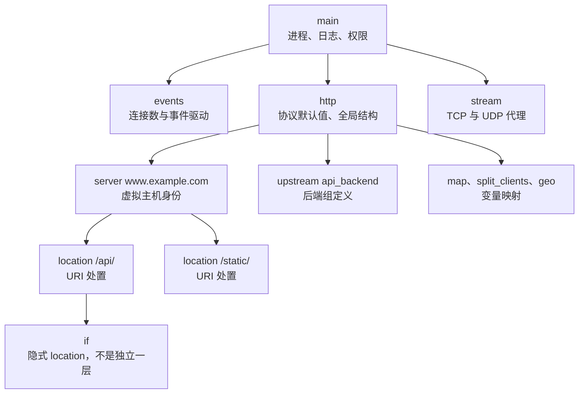
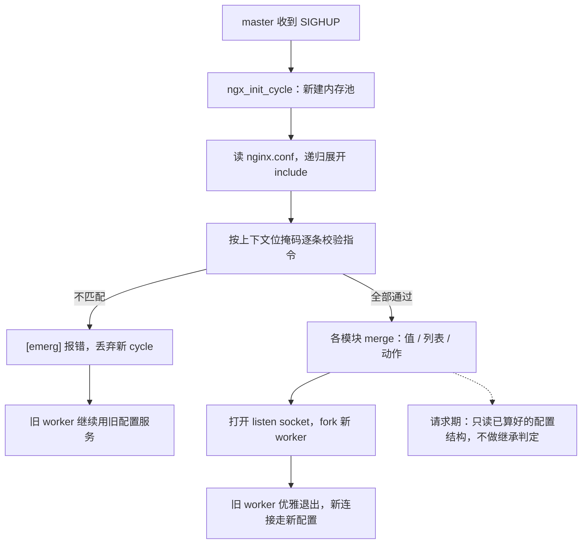
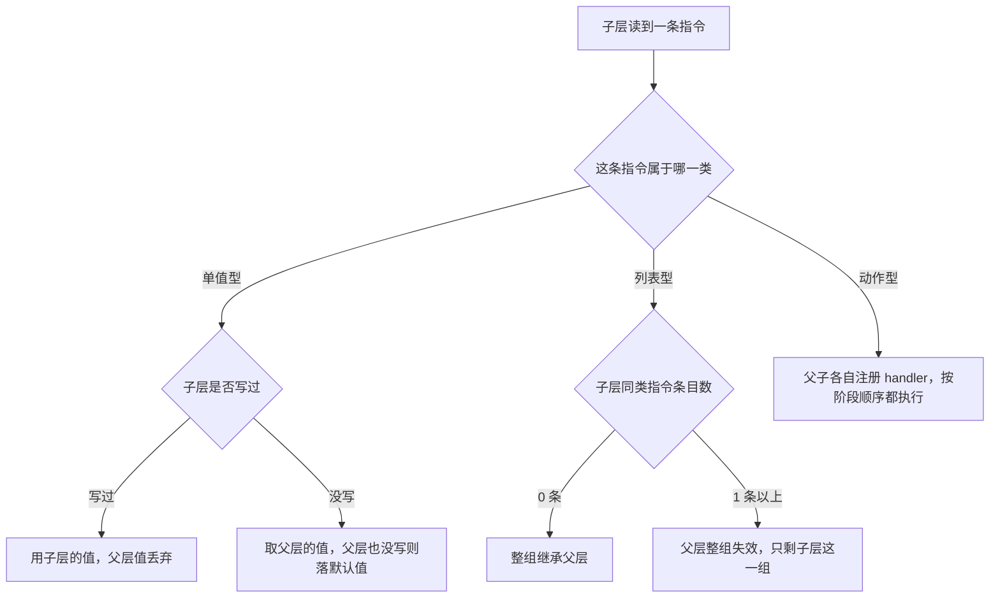
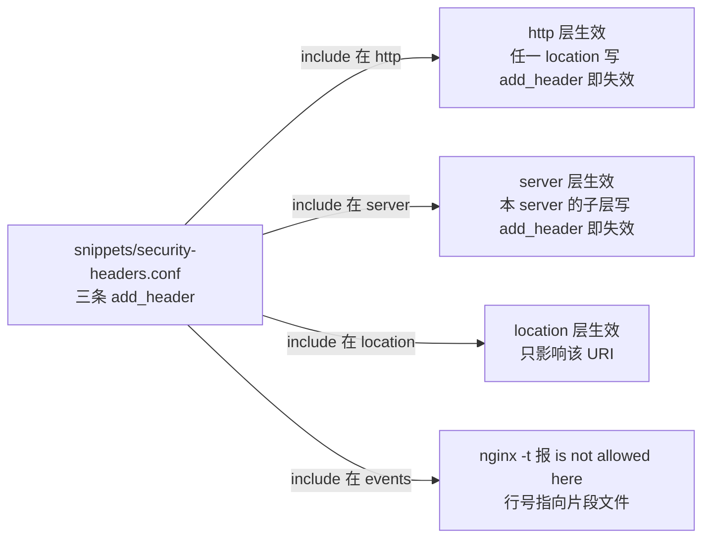
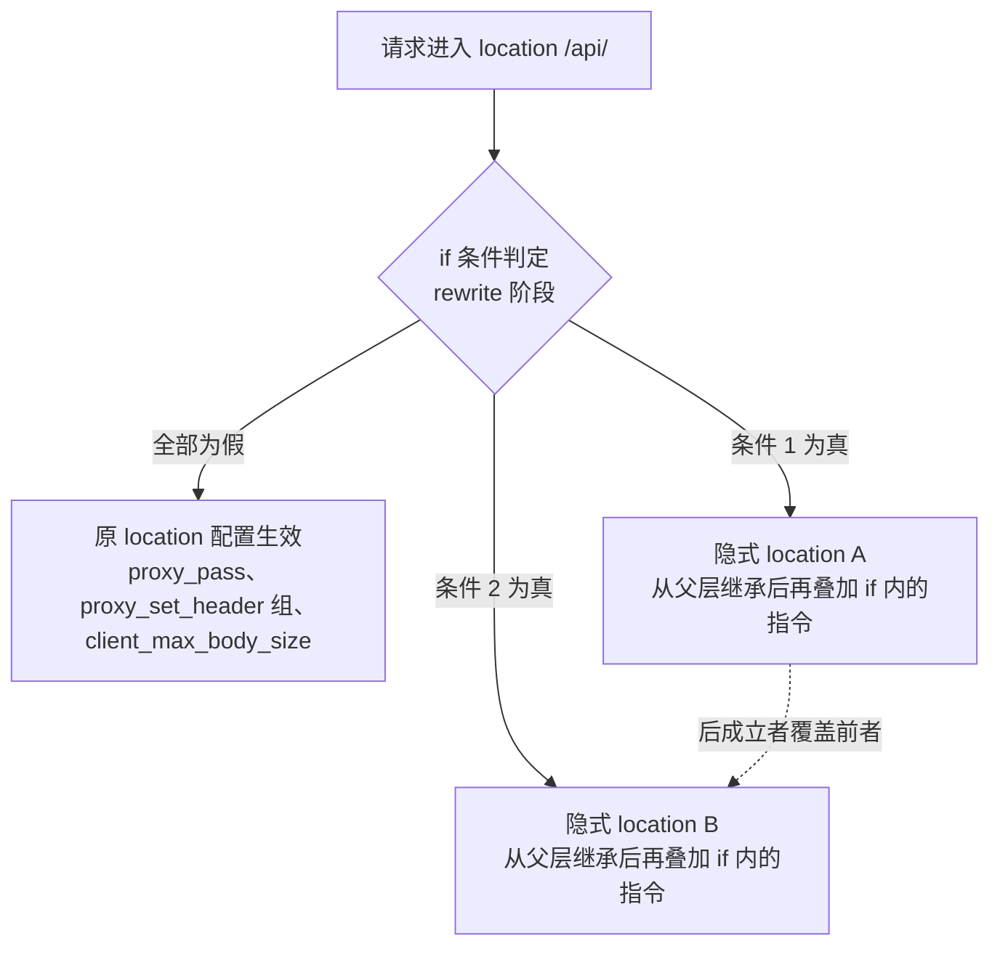
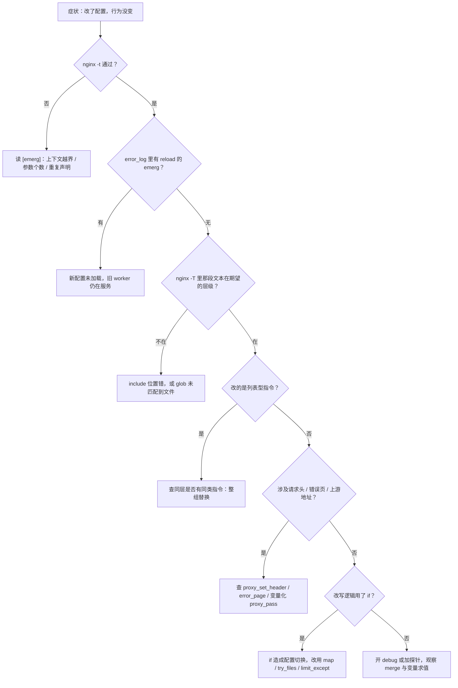

# 02 配置体系解析：指令、上下文与继承规则

**摘要：**

配置不生效是 Nginx 现场最常见的一类抱怨，但绝大多数时候 Nginx 都忠实执行了它被写下的那条规则，只是那条规则并非工程师以为的那条。指令在 `main`、`http`、`server`、`location` 四个层次之间不是简单的「子覆盖父」，而是三种完全不同的合并语义并存：单值指令取最近一层的取值，列表型指令在子层出现一条就整组顶掉父层，动作型指令则在父层与子层各执行一遍。本文以「为什么我的配置不生效」为线索，先讲清四个层次的职责与指令的上下文位掩码，再逐条拆解这三类合并语义并给出可直接查表的指令清单；随后讨论 `include` 的位置如何决定片段语义、变量的懒求值如何让同一行配置在不同时刻取到不同的值、以及 `if` 为什么会把当前 location 的整套配置换掉。收尾给出一条从 `nginx -t` 到 `nginx -T`、再到 debug 日志与变量探针的排查路径，并用四个反例说明规则被违反时的症状、判据与代价。全文的落点不是记住一份指令表，而是建立一条可以逐级验证的推理链：先确认配置是否被加载，再确认文本落在哪一层，然后才去判断语义有没有被有意或无意地改写。

---

## 第 1 章 一棵树上的四个层次

排障现场最耗时的从来不是服务整个躺下，而是服务活着、行为却不是你写下的那样：在 `location` 里补了一条 `add_header`，跨域头反而消失；在 `location` 里加了一条 `proxy_set_header`，上游开始拿到错误的 Host；明明把 `error_page` 写进了 `http`，502 还是裸着返回默认页。这类问题有一个共同点，配置本身没有语法错误，`nginx -t` 一路通过，`nginx -T` 打印出来的文本也和你脑子里想的一模一样。差别不在文本里，而在 Nginx 把这堆文本读进去之后所做的那些合并动作里。

要理解这些动作，先要知道这些文本被组织成了什么形状。

### 1.1 从进程到 URI 的四次落地

Nginx 的配置是一棵树，顶层是 `main` 上下文，也就是 `nginx.conf` 的花括号之外；`main` 之下挂着 `events`、`http`、`stream` 几个并列的块；`http` 之下是 `server`，`server` 之下是 `location`。四个层次各自回答一个不同的问题：`main` 回答「这个进程怎么活」，`http` 回答「这门 HTTP 协议怎么待人」，`server` 回答「这个虚拟主机是谁」，`location` 回答「这个 URI 归谁处置」。

这个分层有一个容易被忽略的性质，越靠下的层次，能够声明的指令越少，而不是越多。`worker_processes` 只能出现在 `main`，`server_name` 只能出现在 `server`，`proxy_pass` 可以出现在 `server` 与 `location` 却不能出现在 `http`（`proxy_pass` 的上下文是 `location`、`if in location`，放错就是启动失败）。也就是说，父子关系给了子层「覆盖」的权力，但没有给子层「扩展」的权力——子层只能在父层已经授权的指令集合内作选择。

这个性质可以借审批制度来理解：集团规章、事业部细则、门店规范、柜台操作手册，四级文件一层比一层具体，但柜台手册不能凭空规定一条集团没授权的审批项，那叫越权。这个比喻的后半截要打个折扣：Nginx 里下级改写某一条时，未必是「在上级基础上加一句」，很多时候是「整章替换」，而这正是后面所有麻烦的来源。

四个层次的分工与放错层级的典型后果，可以用一张表先立起来。

| 层次 | 这一层管什么 | 代表性指令 | 放错层级的典型后果 |
|---|---|---|---|
| `main` | 进程、日志、权限、事件驱动 | `worker_processes`、`pid`、`user`、`events` 块 | 放进 `http` 直接报 is not allowed here，启动即失败 |
| `http` | 协议行为、全局策略、共享结构 | `sendfile`、`gzip`、`log_format`、`map`、`upstream`、`proxy_cache_path` | 把 `log_format` 写进 `server` 报错；把 `add_header` 写进 `http` 却被某个 `location` 整组顶掉 |
| `server` | 虚拟主机身份与默认行为 | `listen`、`server_name`、`ssl_certificate`、`root` | 把 `server_name` 写进 `location` 报错；把整块 `server` 配置 `include` 进 `http` 造成多开端口 |
| `location` | 单条 URI 的处置方式 | `proxy_pass`、`alias`、`try_files`、`limit_except` | 在 `location` 里重写列表型指令，父层同组指令集体失效 |

一个 HTTP 请求进入 Nginx 之后，恰好依次触碰这四层留下的痕迹：worker 进程继承了 `main` 的进程参数，连接建立时套用了 `http` 里的协议默认值，请求行解析后由 `server_name` 选定一台虚拟主机，最后按 URI 选出一个 `location`，把它的配置装进请求对象。这四步里只有最后一步是「按请求变化」的，前三步在进程启动时就已定型。理解这个时序，才能理解为什么同样一行 `add_header`，写在 `http` 里和在 `location` 里会得到完全不同的效果。

把四个层次连同它们的旁支画成一张图，可以看到真正参与「请求处置」的只有最下面那条链，其余都是为这条链准备的材料。



### 1.2 指令表与上下文位掩码

Nginx 判断一条指令能不能出现在某个位置，靠的不是文档，而是一张编译进二进制的**指令表**。每个模块通过 `ngx_command_t` 数组声明自己支持的指令，每一项都带一个 `type` 字段，这个字段是位掩码，同时说明「这条指令允许出现在哪些上下文」与「参数怎么解析」。

```c
/* 示意：一条允许出现在 http / server / location、带一个参数、解析结果写入 clcf 偏移处的指令 */
{ ngx_string("client_max_body_size"),
  NGX_HTTP_MAIN_CONF|NGX_HTTP_SRV_CONF|NGX_HTTP_LOC_CONF|NGX_CONF_TAKE1,
  ngx_http_core_max_body_size,
  NGX_HTTP_LOC_CONF_OFFSET,
  0,
  NULL }
```

上下文位大致分成 `NGX_MAIN_CONF`、`NGX_HTTP_MAIN_CONF`、`NGX_HTTP_SRV_CONF`、`NGX_HTTP_LOC_CONF`、`NGX_HTTP_UPS_CONF` 几类，此外还有两个少见的位，`NGX_HTTP_SIF_CONF` 与 `NGX_HTTP_LIF_CONF`，分别对应「`server` 块里的 `if`」与「`location` 块里的 `if`」。这两个位的存在解释了一个长期让人困惑的事实：官方文档里 `add_header` 的上下文写作 `http`、`server`、`location`、`if in location`，它能写进 `location` 里的 `if`，正是因为它被授权了 `NGX_HTTP_LIF_CONF`；而 `proxy_set_header` 的上下文只到 `location` 为止，所以它根本进不了 `if` 块。很多中文资料说「在 `if` 里写 `proxy_set_header` 会被覆盖」，这个说法连语法关都过不去，正确的说法是它压根不允许出现在那里，`nginx -t` 会直接报错。

位掩码的另一半是参数形态，`NGX_CONF_TAKE1`、`NGX_CONF_TAKE2`、`NGX_CONF_1MORE` 说明必须带几个参数，`NGX_CONF_FLAG` 说明这是 `on`/`off` 开关，`NGX_CONF_BLOCK` 说明这一条自己开一个花括号块。解析器在读到一个指令后，拿当前块的上下文类型去和这条指令的 `type` 做按位与，不匹配就抛错：

```text
nginx: [emerg] "server_name" directive is not allowed here in /etc/nginx/conf.d/api.conf:3
nginx: [emerg] "proxy_pass" directive is not allowed here in /etc/nginx/nginx.conf:42
nginx: [emerg] invalid number of arguments in "gzip_types" directive in /etc/nginx/nginx.conf:18
nginx: [emerg] "listen" directive is duplicate in /etc/nginx/conf.d/site.conf:9
```

这四行报错分别对应四种最常见的误写，而它们都不是「Nginx 的毛病」。容易忽略的是报错里的文件与行号，它指向的是**指令真正被写下的那个文件**，而不是 `include` 它的文件。这一点经常造成误判：工程师在 `nginx.conf` 里翻到第 3 行，发现那一行是注释，于是认定 Nginx 报错了行号；实际情况是第 3 行属于某个被 `include` 进来的片段，而片段本身不知道自己会被放在哪一层。

### 1.3 解析只发生在 reload 的那一刻

配置从文本变成运行时状态，整个过程几乎全部发生在 master 进程的一次 `ngx_init_cycle` 里：收到 `SIGHUP`（也就是 `nginx -s reload`）之后，master 新建一个内存池，重新读入全部配置文件、按 `include` 递归展开、建立每个模块的配置结构、执行 merge、解析 `listen` 并打开监听套接字，一切成功之后才 fork 出新的 worker，再通知旧 worker 优雅退出。worker 进程从头到尾不读配置文件，请求处理期也不做任何「继承」，它只是拿着指向已经算好的配置结构体的指针去取值。

这条性质有两个直接推论。第一，父层的值在 merge 之后被拷贝进了子层的配置结构，请求期不存在「找不到就往上找」的动态查找；所以「继承」在运行时是不存在的，存在的只是**一次性的合并结果**。第二，也是更常被忽略的一点：`nginx -t` 通过并不等于新配置已经生效。如果 reload 时解析失败，master 会丢弃新的 cycle，让旧 worker 带着旧配置继续服务，只在 `error_log` 里留下一行 `[emerg]`。现象就是「改了没变化」，而访问日志一如既往地正常，很多人于是开始怀疑缓存、怀疑 DNS，唯独没有怀疑 reload 本身。

把这一章的时序收拢成一张图，后面所有关于「不生效」的讨论都落在这条链上的某一环。



图里那条虚线是关键：请求期是纯粹的查表，所有「继承」的智力活动都在 reload 时一次性花完了。这也解释了为什么 Nginx 能把每条请求的配置开销压到几乎为零，代价是配置的合并规则必须在文档里说清楚，因为运行时没有第二次机会去修正理解偏差。

---

## 第 2 章 继承的三种形态

上一章说「继承在运行时不存在」，那这一章讨论的继承就是 reload 时 merge 函数做的事。各模块在 `ngx_http_module_t` 里登记自己的 `merge_srv_conf` 与 `merge_loc_conf`，merge 时拿子配置和父配置两个指针，逐字段决定取值。判断「子层有没有声明」靠的不是语法树，而是配置结构里的**哨兵值**：`NGX_CONF_UNSET`、`NGX_CONF_UNSET_UINT`、`NGX_CONF_UNSET_SIZE`、`NGX_CONF_UNSET_MSEC`、`NGX_CONF_UNSET_PTR`，模块初始化时把字段填成哨兵，解析时被真实值覆盖，merge 时凡是仍为哨兵的就说明子层没写。

### 2.1 值继承：合并只做一次

绝大多数指令属于单值型，merge 的形状高度一致，`ngx_conf_merge_value`、`ngx_conf_merge_str_value`、`ngx_conf_merge_uint_value`、`ngx_conf_merge_size_value` 这一组宏干的就是这件事。

```c
/* ngx_conf_merge_value 展开后的语义：先看父层，再看默认值 */
if (conf->keepalive_timeout == NGX_CONF_UNSET_MSEC) {
    conf->keepalive_timeout = prev->keepalive_timeout;   /* 子层没写，取父层 */
}
if (conf->keepalive_timeout == NGX_CONF_UNSET_MSEC) {
    conf->keepalive_timeout = 75000;                     /* 父层也没写，落默认值 */
}
```

这段逻辑看起来平淡，但它有三个容易被忽略的后果。

其一，值继承是**拷贝而非引用**。`http` 里的 `keepalive_timeout 75s` 在 merge 时被复制进每一个 `server` 与 `location` 的配置结构，二者此后没有关联。这本来无所谓，但在压测或排查时会造成一种错觉：有人在运行期改了某个值，却发现所有层次一起变或一起不变，于是怀疑「继承是动态的」。它不是动态的，它连静态的父子关系都不保留。

其二，「没写」和「写成默认值」在很多指令上不等价。`client_max_body_size` 的默认值是 1m，而显式写 `client_max_body_size 0` 表示不限制，两者的语义天差地别；`proxy_read_timeout` 的默认值 60s 与显式写 0 也不等价（0 在很多模块里表示立即超时或关闭行为）。merge 只认哨兵，不认数值：子层写了就以子层为准，父层那个值与本层再无关系，也不会有任何提示。

其三，正因为合并发生在 reload，修改父层配置必须 reload 才会作用到子层已经算好的那份拷贝上。这在容器编排环境里尤其容易出问题：通过 ConfigMap 挂载的配置更新了，但没人发 reload，于是「改了配置不生效」的根因既不是继承也不是缓存，而是根本没有触发那次 `ngx_init_cycle`。

### 2.2 同层累积与跨层替换

麻烦出在列表型指令上。这里必须先拆开两个经常被混为一谈的问题：同一层内写多条会怎样，以及跨层写会怎样。

同一层内写多条，结果通常是**同层累积**。`location` 里写三条 `add_header`，三个响应头都会加上；写五条 `deny`，五条规则依次参与判断；写两个 `error_page`，两个错误码各自有映射；`server` 里写多个 `listen`，多个端口都在监听。这是同一个数组在解析期被 `ngx_array_push` 追加，语义直观，也是最不容易出错的部分。

跨层就完全是另一回事。列表型指令的 merge 实现几乎千篇一律是这个形状：

```c
/* 以 ngx_http_headers_filter_module.c 的 merge 为例（1.27 语义） */
if (conf->headers == NULL) {
    conf->headers = prev->headers;   /* 子层一条都没写，才把父层整组拿过来 */
}
```

注意条件里只有「子层是否为空」，没有任何「把父层数组追加到子层数组」的动作。也就是说，子层只要写下一条，父层那一整组就与本层彻底无关了，官方文档对此的措辞是固定句式：这些指令「当且仅当当前层级没有任何同类指令时」才从上一层继承。笔者把这种语义称为**整组替换**，它是 Nginx 配置里最反直觉、也最容易造成线上事故的一条规则。

为什么设计成这样，而不是做成「父层与子层合并」？原因在于顺序与去重不可定义。假设父层写了 `X-Forwarded-For` 与 `X-Real-IP`，子层只想改 `X-Real-IP`，合并的话就要回答「同名头出现两次怎么办」「子层想删除父层某一条怎么写」「顺序按父先子后还是反过来」。Nginx 的作者选择了不回答：子层一旦接管，就是你自己负责全部。这是用组合性换可预测性，用灵活性换确定性，恰好也是这套配置体系一以贯之的取舍。

把 merge 期这三种形态的判定逻辑画出来，就是下面这张图。它的用处是在写配置时提前判断「这一条会不会把父层的整组顶掉」，而不是等上线后再去怀疑。



### 2.3 三类指令清单

把 reload 期 merge 的动作归纳一下，只有**三种形态**，加一种「不参与继承」的旁支。

| 形态 | 判定规则 | 代表指令 | 误用后的症状 |
|---|---|---|---|
| 值继承 | 子层为哨兵则取父层，否则用子层单值 | `keepalive_timeout`、`client_max_body_size`、`root`、`sendfile`、`gzip`、`proxy_read_timeout`、`proxy_pass`、`resolver` | 子层不小心写了默认值，父层的调优被悄悄抹平 |
| 整组替换 | 子层出现任意一条，父层同组全部失效 | `add_header`、`add_trailer`、`proxy_set_header`、`fastcgi_param`、`uwsgi_param`、`scgi_param`、`grpc_set_header`、`access_log`、`error_page`、`deny`/`allow`、`limit_req`、`limit_conn`、`index`、`gzip_types`、`types` | 父层的安全头、跨域头、真实 IP 头、错误页集体消失 |
| 动作叠加 | 父层与子层各自注册 handler，按阶段顺序都执行 | `rewrite`、`set`、`if`、`break`、`return` | 两条 `rewrite` 互相打脸，或 `return` 抢在 `rewrite` 之前结束请求 |
| 不继承 | 只在自己所在层级有效 | `listen`、`server_name`、`worker_processes`、`upstream` 块、`map` 块、`log_format` | 在子层写会被 `nginx -t` 拒绝，属于语法错误而非语义错误 |

表里第三行值得单独说明，因为它是「累积」这个说法唯一成立的地方。`rewrite` 模块的指令在配置期被编译成一串虚拟机指令，`server` 层的那一串与 `location` 层的那一串是两段独立代码，请求进来先跑 `server` 层的，再按 URI 找到 `location` 跑那一层的，改写过 URI 就重新找一次 `location`，最多十轮。所以父子的 `rewrite` 是各自执行，不是谁覆盖谁。这条时序在 [[03 HTTP 请求处理管道：11 个阶段全解]] 里有完整展开，此处只强调一点：动作叠加不等于结果叠加，两段代码都执行不意味着你得到了想要的结果。

覆盖类指令的完整清单，以及每一条的官方措辞与典型误用，值得单独列一张表，因为这一组正是「配置不生效」的高发区。

| 指令 | 文档措辞要点 | 典型误用形态 |
|---|---|---|
| `add_header` | 当且仅当当前层无任何 `add_header` 时继承 | `http` 里放安全头，某个 `location` 加了一条缓存头，安全头全灭 |
| `add_header` 的状态码过滤 | 仅对 200/201/204/206/301/302/303/304/307/308 生效，需 `always` 才覆盖 4xx/5xx | 4xx、5xx 响应上「配置了但看不到头」 |
| `add_trailer` | 同 `add_header`，`always` 同样必要 | 想给流式响应加尾部字段，却被 4xx 过滤 |
| `proxy_set_header` | 当且仅当当前层无任何 `proxy_set_header` 时继承 | `server` 里配真实 IP 三件套，`location /api/v2/` 加了个请求 ID，真实 IP 全丢 |
| `fastcgi_param` | 同上 | `location` 里补一个参数，`SCRIPT_FILENAME` 随之消失，PHP-FPM 返回 File not found |
| `grpc_set_header` | 同上 | gRPC 网关的鉴权头在某个 `location` 里被清空 |
| `access_log` | 当前层有声明的日志目标就完全替代父层，`access_log off` 也算声明 | 在 `location` 里单独开一个日志文件，结果主日志再也收不到这条 `location` 的流量 |
| `error_page` | 当且仅当当前层无任何 `error_page` 时继承，且未列出的错误码回到默认页 | 子层只想改 404 页，父层的 502 页、500 页一起失效 |
| `deny`/`allow` | 规则数组按「当前层非空即接管」合并 | 在 `location` 里加一条白名单，`server` 层的黑名单整体失守 |
| `limit_req`/`limit_conn` | 当且仅当当前层无声明时继承 | 想给某个接口单独限速，父层的全局限速对它失效 |
| `index`、`gzip_types`、`types` | 数组型，子层声明即替换整组 | `types` 在 `location` 里补一条，MIME 映射整体只剩一条 |

这张表不需要背，需要的是记住判据：当你在子层写下一条列表型指令时，先问自己在父层是否还写过同类指令。如果写过，要么在这层把父层那份也抄一遍，要么把公共部分抽成片段用 `include` 引两次——后者是第 3 章的主题。

### 2.4 add_header 的三个坑

`add_header` 是这套规则里出镜率最高的受害者，也是误解最集中的地方。不少中文资料把它归入「数组累积」，于是读者会以为在 `location` 里加一条头是在父层基础上追加。实际后果分三种，每一种的判据都不同。

第一种是整组替换。电商站点 `www.example.com` 的 `http` 块里放了一组跨域响应头，`Access-Control-Allow-Origin`、`Access-Control-Allow-Credentials`、`Access-Control-Allow-Headers` 三件套全在，前端联调一直正常。某天为了给 `/static/` 加长缓存，工程师在 `location /static/` 里写了 `add_header Cache-Control "public, max-age=31536000";`，于是所有静态资源的跨域预检开始失败。`nginx -t` 通过，`nginx -T` 的文本也没有任何一行被删掉，变化只发生在 merge 那一步：`/static/` 的 headers 数组非空，父层那一组不再参与。

第二种是**状态码白名单**。`add_header` 默认只对 200、201、204、206、301、302、303、304、307、308 生效，文档里写得很清楚，`always` 参数（1.7.5 起）才是「无论状态码都加」。于是「我给 403 加了个 `X-Reason` 头，为什么看不到」的答案通常和继承毫无关系，只是少写了 `always`。反过来也有代价：`always` 意味着 4xx、5xx 也会带上这些头，若其中包含 `Access-Control-Allow-Origin: *` 之类的宽松值，等于把错误响应的跨域面也放开了，安全评审时需要单独看一眼。

第三种最隐蔽，问题根本不在 Nginx。`add_header` 的响应头被 CDN、被 `proxy_cache`、被上游应用自己设置的同一个头覆盖过，或者被浏览器缓存住了旧响应。判据是拿 `curl -I` 直连源站 IP 并带上 `Host` 头绕开 CDN，若此时头在、经过域名访问时头不在，问题就在缓存层而不在配置层。这类误判在排障中占比不低，因为它的症状与继承完全一样：改完配置、发了 reload，行为毫无变化。

顺带记一个版本边界：`add_header` 的整组替换语义一直保持到 1.27.x，官方直到 1.29.3 才补了 `add_header_inherit on|off|merge` 指令，用 `merge` 才能显式实现「父层与子层合并」。这意味着在 1.27 上不存在任何配置层的解法，只能靠重复声明或者 `include` 把公共片段引两次；而 `proxy_set_header` 至今没有对应的开关。

### 2.5 proxy_set_header 与 fastcgi_param 的连带伤害

`proxy_set_header` 的后果比 `add_header` 严重，因为丢掉的往往是上游判断来源所依赖的东西。一个典型的 `server` 块会这样写：

```nginx
server {
    listen 80;
    server_name www.example.com;

    proxy_set_header Host $host;
    proxy_set_header X-Real-IP $remote_addr;
    proxy_set_header X-Forwarded-For $proxy_add_x_forwarded_for;
    proxy_set_header X-Forwarded-Proto $scheme;

    location /api/v2/ {
        proxy_set_header X-Request-ID $request_id;   # 只想加追踪 ID
        proxy_pass http://api_backend;
    }
}
```

`/api/v2/` 的请求到了上游，`Host`、`X-Real-IP`、`X-Forwarded-For`、`X-Forwarded-Proto` 全部消失，上游按默认值重新拼了一遍：`Host` 变成 `proxy_pass` 里的主机名，`X-Real-IP` 为空，`X-Forwarded-For` 为空。应用侧的日志开始出现上游主机名，限流与风控按 IP 的规则全部打偏。更麻烦的是这类问题不会报错，只会让业务数据慢慢变脏。

这里还有一个连层级都不需要跨的细节：`http` 与 `server` 两级之间同样互斥。若 `http` 里配了一组 `proxy_set_header`，`server` 里又配了另一组，最终生效的只有 `server` 那一组，`http` 那组整体失效。F5 的官方知识库里明确记录了这个行为，并强调它是「by design」而不是缺陷：服务器级的组替换了协议级的组，两个层级不合并。

`fastcgi_param` 的现场则是另一种画风。PHP 站点的 `location ~ \.php$` 里照抄了标准片段，`fastcgi_param SCRIPT_FILENAME $document_root$fastcgi_script_name;` 一切正常；后来为了给某个后台路径单独加一个 `PATH_INFO`，工程师在更具体的 `location` 里补了一条 `fastcgi_param PATH_INFO $fastcgi_path_info;`，结果那个路径全部 404。原因是这个更具体 `location` 的 `fastcgi_param` 数组非空，标准片段里那一整组参数不再继承，`SCRIPT_FILENAME` 缺失，PHP-FPM 收到空脚本名。

这三类指令的共同点是：它们描述的是「一组同质条目」，而 Nginx 对「组」的处理只有全有或全无两种状态。记忆时可以把它与 `root`、`client_max_body_size` 这类单值指令分开归档，前者要问「父层写过没有」，后者只需问「我这层要不要改」。

---

## 第 3 章 include：位置即语义

`include` 是 Nginx 配置里最被低估的一条指令。它与继承规则耦合得极深，因为继承是按层次判定的，而 `include` 会把一段文本原样搬进某个层次——搬进哪一层，这段文本就继承哪一层的语义。

### 3.1 文本级拼接，不是模块

`include` 由配置解析器直接处理，本质是一次**文本级拼接**，行为等价于把被包含文件的内容复制粘贴到 `include` 所在的位置，然后继续解析。它没有命名空间、没有变量作用域、没有参数、没有条件、没有隔离。文件本身不携带任何「我属于哪一层」的信息，一句 `include snippets/proxy-params.conf;` 写在 `server` 里就是 `server` 级指令，写进 `location` 里就是 `location` 级指令。

顺序由 glob 的返回顺序决定，glibc 的实现下即字典序，这也是 `conf.d/` 里的文件习惯用 `10-`、`20-` 前缀的原因：同一个层次内后出现的值类指令会覆盖先出现的，动作类指令按出现顺序执行，想控制顺序就得控制文件名。glob 匹配不到任何文件时 `include` 静默通过，这一点是排障陷阱——路径写错、目录被清空、容器挂载覆盖，`nginx -t` 都不会报错，配置就那么少了一半。

### 3.2 位置决定模式

同一个片段放在不同层级，语义可以完全不同。以安全响应头片段为例，它在 `server` 层与 `location` 层的效果并不一样：

```nginx
# snippets/security-headers.conf —— 只有 add_header，本身不含上下文信息
add_header X-Frame-Options "SAMEORIGIN" always;
add_header X-Content-Type-Options "nosniff" always;
add_header Referrer-Policy "strict-origin-when-cross-origin" always;

server {
    server_name www.example.com;
    include snippets/security-headers.conf;      # 这一层生效，子层若另写 add_header 则失效

    location /static/ {
        include snippets/security-headers.conf;  # 必须再引一次，否则上面的三条不会下来
        add_header Cache-Control "public, max-age=31536000";
    }
}
```

这个片段在两层各引一次，看起来啰嗦，但在 1.27 的语义下这是唯一正确写法。若换成 `proxy-params.conf`（一组 `proxy_set_header`）引在 `http` 层，则任何一个 `server` 里只要写了一条 `proxy_set_header`，整组立刻作废——这解释了为什么「我明明在 `http` 里配了真实 IP 头，全站却有一部分接口拿不到」。

位置带来的第二种错位是上下文不匹配。把 `server` 级片段引进了 `location`，`listen`、`server_name` 立刻报 is not allowed here；把 `location` 级片段引进了 `http`，`try_files`、`alias` 这类只允许 `location` 的指令同样报错。报错行号指向片段文件，而工程师在 `nginx.conf` 里找不到对应行，于是误判为配置工具或容器编排的问题。

第三种错位最隐蔽：语法全都合法，语义全错。`add_header` 引在 `http` 与引在 `server` 都合法，但前者会被任意一个 `location` 的 `add_header` 顶掉，后者只被它自己的子层顶掉；`client_max_body_size` 引在 `http` 是全局默认，引在某个 `location` 则只影响那一个路径；`access_log` 引在哪一层，就决定了哪一层的流量被单独记账。**位置即语义**，`include` 只是把这段语义搬过去，它不解释、不校验、也不提醒。



### 3.3 可控的组织方式

既然位置决定语义，配置组织的第一条纪律就是按层次分目录，让片段的名字自带上下文信息。实践里可以这样切：`conf.d/` 只放完整的 `server` 块，文件名用域名或端口；`http.d/` 只放 `http` 级片段，例如 `log_format`、`map`、`upstream`、`limit_req_zone`；`snippets/` 按「在哪一层被引用」分成 `-srv.conf`、`-loc.conf` 两类，文件名后缀必须与引用位置一致，评审时只看后缀就能发现错位。

第二条纪律是片段只装同质指令。把 `add_header` 与 `client_max_body_size` 混在同一个文件里，会强迫调用方在不需要的地方也接受整组替换的风险。公共部分要复用，就一个语义一个文件：安全头一个文件、真实 IP 三件套一个文件、TLS 参数一个文件。

第三条纪律是用 `nginx -T` 验收拼装结果，而不是用眼睛看主配置。`-T` 会按文件打印展开后的完整配置并以 `# configuration file ...` 作分隔，能直接回答三个问题：这段片段到底被拼到了哪一层、glob 匹配到了哪些文件、最后生效的是哪一条。把 `nginx -T` 的输出 diff 一遍新旧版本，比在十个 `include` 之间来回跳要可靠得多。

---

## 第 4 章 变量的求值时机

配置里写下的并不总是值，很多时候是一个变量。变量在这些文本里扮演的是记账科目的角色：配置期只登记「这里将来要取一个值」，真正的金额要等请求走到对应阶段才结算，因此同一行文本在不同请求、不同阶段可以兑现出不同的结果。这也是「配置看起来对、行为却不对」的第二大来源。

### 4.1 懒求值：从脚本编译到请求期

Nginx 的变量不是配置期替换的宏展开。含变量的字符串在配置期被编译成一段虚拟机指令（`ngx_http_script_compile` 产出 `ngx_http_script_t` 数组），请求期由一个栈式解释器执行，遇到变量就调用它的 get handler。变量本身登记在 `ngx_http_variable_t` 里，带一个 get handler、一个可选的 set handler、一个 flag 字段；带 `NGX_HTTP_VAR_INDEXED` 的变量会分配一个下标，求值结果缓存在请求对象的 `variables` 数组里，同一个请求内第二次引用直接取缓存；带 `NGX_HTTP_VAR_NOCACHEABLE` 的变量每次都重算，`$upstream_addr`、`$upstream_status` 这类在上游重试过程中会变化的值就属于这一类。

这套机制带来一个非常重要的性质：**懒求值**。变量只在被真正引用时才计算，`map` 块只是登记了映射规则，若某个请求从头到尾没有引用那个变量，映射一次都不会发生。这在配置层面是纯粹的性能红利，但在排障层面意味着「变量算错了」这种怀疑很难被静态观察——你不加引用，它永远不现身。

更要紧的是求值时机的差异。同一行配置里的变量，可能在不同的处理阶段被求值：写在 `log_format` 里的是日志阶段求值，写在 `proxy_set_header` 里的是构造上游请求时求值，写在 `return` 里的是 rewrite 阶段求值，写在 `if` 条件里的是 rewrite 阶段求值。阶段不同，看到的 `$uri` 可能就不同——`$uri` 会随 rewrite 与内部跳转变化，`$request_uri` 永远是最初那个原始串（含参数），这就是为什么按 URI 做日志分析时用 `$request_uri` 更稳，而按 URI 做匹配时只能用 `$uri`。

### 4.2 $host、$http_host 与 $server_name

这三个变量是最常被混用的一组，差别不只在取值来源，还在**可不可信**。

| 变量 | 取值来源与优先级 | 是否规范化 | 是否可被客户端伪造 | 典型用途 |
|---|---|---|---|---|
| `$host` | 请求行中的主机名 → `Host` 请求头 → 匹配到的 `server_name` | 小写、去端口 | 部分（前两级来自请求） | `proxy_set_header Host`、重定向拼接 |
| `$http_host` | 原样的 `Host` 请求头，缺失则为空 | 不处理，保留大小写与端口 | 是 | 需要还原客户端原始 Host 的极少场景 |
| `$server_name` | 配置里 `server_name` 指令的第一个名字 | 按配置原文 | 否，与请求无关 | 固定回源 Host、日志标注命中了哪个虚拟主机 |

`$host` 的三级回落是它比 `$http_host` 安全的原因：客户端不发 `Host` 头时，它会落到 `server_name` 上，而不是留空；它经过主机名校验与小写归一，非法字符会导致 400 而不是被原样带进上游。`$http_host` 则是原封不动的请求头，含端口、含大小写、含任何客户端愿意放进去的内容，直接拿它拼重定向地址就是开放重定向，直接拿它做缓存键就是缓存投毒。

需要澄清一个流传很广的错误说法：`$host` 的第三级回落是「匹配到的 `server_name`」，不是「`server` 块的监听 IP」。监听地址由 `$server_addr`、`$server_port` 表达，与 `$host` 无关。这个区别在排障时很实际：把 `$host` 打进日志，看到的是客户端声称的主机名或配置里匹配到的名字，从来看不到监听 IP。

`$server_name` 的语义又是第三种：它是配置值，不是请求值。同一个 `server` 块里写 `server_name www.example.com example.com;`，`$server_name` 只会取第一个 `www.example.com`，无论客户端实际请求的是哪个域名。因此拿 `$server_name` 做业务分流通常是对的（它代表「你被哪台虚拟主机接住了」），拿它做用户可见的跳转则常常是错的（用户访问 `example.com` 会被跳到 `www.example.com`）。

### 4.3 变量带来的三类不生效

变量引起的「不生效」，形态与继承那类完全不同，需要单独的判据。

第一类是求值时机错位。`log_format` 里写 `$uri`，看到的可能是 rewrite 之后的值，与访问日志里期望的原始路径不一致；`map` 基于 `$request_uri` 做匹配，却忘了 `$request_uri` 带参数，导致 `~^/api/` 这种正则在某些带参数的请求上匹配到意料之外的分支。判据很简单：把变量同时打进日志与响应头，对比两个阶段的值是否一致。

第二类是变量化 `proxy_pass` 的连带条件。`proxy_pass http://$backend;` 这种写法是合法的，但它把主机名解析从配置期推到了请求期：配置里必须显式提供 `resolver`，否则 `nginx -t` 照样通过，请求一到就是 502 与 `no resolver defined to resolve ...`。同时文档明确，`proxy_pass` 里带变量时，若指令中写了 URI 部分，该 URI 会原样传给上游，不再按 location 前缀替换。这两条合在一起，构成了灰度发布里最常见的翻车方式：把 `upstream` 名换成变量之后，负载均衡策略、健康检查、`keepalive` 连接池全部失效，只剩一个裸的 DNS 解析。

第三类是变量作用域误判。`set` 创建的变量挂在请求对象上，只在本次请求内有效；子请求（`auth_request`、`mirror`、`error_page` 的内部跳转）拿到的是自己的请求对象，父请求里 `set` 的值不会自动出现。若把鉴权结果放在 `set $user_id` 里指望子请求复用，得到的一定是空值。

---

## 第 5 章 if 的代价

如果只能从 Nginx 的配置体系里挑一个「必须理解原理才能正确使用」的语法，那一定是 `if`。它的名字太像一个普通的条件分支，以至于几乎所有人都先按编程语言里的直觉用它，然后在某个深夜被它的行为打醒。`if` 更像一次临时的换房：请求还停在原来的 URI 上，手里拿的配置已经换成了另一套，后面所有关于它的困惑都来自没意识到这次更换。

### 5.1 隐式 location：一套配置的分裂

官方文档对 `if` 的描述只有一句话是关键的：条件为真时，`if` 花括号里的指令被执行，「并且请求被指派为 `if` 指令内部的配置」，而「`if` 内部的配置从上一层继承」。同一页的「内部实现」小节把这个机制讲得更直白：`if` 块会被编译成一份**独立的配置**，条件成立时请求被指派到这份配置上。

换句话说，`location` 里写 `if`，等于在原来的 `location` 里面又长出一个嵌套的 `location`，只是它没有名字、不出现在 `location` 树里、也不会被 URI 匹配到。请求一旦走进这个隐式位置，`r->loc_conf` 就被换掉，Nginx 随即用新配置重新推导内容处理器、请求体上限、超时、缓冲等一堆参数。这就是**隐式 location** 的全部含义，也是后面所有怪异行为的源头。



图里那条虚线是要点：多个 `if` 各自是一份独立配置，条件都成立时，请求被反复指派，最后一次指派的结果留下来。这解释了官方 wiki 里那个看起来像 bug 的例子：同一个 `location` 里两个 `if` 各写一条 `add_header`，响应里只出现第二条。wiki 的注释写得很克制——「不是 bug，就是这么实现的」。

### 5.2 官方 wiki 的五个复现

「If is Evil」这篇 wiki 的价值不在于结论，而在于它给出了五个最小复现，每一个都对应一类真实故障。原文的措辞是：`if` 在 `location` 上下文里有问题，有时它做的不是你期望的事而是完全不同的事，某些情况下甚至会段错误；在 `location` 里唯一百分之百安全的用法只有 `return ...;` 与 `rewrite ... last;`。

第一个复现是两个 `if` 各加一条响应头，只有第二条生效，原因已在上一节说明。

第二个复现最短也最费解：`location` 里写 `proxy_pass http://127.0.0.1:8080/;`，再加一个空的 `if`（条件恒真、花括号里什么都没有），发往上游的 URI 就不再被替换成 `/`。一个空块改变了请求的路由结果，这正是「请求被指派到另一份配置」的直接后果——`proxy_pass` 的 URI 替换语义与所在的 location 配置绑定，配置换了，语义随之改变。

第三个复现是 `try_files` 失效：`location` 里写了 `try_files /file @fallback;`，同样加一个空 `if`，`try_files` 不再按预期工作。这条最伤人，因为「用 `if` 判断文件是否存在，不存在就 `try_files` 兜底」是网上流传最广的错误范式之一。

第四个复现直接崩溃：一个 `if` 里写 `fastcgi_pass`，另一个同级 `if` 里什么都不写，Nginx 段错误。原文配的文字是「不要在家里试」。

第五个复现是 `alias` 带捕获组时不正确地继承进 `if` 创建的隐式嵌套 location：`location ~* ^/if-and-alias/(?<file>.*) { alias /tmp/$file; ... }` 再加一个空 `if`，路径拼接就错。

把五个复现放在一起看，共同的机理只有一条：`if` 不是条件分支，它是配置切换。凡是依赖「我在哪个 location 里」才能正确工作的指令——`proxy_pass` 的 URI 替换、`try_files` 的根路径、`alias` 的捕获组、`fastcgi_pass` 的处理器绑定——一旦遇上配置切换，都可能错位。

### 5.3 什么情况下 if 仍然安全

说「永远不要用 `if`」是不准确的，官方 wiki 自己就承认有些场景无法回避，譬如需要判断一个没有对应指令的变量。安全的用法有三类。

第一类是在 `server` 层用 `if` 做协议跳转。`if ($scheme = http) { return 301 https://$host$request_uri; }` 是官方认可的写法，原因是 `server` 层的 `if` 里只允许 rewrite 模块指令，不存在把内容处理器换掉的余地，配置切换没有副作用。

第二类是在 `location` 里只用 `return` 与 `rewrite ... last`。前者直接结束请求，后者重新走一遍 location 匹配，都不依赖「当前配置里的内容处理器是谁」。

第三类是官方 wiki 给出的技巧：用 `error_page 418 = @other;` 配合 `recursive_error_pages on;`，在 `if` 里只写 `return 418;`，把真正的处置逻辑放进一个命名 location。这样 `if` 里仍然只有 `return`，配置切换被推迟到错误页内部跳转，命名 location 拿到的是干净的、完整的配置。

```nginx
location / {
    error_page 418 = @dynamic;
    recursive_error_pages on;

    if ($args ~ "preview=1") {
        return 418;          # if 里只有 return，安全
    }

    proxy_pass http://render_backend;
}

location @dynamic {
    proxy_pass http://preview_backend;   # 这里是一份正常的 location 配置
}
```

这段配置的价值在于示范了一种思维方式：需要条件分支时，不要试图在 `if` 里堆配置，而是想办法让请求「跳到另一个真正的 location 去」。跳到哪里的手段有 `return 418` 加错误页、有 `rewrite ... last`、有 `try_files ... @named`，都比在 `if` 里写业务配置可靠。

### 5.4 替代方案矩阵

绝大多数用 `if` 的场景，都有不需要 `if` 的等价写法。这些写法的共同点是把「判定」从请求处理阶段提前到配置或变量计算阶段，从而避免配置切换。

| 想解决的问题 | 用 `if` 的错误写法 | 正确替代 | 为什么更好 |
|---|---|---|---|
| 只允许特定方法 | `if ($request_method = POST) { return 405; }` | `limit_except GET { deny all; }` | 专门指令，语义显式，不产生配置切换 |
| 文件不存在时兜底 | `if (!-f $request_filename) { ... }` | `try_files $uri $uri/ @fallback;` | 内容阶段的正式机制，路径基于当前 `location` 计算 |
| 条件成立时换一套处置 | 在 `if` 里堆 `proxy_pass`、`add_header` | `error_page 418 = @named; recursive_error_pages on;` 配合 `if` 里只写 `return 418;` | 配置切换变成一次内部跳转，目标 `location` 拿到完整配置 |
| 判定结果要落到某条指令上 | 在 `if` 里直接写业务指令 | 先用 `map` 算出变量，再交给允许变量的指令 | 判定与处置分离，`map` 的结果可以进日志验证 |
| 不同路径不同上游 | 在 `location` 里用 `if` 切 | 拆成多个 `location` | `location` 匹配优先级本身就能表达路径分流，见 [[07 Location 匹配：优先级规则与正则引擎]] |
| 按比例灰度 | 用 `if ($remote_addr ~ ...)` 估比例 | `split_clients "${remote_addr}AAA" $variant { 10% new; * old; }` | 哈希稳定、比例可配、可复现，取值再交给 `map` 或允许变量的指令 |
| 按网段区分 | 在 `if` 里判断 `$remote_addr` | `geo $limited { default 0; 10.0.0.0/8 1; }` | 前缀树匹配，效率高且结果可日志验证 |
| 需要真正的脚本逻辑 | 多层 `if` 嵌套 | OpenResty 的 `access_by_lua_block` | 逻辑进入真正的编程环境，见 [[12 OpenResty 架构：LuaJIT、cosocket 与协程调度]] |

这张表里最值得记住的是第一行与第三行。`limit_except` 的存在本身就说明 Nginx 的作者知道「按方法限制」是常见需求，并且专门给了一个不产生配置切换的指令；`error_page` 加 `return 418` 则是官方 wiki 自己给出的「从 `if` 里逃出来」的标准姿势。当一个需求已经有专门指令或官方替代姿势时，用 `if` 去模拟它，换来的只有不确定性。

---

## 第 6 章 让「不生效」可观测

前面五章讲的是规则，这一章讲怎么在十分钟内判断「到底是哪条规则被违反了」。排查手段可以按体检的三级来记：`nginx -t` 是验血，看指标合不合规；`nginx -T` 是拍片，看结构拼得对不对；debug 日志是内窥镜，能看到运行期实际发生了什么。三级的价格依次上升，能从便宜的开始，就不要一步跳到贵的。

### 6.1 nginx -t 与 nginx -T

`nginx -t` 做两件事：检查语法与上下文（含 `is not allowed here`、`unknown directive`、`invalid number of arguments`、`directive is duplicate`、`host not found in upstream`），以及尝试打开配置里引用的文件（证书、日志、`include` 目标）。它不检查语义，也不检查运行期行为，所以 `-t` 通过只说明「这份配置能被解析」。

`nginx -T` 是 `-t` 的超集，自 1.9.2 起提供，额外把展开后的完整配置打印到标准输出，每个文件的边界用 `# configuration file ...` 标出。这个输出是排查继承问题的第一手证据，因为它把 `include` 之后的真实文本摆在你面前：哪一段属于 `http`、哪一段落进了 `server`、`conf.d/` 里的文件按什么顺序拼进来，一目了然。

```bash
# 确认片段被拼到了哪一层、按什么顺序
nginx -T | grep -n "configuration file\|add_header\|proxy_set_header"

# 对比改动前后的展开结果
nginx -T > /tmp/nginx.new.conf
diff -u /tmp/nginx.old.conf /tmp/nginx.new.conf
```

需要强调的是 `-T` 只能证明「文本是这样拼的」和「每个块的层级归属」，它证明不了 merge 的结果。`add_header` 在 `http` 与 `location` 各出现一次，`-T` 里两行都在，但运行时只有 `location` 那一组生效。要观察 merge 之后的真实状态，得靠 debug 日志或者直接读响应。

还有一个常被忽略的用法：`nginx -T -c /path/to/test.conf`。把一份待上线的配置放在临时路径，用 `-c` 单独验证一遍再替换生产文件，能避免「先 reload 再看日志」的反复。`-t` 与 `-T` 以调用者的身份读文件，不会切换到配置里的 `user`，因此以普通用户执行时可能读不到证书路径与日志目录。

### 6.2 debug 日志的三个前提

`error_log` 的 `debug` 级别是观察 merge 与变量求值的唯一低层手段，但它有三个前提，缺一个就看不到。

第一个前提是编译期支持。Nginx 必须在 `./configure` 时带 `--with-debug`，否则 `debug` 参数被接受但不会输出调试信息。验证方式是看 `nginx -V` 的 configure arguments；官方 Linux 预编译包从 1.9.8 起提供单独的 `nginx-debug` 二进制，可以直接替换运行，不必自己编译。

第二个前提是日志级别没有被上层覆盖。这一点极其反直觉：官方文档明确写了，重新定义日志而不带 `debug` 级别会关掉调试日志——在 `main` 里 `error_log /var/log/nginx/error.log debug;`，然后某个 `server` 里写 `error_log /var/log/nginx/error.log;`，这个 server 的调试日志就没了。`server` 里那行看起来「只是重申一下日志路径」，实际是一次整组替换，和第 2 章那些列表型指令是同一个道理。

第三个前提是**范围可控**。全局开 `debug` 会让每个请求产生几十到上百行日志，高 QPS 下磁盘 IO 与写日志的开销足以影响延迟（量级判断：单请求百行、每秒千级请求时，日志量在每天数十 GB 的量级）。可行的做法有两种：用 `events { debug_connection 10.0.0.0/8; }` 只对特定客户端开；或者写进环形内存缓冲 `error_log memory:32m debug;`，再从进程内存里导出——文档给的做法是挂 gdb 脚本 dump 出 `debug_log.txt`，这样既不落盘也几乎不影响性能。

打开之后，几类关键字最有用：`http script var` 记录变量求值，`test location` 记录 location 匹配过程，`using configuration` 记录最终选中的配置，`http proxy header` 记录发往上游的请求头。把 `proxy header` 与配置文本对照，就能立刻看出哪些头被整组替换掉了。

### 6.3 三种最小探针

在生产环境里，最快的办法通常轮不到开 debug，三条探针就够把中间状态吐出来。

第一条探针是 `return` 直接回显变量，用来验证求值结果与 `server_name` 命中：

```nginx
location = /__probe {
    return 200 "host=$host http_host=$http_host server_name=$server_name uri=$uri request_uri=$request_uri";
}
```

配合 `curl -H "Host: www.example.com" http://127.0.0.1/__probe` 直连绕开 DNS 与 CDN，一行输出就能回答「请求被哪台虚拟主机接住」「`$host` 的三级回落落到了哪一级」「rewrite 之后 `$uri` 变成了什么」。

第二条探针是把变量塞进响应头，用来观察代理链上的传递：

```nginx
add_header X-Debug-Upstream "$upstream_addr" always;
add_header X-Debug-Cache "$upstream_cache_status" always;
```

用 `add_header` 做探针要小心踩到自己：这一层写了 `add_header`，父层那一组就失效了，探针本身会改变被观察对象。更稳妥的是用 `headers-more-nginx-module` 的 `more_set_headers`，它从 0.25 起改成父子配置合并而非整组顶替，探针不会把父层那组头挤掉（该模块为第三方模块，需另行编译，合并行为以对应版本文档为准）。

第三条探针是日志。自定义 `log_format` 把关键变量一次性写全，比事后追查要省事得多：

```nginx
log_format trace '$remote_addr "$request" $status '
                 'uri=$uri req=$request_uri host=$host sn=$server_name '
                 'up=$upstream_addr ust=$upstream_status uct=$upstream_connect_time';
```

日志体系与链路追踪的完整做法在 [[09 日志体系与可观测性：access_log、error_log 与链路追踪]] 里另有展开，此处只强调一点：把 `$uri` 与 `$request_uri` 同时打出来，是区分「匹配错」与「改写错」的最快手段。

### 6.4 排查决策树

把前面几章判据串起来，可以得到一条从症状出发的决策路径。



这条路径的价值在于顺序：先确认配置有没有被加载，再确认文本在不在对的层级，然后才去怀疑语义。跳过前两步直接开 debug，是排障里最常见的浪费。

---

## 第 7 章 反例档案

规则讲完，用四个反例把症状、判据、根因与代价对上号。这四个形态在真实故障里出现频率最高，覆盖了本章之前的全部规则。

### 7.1 跨域头消失

症状是前端联调突然报 CORS 错误，预检请求返回 200 但缺少 `Access-Control-Allow-Origin`，而配置里明明写着。判据是直连源站 `curl -I` 看响应头，确认头确实不在；再看 `nginx -T`，确认 `http` 层有那三条、并且某个 `location` 里有一条 `add_header`。

根因是整组替换：`location /static/` 为了加缓存头写了一条 `add_header`，`http` 层那一组同组指令整体失效。修法有两种，一是把公共头抽成片段，在 `http` 层与需要自写头的 `location` 里各 `include` 一次；二是把这组头统一下沉到每个 `location`，宁可重复。前者的代价是每个新增 `location` 都要记得多引一行，后者的代价是同一个值散在十几处、改一次要改十几处。

值得留意的是「消失」的边界：`add_header` 只在 200 到 308 这批状态码上生效，所以错误响应的跨域头本来就不存在，与继承无关。把这两件事混在一起查，容易得出「继承规则不稳定」的错误结论。

### 7.2 error_page 不生效

症状是上游返回 502，客户端看到 Nginx 默认的 502 页面，而 `http` 里明明配了 `error_page 502 /502.html;`。判据是先确认 `error_page` 写在哪一层、该层的子层是否也写了 `error_page`；再确认有没有 `proxy_intercept_errors on;`。

这里有两层原因叠在一起。第一层是继承：`error_page` 同样是整组替换，子层只要写了一条（哪怕只改 404），父层的 502 映射就失效，而且未列出的错误码会回到默认页——官方文档的说法是「当且仅当当前层没有任何 `error_page` 时」才继承，邮件列表里 Maxim Dounin 补充过这个**隐式重置**的后果：在子层写 `error_page 418 ...` 不仅设置了 418，还把所有没在本层列出的错误码重置成默认。第二层是拦截：上游返回的 502 默认会直接透传给客户端，Nginx 不会用自己的错误页替换，必须显式 `proxy_intercept_errors on;` 才会进入 `error_page` 流程。

修法是把需要覆盖的错误码在同一层写全，并在需要拦截上游错误的 `location` 或 `server` 上打开 `proxy_intercept_errors`。代价是错误页配置会变长，而且一旦打开拦截，上游的原始错误体就看不到了，排障时需要另外把上游响应记进日志。

### 7.3 include 放错层级

症状是 `nginx -t` 报 `"listen" directive is not allowed here`，行号指向的文件在 `nginx.conf` 里根本没有那一行。判据是看报错路径，它一定是被 `include` 的文件；再看那个文件被哪一行 `include` 引入、那一行处在哪个块里。

根因是把 `server` 级片段引进了 `http` 或 `location`，或者反过来把 `location` 级片段引进了 `http`。还有一种变体：把整段 `server` 配置 `include` 进 `http` 而片段本身带 `server { }` 花括号，于是多开了一个端口，服务起来了但监听的不是你以为的那个地址，`curl` 表现为「连不上」而不是「报错」。容器环境里这种错位更常见，因为挂载路径与镜像内路径不一致时，`include` 可能匹配不到任何文件而静默通过。

修法只有两条：一是目录按层次划分、片段名带 `-srv`/`-loc` 后缀，二是在 CI 里跑 `nginx -T` 并断言关键指令的层级。后者的实现方式是解析 `-T` 输出、检查每个 `# configuration file` 段落里出现的指令集合，属于把配置当代码来测的做法。

### 7.4 变量化 proxy_pass

症状是灰度发布切换后接口大面积 502，`error_log` 里刷 `no resolver defined to resolve ...`，而 `nginx -t` 一直是通过的。判据就是这行日志，它只会出现在运行期。

根因是把 `proxy_pass http://api_pool;` 改成了 `proxy_pass http://$backend;`，主机名解析从配置期推到请求期，而请求期没有 `resolver`。即使补上 `resolver`，还有两个连带变化：指令里若写了 URI 部分，该 URI 会原样传给上游，不再按 location 前缀替换；原本由 `upstream` 块提供的负载均衡、健康检查、`keepalive` 连接池全部不参与，因为地址已是运行期字符串。负载均衡的完整机制在 [[04 反向代理与负载均衡：upstream 模块深度解析]] 里另有展开。

修法是区分两种需求：如果目的只是切换上游地址，用 `map` 把变量映射成稳定的 `upstream` 组名并不可靠——`proxy_pass` 一旦带变量，地址在请求期解析，`upstream` 组的负载均衡与连接池不再参与，实际做法是保留 `upstream` 组、用 `proxy_next_upstream` 与权重做灰度，或者接受 `resolver` 加纯 IP 列表的方案并自己承担健康检查的缺失。代价必须摊开看：变量化换来的是运行期灵活性，付出的是连接池与健康检查；这个交换在低流量场景划算，在高流量场景往往不划算。

---

## 第 8 章 规模、代价与边界

规则与反例之外，还有一层判断需要交代：这套体系在什么规模下开始变贵，以及什么时候该考虑换一层抽象。

### 8.1 reload 的代价构成

配置规模变大之后，reload 的耗时会被反复讨论，但讨论里经常把两件不同的事混成一件事：解析与合并的耗时，以及 worker 切换的耗时。

解析与合并发生在 master 进程，属于纯 CPU 与内存操作：读文件、展开 `include`、按指令表校验、逐模块 merge。万级 `location`、百级 `server` 的配置，这一步通常在几十毫秒的量级（量级判断，取决于行数、模块数量与 `include` 文件个数，不构成基准数据）。真正让 reload 被业务感知的是后半段：新 worker 启动、旧 worker 停止接收新连接、旧 worker 等待已有连接自然结束；这期间内存里存在**两份配置结构**，长连接较多的场景下还会出现连接迁移，`keepalive_timeout` 越长，旧 worker 存活越久。

因此「配置太大导致 reload 慢」这个判断需要拆开验证：如果 `nginx -t` 本身很快，慢的就不是解析；如果旧 worker 在 reload 之后长时间不退出，那是连接迁移的成本，与配置文件大小无关。

### 8.2 配置规模的参数与代价

配置规模上去之后，会碰到几个与哈希表相关的参数。它们的调整方向与代价值得单独列一张表，因为这些都是「调大有效、但代价明确」的旋钮。

| 参数 | 作用 | 默认量级 | 调大的代价 | 调小的代价 |
|---|---|---|---|---|
| `server_names_hash_bucket_size` | `server_name` 哈希桶的宽度，域名较长时需增大 | 32/64，与 CPU 缓存行相关 | 桶变大后每个桶占更多内存，哈希表的空间换查找稳定性 | 域名长度超过桶宽时启动直接报错，无法绕过 |
| `server_names_hash_max_size` | 哈希表桶数量上限 | 512 | 桶数增多，内存占用线性增长，空桶浪费 | 冲突增多，查找退化为桶内线性比较，启动可能报错 |
| `variables_hash_bucket_size` | 变量名哈希桶宽度 | 64 | 同 `server_names` 的权衡 | 长变量名或大量自定义变量时报错 |
| `variables_hash_max_size` | 变量名哈希桶数量 | 1024 | 内存增长，收益递减 | 大量自定义变量时冲突增加 |
| `types_hash_bucket_size`、`types_hash_max_size` | MIME 类型哈希 | 64、1024 | 内存增长 | `types` 条目过多时启动报错 |
| `map_hash_bucket_size`、`map_hash_max_size` | `map` 变量哈希 | 64、2048 | 每个 `map` 块各占一份，大 `map` 叠加后内存可观 | 大 `map` 报错或冲突增加 |

这些参数的共同特征是「先报错，再调大」，报错形态是启动时的 `[emerg] could not build ... hash`。它们不是性能调优旋钮，而是容量旋钮：调大解决的是「放不下」，不是「跑得慢」。把 `server_names_hash_max_size` 从 512 调到 8192 而实际只有 200 个域名，得到的只是几千个用不上的空桶。

### 8.3 什么时候该换一层

Nginx 的配置体系解决的是「HTTP 请求的处置规则」，它的表达能力边界恰好停在「按变量分支」这个层级。越过这条线之后，继续在配置里堆 `if`、堆 `map`、堆正则 `location`，得到的是可读性崩溃与排障成本上升。

判断的信号有三个。其一，同一份配置里出现超过两层的 `if` 嵌套，或者同一个 `location` 里超过三个 `map` 变量参与决策，说明这里需要真正的编程逻辑，OpenResty 的 `access_by_lua_block` 是更合适的容器。其二，配置需要按业务维度频繁变更、且每次变更都要求独立的审批与回滚，说明配置本身变成了发布物，应该交给带版本与灰度能力的配置中心；APISIX 用 etcd 存路由与插件配置、把变更变成 API 调用，正是对这种需求的回应（见 [[14 APISIX 架构：etcd 配置中心与插件体系]]）。其三，配置的正确性已经无法靠人工评审保证，需要自动化断言，这时应该把配置纳入测试与 diff 流程，而不是继续加注释。

但也要承认边界另一侧的代价：OpenResty 换来的是表达力，付出的是 Lua 代码的可观测性与团队技能栈；APISIX 换来的是动态配置，付出的是多一个 etcd 与一套插件执行阶段的心智负担。复杂性不会消失，只会转移，问题只在于转移到哪一层更划算。

---

## 小结

本文沿着「为什么我的配置不生效」这条线，把 Nginx 配置体系的几个关键约定讲了一遍：四个层次各自回答不同的问题，指令的上下文由编译进二进制的位掩码决定，违反时在 reload 阶段被拒绝；继承只发生在 reload 期的 merge 里，请求期只是查表；merge 的形态只有三种，值继承、整组替换、动作叠加，其中整组替换是绝大多数事故的来源，`add_header`、`proxy_set_header`、`fastcgi_param`、`error_page` 都属于这一类；`include` 是文本拼接，位置决定它的语义归属；变量懒求值，求值时机不同则同一行配置的结果不同；`if` 不是条件分支而是配置切换，`location` 里唯一安全的用法只有 `return` 与 `rewrite ... last`。

这些规则看起来零碎，背后是同一条设计取向：把一切能在配置期算完的东西算完，让请求期只剩下查表。这个取向换来了 Nginx 在吞吐上的稳定，也换来了配置语义必须一次写对的要求——运行时没有第二次机会去猜你的意思。理解这一点，配置不生效就不再是玄学，而是一条可以逐级验证的推理链。

---

## 参考资料

1. Nginx 官方文档：指令索引与各模块的上下文说明，<https://nginx.org/en/docs/dirindex.html>
2. Nginx 官方文档：`ngx_http_headers_module`（`add_header` 继承措辞、状态码白名单、`always`、1.29.3 的 `add_header_inherit`），<https://nginx.org/en/docs/http/ngx_http_headers_module.html>
3. Nginx 官方文档：`ngx_http_rewrite_module`（`if` 的语义与内部实现、rewrite 执行顺序），<https://nginx.org/en/docs/http/ngx_http_rewrite_module.html>
4. Nginx 官方文档：命令行参数（`-t`、`-T` 自 1.9.2 起、`-q`、`-s reload`），<https://nginx.org/en/docs/switches.html>
5. Nginx 官方文档：调试日志（`--with-debug`、`nginx-debug` 二进制、环形内存缓冲、`debug_connection`），<https://nginx.org/en/docs/debugging_log.html>
6. Nginx 官方文档：变量索引（`$host`、`$http_host`、`$server_name`、`$uri`、`$request_uri`），<https://nginx.org/en/docs/varindex.html>
7. Nginx Wiki（存档）：「If is Evil」，<https://raw.githubusercontent.com/nginxinc/nginx-wiki/master/source/start/topics/depth/ifisevil.rst>
8. Nginx 邮件列表：Maxim Dounin 关于 `error_page` 继承与未列出错误码隐式重置的回复，<http://mailman.nginx.org/pipermail/nginx/2012-February/032222.html>
9. F5 知识库：`proxy_set_header` 在 `http`/`server` 上下文失效的行为说明，<https://my.f5.com/s/article/K000151885>
10. Nginx 源码：`src/core/ngx_conf_file.c`（指令表校验）、`src/core/ngx_cycle.c`（`ngx_init_cycle`）、`src/http/ngx_http_core_module.c`（`error_page` 合并），<https://github.com/nginx/nginx>

---

> [!note] 思考题
> 1. 第 2 章给出的判据是「子层出现任意一条则整组替换」。如果你的站点有 30 个 `location` 各自需要不同的 `add_header`，你会选择「每个 `location` 都把公共头重声明一遍」，还是「把公共头做成片段在每个 `location` 里 `include` 一次」？两种做法的维护代价分别落在谁身上？
> 2. `nginx -t` 通过、`nginx -T` 的文本正确，行为却不对——请设计一个排查顺序，说明你会用哪三个证据点定位到「merge 结果」这一层，而不会误判为配置未加载。
> 3. 变量化 `proxy_pass` 换来了运行期的地址灵活性，代价是失去 `upstream` 的连接池与健康检查。在什么流量量级与什么变更频率下，这个交换是划算的？如果必须两者兼得，你会怎么设计？
> 4. 官方 wiki 说 `location` 里唯一百分百安全的 `if` 用法是 `return` 与 `rewrite ... last`。那么「`if` 里只写 `set $flag 1;`」是否安全？请从配置切换与阶段执行两个角度说明你的判断。
> 5. 假设团队要把配置纳入 CI 校验，只有 `nginx -T` 的文本输出可用。你会断言哪些不变量，才能在不启动 Nginx 的前提下捕获「`location` 里写了列表型指令导致父层整组失效」这类问题？

---

> **下一篇**：[[03 HTTP 请求处理管道：11 个阶段全解]]