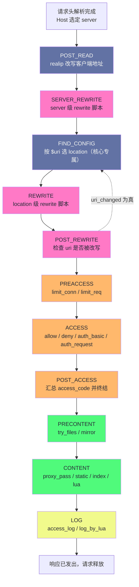
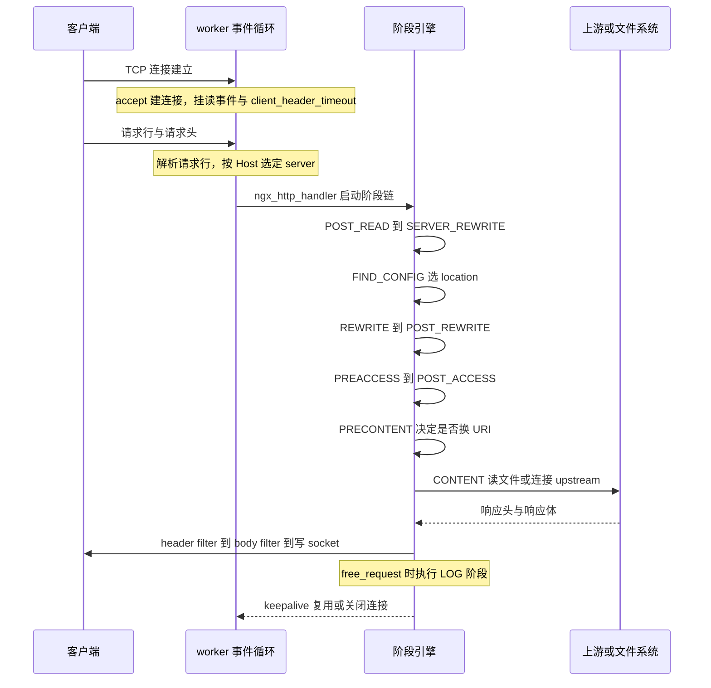
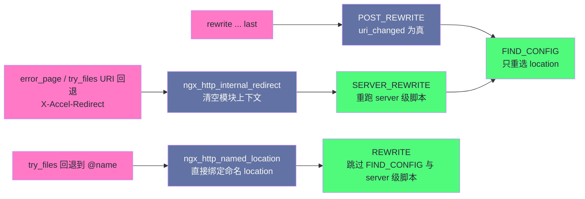
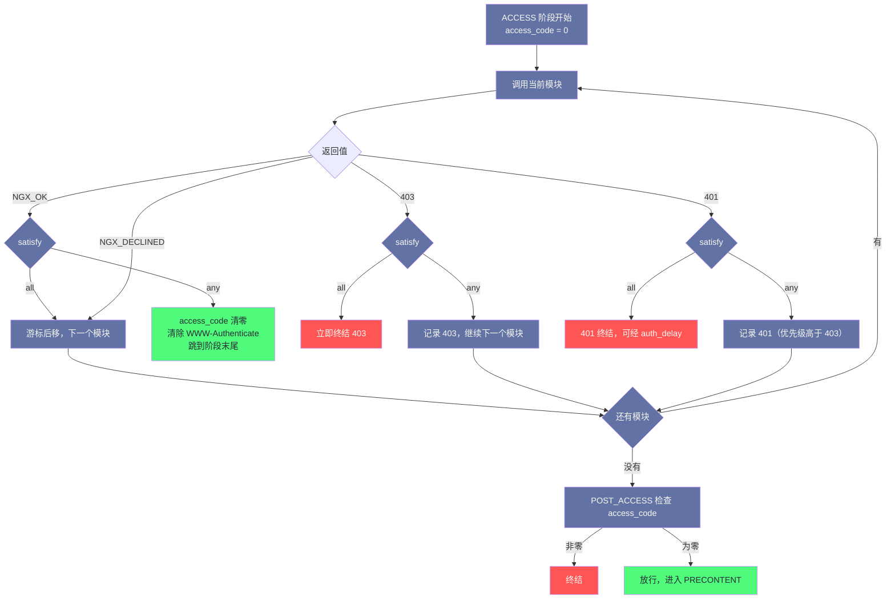
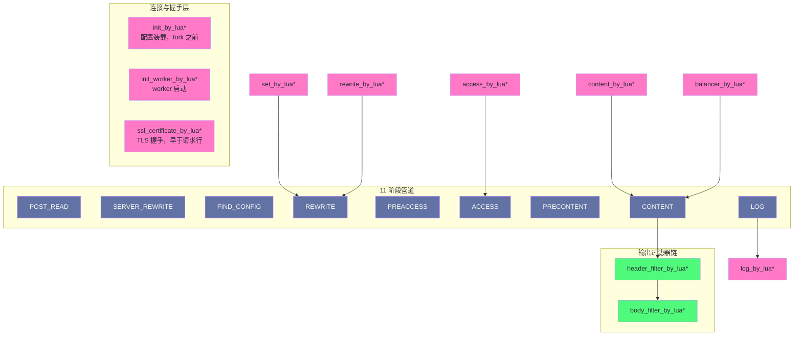

# 03 HTTP 请求处理管道：11 个阶段全解

**摘要：**

Nginx 处理一个 HTTP 请求时，并没有一个统揽全局的函数把它从头做到尾，而是把请求交给一条由 11 个阶段构成的固定管道，几十个模块各自在某个阶段挂一个处理函数，由内核负责顺序与短路。这条管道既是配置行为的解释器，也是排障时的坐标系：为什么 `limit_req` 的 429 会先于 `auth_basic` 的 401，为什么 `index` 与 `proxy_pass` 写在同一个 location 里只有一个会生效，为什么 `log_by_lua` 改不了响应，答案都落在阶段上。本文先给出 11 个阶段的完整顺序与每个阶段能做的决定，再以一个请求的生命周期把它们串起来；随后下潜到引擎层，讲清扁平化的 phase handler 数组、`NGX_OK` 与 `NGX_DECLINED` 等返回码在不同阶段的真实语义、`last` 与 `error_page` 与命名 location 三种重入路径的区别，以及 `satisfy` 如何汇总多个准入模块的结论。接着把 OpenResty 的 `rewrite_by_lua`、`access_by_lua`、`content_by_lua`、`log_by_lua` 映射回这条管道，最后给出可操作的判据：用 `$request_time` 与 `$upstream_response_time` 的差值判断慢在 Nginx 还是后端，用 error_log 的 debug 输出读阶段流转，并逐条纠正几个流传很广的错误说法。全文的技术主张只有一条：先确定请求此刻落在哪个阶段，再讨论配置该怎么写。

---

## 第 1 章 一条固定管道解决什么问题

Nginx 的 HTTP 处理能力分散在几十个模块里：`ngx_http_rewrite_module` 管 URL 改写，`ngx_http_access_module` 管来源限制，`ngx_http_limit_req_module` 管速率，`ngx_http_proxy_module` 管反向代理，`ngx_http_log_module` 管访问日志。这些模块在配置层面是平权的，谁都可以在 `http`、`server`、`location` 上下文里写自己的指令；但在执行层面它们绝不平等，限流必须早于鉴权，鉴权必须早于内容生成，内容生成必须早于写日志。如果把这个顺序交给模块之间自己协商，结果就是一张谁也不敢动的执行链表。

问题出在两个地方。其一是顺序的脆弱性：假设 `limit_req` 想保证自己排在 `auth_basic` 前面，它能依赖的只有“我比别人早注册”，而注册顺序取决于模块在构建脚本里的位置、运维是否启用了某个第三方模块、以及链接器如何摆放目标文件，这些都不是配置能控制的。其二是短路的表达：访问控制模块一旦判定拒绝，就应该让整条链路停下来直接返回 403，但如果处理函数是一张扁平的链表，短路就得靠每个模块自己去检查“前一个模块是否已经产生了响应”，模块两两之间都要互相了解，耦合度随模块数量平方增长。

Nginx 的答案是把**顺序**从模块之间的默契，变成内核里的一张表。每个模块在自己的 `postconfiguration` 阶段声明归属，把处理函数注册进 `cmcf->phases[阶段].handlers` 数组；配置装载完成后，内核把这些数组合并成一条带检查器（checker）的扁平执行链；运行期请求只需要维护一个游标 `r->phase_handler`，顺着链往下走。模块之间不再互相认识，只认识自己所在的那个阶段。

这个设计与经典的责任链模式（Chain of Responsibility）同构，但多出一条硬约束：链条上每一环的**分类**是编译期固定的，运行期不能插队。模块可以说“我不处理，交给同阶段的下一个模块”（返回 `NGX_DECLINED`），也可以说“我处理完了，整条链就此结束”（返回状态码或 `NGX_DONE`），但它无法把自己的处理函数挪到另一个阶段去——这种不可协商，恰恰是配置行为可预测的前提。

不妨用机场中转来类比。旅客从值机到登机要经过值机柜台、安检、边检、登机口，每个环节只认自己那道章，工作人员不需要知道你在上一个环节有没有被开箱检查，也不需要知道下一个环节会不会让你登机；他们只需要确认“这道章盖了没有”。如果没有这套分区，而是所有人挤在一个大厅里、由第一个碰到你的工作人员决定接下来该干嘛，那么流程的正确性就完全取决于运气。Nginx 的 11 个阶段就是把这套分区拆得更细的结果，`FIND_CONFIG` 是其中唯一不设柜台的关口，只由机场自己掌管。

源码层面的锚点是 `src/http/ngx_http_core_module.h` 里那个只有 11 个值的枚举：

```c
typedef enum {
    NGX_HTTP_POST_READ_PHASE = 0,
    NGX_HTTP_SERVER_REWRITE_PHASE,
    NGX_HTTP_FIND_CONFIG_PHASE,
    NGX_HTTP_REWRITE_PHASE,
    NGX_HTTP_POST_REWRITE_PHASE,
    NGX_HTTP_PREACCESS_PHASE,
    NGX_HTTP_ACCESS_PHASE,
    NGX_HTTP_POST_ACCESS_PHASE,
    NGX_HTTP_PRECONTENT_PHASE,
    NGX_HTTP_CONTENT_PHASE,
    NGX_HTTP_LOG_PHASE
} ngx_http_phases;
```

枚举的取值顺序就是执行顺序，注释几乎没有，但枚举本身即是规范。需要提前说明一点：并非所有 HTTP 模块都在这条链上。上游模块（`ngx_http_upstream` 及其使用者）、输出过滤器（`gzip`、`headers`、`sub_filter`、`ssi`）、变量与 map 之类的基础设施，都不注册阶段处理函数，它们工作在另外两条链上——过滤器链（header filter 与 body filter）和按需求值的变量体系。判断一个模块是否属于阶段链，最直接的办法是看它的 `postconfiguration` 往哪个数组里 `ngx_array_push`：往 `cmcf->phases[...]` 里推的才在阶段链上，往 `ngx_http_top_header_filter` 上挂的是过滤器。这条界线不清，就很容易把“为什么 gzip 不在 11 个阶段里”当成设计缺陷。

还有一个容易被忽略的时序事实：阶段链的启动点不在连接建立时，而在请求头解析完成之后。连接被 accept 之后，worker 先把连接挂到读事件上，等第一批字节到达才开始分配请求内存池、解析请求行；随后解析请求头，按 `Host` 选定 `server` 块，再调用 `ngx_http_handler()` 进入阶段引擎。也就是说，**POST_READ 开始时，server 已经选好了，location 还没选**——这个细节决定了 POST_READ 阶段的模块能看到什么、看不到什么，也是后文解释 `real_ip` 为何要挂两次的伏笔。

---

## 第 2 章 从请求头到路由：前五个阶段

11 个阶段的完整流程可以用一张图先立住骨架。图中把阶段、典型模块与“能否终止请求”放在一起，读的时候先记住三组：改写类（SERVER_REWRITE、REWRITE、POST_REWRITE）、准入类（PREACCESS、ACCESS、POST_ACCESS）、内容与收尾类（PRECONTENT、CONTENT、LOG），中间夹着不可插手的 FIND_CONFIG。



### 2.1 POST_READ：改写“客户端是谁”

这是整条链上最早可以插入模块的位置，此时请求行与全部请求头已经解析完毕、server 块已经按 `Host` 选定，但 location 尚未匹配，请求体一个字节都还没读。名字里的 “read” 指的是读请求头，而不是读请求体，这一点经常被反过来理解；HTTP 请求体在 Nginx 里是**惰性读取**的，只有真正需要它的 content handler（典型如 `proxy_pass` 边读边转发）才会去读，或者在拒绝请求时由 `ngx_http_discard_request_body()` 主动丢弃。

这个阶段最典型的住户是 `ngx_http_realip_module`。当 Nginx 部署在负载均衡器、CDN 或网关之后，TCP 连接的对端是代理而不是最终用户，`$remote_addr` 拿到的是代理地址，真实客户端地址只存在于 `X-Forwarded-For`、`X-Real-IP` 或 PROXY protocol 里。`real_ip` 模块在 POST_READ 阶段把连接上记录的对端地址整体替换成头里携带的地址：

```nginx
# 只信任这些代理网段发来的转发头，其余来源的头一律不采信
set_real_ip_from 10.0.0.0/8;
set_real_ip_from 172.16.0.0/12;

real_ip_header X-Forwarded-For;
real_ip_recursive on;
```

`real_ip_recursive on` 的语义是：从 XFF 列表的最右端开始向左剥离受信代理地址，剥到第一个不受信的地址为止，那个地址才是客户端。之所以要从右往左看，是因为左侧的内容客户端可以随意伪造——谁离 Nginx 更近，谁写的值才更可信。改写完成后，连接上的地址结构体与地址文本一起被替换，`$remote_addr`、`$binary_remote_addr`、`$remote_port` 都随之变化，而原始值被保存在 `$realip_remote_addr` 与 `$realip_remote_port` 里，用于日志留痕。

为什么必须这么早？因为后续几乎所有与“来源”相关的判断都读这两个变量：`allow`/`deny` 的白名单、`limit_req_zone $binary_remote_addr` 的限流键、`geo` 模块的地域映射、访问日志的第一列。如果 `real_ip` 晚一个阶段执行，鉴权模块看到的永远是代理地址，白名单形同虚设，限流键退化成“整个机房共用一个桶”。

不过，只把 `real_ip` 理解成“挂在 POST_READ”并不完整。在 1.27 的实现里，它在 POST_READ 与 PREACCESS 两个阶段各注册了一次同一个处理函数（`ngx_http_realip_init()` 里连续两次 `ngx_array_push`），处理函数入口先检查本请求是否已经有 `real_ip` 的模块上下文，有则直接返回 `NGX_DECLINED`。第二次注册解决的是两个真实问题：其一，POST_READ 执行时生效的还是 server 级 location 配置，写在 `location` 里的 `set_real_ip_from`、`real_ip_header` 此时根本不可见，要等 FIND_CONFIG 之后才轮到它们生效；其二，内部跳转（`error_page`、`try_files` 的 URI 回退）会把请求的模块上下文整体清零，POST_READ 不会重跑，只能靠 PREACCESS 补一次。把这两个时序细节拼起来，才能解释为什么一个“只需要最早执行”的模块，偏偏要挂两个阶段。在笔者看来，这两次注册是阶段模型最好的注脚：一个模块挂在哪，取决于它需要哪一份配置，而不取决于它“应该”多早执行。

POST_READ 阶段能做的决定，边界很窄：它能改写“客户端是谁”这一事实，进而影响所有引用这些地址的变量，但它不能改路由、不能决定 location、也不能可靠地读请求体。这也是合理的——此时连“这个请求该由哪段配置负责”都还不知道，任何依赖 location 配置的判断都无从谈起。

### 2.2 SERVER_REWRITE：路由之前的最后改写机会

第二个阶段执行 `server` 块里的 rewrite 模块脚本，也就是 `rewrite`、`return`、`set`、`if` 这几条指令组成的微程序。它与第四个阶段 REWRITE 的区别不在指令集，而在执行时机：SERVER_REWRITE 发生在 location 匹配之前，因此在这里改写 URI 会直接影响接下来 FIND_CONFIG 的结果。

```nginx
server {
    # 这一行在 FIND_CONFIG 之前执行，改写后的 /api/users 会参与 location 匹配
    rewrite ^/v1/(.*)$ /api/$1 last;

    location /api/ {
        proxy_pass http://backend;
    }
}
```

这段配置之所以能工作，是因为 `last` 让 POST_REWRITE 阶段把控制权交回 FIND_CONFIG，用新的 `$uri` 重新匹配 location。如果换成 `break`，脚本就地停下、不再重新匹配，请求会继续用改写后的 URI 在 server 级配置（相当于默认 location）下往后走，后面的 access 与 content 判断都基于这份配置。

SERVER_REWRITE 还有一个常被忽视的用途：在进入路由之前用 `return` 做整体拦截，例如按 Host 把过期域名 301 到新域名、按 `$request_uri` 拦掉批量扫描、按 UA 拒绝某个爬虫。这类判断放在 server 级脚本里，比在每个 location 里重复写要干净，代价是它对所有 location 生效，一条写错的正则可能把整站带偏。至于 `if` 在这个上下文里的陷阱、以及 `rewrite` 与 `return` 谁更便宜，[[02 配置体系解析：指令、上下文与继承规则]] 有更细的展开，回到阶段视角只需补一句结论：`return` 之所以快，是因为它在 rewrite 脚本里直接产生响应并结束请求，后续的 PREACCESS、ACCESS、CONTENT 一个都不会执行；而 `rewrite` 需要先跑 PCRE 匹配、再改写 URI、再由 POST_REWRITE 决定是否重入，是两到三次额外的函数跳转加一次正则执行。差距在纳秒到微秒量级，只有在纯跳转的高 QPS 场景里才值得计较。

### 2.3 FIND_CONFIG：唯一不允许插手的阶段

第三个阶段是整个管道里唯一**不可插手**的位置。在内核构建执行链时，其他阶段都是“把模块注册的 handler 依次铺开”，唯独 FIND_CONFIG 只放一个检查器（`ngx_http_core_find_config_phase`）、不放任何 handler，模块就算想往里注册也没有入口。理由很直白：如果允许第三方模块干预 location 匹配，路由结果就不再由配置唯一决定，A 模块和 B 模块可以各自把请求导向不同 location，配置的可推理性荡然无存。

FIND_CONFIG 做三件事。第一件是按 `$uri` 在当前 server 的 location 树里找出最优匹配，把对应的 `ngx_http_core_loc_conf_t` 绑定到请求上；匹配算法（前缀树、正则顺序、`^~` 与 `=` 的优先级）属于 [[07 Location 匹配：优先级规则与正则引擎]] 的范围，此处只需知道它一次性完成、没有中间态。第二件是检查 `internal` 标记：如果一个 location 被声明为 `internal`，而当前请求不是内部请求，直接以 404 终结——这是 `X-Accel-Redirect` 这类受保护下载路径的守门机制。第三件是把 location 级配置应用到请求上，包括错误日志、`sendfile`、`client_max_body_size`、keepalive 参数等，并顺带检查请求头里的 `Content-Length` 是否超过本 location 允许的上限，超了就以 413 终结。

第三件事是理解“我的模块为什么在这时被调用”的关键。在 FIND_CONFIG 之前，所有模块读到的 location 配置都是 server 级的；在它之后，读到的才是真正命中的 location 配置。同一个模块在两个不同阶段注册处理函数，往往会看到两套完全不同的配置值，`real_ip` 的双重注册就是最典型的例子。反过来，如果一个模块的指令只允许写在 `http` 或 `server` 上下文里，它就没有必要关心 FIND_CONFIG 的时序，因为它的配置在匹配前后是同一份。

### 2.4 REWRITE：location 内的改写脚本

第四个阶段执行命中 location 里的 rewrite 脚本。`set`、`if`、`rewrite`、`return` 不是各自独立的阶段处理器，而是被编译进同一条按书写顺序解释的微程序：变量先算、条件后判、替换与返回各自生效，顺序完全由配置里的书写位置决定。这与“同阶段内多个模块的先后由构建顺序决定”并不矛盾——前者说的是同一条脚本内的指令序，后者说的是不同模块注册到同一阶段后的 handler 序，处在两个抽象层上。

`last` 与 `break` 的差别在这里第一次变得具体。`last` 表示“本轮改写到此为止，用新 URI 重新做一次路由”，它会把 `r->uri_changed` 置位，等 POST_REWRITE 阶段处理；`break` 表示“本 location 的 rewrite 脚本到此为止”，它还会把可能已经置位的 `r->uri_changed` 清掉（源码 `ngx_http_script_break_code()` 里就有这一步），因此不重路由，请求继续用新 URI 在当前 location 的配置下走完后续阶段。这个差别在静态文件场景里会直接体现在路径上：

```nginx
location /static/ {
    # break 之后不再重新匹配 location，请求仍按当前 location 的 root 读文件，路径变成 <root>/assets/a.png
    rewrite ^/static/(.*)$ /assets/$1 break;

    # 若换成 last，则会以 /assets/a.png 重新匹配 location，
    # 很可能落到另一个 location 的 root 或 proxy_pass 上
}
```

多数人把 `last` 记成编程语言里的 `continue`、把 `break` 记成 `break`，这个类比大体成立，但有一步失真：`last` 的“继续”不是继续下一个 location 的脚本，而是回到 FIND_CONFIG 重新选 location，选完之后还要再跑一遍 REWRITE；`break` 的“跳出”也不是跳出请求处理，后续的准入、内容生成照常进行。把这两句话记住，绝大多数 rewrite 相关的“为什么没生效”都能自解。

### 2.5 POST_REWRITE：防止改写把自己转晕

第五个阶段由内核独占，作用是检查 REWRITE 阶段有没有真的改写 URI。如果 `r->uri_changed` 为假，直接进入下一阶段；如果为真，就把请求的“剩余改写次数”减一，减到零时返回 500，并在 error_log 里留下这行：

```text
rewrite or internal redirection cycle while processing "/a/b"
```

这个计数器就是 `NGX_HTTP_MAX_URI_CHANGES`，值为 10，请求初始化时 `r->uri_changes` 被设为 11，因此一个请求最多可以经历 10 次内部跳转。次数没有减到零时，POST_REWRITE 把游标交回 FIND_CONFIG，并顺手把 `loc_conf` 重置为 server 级配置，让下一轮匹配从干净状态开始。

另有一处细节：`uri_changed` 只由 rewrite 模块的 `last` 置位，`break` 不置位；而 `error_page` 触发的内部跳转走的是另一条路径（`ngx_http_internal_redirect`），它自己会递减同一个计数器，却完全不经过 POST_REWRITE。这意味着“10 次”是 `last` 与 `error_page`、`try_files` 回退共享的一个预算，混用几种跳转方式时，谁先耗尽谁的账，日志里只留一行 500，不会告诉你具体是哪条链路绕的圈。

---

## 第 3 章 准入：PREACCESS、ACCESS 与 POST_ACCESS

路由确定之后，请求要过三道准入关口。这三道关口的分工不是按“模块类型”切的，而是按**判断所需的信息**切的：PREACCESS 只关心请求本身的速率与并发，ACCESS 关心请求来自谁、凭证是什么，POST_ACCESS 只负责把前两者的结论汇总成一个状态码。

### 3.1 PREACCESS：先保护资源，再识别身份

PREACCESS 阶段的典型住户是 `ngx_http_limit_conn_module` 与 `ngx_http_limit_req_module`。两个模块都只依赖连接与请求的计数，不需要知道用户是谁，因此可以放在鉴权之前。这个顺序有三重好处：合法用户同样需要被限速，限速不该等到身份确认之后；拒绝一个超速请求的代价（一次共享内存的原子操作）远小于拒绝一个凭证错误的请求（可能牵涉文件读取、外部鉴权调用）；被限流的请求往往连请求体都没有读完，越早拒绝越省带宽。

限流模块的计数器放在共享内存 zone 里，由所有 worker 共同维护，这是它能做到全局口径的原因——`limit_req_zone $binary_remote_addr zone=api:10m rate=10r/s` 里的 `$binary_remote_addr` 正是 POST_READ 阶段 `real_ip` 改写后的地址。把这两条串起来看：如果 `real_ip` 没有生效，限流键会退化成代理地址，所有流量挤进同一个桶，桶的尺寸再大也没用。至于漏桶如何排队、`burst` 与 `nodelay`（1.15.7 起引入 `delay` 参数）如何改变排队语义，[[08 限流与熔断：leaky bucket 与 burst 参数的数学本质]] 有完整推导，这里只强调它的位置：PREACCESS 是你能在“身份未知”的前提下做资源保护的**最后位置**。

`real_ip` 的第二次注册也落在这个阶段，理由在 2.1 节已经交代：内部跳转清空了模块上下文，需要在这里补一次。

### 3.2 ACCESS：鉴权发生在哪里，以及“终止”到底多强

ACCESS 阶段是鉴权的标准位置，常见住户有 `ngx_http_access_module`（`allow`/`deny`）、`ngx_http_auth_basic_module`、`ngx_http_auth_request_module`，以及社区与企业版里的 JWT、OIDC、LDAP 类模块。它们的共同点是：结论只有三种——放行、拒绝（403）、要求认证（401）。

“任何模块返回 403 或 401 都会终止管道”这句话在方向上正确，但机制上需要更精确：处理函数返回 401/403 时，核心并不会立刻终结请求，而是把状态码记进 `r->access_code`，然后要么继续交给同阶段的下一个模块，要么在 `satisfy any` 满足时清空这个记录并跳到阶段末尾；真正终结请求的是紧随其后的 POST_ACCESS 阶段。这样设计只有一个目的——让多个准入模块的结论可以在阶段内部被组合，而不必让每个模块去了解其他模块的存在。

`auth_request` 的行为要单独说，因为它把阶段语义与子请求机制绑在了一起。`auth_request /auth` 会为每个请求发起一个内部子请求去询问鉴权服务，而子请求在 ACCESS 阶段的检查器里被核心直接跳过：

```c
if (r != r->main) {
    r->phase_handler = ph->next;
    return NGX_AGAIN;
}
```

这段代码是 `ngx_http_core_access_phase()` 的第一段逻辑，含义是“子请求不参与 ACCESS 阶段，直接跳到下一阶段”。它是 `auth_request` 能够工作的前提：否则 `/auth` 子请求会再次触发 `auth_request`，鉴权服务把自己递归调用到死。但它同时留下一个容易被误解的边界——**你写在 `/auth` location 里的 `allow`、`deny`、`auth_basic` 对子请求不生效**，因为子请求根本不走 ACCESS；想限制谁能调用鉴权接口，得靠 `internal` 标记加上上游地址段的网络策略，而不是靠 location 里的 allow/deny。

> [!note] 子请求与阶段
> 子请求（subrequest）不是“另起一个请求”那么简单，它复用主请求的连接与部分上下文，从 SERVER_REWRITE 重新进入管道（POST_READ 不再执行），并在 ACCESS 阶段被检查器跳过，日志阶段默认也不记录。`auth_request`、SSI 的 `include virtual`、`X-Accel-Redirect` 的落点、OpenResty 的 `ngx.location.capture` 都建立在同一套语义上。理解这一点，才能解释为什么某些“再走一遍鉴权”的设想在子请求里落空。

### 3.3 POST_ACCESS：把结论钉成状态码

POST_ACCESS 阶段由内核独占，逻辑很短：取出 `r->access_code`，为零则放行，非零则终结请求。终结前会做两件小事，一件是打日志，403 的情况会留下 `access forbidden by rule`，这是排查“到底是谁拒绝的”的第一条线索；另一件是 401 的处理，较新的版本引入了 `auth_delay`，让未认证请求的响应延迟固定时长再返回，以削弱时序侧信道（具体版本以对应文档为准）。

外部模块几乎没有理由在这个阶段注册处理函数，因为它拿不到组合所需的上下文——组合逻辑在 ACCESS 阶段的检查器里已经做完了。

### 3.4 两个阶段之间的界线为什么值得守

把本该在 PREACCESS 做的事挪到 ACCESS，或者反过来，都会有具体后果。前者的典型是把自研限流写成 `access_by_lua`，譬如想在 Lua 里按用户维度再加一层配额：它晚于 `limit_req` 执行，等于在同一层里跑两套限流；而且 Lua 侧的计数往往用自己的共享字典，与 `limit_req` 的 zone 各自为政，多 worker 下的“全局 QPS”其实是两个口径。后者的典型是把鉴权写进 rewrite 脚本的 `if` 里，用 `return 403` 或 `deny` 之外的变量判断去拦请求——这样虽然“也能拦住”，但拦在了 `satisfy` 的组合逻辑之外，多个条件之间的与或关系只能靠嵌套 `if` 手工拼，逻辑一复杂就没人敢改。

阶段模型的约束力就体现在这里：它不阻止你把逻辑放在错误的位置，但它保证了放在正确位置时，行为和顺序是确定的。

---

## 第 4 章 内容生成与收尾：PRECONTENT、CONTENT、LOG

准入通过之后，请求进入“决定用谁来产生响应”的环节。这里有两个阶段，职责却完全不同：PRECONTENT 决定“要不要换一个 URI 再走一遍”，CONTENT 才真正产生响应；两者之间没有第三方插足的余地。

### 4.1 PRECONTENT：在内容生成之前改主意

PRECONTENT 阶段的典型住户是 `ngx_http_try_files_module`，另一个是 `ngx_http_mirror_module`。前者做文件存在性探测与回退，后者把请求复制一份到旁路（镜像流量），两者都属于“在内容生成之前做最后一次决策”。`try_files` 常被误归到 CONTENT 阶段，其实它一行响应都不产生，只负责探测与改道，这也是它单独占一个阶段的原因。

`try_files` 的执行语义需要拆到源码层才清楚。配置 `try_files $uri $uri/ /index.php?$args` 会被编译成一个候选数组，处理函数逐个候选拼接出文件系统路径，用 `ngx_open_cached_file()` 做一次只探测不打开的存在性检查（`of.test_only = 1`），探测结果会被 `open_file_cache` 缓存；一旦命中就返回 `NGX_DECLINED`，表示“我不处理，交给后面的 content handler 用原 URI 去服务”。数组中最后一项永远被当作回退项，**不做存在性探测**，只按形态分三种走法：

| 回退项形态 | 核心动作 | 重入位置 |
|---|---|---|
| 以 `/` 开头的 URI | `ngx_http_internal_redirect()` | 回到 SERVER_REWRITE，重新选 server 配置再 FIND_CONFIG |
| 以 `@` 开头的命名 location | `ngx_http_named_location()` | 直接跳到该 location 的 REWRITE 阶段，跳过 FIND_CONFIG |
| 以 `=` 开头的状态码 | 直接以该状态码终结请求 | 不重入 |

这张表解释了三个常见困惑：为什么 `try_files $uri $uri/ =404` 不会真的去磁盘上找 `=404` 这个文件；为什么回退到 `@fallback` 时，`fallback` 那个 location 里的 `rewrite` 会执行、而它的 `server` 级 `rewrite` 不会重跑；为什么回退到 `/index.php` 时反而会重跑 server 级改写脚本。三者的差别不在 `try_files`，而在重入点的选择。

存在性探测的代价需要单独记账。每个候选一次文件系统探测，虽然有 `open_file_cache` 兜底，但缓存有有效期（`open_file_cache_valid`，默认 60 秒），在高频变更的目录里会退化成密集的 stat 调用；更麻烦的是**负缓存**：一个刚上线的新文件，如果在缓存有效期内被探测过“不存在”，那么在缓存失效前它会持续命中回退项，表现为“部署完了但访问还是 404”。这类问题的现场特征很一致——重启 Nginx 或等一会儿就好，日志里看不到任何错误。

`mirror` 模块的行为是“复制但不影响”：它发起一个后台子请求把原始请求（可含请求体）发给镜像上游，主请求不等待镜像结果，镜像失败也不影响主响应。位置放在 PRECONTENT，是因为它需要在请求体可能被消费之前拿到它，同时又不该干扰真正的 content handler。

### 4.2 CONTENT：只有一个 handler 会执行

CONTENT 阶段是整条管道里最容易被误解的一段。常见的说法是“一个 location 只能有一个 content handler”，更准确的表述是：CONTENT 阶段有两类处理函数，一旦 location 级处理器存在，阶段数组里的处理器一个都不会被尝试；否则阶段数组里第一个返回非 `NGX_DECLINED` 的处理器独占响应。

第一类是 location 级处理器 `clcf->handler`。`proxy_pass`、`fastcgi_pass`、`uwsgi_pass`、`scgi_pass`、`grpc_pass`、`memcached_pass` 这些 `*_pass` 指令的实现模块，都在自己的 `merge_loc_conf()` 里把 `clcf->handler` 指向本模块的处理函数；`content_by_lua*` 走的是同一条路，它也在处理指令时把 `clcf->handler` 换成 Lua 的 content handler。第二类是注册到 CONTENT 阶段数组里的通用处理器：`ngx_http_static_module`、`ngx_http_autoindex_module`、`ngx_http_index_module`、`ngx_http_random_index_module`、`ngx_http_dav_module`、`ngx_http_stub_status_module`。

内核的执行顺序写在 `ngx_http_core_content_phase()` 里，只有几行：

```c
if (r->content_handler) {
    r->write_event_handler = ngx_http_request_empty_handler;
    ngx_http_finalize_request(r, r->content_handler(r));
    return NGX_OK;
}
```

只要 `r->content_handler`（即 FIND_CONFIG 时绑定的 `clcf->handler`）非空，请求就直接交给它并终结，阶段数组连一次遍历都没有。只有它为空时，才逐个调用数组里的处理器，遇到第一个不返回 `NGX_DECLINED` 的就终结；如果全部返回 `NGX_DECLINED`，并且 URI 以 `/` 结尾，返回 403 并打日志 `directory index of "..." is forbidden`，否则返回 404 并打日志 `no handler found`。这两行日志是判断“为什么这个请求是 403 而不是 404”的直接证据，比对着配置猜要快得多。

| 处理器 | 注册方式 | 触发条件 | 会被谁挡下 |
|---|---|---|---|
| `proxy_pass` / `fastcgi_pass` / `grpc_pass` | `clcf->handler` | location 命中即独占 | 无（除非被 rewrite 改写掉） |
| `content_by_lua*` | `clcf->handler` | 同上 | 与 `proxy_pass` 同 location 时按模块合并顺序，不可依赖 |
| `index` | CONTENT 阶段数组 | URI 以 `/` 结尾、GET/HEAD/POST | 有 `clcf->handler` 时不执行 |
| `autoindex` | CONTENT 阶段数组 | 目录且 `autoindex on` | `index` 先命中则不执行 |
| `static` | CONTENT 阶段数组 | 非目录、GET/HEAD/POST | 目录请求让给 `index`/`autoindex` |
| `dav` | CONTENT 阶段数组 | 请求方法在 `dav_methods` 中 | 无（排在 `static` 之前执行） |

`index` 的行为尤其值得纠正。它不是一个“生成首页内容”的处理器，而是 CONTENT 阶段的一个**URI 改写器**：当 URI 以 `/` 结尾时，它按 `index` 指令的顺序探测候选文件，找到后调用 `ngx_http_internal_redirect()` 把 URI 改成 `index.html`，然后重新走一遍管道，由 `static` 去读文件。所以一次“访问目录”在内部其实是两轮请求处理，第一轮在 CONTENT 阶段被 `index` 中断并重入，第二轮才真正读文件；日志里只有一条访问记录，但 debug 日志里会看到两次 `using configuration` 与两次阶段流转，原因就在这里。

`static` 的守卫条件也常被忽略：非 GET/HEAD/POST 的方法直接返回 405，目录请求返回 `NGX_DECLINED` 让位给后面的处理者。这意味着如果某个 location 只配置了 `root`，一个 PUT 请求会撞上 `static` 的 405；要让 DAV 接管，必须在同一个 location 开启 `dav_methods`，此时 DAV 的处理器在阶段数组里排在 `static` 之前，先一步拿到请求，`static` 的 405 就不会被触发。

> [!warning] root 与 proxy_pass 共存不会报错，但只有一个生效
> 在同一个 location 里同时写 `root /var/www` 与 `proxy_pass http://backend`，Nginx 启动和 reload 都不会报错。真正发生的是：`proxy_pass` 在自己的 `merge_loc_conf()` 里设置 `clcf->handler`，而 `root` 只是把路径写进 `clcf->root`，从不注册处理器；CONTENT 阶段看到 `content_handler` 非空就直接执行代理，`root` 配置一次都不会被读取。这与“谁写在后面谁生效”无关，把两行调换顺序结果完全一样。

### 4.3 LOG：响应写完才轮到你

最后一个阶段不在阶段引擎的扁平数组里。内核组装执行链时的循环条件是 `i < NGX_HTTP_LOG_PHASE`，日志阶段的处理器被排除在外；它们由 `ngx_http_log_request()` 在 `ngx_http_free_request()` 里单独遍历调用。这个实现细节决定了三件事。

第一，时机在响应完全发出之后、请求内存池销毁之前。此时 `$status`、`$body_bytes_sent`、`$request_time`、`$upstream_response_time`、`$upstream_addr` 都已是终值，日志能记下完整事实；反过来，任何试图在这里修改响应头或响应体的动作都不会有效果，因为响应早已写进 socket。

第二，异常结束的请求照样写日志。客户端提前断开、上游超时、请求被 `reset_timedout_connection` 重置，最终都会走到 `ngx_http_free_request()`，日志阶段照常执行；如果响应一个字节都没发出去，核心会用终结状态码补写 `$status`，这就是为什么有些日志里的状态码与上游返回的状态码不一致。

第三，日志阶段有“只记一次”的约束。请求对象上有 `r->logged` 标记，同一条请求即使经历多次内部跳转，日志也只写一次；子请求默认不写日志，除非显式打开 `log_subrequest on`。这也解释了一个常见困惑：`X-Accel-Redirect` 触发的内部跳转不会产生第二条访问日志，因为整个过程始终是同一个主请求。

OpenResty 的 `log_by_lua*` 挂在这个阶段，文档明确它“在访问日志之前运行”。它的可用能力被刻意收窄：不能调用输出 API、不能 `ngx.exit`、不能发起子请求、不能用 cosocket，只能在共享字典里记账或投递 timer。这不是实现偷懒，而是时机决定的上限——响应已经发出，任何新的 I/O 要么来不及，要么会把一个本该毫秒级完成的收尾拖成长尾。

---

## 第 5 章 一个请求的完整生命周期

把 11 个阶段放回真实的请求里，才能看清它们与连接生命周期、过滤器链之间的接缝。下面这张时序图从 TCP 连接建立画到请求释放，阶段只占中间一段，前后的工作分别属于连接层与输出层。



图里没有画出的部分同样重要。连接层负责 accept、超时、keepalive 判定与优雅关闭，`keepalive_timeout`、`client_header_timeout`、`lingering_close` 都在这一层起作用；输出层是一条独立的过滤器链，`gzip`、`headers`、`sub_filter`、`ssi`、`charset` 都挂在这条链上，按与阶段链完全不同的规则排序。阶段链负责“做什么”，过滤器链负责“发出去之前怎么改”，两者之间是 content handler 产出的响应头与响应体。

一次 keepalive 连接上会有多个请求串行复用。每个请求开始时 `ngx_http_handler()` 把 `r->phase_handler` 重置为零，阶段链从头再走一遍；`$connection_requests` 记录该连接上已处理的请求数，`keepalive_requests` 达到上限后核心会在响应头里带上 `Connection: close`。这个细节对排查“为什么复用了连接还会出现新的 TLS 握手”之类的现象有用，也提醒我们：阶段链是**请求级**的，与连接级的监听、超时、复用无关。

请求结束时的收尾顺序是：响应发完（或连接异常）→ `ngx_http_finalize_connection()` 判定 keepalive → `ngx_http_free_request()` 执行清理回调与 LOG 阶段 → 销毁请求内存池。清理回调（cleanup handler）本身也是一个可扩展点，模块可以把自己的资源释放挂上去，它与阶段链无关，但同样只在请求结束时执行一次。

---

## 第 6 章 处理器怎么注册，返回码又是什么意思

前五章讲的是“阶段做什么”，这一章讲“阶段怎么跑”。两者不能混着理解：只看阶段顺序，会以为每个阶段是一个函数；看到引擎实现，才知道整条链是一张扁平数组，每个元素带一个检查器，请求只有一个下标在移动。

### 6.1 从模块数组到扁平执行链

模块在 `postconfiguration` 回调里向 `cmcf->phases[阶段].handlers` 追加处理函数，这一步只是“声明归属”，不涉及顺序。配置装载的最后阶段，内核调用 `ngx_http_init_phase_handlers()` 把所有阶段的数组摊平成一张 `ngx_http_phase_handler_t` 数组，每个元素三个字段：

```c
struct ngx_http_phase_handler_s {
    ngx_http_phase_handler_pt  checker;   /* 本阶段的推进策略 */
    ngx_http_handler_pt        handler;   /* 模块的处理函数，可能为空 */
    ngx_uint_t                 next;      /* 下一阶段在数组中的起点 */
};
```

摊平过程有几个容易被忽略的细节。其一，同一阶段的多个 handler 连续排列、共用一个 checker，`next` 统一指向下一阶段的起点，所以“跳到下一阶段”只是一次赋值，不需要循环查找。其二，FIND_CONFIG 阶段只放一个 checker、不放 handler，这与它不可插手的定位一致。其三，POST_REWRITE 与 POST_ACCESS 两条记录是**条件插入**的：只有当 REWRITE 阶段或 ACCESS 阶段确实有处理器时，内核才会为它们追加对应的记录（`use_rewrite`、`use_access` 两个开关），没有处理器就没有这两道检查，省掉两次函数调用。其四，LOG 阶段被循环条件 `i < NGX_HTTP_LOG_PHASE` 排除在外，这也是它不在运行期数组里的原因。

同一阶段内多个 handler 的先后，由模块在构建期的链接顺序决定，与 nginx.conf 里指令的书写顺序无关。Nginx 自己的构建脚本 `auto/modules` 里就有一句注释 `the module order is important`，后面跟着一列模块名：`static`、`gzip_static`、`dav`、`autoindex`、`index`、`random_index`，以及 `access`、`realip`。这行注释的含义正是“这些模块在同一阶段内的相对次序是构建期常量”，第三方模块插进来时若与它们同阶段，先后就只能按构建顺序接受，配置里无从调整。

更细一层：摊平时同一阶段的处理器是**倒序**写进扁平数组的（`j` 从 `nelts - 1` 递减到 0，而数组下标递增），因此后注册的模块先执行。两个反直觉的现象由此得到解释：CONTENT 阶段里 DAV 排在 `static` 之前，PUT 请求不会被 `static` 的 405 截胡；`index` 排在 `autoindex` 之前，开着目录列表的目录才会先返回首页文件而不是列表页。这条“编译期固定”的规则并非没有例外：模块可以在运行期改写 `r->phase_handler` 或重排阶段的 handler 列表，临时调整自己的执行时点，第 9 章的 rewrite tail 就是靠这个办法实现的。

配置中唯一真正由书写顺序决定执行顺序的地方，是 rewrite 脚本内部。`set`、`if`、`rewrite`、`return` 被编译成一段按序执行的微程序，它们不是各自独立的阶段处理器，所以书写顺序就是执行顺序。把这两个层次分清，才能回答“为什么改配置里两行指令的先后有时有用、有时没用”。

### 6.2 返回码：同一个值在不同阶段含义不同

阶段处理函数的返回值是模块与内核之间唯一的协议。它在不同阶段的解释由 checker 决定，同一份协议在四类检查器里有四套含义：

| 返回值 | 通用阶段（POST_READ、SERVER_REWRITE、PREACCESS、PRECONTENT） | REWRITE | ACCESS | CONTENT |
|---|---|---|---|---|
| `NGX_OK` | 跳到下一阶段 | 结束请求（实践中不应返回） | `satisfy all` 下一个模块；`satisfy any` 清空拒绝记录并跳到阶段末 | 结束请求 |
| `NGX_DECLINED` | 同阶段的下一个 handler | 下一个 handler | 下一个模块 | 下一个 content handler |
| `NGX_DONE` | 挂起，等异步回调再继续 | 挂起 | 挂起 | 接管请求，稍后由模块自行终结 |
| `NGX_AGAIN` | 挂起（与 DONE 同类） | 挂起 | 挂起 | 同 `NGX_DONE` |
| `NGX_ERROR` 或 HTTP 状态码 | 终结请求，进入 `error_page` 逻辑 | 同左 | 401/403 记入 `access_code`；其他码终结 | 终结 |

三条最常用的语义值得展开。

`NGX_DECLINED` 是“我不处理，请继续”，但“继续”的方向随阶段而变：在通用阶段，它表示同阶段还有别的模块可以试；在 CONTENT 阶段，它表示这个处理器放弃，让下一个 content handler 上场。也正因为如此，CONTENT 阶段的处理器必须谨慎判断自己是否该处理——一旦误判返回了非 DECLINED，请求就再没有别的机会。

`NGX_DONE` 是异步的分界线。content handler 返回它，意味着“请求所有权已经转移给我，响应稍后由我产生”，`proxy_pass` 就是这么工作的：它把请求发给上游后返回 `NGX_DONE`，等上游响应到达的事件回调里再调用 `ngx_http_finalize_request()` 收尾。准入类模块同样可以用它挂起外部鉴权调用，只是挂起期间连接被占住，鉴权超时必须自己兜底，否则请求会一直挂在内存里。

`NGX_AGAIN` 与 `NGX_DONE` 在检查器里走同一分支——都返回让出信号，让 `run_phases` 的循环退出，把控制权交回事件循环。两者的差别只在语义约定：`AGAIN` 常用于“还需要更多数据”，`DONE` 常用于“已经接管”。

### 6.3 阶段推进的循环

引擎主循环短得可以整段引用。`ngx_http_core_run_phases()` 里只有一个 `while`：

```c
ph = cmcf->phase_engine.handlers;

while (ph[r->phase_handler].checker) {
    rc = ph[r->phase_handler].checker(r, &ph[r->phase_handler]);

    if (rc == NGX_OK) {
        return;
    }
}
```

`r->phase_handler` 是当前下标，checker 负责解释处理函数的返回值并推进下标。checker 返回 `NGX_AGAIN` 时循环继续，返回 `NGX_OK` 时函数退出——挂起后恢复运行时，异步回调只需把 `r->write_event_handler` 指回这个函数，循环就会从上次的下标继续。数组末尾放置了一个 `checker` 为空的哨兵，`while` 条件读到这里自然结束，这也意味着“阶段链跑完了但没人产生响应”是一种不可能发生的状态：CONTENT 阶段兜底会给出 403 或 404。

理解这个循环，就能理解 Nginx 为什么能在单线程事件循环里处理几十万连接：阶段推进不阻塞、不睡眠，遇到需要等待的 I/O 就登记回调并让出，等待中的请求只占内存不占 CPU。代价是每条阶段链上的逻辑都必须短小——任何同步阻塞调用（磁盘读写、DNS 解析、数据库查询）都会卡住整个 worker 上所有连接，这也是第 11 章强调“不要在准入阶段做重活”的根因。

### 6.4 子请求走的是同一条链，但少一个阶段

子请求不是“另一个请求”的简单复制。它复用主请求的连接与一部分上下文，进入管道时带着 internal 标记，于是 `ngx_http_handler()` 把游标设到 SERVER_REWRITE 而不是零，**POST_READ 不再执行**；此后各阶段照常推进，只在两处被特殊对待：ACCESS 阶段被检查器直接跳过（见 3.2 节的源码），LOG 阶段默认不记录（`log_subrequest off`）。

这条规则解释了若干看起来矛盾的现象。`auth_request` 的鉴权子请求能访问 `/auth` location 的 content handler，却不会命中该 location 里的 `allow`；`ngx.location.capture` 能打到内部接口，却绕过了外部请求要过的鉴权；SSI 的 `include virtual` 不会重复写访问日志，因为子请求默认不记日志。把这些现象归到“子请求少走一个阶段”这一条上，比逐个背结论可靠。

---

## 第 7 章 重入：三种内部跳转与它们各自的入口

请求处理并不总是一条直线。rewrite 的 `last`、`try_files` 的回退、`error_page`、`X-Accel-Redirect` 都会让请求“重新走一遍”，但它们回到的位置并不相同，差别决定了配置的可见性与调试日志的形态。

### 7.1 三个入口

改写后的 URI 需要重新找 location，而“重新找”有三种实现，对应三个入口：



第一条路径最轻：`last` 只把 `r->uri_changed` 置位，POST_REWRITE 减一次预算后把游标指回 FIND_CONFIG，server 级脚本不重跑、模块上下文不清空。第二条路径最重：`ngx_http_internal_redirect()` 先减预算，再把 `r->uri` 换成新值、`ngx_memzero(r->ctx, ...)` 清空所有模块的请求上下文、把 `loc_conf` 重置到 server 级，最后调用 `ngx_http_handler()`，而 `ngx_http_handler()` 看到 `r->internal` 为真，把 `phase_handler` 设成 `server_rewrite_index`，于是从 SERVER_REWRITE 重新开始。第三条路径最直接：`ngx_http_named_location()` 只在 server 的命名 location 表里按名字查找，找到后把 `loc_conf` 直接绑过去、游标设成 `location_rewrite_index`，于是跳过 FIND_CONFIG，从该 location 的 REWRITE 开始跑。

| 方式 | 触发者 | 重入位置 | 重跑 server 级脚本 | 清空模块上下文 | 典型用途 |
|---|---|---|---|---|---|
| `last` | rewrite 模块 | FIND_CONFIG | 否 | 否 | URI 规范化、版本前缀映射 |
| 内部跳转 | `error_page`、`try_files` URI 回退、`X-Accel-Redirect` | SERVER_REWRITE | 是 | 是 | 错误页、静态降级到动态、受保护下载 |
| 命名 location | `try_files @name`、`error_page ... @name` | 该 location 的 REWRITE | 否 | 是 | 兜底处理、统一错误输出 |

三种路径共享同一个预算：`r->uri_changes`，初值 11，上限 10 次（`NGX_HTTP_MAX_URI_CHANGES` 定义为 10）。每次重入减一，减到零就以 500 终结。这里的 500 并不会告诉你哪条链路绕的圈，但 error_log 里的三行文本足以区分：

```text
rewrite or internal redirection cycle while processing "/a"
rewrite or internal redirection cycle while internally redirecting to "/b"
rewrite or internal redirection cycle while redirect to named location "@c"
```

第一行来自 POST_REWRITE（`last` 绕圈），第二行来自 `ngx_http_internal_redirect()`，第三行来自 `ngx_http_named_location()`。排障时先看是哪一行，就能把范围缩小到对应的指令。

### 7.2 error_page 不是阶段

`error_page` 经常被当成一个阶段来理解，实际它不在 11 个阶段里的任何一个。它的执行时机是“响应状态码确定之后、请求终结之前”：核心在 `ngx_http_finalize_request()` 里发现状态码命中 `error_page` 配置，就按配置发起内部跳转（URI）或命名 location 跳转，然后把状态码改写成配置要求的值（`error_page 404 =200 /not_found.html` 里的 `=200` 就是这个作用）。因此：

- `error_page` 触发时，CONTENT 阶段已经结束。如果响应头已经发给客户端（流式输出已经开始），错误页就无法再改写状态码：`ngx_http_send_header()` 会以 `header already sent` 拒绝重复发送，客户端看到的是被截断的原始响应。
- `error_page` 只在 `r->uri_changes != 0` 时才会被采用（源码里 `ngx_http_special_response_handler()` 的第一个条件），预算耗尽后错误页直接失效、返回裸的 500；它与 `try_files` 回退共享同一份预算。
- `error_page` 指向的 URI 会重新走一遍 SERVER_REWRITE 之后的全部阶段，包括 ACCESS。把错误页放在需要鉴权的 location 上，可能让一个本该 404 的请求变成 401，这是“错误页配置看起来生效、实际返回码不对”的常见来源。

`X-Accel-Redirect` 走的是同一个内部跳转路径，区别在于触发者是上游而不是本地配置：应用服务器在响应头里写上 `X-Accel-Redirect: /secure/file.pdf`，Nginx 收到后丢弃上游响应体、按内部跳转处理该 URI，客户端只看到一次下载。它之所以安全，是因为目标 location 通常带 `internal` 标记，外部请求直接访问会被 FIND_CONFIG 阶段以 404 挡掉。

### 7.3 重入对“我的模块为什么没执行”的影响

重入会重置一部分状态，这直接决定了模块能否看到自己期望的上下文。POST_READ 阶段不会重跑，所以 `real_ip` 依赖 PREACCESS 的第二次注册补上下文；`internal_redirect` 会清空 `r->ctx`，所以任何把状态存在模块上下文里的模块，都必须考虑重入后上下文丢失的情况；`last` 不清空上下文，所以 rewrite 脚本里 `set` 出来的变量在重入后仍然可读，但 `$uri`、`$args`、`$request_uri` 的取值会随重入变化，日志里记录哪一个需要明确。

一个具体的判断方法是看变量在哪个阶段求值。`$request_uri` 是客户端原始请求行里的 URI，重入不会改；`$uri` 是当前规范化后的 URI，每次重入都会更新；`$document_uri` 是 `$uri` 的别名。把 `$request_uri` 写进日志、把 `$uri` 用于内部判断，是两条不容易踩坑的默认规则。

---

## 第 8 章 satisfy：多个准入模块如何组合

同一个 location 里可以同时存在 `allow`/`deny`、`auth_basic`、`auth_request`，它们都在 ACCESS 阶段执行，结论需要汇总。`satisfy` 指令就是这个汇总策略：`all`（默认，全部满足）与 `any`（任一满足）。

### 8.1 all 与 any 的执行差异

`all` 的语义最直观：每个模块都要给出“通过”，任何一个返回拒绝就终结。检查器在 `satisfy all` 下遇到 `NGX_OK` 只是把游标往后挪，遇到 403 直接把状态码交给终结逻辑，遇到 401 则先记下来（较新版本会经过 `auth_delay` 再终结）。

`any` 的实现要绕一点。检查器遇到某个模块返回 `NGX_OK` 时，会做三件事：把 `r->access_code` 清零、把已经写入响应头的 `WWW-Authenticate` 标记清掉、把游标直接设到本阶段末尾。也就是说，**任一模块通过即结束本阶段**，后面的模块连执行机会都没有。反过来，如果先遇到拒绝，状态码只会被记下来，请求继续交给下一个模块，直到有人通过或者阶段结束。



记录拒绝时有一条优先级规则：401 与 407 会覆盖先前的 403，反之不成立。也就是说，如果 `deny` 先返回 403、`auth_basic` 后返回 401，最终状态码是 401，客户端会看到认证挑战而不是禁止访问。这个细节在多模块组合时经常造成“配置了 IP 白名单，为什么外网访问看到的是登录框”的困惑——`satisfy any` 下两者都被记录，401 胜出，浏览器弹框是正常结果。

### 8.2 几个组合场景的实际结果

| 配置 | satisfy | 命中内网 IP | 命中外网 IP 且凭证正确 | 命中外网 IP 且无凭证 |
|---|---|---|---|---|
| `allow 10/8; deny all;` 单独使用 | all | 放行 | 403 | 403 |
| 上述规则加 `auth_basic` | all | 放行（且必须通过认证） | 403 | 403 |
| 上述规则加 `auth_basic` | any | 放行（不再要求认证） | 放行 | 401 |
| `auth_request` 加 `allow 10/8; deny all;` | any | 放行（不再调用鉴权服务） | 由鉴权服务决定 | 由鉴权服务决定 |

第三行是 `satisfy any` 最标准的用法：内网直通、外网走认证。第四行则暴露了 `satisfy any` 的一个隐含代价——内网请求不会再调用 `auth_request`，如果鉴权服务除了认证还承担审计、注入用户头等职责，内网流量会缺掉这部分上下文。要两者兼得，只能放弃 `satisfy any`，用 `satisfy all` 加上鉴权服务内部的放行策略。

`auth_request` 的子请求还带来另一层影响：子请求不经过 ACCESS 阶段，所以 `/auth` location 上的 `satisfy`、`allow`、`auth_basic` 一概不生效。这一点在 3.2 节已经从阶段机制上解释过，落到配置层面就是一句话——对鉴权子请求的访问控制，只能靠 `internal` 标记与网络策略，**location 里的准入指令指望不上**。

### 8.3 为什么这些语义不该靠猜

`satisfy` 的组合规则并没有写在指令文档的显眼位置，它藏在 ACCESS 阶段检查器的几十行 C 代码里。工程上的稳妥做法是：能用单一模块表达的策略，不要用多个模块加 `satisfy` 拼；必须拼的时候，先用一个测试请求把四种组合的结果各跑一遍，把 `access_log` 里的状态码与 error_log 里的 `access forbidden by rule` 对齐，再上线。准入是一道“错了就直接暴露在公网”的关口，它的行为不值得靠经验推断。

---

## 第 9 章 OpenResty 指令与 11 个阶段的映射

OpenResty 没有另造一条请求管道，它把自己的一组处理函数注册进同一批阶段数组，然后在函数里执行 Lua。所以“这段 Lua 什么时候跑”这个问题，答案永远落在 Nginx 的某个阶段上；反过来，凡是阶段语义带来的限制，Lua 一个也躲不掉。



把指令逐个对到阶段上，能看到三类不同的归属：

| 指令 | 挂载点 | 阶段内的相对位置 | 能力与限制 |
|---|---|---|---|
| `init_by_lua*` | 配置装载期（master 进程） | 不是阶段，worker fork 之前 | 预热全局数据，不能使用 cosocket |
| `init_worker_by_lua*` | worker 启动 | 不是阶段 | 起定时器、初始化每 worker 状态 |
| `ssl_certificate_by_lua*` | TLS 握手 | 早于请求行 | 动态选证书，此时还没有 `$uri` |
| `set_by_lua*` | REWRITE | 脚本内变量赋值 | 必须同步返回，不能 `ngx.sleep` |
| `rewrite_by_lua*` | REWRITE | 自己重排到阶段末尾，在 rewrite 模块脚本之后 | 可改 URI，但 `last` 的语义由 rewrite 模块负责 |
| `access_by_lua*` | ACCESS | 默认重排到阶段末尾，在 `allow` 与 `auth_basic` 之后 | 子请求不执行；`ngx.exit(ngx.OK)` 仍会进入 CONTENT |
| `content_by_lua*` | CONTENT | 注册为 location 级处理器 | 与 `proxy_pass` 互斥，不应写在同一 location |
| `header_filter_by_lua*` | 响应头过滤器链 | 不是阶段 | 能改响应头，不能改响应体 |
| `body_filter_by_lua*` | 响应体过滤器链 | 不是阶段 | 可能被调用多次，chunk 边界不确定 |
| `log_by_lua*` | LOG | 在 access_log 之前 | 不能输出、不能 cosocket、不能子请求 |

“rewrite tail”与“access tail”这两个说法需要解释一下。既然同阶段处理器按注册的倒序执行、第三方模块的链接位置又不稳定，`ngx_lua` 就没有把时序寄托在模块顺序上，它用重排把执行时点推到阶段末尾：`rewrite_by_lua*` 的处理函数第一次被调用时，先把自己的条目与本次阶段末尾的条目交换、把中间的条目整体前移，再把游标退一格重新执行当前条目，于是 Lua 代码落到本阶段其他处理器之后执行；`rewrite_by_lua_no_postpone on` 关掉这个推迟，Lua 就回到它在数组里的自然位置。ACCESS 阶段同理，开关是 `access_by_lua_no_postpone`。这个默认值的设计意图很明确：让“便宜的判断先做”，IP 黑名单能挡掉的请求，没必要进 Lua 沙箱再挡一次。

映射清楚了，几个常见的设计错误也就一目了然。把限流写成 `access_by_lua`，它晚于 `limit_req`，两套计数器各算各的，等于失去了共享内存 zone 的全局口径；把鉴权写成 `rewrite_by_lua`，它早于 ACCESS，`satisfy` 的组合逻辑完全不参与，而且 401 的挑战头、`auth_delay` 这些机制都不会生效；在 `content_by_lua` 里用 `resty.http` 自己写代理，看起来灵活，实际上丢掉了 `proxy_pass` 的连接池复用、超时分层、重试与失败摘除，只适合确实需要动态编排后端的场景。至于 `header_filter_by_lua` 想改响应体、`body_filter_by_lua` 想拿完整响应，都属于对阶段位置的误解——前者拿不到 body，后者看到的是分块，不是全文。

APISIX 在这条管道之上又包了一层。它把插件链拆到 `rewrite`、`access`、`before_proxy`、`header_filter`、`body_filter`、`log` 六个执行点，路由匹配在 `rewrite` 阶段完成，剩下的插件按优先级依次执行。也就是说，APISIX 的“阶段”是 Nginx 阶段的一个子集加一层内部调度，它并不改变本篇讲的顺序约束：限流插件仍然先于鉴权插件，日志插件仍然在响应之后。插件体系与 etcd 配置分发属于 [[14 APISIX 架构：etcd 配置中心与插件体系]] 的范围，cosocket 与协程调度则见 [[12 OpenResty 架构：LuaJIT、cosocket 与协程调度]]。

---

## 第 10 章 判据：慢在 Nginx 还是后端

阶段模型除了解释配置行为，还有一个更实用的用途：定位延迟。掌握了请求在哪一段停留，就能把“接口慢”拆成“Nginx 慢”与“后端慢”两个假设，再各自证伪。

### 10.1 用两个时间变量的差值定位

`$request_time` 度量的是从请求第一个字节到达，到日志写入（响应已发完）之间的总时长；`$upstream_response_time` 度量的是从 Nginx 开始连接上游，到收到上游最后一个响应字节之间的时长。前者包含后者，两者的差就是 Nginx 自己消耗的时间，加上把响应发给客户端的时间：

| 观测到的组合 | 典型含义 | 下一步看什么 |
|---|---|---|
| `request_time` 大，`upstream_response_time` 小 | 时间花在 Nginx 内部或发给客户端的路上 | ACCESS 阶段是否有外部调用、响应体是否很大、客户端带宽是否受限 |
| 两者接近且都大 | 后端慢，Nginx 只是在等 | `$upstream_addr`、`$upstream_connect_time`、`$upstream_header_time` |
| 两者都小 | 请求本身健康 | 无需处理，关注 P99 分布即可 |
| `upstream_response_time` 为 `-` | 没走上游（静态文件、缓存命中、Lua 直接返回） | `$upstream_cache_status`、`$uri` 对应的 content handler |
| `upstream_response_time` 有多个逗号分隔值 | 发生了重试或 `proxy_next_upstream` | `$upstream_addr` 的顺序，第一个地址对应第一次尝试 |

继续下钻时，`$upstream_header_time` 与 `$upstream_connect_time` 能把“后端慢”再切一刀：`connect_time` 大说明 TCP 或 TLS 建连慢，譬如机房之间的链路抖动、或上游的 listen backlog 被打满；`header_time - connect_time` 近似等于后端处理请求并生成响应头的时间，这一段长就是应用本身的问题；`response_time` 与 `header_time` 的差则是响应体传输时间，长说明响应大或带宽受限。这三个变量都支持多值（用逗号与冒号分隔），重试场景下要取最后一段看最终结果。

缓存场景需要单独记一条：命中缓存时请求没有走上游，`upstream_response_time` 会是空或 `-`，`$upstream_cache_status` 为 `HIT`。如果此时 `request_time` 仍然很大，问题一定不在后端，而在 Nginx 读缓存文件、压缩、限速或者发送环节。

### 10.2 在 debug 日志里看阶段流转

把 `error_log` 调到 `debug` 级别（生产环境建议用 `debug_connection` 只对特定来源地址开启，避免所有请求都写几百行日志），一个代理请求的日志大致如下。以下为示例输出，用于说明字段形态：

```text
2026/11/20 10:00:00 [debug] 1234#0: *7 http request line: "GET /v1/users HTTP/1.1"
2026/11/20 10:00:00 [debug] 1234#0: *7 http header: "Host: api.example.com"
2026/11/20 10:00:00 [debug] 1234#0: *7 http cl:- max:1048576
2026/11/20 10:00:00 [debug] 1234#0: *7 generic phase: 6
2026/11/20 10:00:00 [debug] 1234#0: *7 rewrite phase: 9
2026/11/20 10:00:00 [debug] 1234#0: *7 test location: "/v1/users"
2026/11/20 10:00:00 [debug] 1234#0: *7 using configuration "/api/"
2026/11/20 10:00:00 [debug] 1234#0: *7 access phase: 13
2026/11/20 10:00:00 [debug] 1234#0: *7 content phase: 16
2026/11/20 10:00:00 [debug] 1234#0: *7 http upstream connect: 0
2026/11/20 10:00:00 [debug] 1234#0: *7 http finalize request: 0, "/v1/users?" a:1, c:1
```

几处读法值得记住。`generic phase`、`rewrite phase`、`access phase`、`content phase` 后面的数字是扁平数组的下标 `r->phase_handler`，不是阶段编号，所以同一个请求里它单调递增，看到它跳回较小的值就说明发生了重入。`test location` 与 `using configuration` 成对出现，前者是 location 树里尝试过的候选，后者是最终选中的配置块，重入时会再次出现。`http cl:- max:1048576` 里的 `max` 就是本 location 的 `client_max_body_size`，请求体超限的 413 在这里就能看出原因。`http finalize request` 里的 `a` 表示当前请求是否仍是连接上的活动请求（`r == c->data`），`c` 是主请求的引用计数 `r->main->count`，后者归零时才真正释放。

这套日志的开销不小，一个请求少则几十行、多则上百行，写盘与解析成本都会压在 worker 上。合理的用法是：线上常开 `info`，排障时对特定 IP 打开 `debug_connection`，拿到阶段序列后立刻关掉。

### 10.3 各阶段的时间账单

下面这张表是量级判断，不是基准测试结果，目的是给出一个数量级的直觉，具体数字随硬件、响应大小、配置差异很大：

| 场景 | 阶段自身耗时占比 | 主要耗时去向 | 判据 |
|---|---|---|---|
| 静态小文件，keepalive 命中 | 低于 5%（量级判断） | 内核协议栈与页缓存拷贝 | `upstream_response_time` 为空，`request_time` 在毫秒级 |
| 反向代理，后端 10 ms | 1% 到 2%（量级判断） | 网络往返与后端处理 | 两个时间变量接近 |
| 每次请求调用一次外部鉴权，5 ms | 差值 5 ms 以上 | ACCESS 阶段的外部调用 | `request_time` 明显大于 `upstream_response_time` |
| 几十条正则 rewrite | 累计 0.1 到 1 ms（量级判断） | PCRE 匹配 | CPU 使用率随 QPS 线性上升，且无上游耗时 |
| 10 MB 大响应 | 阶段占比可忽略 | 发送缓冲与客户端带宽 | `request_time` 远大于 `upstream_response_time`，`body_bytes_sent` 很大 |

这张表只说明一件事：阶段框架本身的开销通常微不足道，真正需要审视的是你在某个阶段里放了什么。一个在 ACCESS 阶段同步调用鉴权服务的实现，足以让 Nginx 从“快”的代名词变成瓶颈本身。

### 10.4 几个与阶段有关的观测参数

阶段本身没有可以直接调的参数，但下面这几个配置决定了“你能不能看见阶段在做什么”，以及“记录这些要付多少代价”。它们的取值没有一个放之四海皆准的答案，只有代价的转移：

| 参数 | 作用 | 调大的代价 | 调小的代价 |
|---|---|---|---|
| `error_log` 级别 | 决定能否看到阶段流转 | `debug` 下每个请求数十到上百行，磁盘 IO 与格式化开销明显上升 | `info` 及以下看不到阶段细节，排障只能靠状态码反推 |
| `debug_connection` | 只对指定来源开启 debug | 覆盖地址写得过宽时，等于对全网开 debug | 覆盖不到真正出问题的客户端，日志里恰好缺少关键请求 |
| `open_file_cache_valid` | `try_files` 与静态文件存在性缓存的有效期 | 目录变更后仍按旧结果服务，新文件延迟可见 | stat 调用变密，元数据热点目录的 CPU 占用升高 |
| `access_log` 的 `buffer` 与 `flush` | 日志写盘方式 | 缓冲越大，进程异常退出时丢失的未落盘日志越多 | 每条日志一次写调用，高 QPS 下 IOPS 压力上升 |
| `client_header_timeout` | 等待请求头完成的时限，阶段链尚未启动 | 慢速请求占住连接更久，易被慢速攻击拖住 | 网络抖动时正常请求被提前断开，日志表现为 408 |

这张表的用法很朴素：先确认你要回答的问题需要哪一级信息，再只在那条通道上付代价。为一个偶发问题把全局日志调到 `debug`，通常得不偿失；反过来，手里只有 `info` 级日志却想定位某个阶段的行为，也基本只能靠猜。

---

## 第 11 章 反例：六个流传很广的误判

阶段机制最容易被误读的地方，往往不是机制本身，而是围绕它流传的经验说法。下面六条在配置评审里出现频率极高，每一条都能用本篇的机制解释证伪。

### 11.1 以为 index 会生成首页内容

`index index.html` 与 `proxy_pass` 写在同一个 location 里时，访问目录不会先找 `index.html` 再决定是否转发，而是直接进入代理——`proxy_pass` 设置了 `clcf->handler`，CONTENT 阶段看到 `content_handler` 非空就独占执行，`index` 注册在阶段数组里，根本没有被调用的机会。`index` 的真实身份是 URI 改写器：只有当它就是那个被选中的处理器时，它才会把 URI 改成 `index.html` 并触发内部跳转，再由 `static` 去读文件。把“目录访问要落到首页”和“目录访问要转给后端”这两种意图写在同一个 location 里，本身就是一个自相矛盾的需求。

### 11.2 以为 root 与 proxy_pass 谁写在后面谁生效

Nginx 启动和 reload 都不报错，运行时永远是 `proxy_pass` 生效，与两行的先后无关。原因并不复杂：`root` 只写配置，不注册处理器；`proxy_pass` 注册 location 级处理器。这类“静默生效”的错误比配置报错更危险，因为它在测试环境里也可能不显形——只有当后端恰好返回了与预期不同的内容时才会被发现。

### 11.3 以为 return 属于 CONTENT 阶段

`return` 是 rewrite 模块的指令，执行位置在 SERVER_REWRITE 或 REWRITE 阶段的脚本里；它产生响应之后，PREACCESS、ACCESS、CONTENT 全都不会执行。因此它既能用来做重定向，也能用来做“在鉴权之前统一拦截”的手段，但想用它绕开或替代鉴权，就必须清楚它拦在了 ACCESS 之前——这意味着 `satisfy`、`auth_basic` 的挑战逻辑都不会参与。另一个附带的纠正：并不存在一个叫 `ngx_http_return_module` 的模块，`return` 一直住在 rewrite 模块里。

### 11.4 以为 POST_READ 是“读完请求体之后”

这个误解会直接影响大文件上传场景的判断。请求体在 Nginx 里是惰性读取的：CONTENT 阶段的处理器需要它时才会读，拒绝请求时核心会主动丢弃它。POST_READ 只是“请求头读完”，`real_ip` 在这个时刻已经完成了地址改写，而客户端可能连 100 个字节的请求体都还没发过来。理解了这一点，就不会再问“为什么上传还没开始，限流和鉴权就已经生效了”。

### 11.5 以为 log_by_lua 在响应发出之前执行

日志阶段在响应写完之后、请求释放之前执行，`log_by_lua*` 虽然排在 `access_log` 之前，但它同样处在“响应已发出”这个时间点上。由此带来两个后果：它改不了响应，任何在日志阶段调用输出 API 的写法都会失败；它的可用能力被刻意收窄，cosocket 与子请求都不可用，想要异步统计只能写共享字典或投递定时器。把埋点逻辑放在日志阶段之前，是这类需求更稳妥的做法。

### 11.6 在 ACCESS 阶段做重活

准入阶段的定位是“快速判断”，但它的位置又非常诱人：这里能拿到完整的请求上下文，又能拦住后续处理。于是相当多的实现把外部鉴权、权限查询、灰度判定统统塞进 `access_by_lua`，每个请求一次远程调用。用量级估算来看这笔账：2000 QPS 的入口，如果每次鉴权同步等待 20 ms，仅这一段的并发需求就是 40；把结果缓存到共享字典、把平均等待压到 0.2 ms，同样的 QPS 只需要 0.4 个并发额度（示例推算，未计连接复用与超时重试）。差距不在算法，而在“这段逻辑被放在了哪个阶段、被调用了多少次”。缓存键、过期时间、权限变更后的失效策略，才是这个设计真正要解决的问题；阶段位置只决定了这笔成本被记在谁的账上。

---

## 第 12 章 结语：确定性从哪里来

Nginx 的 11 个阶段不是一组功能清单，而是一份关于“顺序”的契约。它把模块之间的先后关系从约定俗成的经验，变成了编译期确定、运行期只读的数据结构；把“短路”从每个模块的自查，变成了检查器的统一语义；也把“请求现在走到哪了”从一个模糊的直觉，变成了一个可以打印出来的下标。配置行为之所以可推理、排障之所以有坐标系，都来自这份契约。

但契约也有代价。阶段的划分粒度是固定的，跨阶段的逻辑只能通过子请求、Lua 或自定义模块去拼；阶段的顺序不可配置，某些“先鉴权再改 URI”的诉求只能靠 rewrite 脚本与准入模块的配合绕着实现；阶段内部的处理函数顺序由构建期决定，第三方模块插进来时，先后关系只能接受。这些限制不是缺陷，而是把“可预测”放在“可定制”之前的取舍——用表达力换确定性，用固定的骨架换稳定的行为。笔者更愿意把这套设计看成一份契约而不是一份教程：契约写清楚了谁在什么时候做什么，剩下的事才有讨论的基础。

理解这条管道之后，再看 `limit_req` 为何先于 `auth_basic`、`index` 为何不是内容生成者、`log_by_lua` 为何改不了响应，都不再需要记忆结论：把请求放进 11 个格子里走一遍，答案自然浮现出来。

---

## 参考资料

1. [ngx_http_core_module.h：阶段枚举与引擎结构](https://github.com/nginx/nginx/blob/master/src/http/ngx_http_core_module.h)
2. [ngx_http.c：init_phase_handlers 与扁平执行链的组装](https://github.com/nginx/nginx/blob/master/src/http/ngx_http.c)
3. [ngx_http_core_module.c：各阶段检查器与内部跳转实现](https://github.com/nginx/nginx/blob/master/src/http/ngx_http_core_module.c)
4. [ngx_http_request.c：请求生命周期与日志阶段的调用点](https://github.com/nginx/nginx/blob/master/src/http/ngx_http_request.c)
5. [ngx_http_index_module.c：index 通过内部跳转改写 URI](https://github.com/nginx/nginx/blob/master/src/http/modules/ngx_http_index_module.c)
6. [ngx_http_try_files_module.c：存在性探测与回退项处理](https://github.com/nginx/nginx/blob/master/src/http/modules/ngx_http_try_files_module.c)
7. [ngx_http_realip_module.c：双阶段注册与地址改写](https://github.com/nginx/nginx/blob/master/src/http/modules/ngx_http_realip_module.c)
8. [Nginx 官方文档：rewrite 模块](https://nginx.org/en/docs/http/ngx_http_rewrite_module.html)
9. [Nginx 官方文档：try_files 与 location](https://nginx.org/en/docs/http/ngx_http_core_module.html#try_files)
10. [Nginx 官方文档：access 模块与 satisfy](https://nginx.org/en/docs/http/ngx_http_access_module.html)
11. [Nginx 官方文档：auth_request 模块](https://nginx.org/en/docs/http/ngx_http_auth_request_module.html)
12. [Nginx 官方文档：upstream 模块变量](https://nginx.org/en/docs/http/ngx_http_upstream_module.html)
13. [Nginx 官方文档：调试日志](https://nginx.org/en/docs/debugging_log.html)
14. [OpenResty：lua-nginx-module 指令与阶段说明](https://github.com/openresty/lua-nginx-module)

---

> **下一篇**：[[04 反向代理与负载均衡：upstream 模块深度解析]]

---

> [!note] 思考题
> 1. 如果把 `access_by_lua` 的鉴权结果缓存到共享字典，缓存键应该包含哪些因素、过期时间怎么定，才能在权限变更后既不过度放行又不把共享字典打爆？
> 2. `try_files` 依赖 `open_file_cache` 做存在性探测，负缓存会让刚发布的文件在缓存有效期内持续 404。你会把这一窗口纳入发布流程，还是改用别的方式规避？
> 3. `last`、`error_page`、`try_files` 回退共享同一个 10 次重入预算。当一次请求同时经历 URI 规范化与错误页跳转时，你如何判断预算被谁消耗，又如何在日志里留下可追溯的证据？
> 4. `satisfy any` 下 401 会覆盖 403，这条规则会怎样影响“内网白名单加外网认证”方案的测试用例设计？
> 5. 日志阶段不能使用 cosocket，但耗时统计往往需要外部存储。在不阻塞请求的前提下，你会用共享字典加定时器、还是把统计前移到 `body_filter_by_lua`，两种做法的准确性代价分别是什么？
