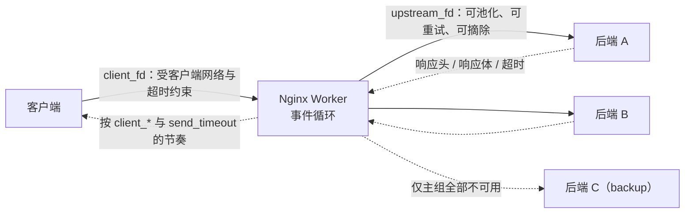
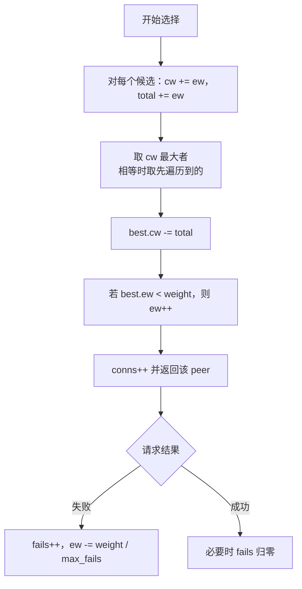
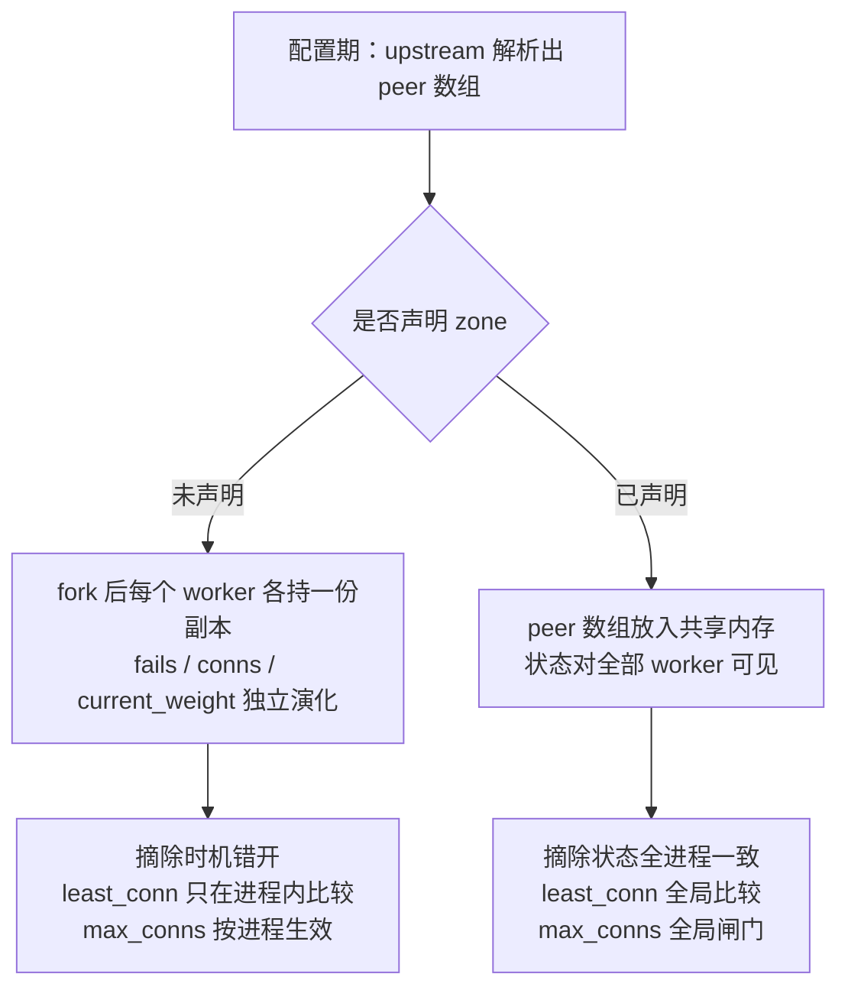
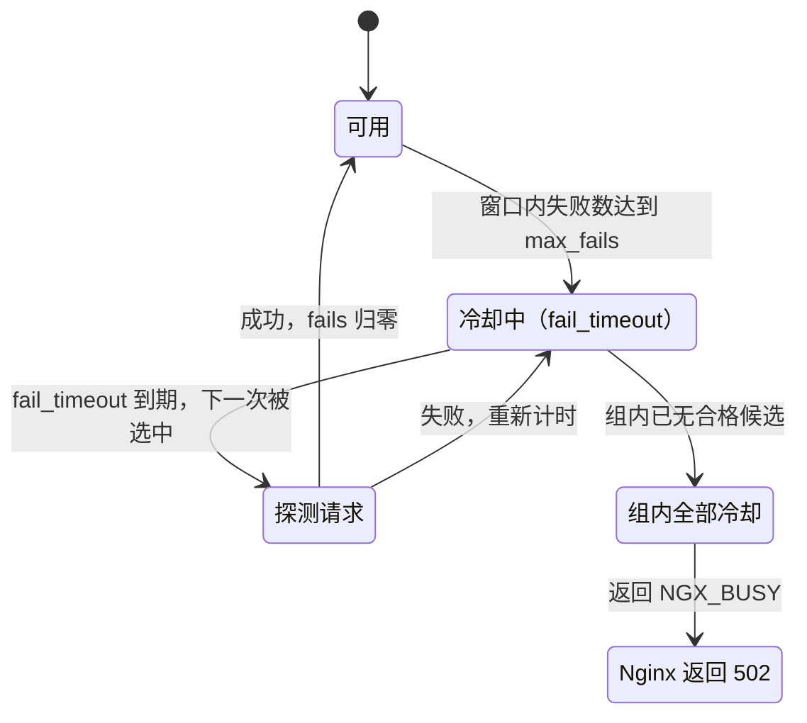
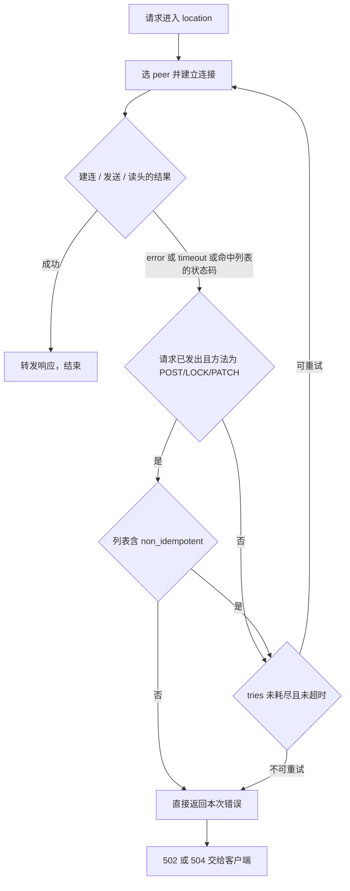
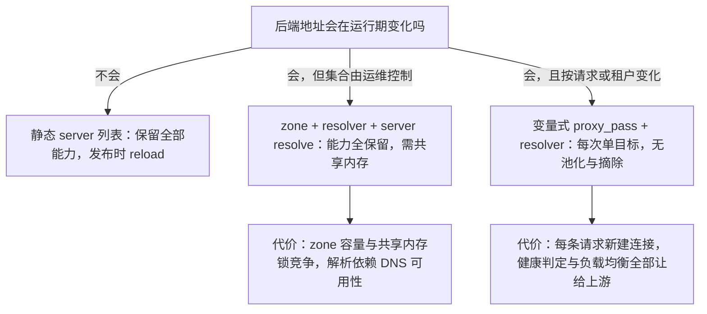

# 04 反向代理与负载均衡：upstream 模块深度解析

**摘要：**

`proxy_pass` 只负责把请求交出去，真正决定"交给谁、交几次、交出去之后还算不算活着"的，是 `upstream` 块里那几条看似平淡的指令。本文按两条线索展开：第一条是负载均衡算法的真实语义——默认加权轮询不是按权重排队，而是带记忆的平滑调度；`ip_hash` 与 `hash` 提供的是取模意义上的粘性，并非一致性哈希；`least_conn` 的"最小连接"究竟是全局比较还是每进程比较，取决于有没有声明 `zone`。第二条是被动健康检查的判定链——`max_fails` 与 `fail_timeout` 只负责计数，真正决定"什么算失败"的是 `proxy_next_upstream`，它的默认值不含 5xx，于是后端持续返回 500 时 Nginx 仍认为它健康，反过来一次被误计的超时却能把它摘掉十秒。围绕这两条线索，本文继续拆 `keepalive` 的三个必要条件、四层超时的计时口径、`X-Forwarded-For` 的伪造面，以及变量式 `proxy_pass` 放弃 `upstream` 能力的代价。文中的算术与日志判据都标注了口径，可以直接搬进排查清单。落点只有一句：摘除机制本质上是拿真实请求做的有损探测，配置的目标不是零误判，而是让误判的代价可控。

---

## 第 1 章 两个连接、三个时间轴

### 1.1 反向代理替谁排队

正向代理与反向代理的区分常被讲成"代理客户端还是代理服务端"，这句话没错，但它解释不了一个更实际的现象：接入反向代理之后，链路上的排队点从一处变成了三处，而绝大多数 502 与 504 的根因就藏在这三处排队的错配里。

客户端把请求发给 Nginx 时，它排的是客户端到 Nginx 这条连接的队，受制于客户端自己的网络、Nginx 的 `listen` 队列、`worker_connections` 上限；Nginx 把请求转给后端时，它排的是后端处理能力的队，受制于后端的线程池、连接数、GC 停顿；后端把响应写回来时，如果客户端很慢，数据还会在 Nginx 的缓冲区里再排一次队。三处排队各有各的容量与超时，任何一处溢出，表现出来的都是一句笼统的"网关错误"。不理解这三处各自的时间轴，排查就只能靠猜。

这就像把一个只开一个窗口的小邮局交给一个分拣中心：分拣中心可以让寄件人排一队、让邮车排一队、让待取的包裹再排一队，但分拣中心自己并不增加邮局的窗口数。反向代理的吞吐上限，最终仍由后端那个"窗口"决定，Nginx 能做的是把排队位置挪到代价更低的地方，而不是消灭排队。

### 1.2 一次代理请求的四个动作

抛开阶段划分的细节（03 篇拆过 11 个阶段的顺序），一次代理请求在 `upstream` 模块里只做四件事：选一个 peer、拿一条到该 peer 的连接、把请求写出去并读回响应头、按结果更新这个 peer 的状态。四件事分别对应 `ngx_http_upstream_get_peer`、连接建立（含 keepalive 池查找）、请求与响应头的收发、以及 `peer.free` 时对 `fails`、`conns`、`current_weight` 的记账。

关键在于第四步：决定一个后端"活着还是被摘掉"的，不是它自己，而是这四步里产生的记账结果。选中它、连不上它、读到超时、读到 500，这些事件会被翻译成不同的状态位交给 `free`，`free` 再决定是给它加一次失败、还是把失败清零。选谁由负载均衡算法决定，而"算不算失败"由另一个指令定义，也就是后文反复出现的 `proxy_next_upstream`。这条链把"调度"和"健康判定"耦合在了一起，看懂耦合点，才看得懂后面那些反直觉的现象。

下图是一次代理请求里两条连接的走向，注意右侧三个后端地位并不对等：`backup` 节点只在主组全部不可用时才会被考虑，它平时不参与任何一次选择。



### 1.3 三个时间轴与两个待答问题

第一条时间轴是**连接生命周期**：客户端连接由 `keepalive_timeout` 决定空闲多久后关闭，上游连接由 `upstream` 里的 `keepalive_timeout` 与后端的空闲超时共同决定。两条时间轴不同步，就会出现"连接还在池里、对端已经关了"的僵尸连接，这是后文第 8 章要处理的误摘来源之一。

第二条时间轴是**单次请求的传输**：`proxy_connect_timeout` 管建连，`proxy_send_timeout` 管请求写出的间隔，`proxy_read_timeout` 管响应读取的间隔，`send_timeout` 管向客户端写响应的间隔。它们没有一个是"整次请求的总时长"，把 `proxy_read_timeout` **当总超时用**，是这一篇里出现频率最高的配置误解。

第三条时间轴是**节点状态的生命周期**：`fail_timeout` 既是失败计数的统计窗口，又是摘除后的冷却时长，冷却结束时第一个真实请求充当探测请求。节点在这条时间轴上的状态变化，与它真实的健康状况之间隔着两层误差——一层来自"什么算失败"的定义，一层来自"谁来当探测请求"的随机性。后文所有关于"后端明明活着却被摘掉"的讨论，都在这条时间轴上展开。

由此引出本篇要回答的两个问题：为什么流量会不均（第 3 至第 5 章），以及为什么后端活着却被摘掉（第 6 至第 9 章）。前者是算法问题，后者是判定问题，两者共用同一套 peer 状态。

---

## 第 2 章 upstream 块里的五件东西

### 2.1 server：一个地址条目如何变成多个 peer

`server` 指令写的是一个地址，但落到运行期，它可能变成多个 peer。如果写的是域名，Nginx 在解析配置时就把域名解析成若干 IP，每个 IP 各自成为一个独立的 peer，各自拥有独立的权重、失败计数与连接计数。这一点在容器与云环境中经常被忽略：写 `server backend.internal:8080` 看上去是一台机器，实际可能是三个 IP 三个 peer，`max_fails` 每个 peer 各算一套，故障时可能只有其中一个 IP 被摘、另外两个继续收流量，观测上就像是"这台机器时好时坏"。要精确控制粒度，就用 IP 或者关掉运行期解析，让一条记录对应一个确定的后端。

`server` 后面可以带一串参数，它们的作用面完全不同：`weight` 参与调度，`max_fails` 与 `fail_timeout` 参与摘除，`backup` 与 `down` 改变参与调度的资格，`max_conns` 是并发闸门，`resolve` 改变地址来源。下表把常用参数与"调大/调小"的代价放在一起，顺带标注了版本边界。

| 参数 | 语义与默认值 | 调大 | 调小 |
|---|---|---|---|
| `weight` | 相对权重，默认 1，整数 | 该节点分到的请求比例上升，慢节点积压更严重 | 该节点被保护起来，但总容量下降 |
| `max_fails` | 统计窗口内允许的失败次数，默认 1，`0` 关闭计数 | 更难被摘除，故障节点滞留时间变长 | 更容易被摘除，抖动即触发 |
| `fail_timeout` | 统计窗口兼冷却时长，默认 10s | 冷却久，恢复慢，但避免反复打坏节点 | 冷却短，恢复快，但可能反复进入故障态 |
| `backup` | 仅在主组全部不可用时参与，不能与 `hash`/`ip_hash`/`random` 同用 | — | — |
| `down` | 永久标记不可用，计权求和时仍然算入 | — | — |
| `max_conns` | 到该后端的并发连接上限，默认 0 不限（1.11.5 起） | 放宽闸门，慢后端可能被压垮 | 更早排队，缓解后端过载 |
| `resolve` | 运行期跟随域名变化（1.27.3 起开源版可用） | — | — |

`backup` 与 `down` 值得单独说一句。`down` 的语义不是"从组里删掉"，而是"仍然占着权重与哈希位置，但不派请求"，所以想让 `ip_hash` 的映射保持不变、又临时下线一台机器时，正确做法是给它加 `down` 而不是把这行删掉——删掉会改变 `total_weight`，进而把大量客户端重新洗牌。`backup` 的限制则常常被忽略：它与 `hash`、`ip_hash`、`random` 三种方法互斥，配置加载时就会报错，因为后三种方法需要一个稳定的哈希空间，而备用节点的加入与退出会破坏这个前提。

还有一个容易被文档一带而过的边界：组里只有一个 server 时，`max_fails`、`fail_timeout` 这些参数会被忽略，这个节点永远不会被判定为不可用。源码里的做法很直接——单 peer 分支在 `free` 时无条件把 `fails` 清零。理由不难猜：没有其他节点可切，摘掉它等于直接对客户端返回 502，不如一直尝试。这个边界意味着，用单节点 `upstream` 加 `max_fails` 想做"熔断"行不通，需要熔断就得在入口层另想办法，或者至少保证组里有两个以上的 peer。

### 2.2 weight 表达的是请求数，不是连接数

权重最容易被误读成"处理能力配额"。它确实是能力配额的一种近似，但它的计量单位是**被选中的次数**，不是并发连接数，也不是字节数。一个权重为 5 的节点，如果每个请求都耗时 2 秒，它会被分配五倍于权重 1 节点的请求，于是它同时挂着五倍数量的连接，然后拖慢、超时、被 `max_fails` 摘掉。默认加权轮询本身没有"感知慢"的能力，它只在"选谁"这一步做加权，不回头检查"上一个被选中的节点是不是还堵着"。

这个性质决定了权重的适用条件：请求耗时接近、后端能力成比例时，权重才等价于容量比例；一旦耗时分布差异很大，权重就该让位给按负载选择的方法。反过来说，只要请求耗时同构，加权轮询就是最省的状态机——每个 worker 只维护一组整数，没有额外开销。

### 2.3 zone：把状态从 worker 私有变成进程共享

`zone` 是 `upstream` 块里语义最重的一条指令（1.9.0 引入）。它为整个组申请一块共享内存，用来存放"组的配置与运行期状态"，让多个 worker 看到同一份状态。运行期状态里最关键的是四项：`fails`（失败计数）、`accessed` 与 `checked`（失败时间戳与冷却判定）、`conns`（当前活跃连接数）、以及平滑加权轮询用的 `current_weight`。

没有 `zone` 时，配置解析阶段生成的 peer 数组会在 `fork` 之后被每个 worker 各持一份，此后互不相干。四个 worker 就是四份 `fails`、四份 `conns`、四个独立的轮询序列。这带来三个直接后果：其一，同一个后端在不同 worker 眼里健康状态不同，摘除时机最多相差整整一个 `fail_timeout`；其二，`least_conn` 只能在 worker 内部比较连接数，选出来的"最小"是局部最小；其三，`max_conns` 的限制按进程各自生效，四个 worker 各配 100，后端实际可能收到 400 条并发连接。

有 `zone` 之后，这几项变成全局可见，`least_conn` 的比较、`max_conns` 的闸门、冷却状态才真正符合直觉。代价是锁：每次选 peer、每次 `free`、每次读写 `conns` 都要在共享内存的互斥量上做一次加解，worker 数量与 QPS 一起上去之后，这把锁会成为新的热点。共享内存的容量也要给够，peer 数组、名字、以及每条记录附带的状态都从这块 zone 里分配，估算不足时 `nginx -t` 阶段未必报错，运行期才在日志里出现分配失败。既然具体字节数随版本与编译选项变化，稳妥的做法是按"每节点一条记录再加一段公共结构"的量级留出富余，并用 `nginx -T` 核对最终配置，而不是照抄某个固定数值。

> [!warning] zone 不是可选项里的锦上添花
> 只要组里有两个以上 worker、又希望 `least_conn` 与 `max_conns` 按全局生效，`zone` 就是必需项。反过来，如果组里只有单个 worker（譬如 `worker_processes 1` 的旁路代理），加 `zone` 只会带来锁开销而没有收益。

### 2.4 keepalive：连接池只解决握手

`upstream` 里的 `keepalive N` 激活的是到后端的连接缓存，`N` 的含义是**每 worker 的空闲连接上限**（1.27.x 默认关闭该缓存，需要显式声明；1.29.7 起改为默认开启 32 条）。缓存是每个 worker 一份、每个 `upstream` 组一份，池内按对端 `sockaddr` 匹配可复用的连接，容量满了之后按最近最少使用淘汰。

它解决的问题很窄：省掉每条请求都要做的 TCP 三次握手（后端是 HTTPS 时还要省掉 TLS 握手）；解决不了的问题同样明确：不改变并发需求与后端处理能力，也不改变 `max_fails` 的判定。真正配错的地方几乎总在"三个条件"上，第 8 章专门拆。

### 2.5 算法指令与 resolver 的位置

余下的算法指令都是单行开关：`least_conn`、`ip_hash`、`hash $key [consistent]`、`random [two]`。`resolver` 则有两个位置需要分清——`http` 块里的 `resolver` 服务于变量式 `proxy_pass`；`upstream` 块里的 `resolver` 是 1.27.3 起才有的能力，服务于带 `resolve` 参数的 `server`。两者的作用对象不同，混写不会报错，但行为会与预期不符，第 11 章会用一张表把三条动态化路线分开。

把五件东西放在一起看，`upstream` 块其实只做两件事：定义 peer 集合（`server`、`backup`、`down`、`weight`、`max_conns`、`resolve`），以及定义这些 peer 之间如何共享状态与如何被选择（`zone`、算法指令、`keepalive`）。后面所有现象都可以从"peer 集合 + 状态归属 + 选择规则"三个词里推出来。

---

## 第 3 章 默认加权轮询是"平滑"的

### 3.1 朴素加权轮询的问题

最直觉的加权实现是按比例排一张表：权重 3 的 A 连排三次，权重 1 的 B 排一次，于是分配序列是 `A A A B`。它满足比例，但把比例压缩进了最短的窗口——三连发意味着在这三个请求的瞬间，A 承担了全部流量。如果 A 与 B 的能力比恰好是 3:1，这没问题；如果 A 只是配置了更高权重、实际处理能力与 B 相当，那么每个周期开头的那三个请求会同时压到 A 上，A 的队列瞬间变长，响应变慢，而 B 在这段时间空闲。

这个问题在低 QPS 下几乎看不出来，高 QPS 下则表现为周期性延迟尖刺，尖刺周期正好等于 `total_weight` 个请求。Nginx 默认的平滑加权轮询（smooth weighted round-robin）就是为消除这种突发设计的。

### 3.2 平滑加权轮询的三步

算法的核心是一个随请求演化的整数权重，Nginx 源码里叫 `current_weight`，与之配合的还有 `effective_weight`（有效权重，初始等于 `weight`）：

1. 遍历所有候选 peer，对每一个执行 `current_weight += effective_weight`，同时累加 `total += effective_weight`；
2. 选出 `current_weight` 最大的那个，相等时取先出现的那个（比较用的是严格大于，所以先遍历到的节点胜出）；
3. 被选中者的 `current_weight -= total`，其余节点不变。

这三步的效果是：每个节点欠下的"应得请求"被记录成一个可正可负的余额，余额最高的先还，还完立刻扣掉一整轮的总量。于是比例不变，但分配被摊平到每一个请求上。

以权重 3:1 为例，逐步展开如下（`cw` 为 `current_weight`，`total` 恒为 4）：

| 请求序号 | 加权后 `cw` | 选中 | 选中后 `cw` | 序列 |
|---|---|---|---|---|
| 1 | A=3，B=1 | A | A=-1，B=1 | A |
| 2 | A=2，B=2 | A（相等取先出现者） | A=-2，B=2 | A |
| 3 | A=1，B=3 | B | A=1，B=-1 | B |
| 4 | A=4，B=0 | A | A=0，B=0 | A |

序列是 `A A B A`，周期为 4，比例精确为 3:1；相比朴素实现的 `A A A B`，最长连续次数从 3 降到 2。权重 5:1:1 的七请求周期是 `A A B A C A A`，与官方文档"每 7 个请求中 5 个给第一台、另两台各 1 个"的表述一致。这两个例子解释了一个常见的观测困惑：抓 8 个或 10 个请求的日志去看分配，看到的常常是"连续两个 A"，而不是"每 4 个请求里 3 个 A"，于是误判为负载不均。

下图是从选 peer 到更新状态的一次循环，注意 `effective_weight` 的自增发生在选择过程中，它的作用在第 3.4 节才会显现。



### 3.3 状态存在哪里，决定了序列的长度

平滑加权轮询的状态是 `current_weight`，它躺在 peer 结构里。没有 `zone` 时，这份结构在 fork 之后是每个 worker 的私有拷贝，四个 worker 就相当于四台互不通信的调度器，各自维护 `A A B A` 的相位。从全局看，同一时刻四个 worker 可能都在选 A，于是某个极短窗口内 A 收到了四倍于平均的请求；而把观测窗口拉长到一个周期以上，比例又精确回到 3:1。这解释了另一类现象：平均值完全正确，但没有一处局部是均匀的。

有 `zone` 之后，`current_weight` 进入共享内存，四个 worker 交替推进同一个余额，局部均匀性才与平均值一致。代价依旧是那把锁：每个请求都要在共享内存上更新一次整数。

### 3.4 effective_weight：失败后的降权与线性恢复

`effective_weight` 是这套算法里最容易被忽略的一半。它在配置解析时被初始化为 `weight`，此后有两个方向的变动：当一次请求被判定为失败（判定标准见第 6 章），`free` 阶段执行 `effective_weight -= weight / max_fails`，下限截到 0；而恢复发生在选 peer 的循环里——每一轮选择中，凡是 `effective_weight < weight` 的候选都会自增 1，不限于最终被选中的那一个。

这两个方向的速率不对称：下降是"一次失败扣掉 `weight / max_fails`"，上升是"每一轮选择加 1"。以 `weight=10`、`max_fails=2` 为例，一次失败扣掉 5，此后要经历五轮选择才恢复到 10，而在这五轮里它的份额一直偏低；又因为除法是整数截断，`weight=1` 搭配 `max_fails>1` 时 `weight / max_fails` 为 0，降权这一步实际不生效，真正起作用的只剩 `fails` 计数的摘除。也就是说，失败之后的降权是阶跃的，恢复是线性的，恢复期内这个节点处在一个"半可用"的中间态。

这个中间态的价值在于：它比"摘除"温和，节点不会因为一次失败就从调度里消失（只要 `fails` 还没到 `max_fails`），而是先被压低份额，让流量自动向健康节点倾斜。商业订阅版有一个 `slow_start` 参数可以显式控制健康节点恢复权重的时长，开源版能依赖的就只有这条线性恢复路径，理解它的速率，才能在观测到"恢复得慢"时不至于误判为故障。

> [!info] 一个可推算的例子
> 三个节点 `weight=10`、`max_fails=3`，其中一台连续失败两次。每次失败扣 `10/3`（整数截断为 3），`effective_weight` 从 10 降到 4，其份额从约 33% 降到约 17%（示例推算，另两台仍为 10）。此后它每一轮选择恢复 1，约六轮后回到满权重。这解释了为什么 `max_fails` 设得较大时，故障节点会经历一段"低份额但仍收流量"的观察期。

### 3.5 权重不是总时长的配额

把权重当成处理能力配额，是这一章要落地的最后一个判断。权重只决定被选中的次数，不决定每次被选中要花多久；后端慢下来时，权重越大，压给它的请求越多，积压越重，随后越容易被 `proxy_read_timeout` 与 `max_fails` 摘掉——摘掉之后流量转向其余节点，后者如果容量不足，会跟着变慢、跟着被摘，这就是后文第 6 章要说的连锁反应。

当请求耗时分布不可控时，正确的做法是把选择依据从"次数"换成"当前负载"，也就是 `least_conn`。但 `least_conn` 有一个前提条件经常被忽略：它比较的是 peer 结构里的 `conns`，而 `conns` 在不在共享内存里，取决于 `zone`。

### 3.6 random：两次抽样换常数开销

`random` 按权重随机选一台，不记录任何跨请求状态；`random two` 先随机抽两台，再按 `least_conn`（默认方法）在这两台里选连接更少的那台。这是"两次随机选择"在负载均衡上的落地：完整的最小连接要扫全组，开销随节点数线性增长，两次抽样在节点数上到十几个之后，分配质量已接近全局最小，代价只是两次比较。`random` 与 `backup` 互斥；`two` 之后的方法在开源版只有 `least_conn`，`least_time` 需要商业订阅。

---

## 第 4 章 zone：共享内存如何改变语义

### 4.1 没有 zone 时每个 worker 各自计数

Nginx 的进程模型是 master 解析配置、fork 出若干 worker，worker 之间不共享堆内存。`upstream` 块里定义的 peer 数组在配置解析阶段就已生成，fork 之后每个 worker 各持一份副本，此后 `fails`、`accessed`、`conns`、`current_weight` 的每一次更新都只发生在自己的副本上。这不是实现上的疏忽，而是默认行为的设计取舍：无锁、无竞争、每个 worker 独立决策，代价是**全局视图缺失**。

后果可以逐条列举。第一，摘除不同步。某个 worker 连续失败三次、把节点 A 标记为冷却，另外三个 worker 完全不知情，仍按各自主循环往 A 发请求，于是同一次故障的失败次数被四个 worker 分别计数，冷却窗口各不相同，恢复时间也各不相同。第二，`least_conn` 退化。四个 worker 各自比较自己看到的连接数，选出来的"最小"只在进程内成立；从后端视角看，四条连接可能同时砸到同一台机器上。第三，`max_conns` 变成每进程限制。文档在 `max_conns` 条目下有一句明确的说明：若组不在共享内存中，这一限制按每个 worker 进程生效。配了 100 的四 worker 部署，实际放行上限是 400。

这几个后果叠加起来，就出现了最典型的观测困惑：某个后端明明只挂了十秒，重启后立刻可用，但监控显示流量倾斜持续了将近一分钟。原因不是健康检查太慢，而是四个 worker 的冷却期结束时间彼此错开，最晚的那个把窗口拖长了。

### 4.2 有 zone 之后：一致的代价是锁

声明 `zone` 之后，peer 数组被放进共享内存，前述三项状态变成全进程一致：一次失败被所有 worker 看见，一份冷却对所有 worker 生效，`conns` 变成全局计数，`least_conn` 的比较才有全局意义。源码里每次选 peer 都要先拿 peers 的读写锁，再对具体 peer 加锁，`free` 时同样加锁，锁的粒度已经做到每个 peer 一把，但读写并发本身仍然是串行的。

于是容量规划里出现了一个新的量：worker 数越多，共享内存上的争用越明显。这不是说 `zone` 不该开，而是说它的收益（一致的摘除与全局的最小连接）与代价（锁竞争）需要一起评估。经验上，worker 数在个位数、QPS 在万级以内时，锁的代价远小于误判的代价；worker 数上到几十、又是极短请求的高并发场景，才需要开始怀疑锁的贡献。

下图把两种状态归属并排画在一起：未声明 `zone` 时每个 worker 各持一份副本，声明之后 peer 数组进入共享内存，`least_conn` 与 `max_conns` 的语义差异就从这里来。



### 4.3 least_conn 的真实比较式

`least_conn` 的文档描述是"选择活跃连接数最少的服务器，并考虑权重"，落在源码里是一个交叉相乘的比较：对每个候选 peer，比较 `peer->conns * best->weight` 与 `best->conns * peer->weight`，取更小者；如果出现相等（`many` 标记被置位），则在并列的 peer 中退化为加权轮询来挑选。把两个乘积相等变形一下，就是在比较 `conns / weight`——单位权重上的连接数，这与"考虑权重"的直觉一致。

这个比较式有两个容易踩空的点。其一，`conns` 的增减发生在 `get_peer` 成功后自增、`free` 时自减，所以它统计的是**已取出未释放的请求数**，包含正在建连、正在等响应、正在传响应的全部阶段；它与后端自己统计的活跃连接数并不等价，中间差着 Nginx 侧的缓冲与排队。其二，并列时的退化选择用的是加权轮询，这意味着 `least_conn` 在负载均匀时并不是"随机挑一个"，而是有确定相位的，抓包看到的分布会带周期性。

### 4.4 zone 容量、reload 与配置变更

`zone` 的容量按 peer 数与记录大小估算，同一块 zone 可以被多个组共用（文档明确允许几个组共享同一 zone，此时只需在其中一个组里写 `size`）。容量不足时的症状是运行期告警而非配置期报错，所以变更 peer 数量之后要留意日志。

另一个值得知道的行为是 reload：同名同大小的 `zone` 在新旧配置之间会被保留，节点状态也随之保留。这在滚动发布时是好事——后端重启不会被 reload 顺带清零失败计数；在故障处置时也可能变成坏事——你刚手工把某个节点的 `max_fails` 调大，准备让它恢复接流量，却发现它仍带着上一轮的冷却状态。清理状态只能重启 worker，或改动 zone 尺寸让共享内存重建，两者都有代价。

---

## 第 5 章 粘性不是一致性：ip_hash 与 hash

### 5.1 ip_hash 的哈希键只有三段

`ip_hash` 的文档表述很清楚：IPv4 取客户端地址的前三个字节，IPv6 取整个十六位地址，作为哈希键。源码里的实现是：从 `hash = 89` 开始，对键的每个字节执行 `hash = (hash * 113 + byte) % 6271`，得到一个 0 到 6270 之间的数，再对组的 `total_weight` 取模，按权重区间落到某个 peer 上。

这个实现带来两个直接结论。第一，同一 `/24` 网段内的客户端，无论具体 IP 是什么，哈希键完全相同，一定落到同一台后端。第二，哈希值与 `total_weight` 相关，而 `total_weight` 是所有 peer 权重之和，所以任何改变总权重或节点集合的操作，都会**打散绝大多数映射**。文档对此说得很直白：加一台或删一台，可能导致大部分键被重映射；如果要临时下线一台机器又不想打散映射，就给它加 `down`——`down` 的节点仍计入 `total_weight`，哈希空间不变，只是请求会在绕过它之后落到下一个候选。

重排比例可以估个量级。从 n 台等权节点扩到 n+1 台，`hash % total_weight` 的结果落在原位置的概率约为 `1/(n+1)`，其余 `n/(n+1)` 全部换台。四台扩到五台时，约 80% 的客户端会换后端（示例推算）。对有状态的会话来说，这 80% 就是一次集体掉登录；对缓存来说，这就是一次集体未命中，后端的瞬时压力会按未命中比例放大。

### 5.2 二十次尝试后的回退

`ip_hash` 还有一个藏在源码里的兜底：如果按哈希选中的 peer 已经被试过、或者处于 `down`、冷却、`max_conns` 满的状态，就把上一轮的哈希值再迭代一次、落到下一个候选，尝试次数超过 20 或组内 peer 少于 2 个时，直接退化为普通加权轮询。这个兜底是为了避免"某个热点哈希对应的节点全挂，导致同一批客户端陷入无限重试"，代价是这些客户端在故障期间失去粘性，故障恢复后也不会自动回到原来的节点——因为回退路径不更新客户端的哈希，下一次请求仍从原始哈希算起，是否回到原位取决于该节点是否已恢复。

把这条与前面的重排结合起来看，`ip_hash` 的适用边界就清楚了：它适合"节点集合长期稳定、客户端 IP 稳定、会话必须落在单机内存"的旧式部署；它不适合弹性伸缩、灰度发布、以及大量客户端共用出口 IP 的场景。后一种场景里，一个运营商 NAT 后面的几千个用户共享三个字节的键，会被整段压到一台后端上，而 `ip_hash` 没有任何机制能察觉这种偏斜。

### 5.3 hash consistent：ketama 环与 160 个虚拟点

`hash $key` 不带 `consistent` 时，就是"哈希取模"：`hash(key) % total_weight` 之后再按权重区间找 peer，行为与 `ip_hash` 的结构相同，只是键换成了任意变量组合。带 `consistent` 时，Nginx 切换到 ketama 风格的一致性哈希：为每个 peer 在 32 位环上布置虚拟点，每个权重单位布置 160 个点，点的位置由 `crc32(主机名 \0 端口 + 上一个点的哈希)` 迭代得到；请求的键做一次 `crc32`，在有序点上二分查找顺时针最近的一个点，落到该点所属的 peer。文档提到与 `Cache::Memcached::Fast` 的 `ketama_points=160` 兼容，指的正是这个数。

一致性哈希的收益就是**重排比例收敛**：增加一台节点，只有落在"新节点与其前驱之间"的那一段键会迁移，迁移量约等于新节点的份额 `w_new / total_weight`；等权扩容时约 `1/(n+1)`。四台扩到五台，迁移约 20%，其余 80% 的映射保持不变（示例推算）。这与 `ip_hash` 的约 80% 重排正好互为镜像。

但一致性哈希不是免费的：虚拟点数量与 `total_weight` 成正比，节点多、权重大的组消耗更多配置期内存；点的分布是概率性的，只有两台时环上区间宽度不均，个别节点可能承担明显超过权重的份额；权重变化同样导致部分键迁移，只是幅度小于取模。下表把三种粘性方案的差异放在一起。

| 方案 | 哈希键 | 扩容 n→n+1 的重排比例 | 权重变化的影响 | 典型用途 |
|---|---|---|---|---|
| `ip_hash` | IPv4 前 3 字节 / IPv6 全址 | 约 `n/(n+1)`，四扩五约 80% | 改变 `total_weight`，整体重排 | 旧式单机会话，节点集合稳定 |
| `hash $key` | 任意变量组合 | 约 `n/(n+1)` | 同上 | 按 URI、用户 ID 分片 |
| `hash $key consistent` | 任意变量组合 | 约 `1/(n+1)`，四扩五约 20% | 部分迁移，幅度小于取模 | 缓存层分片、需要灰度扩容 |

### 5.4 粘性的三种替代

如果粘性是为了共享会话，把会话挪到集中存储、让后端无状态，是最根本的解法，代价是多一次网络往返与一个新的依赖。如果是为了缓存命中率，一致性哈希更合适，但要接受"节点少时分布不均"，必要时用权重补偿。如果是为了灰度发布，用 `hash $cookie_user consistent` 之类的组合比 `ip_hash` 可控，因为键的语义从"网络位置"变成"业务标识"，不受 NAT 与 IPv6 隐私地址影响。

---

## 第 6 章 被动健康检查：什么算失败

### 6.1 判定权不在 max_fails 手里

开源版 Nginx 没有主动探测，所谓健康检查完全是被动的：靠真实请求的结果给 peer 记账。记账的规则写在 `peer.free` 里，而"这次请求算不算失败"的判断发生在更早的 `ngx_http_upstream_next`，它依据的是 `proxy_next_upstream` 这个指令。文档在 `max_fails` 条目下有一句关键的话：什么算一次不成功的尝试，由 `proxy_next_upstream` 一类的指令定义。

于是出现第一个反直觉的结论：后端持续返回 500，Nginx 认为它**完全健康**。原因是 `proxy_next_upstream` 的默认值是 `error timeout`，只有建连失败、向它发送请求失败、读取响应头失败或超时、以及响应头非法才算失败；500、502、503、504 这些"后端返回了一个合法响应、只是语义是错误"的情况默认不算失败，既不重试，也不计入 `fails`。要让 500 参与摘除，必须显式把 `http_500` 写进列表。这个默认值有其合理性——5xx 常常是业务错误而非节点故障，用它做摘除依据会误伤——但它与很多人的预期相反，也是"后端明明在报错却一直不摘"的根源。

第二个反直觉之处在于，`error` 与 `timeout` 是**永远计入失败**的，即使你没有把它们写进 `proxy_next_upstream`；而 `http_500` 一类状态码只有在写进列表时才计入。这两类判定规则**不对称**，文档写得很清楚：`error`、`timeout`、`invalid_header` 始终视为不成功尝试，`http_500/502/503/504/429` 仅在显式声明时视为不成功尝试，`http_403/404` 永远不算。配置时需要按这个不对称来思考，而不是简单地把状态码一股脑加进去。

### 6.2 max_fails 与 fail_timeout 的窗口语义

`fail_timeout` 有两个含义，文档把它们写在同一句里：统计失败次数的时间窗口，以及被判定不可用之后的时长。默认 `max_fails=1`、`fail_timeout=10s`，意思是"在 10 秒窗口内失败 1 次，就把这个节点摘掉 10 秒"。把 `max_fails` 设为 0 则关闭计数，节点永远不会因为失败被摘。

窗口的滑动方式值得说细：失败时 `fails` 自增，同时把 `accessed` 与 `checked` 都更新为当前时间；之后每次被选中，如果距上次 `checked` 已超过 `fail_timeout`，`checked` 会被刷新为当前时间；成功返回时，若 `accessed < checked`，`fails` 清零。换句话说，计数的有效期是"从最近一次失败起 `fail_timeout`"，超出这个窗口之后的下一次成功会把计数清掉。这套逻辑在正常情况下工作良好，在"每 `fail_timeout` 恰好失败一次"的边缘负载下会振荡：计数每次被清到 0，永远攒不满 `max_fails`，节点始终不摘，但每次失败都落在真实用户身上。

| 配置组合 | 行为 | 适合 | 风险 |
|---|---|---|---|
| `max_fails=1`，`fail_timeout=10s` | 一次失败即摘 10 秒 | 后端重启快、流量可被其余节点吸收 | 抖动即摘，反复摘除引发流量震荡 |
| `max_fails=3`，`fail_timeout=30s` | 30 秒内三次失败才摘 30 秒 | 一般生产默认 | 故障节点滞留更久，期间持续拖慢部分请求 |
| `max_fails=0` | 永不摘除 | 单节点组、调试环境 | 故障节点永久收流量 |
| `max_fails=5`，`fail_timeout=60s` | 宽容阈值 | 后端有偶发慢请求 | 摘除滞后，故障影响面扩大 |

### 6.3 冷却、探测与"全部冷却"的 502

节点进入冷却后不再被选中，冷却到期之后它重新回到候选集，第一个被派给它的请求就是探测请求。探测成功，`fails` 清零，节点满血回归；探测失败，重新进入一个 `fail_timeout` 的冷却。注意这里没有指数退避，每次失败都只是重置一个固定的冷却窗口。

真正的陷阱在"所有节点都在冷却"时。此时 `get_peer` 找不到任何合格候选，返回空，负载均衡模块据此返回 `NGX_BUSY`，上游连接阶段于是记一条 `no live upstreams` 的 error 日志，直接给客户端 502——这个 502 **不是后端返回的**，是 Nginx 自己的判决。后端可能全都活着，只是全部处在冷却窗口里。这个行为比"继续打到某个节点"更容易造成全站不可用，因为一旦摘除是批量发生的（一次网络抖动、一次上游交换机闪断），四个节点的冷却窗口可能高度重叠，重叠期内所有请求都拿到 502，而它们的后端其实早已恢复。

下面这张状态机把"可用—冷却—探测"的循环与"全部冷却"这个出口画在一起，出口通向的是 Nginx 自己的 502，而不是后端。



### 6.4 四个让健康后端被摘掉的真实原因

第一，超时判错。`proxy_read_timeout` 计的是两次读之间的间隔，但很多后端在"处理完成之前不发任何字节"，一次 61 秒的计算会让 Nginx 读超时，于是判为 `timeout`，计入失败。后端没死，只是慢；`max_fails=1` 时它被摘 10 秒，重试到其他节点，其他节点多接一份流量。若这是个大查询接口，摘除反而让其余节点也变慢，进而被逐个摘掉。

第二，僵尸连接。keepalive 池里的空闲连接被后端关闭（重启、空闲超时、LB 断连）之后，下一次复用必然拿到一个已关闭的 socket，读取立刻返回错误，`upstream_next` 按 `error` 记一次失败。源码里对这种情况有一处补偿——`u->peer.cached` 且属于 `error` 时，把 `tries` 加回去，避免同一次复用失败消耗掉重试额度——但失败计数本身仍会增加。`max_fails=1` 的组在滚动重启后端时，很容易因此出现"新起的实例刚接流量就被摘"的现象。

第三，探测请求恰好落在恢复期。冷却结束后的第一个请求被当作探测，如果后端此时刚启动、还没预热（连接池空、JIT 未编译、缓存冷），这个请求大概率超时，节点被再次摘除。这也是为什么"摘除—恢复"会呈现周期性的锯齿：每次探测都赶上最差的时刻。

第四，判定与调度耦合导致的自我强化。少量失败把 A 摘掉，流量按比例分给其余节点，其余节点负载与延迟上升、开始超时，于是也被摘，直到最后一个节点独占全部流量，就是第 3 章末尾预告的连锁反应。缓解办法不在健康检查本身，而在容量冗余与摘除阈值：`max_fails` 留余量、`fail_timeout` 别太长，并保证摘掉任一台后剩余节点仍有余量。

### 6.5 别指望单节点组做熔断

`max_fails` 在单 peer 组里被忽略，这一点在 2.1 节提过，但它决定了架构选择：只有一个后端（或一个 Service 后面只有一个 Pod）时，`max_fails` 给不了任何保护，请求会一直打过去直到它恢复；要保护这类拓扑，只能在入口层加并发上限或队列，也就是 08 篇的限流思路。

---

## 第 7 章 proxy_next_upstream：重试的放大效应

### 7.1 "默认 0 次重试"是一个误解

`proxy_next_upstream_tries` 的默认值是 0，文档解释为"0 表示关闭这一限制"，而不是"不重试"。真正限制重试次数的是 peer 的 `tries` 属性：它在初始化时被设为组内可用 peer 的数量（不含 `down` 的节点），每失败一次自减一次，减到 0 才停止。所以在四节点的组里，即使不写 `proxy_next_upstream_tries`，一个请求也可能依次试过四个节点——"默认不重试"的直觉是错的，默认是"不限额外次数，但实际上限是节点数"。

这个默认值配合 `error`、`timeout` 属于永远计入失败的类别，意味着一次区域性网络故障中，每个客户端请求都会把组内节点从头试到尾，后端的请求量按"节点数"倍放大。`proxy_next_upstream_timeout` 默认也是 0（不限时），重试链会一直延续到 `tries` 耗尽，客户端等待时间等于各次尝试之和。

把重试路径画出来会更清楚：一条请求在 `request_sent` 与请求方法两个条件的共同约束下才被允许换节点，而 `tries` 与时间预算共同决定什么时候放弃。



### 7.2 取值表与两类判定

| 取值 | 含义 | 是否计入 `fails` | 备注 |
|---|---|---|---|
| `error` | 建连、发送请求、读响应头时发生错误 | 始终计入 | 即使不写进列表也计入 |
| `timeout` | 上述阶段发生超时 | 始终计入 | 与 `proxy_read_timeout` 的口径绑定 |
| `invalid_header` | 后端返回空或非法响应 | 始终计入 | 常出现在后端非 HTTP 服务时 |
| `http_500` | 后端返回 500 | 仅在显式声明时计入 | 默认不摘 500 的根源 |
| `http_502` / `http_503` / `http_504` | 后端返回对应状态码 | 仅在显式声明时计入 | 链式代理场景需要显式声明 |
| `http_429` | 后端返回 429（1.11.13 起） | 仅在显式声明时计入 | 与限流后端配合时有用 |
| `http_403` / `http_404` | 后端返回 403 / 404 | 永不计入 | 属于业务语义，不该触发摘除 |
| `non_idempotent` | 允许非幂等请求在已发出后换节点 | 不影响 | 危险项，见 7.3 |
| `off` | 关闭换节点 | 不影响计数 | `error`/`timeout` 仍会计入失败 |

这张表最需要记住的是倒数第二列：`fails` 的计数与"是否重试"是两件事。`proxy_next_upstream off` 只是不换节点，节点的失败计数照旧累积，一样会被摘除。反过来，把 `http_500` 加进列表之后，既会触发重试，也会把 500 计入失败——两个效果一起来，这也解释了为什么"加了 http_500 之后摘除变频繁"。

### 7.3 非幂等请求的重试边界

Nginx 对非幂等请求的保护有一个精确的触发条件：只有**请求已经发出**（`request_sent` 为真）且方法属于 POST、LOCK、PATCH 时，才会给错误类型打上非幂等标记；此时若列表里没有 `non_idempotent`，就不换节点。反过来说，在建连阶段就失败的 POST 请求，因为请求还没发出去，仍然会被重试到下一个节点——这是安全的，因为**后端没收到这次请求**。

真正危险的是"请求已发出、后端已处理、但响应在返回途中超时"这一种。此时默认行为是不重试，客户端拿到 504；如果运维为了"提高成功率"加上 `non_idempotent`，同一个下单请求就可能在后端落两次库。这类重复写不会在 Nginx 的日志里留下明显痕迹，只会在业务侧表现为偶发的重复订单或重复扣款。要重试非幂等请求，正确的前提是后端具备幂等键或去重表，而不是靠 Nginx 这一侧保证。

### 7.4 放大倍数与日志判据

重试的放大效应可以按"平均尝试次数"直接估算。设组内有四个节点，其中一台完全不可用，客户端请求均匀落到四个节点上：每个请求有 1/4 的概率先命中坏节点，命中后重试一次，于是平均尝试次数为 `1 + 1/4 = 1.25`，后端总请求量放大 1.25 倍。若两台不可用、`tries` 不限制，平均尝试次数升到 `1 + 1/2 + 1/2 × 1/3 ≈ 1.67`，放大 1.67 倍。若四台全不可用，每个请求试满四次才放弃，放大 4 倍，且这四个请求全部无功而返——这就是故障期间后端"请求量暴涨却全部失败"的算术来源（示例推算，假设请求在节点间均匀分布）。

| 故障形态 | 平均尝试次数 | 后端请求放大 | 客户端结果 |
|---|---|---|---|
| 全部健康 | 1.00 | 1.00× | 正常 |
| 四台中一台不可用 | 1.25 | 1.25× | 正常，延迟略升 |
| 四台中两台不可用、`tries` 不限 | 约 1.67 | 约 1.67× | 部分请求重试后成功 |
| 四台全不可用、`tries` 不限 | 4.00 | 4.00× | 全部失败，等待时间为四次尝试之和 |
| 四台全不可用、`tries 2`、`timeout 5s` | 2.00 | 2.00× | 快速失败，代价是成功率更低 |

判据方面，`$upstream_addr` 会把一次请求里被联系过的后端按顺序以逗号分隔记录，`$upstream_status` 与 `$upstream_response_time` 同样按顺序给出对应值。日志里出现 `10.0.0.1:8080, 10.0.0.2:8080` 这样的地址串，就说明这个请求发生过重试；如果第二个地址重复出现多次，说明 `tries` 与客户端超时都在放大等待时间。把二者放进 access_log，等于免费拿到一条重试链，排查"502 是谁返回的"时比看 error_log 更直接。

---

## 第 8 章 keepalive 三件套

### 8.1 池的结构与淘汰

`keepalive N` 声明之后，每个 worker 为这个 `upstream` 组维护一个空闲连接队列，容量为 N 条，池内按对端的 `sockaddr` 匹配可复用的连接。取连接发生在选完 peer 之后：先由负载均衡选出目标地址，再去池里找一条指向同一地址的空闲连接；找不到就新建。归还发生在请求结束且满足一系列条件时，池满时淘汰队列末尾（最久未使用）的那条。

由此可以推出一个常被误解的点：**连接池不参与选路**。池里有没有到某台后端的空闲连接，不影响负载均衡选谁；选完之后才去池里找。如果算法把请求轮到了另一台，池里那条连接就只能继续空闲，直到超时被关闭。这也是为什么"配了 keepalive、但复用率很低"有时不是配置问题，而是池容量太小或后端数量太多，导致每次选中的目标与池内现有连接对不上。

### 8.2 三个条件缺一不可

在 1.27.x 的默认值下，让上游 keepalive 真正生效需要三个条件同时满足，缺任何一个都会退回短连接：

1. `upstream` 块里声明 `keepalive N`；
2. `location` 里设置 `proxy_http_version 1.1`（默认是 1.0，1.0 的默认语义是短连接）；
3. `location` 里设置 `proxy_set_header Connection ""`（默认值是 `Connection close`，见第 10 章）。

第三个条件最常被漏掉，因为它的默认值藏在 `proxy_set_header` 的默认声明里：Nginx 默认会向上游发送 `Connection: close`，即使你把协议版本改成了 1.1。不把这个头清空，后端收到 `Connection: close` 就会在响应后主动关闭连接，Nginx 拿到的响应也就无法进入连接池，池永远是空的。三个条件的失败形态各不相同：缺第 1 条是完全不池化；缺第 2 条是协议版本退回 1.0，后端按短连接处理；缺第 3 条是协议版本对了、但每次都被要求关闭。

| 缺哪一条 | 上游看到的请求 | 复用是否生效 | 典型症状 |
|---|---|---|---|
| 未声明 `keepalive` | 1.1，`Connection: ""` | 不生效 | 后端连接数随 QPS 上升，TIME_WAIT 增多 |
| 缺 `proxy_http_version 1.1` | 1.0，无 Connection 头，默认短连接 | 不生效 | 后端日志里全是短连接 |
| 缺 `Connection ""` | 1.1，`Connection: close` | 不生效 | 协议版本对，但连接仍在每次响应后关闭 |
| 三条齐全 | 1.1，`Connection: ""` | 生效 | 池内连接稳定复用，需关注僵尸连接 |

顺带说明版本差异：1.29.7 起上游 keepalive 默认开启（默认 32 条），`proxy_http_version` 的默认值也改为 1.1，第三个条件仍然需要，因为 `Connection: close` 的默认声明没有变；本文按 1.27.x 的口径描述，版本敏感处请以对应版本文档为准。

### 8.3 入池条件：为什么"配了却不复用"

即使三条都配齐，连接也未必进池。归还时的判断条件在源码里是一串并列的否决项：本次请求被判定为失败、连接对象为空、连接出现 EOF 或读写错误或超时、该连接已服务的请求数达到 `keepalive_requests`、连接存活时间超过 `keepalive_time`、响应本身不允许 keepalive（后端返回 `Connection: close` 或 HTTP/1.0）、请求体尚未发送完、进程正在退出。任何一条命中，连接就被直接关闭。

这串条件正好构成一张排查清单。复用率低时，先看后端是否返回了 `Connection: close`（有些框架默认如此，或者因为响应体用了 `Transfer-Encoding` 之外的分块写法）；再看 `keepalive_requests` 是否被调得过小（1.19.10 起默认 1000，之前默认 100）；最后看 `keepalive_timeout` 与后端空闲超时的关系。若后端在 30 秒后关闭空闲连接，而 Nginx 的 `keepalive_timeout` 设了 60 秒，池里就会长期躺着已经死掉的连接。

### 8.4 僵尸连接与误摘除

僵尸连接的杀伤力不只在于"复用失败一次、多花一次建连"，更在于它会被计入失败计数。如第 6 章所述，复用失败属于 `error`，`free` 时按失败处理，`fails` 自增。在 `max_fails=1`、`fail_timeout=10s` 的组里，后端滚动重启时每台新实例都可能因为一次僵尸连接复用而被摘十秒，运维看到的现象是"新实例刚上线就被踢出，日志里反复出现 `upstream server temporarily disabled`"。

缓解方式有三条，各有代价：把 `keepalive_timeout` 设得比后端空闲超时短一截（譬如后端 60 秒、Nginx 设 50 秒），代价是空闲连接被更早关闭、复用率略降；把 `max_fails` 从 1 调到 3，代价是真正的故障节点多收一段时间的流量；让后端在关闭连接前发送 `Connection: close` 并优雅收尾，代价是需要改后端。三条可以叠加，优先级取决于哪一侧更容易改。

### 8.5 复用率的算术

复用带来的收益可以用两条连接的往返次数来算，不必套用固定性能数字。同机房内网的一次往返通常在亚毫秒到一毫秒量级，一次请求-响应本身就需要一次往返；不复用时，建连（三次握手）还要再加一次往返（如果是 HTTPS，还要加 TLS 握手的一到两次往返）。也就是说，同机房短请求的总延迟从约两次往返降到约一次往返，量级上接近减半；跨机房或跨可用区时，一次往返的绝对值变大，收益同比放大。

CPU 与端口层面的账同样可以估。以单 worker 500 QPS、每次建连与销毁合计十几微秒的内核开销计，每秒约消耗几毫秒到十几毫秒的 CPU（示例推算），单看不多；但四个 worker 合计每秒两千次建连（示例推算），按 Linux 主动关闭方 60 秒 TIME_WAIT 计算，稳态下主动关闭的一方会积压约 12 万个处于 TIME_WAIT 的套接字——默认 `Connection: close` 时主动关闭的是后端，所以这些 TIME_WAIT 通常记在后端的账上。keepalive 把这条曲线压平，代价是后端要维持空闲连接——空闲连接在后端也占文件描述符与内存，所以 `keepalive N` 的调大不是没有上限，通常按"每 worker 的并发峰值加一点余量"来定，而不是照抄一个大数。

---

## 第 9 章 超时的四层与一个缓冲

### 9.1 客户端侧与上游侧各有两道闸门

超时不是一条指令，而是分列两侧的计时器。客户端侧：`client_header_timeout`（默认 60s）限制读完整个请求头的总时长，`client_body_timeout`（默认 60s）限制两次读请求体之间的间隔，`send_timeout`（默认 60s）限制两次写响应之间的间隔。上游侧：`proxy_connect_timeout`（默认 60s，通常不会超过 75 秒）限制建连，`proxy_send_timeout`（默认 60s）限制两次写请求之间的间隔，`proxy_read_timeout`（默认 60s）限制两次读响应之间的间隔。

这六条里，只有 `client_header_timeout` 与 `proxy_connect_timeout` 计的是"整段动作"的时长，其余四条都计**相邻两次读写之间的间隔**。文档对 `proxy_read_timeout` 的措辞是"只在两次连续的读操作之间计时，不覆盖整个响应的传输"，对 `proxy_send_timeout` 的措辞同理。这个差别是本章全部误判的源头。

| 指令 | 默认 | 计的是什么 | 调大的代价 | 调小的代价 |
|---|---|---|---|---|
| `client_header_timeout` | 60s | 读完整个请求头的总时长 | 慢速攻击占用连接更久 | 正常但慢的客户端被误断 |
| `client_body_timeout` | 60s | 两次读请求体之间的间隔 | 大文件上传更从容，慢连接占用更久 | 弱网上传被中断 |
| `send_timeout` | 60s | 两次写响应之间的间隔 | 慢客户端拖住 worker 更久 | 移动端弱网下载被误断 |
| `proxy_connect_timeout` | 60s | 建立到上游连接的总时长 | 后端不可达时等待更久，占满并发 | 网络抖动即判失败，加速摘除 |
| `proxy_send_timeout` | 60s | 两次写上游之间的间隔 | 大请求体上传更从容 | 大 POST 被中断 |
| `proxy_read_timeout` | 60s | 两次读上游之间的间隔 | 慢接口不再被误杀，但慢请求占用连接更久 | 长计算接口被误杀，触发摘除 |
| `keepalive_timeout`（上游） | 60s | 空闲连接的存活时长 | 僵尸连接存活更久，误摘概率上升 | 复用率下降，建连变多 |

### 9.2 把 read_timeout 当总超时会发生什么

假设后端有一个报表接口，稳定地在 90 秒后返回完整结果，期间不发任何字节。`proxy_read_timeout 60s` 会在第 60 秒判定超时，客户端拿到 504，同时这个节点被记一次 `timeout` 失败；`max_fails=1` 时它立刻被摘 10 秒。业务侧看到的是"报表接口偶尔 504，且失败之后十秒内的所有请求都变得很慢"——因为那十秒的流量全压到了其余节点。

反过来，一个持续 30 分钟的 SSE 流，只要每 20 秒推送一次心跳，即使总时长远超 60 秒也不会触发 `proxy_read_timeout`，因为计时器在每次读到数据时被重置。这也是为什么"把超时调大"通常不能解决长连接问题，真正需要检查的是两件事：心跳间隔是否小于 `proxy_read_timeout`，以及 `proxy_buffering` 是否把数据憋在 Nginx 里没有下发。

### 9.3 超时与摘除的耦合

每一次 `timeout` 都会走 `upstream_next` 里的失败记账，于是超时阈值与摘除阈值之间形成了一个隐式耦合：把 `proxy_read_timeout` 调小，等于让节点更容易被判失败，也就更容易被摘；把 `max_fails` 调大，等于用更长的故障滞留期换取更低的误摘率。两者要一起看，单独调任何一个都会把问题推到另一侧。

一个可操作的组合是：先按接口的 P99 加一段余量定 `proxy_read_timeout`（宁可让它比典型耗时大一个数量级，也别卡在长尾上），再用 `max_fails=2` 或 3 吸收偶发长尾，最后用 `fail_timeout` 控制冷却期的长度。若某接口的长尾本身不可控（报表、导出），更好的做法是拆到独立的 `location` 与 `upstream`，给它单独的超时与摘除参数，而不是让整组共用一套阈值。

### 9.4 缓冲为什么能缩短上游连接占用

`proxy_buffering` 默认开启。开启时，Nginx 会尽快把后端的响应读进缓冲区（内存不够时落临时文件），读完之后立刻把上游连接归还，再按客户端的接收速度慢慢下发。于是后端的连接占用时间取决于 Nginx 读得多快，而不取决于客户端有多慢。关闭时（`proxy_buffering off`），数据边收边发，慢客户端会反压到上游，上游连接被长时间占住。

```nginx
location /api/ {
    proxy_pass http://api_backend;

    proxy_buffering on;              # 默认值；让后端尽快脱身
    proxy_buffers 8 16k;             # 响应体缓冲区
    proxy_buffer_size 4k;            # 响应头专用缓冲区
    proxy_busy_buffers_size 32k;     # 正在下发的缓冲区上限
    proxy_max_temp_file_size 1024m;  # 溢出时落盘的上限
}
```

缓冲的代价是首字节延迟：Nginx 要攒够一批数据才开始下发，交互式小响应受影响不大，流式响应则被彻底破坏。SSE、gRPC streaming、以及需要实时下发的进度条，都必须关掉缓冲；大文件下载如果不想占用临时文件目录，也应当关掉缓冲并直接把上游连接当作数据通道。需要记住的是，缓冲只改变"数据在 Nginx 里待多久"，不改变 `proxy_read_timeout` 的计时口径——它计的是读上游的间隔，与客户端读得快慢无关。

---

## 第 10 章 头部处理：两个默认覆盖与一条伪造链

### 10.1 Nginx 默认只覆盖两个头

Nginx 向上游转发请求时，客户端的请求头基本原样带过去，但有两个头被默认声明覆盖：`Host` 变成 `$proxy_host`（即 `proxy_pass` 里写的地址），`Connection` 变成 `close`。这两条默认值都有明确用途：前者避免把客户端的 `Host` 直接透给上游导致虚拟主机路由错乱，后者保证 HTTP/1.0 语义下的连接关闭行为可预期。

`proxy_set_header` 的语义是"整组替换"而不是"逐条合并"：只要某个层级声明了任意一条 `proxy_set_header`，该层级就完全取代父级的集合，父级的头全部失效。这条继承规则在 02 篇拆过，落到代理场景的后果是：在 `server` 块里配了 `Host`、`X-Real-IP`、`X-Forwarded-For` 三条，然后在某个 `location` 里补一条 `Connection ""`，前三条会一起消失。稳妥的做法是把公共头放进 `include` 片段，需要覆盖的地方整体重新引入。

空字符串是有效的取值，表示"不发送这个头"，`proxy_set_header Connection ""` 正是靠这个语义清掉默认的 `close`。

### 10.2 X-Forwarded-For 的追加与伪造

`$proxy_add_x_forwarded_for` 的定义是"若请求里已有 `X-Forwarded-For`，则在其后追加 `, $remote_addr`；若没有，则等于 `$remote_addr`"。这个"追加"语义是把双刃剑：在多级代理链上，它天然记录下整条路径；但它不校验已有值，客户端可以自带一个 `X-Forwarded-For: 1.2.3.4`，Nginx 会把真实地址追加在后面，后端若按惯例取第一个值，取到的就是伪造值。

正确的处理取决于信任边界。入口层应当用 `$remote_addr` 覆盖而不是追加，把伪造值截断在边界之外；只有在自己可信的代理层之间，才使用追加语义，并把内层代理的 `$remote_addr` 设为信任来源。若需要基于真实客户端 IP 做限流或访问控制，应当启用 `realip` 模块，用 `set_real_ip_from` 明确列出可信代理网段，让它按可信网段从右往左跳过自己人、取第一个不可信地址回填 `$remote_addr`，而不是靠后端自己解析字符串。

`X-Real-IP` 与 `X-Forwarded-Proto` 是另外两个常见头。前者只有单值，语义上是"最近一跳的客户端地址"，在多级代理下会被覆盖；后者告诉后端原始请求协议，后端据此生成绝对 URL 或决定是否跳转 HTTPS；配错时最常见的是重定向循环——后端以为自己是 HTTP 把用户重定向到 HTTPS，而边界层已经做了 HTTPS 卸载。

### 10.3 排查 502 时先看头

502 的常见成因里有两个与头直接相关：其一是 `Host` 传错，后端按虚拟主机匹配不到站点，直接复位连接；其二是请求头过大，`large_client_header_buffers` 或后端的头部上限把请求拒掉，表现为后端返回 400/431 或直接断连。排查时先在 `access_log` 里加上 `$upstream_addr`、`$upstream_status`、`$upstream_response_time`，确认 502 是上游返回的还是 Nginx 自己判的（第 6 章的 `no live upstreams`）；再抓一次上游请求头，确认 `Host` 与 `Connection` 的实际取值。

---

## 第 11 章 动态 upstream 的三条路

### 11.1 变量式 proxy_pass 放弃了什么

把 `proxy_pass` 的目标写成变量（`proxy_pass http://$backend`）是很多动态化需求的起点。它确实能做到"每次请求按变量决定去哪"，代价是**放弃 `upstream` 块的全部能力**：没有组就没有跨请求的调度状态，临时 peer 数组每条请求重建，健康计数无法累积，`zone` 与 `keepalive` 池也无从谈起，`max_conns` 与 `max_fails` 同样跟着失效。

此外还有两个容易忽略的语义变化。第一，必须显式配置 `resolver`，否则运行期报 `no resolver defined to resolve`，请求直接失败；解析结果按 DNS 的 TTL 缓存，TTL 很长时"动态"是名义上的。第二，带变量的 `proxy_pass` 使 location 前缀替换规则失效——Nginx 无法确定该替换请求 URI 的哪一部分，URI 需要自己用 `rewrite` 处理，否则路径可能与预期不同。

### 11.2 1.27.3 之后的 resolve

1.27.3 起，`server` 指令的 `resolve` 参数进入开源版（此前是商业订阅能力）。它的做法是在共享内存里维护 peer 集合，由解析器按 TTL 周期性重解析域名，把变化同步进 peer 数组，从而在不放弃负载均衡、健康检查、连接池的前提下支持域名漂移。使用它的前提有三个：组必须声明 `zone`；必须在 `http` 或 `upstream` 块里配置 `resolver`；某些负载均衡方法不支持运行期改名，配置加载时会直接报错（错误信息里会指出 "load balancing method does not support resolving names at run time"），此时需要换方法或接受静态解析。

```nginx
resolver 10.0.0.2 valid=10s;

upstream api_dynamic {
    zone api_dynamic 64k;
    least_conn;
    server api.internal:8080 resolve max_fails=2 fail_timeout=10s;
    keepalive 32;
}
```

### 11.3 三条路的取舍

| 维度 | 静态 server 列表 | `zone` + `resolver` + `resolve` | 变量式 `proxy_pass` |
|---|---|---|---|
| DNS 变更生效 | 需 reload | 按 TTL 自动 | 按 TTL 自动 |
| keepalive 池 | 有 | 有 | 无 |
| 被动健康检查与摘除 | 有 | 有 | 无 |
| 负载均衡 | 有 | 有 | 无（每次单一目标） |
| 共享状态 | 可选 `zone` | 必须 `zone` | 无 |
| 配置复杂度 | 低 | 中 | 低但语义变化多 |
| 适用场景 | 地址稳定、发布靠 reload | 容器化后端、需要保留全部能力 | 按请求或租户动态选目标、能接受短连接 |

下图把三条路的决策条件画成一条判断链，落点是"能力保留"与"动态性"之间的取舍，而不是谁更先进。



Kubernetes 场景下的选择可以据此推出：Service 的 ClusterIP 稳定、Pod 变化由 kube-proxy 或服务网格处理时，静态列表加 reload 足够；需要让 Nginx 直接跟随 Endpoints 变化时，`resolve` 加 `zone` 是保留能力的那条路；只有目标是"每个请求不同的外部域名"时，变量式 `proxy_pass` 才合理，但要接受它把连接复用与故障摘除一并交还给上游。

---

## 结语

回到开篇那两个问题。流量不均的答案藏在算法的状态归属里：默认加权轮询是平滑的，但它的平滑只在单个调度域内成立，没有 `zone` 时每个 worker 各自平滑，全局看仍然是锯齿；`ip_hash` 与 `hash` 给出的是取模意义上的粘性，扩容必然重排大部分映射，只有 `consistent` 把钱押在环上才换来小比例迁移。后端活着却被摘掉的答案则藏在判定链里：`max_fails` 只负责计数，`proxy_next_upstream` 才定义什么算失败，默认值不含 5xx 让报错的后端一直"健康"，而被计入的 `timeout` 与僵尸连接又足以把健康节点摘掉十秒，全部节点同时冷却时 Nginx 干脆自己返回 502。

这两条线索最终指向同一个判断：被动健康检查是拿真实请求做的有损探测，它必然有误判，配置的目标不是消灭误判，而是让误判的代价可控——留足容量冗余、把阈值调到手抖与滞后之间的平衡点、把动态化的需求交给能保留能力的那条路。配置继承的细节见 [[02 配置体系解析：指令、上下文与继承规则]]，SSL 握手的开销见 [[06 SSL-TLS 卸载：HTTPS 握手流程与性能优化]]，worker 与连接数的调优见 [[10 性能调优全攻略：worker 进程、连接数与内核参数]]。

---

## 参考资料

1. [Nginx 官方文档：ngx_http_upstream_module](https://nginx.org/en/docs/http/ngx_http_upstream_module.html)（`server`、`zone`、`hash`、`ip_hash`、`keepalive`、`least_conn`、`random`、`resolve` 的参数与版本边界）
2. [Nginx 官方文档：ngx_http_proxy_module](https://nginx.org/en/docs/http/ngx_http_proxy_module.html)（`proxy_next_upstream` 的失败判定规则、`proxy_read_timeout` 与 `proxy_send_timeout` 的计时口径、`proxy_set_header` 默认值）
3. [Nginx 源码：ngx_http_upstream_round_robin.c](https://github.com/nginx/nginx/blob/master/src/http/ngx_http_upstream_round_robin.c)（平滑加权轮询、`effective_weight` 的降权与恢复、冷却判定、单 peer 分支）
4. [Nginx 源码：ngx_http_upstream_ip_hash_module.c](https://github.com/nginx/nginx/blob/master/src/http/modules/ngx_http_upstream_ip_hash_module.c)（前三字节哈希、`% 6271` 与 20 次回退）
5. [Nginx 源码：ngx_http_upstream_hash_module.c](https://github.com/nginx/nginx/blob/master/src/http/modules/ngx_http_upstream_hash_module.c)（ketama 环、每权重 160 个虚拟点）
6. [Nginx 源码：ngx_http_upstream_keepalive_module.c](https://github.com/nginx/nginx/blob/master/src/http/modules/ngx_http_upstream_keepalive_module.c)（连接池结构、入池条件与 LRU 淘汰）
7. [Nginx 变更日志](https://nginx.org/en/CHANGES)（1.9.0 引入 `zone`、1.19.10 起 `keepalive_requests` 默认 1000、1.27.3 起 `resolve` 与 upstream 级 `resolver` 进入开源版）
8. [Inside NGINX: How We Designed for Performance & Scale](https://blog.nginx.org/blog/inside-nginx-how-we-designed-for-performance-scale)（Nginx 官方对连接与事件模型的说明）
9. [libketama: consistent hashing algorithm for memcached clients](https://www.metabrew.com/article/libketama-consistent-hashing-algo-memcached-clients)（`consistent` 参数所兼容的 ketama 实现来源）

---

> **下一篇**：[[05 缓存机制：proxy_cache 的物理结构与失效策略]]

---

> [!note] 思考题
> 1. 四节点、每节点 300 QPS、`max_fails=1`、`fail_timeout=10s` 的组里，一次 3 秒的 GC 停顿可能让几台节点进入冷却？如果四台的冷却窗口完全重叠，客户端会看到什么状态码，error_log 里对应的那句话是什么？
> 2. 平滑加权轮询的周期等于 `total_weight`。把 A 的权重从 3 调到 100（B 仍为 1）之后，一个完整周期是多少个请求？至少要看多少条日志，才能从序列里看出 100:1 而不至于误判为不均？为什么 `effective_weight` 的线性恢复让"恢复期"比"故障期"更难观测？
> 3. 组内所有节点都在冷却窗口时，Nginx 为什么不用"退回到第一个节点再试一次"的兜底，而是直接返回 502？这个选择在什么故障形态下会把局部问题放大成全站不可用？
> 4. 给一个下单接口加 `non_idempotent`，收益是重试成功率，风险是重复写。用重试率与重复率各估一个数量级：需要低到什么程度，这笔交易才划算？另外，连接阶段失败时 POST 本来就会换节点，这个默认行为你能接受吗？
> 5. 用 DNS 做灰度时，变量式 `proxy_pass` 与 1.27.3 的 `resolve` + `zone` 在 keepalive 复用率、故障摘除、URI 语义三方面各差在哪里？如果后端是 Kubernetes Service，你会选哪条路，为什么？
> 6. 只有 `$upstream_addr`、`$upstream_status`、`$upstream_connect_time` 三个字段的 access_log，如何区分"后端真的挂了"与"后端被 Nginx 摘了"这两种同表现为 502 的场景？你的判断顺序是什么？
