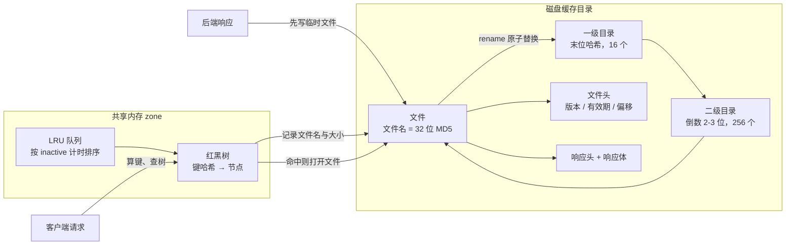
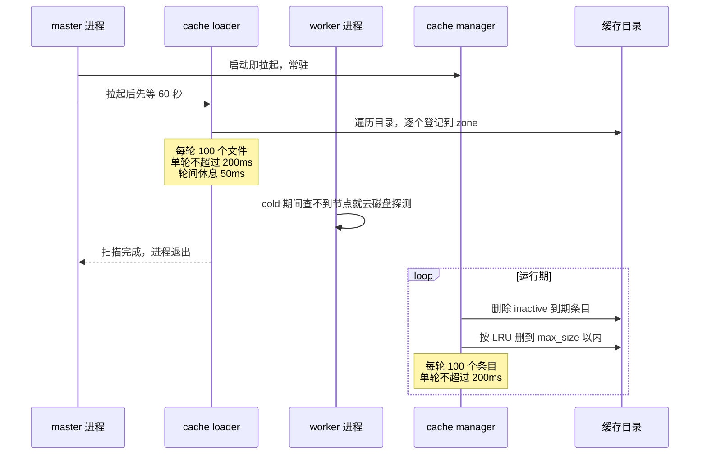
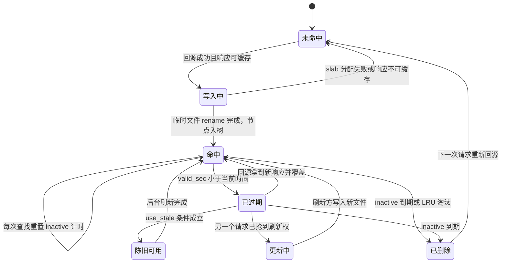
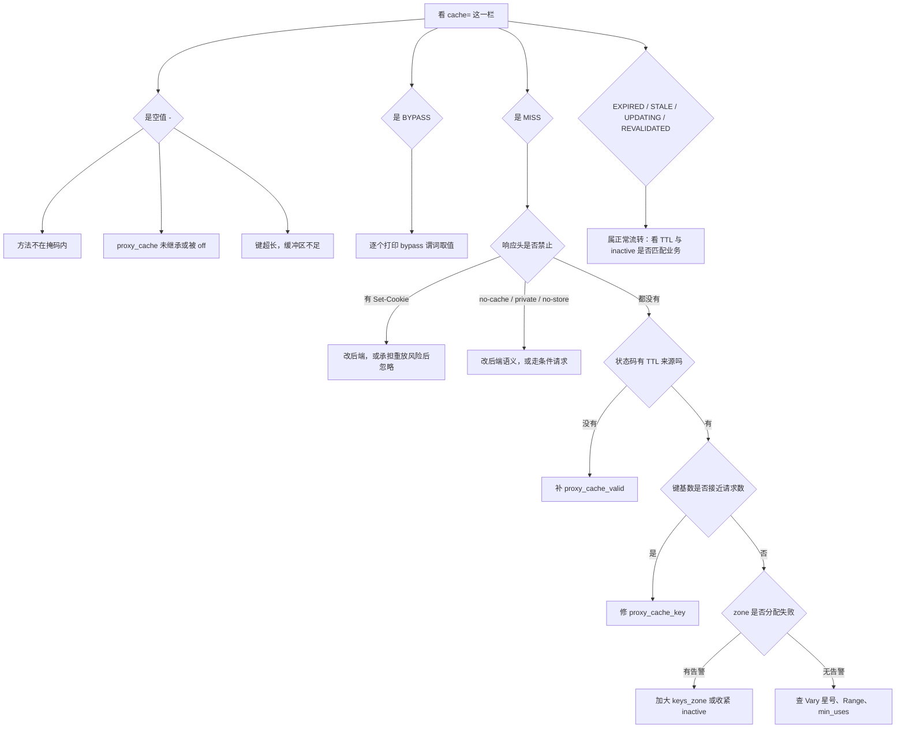
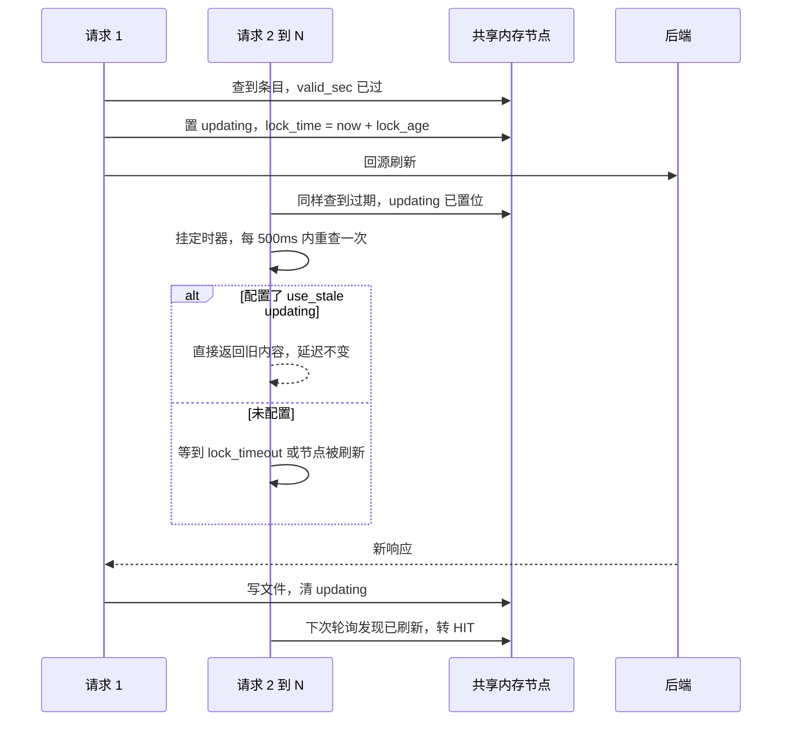

# 05 缓存机制：proxy_cache 的物理结构与失效策略

**摘要：**

`proxy_cache` 大概是 Nginx 里"配置五行、排查五小时"的代表：三行指令加完，后端压力没降，访问日志里的缓存状态却清一色是 MISS，配置看起来挑不出毛病。问题很少出在指令写法上，而在于这套缓存有六道彼此独立的闸门——请求方法、请求头模板、响应头、响应码的存活时间来源、缓存键的稳定性、以及共享内存里能不能放得下这个键的元数据；任何一道关上，日志的表现都一模一样。本篇先把缓存的物理结构拆开：`proxy_cache_path` 的 `levels` 如何把 MD5 铺成三级目录，`keys_zone` 里每个键的元数据占多少字节、能装下多少个键，`max_size` 与 `inactive` 各自依据什么删除条目，以及 cache loader 与 cache manager 这两个后台进程为何必须分工。结构清楚之后，逐个给出六类不缓存原因的判据与修法，再谈 `proxy_cache_lock` 与 `proxy_cache_use_stale` 构成的降级链、`Vary` 与条件请求的语义边界，最后回答开源版没有 purge 指令时该怎么让内容"立刻失效"。落到实处的判断只有一条：缓存是否有效，取决于键空间与容量算术是否匹配业务，而不是指令是否齐全。

---

## 第 1 章 一条全是 MISS 的日志

### 1.1 现象往往比配置更像故障

值班时遇到的上游压力问题，有一类是这样出现的：某次业务高峰后，团队给一个查询接口加上了 `proxy_cache`，期望把数据库压力砍掉一半；上线三天，上游 QPS 与改造前几乎没有差别，磁盘上却多出几十万个缓存文件，`error_log` 里偶尔冒出一行 "could not allocate node"。把访问日志里新增的 `$upstream_cache_status` 拉出来统计，MISS 占了九成，剩下的是一小撮 BYPASS 和 EXPIRED，HIT 少得像抽样误差。

这组数字已经把方向指得很清楚：缓存不是"没生效"，而是**生效了但从不命中**。中文语境里这两件事经常被混为一谈，工程含义却完全不同——没生效说明请求根本没进缓存流程，判据是日志里那一栏是空的；不命中说明请求进了流程，键算出来了，共享内存里查不到与之对应的元数据，判据是清一色的 MISS。前者要查配置继承与请求方法，后者要查键设计、响应头和容量。把这两类问题分开，排查时间通常能从半天缩到十几分钟。

`proxy_cache` 之所以给人"玄学"的印象，是因为它的失效条件分散在四处：客户端请求、后端响应、Nginx 自身配置、以及共享内存的容量。这四处各自独立，任何一处拦下条目，日志都只留一个 MISS。想靠读文档的指令清单把这些条件串起来，几乎做不到；只有先理解条目在磁盘与内存里是以什么形态存在的，才能明白每道闸门卡在哪一环。

### 1.2 缓存在这一层买到了什么，又付出了什么

把缓存放在 Nginx 这一层，最直接的收益是对后端透明：不需要改一行应用代码，不必引入 Redis 这类外部依赖，只要 `location` 里挂一个 `proxy_cache`，就能让一个动不了的遗留服务获得缓存能力。第二个收益是位置：Nginx 与后端在同一条内网链路上，一次命中省下的是一次完整的后端处理加一次网络往返，这在突发流量下比"把后端优化 20%"更立竿见影。

代价同样具体，而且往往被低估。

磁盘写入是第一项。每个缓存条目都要落成文件，写文件意味着先写临时文件再 `rename`，意味着 page cache 被这些冷数据挤占，也意味着磁盘 I/O 与业务日志争抢带宽。命中率不到三成的缓存，实际上是在用写放大的代价换极小的延迟收益。

**键空间**是第二项。共享内存里每个键都要占一份元数据，元数据的数量上限由 `keys_zone` 的尺寸决定，而不是由磁盘大小决定。这个细节是后文反复回到的支点：磁盘上有一百万个文件，共享内存里只放得下八万个键的元数据，那么剩下的九十二万个文件在缓存逻辑里等于不存在。

语义风险是第三项。HTTP 缓存不是简单地把 URL 映射到字节流，`Cache-Control`、`Vary`、`Set-Cookie`、状态码都是协议语义的一部分；绕开这些语义强行缓存，代价是把"不同用户看到同一份内容"变成事故。第 3 章与第 5 章会反复回到这条线。

### 1.3 本篇的路线

顺序是先结构、后判据、再权衡。第 2 章拆物理结构：条目如何从键字符串变成磁盘上一个以 MD5 命名的文件，共享内存里记了什么，`max_size` 与 `inactive` 依据什么删，loader 与 manager 两个进程如何分工。第 3 章给出六类"配了没缓存"的原因与逐项判据，其中包含一个常被误认为默认行为的说法。第 4 章谈缓存过期瞬间的并发问题，`proxy_cache_lock` 与 `proxy_cache_use_stale` 构成一条从"只有一个请求回源"到"宁可给旧内容也不给错误"的降级链。第 5 章处理 `Vary` 与条件请求这两个语义边界，第 6 章回答开源版如何让内容失效，第 7 章做容量算术并给出三个反例。

配置在哪个上下文生效、继承规则如何影响 `proxy_cache`，是 `[[02 配置体系解析：指令、上下文与继承规则]]` 的主题；上游组的选路、重试与连接池在 `[[04 反向代理与负载均衡：upstream 模块深度解析]]` 里讨论；日志字段的采集与聚合在 `[[09 日志体系与可观测性：access_log、error_log 与链路追踪]]` 中展开。本篇只关心一件事：一条响应有没有被存下来、凭什么被找到、又凭什么被删掉。

---

## 第 2 章 缓存的物理结构

### 2.1 一个条目在磁盘上长什么样

整块结构的声明处是 `proxy_cache_path`：它只接受 `http` 上下文，一次写清楚缓存目录、目录分层、zone 名称与尺寸、磁盘上限与冷却时间，之后所有 worker 共同按这套参数维护同一份缓存。理解它每个参数落在哪一层，比记住指令拼写重要得多。

`proxy_cache_key` 算出来的是一个字符串，进程内的处理却只认哈希：Nginx 对这个字符串做 MD5，得到 32 个十六进制字符，再用 `levels` 参数把它铺进目录层级。官方文档给的例子是 `levels=1:2`、路径 `/data/nginx/cache`，最终落盘的文件名形如：

```text
/data/nginx/cache/c/29/b7f54b2df7773722d382f4809d65029c
```

路径的取法是从哈希末尾往前推的：最后一位 `c` 作为一级目录，紧接着的两位 `29` 作为二级目录，完整的 32 位哈希作为文件名。`levels` 允许 1 到 3 级，每一级的取值只能是 1 或 2，于是 `1:2` 展开成 16 × 256 = 4096 个叶子目录，`2:2` 展开成 256 × 256 = 65536 个，`2` 只有 256 个。这一步不是审美问题，而是目录项规模问题：ext4 用 htree 组织大目录，单个目录下文件数达到数十万时，查找路径变长、目录块争用加剧，`open(2)` 的尾部延迟会明显变差；把文件打散到几千个目录，单目录规模就回到可控范围。

文件本身不是裸的响应体，而是"结构化的响应"。文件开头是 `ngx_http_file_cache_header_t`，记录着这份缓存的身份、有效期与偏移量；随后是原样保存的响应头，再往后是响应体。命中的时候，Nginx 打开文件，先读文件头校验，再把响应头与响应体按 `body_start` 切开回给客户端。文件头里的关键字段决定了后续一切行为：

| 字段 | 记录什么 | 一旦对不上会发生什么 |
|-----|---------|-------------------|
| `version` | 缓存头格式版本常量 | 版本不匹配则整份文件作废，按 MISS 处理 |
| `valid_sec` | 绝对过期时间（Epoch 秒） | 小于当前时间即进入 EXPIRED / STALE 判定 |
| `updating_sec`、`error_sec` | 由 `stale-while-revalidate`、`stale-if-error` 响应头换算的宽限窗口 | 决定过期后还能不能拿旧内容兜底 |
| `date`、`last_modified` | 响应生成时间与后端最后修改时间 | 条件请求的 `If-Modified-Since` 由此而来 |
| `crc32`、`header_start` | 键的校验值与响应头长度 | 校验失败会打 `md5 collision` 的 CRIT 日志 |
| `body_start` | 响应体在文件内的偏移 | 偏移错乱等于文件损坏 |
| `etag`、`vary_len`、`variant` | 实体标签、`Vary` 头文本与变体哈希 | 变体哈希不匹配则换一个文件继续找 |

这张表解释了两个日常现象。

其一，缓存文件跨版本不可复用。头格式在 1.7.3、1.7.7、1.11.10 都变更过，官方文档明确写了升级后旧缓存被视为无效。做滚动升级时，如果新旧两个版本共用同一个缓存目录，双方会持续把对方的文件判为 version mismatch 然后重写，看起来就像"缓存怎么都存不住"。

其二，手工删文件与清空目录是两种不同性质的操作。删掉文件只是去掉了数据，共享内存里的节点还在，下一次请求会先查到节点、再去 `open(2)` 一个不存在的路径，失败后才落到回源分支；这与"节点和文件一起不存在"的正常 MISS 路径并不相同，虽然结果都是回源，但磁盘上会留下一次无谓的系统调用，日志里也更难读。

把两层的分工画成一张图，后面所有判据都能在这张图上找到落点：



### 2.2 keys_zone 里存的是什么，能装多少个键

`keys_zone=name:size` 声明一块共享内存，用来放"活跃的键与它们的信息"。具体到这个结构体，一个键在共享内存里对应一个约 120 字节的节点（按字段推算，64 位平台，不同版本略有差异）：红黑树节点用于按键哈希检索，双向队列节点用于按最近访问时间排序，12 字节的键哈希残余（前 4 字节被红黑树的键字段复用），一组位域记录引用计数、使用次数、是否存在、是否正在更新，再加上文件唯一标识、`inactive` 截止时间、`valid_sec`、响应体偏移、占用磁盘块数与加锁时间。经过 slab 分配器对齐之后，每个键的实际开销接近 128 字节。

这个数字与官方文档的口径能对上：文档写的是"1MB 的 zone 大约可以存放 8000 个键"，8000 个键分摊 1MB，每个键约 131 字节。商业版因为要在同一块内存里额外维护 API 可以读到的扩展信息，同样 1MB 只能放约 4000 个键；开源版按 8000 估算是合理的。

| `keys_zone` 尺寸 | 可索引键数量（示例推算） | 适用的键空间规模 | 配得过小的代价 |
|---------------|-------------------|--------------|-------------|
| 10m | 约 8 万 | 十万级 URL，天级更新 | 超过部分永远 MISS，error_log 出现节点分配告警 |
| 50m | 约 40 万 | 百万级 URL，小时级更新 | 仍以 1/8 水位反复抖动，命中率被容量截断 |
| 200m | 约 160 万 | 百万级 URL 且允许变体 | 每 worker 都要映射这块内存，RSS 随之上涨 |
| 1g | 约 800 万 | 千万级 URL 或大量 `Vary` 变体 | 启动期 loader 扫描时间长，内存水位需纳入监控 |

需要强调的是，这块内存里**没有响应体**。响应体始终在磁盘上，命中时通过 `open(2)` 与 `read(2)` 交给内核，速度取决于 page cache 是否还留着那些页。这两层的分工不妨用图书馆打比方：共享内存是那盒卡片目录，磁盘是书架，卡片丢了的书还立在架上，只是再没人找得到它；卡片目录的抽屉数量，就是这个 zone 的尺寸。有些文章把 HIT 描述成"从内存返回"，严格讲只说对了一半：元数据确实在共享内存里，正文在磁盘上、由操作系统的页缓存加速。这也解释了一个常见困惑——为什么加大了 `keys_zone` 之后命中延迟没降，因为延迟的大头从来不在元数据查询上。

zone 满了之后的行为，是理解**容量决定命中率**的关键。当 slab 分配不出新节点时，Nginx 会依次做三件事：先把水位线（watermark）下调到当前节点数的 7/8，让 cache manager 按 LRU 开始收缩；再就地强制过期一批条目，然后重试一次分配；若仍然失败，就在 `error_log` 打一条 ALERT 级别的 "could not allocate node"，同一秒内只打一次，然后放弃写入这条缓存。现象上，就是缓存写不进去、命中率贴在地板上，而磁盘使用量却不见下降——因为 manager 只删到水位线，剩下的文件仍在，只是共享内存里再也找不到它们。

这背后是缓存系统里最容易踩的一条容量错配：磁盘给了 50GB，共享内存只给了 10m，于是磁盘上堆着几百万个再也不会被索引到的文件，直到 `inactive` 到期才被慢慢清掉。容量的两个维度必须一起算，不过只调其中一个，得到的往往正是"磁盘很满、命中率很低"的组合。

### 2.3 max_size 与 inactive：两个不同的删除理由

缓存的删除有**两套完全独立的规则**，混用它们会产生一类很典型的错误配置。

`inactive` 管的是"还有没有人访问"。默认值是 10 分钟，含义是某个条目在这段时间内没有被任何请求查到，无论它是否新鲜，都会被删掉。这条规则在每次查找时被重置：请求查到节点后，节点会被移到 LRU 队列头部，`inactive` 截止时间被改写为当前时间加 `inactive`。于是它实际描述的是一种"热度"——冷门内容即使 TTL 还没到，也会在十分钟后被清走，把磁盘和键位让给热点。

`max_size` 管的是"磁盘还放不放得下"。它没有默认上限，不配置时就只受文件系统与 `inactive` 约束；配置之后，cache manager 会周期性比较缓存目录的实际占用与 `max_size`，超标就按 LRU 顺序删，直到回到阈值以内。1.19.1 之后还有 `min_free`，当缓存所在文件系统的可用空间低于这个值时也会触发删除，这一条在多业务共用一块盘的机器上尤其重要。

真正容易出错的地方，是把 `inactive` 当成 TTL 用。譬如后端返回 `Cache-Control: max-age=3600`，运维为了让"内容早点刷新"，把 `inactive` 设成 60s，然后发现命中率掉到个位数。原因是 `inactive` 并不改变新鲜度，它只是更勤快地删条目；被删掉的条目即使原本还剩 59 分钟有效期，也不会再被命中，只能重新回源。反过来，把 `inactive` 设成 7 天、TTL 只有 5 分钟，磁盘上就会长期躺着大量过期条目，它们占着键位与空间，把真正的热点挤出 zone。

| 删除理由 | 谁触发 | 判定依据 | 删除范围 | 可观测信号 |
|--------|-------|--------|--------|---------|
| 有效期到期 | 无需进程参与 | `valid_sec` 小于当前时间 | 只改状态，不删文件与节点 | 日志出现 EXPIRED，`use_stale` 时出现 STALE |
| `inactive` 到期 | cache manager | 距最后一次查找超过 `inactive` | 删节点与文件 | 该键重新出现 MISS，磁盘占用缓慢下降 |
| `max_size` 超额 | cache manager | 目录占用超过 `max_size` 或 `min_free` 不足 | 按 LRU 删到阈值内 | 冷门键批量转 MISS，磁盘占用贴近上限 |
| 键位耗尽 | 写缓存时发现分配失败 | slab 无可用节点 | 水位线下调到 7/8 后按 LRU 删 | `could not allocate node` 告警与命中率同步下滑 |

### 2.4 manager 与 loader：两个后台进程

master 进程在启动时会额外拉起两个特殊进程，`ps` 里能看到 "cache manager process" 与 "cache loader process"。它们共享同一块 zone，职责却完全不同。

loader 只做一件事：把磁盘上已有的缓存文件重新登记到共享内存里。共享内存不持久，进程重启后 zone 是空的，磁盘上的文件却还在；如果没有 loader，这些文件会变成谁也查不到的孤儿，直到 `inactive` 到期被删掉。文档写的是"启动一分钟之后"loader 才被激活，源码里对应的就是 60000 毫秒的延迟，这个错峰把目录扫描与启动初期的回源高峰分开。扫描按目录树进行，每轮最多处理 `loader_files` 个文件（默认 100）、单轮耗时不超过 `loader_threshold`（默认 200 毫秒）、轮与轮之间休息 `loader_sleep`（默认 50 毫秒），扫完之后进程退出。在扫描完成之前，zone 处于 `cold` 状态，请求查不到节点时会退一步直接去磁盘探测文件是否存在，这就是"重启后没等缓存加载完，居然也能命中"的原因。

manager 是常驻的维护者：删除 `inactive` 到期的条目，处理 `max_size` 与 `min_free` 的超限，维护 LRU 队列的次序。它的唤醒间隔不完全由固定周期决定，cache manager 会根据最近的过期时间算出一个等待值，源码里这个值被压到 10 秒上限；每轮的删除量同样受 `manager_files`（默认 100）、`manager_threshold`（默认 200 毫秒）、`manager_sleep`（默认 50 毫秒）三重节流。换句话说，`max_size` 是软上限：从磁盘占用超标到删够，中间必然有一段超出窗口，窗口长度取决于淘汰量与节流参数。

两个进程在时间轴上的关系，用一张时序图看得更清楚：



两个进程分开的根本理由，在于它们的时间尺度不同：loader 处理的是一次性全量历史，manager 处理的是持续增量的维护；若合在一起，启动期的全量扫描会被删除节流拖慢，运行期的删除又会被扫描阻塞。这里还有一条对运维特别有用的推论：**reload 不会重建 zone**。共享内存在 `reload` 时被新 worker 继承，`cold` 标志已经是 0，loader 不会重跑，所以改大 `keys_zone` 之后必须重启 master 进程才能拿到新的内存尺寸，只 `reload` 看着配置生效了，实际行为一点没变。

| 参数 | 默认值 | 管什么 | 调大的代价 | 调小的代价 |
|-----|-------|------|---------|---------|
| `keys_zone` 尺寸 | 必填 | 可索引键数量 | 每 worker 映射更多内存，RSS 上涨 | 键位不足，命中率被容量截断 |
| `max_size` | 不限制 | 磁盘占用上限 | 磁盘换命中率，冷数据长期驻留 | 淘汰频繁，命中率随工作集波动 |
| `inactive` | 10m | 冷条目存活时间 | 冷数据占键位与磁盘 | 热点稍冷即被删，命中率虚低 |
| `loader_files` | 100 | 单轮登记文件数 | 启动期 I/O 更集中，回源更慢 | 缓存可用时间被拉长 |
| `loader_sleep` | 50ms | 轮间休息 | 启动扫描拖得更久 | 与业务 I/O 争抢更激烈 |
| `manager_files` | 100 | 单轮删除条目数 | 单轮停顿变长，删除更集中 | 磁盘超限窗口变长 |
| `manager_sleep` | 50ms | 轮间休息 | 淘汰追不上写入速度 | 与业务 I/O 争抢更激烈 |

### 2.5 一个条目的一生

把上面的机制串起来，一个条目从产生到消失会经过若干状态，每个状态都能在日志里找到对应信号。这条状态机是后文所有判据的坐标系：判断"为什么没缓存"，本质上是在判断请求停在了哪个状态、以及为什么没走到下一个状态。



这张状态图里有两个容易看漏的分支。其一，"写入中 → 未命中"意味着这次回源白跑，缓存什么都没留下，常见原因是响应带了不可缓存的头、状态码找不到 TTL、或者 zone 满了；日志上只留一个 MISS，与正常回源的 MISS 无法区分，只能靠响应头与 `error_log` 去分辨。其二，"已过期 → 更新中"是另一个请求已经拿到刷新权，本请求如果没配 `use_stale updating`，就只能等，等待的终点由第 4 章的两个时间参数决定。

---

## 第 3 章 "配了没缓存"的六个原因

### 3.1 先把状态栏读对

排查起点不是配置，而是访问日志里那一栏。`$upstream_cache_status` 的取值来自共享内存节点上的状态标记，七个值加一个空值，含义与后续动作差别很大：

| 取值 | 含义 | 说明与下一步 |
|-----|-----|-----------|
| 空值（日志里显示 `-`） | 请求根本没有进入缓存流程 | 查方法掩码、`proxy_cache` 是否被上层覆盖、zone 是否解析成功；这一栏为空比 MISS 更值得追 |
| `MISS` | 查了缓存，没找到可用条目，本次回源 | 区分"本来没有"与"写不进去"：看响应头与 `error_log` |
| `BYPASS` | `proxy_cache_bypass` 条件成立，跳过读缓存 | 打印 bypass 谓词的取值，确认是哪个条件命中 |
| `EXPIRED` | 条目存在但 `valid_sec` 已过，本次回源 | 属正常刷新；若频率过高说明 TTL 太短或 `inactive` 太狠 |
| `STALE` | 本次返回了过期内容，刷新责任在本次请求或后台子请求 | 只在 `use_stale` 条件成立时出现，属降级链路 |
| `UPDATING` | 另一个请求正在刷新，本次返回旧内容 | 与 `STALE` 成对出现：`STALE` 是"我来刷"，`UPDATING` 是"别人在刷" |
| `REVALIDATED` | 用条件请求校验，后端回 304，沿用旧条目 | 需要 `proxy_cache_revalidate on`，否则不会出现 |
| `HIT` | 直接命中 | 命中后 `inactive` 计时重置 |

这张表最容易被忽略的是第一行。`MISS` 至少证明"缓存流程跑到了、键算出来了、共享内存查过了"；空值则证明流程在更早的地方就退出了——方法不在掩码里、`proxy_cache` 没有继承下来、zone 名字写错、或者缓存键太长超出了缓冲区。把空值与 MISS 混为一谈，会让**一半的排查方向引偏**。

日志里要同时带上状态、键与上游地址，否则很多判断只能靠猜：

```nginx
log_format cache '$remote_addr "$request" $status '
                 'cache=$upstream_cache_status '
                 'key=$proxy_cache_key '
                 'upstream=$upstream_addr urt=$upstream_response_time';

access_log /var/log/nginx/cache.log cache;
```

有了 `key` 这一栏，很多问题会自己浮出来：统计一段时间内唯一键数量与请求数之比，若比值接近 1，说明键空间被过度细分；若比值明显小于 1 而 HIT 依然很低，说明问题不在键而在响应头或容量。

```bash
# 唯一键数 / 请求数，比值接近 1 说明键空间被过度细分
awk '{n++; split($0,a,"key="); split(a[2],b," "); k[b[1]]=1} \
     END{printf "请求 %d，唯一键 %d\n", n, length(k)}' /var/log/nginx/cache.log
```

### 3.2 原因一：请求头里的身份信息

这是六条里最需要澄清的一条。Nginx 不会因为请求带了 `Cookie` 或 `Authorization` 就拒绝缓存：缓存入口只检查三件事——方法是否在 `proxy_cache_methods` 里、`proxy_cache_bypass` 谓词是否成立、缓存键算出来是什么。请求头本身不参与"要不要缓存"的判断。

真正让带身份信息的请求表现为"没缓存"的，是两类配置，而这两类配置恰好都出现在官方文档的示例里：

第一类是 `proxy_cache_bypass` 与 `proxy_no_cache` 的条件。文档示例写的是 `proxy_cache_bypass $cookie_nocache $arg_nocache$arg_comment;` 和 `proxy_cache_bypass $http_pragma $http_authorization;`，很多团队照抄成"带 Cookie 或带 Authorization 就绕过缓存"。不过这类请求在日志里是 BYPASS，判据很明确，把谓词里的每个变量单独打到日志里，很快就能定位是哪个条件成立。

第二类是缓存键里拼了会话维度。文档同样给过 `proxy_cache_key "$host$request_uri $cookie_user";` 这样的示例，本意是演示键可以任意组合，后果却是每个用户一个键：一万个在线用户就是一万份缓存，HIT 概率被稀释到接近零，磁盘上文件数随用户数线性增长。这类问题的判据是键基数——把 `$proxy_cache_key` 打进日志做去重统计，比值接近 1 就是它。

这里还有一层协议背景值得交代清楚。RFC 9111 在 3.5 节对共享缓存提出要求：当请求带有 `Authorization` 时，除非响应显式允许（例如带 `public`、`s-maxage`，或带 `must-revalidate` 之类的标记），否则不得用已存响应去满足后续请求。这是"认证请求默认不可复用"的规范来源，也是各类反向代理、CDN 长期把 `Authorization` 视为缓存边界的依据。Nginx 没有把这条判断内置，它把决定权交给了写配置的人；于是"带 Cookie 不缓存"**退化成了行业模板**。

| 场景 | 请求特征 | 推荐做法 | 不这样做的后果 |
|-----|--------|--------|-------------|
| 公共内容，但客户端普遍带 Cookie | 有会话 Cookie，内容与用户无关 | 键里不加 `$cookie_*`，只在确有语言/灰度维度时加对应变量 | 键基数爆炸，命中率贴地 |
| 个人化内容 | Cookie 或 Authorization 决定内容 | 用 `proxy_cache_bypass` 与 `proxy_no_cache` 显式绕过 | 要么串数据，要么命中率虚高但内容是错的 |
| 内容与登录态无关但受灰度影响 | 带灰度标记 Cookie | 把灰度标记纳入键，而不是把整个 Cookie 纳入键 | 灰度失效或缓存全不命中 |

### 3.3 原因二：响应带 Set-Cookie

响应头里出现 `Set-Cookie`，Nginx 默认就不缓存这条响应。源码里的处理非常直接：只要没配 `proxy_ignore_headers Set-Cookie`，这个响应头一出现就把可缓存标记清掉，后续的 TTL 计算再正确也没用。

这条规则的合理性显而易见——会下发 Cookie 的响应通常与会话有关；但它在实践中造成的"缓存无效"极其常见：后端框架在登录态、灰度标记、甚至埋点标识上顺手下发一个 Cookie，把整个接口从缓存里踢了出去。判据是两个证据同时成立：日志里该接口恒为 MISS，且 `curl -I` 能看到响应中的 `Set-Cookie`。

修法分三层，风险递增。

最干净的一层是改后端：公共内容不下发 Cookie，会话相关内容本就不该被共享缓存。这一层需要后端配合，通常是推动成本最高、风险最低的做法。

第二层是用 `proxy_ignore_headers Set-Cookie` 强制缓存。这里必须清楚它做了什么：它让 Nginx 不再因为 `Set-Cookie` 而放弃缓存，那份响应头照样被写进缓存文件，命中时会被重放给后续客户端。也就是说，某个用户的会话标识可能被发给所有人。这条路上有一个缓解手段是同时配 `proxy_hide_header Set-Cookie`，让这个头不再转发出去；但缓存文件里存的仍然是最初那份响应头，语义上的风险并未消失，只是泄露面收窄。

第三层是把网关当作 Cookie 的转换点：后端下发 Cookie，Nginx 在转发给客户端前把它拿掉。这种做法只在"Cookie 内容确实不影响响应体"时成立，且必须连同后续请求的 Cookie 入站一起处理，否则会破坏登录流程。

对绝大多数业务，正确的选择是第一条：缓存边界应该由后端的内容语义决定，而不是由网关强行覆盖。

### 3.4 原因三：Cache-Control 禁止缓存

响应头里的 `Cache-Control` 是后端对缓存的明确指令，Nginx 默认尊重它。`no-cache`、`no-store`、`private` 三个值出现即视为不可缓存，`max-age=0` 等价于立即过期不可缓存；源码里对这三个词做的是大小写不敏感的字符串命中，因此 `private` 出现在 `Cache-Control: private, max-age=60` 里同样会让响应整个不可缓存，而不是"按 60 秒缓存但不共享"。

与之配套的还有 `X-Accel-Expires`，这是 Nginx 自有的响应头：值为秒数时设定缓存时间，值为 0 时直接关闭缓存。它的优先级高于 `Expires` 与 `Cache-Control`，是后端精确控制缓存时间的通道。

判据很直接：拿 `curl -I` 看响应头，`Cache-Control` 里是否带上述值；带了就说明缓存一定写不进去，与 Nginx 侧配了多长的 TTL 无关。修法同样有三条路，前两条与上一节同构——改后端语义，或用 `proxy_ignore_headers Cache-Control Expires` 覆盖。覆盖的风险在这里更高，因为 `no-store` 表达的是**连磁盘都不要写**，把它忽略掉，等于把最敏感的那批响应写到了磁盘上。

第三种做法值得单独说：区分"响应不允许共享缓存"和"响应允许共享但需要先校验"。后者的正确表达是 `Cache-Control: no-cache` 加 `ETag`，配合 `proxy_cache_revalidate on` 走条件请求，既不牺牲正确性，又能把带宽和渲染成本省下来。很多后端配 `no-cache` 的真实意图就是后者，把它当成"完全不准缓存"处理，往往是把可优化的空间一起扔掉了。

请求侧的 `Cache-Control` 不参与判断，这一点常被误解。客户端发 `Cache-Control: no-cache`，Nginx 不会因此绕过缓存；需要的话必须显式写进 `proxy_cache_bypass`，例如 `proxy_cache_bypass $http_cache_control;`。同理，客户端的 `Pragma: no-cache` 也一样需要显式处理。

### 3.5 原因四：状态码没有可用的存活时间来源

缓存的存活时间有两个来源，优先级从高到低是：响应头（`X-Accel-Expires`、`Expires`、`Cache-Control` 的 `max-age`/`s-maxage`）、`proxy_cache_valid` 指令。两者都没有给出时间，这条响应就不会被缓存——即使它是 200。

`proxy_cache_valid` 的写法有一个容易踩空的地方：只写时间不带状态码时，只对 200、301、302 生效；一旦显式列出状态码，规则就只覆盖列出的那些。于是下面这段配置里，404 会被缓存 1 分钟，200 反而因为没有任何 TTL 来源而不缓存：

```nginx
# 看起来配了缓存时间，实际上 200 的响应一条都没存
proxy_cache_valid 404 1m;
```

正确的写法是分别列出，或者用 `any` 兜底：

```nginx
proxy_cache_valid 200 301 302 10m;
proxy_cache_valid 404 1m;      # 防止不存在的资源反复穿透
proxy_cache_valid any  1m;     # 兜底，慎用：5xx 也会被缓存
```

`any` 的代价要说清楚：它会把 500、502、503 也缓存起来，后端抖动时错误页会被固化一段时间，比不缓存更难恢复。把 5xx 交给 `proxy_cache_use_stale` 处理才是更合适的分工——后者不会覆盖掉本来正确的旧条目。

判据有两条：响应状态码是否在 `proxy_cache_valid` 的覆盖范围内；以及当 `proxy_cache_valid` 完全没配时，后端是否提供了缓存头。两条都不满足，缓存就永远写不进去，日志恒为 MISS 而磁盘上没有对应文件。

### 3.6 原因五：方法不是 GET 或 HEAD

`proxy_cache_methods` 的**默认值是 GET HEAD**，且这两个方法总是会被加入列表，即使只写了 `POST` 也一样。POST、PUT、DELETE 默认不参与缓存，这类请求在日志里的状态栏是空的，而不是 MISS——因为它们在校验方法掩码时就被拒掉，缓存状态根本没被赋值。

HEAD 有一个专门的处理：`proxy_cache_convert_head on`（默认开启，1.9.7 起）会把它当作 GET 去查缓存，从而让 HEAD 也享受命中。关掉这个开关之后，缓存键必须显式包含 `$request_method`，否则 GET 与 HEAD 会撞进同一个键，出现"HEAD 命中了一份本该给 GET 的内容"这类诡异现象。

把 POST 加进缓存列表是可行的，但要满足三个前提：请求体不参与内容决定、后端行为幂等、缓存键包含请求体或能证明它无关紧要。不过现实里满足这三条的接口极少，硬加的结果通常是不同参数共用一份缓存。如果确实要加，键里必须带 `$request_body` 或等价的摘要变量，代价是键长度和键空间一起涨。

### 3.7 原因六：缓存键算错

缓存键决定"什么算同一个资源"，它是六条原因里唯一需要设计而不是照抄的一项，也是命中率出问题时最常见的根因。

先看默认值。文档的语法部分写的是 `proxy_cache_key $scheme$proxy_host$request_uri;`，正文补充了一句"默认值接近 `$scheme$proxy_host$uri$is_args$args`"。两个细节值得记住：一是键里不含请求方法，所以 GET 与 HEAD 默认共用键，这也是 `proxy_cache_convert_head` 存在的原因；二是键里含的是 `$proxy_host`，即 **上游名，而非客户端 Host**。

`$proxy_host` 这一点是多站点部署的经典事故源。当多个域名共用同一个 upstream 时，键在所有人眼里都是同一个，于是 A 站点的页面被 B 站点的请求命中。正确的写法是用 `$host`（客户端 Host 或 `server_name`）替代或补充 `$proxy_host`：

```nginx
# 多域名共用一个 upstream 时必须显式区分站点
proxy_cache_key "$scheme$host$request_uri";
```

另一个方向是键被过度细分：譬如把 `$http_user_agent`、`$http_cookie`、`$arg_timestamp`、`$request_id` 这类每次都可能不同的值拼进键，等于给每个请求分配独立缓存。与 `$uri` 和 `$request_uri` 混用也会出事——只写 `$uri` 会丢掉查询串，不同的分页、筛选条件共用一份缓存，数据串得比不缓存更糟。

| 键写法 | 命中率 | 数据正确性 | 适用场景 |
|-------|------|---------|--------|
| `$scheme$proxy_host$request_uri`（默认） | 高 | 单站点安全，多站点串数据 | 单域名、单一 upstream |
| `$scheme$host$request_uri` | 高 | 多站点安全 | 多域名共用 upstream 的通用基线 |
| 追加 `$cookie_*` | 极低 | 个人化正确 | 仅当该 Cookie 确实决定内容且用户量可控 |
| 追加 `$http_user_agent` | 极低 | 正确但过度细分 | 几乎总该用 `Vary` 或按 UA 大类归一 |
| 只用 `$uri` | 高 | 查询串丢失导致串数据 | 明确无查询语义的静态路径 |

判据依然是键基数：`key` 打进日志后统计唯一值数量，与 URL 数量、请求数量做三角对比。唯一键数远大于 URL 数，说明被细分；不同站点出现同一份内容，说明键粗了。

### 3.8 另外四类结构性拦截

六条主因之外，还有几种情况会让缓存写不进去，它们出现频率低，但一旦出现极难从现象反推。

缓存键太长、超出了 `proxy_buffer_size`。源码里有一条判断：键长度加 256 字节若超过缓冲区大小，就放弃缓存并打一条 ERR 日志，内容是缓冲区不足以容纳缓存键、建议增大到某个值的整千字节。键里拼了 `$request_uri` 加多个变量时可能踩到，判据是 `error_log` 里那条以模块名开头的缓冲区告警。

`Vary: *`。响应头里的 `Vary` 取值为星号时，表示"任何请求头都可能影响内容"，Nginx 直接放弃缓存。这通常是后端框架或某些中间件的默认行为，需要从后端侧修正。

分片请求。带 `Range` 的请求在偏移超过 `proxy_cache_max_range_offset` 之后就不再走缓存；视频、大文件下载这类场景下，这类请求本来就占大头，命中率统计必须把它们单独归类，否则永远算不准。

`proxy_cache_min_uses` 大于 1。这个指令要求同一个键被请求若干次之后才写入缓存，前几次必然 MISS 且不落盘。它本意是过滤"只访问一次"的冷门 URL，节省磁盘写入；副作用是低 QPS 的接口在统计窗口里几乎见不到 HIT，看起来像缓存失效。

### 3.9 判定次序

六条原因与四类结构性拦截叠加起来，靠试错试不完。不妨把上面所有判据整理成一个自上而下的顺序，它能保证每一步只排除一类可能，且每一步都留下可复核的证据：



这套顺序之所以有效，是因为它按"从流程外到流程内"排列：先确认请求有没有进缓存流程（空值与 BYPASS），再确认响应允不允许缓存（响应头），再看有没有 TTL（配置），最后才怀疑键与容量。反过来从键开始怀疑，通常会在响应头上多绕很多圈。

---

## 第 4 章 过期瞬间：锁、陈旧与降级

### 4.1 为什么同一秒到期的请求一起回源了

缓存最脆弱的时刻不在冷启动，而在热点条目的 TTL 到点那一瞬。设一个接口有 1000 QPS、TTL 是 300 秒，条目到期后的第一个毫秒里，所有看这个键的请求都会发现 `valid_sec` 已过，如果没有额外机制，它们会全部回源——这就是缓存击穿。1000 QPS 的接口在 300 秒内积累的并发，会被压缩进"回源延迟"这段窗口里爆发，后端看到的是瞬时数十倍的请求量。这类故障的形态很好认：缓存命中率曲线周期性塌陷，与 TTL 的整数倍对得上。

`proxy_cache_lock on` 的作用是把并发压回 1。原理并不神秘：共享内存节点上有一个 `updating` 标记和一个 `lock_time` 截止时间，第一个发现过期的请求把标记置位、把截止时间设为当前时间加 `proxy_cache_lock_age`，然后自己去回源；后续请求发现标记已置位，就不再回源，而是挂一个定时器等待，等待的终点是 `proxy_cache_lock_timeout`。

源码里有几个细节决定了它的实际行为。等锁的请求不是被唤醒，而是轮询：定时器间隔取"剩余等待时间"与 500 毫秒中的较小值，每个周期重新查一次节点状态。因此解锁到第一个等待者恢复之间，存在最多 500 毫秒的空窗；对延迟敏感的接口，这段时间会直接体现在 P99 上。另外，等待是有全局上限的：每个等待中的请求都会给主请求的 blocked 计数加一，这个计数到 250 之后，后续请求不再等待，直接回源。

把这套协作画成时序，等待的边界与空窗都落在图上：



### 4.2 lock_timeout 与 lock_age 分工

两个参数默认都是 5 秒，名字也像，含义却**作用在不同角色身上**，混用会导致"锁形同虚设"或"用户全被拖死"两种相反的结果。

| 参数 | 作用对象 | 默认值 | 计时起点 | 到点后的行为 | 调大的代价 | 调小的代价 |
|-----|--------|------|--------|-----------|---------|---------|
| `proxy_cache_lock_timeout` | 等锁的请求 | 5s | 请求开始等待 | 自行回源，且该响应不写入缓存 | 慢后端把用户拖到超时 | 回源并发回升，锁的价值下降 |
| `proxy_cache_lock_age` | 持有锁的回源者 | 5s | 上一次回源开始 | 允许再放一个请求去回源 | 卡死的回源会把请求堆住 | 重复回源增多，锁被频繁突破 |

`lock_timeout` 到点后的"响应不写入缓存"是一个关键设计，否则每个超时回源的请求都会覆写一遍缓存，锁就白加了。这条行为在 1.7.8 之后固定下来，更早的版本里超时响应仍可能被缓存。

`lock_age` 解决的是另一个问题：如果持有锁的那个回源请求卡住（后端半死、连接不返回），没有 `lock_age` 的话所有等待者会一直等，直到各自的 `lock_timeout` 到点。有了 `lock_age`，超过这个期限就再放一个请求进去试，等于给刷新动作加了超时重试的语义。两者配合的关系不妨这样记：`lock_age` 保证"刷新不会永远只有一个请求在做"，`lock_timeout` 保证"等待不会无限期"。

### 4.3 use_stale：拿旧内容换可用性

`proxy_cache_lock` 解决的是"别一起回源"，`proxy_cache_use_stale` 解决的是"回源不成功时给什么"。后者的参数与 `proxy_next_upstream` 同构：

| 触发条件 | 含义 | 典型场景 | 风险 |
|--------|-----|--------|-----|
| `error` | 连接上游失败 | 后端进程崩溃、监听端口关闭 | 旧内容可能已过期很久 |
| `timeout` | 连接或读超时 | 后端慢查询、GC 停顿 | 同上 |
| `invalid_header` | 上游返回空或非法响应 | 后端异常退出时的半截响应 | 同上 |
| `updating` | 另一个请求正在刷新 | 热点条目到期的瞬间 | 需与 `proxy_cache_lock` 配合 |
| `http_500` 等 5xx | 上游明确报错 | 后端故障切换窗口 | 错误期间的旧内容可能与现实不符 |
| `http_403`、`http_404` | 权限或资源不存在 | 后端路由配置变更 | 已下线的资源被继续供给 |
| `http_429` | 被上游限流 | 后端自我保护 | 旧内容持续供给，掩盖限流问题 |

`updating` 与其余参数的语义不同：它不是"出错时兜底"，而是"刷新期间用旧内容顶着"。与 `proxy_cache_lock` 组合之后，热点条目到期的那一刻，第一个请求回源，其余请求直接拿旧内容返回，日志里分别记为 STALE 与 UPDATING——这就是 Nginx 版的 stale-while-revalidate。没有 `use_stale updating` 时，其余请求只能干等，等锁的轮询空窗会把 P99 推高。

除了指令，1.11.10 之后还支持由后端用响应头声明宽限窗口：`Cache-Control: stale-while-revalidate=30` 与 `stale-if-error=60`。这两个值会被换算进缓存文件头的 `updating_sec` 与 `error_sec`，在条目过期后的一段时间内允许继续使用旧内容。它们的优先级低于指令参数，也就是说指令里显式列出的条件始终有效，响应头只能补充。

这条降级链的边界要划清楚。对静态资源、内容列表、商品详情，旧 30 秒的内容远好于一个 502；对账户余额、库存扣减、订单状态，**旧内容比错误更有害**，因为它会让用户基于错误信息做决策。同一个 Nginx 实例上不同 `location` 应该有不同的取舍，把 `use_stale` 写成一个全局策略，等于默认所有接口的容错语义相同。

### 4.4 后台更新与条件请求

`proxy_cache_background_update on` 是这条链的进一步延伸：条目过期时不再由用户请求触发刷新，而是发一个后台子请求去更新，当前请求直接拿旧内容返回。它需要 `proxy_cache_use_stale updating` 配合，否则旧内容没有出场的机会。代价是"用户在 TTL 到期后看到的一定是旧内容"，一致性窗口从"到期时刻"延长到"后台更新完成时刻"。

`proxy_cache_revalidate on` 走的是另一条路：过期后不直接重新拉取，而是带 `If-Modified-Since` 或 `If-None-Match` 回源，后端如果返回 304，就沿用旧条目并把 `valid_sec` 刷新，日志记为 REVALIDATED。这条路省的是带宽与后端渲染成本，不省往返延迟——条件请求依然是一次完整的 RTT。它适用于响应体大、变化不频繁的资源，对小的 JSON 接口收益有限。

| 配置组合 | 到期瞬间用户看到的 | 后端压力 | 一致性窗口 | 适用对象 |
|--------|--------------|--------|---------|--------|
| 无任何配置 | 等待回源 | 到期瞬间尖峰 | 无 | 低 QPS、弱实时要求 |
| `lock on` | 等待（最多 500ms 轮询空窗） | 单请求 | 无 | 通用基线 |
| `lock on` + `use_stale updating` | 立即拿到旧内容 | 单请求 | 回源耗时 | 热点接口 |
| 上一行 + `background_update on` | 立即拿到旧内容 | 后台单请求 | 回源耗时加子请求调度 | 高 QPS 热点接口 |
| 上一行 + `revalidate on` | 立即拿到旧内容，后台走 304 校验 | 后台单请求，多为 304 | 同上，但带宽更省 | 响应体大的资源 |

条件请求这里有一个容易忽略的细节：缓存开启时，Nginx 不会把客户端发来的 `If-Modified-Since`、`If-None-Match`、`Range`、`If-Range` 转发给后端。这是有意为之——缓存层要自己决定用哪一份副本，客户端的条件头若透传到后端，会让后端返回 304 而缓存层拿不到完整响应，缓存条目就永远刷新不了。

---

## 第 5 章 Vary 与语义边界

### 5.1 Vary 是第二级索引

`Vary` 常被误解为"把请求头拼进缓存键"，实际实现比这个说法精确，也更有工程含义。Nginx 先在缓存文件头里记下后端声明的 `Vary` 头文本，再对"主键 + 每个被声明的请求头名与值"做一次 MD5，得到一个变体哈希（variant）也存进文件头；查找时先按键找到文件，再比对变体哈希，不一致就换文件继续找。也就是说，`Vary` 不是修改主键，而是在主键之下加了**第二级索引**。

源码里对 `Accept-Charset`、`Accept-Encoding`、`Accept-Language` 三个头做了规范化处理，先做小写化与顺序整理再参与哈希，避免冒号分隔顺序不同导致同一份内容被存成多份。其余头按原值参与哈希，任何字节差异都会产生新变体。

不过这样设计的代价是表面积放大：一个键如果声明了 `Vary: Accept-Encoding`，gzip 与未压缩两份各占一个文件和一份元数据；若声明 `Vary: User-Agent`，浏览器版本、系统标识、各类客户端库的 UA 各成一档，键空间会膨胀到无法预估。`Vary: *` 的含义是"无法枚举"，Nginx 遇到它直接放弃缓存，这一点前文已经说过。

对运维最有影响的一条是：后端某次发布开始发送 `Vary`，会让命中率断崖式下跌，而配置侧没有任何变更。原因是同一批 URL 突然需要多个变体，旧的单变体文件仍在 `inactive` 窗口内，但不再被匹配。排查时先看响应头有没有 `Vary`，再看它的取值是否真的只影响编码与语言这两类粗粒度维度。

`Vary` 与 `proxy_cache_key` 的分工可以这样理解：`proxy_cache_key` 是网关侧设计的、确定性的资源标识；`Vary` 是后端声明的、内容协商的可变维度。两者都能细分缓存，但前者可控可测，后者由后端随手决定。能用前者表达清楚的维度，不要交给后者。

### 5.2 三个语义检查点

除 `Vary` 之外，还有三处交界需要在上线前确认。

认证与共享缓存。前文引用过 RFC 9111 对带 `Authorization` 请求的限制。若缓存层确实要复用这类响应，响应必须显式声明允许，例如带 `public` 或 `s-maxage`；否则一旦被审计或接入 CDN，行为会与预期不符。

压缩与编码。`gzip on` 在 Nginx 侧生成的内容编码，与后端返回的编码不是同一件事。若缓存的是后端响应，编码由后端决定，缓存里存的是后端那份字节流；若在缓存之后又做了压缩，命中时压缩逻辑会在输出阶段再跑一次。两处叠加容易出现"缓存里存了压缩后的内容，但 `Vary` 没有声明编码维度"的错配，表现为某些客户端拿到乱码。

分片与完整对象。带 `Range` 的请求与完整对象的缓存是两条路径，`proxy_cache_max_range_offset` 控制范围偏移超过多少之后不再走缓存。视频与大文件场景要做命中率统计时，必须把分片请求单独归类，否则统计结果会被大量必然 MISS 的请求稀释。

---

## 第 6 章 让内容失效：没有 purge 指令的四种做法

### 6.1 先确认事实

开源版 Nginx **没有内置的缓存清除指令**。`proxy_cache_purge` 与 `proxy_cache_path` 的 `purger` 参数都属于商业订阅：文档在指令说明末尾标注了商业可用，清除成功返回 204，键尾带星号时按通配删除，但被删条目仍会留在磁盘上，直到 `inactive` 到期或被 purger 进程处理。第三方模块 `ngx_cache_purge` 提供了相近能力，代价是要重新编译 Nginx 并自行维护补丁——对于用发行版包管理器的环境，这条路的运维成本经常被低估。

所以开源版的"清除"，本质是在四种近似方案里选一种，每种方案的时效性与一致性不同。

### 6.2 方案一：把版本号写进键

最省事、也最可靠的做法是不清除旧条目，而是让新请求不再指向它们。把内容版本作为缓存键的一部分，发布新版时版本号变化，所有请求自然指向新键，旧条目靠 `inactive` 自行消失。

```nginx
# 版本号由发布系统写入（用 map 或 geo 定义变量），值变化即等价于整体失效
proxy_cache_key "$scheme$host$request_uri$content_version";
```

代价是磁盘上会同时存在新旧两代条目，直到 `inactive` 到期。若 `inactive` 是 7 天、发布频率是每天一次，磁盘峰值大约需要平时容量的数倍（示例推算：7 代 × 单代容量）。这个方案的优点是零删除风险、无一致性窗口；缺点是无法只失效某一个 URL——它天然是"整体换代"的粒度。

### 6.3 方案二：bypass 加 no_cache 的伪清除

把"清除"表达成"让这次请求绕过缓存"，配置上有两种写法：只绕读，或者连写入一起禁止：

```nginx
# 只绕读：这一次回源，并把新响应写回同一个键
proxy_cache_bypass $arg_flush;
# 若把下面这行也打开，连写入也被禁止，旧条目原样保留
# proxy_no_cache  $arg_flush;
```

只配 `proxy_cache_bypass` 时，被标记的请求会回源并把新内容写入同一个键，下一次请求就命中新内容，**语义不是清除**，但效果接近刷新。它的可靠性取决于两个前提：这次回源成功，且响应本身可缓存；任一条不成立，旧条目会继续服务。并发下还会出现抖动——同时到达的多个请求里只有一个真正回源，其余可能命中旧条目，表现为"刷新后部分用户仍看到旧内容"。

同时配上 `proxy_no_cache` 之后，这次请求既不读也不写，旧条目原封不动，下一个请求继续命中旧内容。这个组合适合"只想让某个请求拿到真实响应、不想污染缓存"的场景，与清除无关，两者不要混用。

### 6.4 方案三：直接删文件

缓存文件名就是键的 MD5，理论上可以算出路径精确删除：

```bash
# key 的 MD5 末位是一级目录，倒数 2-3 位是二级目录
key='httpsexample.com/api/list?page=1'
hash=$(printf '%s' "$key" | md5sum | cut -d' ' -f1)
path="/var/cache/nginx/${hash: -1}/${hash: -3:2}/$hash"
rm -f "$path"
```

这条路有三个必须知道的前提。

其一，键的构成必须与配置完全一致，譬如 `$scheme` 的取值、`$host` 与 `$proxy_host` 的区别、`$request_uri` 是否带查询串。任何一处不一致，算出来的路径就是错的，删除变成空操作且没有报错。

其二，**删文件不等于删条目**。节点还在，下次请求会先查到节点、再去打开一个不存在的文件，失败后才回源并重写。结果是对的，但中间多了一次失败的系统调用，日志里也看不出区别。

其三，`reload` 不会重建 zone。笔者在几次故障复盘里都看到同一种误解：删完目录再 `reload` 就能让索引一致，实际上共享内存被新 worker 继承，`cold` 标志早就是 0，loader 不会重跑，残留节点会一直存在到 `inactive` 到期。要让索引与磁盘重新对齐，只能重启 master 进程（会清空 zone）或者手工接受这段不一致。

批量清空的场景还要注意 `max_size` 的统计口径：manager 维护的占用是按节点累计的块数，直接删文件不会同步这个数字，于是可能出现"磁盘已经很空、manager 仍判定超额"的短期错位，直到下一次按目录重新统计。

### 6.5 方案四：在 OpenResty 侧实现

真正需要"秒级、按 URL 精确清除"的场景，通常会把代理层换成 OpenResty，在 Lua 里实现清除接口：算出键与路径、删除文件、维护版本映射，甚至用共享字典记录"待失效键"，让 worker 在读取时主动跳过。这条路的自由度最高，代价是要自己保证并发安全与多实例之间的一致性——单机删除不会传播到其他节点，除非另建广播机制。具体的实现形态与性能陷阱在 `[[12 OpenResty 架构：LuaJIT、cosocket 与协程调度]]` 与 `[[13 OpenResty 实战：lua-resty 生态与性能陷阱]]` 中展开。

| 方案 | 生效时效 | 实现成本 | 一致性 | 主要风险 |
|-----|--------|--------|-------|--------|
| 键版本化 | 发布即生效 | 低 | 强（新请求全部指向新键） | 磁盘多代并存，粒度是整体 |
| bypass 伪清除 | 下一次请求 | 低 | 弱（依赖回源成功） | 并发抖动，失败则旧内容继续 |
| 直接删文件 | 立即 | 中 | 中（节点残留，索引不一致） | 键算错则静默失败 |
| OpenResty 实现 | 立即 | 高 | 需自行保证 | 多实例传播与并发安全 |
| 商业版 purge | 立即 | 低（付费） | 强 | 通配删除仍有磁盘滞后 |

---

## 第 7 章 容量算术与三个反例

### 7.1 命中率是四个条件的乘积

把前文所有条件收拢，一次请求能命中缓存，需要同时满足四件事：请求可缓存（方法与 bypass 都通过）、响应可缓存（响应头与状态码都允许，且有 TTL 来源）、键稳定（同一资源算出同一个键）、条目还在（`inactive` 未到期，节点在 zone 里，文件在磁盘上）。命中率约等于这**四个条件的通过率之积**，任何一项掉到 0，整体就是 0。

这个乘积形式解释了实践中一类困惑：单独看每一项都"大部分满足"，乘起来却很低。设请求侧通过率 90%、响应侧 95%、键稳定 70%、条目存活 60%，乘起来只剩 36%（示例推算）。把力气花在已经 95% 的那一项上收益有限，先找出掉得最狠的那一项才对。

### 7.2 max_size 与工作集的算术

不过命中率还有一个不可绕过的上界：能被同时装下的工作集。设平均响应体 40KB、`max_size` 为 10GB，磁盘上大约能放 26 万个条目；若业务的工作集是 100 万个 URL，即使每个 URL 每天只被访问一次，也有约 74% 的条目在被再次访问前就被淘汰（示例推算）。此时命中率的上界大约是 26%，与 TTL 调多长无关。

`keys_zone` 的算式同理，只是尺度更紧：1MB 约 8000 个键，10m 大约 8 万个键。如果 URL 空间是千万级，`keys_zone` 至少要按几百 MB 估算，否则出现的是"磁盘满了、命中率却上不去"的组合——文件在，**元数据没了等于没有**。

### 7.3 三个反例

第一个反例是把 `keys_zone` 配得过小。某次改造（示例配置，数字取整）给图片服务配了 10m 的 zone、100GB 的 `max_size`，上线一周后命中率 12%，`error_log` 里每天出现几十条 "could not allocate node"，磁盘却用掉了 60GB。原因是 zone 只能记住 8 万个键，而图片 URL 有上千万个；被挤出 zone 的条目成了孤儿文件，要等到 `inactive` 才会被回收。把 zone 调到 512m 之后，命中率回到 80% 以上（示例推算，取决于实际访问分布），磁盘占用反而下降了——不再有孤儿堆积。

第二个反例是把 `inactive` 当 TTL 用。某接口需要 1 小时的缓存，运维把 `inactive` 设成 10 分钟"让内容更新快点"，结果命中率长期在 20% 徘徊，后端压力几乎没有变化。`inactive` 只决定"多久没被访问就删"，它不会让内容更早更新，只会让冷一点的条目提前消失。正确的做法是把更新语义交给 TTL 与 `revalidate`，`inactive` 保持在"比最冷热点略长"的量级。

第三个反例是以为有 purge。运营改了商品标题，期望"清除缓存后立刻生效"，于是执行了一次 `reload`——这是笔者见过最省事也最容易出错的处理方式。`reload` 既不删文件也不清 zone，旧内容继续服务，直到 TTL 到期；更隐蔽的是，如果该条目已经被 `use_stale` 兜住，后端短暂的 5xx 还会让它继续返回旧内容。可行的做法只有前文的四种替代方案，其中最省心的是键版本化：它把"失效"变成"换一个键"，从根本上避开清除这个动作。

### 7.4 上线前的检查清单

| 检查项 | 判据 | 建议 |
|-------|-----|-----|
| 状态栏是否可观测 | 访问日志含 `$upstream_cache_status` 与 `$proxy_cache_key` | 上线前就加，不要等出事再加 |
| 响应头是否允许缓存 | `curl -I` 无 `Set-Cookie`、无非预期的 `Cache-Control` | 与后端对齐公共内容的语义 |
| 状态码是否覆盖 | `proxy_cache_valid` 显式列出 200、301、302 | 避免只列 404 造成 200 不缓存 |
| 键是否区分站点 | 多域名场景用 `$host` 而非只用 `$proxy_host` | 防止跨站串数据 |
| zone 是否够用 | 键空间量级 ÷ 8000 得出 MB 数，再留一倍余量 | 监控 `could not allocate node` |
| 容量是否匹配 | 工作集 × 平均对象大小 ≤ `max_size` | 否则命中率上界被容量截断 |
| 降级是否分级 | 静态与动态接口分别配置 `use_stale` | 不要全局一刀切 |
| 失效路径是否明确 | 四种替代方案中选定一种并演练 | 不要假设存在 purge |

---

## 第 8 章 结语

`proxy_cache` 的难点不在指令，在它同时是一门存储课与一门语义课。存储这半边，共享内存只放元数据、磁盘放内容，两个容量维度必须一起算，任何一个维度错配，结果都不是"缓存慢一点"，而是"缓存根本不成立"；语义那半边，响应头、状态码、方法、键、容量五道闸门各自独立，任何一道关上，日志都只留一个 MISS，判据必须提前埋进访问日志，事后补是补不回来的。

配置层面真正需要设计的其实只有两处。一是缓存键的粒度：粗了会串数据，细了命中率归零，而这件事只能由业务语义决定，任何通用模板都不解决问题。二是过期瞬间的策略：`lock_age` 与 `lock_timeout` 决定等待的边界，`use_stale` 决定拿旧内容还是拿错误，这条链的每一档都对应不同的用户体验与一致性代价，静态资源与账户类接口不该共用同一套参数。

其余选项大多是默认值已经够用、但被误解的配置。把 `inactive` 与 TTL 分清、把两个 lock 时间参数分清、把"带 Cookie 不缓存"从行业经验还原成协议约束与配置事实，这三件事做完，绝大多数"配了没缓存"的问题会在十分钟内定位。缓存不是一加了之的加速器，它是一份带元数据的副本加上一整套删除规则，规则与副本必须一起设计——这一点上，没有普适参数，只有与业务规模匹配的算术。

---

## 参考资料

1. [Module ngx_http_proxy_module](https://nginx.org/en/docs/http/ngx_http_proxy_module.html) — `proxy_cache_path` 参数语义、`keys_zone` 容量口径、loader 与 manager 的节流参数、`proxy_cache_purge` 的商业标记。
2. [NGINX Plus Admin Guide: Content Caching](https://docs.nginx.com/nginx/admin-guide/content-cache/content-caching/) — 缓存键、`inactive` 与 `proxy_cache_valid` 的使用边界。
3. [nginx 源码仓库](https://github.com/nginx/nginx) — `ngx_http_file_cache.c` 中的节点结构、loader 启动延迟与水位线，`ngx_http_upstream.c` 中的缓存状态机与 `Vary` 变体哈希。
4. [RFC 9111: HTTP Caching](https://www.rfc-editor.org/rfc/rfc9111.html) — 共享缓存对带 `Authorization` 请求的限制与 `Vary` 的语义。
5. [RFC 5861: HTTP Cache-Control Extensions for Stale Content](https://datatracker.ietf.org/doc/html/rfc5861) — `stale-while-revalidate` 与 `stale-if-error` 的定义。
6. [ngx_cache_purge](https://github.com/FRiCKLE/ngx_cache_purge) — 第三方清除模块的实现与编译依赖。
7. [lua-nginx-module](https://github.com/openresty/lua-nginx-module) — OpenResty 侧实现清除接口所依赖的 API 范围。

---

> **下一篇**：[[06 SSL-TLS 卸载：HTTPS 握手流程与性能优化]]

---

> [!note] 思考题
> 1. 若业务的工作集远超 `max_size`，提高 TTL 会让命中率上升还是下降？请从 LRU 淘汰顺序与 `inactive` 两个角度给出分析。
> 2. `proxy_cache_lock` 的等待是每 500 毫秒轮询一次。对 P99 敏感、QPS 又高的接口，这个空窗和 `use_stale updating` 之间该如何取舍？
> 3. 缓存键里加入 `$cookie_lang` 与用 `Vary: Accept-Language` 表达同一件事，两者在键空间、可观测性与后端侵入性上分别有什么差异？
> 4. `no-store` 与 `private` 被 `proxy_ignore_headers` 忽略之后，哪些类型的响应会从"绝对不该缓存"变成"可能被共享"？请举出你所在业务里的具体例子。
> 5. 键版本化方案在单机能做到发布即生效，多机房部署时会出现什么新问题？如果要求跨机房秒级一致，你会怎样设计失效通道？
