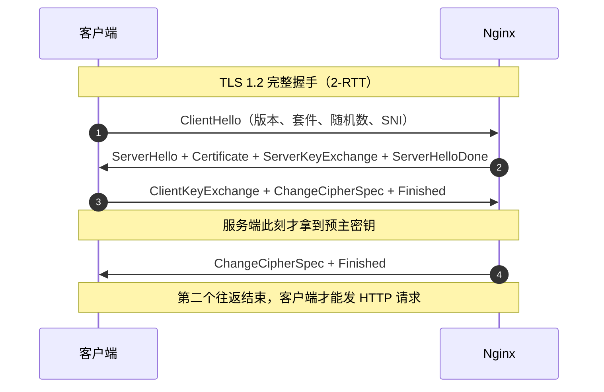
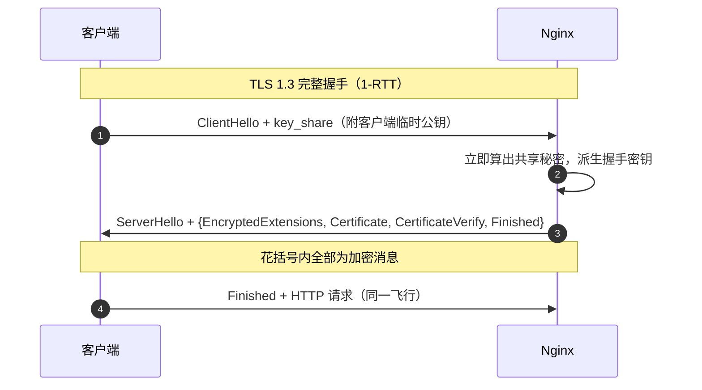
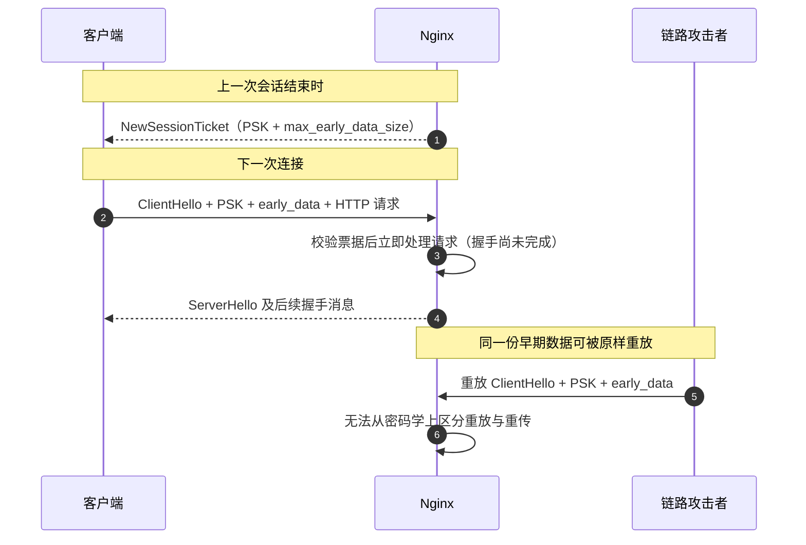
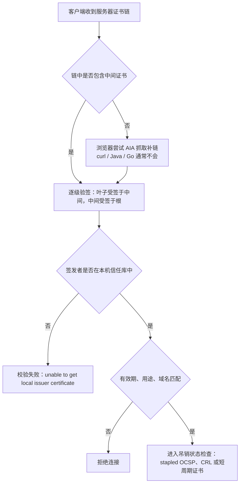
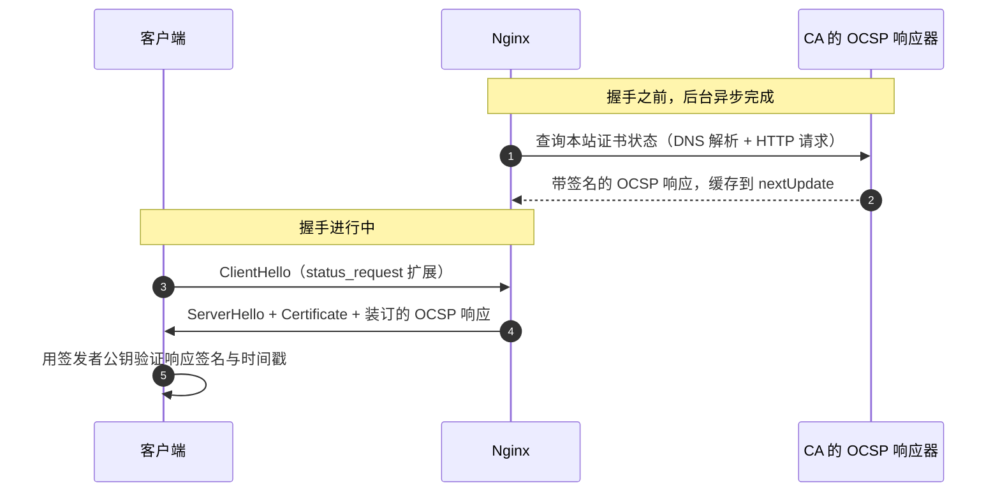
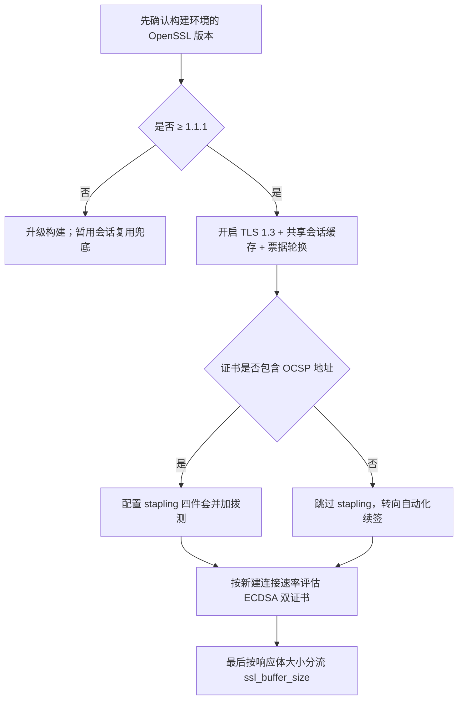

# 06 SSL/TLS 卸载：HTTPS 握手流程与性能优化

**摘要：**

HTTPS 的延迟有两段来源，一段在握手，一段在传输，而前者最容易被误判成网络慢。Nginx 作为 TLS 卸载（TLS Termination）点，把每一次连接的信任建立都收拢到自己身上：证书链、密钥交换、会话复用、吊销状态查询都在这一层结算。本文先把一次握手拆成可以记账的往返（Round Trip Time，RTT），逐项核对 TLS 1.2 的 2-RTT、会话复用的 1-RTT、TLS 1.3 的 1-RTT 与 0-RTT 各自省在哪一步，以及 1.3 的快究竟来自密钥交换与身份认证合并进同一轮，还是来自加密算法本身。随后落到配置面：`ssl_protocols` 与 OpenSSL 版本的关系、`ssl_session_cache` 的容量算术、票据密钥的轮换与多机同步。证书链与 OCSP Stapling 是本文的重头——漏配中间证书为什么会出现浏览器能过、Java 与 curl 报错的分裂现象，stapling 的四个指令又为什么常常配了却不生效。最后给出一条按收益排序的优化路径，并划清它与 upstream、系统参数、安全加固各自的分工。文中出现的量化都标注了推算口径，读者可以按自己的 RTT 分布替换其中的常数；配置示例以 Nginx 1.27.x 与 OpenSSL 1.1.1 以上为基线，版本敏感的指令单独标注。

---

## 第 1 章 握手慢在哪里：先立一本 RTT 账

1994 年 Netscape 把 SSL 摆到 HTTP 与 TCP 之间时，要解决的问题朴素得近乎原始：两个从未见过面的进程，如何在一个谁都能旁听的网络上，谈出一个只有双方知道的秘密，并且还要让对方相信对面坐着的确实是它声称的那个主机。这个目标决定了握手必然是一段对话而不是一句话，而对话的每一次往返都要按物理距离付账。二十多年过去，密码学换了四代，套件从 RC4 换到 AES-GCM，但"往返次数"这个结构性的成本几乎没动，直到 TLS 1.3 才被真正压缩。

理解握手性能，最有效的办法不是背参数，而是记账：把一次连接从 SYN 到第一个业务字节所花的时间，拆成若干个 RTT 加上若干段 CPU 时间，看看每一段各由谁承担。

### 1.1 卸载点定在哪里，决定了成本结构

把 **TLS 卸载**（TLS Termination）放在 Nginx 上，意味着"证明我是谁、商量怎么加密"这件事从业务进程整体搬到了接入层：证书只在这一层安装和轮换，密钥运算只在这一层发生，后端收到的已经是明文 HTTP 请求，可以专注于业务逻辑。与之相对的另外两种形态是 TLS 直通（pass-through，Nginx 只看 `ssl_preread` 里的 SNI 做四层转发，不解密）和重新加密（re-encryption，Nginx 解密后再用另一套证书连上游）。直通把握手留给了后端，接入层无法做任何七层处理；重新加密多了一次完整的握手，只在内网合规要求端到端加密时才有意义。生产上最常见的是终止式卸载，笔者也只讨论这一种。

这个位置有个容易被忽略的后果：握手发生在 HTTP 解析之前。Nginx 的 TLS 握手由 OpenSSL 在 worker 进程内完成，握手不结束，第一个 HTTP 请求就不会进入后面那套十一个阶段的处理管道（见 [[03 HTTP 请求处理管道：11 个阶段全解]]）。所以握手的开销是按连接数乘出来的，而缓存命中率、限流、日志这些手段作用的对象是请求，都在门内。门外的队伍再长，门内的优化也救不了。

这就像小区的门禁：物业把绿化、电梯调度做得再好，访客卡在门口刷卡核验的那几十秒依然是访客体验的全部。想让人流快起来，要么减少访客（连接复用），要么把核验流程从两轮问话压到一轮（协议升级），要么把核验结果记住下次直接放行（会话恢复）。

### 1.2 一个往返里究竟装了什么

TLS 的握手消息并不等于网络包。若干个握手消息可以先被拼进一条 TLS 记录（TLS Record），记录层再加上五字节头部与十六字节的认证标签（AEAD 模式下）后交给 TCP。一条记录的载荷上限是 16KB，实际能装多少还受路径最大传输单元（MTU）与初始拥塞窗口约束。这一点在评估证书体积时很关键：一张 RSA-2048 的叶子证书约 1.2KB，加上中间证书与握手消息，服务端第一个飞行（flight）的总量常常在 3-5KB 之间，会被拆成两三个 TCP 段，但只要它们在同一个往返内连续发出，就仍然只算一个 RTT，多出来的是带宽与重传概率，不是往返次数。

真正决定 RTT 数量的，是双方什么时候才具备"能加密说话"的条件。TLS 1.2 里，服务端要等到客户端把预主密钥（pre-master secret）送过来才能算出会话密钥，而预主密钥要么由客户端用服务端公钥加密后放在第二个往返里（RSA 密钥交换），要么由双方各出一半参数在第两个往返里凑出来（DHE/ECDHE）；在此之前，服务端既不能加密自己的 Finished，也没法让客户端相信它真的持有私钥。于是**两次往返成了硬约束**。

TLS 1.3 把这件事的次序改了：客户端在第一个 ClientHello 里就附带自己的临时公钥（`key_share` 扩展），服务端收到即可算出共享秘密，于是它紧接着发出的 ServerHello 之后的所有握手消息——包括证书、证书签名（CertificateVerify）与 Finished——全都处于加密状态，客户端在一个往返内就完成了"谈密钥"和"验身份"两件事，第三个飞行里把自己的 Finished 连同第一个 HTTP 请求一起送出即可。省下的那个往返不是靠更快的算法，而是靠**重排消息依赖关系**。

### 1.3 四个版本的账本

把上述差别整理成一张账本，四种情况的往返数一目了然。这张表是后面所有优化讨论的坐标系。

| 场景 | 握手往返 | 客户端何时能发业务数据 | 省下的是 |
|---|---|---|---|
| TLS 1.2 完整握手 | 2-RTT | 收到服务端第二个飞行之后 | —— |
| TLS 1.2 会话复用（Session ID 或票据） | 1-RTT | 收到服务端第一个飞行之后 | 一次往返，外加密钥交换与证书传输 |
| TLS 1.3 完整握手 | 1-RTT | 发出第三个飞行时（同包携带请求） | 相对 1.2 省一次往返，且证书加密 |
| TLS 1.3 会话复用（PSK） | 1-RTT | 同上 | 省掉证书与签名验证的 CPU 与字节，往返数不变 |
| TLS 1.3 0-RTT（early data） | 0-RTT | 第一个飞行即携带请求 | 省掉整个握手等待，代价是可重放 |

这张表里最容易被误读的一行是"TLS 1.3 会话复用"。很多人把 1.2 时代的直觉平移过来，以为 1.3 的复用还能再省一个往返，实际情况是 1.3 的完整握手本身就是 1-RTT，复用省掉的是服务端发送证书、客户端验证证书签名这两笔 CPU 与流量开销，往返数并不会从 1 降到 0——能降到 0 的是 0-RTT，而 0-RTT 是另一套机制，需要票据里预先声明可接受的早期数据量。把这三件事（复用、1.3、0-RTT）**分开记账**，后面的配置决策才不会错位。

下面两张时序图对照了 1.2 与 1.3 的完整握手，注意观察服务端在什么时候才敢加密说话。





### 1.4 把 RTT 换算成毫秒

往返次数本身没有意义，乘以链路时延才有。下表按典型网络场景给出换算，数值是示例推算：同机房取 0.3ms，同城跨可用区取 2ms，跨省互联网取 25ms，移动 4G 取 60ms，跨境取 180ms。实际环境受路由、拥塞与运营商互联质量影响，量级判断即可。

| 客户端位置 | 单程 RTT | 1.2 全握手（2-RTT） | 1.2 复用（1-RTT） | 1.3 全握手（1-RTT） | 1.3 0-RTT |
|---|---|---|---|---|---|
| 同机房内网 | 0.3ms | 0.6ms | 0.3ms | 0.3ms | 约 0 |
| 同城跨可用区 | 2ms | 4ms | 2ms | 2ms | 约 0 |
| 跨省互联网 | 25ms | 50ms | 25ms | 25ms | 约 0 |
| 移动 4G | 60ms | 120ms | 60ms | 60ms | 约 0 |
| 跨境链路 | 180ms | 360ms | 180ms | 180ms | 约 0 |

按这张表，一个移动端用户首次打开页面，1.2 的握手要花掉 120ms，而这 120ms 里 Nginx 做的密码学运算加起来可能不到 2ms——九成以上的时间是在等光信号穿过光纤和基站回传。这个比例决定了优化优先级：**先把往返砍掉**，再去抠 CPU。反过来，在内网服务间调用里 RTT 只有 0.3ms，握手耗时被 CPU 主导，此时证书算法与套件选择才开始显眼。

---

## 第 2 章 TLS 1.3 为什么反而更快

TLS 1.3 的正式文档是 2018 年发布的 RFC 8446，从 SSL 3.0 到它隔了二十二年，期间积累的攻击（BEAST、POODLE、CRIME、Lucky13、FREAK、Logjam）几乎都指向同一类问题：协议给了太多可协商的自由度，而自由度就是攻击面。1.3 的做法是把协商空间砍到只剩安全的那一小块，顺手把消息顺序改成更紧凑的形状。砍功能与提速度在这份标准里是同一件事。

### 2.1 key_share：把密钥交换提前到第一句话

1.2 的 ClientHello 更像一份简历：我支持这些版本、这些套件、这些曲线、这些签名算法，请挑一个。挑完之后双方才开始真正交换参数。1.3 的 ClientHello 则直接带着答案上门：`key_share` 扩展里放的就是客户端这一次的临时公钥（常见是 X25519 的 32 字节），服务端只要回一个自己的公钥，双方立刻能算出 ECDHE 共享秘密。

这个改动带来一个连锁反应。因为服务端在发出 ServerHello 之后就已经握有共享秘密，它可以为后续所有握手消息派生握手密钥，于是 EncryptedExtensions、Certificate、CertificateVerify、Finished 这四条消息可以打包在同一个飞行里加密送出。客户端收到后先算密钥解密，再验证书链与 CertificateVerify 的签名，最后校验 Finished 里的握手摘要。整个过程只有一个往返。

相比之下，1.2 的服务端在发出 ServerHello 时还没有共享秘密，它只能把证书明文发出去，然后干等客户端的 ClientKeyExchange；等到第二个往返结束，双方的 Finished 才交换完毕。这不是实现优劣，而是消息依赖关系决定的信息流顺序。

### 2.2 认证与密钥交换合并到一轮

身份认证在 TLS 里靠两样东西落地：证书链证明"这把公钥属于这个域名"，CertificateVerify 里的签名证明"对面确实持有对应私钥"。1.2 中这两件事与密钥交换分处不同飞行：证书在第一个飞行明文送出，签名（ServerKeyExchange）也在第一个飞行，但密钥交换的参数要到第二个飞行才凑齐。1.3 把这三件事压进同一个方向的消息流：证书和签名都在服务端第一个飞行里，而且已经加密。

由此产生两个副作用，都是正向的。其一，被动监听者看不到证书，中间盒无法再靠嗅探证书做审计或干扰，这也让"证书透明度日志 + 被动监控"这套组合里少了一个旁路。其二，证书与签名同处一条加密记录，客户端的验证逻辑可以在收到数据后一次性完成，不必像 1.2 那样先明文收证书、再等参数、再做密钥确认。

不过，这种合并也意味着客户端必须支持新的签名算法集合。1.3 要求 CertificateVerify 使用 rsassa-pss（RSA 填充方案）或 ECDSA，且禁止 SHA-1；一台还在用十年前 OpenSSL 的客户端，即便服务端开了 1.3，也会因为签名算法协商不上而回落到 1.2。版本兼容这件事在协议层是自动协商的，代价是服务端要同时维护两套状态机。

### 2.3 删掉的东西也在加速

1.3 删掉的功能清单，每一条都能对应一次历史事故。RSA 密钥交换被移除，因为它的预主密钥由客户端用服务端公钥加密，一旦服务端私钥泄露，攻击者可以解密此前录下的全部流量，缺乏前向安全性（Forward Secrecy）；CBC 模式被移除，因为它带来 BEAST 与 Lucky13 这类填充预言问题；压缩被移除，因为 CRIME 攻击证明压缩率本身会泄露明文内容；重协商（renegotiation）被大幅限制，因为 2009 年的重协商漏洞允许攻击者把受害者的握手嫁接到自己的连接上；自定义 DH 组被移除，因为 2015 年的 Logjam 说明 512 位导出级 DH 参数仍在被广泛使用。

从性能角度看，这些删减带来的是间接收益：可协商项变少，参数匹配过程变短，1.3 的套件只剩五个且全部是 AEAD，握手报文字节数随之下降。少几个字节不改变往返次数，但会降低超过初始拥塞窗口、触发额外往返的概率。

> [!info] 版本口径
> 本文以 Nginx 1.27.x + OpenSSL 1.1.1/3.x 为基线。`ssl_protocols` 的 `TLSv1.3` 参数自 Nginx 1.13.0 起可用，但只有在编译时链接了 OpenSSL 1.1.1 或更高版本才生效；自 1.23.4 起 TLS 1.3 进入默认值。若构建环境仍是 OpenSSL 1.0.2 或 1.1.0，配置里写 `TLSv1.3` 会让 `nginx -t` 直接报参数非法，而不是静默降级。1.29.x 之后新增的 `ssl_certificate_compression`、`ssl_ech_file` 等指令在 1.27.x 上不存在，需要按实际版本判断。

### 2.4 0-RTT：省下的这个往返从哪里借来

0-RTT 是 1.3 唯一能把往返数降到零的手段，机制上依赖上一次会话留下的票据。首次连接完成后，服务端通过 NewSessionTicket 消息下发一张票据（本质是一个预共享密钥 PSK）以及一个允许的早期数据上限（`max_early_data_size`）；下一次连接时，客户端在 ClientHello 里带上票据与 early_data 扩展，并把 HTTP 请求直接塞进第一个飞行。服务端验证票据后就能在握手完成之前处理请求，客户端感知到的首字节时间几乎等于零个往返。

借来的这个往返有明确利息。早期数据没有前向保密性——它用票据派生的密钥加密，而票据本身由服务端的长期票据密钥保护，一旦票据密钥泄露，历史早期数据可被解密；更要紧的是它**可被重放**：链路上的攻击者可以把整个 ClientHello 连同 early_data 原样再发一遍，服务端无法从密码学上区分"客户端重传"与"攻击者重放"。RFC 8446 因此把防重放的责任部分推给应用层，并在 RFC 8470 里定义了 Early-Data 请求头与 425（Too Early）状态码，供后端表达"我看见你是早期数据，这个操作我不接"。



Nginx 的 `ssl_early_data on`（1.15.3 起，1.15.4 起支持 OpenSSL 1.1.1）打开这道门，同时提供一个变量 `$ssl_early_data`，在请求确实来自早期数据且握手尚未完成时取值为 1。官方文档里有一句话值得单独拎出来：OpenSSL 内置的重放保护默认是关闭的，因为它会干扰会话恢复，需要时可以显式打开——`ssl_conf_command Options AntiReplay;`（`ssl_conf_command` 自 1.19.4 起提供）。也就是说，默认配置下 Nginx 对 0-RTT 重放不做任何拦截，防线的位置在应用层。

把防线放在应用层的具体做法，是让非幂等方法直接拒绝早期数据。下面这段配置按请求方法分流，只允许 GET 与 HEAD 走 0-RTT，其余方法在网关层直接返回 425，并顺手把 Early-Data 头传给后端，让后端有机会做二次判断。

```nginx
map $ssl_early_data:$request_method $reject_early {
    default     0;
    "1:POST"    1;
    "1:PUT"     1;
    "1:DELETE"  1;
    "1:PATCH"   1;
}

server {
    listen 443 ssl;
    http2 on;

    ssl_certificate     /etc/nginx/ssl/fullchain.pem;
    ssl_certificate_key /etc/nginx/ssl/privkey.pem;
    ssl_early_data on;

    # 早期数据只放行幂等的读操作，其余直接拒绝，避免重放导致重复下单
    if ($reject_early) {
        return 425;
    }

    location /api/ {
        proxy_set_header Early-Data $ssl_early_data;
        proxy_pass http://backend;
    }
}
```

这里有一个比"重放"更隐蔽的坑：请求在握手完成之前就被代理出去了。如果后续握手因为证书校验失败、客户端中途断开或超时而无疾而终，后端可能已经执行了这次请求，而客户端认为连接从未建立并选择重试，于是同一次操作被执行两遍。这类故障在日志里表现为"后端有记录、接入层没有对应状态码、客户端报连接重置"，排查时很容易被归因为网络抖动。把 0-RTT 限定在幂等请求上，本质上不只是防攻击，也是防这种"半截请求"。

还有两个边界条件值得记住。第一，早期数据与票据绑定，多机房部署时票据密钥不同步，客户端在 A 机房拿到的票据拿到 B 机房用不了，服务端会拒绝早期数据并让客户端在握手完成后重发请求，用户体验上等于白跑一次 0-RTT，甚至因为多了一次重试而更慢。第二，0-RTT 的收益只对"刚建立过连接又马上重连"的客户端成立，浏览器标签页恢复、移动端 App 冷启动这类场景命中率高，而长连接或低频访问的客户端几乎用不上，开启它等于徒增重放面。

### 2.5 套件配置：1.3 时代 ssl_ciphers 还剩多少作用

`ssl_ciphers` 只影响 TLS 1.2 及以下，默认值是 `HIGH:!aNULL:!MD5`，写法沿用 OpenSSL 的套件表达式；1.3 的那五个套件由 OpenSSL 固定，改 `ssl_ciphers` 对它们毫无作用，要动只能借助 `ssl_conf_command Ciphersuites ...`（1.19.4 起，等价于直接给 OpenSSL 下配置）。同理，`ssl_prefer_server_ciphers on` 只在 SSLv3 与 1.2 及以下生效——1.3 的套件选择本来就不参照客户端的排列顺序。至于 AES-GCM 与 ChaCha20-Poly1305 的取舍，判据是目标终端有没有 AES-NI：x86 服务器上 AES-GCM 更快，缺少硬件指令的老 ARM 终端上 ChaCha20 更稳；以移动端为主的站点可以用 `ssl_conf_command Options PrioritizeChaCha;` 把 ChaCha20 提前，不必重写整个套件串。

```nginx
# 1.2 只留前向安全的 AEAD 套件；1.3 的套件与顺序由 OpenSSL 决定
ssl_ciphers 'ECDHE-ECDSA-AES128-GCM-SHA256:ECDHE-RSA-AES128-GCM-SHA256:ECDHE-ECDSA-CHACHA20-POLY1305:ECDHE-RSA-CHACHA20-POLY1305';
ssl_prefer_server_ciphers on;

# 移动端占比高时，让 OpenSSL 优先 ChaCha20（1.19.4 起）
ssl_conf_command Options PrioritizeChaCha;
```

---

## 第 3 章 会话复用：把状态放在服务端还是客户端

握手再怎么优化，只要客户端每次重连都要重新验证一次身份，成本就一直在。会话复用的思路是：既然刚刚谈好的密钥材料还在，那就想办法把它保存下来，下次直接用。问题的分歧点只有一个——这份状态存哪儿。存在服务端，就有了 Session ID 与共享缓存；存在客户端，就有了会话票据；TLS 1.3 把两者统一到预共享密钥（PSK）这个抽象之下，但底层的存储位置依然决定了水平扩展与运维方式。

### 3.1 Session ID：状态留在服务端

TLS 1.2 的经典做法是服务端在完整握手结束时生成一个 Session ID，把主密钥、协商参数、套件与协议版本打包进内存，并把 ID 回给客户端。客户端重连时在 ClientHello 里带上这个 ID，服务端在缓存里查到就直接跳过密钥交换与证书，用一个往返完成恢复。

Nginx 的这部分缓存由共享内存区（shared zone）承载，配置形如 `ssl_session_cache shared:SSL:10m;`，其中 `SSL` 是区名（可任意命名，多个虚拟主机可以共用同一个区），`10m` 是区大小。容量的换算关系在官方文档里写得很明确：**1MB 大约能存 4000 个会话**，那么 10MB 约 4 万个会话，平均每个会话连同索引结构的开销在 250 字节上下。缓存内部用红黑树做 ID 查找、用 LRU 队列做过期淘汰，因此当新连接速率乘以会话有效期超过容量时，淘汰会把还没复用的会话挤出去，复用率随之下降。

这笔账可以算得更具体一些。假设一个移动端 API 网关每秒新增 800 个 TLS 连接，`ssl_session_timeout` 设为 5 分钟，那么稳态下需要同时驻留的会话数是 800 × 300 = 24 万，按每 MB 4000 个算需要 60MB；配置里若只写了 `shared:SSL:10m`，容量只有需求量的六分之一，绝大部分会话在客户端回来之前就被淘汰了。示例推算的意义不在于精确，而在于提醒：`ssl_session_cache` 的大小应当由新连接速率与会话有效期共同决定，而不是照抄某个模板里的数字。真实复用率可以用访问日志里的 `$ssl_session_reused` 变量验证，取值为 `r` 表示命中、`.` 表示完整握手，按小时聚合就能看到曲线。

```nginx
# 复用率是唯一可信的验收指标，先埋日志再调参
log_format ssl_debug '$remote_addr $ssl_protocol $ssl_cipher '
                     '$ssl_session_reused $ssl_early_data $request_uri';
access_log /var/log/nginx/ssl_debug.log ssl_debug;
```

另一个常被忽略的事实是：`ssl_session_cache` 的默认值是 `none`，含义是"不真正缓存，但告诉客户端会话可复用"；而 `off` 更绝，它明确告诉客户端会话不可复用。两者都不等于"自动开启复用"，这也是大量 Nginx 站点复用率接近零的原因。官方文档在示例配置里干脆直接建议：worker 数等于 CPU 核数、开启 keep-alive、启用共享缓存、关闭内置缓存，并适当延长会话有效期。keep-alive 与复用是互补关系——连接存活得越久，需要新建握手的机会越少；反过来，`keepalive_timeout` 设得过短，等于人为制造重连。

### 3.2 会话票据：把状态搬到客户端

会话票据（Session Ticket）换了个方向：服务端不存状态，而是在完整握手结束时把会话参数用票据密钥加密成一张票据交给客户端保管，客户端重连时把票据带回来，服务端解密即恢复。这个设计对水平扩展极其友好，因为任何一台持有同一把票据密钥的服务器都能解开票据，不需要共享内存也不需要会话粘滞。

代价是密钥管理从内存里的缓存变成了**必须妥善保管的长期秘密**。Nginx 的 `ssl_session_ticket_key` 指定的密钥文件要求是 48 或 80 字节的随机数据——80 字节时用 AES-256 加密，48 字节时用 AES-128；可以配置多个文件，其中第一个用于加密新票据，其余的只用于解密旧票据，这正好构成轮换机制：每天生成一个新密钥放在最前面，把昨天的挪到第二位，后天的挪到第三位，保留两三个即可覆盖客户端票据的自然过期窗口。

```bash
# 80 字节密钥对应 AES-256；放在最前面的是加密密钥
openssl rand 80 > /etc/nginx/ssl/ticket-current.key
```

从 1.23.2 起，Nginx 在使用共享会话缓存时会自动生成、保存并定期轮换票据密钥，除非显式配置了 `ssl_session_ticket_key`；这意味着多机部署下若各机器独立自动轮换，票据天然无法跨机复用，必须显式下发同一份密钥文件，让所有节点共用一套密钥序列。轮换周期与保留数量构成一个安全与可用性的平衡：轮换越频繁，密钥泄露的影响窗口越短；保留越多，客户端跨轮换恢复的成功率越高。一天一轮换、保留两份旧密钥是常见的折中，但具体数值应由密钥托管能力与客户端重连分布决定。

票据机制的软肋是前向安全性。票据里装着会话的主密钥，而票据本身由长期票据密钥保护，一旦票据密钥泄露，攻击者可以解开此前截获的所有票据，进而解密当时录下的应用数据。这正是必须轮换的根本原因，也是"票据比缓存更安全"这种说法的反例——两者保护的对象不同，缓存的风险是内存被读取，票据的风险是密钥文件被复制，后者往往更难发现。

### 3.3 TLS 1.3 下复用的形变

TLS 1.3 删掉了 Session ID 这种恢复方式，只保留 PSK，而 PSK 的载体就是票据。于是很多团队在"安全规范要求关闭会话票据"时踩了坑：`ssl_session_tickets off` 在 1.2 时代只是关掉无状态票据，还可以靠服务端缓存恢复；到了 1.3，票据是唯一的恢复载体，关掉之后恢复能力是否还在，取决于 OpenSSL 是否退回到服务端保存状态的**有状态票据**实现。这个行为随 OpenSSL 版本而异，配置前应以对应版本文档与实测为准，不能想当然。

更实际的影响在缓存容量上。1.2 时代的共享缓存主要服务 Session ID 恢复，容量按新连接速率规划；1.3 时代票据默认是无状态的，服务端不再为每个会话占内存，共享缓存的压力主要来自仍未升级的 1.2 客户端。也就是说，升级到 1.3 之后，`ssl_session_cache` 的容量需求可能明显下降，但 `ssl_session_ticket_key` 的运维要求上升了——从"配一次不管"变成"纳入密钥轮换流程"。这两笔账必须一起记，否则很容易出现"缓存开得很大、票据密钥三年没换"的状态。

### 3.4 复用相关的配置面

下表把与会话复用相关的指令集中列出，并标注了参数调大调小各自的代价。这张表值得和上一章的 RTT 账本对照看：所有复用手段的目标都是把 2-RTT 的全握手变成 1-RTT 的恢复握手，进而为 0-RTT 创造条件。

| 指令 | 默认值 | 作用 | 调大的代价 | 调小的代价 |
|---|---|---|---|---|
| `ssl_session_cache` | `none` | 共享内存区大小，1MB 约 4000 会话 | 内存占用上升；命中率随容量饱和而不再增长 | 会话被提前淘汰，复用率下降，全握手比例上升 |
| `ssl_session_timeout` | `5m` | 客户端可复用会话的时间窗 | 缓存驻留会话数增加，需要更大 zone 才能装下 | 客户端稍晚重连就要重做全握手 |
| `ssl_session_tickets` | `on` | 是否签发会话票据 | 无状态票据无内存成本，但关闭会影响 1.3 恢复 | 1.2 可回落缓存，1.3 可能直接失去恢复能力 |
| `ssl_session_ticket_key` | 自动生成 | 票据加解密的密钥文件 | 保留旧密钥越多，恢复成功率越高，泄露影响面越大 | 轮换过频，客户端票据失效概率上升 |
| `keepalive_timeout` | `75s` | 空闲连接保持时间 | 每连接占用文件描述符与内存更久 | 重连变多，握手次数与新会话数上升 |

---

## 第 4 章 证书链：最容易被漏掉的一段

如果只能记住这篇文章的一件事，那应该是：`ssl_certificate` 指向的不是"服务器证书"，而是"服务器证书加上中间证书组成的链"。这条规则在文档里写得清楚，在实际部署里却反复出错，原因是它的症状极具欺骗性——用浏览器打开一切正常，用 curl、Java 客户端或 Go 程序调用却报证书不受信任。同一个域名、同一份配置，在不同客户端上给出相反结论，这种分裂让很多人第一反应是"客户端的问题"。

### 4.1 信任链的模型

公钥基础设施（Public Key Infrastructure，PKI）的验证逻辑是一层层往上签：根证书（Root CA）自签名，被预装进操作系统或浏览器的信任库；中间证书（Intermediate CA）由根签发；叶子证书（Leaf，也就是服务器证书）由中间证书签发。客户端拿到叶子证书后，要沿着签发关系一路向上，直到某张证书的签发者在自己的信任库里，才算验证通过。因此服务器必须把"叶子 + 所有中间证书"一起发出来，客户端才有材料完成这条路径；根证书通常不必发，因为客户端本来就有。

Nginx 的 `ssl_certificate` 要求把主证书放最前面，后面按签发顺序跟中间证书，同一个 PEM 文件里依次拼接即可；私钥可以用 `ssl_certificate_key` 单独指定，也可以与证书放在同一个文件里。这个拼接动作在 Let's Encrypt 体系里对应 `fullchain.pem`（叶子 + 中间）与 `cert.pem`（仅叶子）两个文件的区别，把 `cert.pem` 配到 `ssl_certificate` 上，就是本文反复提到的那个错误。

### 4.2 漏配中间证书的症状学

为什么浏览器能过？因为主流浏览器实现了 **AIA**（Authority Information Access）抓取：叶子证书里有一个扩展字段记录了中间证书的下载地址，浏览器发现链断了，会自己去把中间证书取回来补上。这个行为让服务器配置的错误被浏览器悄悄修好了，也让问题一直藏到了非浏览器客户端上门。

为什么 curl、Java、Go 会挂？因为这些客户端不做 AIA 抓取（或者默认不做），它们只按收到的东西验链。OpenSSL 给出的典型报错是 `unable to get local issuer certificate`，`openssl s_client` 里对应 `Verify return code: 21 (unable to verify the first certificate)`；Java 的报错长得更吓人，`PKIX path building failed` 后面跟着 `unable to find valid certification path to requested target`；Go 的 `x509` 包则直接说 `certificate signed by unknown authority`。三种措辞，一个根因。

另一层差异在信任锚。浏览器的信任库由各厂商维护，覆盖范围宽、更新快；Java 用自带的 `cacerts`，版本老一点就可能缺新根；不同 Android 版本的可信根集合更是千差万别。2015 年 Let's Encrypt 上线时靠 IdenTrust 的交叉签名让老设备也能信任，2021 年 9 月 30 日 DST Root CA X3 过期后，大量 Android 7 以下的设备开始报错，就是信任锚不一致的经典案例。这也解释了为什么"我们的证书没问题，是对方的客户端太老"这句话有时成立、有时只是借口——判断依据是具体缺的是链还是根。

下面这张流程图把客户端拿到证书后的校验步骤展开，漏配中间证书的失败点落在第二步。



### 4.3 诊断与修复

排查证书链只需要三条命令。第一条看服务端到底发了什么，`openssl s_client` 的 `-showcerts` 会把收到的每张证书打印出来，`-servername` 则模拟 SNI，避免打到默认虚拟主机上去了；第二条用 `openssl verify` 在离线环境下复现客户端的验链过程；第三条用 curl 或真实客户端跑一次，确认症状。三条命令的输出可以互相印证，也能区分"链不全"与"根不被信任"这两种不同的问题。

```bash
# 1) 看服务端发了几张证书：正常应至少有叶子 + 中间两张
echo | openssl s_client -connect api.example.com:443 \
    -servername api.example.com -showcerts 2>/dev/null \
  | grep -E '^ *[0-9]+ s:|^ *i:'

# 2) 离线复现验链：-untrusted 提供中间证书，-CAfile 提供根
openssl verify -CAfile root.pem -untrusted intermediate.pem leaf.pem

# 3) 用真实客户端确认症状
curl -v https://api.example.com/health
```

修复动作本身只是一次拼接与一次重新加载：把叶子证书在前、中间证书在后写进同一个文件，`nginx -t` 通过后 `reload` 即可。但更重要的是把这条检查前移到发布流程里——在 CI 里对预发环境跑一次 `openssl s_client` 并断言证书数量不少于两张，比事后被 Java 客户端投诉要便宜得多。

```bash
# 拼接顺序不能颠倒：叶子在前，中间在后
cat leaf.pem intermediate.pem > fullchain.pem
```

### 4.4 证书算法：ECDSA 与 RSA 的代价分配

证书的签名算法决定了握手里最重的那笔 CPU 开销落在谁身上。服务端在 CertificateVerify 里要用私钥签名，客户端要用公钥验签；RSA 的特点是**签名贵、验签便宜**（私钥运算涉及大数模幂，公钥运算指数很小），ECDSA 恰好相反，签名便宜、验签相对贵。这个不对称性决定了两种证书的成本分配完全不同。

| 算法与密钥长度 | 服务端签名开销 | 客户端验签开销 | 叶子证书体积 | 适用判断 |
|---|---|---|---|---|
| RSA-2048 | 约 1ms（量级判断） | 约 30-60µs | 约 1.2KB | 兼容性最好，服务端 CPU 压力大 |
| RSA-4096 | 约 5-8ms（量级判断） | 约 100µs | 约 1.8KB | 除合规要求外不推荐，握手明显变重 |
| ECDSA P-256 | 约 50µs（量级判断） | 约 100µs | 约 0.7KB | 服务端省 CPU，现代客户端全支持 |
| ECDSA P-384 | 约 150µs（量级判断） | 约 400µs | 约 0.9KB | 安全强度更高，移动端验签开销上升 |

同样是"握手一次"，RSA-2048 的服务端开销比 ECDSA P-256 高一个数量级以上。以一个每秒新建 5000 个连接的接入层为例，示例推算：RSA 方案光签名就要吃掉约 5 个 CPU 核，ECDSA 方案不到半个核；省下来的算力可以直接折算成机器数量。代价是验签成本转移给了客户端，而客户端数量远超服务端、且并行度极高，整体上更划算——这也是 CDN 与大型站点普遍换用 ECDSA 证书的原因。

真正需要小心的是兼容性。Nginx 自 1.11.0 起支持在同一个虚拟主机上配置多张 `ssl_certificate`，分别挂 RSA 与 ECDSA 证书，握手时按客户端能力自动选择，这是既拿性能又保兼容的标准做法；OpenSSL 1.0.2 以上才支持为不同证书使用各自的证书链，更老的版本只能共用一条链。另一个陷阱在曲线配置：`ssl_ecdh_curve` 决定了服务端支持的曲线集合，若只写了 `X25519` 而证书是 P-384 的，ECDSA 证书会无法工作，官方文档对此有明确提示——配置曲线时必须把证书用到的曲线包含进去。

```nginx
# 双证书：现代客户端走 ECDSA，老客户端回落 RSA
ssl_certificate     /etc/nginx/ssl/example.ecdsa.fullchain.pem;
ssl_certificate_key /etc/nginx/ssl/example.ecdsa.key;
ssl_certificate     /etc/nginx/ssl/example.rsa.fullchain.pem;
ssl_certificate_key /etc/nginx/ssl/example.rsa.key;

# 曲线列表要覆盖证书所用曲线，否则 ECDSA 证书失效
ssl_ecdh_curve X25519:prime256v1:secp384r1;
```

---

## 第 5 章 OCSP 与 Stapling：把吊销检查从客户端手里拿回来

证书有有效期，但在有效期内也可能作废：私钥泄露、域名易主、CA 误签发，都需要一个"提前失效"的通道。TLS 本身对此毫无办法，它只校验有效期与签名，于是吊销检查必须外挂。这段外挂逻辑过去二十年一直是 HTTPS 性能与可用性的薄弱环节，也是 OCSP Stapling 存在的全部理由。

### 5.1 三条吊销检查的路线

业界试过的方案可以归成三条。第一条是证书吊销列表（Certificate Revocation List，CRL）：CA 定期发布一份被吊销证书的清单，客户端下载后本地比对。第二条是在线证书状态协议（Online Certificate Status Protocol，OCSP）：客户端针对单张证书实时问 CA 一句"它还有效吗"。第三条是干脆取消检查，靠把证书有效期压到极短，让"等待吊销"这件事失去意义。

| 机制 | 开销落在谁身上 | 时效性 | 隐私 | 现状判断 |
|---|---|---|---|---|
| CRL 全量下载 | 客户端（文件体积随吊销量膨胀） | 取决于 CA 发布频率 | 较好，无实时查询 | 主流浏览器已基本不用，CRLSet 等增量方案替代 |
| OCSP 实时查询 | 客户端多一次连接 + CA 承担查询量 | 近实时 | 差，CA 可见用户访问的站点 | 仍被部分客户端使用，但趋势下行 |
| OCSP Stapling | 服务端周期性查询 | 取决于刷新窗口 | 好，CA 只看到服务端 | 在仍签发 OCSP 的 CA 下仍然有效 |
| 短周期证书 | 运维（自动化续签） | 由有效期决定 | 最好 | 方向，有效期已进入持续缩短的轨道 |

### 5.2 客户端直查 OCSP 的三重代价

客户端直查的流程很直白：拿到服务器证书后，从证书的 AIA 扩展里取出 OCSP 响应器的 URL，解析域名、建 TCP、握手、发一个 HTTP 请求、等签名响应，然后才决定是否继续。这段流程没有一步是免费的。

第一重代价是多一次完整的网络连接。一次 OCSP 查询至少要 1 个 RTT 的 TCP 加 1 个 RTT 的 TLS（如果响应器走 HTTPS），再加上 DNS 解析与 HTTP 往返；即便响应器同城，也可能要 3-4 个 RTT。示例推算：跨境链路上用户与 CA 响应器之间的 RTT 取 180ms，一次查询就能吃掉 500ms 以上，比整次 TLS 握手还贵。更要紧的是这段等待发生在握手的串行路径上，用户看到的是白屏时间被拉长。

第二重代价是隐私。响应器知道"某个 IP 正在访问某个域名"，而 OCSP 查询是明文 HTTP（协议本身依赖签名而不依赖传输加密），链路上的任何观察者都能看到你在访问什么站点。这让 HTTPS 苦心经营的"隐藏访问内容"在连接建立阶段漏了一地。

第三重代价是可用性。响应器不可达时，客户端只有两种选择：软失败（soft-fail，当作有效继续连接）或硬失败（hard-fail，拒绝连接）。浏览器普遍选择**软失败**，因为硬失败意味着 CA 的一次故障能让半个互联网打不开；但软失败也意味着吊销检查在关键时刻形同虚设，攻击者只要阻断响应器就能让被吊销的证书继续可用。

### 5.3 Stapling：让服务端替客户端跑腿

OCSP Stapling 的思路是把查询主体从客户端换成服务端。Nginx 在后台向 CA 的响应器查询自家证书的状态，拿到一份带 CA 签名与时间戳的响应并缓存在内存里；TLS 握手时，这份响应被"装订"进证书消息一并送出（TLS 1.2 里是 CertificateStatus 消息，TLS 1.3 里是证书条目上的 status_request 扩展）。客户端拿到的是一条完整的证据链，不需要再发起任何网络请求。

好处正好对上前一节的三个代价：少一次连接，握手的串行路径变短；CA 只看到服务端的查询，看不到终端用户；响应器临时故障时，服务端可以继续提供缓存内仍在有效期内的响应，可用性从"依赖 CA 实时在线"变成"依赖缓存未过期"。对启用 Must-Staple 扩展（RFC 7633）的证书来说，stapling 不再是优化而是硬性要求——客户端发现证书声明了必须装订却没收到响应，会直接拒绝连接。



### 5.4 四个指令，以及它们为什么会静默失效

OCSP Stapling 的标准配置只有四行，但这四行之间的依赖关系比看起来复杂，任何一条不满足，结果都是"握手照常、响应没有"，日志里最多一条警告，业务毫无感知。这种**静默失效**是它最危险的地方：配置看起来齐全，监控不报错，只有在有人用 `openssl s_client -status` 拨测时才会发现装订根本不存在。

```nginx
server {
    listen 443 ssl;
    http2 on;

    ssl_certificate           /etc/nginx/ssl/fullchain.pem;
    ssl_certificate_key       /etc/nginx/ssl/privkey.pem;

    ssl_stapling on;
    ssl_stapling_verify on;   # 校验响应签名，关掉等于不验真伪

    # 验证 stapling 响应所需的信任链：签发者证书 + 根证书 + 全部中间证书
    ssl_trusted_certificate   /etc/nginx/ssl/trusted-chain.pem;

    # OCSP 响应器的域名必须由 nginx 自己解析，不能用系统解析器
    resolver 223.5.5.5 119.29.29.29 valid=300s ipv6=off;
    resolver_timeout 5s;
}
```

四个指令各管一件事，缺一不可。`ssl_stapling` 打开功能；`ssl_stapling_verify` 决定 Nginx 是否校验响应上的 CA 签名与响应者身份；`ssl_trusted_certificate` 提供验签所需的证书集合（注意它不会发给客户端，这一点与 `ssl_client_certificate` 相反）；`resolver` 负责解析响应器域名，因为 Nginx 在握手路径上不能阻塞在系统解析器上，必须走自己的异步 DNS。

`ssl_trusted_certificate` 的语义常被误解。官方文档对 `ssl_stapling_verify` 的要求写得很清楚：签发者证书、根证书以及全部中间证书都要放进这个文件。原因在于 OCSP 响应通常由 CA 的专用响应器证书签名，而那张证书由中间证书签发，验签需要从响应器证书一路追到根。另一方面，`ssl_stapling` 本身要求 Nginx 知道叶子证书的签发者是谁——如果 `ssl_certificate` 里只有叶子证书，签发者就必须出现在 `ssl_trusted_certificate` 里，否则装订根本不会发生。这也解释了为什么"证书链不全"这个错误会同时污染握手和 stapling 两件事。

下表把常见的失效现象与判据列出来，排查时按这个顺序走，比盲改配置快得多。

| 现象 | 典型日志或输出 | 根因 | 处置 |
|---|---|---|---|
| 握手正常但无 stapling 响应 | `ssl_stapling ignored, issuer certificate not found` | `ssl_certificate` 只有叶子证书，签发者未知 | 拼接完整链，或在 trusted 文件里补签发者 |
| 有响应但客户端仍警告 | `OCSP_basic_verify() failed` | trusted 文件缺根或中间证书 | 补齐签发者与根，重新加载 |
| 完全不查询响应器 | `no resolver defined to resolve ...` | 未配置 `resolver` | 配置内网或公共 DNS，注意 `ipv6=off` |
| 长时间无响应 | 装订为空，日志无异常 | 服务器出网受限，或响应器只提供 IPv6 | 放通出方向 80 端口，检查 DNS 解析结果 |
| 证书根本没有 OCSP URL | `no OCSP responder URL in the certificate` | CA 已停止签发带 OCSP 地址的证书 | 接受现实，转向短周期证书与自动化续签 |

验收手段只有一个：**拨测**。`openssl s_client -connect host:443 -status` 会打印装订回来的响应状态，正常时应看到 `OCSP Response Status: successful`、签发时间与下次更新（Next Update）时间；若整段缺失，说明装订没有生效。把这个拨测做成每分钟一次的外部监控，并在响应缺失时告警，才算真正把 stapling 纳入可观测范围。对出网受限的环境，可以用 `ssl_stapling_file` 指向一份离线更新的 DER 响应，配合 `ssl_stapling_responder` 覆盖证书里的地址，把在线查询彻底挪出握手路径。

### 5.5 OCSP 的退场与它留下的问题

2025 年前后，Let's Encrypt 宣布停止 OCSP 服务，新签发的证书不再包含 OCSP 响应器地址，这件事在业内引发的实际影响比预想的小——因为主流浏览器早就不把在线吊销检查当作硬门槛，Chrome 用内置的 CRLSet 做近似判断并在失败时软失败，Firefox 也在逐步移除对 OCSP 的依赖。与此同时，CA/Browser Forum 已经通过了证书有效期的缩短路线，把上限从 398 天分阶段压到 200 天、100 天、47 天（具体生效时间与阶段以 CA/B 公告为准）。

两件事叠加起来的结论是：吊销检查的重心正在从实时查询转向**缩短暴露窗口**。一张 47 天就过期的证书，被吊销后的风险窗口本来就只有几十天，为它维持一套实时查询链路的性价比越来越低。这并不意味着 stapling 立刻失去意义：仍在使用提供 OCSP 的 CA、签发了 Must-Staple 证书、或者客户端群体里有硬失败策略的系统，依然需要它。但它确实从"HTTPS 标配"退化成"按 CA 与客户端画像决定的选项"，这个变化值得在架构决策里明确写下来，而不是照抄五年前的配置模板。

对运维的影响则转移到续签上。有效期压到几十天，人工续签彻底不可行，自动化（ACME 协议 + 定时续签 + 到期拨测）成为硬前提。证书与密钥的保管、HSTS 预加载留给 [[11 安全加固：常见攻击向量与防御配置]]，本文只关心它对握手路径的影响：续签变频繁，reload 就变频繁，而 reload 会重建 worker 与 SSL 会话缓存，处理不慎时每次续签都是一次复用率断崖。

---

## 第 6 章 SNI：一个 IP 上的多张证书

在 IPv4 地址还算充裕的年代，一个有 HTTPS 的网站占一个独立 IP 是常态，证书绑定在 IP 上，问题不存在。地址耗尽与虚拟主机普及之后，同一台 Nginx 上跑几十上百个域名成了标配，如何让客户端在握手阶段就表明"我要访问哪个域名"，成了协议必须回答的问题。服务器名称指示（Server Name Indication，SNI）就是这个答案，它把域名放进了 ClientHello。

### 6.1 SNI 的选择机制与默认站

SNI 的工作方式简单：客户端在 ClientHello 的 server_name 扩展里写上目标域名，Nginx 在握手早期就按这个值挑选虚拟主机与证书，因此每个域名可以有独立的证书、独立的协议版本与套件策略。这个"早期"很关键：证书选择发生在握手之前，所以它不能依赖 Host 请求头——HTTP 层的信息此时还不存在。

由此带来一个必须面对的边界：不做 SNI 的客户端。老旧的 Java 客户端、部分命令行工具、直接按 IP 访问的探测流量，都不会发送 SNI，Nginx 只能退回 `default_server` 的证书。官方文档对此有一句提醒：受 TLS 协议限制，若要让不使用 SNI 的客户端也能拿到正确的证书，不同证书的虚拟主机应当监听不同的 IP。这句话在今天依然成立，只是影响面小了很多。

`default_server` 的处理方式值得单独设计。默认把某个真实业务站点设为默认站，意味着任何未知域名、任何扫描器的请求都会落到它身上，证书不匹配的告警与日志噪音都会记在它头上。更干净的做法是专门设一个空壳默认站并用 `ssl_reject_handshake on`（1.19.4 起）直接拒绝握手，让未知 SNI 在 TLS 层就被挡掉，既省 CPU 也省日志。

```nginx
# 空壳默认站：未知 SNI 直接拒绝，不进入 HTTP 处理
server {
    listen 443 ssl default_server;
    ssl_reject_handshake on;
}

server {
    listen 443 ssl;
    server_name api.example.com;
    ssl_certificate     /etc/nginx/ssl/api.example.com.fullchain.pem;
    ssl_certificate_key /etc/nginx/ssl/api.example.com.key;
}
```

SNI 的值可以在日志与路由里使用，变量是 `$ssl_server_name`（1.7.0 起）。另一个用法是把证书文件名做成变量，实现"按 SNI 动态加载证书"，但官方文档明确提示：使用变量意味着每次握手都要加载一次证书，对性能有负面影响，而且文件名来自客户端，必须用 `map` 做白名单过滤，否则存在路径穿越与任意文件读取风险。这个技巧适合证书数量多到无法用静态配置管理的场景，不适合当作默认方案。

### 6.2 SNI 在 TLS 1.3 里加密了吗

这是被问得最多、也误解最深的一个问题。TLS 1.3 加密的是证书，不是 SNI。ClientHello 依然是明文，因为服务端必须先看到 SNI 才能挑选证书，而挑选证书又发生在握手密钥建立之前——这是一个先有鸡还是先有蛋的循环。所以被动观察者看不到你访问的站点用了什么证书、什么算法，但仍然能看到你访问了哪个域名。

真正能隐藏 SNI 的是加密客户端问候（Encrypted Client Hello，ECH），它的前身叫 ESNI。做法是：域名所有者在 DNS 的 HTTPS 记录里发布一个公钥，客户端用这个公钥把"内层 ClientHello"（含真实 SNI）加密，外层 ClientHello 只带一个公开的 front 名称；服务端解密内层后按真实域名选证书。整条链路需要 DNS、客户端、服务端三方同时支持，任一方不支持就退回明文 SNI，因此它提供的隐私是**尽力而为**，而不是保证。

Nginx 对 ECH 的支持是版本敏感的。1.27.x 上没有任何原生 ECH 指令，官方文档里出现的 `ssl_ech_file`（加密 ClientHello 配置，共享模式）以及配套的 `$ssl_ech_status` 变量，自 1.29.4 起才提供，并且要求 OpenSSL 4.0 以上的构建。换句话说，在本文使用的版本口径下，讨论 ECH 只能停在"客户端与 CDN 侧已经可用，源站 Nginx 尚不支持"，具体能力以对应版本文档为准。HTTP/3 也没有改变这个格局：QUIC 的 Initial 包虽然加密，但初始密钥可由连接 ID 推导，链路上的观察者仍能还原其中的 SNI。

> [!warning] SNI 泄露的实际影响
> SNI 明文意味着"你访问了哪个域名"这一事实在链路上可见，即使内容全程加密。对内部系统而言，这等同于把资产清单暴露给链路观察者；对外部站点而言，它构成了流量画像的基础。用独立 IP、ECH 或前置 CDN 都能缓解，但没有一种能在源站单方面解决。

### 6.3 多域名配置的边界

一个 Nginx 上承载多个域名时，证书的组织方式比证书本身更影响运维效率。为每个域名单独签发证书，隔离性好但到期日分散，续签任务多；用一张多域名（SAN）证书覆盖十几个域名，管理简单但任何一个域名变更都要重签，且所有域名共享同一张证书的私钥；通配符证书能覆盖一级子域，但跨级（如 `a.b.example.com`）不匹配，且私钥泄露的影响面最大。这三种方式的取舍没有唯一答案，取决于域名数量、变更频率与爆炸半径的容忍度。

还有一个容易混淆的分工：SNI 只在握手阶段使用，用于选证书与虚拟主机；HTTP 层的 Host 头与 URI 才用于 location 匹配与 upstream 路由。两者可以不一致——客户端可以在 SNI 里写 `api.example.com` 而在 Host 头里写别的值，Nginx 默认不会因此拒绝请求。如果业务依赖"SNI 与 Host 必须一致"来做安全隔离，需要显式校验，否则这层假设会被轻易绕过。

---

## 第 7 章 优化排序：先做收益最大的

到这里，可用的手段已经摆齐：协议升级、会话复用、OCSP Stapling、证书算法、缓冲区与硬件加速。真正的问题不是"还能做什么"，而是"先做哪个"。排序的依据不是手段的先进程度，而是单位改动带来的毫秒数。

### 7.1 排序的依据：往返与微秒不在一个量级

前文的换算表已经给出结论：一次跨省往返约 25ms，一次移动网络往返约 60ms，而 RSA-2048 的一次签名约 1ms，ECDSA P-256 约 50µs。三者相差三到四个数量级。这意味着任何能减少往返或减少一次独立连接的改动，收益都远大于任何能省几毫秒 CPU 的改动；反过来，在一个 RTT 只有 0.3ms 的内网环境里，这个排序会翻转，CPU 成为主要矛盾。

由此得到一条排序原则：**先砍往返**（协议与会话复用），再砍独立连接（OCSP Stapling），再砍每次握手的 CPU（证书算法），最后才是缓冲区与硬件这类"在剩余空间里找几个百分点"的手段。这条原则也解释了为什么很多团队换了更快的 CPU 却感觉不到快——瓶颈根本不在 CPU 上。

### 7.2 第一优先：TLS 1.3 与会话复用

这两件事应当一起做，因为它们共享同一批前置条件：一个支持 OpenSSL 1.1.1 以上的 Nginx 构建、一份完整的证书链、一套可用的会话存储。开启 1.3 的配置本身只有一行 `ssl_protocols TLSv1.2 TLSv1.3;`，但真正决定收益的是会话复用的命中率——1.3 的完整握手虽然只要 1-RTT，但每次都要传证书、验签名；恢复握手把这些全省掉。

验收要看分布而不是看开关。用访问日志把协议版本与 `$ssl_session_reused` 交叉统计：1.3 占比逐周上升、1.2 流量集中在老客户端、复用率随缓存容量调整而提升，才算真正生效；若 1.3 占比高而复用率低，问题在票据或缓存，若复用率高而 1.2 占比也高，说明客户端群体比预期老。

### 7.3 第二优先：OCSP Stapling

它排在证书算法之前，理由很直接：stapling 消除的是一次完整的额外连接（DNS + TCP + TLS，至少三四个往返），而证书算法优化的是握手内部约 1ms 的签名运算。在客户端仍会主动查询 OCSP 的环境里，这笔收益远大于换算法；在 CA 已停止提供 OCSP 的环境里，这一项可以直接跳过，把精力放到自动化续签上。

配置成本是一次性的，但运维成本是持续的：resolver 要可达、trusted 证书链要随证书更新、拨测要覆盖。这三件事任何一件失守，stapling 就会静默消失。判断是否值得做，可以看客户端的 OCSP 查询比例——如果大部分流量来自现代浏览器（软失败、几乎不查），收益有限；如果有大量 Java 客户端、IoT 设备或强制吊销检查的合规场景，收益明显。

### 7.4 第三优先：证书算法

换 ECDSA 证书的收益全部落在服务端 CPU 上，对 RTT 没有任何影响。它的价值随连接新建速率线性增长：每秒几百个新连接时几乎感觉不到，每秒数千个新连接时能省下可观的核数。做这件事的正确姿势是双证书而不是全量替换，用 `ssl_certificate` 挂两张证书让客户端自己选，既拿到现代客户端的性能，又不丢老客户端的兼容性。

### 7.5 第四优先：硬件加速与缓冲区

硬件加速的适用面比想象中窄。AES-NI 早已是 x86 标配，AES-GCM 的对称加密开销可以忽略，真正值得用专用卡卸载的是 RSA 签名这类大数运算——而这恰好是换 ECDSA 证书就能绕开的部分。只有在无法更换算法（譬如合规上必须保留 RSA）且新建连接速率极高时，QAT 一类加速卡才有性价比，Nginx 通过 `ssl_certificate_key engine:name:id`（1.7.9 起）把私钥运算交给 OpenSSL engine。

`ssl_buffer_size` 是本文最容易被误用的参数。它控制 Nginx 发送 TLS 数据时使用的缓冲区大小，默认 16KB，官方文档的表述是：16KB 对应大响应场景下的最小开销，而要降低首字节时间（TTFB），可以改用更小的值，文档给出的例子是 4KB。机制上的原因是 Nginx 会先把待发送数据攒进这个缓冲区再生成 TLS 记录，缓冲区越小，小响应或流式响应就能越早被推出去，客户端更早拿到第一个字节。

代价在吞吐侧，而且是可算的。每条 TLS 记录要加五字节头部与十六字节 AEAD 认证标签，共 21 字节；缓冲区设为 1400 字节时，开销占比约 1.5%，而 16KB 时只有约 0.13%。更明显的是记录数量：传输 1MB 数据，1400 字节的缓冲区要生成约 750 条记录，16KB 只需约 64 条，前者意味着十余倍的系统调用与加解密次数。所以正确的用法是**按业务分流**，而不是全局调小：API 与动态页面这类响应体通常在几 KB 以内、延迟敏感的场景用 4KB；文件下载、视频流这类吞吐敏感的场景保持默认 16KB；把 `ssl_buffer_size 1400` 写进全局配置，等于用整体吞吐换少量 TTFB，得不偿失。

| 优化项 | 一次握手的收益 | 主要代价与前置条件 | 建议优先级 |
|---|---|---|---|
| TLS 1.3 | 省 1 个 RTT，证书加密传输 | 需 OpenSSL 1.1.1+；老客户端回落 1.2 | 最高 |
| 会话复用（缓存 + 票据） | 2-RTT 降为 1-RTT，省证书与签名 | 缓存内存、票据密钥轮换与多机同步 | 最高 |
| OCSP Stapling | 省掉客户端一次额外连接（3-4 RTT） | resolver 可达、trusted 链完整、需拨测 | 高（视 CA 是否提供 OCSP） |
| ECDSA 证书 | 服务端签名开销降一个数量级 | 老客户端兼容性，需双证书与曲线覆盖 | 中高（按新建连接速率决定） |
| 硬件加速卡 | RSA 签名卸载 | 成本高、可用性依赖驱动，换算法即可绕开 | 低（特定场景） |
| `ssl_buffer_size` 调小 | 小响应 TTFB 降低 | 记录数增加，吞吐与 CPU 开销上升 | 中（按响应体大小分流） |

下面这张图把决策顺序画成了一条判据链，每一层的判断都依赖上一层的结论。



---

## 第 8 章 反例集与边界

优化手段脱离前提就会被误用，而误用往往比不做更糟：它让人以为已经优化过，从而不再检查。下面这些反例的共同点，是把看起来相关当成了确实生效。

### 8.1 四个典型反例

第一个是只配服务器证书、不配中间证书。它在浏览器上完全看不出问题，因为浏览器会去 AIA 抓链；直到某个 Java 客户端或命令行工具报出 `PKIX path building failed`，团队才开始怀疑客户端。这个反例的代价不是性能，而是可用性，并且它同时污染 OCSP Stapling——签发者未知，装订就不会发生，两个问题一起静默。

第二个是 `ssl_session_cache off`。很多人以为 `off` 是"用默认缓存"，实际上它明确告诉客户端"会话不可复用"，等于主动放弃了从 2-RTT 到 1-RTT 的那一半收益。默认值 `none` 的含义也不乐观：它告诉客户端可以复用，但服务端并不真的存。这两个值都不该出现在生产配置里，正确的写法是 `shared:SSL:10m`（容量按新连接速率计算）并配合合理的 `ssl_session_timeout`。

第三个是把 `ssl_buffer_size` 设成很小的值，以为越小越快。缓冲区的确影响 TTFB，但记录开销与系统调用次数会随缓冲区缩小而上升；把 1400 字节设成全站默认，会让大响应场景的吞吐下降一个档次，同时把 CPU 花在拆分与封装记录上。这个反例的迷惑性在于它确实改善了某个局部指标，只是用错了地方。

第四个是配了 OCSP Stapling 却不加 `ssl_stapling_verify`。表面上握手里有响应，客户端也能收到，但 Nginx 没有校验响应上的签名与响应者身份，等于把"这张证书还有效"的判断建立在未经验证的数据上。既然要做吊销检查，验证响应就是这个机制的安全底线；不验证的装订只提供了隐私与延迟收益，却在安全语义上不如不做。

| 反例 | 表面症状 | 真实根因 | 正确处置 |
|---|---|---|---|
| `ssl_certificate` 只配叶子证书 | 浏览器正常，Java/curl 报验链失败 | 链不完整，非浏览器客户端不做 AIA 抓取 | 拼接 fullchain 并用 `openssl s_client -showcerts` 断言 |
| `ssl_session_cache off` | 无明显故障，复用率为零 | 显式禁止复用，每次都全握手 | 改 `shared:SSL:10m` 并按需调 `ssl_session_timeout` |
| 全站 `ssl_buffer_size` 极小 | TTFB 略降，下载吞吐下降 | 记录数暴增，封装与系统调用开销上升 | 仅对小响应虚拟主机设 4KB，其余保持默认 |
| `ssl_stapling on` 未加 verify | 握手内有 OCSP 响应 | 未校验签名，等同不检查 | 打开 `ssl_stapling_verify` 并补齐 trusted 链 |
| 全站 `ssl_early_data on` | 首字节更快，偶发重复写入 | 早期数据可重放且请求可能半截生效 | 仅放行幂等方法，其余返回 425 |

### 8.2 什么时候不该做这些优化

本文的优化路径并非普适。内网服务间的 mTLS 场景里，客户端固定、RTT 极低、证书由内部 CA 签发，1.3 与复用的收益主要体现在 CPU 上，而 OCSP Stapling 往往因为内部 CA 不提供响应器而毫无意义；此时把精力放在连接池与上游长连接上更划算（见 [[04 反向代理与负载均衡：upstream 模块深度解析]]）。纯静态资源、大文件下载站点的瓶颈在带宽与磁盘，`ssl_buffer_size` 应保持默认甚至调大，协议升级之外的动作收益有限。客户端群体极老的场景（工业设备、老版本 Android、嵌入式 Java），ECDSA 需要双证书兜底，1.3 需要保留 1.2，任何"只留最新"的配置都会造成部分客户端不可用。

还有两个新变量值得留出观察位。其一是后量子混合密钥交换（如 X25519 与 ML-KEM）让 ClientHello 从几十字节涨到一千多字节，可能超过初始拥塞窗口、在真实网络上多出一个往返，与本文"1.3 省一个往返"的方向相反，需要在升级前后拨测。其二是 TLS 1.3 的证书压缩（`ssl_certificate_compression`，1.29.1 起、依赖 OpenSSL 3.2 以上），对高 RTT 链路有意义，但 1.27.x 上不可用。

### 8.3 与相邻篇章的分工

本文只负责"连接建立阶段"的成本。握手完成之后，上游的选择、健康检查与超时阶梯属于 [[04 反向代理与负载均衡：upstream 模块深度解析]] 的题目；worker 进程数、文件描述符上限、内核参数与整体吞吐模型的量化在 [[10 性能调优全攻略：worker 进程、连接数与内核参数]]；HSTS、证书与私钥的保管、加密套件的合规基线、以及针对 TLS 层的攻击面收敛在 [[11 安全加固：常见攻击向量与防御配置]]。若架构上已经引入服务网格，mTLS 的信任模型与证书轮换由控制面接管，可对照 [[05 安全——mTLS、认证与授权策略]] 看两者的边界：接入层卸载关心的是"公网客户端如何快速、可信地连进来"，网格 mTLS 关心的是"内部服务之间如何互相证明身份"。

---

## 小结

TLS 卸载的性能问题可以还原成**两笔账**：往返账与运算账。往返账由协议版本与会话复用决定，1.2 的全握手两次、恢复一次，1.3 把全握手压到一次，0-RTT 再把恢复压到零次；运算账由证书算法与套件决定，RSA 的签名开销比 ECDSA 高一个数量级，而对称加密在现代 CPU 上已可忽略。两笔账的量级差了三到四个数量级，所以优化的顺序必须是先动往返，再动连接数，最后才动 CPU 与缓冲区。

配置面上真正容易出错的地方集中在"看似生效"上：`ssl_certificate` 漏了中间证书，浏览器会替你补链，Java 与 curl 不会；`ssl_session_cache off` 让复用率为零却没有任何报错；OCSP Stapling 少了 `resolver` 或少验签，握手照常而装订消失；`ssl_buffer_size` 调小确实降了 TTFB，代价写在吞吐里。这些错误都不会在 `nginx -t` 时报出来，只能靠拨测与日志分布验收。

至于 OCSP 与 TLS 1.3 这些"新东西"改变了什么，答案有两层。1.3 改变的是握手的结构，把认证与密钥交换合并进一轮，让"少一个往返"成为协议默认而非优化技巧；OCSP 的退场则改变了运维的重心，从维护实时查询链路转向自动化续签与缩短暴露窗口。两者都指向同一个判断：协议层的复杂度在下降，而运维侧的自动化要求在抬升。至于这两条路线该优先投入哪一条，取决于站点的客户端画像与证书规模，没有统一答案。

---

## 参考资料

- [RFC 8446 - The Transport Layer Security (TLS) Protocol Version 1.3](https://datatracker.ietf.org/doc/html/rfc8446)
- [RFC 5077 - Transport Layer Security (TLS) Session Resumption without Server-Side State](https://datatracker.ietf.org/doc/html/rfc5077)
- [RFC 6066 - TLS Extensions: status_request 与 SNI](https://datatracker.ietf.org/doc/html/rfc6066)
- [RFC 8470 - Using Early Data in HTTP](https://datatracker.ietf.org/doc/html/rfc8470)
- [RFC 6960 - Online Certificate Status Protocol (OCSP)](https://datatracker.ietf.org/doc/html/rfc6960)
- [RFC 7633 - X.509v3 TLS Feature Extension（Must-Staple）](https://datatracker.ietf.org/doc/html/rfc7633)
- [Nginx 官方文档：ngx_http_ssl_module](https://nginx.org/en/docs/http/ngx_http_ssl_module.html)
- [Nginx 官方文档：Configuring HTTPS Servers（证书链一节）](https://nginx.org/en/docs/http/configuring_https_servers.html)
- [Mozilla SSL Configuration Generator](https://ssl-config.mozilla.org/)

---

> [!note] 思考题
> 1. TLS 1.3 的会话复用并不减少往返数，那么它在什么情况下仍然值得开启？请从 CPU、字节数与 0-RTT 前置条件三个角度分别估算收益。
> 2. 0-RTT 的早期数据在服务端默认没有重放保护。如果业务里有"提交订单"与"查询订单"两类接口，你会如何在 Nginx 层把两者分开，并用什么日志字段证明拦截生效？
> 3. 同一份证书配置下，浏览器正常而 Java 客户端报 `PKIX path building failed`。请写出从 `openssl s_client` 到 `openssl verify` 的完整排查步骤，并说明每一步能排除哪种可能。
> 4. OCSP Stapling 配了四个指令却没有任何装订响应，可能的原因有哪几类？如果 CA 已经停止提供 OCSP 服务，这一项优化应该被什么替代？
> 5. `ssl_buffer_size` 从 16KB 调到 4KB，TTFB 与吞吐各自会发生什么变化？请用记录头开销与记录数量做一次示例推算，并给出你所在业务的分流方案。
> 6. 如果客户端群体里同时存在只支持 RSA 的老系统和只支持 ECDSA 的新设备，双证书方案在什么情况下仍会失效？曲线配置在这里扮演什么角色？
