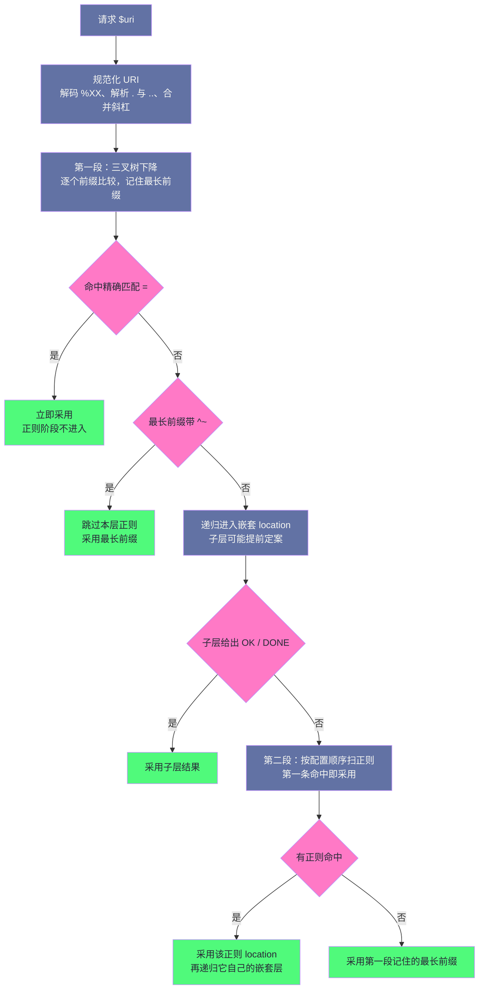
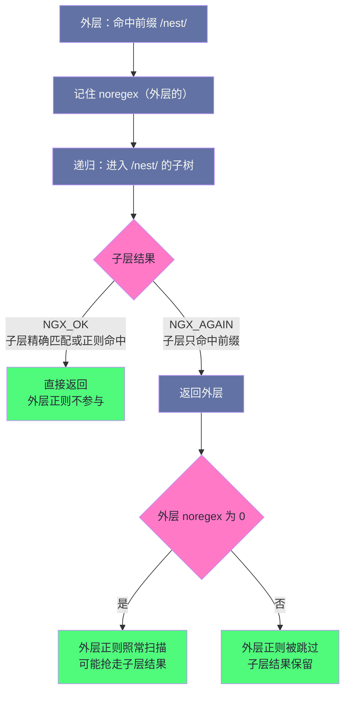
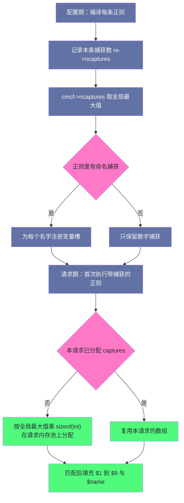
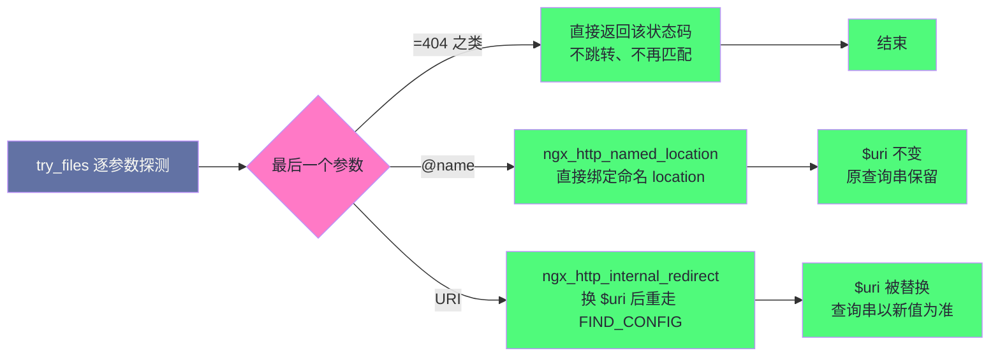
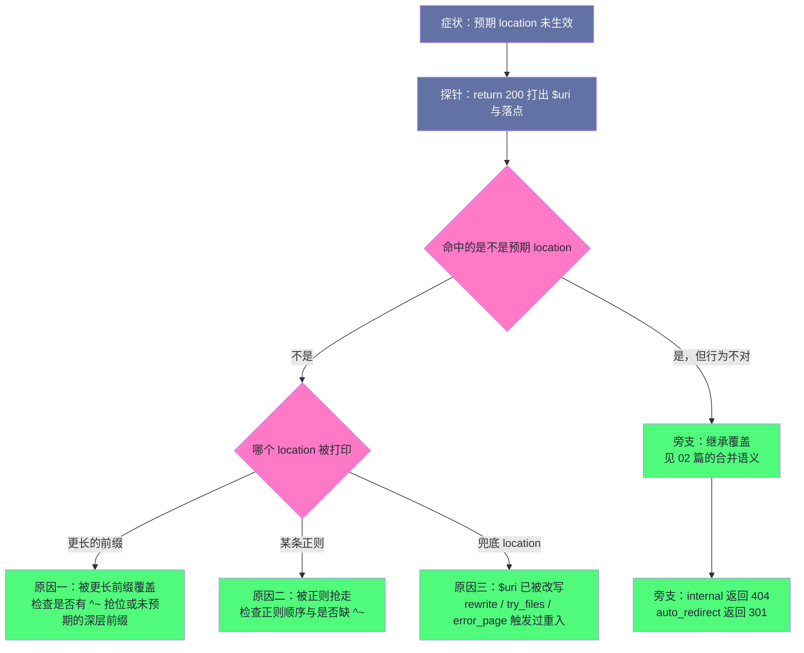

# 07 Location 匹配：优先级规则与正则引擎

**摘要：**

`location` 是 Nginx 配置里出现频率最高的块指令，也是被记错次数最多的那一条。大多数人记住的是一张「`=` 最高、`^~` 次之、正则再次、前缀最末」的优先级表，而这层印象从两个方向失真：正则之间的胜负不取决于谁更具体，只取决于谁写在前面；普通前缀虽然被记下来，却随时会被处在后面的正则覆盖。本文先给出五种修饰符的定义与两段式搜索的完整判定路径，再把「最长前缀先被记住、随后被正则否掉」这条机制落到源码里的三叉树与 `NGX_AGAIN` 返回码上；接着单独拆解 `^~` 究竟改变了什么（只改变「本层是否检查正则」这一位，不改变最长前缀的判定），并把嵌套 location 的递归下潜与外层正则的伏击关系用一组可复现的对照实验摆出来。后半程进入正则引擎内部：捕获组为什么会在请求池上分配、全局最大捕获数如何被一条正则抬高、灾难性回溯在本机实测中如何从 2 毫秒涨到 80 毫秒并撞上 PCRE2 的匹配步数上限、`try_files` 的最后一个参数为什么既不是文件检查也不是优先级声明。收尾给出一套可验证的调试手段——`nginx -T`、`error_log debug` 里的 `test location` 与 `using configuration` 两行日志、以及 `return 200` 探针——并解释「匹配到了却没生效」的三类原因与判别顺序。

---

## 第 1 章 一条被记反的规则

先看一段最小配置，两个 location 都能接受 `/api/users` 这个请求：

```nginx
location /api/ { return 200 "prefix"; }
location ~ ^/api/ { return 200 "regex"; }
```

哪一条生效？凭「越具体越优先」的直觉，答案是前缀 `/api/`，因为它的字面量和请求贴得更近；实际答案是正则那条。笔者在 1.27.4 上把这段配置扩成一组——再补一条 `location = /api` 与一条更长的 `location /api/v2/`——实测 `/api/`、`/api/v2/x` 都落在正则上，只有不带尾斜杠的 `/api` 落到了精确匹配。

这类判断上的偏差不是理解力问题，而是信息的年代问题。Nginx 官方文档在 `location` 一节里留了一条平常很少被引用的注记：从 0.7.1 到 0.8.41，如果一个请求命中了不带 `=` 或 `^~` 修饰的前缀 location，搜索就此结束，正则不再检查；0.8.42 之后才改成「先记住最长前缀，再检查正则」。也就是说，「前缀命中即停」这条规则在 2009 年前后是成立的，此后十多年里被一代代博客、面试题和口口相传的配置模板继承了下来，最终变成一种听起来很有道理的错觉。今天照它写配置，绝大多数场景能跑，恰恰是因为多数站点的正则和前缀并不冲突；一旦冲突出现，症状是路由落到了另一个 location，而不是报错。

记反的代价之所以高，在于它极难自证。`nginx -t` 会通过，`nginx -T` 打印出来的文本与你脑子里想的完全一致，请求也不报错，只是缓存头加在了不该加的地方、鉴权绕过了本该拦住的路径、`proxy_pass` 指向了另一个上游。第 8 章会给出把这类偏差变成可观测证据的办法，在那之前，先把规则本身的形状立起来。

本篇只讨论匹配与正则。位置匹配发生在哪一个阶段、阶段链如何组织，见 [[03 HTTP 请求处理管道：11 个阶段全解]]；location 级指令如何从父层合并下来、为什么有时候匹配对了但配置值不对，见 [[02 配置体系解析：指令、上下文与继承规则]]。

关于匹配，需要先固定两个前提。其一，匹配作用在规范化之后的 URI 上，不是原始请求行：`%XX` 形式的编码会被解码，`.` 与 `..` 这类相对路径成分会被解析掉，连续的斜杠会被合并（`merge_slashes` 默认为 `on`）。其二，匹配的输入是 `$uri` 的当前值，而不是 `$request_uri`；只要 URI 被改写过，下一次匹配就针对新值，这条差别在第 8 章会作为「匹配到了却没生效」的第三种原因出现。

> [!info] 本文的实测环境
> 文中标注「实测」的结论，都来自一套可复现的环境：macOS（Apple Silicon）上用 nginx 1.27.4 源码编译，加 `--with-debug`，链接系统 PCRE2，未启用 JIT；路由矩阵、`try_files` 兜底、`error_page` 链分别跑在独立端口上，互不干扰。耗时数字只作量级参考，单机单次测量不足以支撑容量规划。

---

## 第 2 章 五种修饰符与两段式搜索

### 2.1 五种写法

`location` 的语法形式有五种，其中四种是 URI 匹配，一种是命名 location：

| 写法 | 匹配语义 | 命中后是否继续搜索 | 典型用途 |
|---|---|---|---|
| `location = /p` | 精确匹配，URI 必须完全相同 | 立即终止，正则不再检查 | 首页、健康检查、`favicon` 这类高频固定路径 |
| `location ^~ /p/` | 前缀匹配，命中后抑制本层正则 | 本层正则不再检查，但仍可能被更深层的前缀覆盖 | 静态资源目录、需要屏蔽正则的路径段 |
| `location ~ /re/` | 正则匹配，区分大小写 | 按配置顺序继续试下一条正则，命中即用 | 按扩展名、按路径片段的规则 |
| `location ~* /re/` | 正则匹配，不区分大小写 | 同上 | 扩展名、静态文件后缀 |
| `location /p/` | 前缀匹配，无修饰符 | 继续检查正则，全都不中才用它 | 目录级分流、兜底 |
| `location @name` | 命名 location，不参与 URI 路由 | 只有内部重定向能选中它 | 兜底上游、统一错误页 |

这张表只说明单条规则的作用，优先级并不在这张表里排出来。优先级不是一个序，而是一套两段式的流程：第一段只做前缀判定，第二段只做正则判定，两段之间只有一条通道——被记下来的那个最长前缀。

### 2.2 第一段：三叉树与「记住最长前缀」的物理形态

第一段的实现是 `ngx_http_core_find_static_location()`，它在编译期由所有前缀型 location（含 `=` 与 `^~`）建成的一棵三叉查找树上做下降。这棵树的节点带三个指针：`left`、`right` 用于同层比较大小，`tree` 指向「以当前节点为前缀的更深一层」。需要强调，这里没有哈希表的参与；`server_name`、`map`、`types` 才用哈希，URI 前缀匹配走的是逐字符比较加二叉分支。

下降过程可以压缩成一段伪代码，其中的返回码是整个机制的枢纽：

```c
/* src/http/ngx_http_core_module.c，节选自 find_static_location */
rv = NGX_DECLINED;
for ( ;; ) {
    if (node == NULL) { return rv; }              /* 没路了，交回记住的那个前缀 */

    n = min(len, node->len);
    rc = ngx_filename_cmp(uri, node->name, n);    /* 逐字节比较 */
    if (rc != 0) { node = (rc < 0) ? node->left : node->right; continue; }

    if (len > node->len) {
        if (node->inclusive) {
            r->loc_conf = node->inclusive->loc_conf;  /* 记住：当前最长前缀 */
            rv = NGX_AGAIN;                           /* 但还没定案 */
            node = node->tree; uri += n; len -= n;     /* 继续往深里走 */
            continue;
        }
        node = node->right; continue;
    }

    if (len == node->len) {
        if (node->exact) { r->loc_conf = node->exact->loc_conf; return NGX_OK; }
        r->loc_conf = node->inclusive->loc_conf; return NGX_AGAIN;
    }
    /* len < node->len：可能命中 auto_redirect，返回 NGX_DONE */
}
```

三个返回码的含义值得逐条钉住：

`NGX_OK` 表示精确匹配命中。它在树的叶子上直接返回，调用方拿到它就把搜索结束掉，正则阶段根本不会进入——这是 `=` 之所以「最高」的全部机制，它不是排序后的第一名，而是**唯一能提前退出**的入口。

`NGX_AGAIN` 表示「当前有个前缀匹配，但胜负未定」。每深入到一层更长的前缀，它就把 `r->loc_conf` 覆盖一次，所以「记住最长前缀」并不需要额外变量，`r->loc_conf` 的历史值就是最长前缀；`rv` 只在回溯到无处可走时作为答案返回。

`NGX_DONE` 是 `auto_redirect` 的专属路径：当一个以斜杠结尾的前缀 location 上挂了 `proxy_pass`、`fastcgi_pass`、`grpc_pass` 之类的通行指令，请求该前缀但不带尾斜杠时，Nginx 返回 301 把斜杠补上。这个行为在 1.27.x 上默认开启，实测 `location /user/ { proxy_pass ...; }` 收到 `GET /user` 会返回 301，而同一份配置里若另有一条 `location = /user`，精确匹配会先一步把请求接走，301 不再发生。

### 2.3 第二段：正则数组的线性扫描

第一段返回 `NGX_AGAIN` 之后，控制权交给 `ngx_http_core_find_location()`。它做三件事，顺序非常关键：

```c
/* 同上文件，节选自 find_location，省略与 predicate 相关的分支 */
rc = ngx_http_core_find_static_location(r, pclcf->static_locations);

if (rc == NGX_AGAIN) {
    clcf = ngx_http_get_module_loc_conf(r, ngx_http_core_module);
    noregex = clcf->noregex;        /* 命中前缀的那个 location 是否带 ^~ */

    rc = ngx_http_core_find_location(r);       /* 先递归进嵌套 location */
}

if (rc == NGX_OK || rc == NGX_DONE || rc == NGX_ERROR) { return rc; }

/* 只有 NGX_DECLINED 或嵌套层返回 NGX_AGAIN 才走到这里 */
if (noregex == 0 && pclcf->regex_locations) {
    for (clcfp = pclcf->regex_locations; *clcfp; clcfp++) {
        n = ngx_http_regex_exec(r, (*clcfp)->regex, &r->uri);
        if (n == NGX_OK) {
            r->loc_conf = (*clcfp)->loc_conf;
            rc = ngx_http_core_find_location(r);   /* 再进这条正则的嵌套层 */
            return (rc == NGX_ERROR) ? rc : NGX_OK;
        }
        if (n == NGX_DECLINED) { continue; }
        return NGX_ERROR;
    }
}
return rc;
```

三个细节从代码里直接读得出来。第一，`regex_locations` 是数组，遍历顺序就是配置书写顺序，第一条命中立刻 `return NGX_OK`，没有任何「具体度比较」的步骤。第二，`noregex` 取自 `r->loc_conf` 指向的那个 location，也就是第一段记下的最长前缀，而不是「配置里出现过任何一条 `^~`」；这一点决定了 `^~` 只对「它自己是最长前缀」的情形生效。第三，进入正则之前先递归嵌套，命中正则之后还要再递归一次——嵌套与外层正则的胜负关系就藏在这两次递归的位置里，第 5 章展开。

### 2.4 合起来的判定路径

把两段画成一张图，五种修饰符的优先级就不再是一张需要背的表，而是一条只有四个分叉的路径。



拿一组配置把这张图跑一遍，比记优先级表可靠得多：

```nginx
location = /api          { return 200 "A"; }
location /api/           { return 200 "B"; }
location /api/v2/        { return 200 "C"; }
location ~ ^/api/        { return 200 "D"; }
```

| 请求 | 第一段结果 | 第二段结果 | 最终落点 | 说明 |
|---|---|---|---|---|
| `GET /api` | 精确命中 `= /api` | 不进入 | A | 精确匹配直接终止搜索 |
| `GET /api/` | 最长前缀 `/api/` | 正则 `^/api/` 命中 | D | 前缀被正则否掉 |
| `GET /api/v2/x` | 最长前缀 `/api/v2/` | 正则 `^/api/` 命中 | D | 更长的前缀同样被否掉 |
| `GET /apifoo` | 无前缀命中（`/api/` 不是它的字节前缀） | `^/api/` 也不匹配 | 404，或落到兜底 location | 前缀匹配只认字节，不带尾斜杠的 `/api` 才会命中它 |

最后一行对应一个与匹配无关、但经常被混在一起谈的性质：前缀匹配不做路径分段判断，`location /api` 会命中 `/apifoo`、`/api/v2`、`/apix`。实测 `location /api { ... }` 收到的 `/apifoo` 返回的就是它的响应。要按目录切分，前缀得写成 `/api/`。

---

## 第 3 章 两处最容易记反的地方

### 3.1 正则之间按配置顺序，不按具体度

在正则数组里，胜负只由书写位置决定。下面这段配置的意图很清楚——`/secure/` 下的图片禁止外链，其余图片给长缓存——但写在前的宽泛正则会把后面的具体正则彻底架空：

```nginx
location ~* \.(jpg|png)$ {
    expires 30d;
}
location ~ /secure/.*\.(jpg|png)$ {
    deny all;            # 永远轮不到
}
```

用返回不同内容做标记实测，`GET /secure/x.jpg` 落在前面那条宽泛正则上，后面那条连被求值的机会都没有：正则数组按顺序执行，第一条命中即返回。把两条调换即可。这里的判断标准只有一条——**越具体的正则必须越靠前**——而 Nginx 不会为此给出任何提示，`nginx -t` 通过，配置评审也看不出问题，因为两条单独看都对。

为什么不做「具体度比较」？因为正则之间的包含关系在一般情况下不可判定，即使可判定，代价也远超它带来的收益。前缀匹配可以靠字符串长度定胜负，正则没有这个长度；退一步说，就算实现了某种启发式排序，运维人员也就失去了对结果的完全预期。**顺序即优先级**，它是唯一一个既确定又便宜、还能被人读懂的裁决方式，这与 `iptables` 的规则链、Apache 的 `RewriteRule` 顺序是同一个取向。

### 3.2 最长前缀先被记住，随后被正则覆盖

第二处记反更隐蔽，因为它涉及两个动作的先后。第一段确实找出了最长前缀，也确实把它存进了 `r->loc_conf`；但第二段一旦有正则命中，`r->loc_conf` 就被改写，第一段的成果被整条丢弃。所以「最长前缀」不是最终答案，它只是**正则全不中时的备胎**。

一句常见的话是「Nginx 选最长匹配的 location」。这句话只在没有正则命中时才成立，而绝大多数生产配置里都有正则。第 2 章那张表里 `/api/v2/x` 落到 D 就是反例：`/api/v2/` 比 `/api/` 长，但两者都没赢。

### 3.3 `=` 的特殊之处：它是终止开关

精确匹配胜出的方式与前缀、正则都不同。前缀和正则是「参与竞争并胜出」，`=` 是**让竞争不再发生**。`find_static_location()` 在叶子上返回 `NGX_OK`，调用方看到这个码立即返回，正则循环根本不执行。所以严格讲，`=` 不是优先级最高，而是唯一一个能短路整条流程的分支。

这个区别有实际后果。其一，精确匹配是唯一能保证「不会被执行到别的 location」的写法，凡是要把某个 URI 从正则手里抢回来的场景，`=` 都比 `^~` 更可靠——第 4 章末尾的反例正是 `^~` 抢不回来的情形。其二，精确匹配的 location 里不能再嵌 location，配置期就会报错；前缀与正则 location 可以嵌，但正则父层只能嵌正则（见 5.4）。其三，高频固定路径用 `=` 能少走一次正则数组，收益不大但方向正确：官方文档举的例子是 `/`。

---

## 第 4 章 `^~` 究竟改变了什么

### 4.1 它是一位布尔量，不是一个优先级

`^~` 在配置解析时只做一件事：把该 location 的 `noregex` 置 1。它不参与任何长度比较，不提升自身在树中的位置，也不改变 `rv` 的取值。运行时，`find_location()` 从 `r->loc_conf` 里把 `noregex` 取出来，只在决定「要不要进入正则循环」时用一次：

```c
noregex = clcf->noregex;
...
if (noregex == 0 && pclcf->regex_locations) { /* 才扫正则 */ }
```

所以 `^~` 的语义可以精确地写成一句话：命中它的那个前缀是候选时，本层的正则不必再试。**它管跳过，不管优先**。

### 4.2 它不改变最长前缀的判定

`^~` 最容易出事的地方，是**只对自己生效**——只有它自己成为最长前缀时才有意义。写一条 `^~` 短前缀，再写一条更长的普通前缀，请求落在后者范围内时，`noregex` 取的是后者的（为 0），正则照常检查：

```nginx
location ^~ /static/      { return 200 "E"; }
location /static/deep/    { return 200 "F"; }
location ~ \.png$         { return 200 "G"; }
```

| 请求 | 最长前缀 | `noregex` | 正则是否检查 | 实测落点 |
|---|---|---|---|---|
| `/static/logo.png` | `/static/`（带 `^~`） | 1 | 不检查 | E |
| `/static/deep/logo.png` | `/static/deep/`（普通） | 0 | 检查，`\.png$` 命中 | G |

第二行是很多人没有预料到的结果：`^~ /static/` 在目录树的语义上「覆盖」了整个 `/static/`，但在匹配算法里它只是 `r->loc_conf` 的一个历史值，被更长的 `/static/deep/` 顶掉之后，它的 `noregex` 也一起失效。想让深层目录同样不检查正则，只能把 `^~` 写在 `location /static/deep/` 上，或者把 `^~` 改成 `=` 精确匹配。

### 4.3 与 `~` 的对照

把同一段意图写成两种版本，差别就只有一位 `^~`：

```nginx
# 版本一：没有 ^~
location /img/   { return 200 "plain"; }
location ~ \.png$ { return 200 "regex"; }

# 版本二：加 ^~
location ^~ /img/ { return 200 "caret"; }
location ~ \.png$ { return 200 "regex"; }
```

| 请求 | 版本一落点 | 版本二落点 |
|---|---|---|
| `/img/a.png` | regex | caret |
| `/img/a.txt` | plain | caret |
| `/img/a/b.png` | regex | caret |

这组对照说明 `^~` 的真实用途：它保护的是一整段目录「不被正则的横切规则碰到」，而不是「让这段目录更靠前」。静态资源目录之所以典型，是因为横切正则往往按扩展名写（`.png`、`.css`、`.js`），而运维希望这个目录的缓存策略只由 `expires` 决定，不接受扩展名正则的插入。

### 4.4 只在自己的层生效

`^~` 的 `noregex` 是绑在「当前这一层的 `r->loc_conf`」上的。第 2 章那段代码里，递归进嵌套之前先把它存进局部变量 `noregex`，返回之后用这个局部变量决定本层是否扫正则——也就是说，内层的 `^~` 只影响内层，外层的 `^~` 只影响外层。第 5 章会看到，一个嵌在普通前缀里的 `^~` 子 location，即使它自己命中了，也会被外层的正则抢走，原因就在这里。

### 4.5 一个把 `^~` 当优先级用的反例

现场常见的一种写法，是把敏感目录交给 `^~` 保护，然后在文件末尾补一条兜底正则：

```nginx
location ^~ /download/ { internal; }
location ~ \.(zip|tar|gz)$ { }
```

若 `location /download/` 之下还有更长前缀（比如 `/download/temp/`），或者存在 `/download` 之外的同后缀路径，`^~` 都救不了。真正需要「任何情况下都不被正则碰到」的 URI，用 `=`；需要「整段目录屏蔽正则」的，用 `^~` 并且不要再往下切更细的前缀；两者混用时，先跑一遍第 8 章的 debug 日志，比在评审会上争论有效。

---

## 第 5 章 嵌套：递归下潜与外层正则的伏击

### 5.1 一棵树里的子树

Nginx 允许在一个前缀 location 内部再写 location，嵌套层会被编译成「当前 location 自己的一棵三叉树」。这一点在 debug 日志里有个很好的指纹：顶层树的节点名是相对父节点裁剪后的剩余片段，而进入子 location 的树之后，节点名又回到完整路径。

```text
2026/11/20 22:12:02 [debug] *1 test location: "/"
2026/11/20 22:12:02 [debug] *1 test location: "static/"
2026/11/20 22:12:02 [debug] *1 test location: "nest/"
2026/11/20 22:12:02 [debug] *1 test location: "/nest/inner/"
```

三段日志对应一句话：顶层树比较 `/`、`static/`、`nest/` 这些片段；下潜到 `/nest/` 的子树后，节点名变成 `"/nest/inner/"`，因为每棵子树都从完整路径的第 0 个字节重新建起。

### 5.2 递归的两个位置决定了嵌套的胜负

回到 2.3 节的代码：递归出现在两个地方，一次在正则之前（进入最长前缀的子层），一次在正则命中之后（进入该正则的子层）。而它们之间横着一句 `if (rc == NGX_OK || rc == NGX_DONE || rc == NGX_ERROR) return rc;`。

这句话是嵌套行为的全部解释：子层的搜索结果**只有 OK 与 DONE 才短路**整条递归——也就是精确匹配命中、正则命中、自动跳转这三种情形；如果子层只给出 `NGX_AGAIN`（只是命中了一个前缀），控制权会一路返回到最外层，让外层的正则继续参与竞争。



### 5.3 一组可复现的对照

把同一个父 location 与三个子 location 放在两个 server 里，一个带外层正则，一个不带，结果差异就摊开了。配置摘录（两个 server 除最后那条正则外完全相同）：

```nginx
# A 服：外层有正则
location /p/ {
    return 200 "A_outer_prefix";
    location = /p/exact   { return 200 "A_nested_exact"; }
    location ^~ /p/caret/ { return 200 "A_nested_caret"; }
    location ~ \.png$     { return 200 "A_nested_regex"; }
}
location ~ ^/p/ { return 200 "A_outer_regex"; }

# B 服：与 A 相同，去掉外层那条正则
```

| 请求 | A 服（有外层正则） | B 服（无外层正则） | 判据 |
|---|---|---|---|
| `/p/x` | `A_outer_regex` | `B_outer_prefix` | 外层正则可以完全压过外层前缀 |
| `/p/exact` | `A_nested_exact` | `B_nested_exact` | 子层精确匹配返回 `NGX_OK`，短路 |
| `/p/caret/a.png` | `A_outer_regex` | `B_nested_caret` | 子层 `^~` 只给出 `NGX_AGAIN`，输给外层正则 |
| `/p/a.png` | `A_nested_regex` | `B_nested_regex` | 子层正则命中返回 `NGX_OK`，反而赢过外层正则 |
| `/p/exact.png` | `A_nested_regex` | `B_nested_regex` | 子层精确匹配不中，正则接管 |

第三行是这组实验的重点：子层的 `^~` 并不构成对外层正则的豁免，因为 `^~` 只是子层自己的 `noregex`，而外层扫正则时看的是外层那个 `noregex`。把父 location 也改成 `location ^~ /p/`，第三行立刻变为 `A_nested_caret`——外层 `noregex` 为 1，外层正则被跳过，子层结果才保得住。这与第 4 章的结论是同一条规则，只是发生在两层上。

> [!warning] 嵌套里的直觉失效
> 「外层先匹配，再在子层里挑一个」这个说法是错的。实际顺序是「先下潜到最深处，再逐层返回时补上各层的正则」；而只要某一层给出 `NGX_OK`，整条递归立刻结束。配置评审时按这个顺序推一遍，嵌套的落点才推得准。

### 5.4 配置期就能拦住的写法

嵌套不是随便写的，解析阶段有一组硬约束，违反时 `nginx -t` 会直接失败。下面这些信息来自 1.27.4 实测，错误文本与真实输出一致：

| 写法 | 实测报错（摘要） | 原因 |
|---|---|---|
| 在 `location = /a` 内嵌 `location /a/b` | `location "/a/b" cannot be inside the exact location "/a"` | 精确匹配不允许有子层 |
| 在 `location @n` 内嵌 `location /a` | `location "/a" cannot be inside the named location "@n"` | 命名 location 不允许有子层 |
| 在 `location /a` 内嵌 `location @n` | `named location "@n" can be on the server level only` | 命名 location 只能在 server 层 |
| 在 `location /a/` 内嵌 `location /b/` | `location "/b/" is outside location "/a/"` | 子层名字必须以父层名字为前缀 |
| 在 `location ~ ^/a` 内嵌 `location /a/b` | `location "/a/b" is outside location "^/a"` | 正则父层下只能嵌正则，不能嵌普通前缀 |
| 两条同名 `location /a/` | `duplicate location "/a/"` | 同名 location 重复定义 |

表里第五行那条规则有个容易误解的细节：正则 location 内部并不是绝对不能嵌套。1.27.4 上 `location ~ ^/r/ { location ~ \.png$ { ... } }` 能通过 `nginx -t`，实测 `GET /r/a.png` 命中的正是内层那条正则，`GET /r/x` 才落到外层。真正被禁止的是「正则父层 + 普通前缀子层」，因为后缀校验拿子层名字去和父层的正则字符串比前缀，几乎必然不匹配。这类能用但与直觉相反的写法，本篇的建议是不要用：它没有可读性收益，却会在迁移版本或改用别的边缘网关时变成迁移成本。

### 5.5 什么时候值得嵌套

嵌套的价值有两个真实来源。其一是「例外套在通则里」：一个前缀接管整段流量，其中几个固定子路径要单独处理，把例外写成子层，比在外面写一堆更长的前缀更容易读。其二是「先用前缀缩小范围，再在子层用正则」，这样外层正则数组的条数可以变少，请求在大多数情况下不必线性扫一遍长数组。

代价也有两个。其一是语义复杂度：按 5.3 的结论，子层的保护力度取决于父层有没有 `^~`，这层耦合很难靠读配置看出来。其二是可迁移性：`map`、`return`、`try_files` 这类表达在同一层级就能写完的规则，嵌套进去只增加了「外层正则伏击」的可能性。判断标准可以很直接——如果一个嵌套块需要三行注释才能讲清它的落点，那它应该被拆成两个同级 location，或者交给 `map` 与 OpenResty。

---

## 第 6 章 正则引擎：PCRE2、捕获与回溯

### 6.1 编译期与请求期的分界

Nginx 的正则 location 在配置加载时编译，编译结果是 PCRE2 的内部表示，随配置常驻；请求期的每次匹配只是执行，不含编译。编译期的错误会直接让 `nginx -t` 失败，例如括号不配对、重复的命名捕获，错误信息里会带上出错的 pattern。

版本口径需要交代清楚。Nginx 从 1.21.5 起默认用 PCRE2 构建；`pcre_jit` 指令早在 1.1.12 就有，但它要求构建时链接的 PCRE/PCRE2 带 JIT 支持，否则该指令不产生效果。JIT 把匹配编译成机器码，对「带量词、要回溯」的正则收益最大，对 `~* \.(css|js)$` 这种线性扫描收益有限。是否开启要看构建方式，`nginx -V` 里没有 `--with-pcre-jit` 时，写在配置里的 `pcre_jit on` 不会报错但也不会生效，这一点在排查「开了 JIT 却没变快」时值得先确认。

### 6.2 捕获组：一条正则抬高全局的水位

捕获组的开销不在匹配本身，而在内存分配。`ngx_http_regex_compile()` 在配置期做两件事：把本条正则的捕获数记进 `re->ncaptures`，并用 `cmcf->ncaptures = ngx_max(cmcf->ncaptures, re->ncaptures)` 抬高一个**全局最大值**；如果正则里有命名捕获，还会为每个名字注册一个变量槽。

请求期第一次执行任何带捕获的正则时，`ngx_http_regex_exec()` 才按这个全局最大值分配数组：

```c
/* src/http/ngx_http_variables.c，节选自 ngx_http_regex_exec */
if (re->ncaptures) {
    len = cmcf->ncaptures;                       /* 全局最大，不是本条正则的捕获数 */
    if (r->captures == NULL || r->realloc_captures) {
        r->captures = ngx_palloc(r->pool, len * sizeof(int));
    }
} else {
    len = 0;
}
rc = ngx_regex_exec(re->regex, s, r->captures, len);
```

这里有两个反直觉的后果。第一，只要配置里存在一条带 9 个捕获组的正则，所有「执行到带捕获的正则」的请求都会按 9 组的水位分配，哪怕命中它的那条正则只有 1 个组。第二，数组挂在请求内存池上，随请求释放，所以它不会泄漏，但会在每个请求的生命周期里多占一段内存；捕获数越多、QPS 越高，这段常驻内存的峰值越明显。水位还要再乘一个余量：`http` 块初始化时 `cmcf->ncaptures` 会被放大成 `(n + 1) * 3`，这是 `ngx_http_core_init_main_conf()` 收尾处的动作。原因在 PCRE2 的 ovector 按「对」计，一份 ovector 用两个 `int` 存起止偏移，Nginx 按三倍留余量。落到数字上，最大捕获数为 9 的配置让每个请求分配 30 个 `int`、约 120 字节；最大捕获数为 2 时是 9 个 `int`、约 36 字节。十万并发连接下前者是十几 MB 量级（示例推算，按 `sizeof(int)` 为 4 计算，实际要看同时活跃的请求数而非连接数）。

命名捕获还有额外成本。`(?<name>\d+)` 这类写法在配置期会给名字注册一个变量索引，即使用户从不引用 `$name`，变量槽也在那里；写得多，变量表就长，`ngx_http_variables_init_vars()` 阶段要做的工作也更多。是否引用并不会改变「注册」这件事，这一点与普通 `$1`、`$2` 不同——数字捕获只在正则真的执行时才有值。

分配路径串起来看是这样的：



数字捕获的生命周期还有一个容易忽略的性质：`r->captures_data` 指向最近一次匹配的字符串，正则再执行一次，`$1` 就指向新的匹配。重入之后 `$uri` 可能已经被换成新值，捕获值跟着指向新缓冲区，而 rewrite 脚本里早先 `set` 出来的变量仍然保留旧值。同一次请求里既用 `$1` 又发生内部跳转时，「变量取到了奇怪的内容」往往就源于这个指向关系。

实测一段带命名捕获的配置：

```nginx
location ~ ^/cap/v(?<ver>\d+)/(?<name>[a-z0-9_-]+)$ {
    return 200 "ver=$ver name=$name one=$1";
}
```

`GET /cap/v3/hello` 返回 `ver=3 name=hello one=3`。注意 `one=3`：`$1` 是第一个捕获组，也就是 `\d+` 那一段，不是整条路径。捕获值指向的是最近一次执行的正则所匹配的字符串，如果同一次请求里后面又有别的正则命中，`$1` 会被新的匹配覆盖；这一点在 rewrite 链路里经常变成「变量怎么变成另一个值了」的来源。

### 6.3 灾难性回溯：从 2 毫秒到 80 毫秒

嵌套量词是唯一一类能让一条正则从微秒级跳到毫秒级的写法。典型模式 `^(a+)+$` 对 `aaaa...ab` 这种输入，需要枚举所有分组方式才能确认不匹配，回溯次数随 `a` 的个数指数增长。

在一台 Apple Silicon 的 macOS 上，用 1.27.4 源码编译（`--with-debug`，链接系统 PCRE2，未开 JIT）实测，请求 `/redos/` 加上 `n` 个 `a` 再加一个 `b`：

| `a` 的个数 | 实测耗时 | 状态码 | 现象 |
|---|---|---|---|
| 16 | 2.2 ms | 200 | 正常返回 |
| 18 | 8.5 ms | 200 | 正常返回 |
| 20 | 21.2 ms | 200 | 正常返回 |
| 21 | 42.5 ms | 200 | 接近上限 |
| 22 | 82.6 ms | 500 | 撞上限，`-47` |
| 23 | 79.2 ms | 500 | 撞上限，`-47` |

两次运行的绝对值有十几毫秒的浮动，但形状稳定：`n` 每加 2，耗时约乘 4，这是教科书式的指数曲线。到 `n = 22` 曲线突然压平，因为撞上了 PCRE2 的**匹配步数上限**（默认一千万步量级，以所链接的 PCRE2 版本为准），`pcre2_match()` 返回 `-47`，Nginx 把它当成匹配错误，请求以 500 结束，并写一条 alert 日志：

```text
2026/11/20 22:12:02 [alert] 9204#0: *10 pcre2_match() failed: -47 on
"/redos/aaaaaaaaaaaaaaaaaaaaaab" using "^/redos/(a+)+$",
client: 127.0.0.1, server: , request: "GET /redos/aaaaaaaaaaaaaaaaaaaaaab HTTP/1.1"
```

这段日志把三件事固定下来。其一，灾难性回溯在 PCRE2 下不会让 worker 永久卡死，它有上限，代价被约束在「一次请求几十毫秒」这个量级；其二，代价并不因此可接受——单核每秒能接住的这类请求只有十来个，一条构造好的 URI 就足以把接入层打满，而正常的 `a^200` 输入反而是微秒级，攻击者只需要反复请求同一路径；其三，日志里留下了 `pcre2_match() failed: -47` 这个确凿指纹，配 `limit_req` 值班时可以直接据此做告警规则（限流见 [[08 限流与熔断：leaky bucket 与 burst 参数的数学本质]]）。

防范手段按有效性排序：不要写嵌套量词；在可能的地方用字符类固化长度（`[a-z]{1,32}` 优于 `[a-z]+`）；把「形状判断」前移到前缀 location，让绝大多数请求根本不进这条正则；对确实无法回避的外部输入，用 `$uri` 长度先做一次拦截，或者把这段判断搬到 OpenResty 里用 `ngx.re` 并显式传入 `match_limit`（Lua API 暴露了该参数，配置指令没有）。

### 6.4 正则条数与匹配耗时

另一种常被高估的代价是「正则太多会拖慢匹配」。实测在同一台机器上，用一条 `location /` 兜底加 N 条互不命中的 `location ~ ^/r<i>/`，请求一个都匹配不上的 URI，走 keep-alive 顺序发 3000 次取中位数：

| 正则条数 | 中位耗时 | p99 | 增量 |
|---|---|---|---|
| 1 | 49.6 µs | 89.0 µs | 基准 |
| 100 | 57.5 µs | 69.3 µs | +8 µs |
| 1000 | 86.7 µs | 117.6 µs | +37 µs |

这些数字包含 HTTP 往返与 epoll 唤醒的固定开销，真正属于正则求值的增量约每条约 35 纳秒（量级判断：模式都是以固定前缀开头、首字符即失败，几乎不回溯）。也就是说，一千条正则的线性扫描加起来，还不到一次灾难性回溯的千分之一。由此得到的取舍很清楚：**控制形状，而不是数量**。真正因为数量而变慢的地方在别处——配置加载。5000 条正则 location 时，`nginx -t` 实测约 10 毫秒级，对 `reload` 的影响远小于证书加载、共享内存重建这些大头。

> [!info] 量级的参照
> 微秒级的匹配开销、毫秒级的单条坏正则、秒级的配置错误，三者相差三到六个数量级。排障时先判断落在哪个量级，比逐行读配置更快锁定方向。

### 6.5 写正则时能提前规避的四件事

第一件是锚定位置。`~ \.php$` 依赖结尾锚点，`~ /admin/` 依赖路径片段，两者都没有问题；有问题的是既不加锚点又用宽泛通配的写法，比如 `~ .*\.php.*`，它会在任何位置的任何字符上回溯。把锚点写全，回溯的空间就被压缩掉大半。

第二件是用字符类替代通配。`[a-z0-9]{1,32}` 的比较代价与长度成正比且没有分支，`.*` 加后续条件则要枚举所有切分点。URI 是用户完全可控的输入，它的长度上限由请求行缓冲决定（默认 8k 量级，以版本为准），这个上限决定了最坏情况的下界，而回溯让它变成上界的指数。

第三件是让前缀先筛一遍。把「必须命中才进入正则」的条件尽量表达成前缀 location，正则数组里只剩真正需要模式匹配的规则，等于用一次三叉树下降把绝大多数请求挡在正则之外。

第四件是捕获的克制。只在确实要取值的正则里用捕获，能用数字捕获就不要用命名捕获，能用一个组就不要写五个。捕获数的水位是全局的，一条贪心的正则会让所有走捕获路径的请求一起付账。

---

## 第 7 章 `try_files`、命名 location 与内部重定向

### 7.1 `try_files` 在哪个阶段

`try_files` 由 `ngx_http_try_files_module` 实现，注册在 PRECONTENT 阶段。这个位置决定了两件事：它先于内容处理器执行，所以 `location` 里同时写了 `proxy_pass` 与 `try_files` 时，判断先发生在 `try_files` 一侧；同时它排在 ACCESS 之后，鉴权早已跑完，把「某个文件是否存在」暴露给未授权请求的可能性要单独考虑。

处理逻辑按参数顺序逐个探测：对每个中间参数，它把 `root` 或 `alias` 拼成文件系统路径，用 `open_file_cache` 的 `test_only` 方式探测存在性（末尾带斜杠的参数探测的是目录）。最后一个参数**不做存在性探测**，它只被当作「前面都失败之后的去处」，而它的形态决定了后续走哪条路：

```c
/* src/http/modules/ngx_http_try_files_module.c，节选自 handler 末尾 */
if (tf->lengths == NULL && tf->name.len == 0) {   /* 最后一个参数 */
    if (tf->code) { return tf->code; }            /* 形如 =404 */
    path.len -= root; path.data += root;
    if (path.data[0] == '@') {
        (void) ngx_http_named_location(r, &path); /* 命名 location */
    } else {
        ngx_http_split_args(r, &path, &args);
        (void) ngx_http_internal_redirect(r, &path, &args);  /* URI 内部重定向 */
    }
    ngx_http_finalize_request(r, NGX_DONE);
    return NGX_DONE;
}
```

三种形态对应三条完全不同的路径：



### 7.2 三条出路的实测差别

同一份配置里把三种兜底都摆上，请求结果的差异比读源码更直观：

```nginx
location /tf/     { try_files $uri @fb; }
location @fb      { return 200 "FB uri=$uri args=$args is_args=$is_args"; }

location /tf2/    { try_files $uri /fb2; }
location = /fb2   { return 200 "FB2 uri=$uri args=$args"; }

location /tfnamed/ { try_files /nope @backend; }
location @backend  { return 200 "named backend"; }

location /tfbad/   { try_files /nope @nosuch; }
location /tffile/  { try_files /nope /var/tmp/nonexistent.html; }
```

| 请求 | 状态 | 落点与响应 | 原因 |
|---|---|---|---|
| `GET /tf/x?q=1` | 200 | `FB uri=/tf/x args=q=1 is_args=?` | 命名 location 不改 `$uri`，原查询串保留 |
| `GET /tf2/x?q=2` | 200 | `FB2 uri=/fb2 args=` | URI 兜底替换了 `$uri`，原查询串丢失 |
| `GET /tfnamed/` | 200 | `named backend` | 命名 location 正常接管 |
| `GET /tfbad/` | 500 | 默认 500 页，日志 `could not find named location "@nosuch"` | 命名 location 不存在 |
| `GET /tffile/` | 200 | 兜底 location 的响应，`$uri` 已变成 `/var/tmp/nonexistent.html` | 文件路径被当成 URI 内部重定向 |

第二行值得单独看一眼：`try_files $uri /fb2` 这类写法在 URI 兜底时**会丢掉查询串**。源码里的 `ngx_http_split_args()` 只在兜底字符串自身含 `?` 时才有参数，随后 `ngx_http_internal_redirect()` 用这个结果覆盖 `r->args`，原请求的查询串就没了。需要保留参数时，兜底写成 `@name`，或者在兜底 URI 里显式带上 `$args`（注意这样会与已有参数拼接，得自行判断 `?` 与 `&`）。

最后一行是现场最常见的误解之一。把兜底参数写成一个文件系统路径，看上去像「文件不存在就用这个文件」，实际它被切掉 `root` 前缀后当成 URI 去做内部重定向，于是请求进入第二轮 FIND_CONFIG，用一个奇怪的新 URI 重新匹配一遍。本例里它落到了兜底 location 返回 200，日志里 $uri 变成 `/var/tmp/nonexistent.html`；在真实站点里，这个新 URI 通常会 404，或者被另一个 proxy location 接走，表现为「页面内容莫名其妙」。把「文件路径当兜底」和本章的表格对着看，就能理解为什么它既不检查文件、也不报错。

至于那个流传很广的说法——「`try_files` 最后一个参数写成文件路径会导致 500」——实测在 1.27.4 上并不成立，得到的是内部重定向后的结果（本例 200，典型配置下 404）。真正的 500 来自命名 location 找不到，也就是第 4 行那样，日志里留下一行 `could not find named location`。把两种症状分清楚，排障时能少走一圈。

### 7.3 命名 location 的边界

`location @name` 不进入任何三叉树，它被放在 server 级的命名 location 数组里，只能由内部重定向按名字查找。这带来三条硬边界：

它不能接收客户端请求。客户端发来 `GET /@backend`，这个字符串只是一个普通 URI 路径，会在三叉树里匹配前缀与正则，与命名 location 无关。实测在一个没有兜底 location 的 server 里请求 `/@n`，返回 404。

它不能嵌套，也不能包含嵌套。解析阶段就会报 `named location "@n" can be on the server level only` 或 `cannot be inside the named location`。

`internal` 指令写在命名 location 上等于没写，因为它本来就不对外。实测 `location @n { internal; ... }` 能通过 `nginx -t`，通过 `try_files` 跳进去也正常工作，外部访问得到的 404 与 `internal` 无关——它根本没被匹配到。`internal` 的真实用途是挂在普通的 URI location 上，配合 `X-Accel-Redirect` 做受保护下载：上游验证权限后返回 `X-Accel-Redirect: /secure/file.pdf`，Nginx 对 `/secure/` 发起内部跳转，外部直接访问该路径则在 FIND_CONFIG 阶段被 404 挡住。实测外部请求 `GET /sec/file` 返回 404，而 `error_page 404 /sec/nf` 触发的内部请求能正常进入。

还有一点容易忽略：命名 location 跳转**不修改 `$uri`**。7.2 的表格第一行已经给出了证据——`/tf/x` 进了 `@fb` 之后，`$uri` 仍是 `/tf/x`。所以在 `@name` 里写 `root`、`try_files` 或 `proxy_pass`，路径是基于原 URI 的，不是基于那个触发跳转的名字。

### 7.4 `error_page` 不递归，也不链式

「`error_page` 指向一个不存在的页面会无限递归」是另一个流传很广的说法。实测 1.27.4：配置 `error_page 404 /step1` 且 `/step1` 返回 500，再配 `error_page 500 /step2`，请求一个 404 路径得到的是 500 默认页，`/step2` 并未被触发。

| 配置 | 请求 | 实测结果 |
|---|---|---|
| `error_page 404 /step1`，`/step1` 返回 500，另有 `error_page 500 /step2` | `/gone` | 500 默认页，`/step2` 未生效 |
| `error_page 404 =200 /ok`，`/ok` 返回 200 | `/r404` | 200，正文来自 `/ok` |
| `error_page 404 /missing-too`，`/missing-too` 也 404 | `/loop/x` | 404，无循环、无 cycle 日志 |

结论是：`error_page` 的内部跳转只发生一次，由它产生的响应不再套用错误页，所以不存在「错误页自己 404 又触发错误页」的递归链；`=200` 这类写法才会改变状态码，不写则保留原始状态码、只替换正文。这与 `rewrite ... last` 那种「每轮都可能再触发」的行为不同，也解释了为什么 `error_page` 与 `try_files`、`X-Accel-Redirect` 共享同一个 `uri_changes` 预算却很少真的耗尽——它们不是自我循环的。

`uri_changes` 的预算与三种重入路径的细节，在 [[03 HTTP 请求处理管道：11 个阶段全解]] 里已经拆开：初值 11、上限 10 次，耗尽时以 500 结束并留下 `rewrite or internal redirection cycle` 这一类日志。与本章衔接的部分只有一句需要记住：`try_files` 的 URI 兜底与 `error_page` 都属于**改 `$uri` 再重入**，所以匹配会再发生一次，而 `@name` 跳转不会。

---

## 第 8 章 让匹配过程可见

### 8.1 三件工具

第一种是 `nginx -T`。它把主配置与所有 `include` 进来的文件按加载顺序完整打印出来，每段前面带 `# configuration file ...` 的注释。判断「我改的那行到底有没有被加载」只有这一个可靠办法：`-t` 只说语法与语义校验通过，不告诉你生效的是哪一个文件。片段被两处 `include` 时，`-T` 里会打印两次，位置一目了然。

第二种是 `error_log ... debug`。它要求 Nginx 构建时带 `--with-debug`，官方发行版通常提供 `nginx-debug` 二进制；用不带调试支持的二进制配上 `debug` 级别，日志里只会出现一行 `nginx was built without debug support`，不会给出任何匹配细节。开启之后，每次请求都会打印它走过的三叉树节点、尝试过的每一条正则，以及最终的裁决结果。开启方式是全局 `error_log /var/log/nginx/error.log debug;`，也可以在某段配置里单独写一行把范围收窄；完整的日志治理方案见 [[09 日志体系与可观测性：access_log、error_log 与链路追踪]]。

第三种是探针。在怀疑的 location 里写 `return 200 "hit $uri";`，或者 `add_header X-Loc $uri always;`，用一次请求直接看落点。它比 debug 日志便宜得多，也没有全局开启 debug 的副作用，适合在不能重启的生产环境里做最小验证（reload 即可生效）。

### 8.2 读一段真实的 debug 日志

下面这段来自 1.27.4 实测，请求是 `GET /static/deep/x.png`；配置是一个包含第 4 章那三条在内的路由矩阵，所以日志里还能看到别的正则被尝试。为了可读性，只保留了日志正文与连接编号：

```text
[debug] *3 test location: "/"
[debug] *3 test location: "static/"
[debug] *3 test location: "deep/"
[debug] *3 test location: ~ "^/api/"
[debug] *3 test location: ~ "\.png$"
[debug] *3 using configuration "\.png$"
```

六行日志可以读成三句话。前三行是三叉树的下降路径：根节点 `/`，然后是比较 `static/` 片段，再往下比较 `deep/` 片段——注意它们都是相对名字，不带前导斜杠。后两行是正则数组：`test location: ~ "..."` 里的 `~` 是固定前缀，表示「这是一条正则」，方括号里是模式原文。最后一行 `using configuration "..."` 是**裁决书**：真正绑定的 location。正则 location 在这一行里只打印模式原文，不带任何修饰；精确匹配会打印成 `=/path`（等号紧贴名字，实测输出即 `using configuration "=/gone"`）；带 `*` 前缀的则是 `if` 或 `limit_except` 生成的隐式 location，这类 location 没有配置里的名字，与命名 location 不是一回事。

再看另一个请求 `GET /nest/inner/x` 的日志，它对应第 5 章对照表里第三行那种情形：

```text
[debug] *5 test location: "/"
[debug] *5 test location: "static/"
[debug] *5 test location: "nest/"
[debug] *5 test location: "/nest/inner/"
[debug] *5 test location: ~ "^/api/"
[debug] *5 test location: ~ "\.png$"
[debug] *5 test location: ~ "^/nest/"
[debug] *5 using configuration "^/nest/"
```

这七行把第 5 章的结论原样复现了一遍：树下降进入了 `/nest/` 的子树并命中 `/nest/inner/`，但由于子层只给出 `NGX_AGAIN`，外层又试了三条正则，最后 `^/nest/` 那条把它抢走。日志本身不解释原因，但「子树命中之后仍然出现外层正则的 test 行」这个形态，就是嵌套被外层正则伏击的指纹。

命名 location 的日志长这样，请求 `GET /n/`：

```text
[debug] *7 using configuration "/n/"
[debug] *7 test location: "@n1"
[debug] *7 using location: @n1 "/n/?"
```

第一行是 FIND_CONFIG 的结果；后两行来自 `try_files` 的兜底：`test location: "@n1"` 是命名 location 数组里的逐个比对，`using location:` 才是命中。注意这里打的是 `using location`，不是 `using configuration`，而且后面还补了 `"$uri?$args"`——这正是「命名跳转不改 `$uri`」的日志证据。

### 8.3 日志的三处盲区

第一处：看不出 `~` 与 `~*`。日志里所有正则都以 `~` 前缀打印，大小写标志不在其中。要确认某条正则是否区分大小写，只能回看配置，或者用大小写不同的两个 URI 各打一次。

第二处：看不到「记住的前缀」。树下降只打印节点名，不打印 `NGX_AGAIN` 的记账。某条前缀到底有没有成为候选，只能从「子树 test 行出现之后、外层正则是否被尝试」来反推。

第三处：只看得到走过的那条分支。三叉树是二分查找加同前缀下潜，与本次请求无关的节点根本不会被访问；正则数组则会一直扫到命中为止，命中之后的条目不会出现在日志里。所以「日志里没有我的 location」通常说明的是它不在搜索路径上，而不是它没被加载——确认加载情况要用 `nginx -T`。

### 8.4 「匹配到了但没生效」的三类原因

现场描述的「匹配到了但没生效」，落到机制上只有三条主线，加两条旁支：



第一条，被更长的前缀覆盖。同一段路径上叠了别的前缀，或者 `^~` 写在了较短的层上（第 4 章），都会让预期的那条退到二线。判别方式是看 debug 日志里 `using configuration` 打印的前缀长度。

第二条，被正则抢走。配置里有横切正则（扩展名、`/admin/`、`/api/v\d+/` 之类），而预期 location 是普通前缀。这类问题在日志里的特征是：树下降之后紧跟着若干 `test location: ~` 行，且 `using configuration` 打印的是某个模式。修法是加 `^~`、改用 `=`，或者把正则收窄。

第三条，`$uri` 被改写。`rewrite`、`try_files` 的 URI 兜底、`error_page` 的 URI 重定向都会替换 `$uri`，然后重新跑一次 FIND_CONFIG，此时参与匹配的已经不是客户端最初那条 URI。一个最小例子就够说明：

```nginx
location /rw/      { rewrite ^/rw/(.*)$ /api/$1 last; }
location ~ ^/api/  { return 200 "regex hit, uri=$uri"; }
```

实测 `GET /rw/x` 返回的是正则那条，响应里的 `$uri` 已经变成 `/api/x`，而 access_log 里记下的 `$request_uri` 仍是 `/rw/x`。同一份 debug 日志里会出现两轮 `using configuration`：第一轮打印 `/rw/`，第二轮打印 `^/api/`，两轮之间的分界就是那次 `last`。判别方式是同时打出 `$uri` 与 `$request_uri`：两者不一致，说明中间发生过改写；`try_files` 的兜底丢查询串、命名跳转保留原 URI 这些细节，第 7 章的表格可以直接对照。

两条旁支。其一是 location 选对了、行为不对——那属于指令合并的问题，见 [[02 配置体系解析：指令、上下文与继承规则]]；其二是 location 选对了但状态码不对——`internal` 会让外部请求拿 404，`auto_redirect` 会让缺尾斜杠的请求拿 301，这两种情况在 access_log 里表现为「路由看起来对，但请求被 404/301 截断」。

---

## 第 9 章 反例档案

### 9.1 用正则做本该前缀匹配的事

按扩展名分流是正则的正经用途，但把「目录分流」也写成正则，就会同时损失可读性与可预测性：

```nginx
# 反例
location ~ ^/api/ { proxy_pass http://api; }
location ~ ^/static/ { root /var/www; }

# 正例
location /api/    { proxy_pass http://api; }
location ^~ /static/ { root /var/www; }
```

反例的问题不在性能，而在「与其他正则竞争」：只要上层还有一条更靠前的宽泛正则（比如按 UA 或按路径片段写的拦截规则），这两条前缀语义的规则就会被迫进入顺序竞争，而且谁赢取决于书写次序。正例把它们放回第一段搜索，语义稳定，`^~` 再补上「不被横切正则打断」这层保护。

### 9.2 把 `^~` 当成优先级声明

最常见的误用，是试图用 `^~` 抢在更长的普通前缀之前。第 4 章的实测已经给出答案：`^~ /static/` 遇到 `/static/deep/` 时，最长前缀是后者，`noregex` 取后者的值，正则照旧执行。要在这种结构里保护整段目录，只能把 `^~` 提到每一个更深的前缀上，或者干脆用 `=` 把关键 URI 逐个钉死。

### 9.3 `try_files` 的两个错误兜底

第一类是兜底命名 location 不存在：`try_files $uri @bakend`（拼写错误）在 1.27.4 上返回 500，日志写 `could not find named location "@bakend"`。第二类是兜底写文件路径：`try_files $uri /var/www/index.html`，实测结果是内部重定向到一个由文件路径拼出来的 URI，`$uri` 变成 `/var/www/index.html`，最终落点取决于兜底 location 怎么处理它。两种错误都不会在 `nginx -t` 阶段暴露，值得在灰度环境用一个不存在的路径打一次。

### 9.4 前缀不带尾斜杠

`location /api` 会命中 `/apifoo`，也会命中 `/api`、`/api/x`；`location /api/` 不会命中 `/api`。前者是字节前缀，后者同样也是字节前缀，但它多了一个斜杠字符，所以 `/api` 这个请求根本没有以 `/api/` 开头的字节序列。两个方向都会出事：想拦 `/api/` 下的越权路径，写成 `/api` 会漏掉 `/apifoo`；想匹配 `/api` 本身，写成 `/api/` 会漏掉不带斜杠的请求。需要「恰好这个路径」时用 `=`，需要「这个目录下」时带斜杠，两者都想要就写两条。

还有一个容易忽略的连带效应：关掉 `merge_slashes` 之后，`/api//x` 会以原样进入匹配，`$uri` 保留双斜杠（实测 `uri=/api//x`），但它仍然以字节前缀命中 `/api/`——前缀比较发生在字符层面，与路径分段的语义无关。这也是为什么「路径规范化」这类事应该交给 Nginx 的默认行为，而不是靠 location 去容错。

### 9.5 在 macOS 上开发、在 Linux 上生产

Nginx 对「文件名大小写敏感」的判定来自编译期与运行平台。在大小写不敏感的文件系统上（macOS、Cygwin），前缀匹配与精确匹配都忽略大小写，比较范围限于单字节 locale。实测在 macOS 上：

| 请求 | 配置 | 实测结果 |
|---|---|---|
| `/casesens/x` | `location /CaseSens/` | 命中 |
| `/ADMIN` | `location = /admin` | 命中 |

同一份配置搬到 Linux，两行都会变成不命中。这不是 Nginx 的歧义，而是平台语义差异；它制造的典型事故是「本地全绿、上线 404」。把路径的大小写当成契约的一部分，在本地就用全小写，能省掉一轮排查。

### 9.6 静态目录与横切正则的缓存头之争

静态资源目录希望由 `expires` 统一控制缓存，横切正则又按扩展名补 `Cache-Control`，两者同时存在时，正则若写在前就会覆盖目录策略。第 4 章的对照表已经说明 `^~` 是解决办法，但要注意 `^~` 不能覆盖更深的前缀（4.2 的反例）。当目录结构本身很深时，更稳的做法是把静态目录单独拆一个 `server` 块或单独一段 `include`，让它在配置上就没有正则竞争者。

### 9.7 正则结尾锚定的是路径，不是请求行

`~ \.php$` 这类写法对「带参数的 PHP 请求」是否成立，取决于匹配的输入到底是什么。实测 1.27.4：

| 请求 | `~ \.php$` | 说明 |
|---|---|---|
| `/a.php` | 命中 | 直接匹配 |
| `/a.php?x=1` | 命中 | 匹配输入是 `$uri`，不含查询串 |
| `/a.php/extra` | 不命中 | 结尾不是 `.php`，落到兜底 location |

第二行说明 `$` 锚定的是路径末尾而不是请求行末尾，所以查询串不会影响扩展名匹配——这与多数人的预期一致，但如果把 `$` 用在需要覆盖查询串的场景里就会反向出错。第三行是真正的坑：`PATH_INFO` 形态的 URI 在 `\.php$` 下不命中，需要额外一条 `~ \.php/` 或者改用 `fastcgi_split_path_info`。这类「差一个字符」的规则，只有把匹配输入固定成 `$uri` 这个事实记住，推导才不会走偏。

---

## 第 10 章 规模、代价与边界

把本篇涉及的旋钮放在一张表里，比记规则更接近日常判断：

| 旋钮 | 调大的代价 | 调小的代价 | 适用判断 |
|---|---|---|---|
| 前缀 location 数量 | 三叉树更深，`nginx -t` 与 reload 略慢；命名空间更难维护 | 深层目录被迫用正则表达，进入顺序竞争 | 几百条以内几乎无感，瓶颈通常在别处 |
| 正则 location 数量 | 每条请求多几次线性比较，每条几十纳秒量级 | 横切规则被迫塞进前缀，可读性下降 | 千条以内可接受，重点看排在数组前几位的模式 |
| 捕获组 | 请求池按全局最大值分配，命名捕获还占变量槽 | 无法从 URI 里提取参数，得靠 `map` 或 rewrite | 只在确实要取值时用，且优先数字捕获 |
| `^~` 使用范围 | 越多，越容易掩盖本层正则的意外效果 | 静态目录被横切正则污染 | 只在「整段目录屏蔽正则」这一种意图下使用 |
| 嵌套层数 | 落点取决于各层 `noregex`，心智负担陡增 | 例外处理只能靠更长的前缀表达 | 一层够用，两层要写注释 |
| debug 日志 | 磁盘写入与 CPU 开销上升，高流量下可吃掉可观吞吐 | 没有匹配细节可看 | 用 `debug_connection` 或按 location 收窄，不长期全局开启 |
| `pcre_jit` | 首次匹配有编译成本，内存略增 | 复杂正则更慢 | 构建支持就开，回退时注意它是静默不生效的 |

这张表里没有「性能调优的参数」，因为位置匹配本身几乎没有可调的参数。它的成本是配置规模的函数，而它的风险是语义的函数——第 3 章与第 5 章的那些反直觉行为，代价不体现在 CPU 上，体现在「排查一个路由问题要花多久」。

由此产生的边界判断可以归成三条。其一，当路由规则开始需要「按请求头、按用户、按版本号」组合判断时，`location` 就不是合适的表达层了：`map` 能把判断挪到变量求值里，OpenResty 能在 `access_by_lua_block` 里做真正的编程逻辑（见 [[12 OpenResty 架构：LuaJIT、cosocket 与协程调度]]），APISIX 则把路由变成配置中心里可版本化的对象（见 [[14 APISIX 架构：etcd 配置中心与插件体系]]）。其二，当同一份配置需要在多个团队之间共享时，前缀与正则的混用会成为接口契约的隐患，因为匹配顺序是一种隐式契约。其三，当路由正确性已经无法靠人工评审保证时，应该把「URI 到 location 的映射表」变成测试用例——用 `return 200` 探针跑一组固定 URI，把结果断言下来，比在文档里描述优先级可靠得多。

---

## 结语

`location` 的匹配不是一张优先级表，而是一条**有短路能力的两段式流程**。第一段在三叉树上找出最长前缀并把它记进 `r->loc_conf`，精确匹配在这一段就能终结搜索；第二段按配置顺序扫正则，命中即采用，把第一段的记忆覆盖掉。`^~` 只是一位布尔量，作用是让本层不必扫正则，它既不提升自身位置，也不改变最长前缀的判定，更不能保护比它更深的前缀。嵌套把这条流程变成递归：只有 `NGX_OK` 与 `NGX_DONE` 会短路，纯前缀命中的 `NGX_AGAIN` 会一路返回，把胜负交给外层正则。把这些机制与「最新版本的行为」对齐之后，那些年深日久的说法——前缀命中即停、正则越具体越优先、`^~` 是优先级、`try_files` 末参是文件检查——就都能被一条具体的代码路径或一次可复现的请求否掉。笔者以为，位置匹配最值得记住的不是规则本身，而是它的代价结构：匹配的开销可以忽略，配错的代价要用一次线上事故来付。

---

## 参考资料

1. Nginx 官方文档：`ngx_http_core_module` 的 `location` 一节，含匹配顺序、`^~` 语义、0.7.1–0.8.41 的历史注记与尾斜杠 301 行为，<https://nginx.org/en/docs/http/ngx_http_core_module.html#location>
2. Nginx 官方文档：`ngx_http_core_module` 的 `error_log` 与 `internal` 指令，<https://nginx.org/en/docs/http/ngx_http_core_module.html#error_log>
3. Nginx 官方文档：`ngx_http_try_files_module`，<https://nginx.org/en/docs/http/ngx_http_try_files_module.html>
4. Nginx 官方文档：调试日志的开启方式（`--with-debug`、`debug_connection`、环形缓冲），<https://nginx.org/en/docs/debugging_log.html>
5. Nginx 官方文档：`pcre_jit` 指令与命令行 `-t`、`-T` 参数，<https://nginx.org/en/docs/ngx_core_module.html#pcre_jit>
6. Nginx 官方更新日志：PCRE2 自 1.21.5 起成为默认，`pcre_jit` 自 1.1.12 引入，<https://nginx.org/en/CHANGES>
7. Nginx 源码：`src/http/ngx_http_core_module.c`（`ngx_http_core_find_location`、`ngx_http_core_find_static_location`、`ngx_http_core_location`），<https://github.com/nginx/nginx/blob/master/src/http/ngx_http_core_module.c>
8. Nginx 源码：`src/http/ngx_http_variables.c`（`ngx_http_regex_compile`、`ngx_http_regex_exec`）与 `src/http/modules/ngx_http_try_files_module.c`，<https://github.com/nginx/nginx>
9. PCRE2 官方文档：`pcre2api` 中的匹配限制（match limit / depth limit）与 `pcre2_match` 错误码，<https://www.pcre.org/current/doc/html/pcre2api.html>

---

> [!note] 思考题
> 1. 本篇给出的一组实测里，子层的 `^~` 输给了外层正则。如果让你改造这条规则，让「子层 `^~` 也能抑制外层正则」，你需要改动 `find_location` 的哪一处控制流，又会因此失去什么？
> 2. 正则数组按书写顺序裁决，换来的是确定性与零配置成本。如果把裁决改成「按模式长度」或「按锚定程度」这类启发式，你能举出几个它会给出反直觉结果的例子？
> 3. `try_files` 的 URI 兜底会丢掉查询串，命名 location 兜底则保留。这个不一致在你的系统里是否被显式依赖过？如果要统一，你会在哪一侧加补偿？
> 4. 在 macOS 上精确匹配也忽略大小写，这件事说明「配置行为」有一部分取决于构建与运行环境。除了大小写，你还能想到哪些由平台决定的匹配差异？
> 5. 灾难性回溯的实测代价被 PCRE2 的匹配步数上限约束在几十毫秒。这个上限对防守方是保护还是帮助？请从「单请求代价」与「并发放大」两个角度分别评估。

---

> **下一篇**：[[08 限流与熔断：leaky bucket 与 burst 参数的数学本质]]