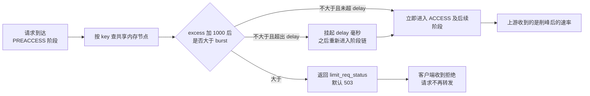
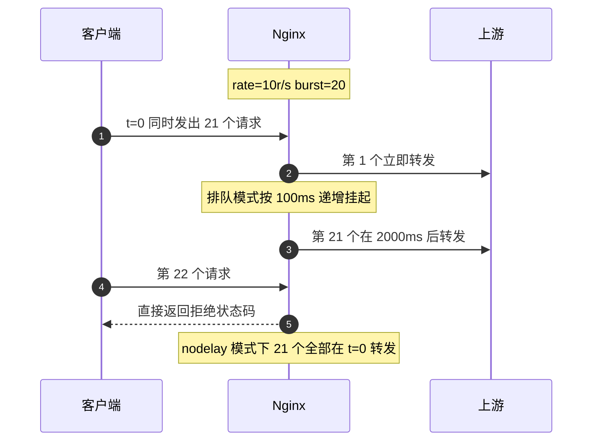
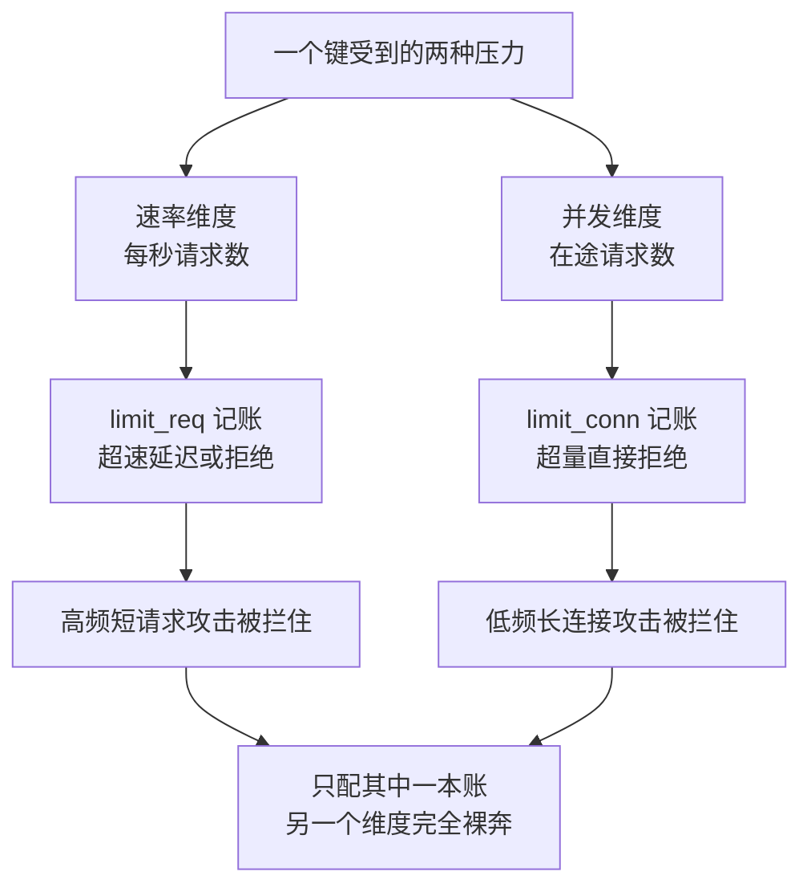
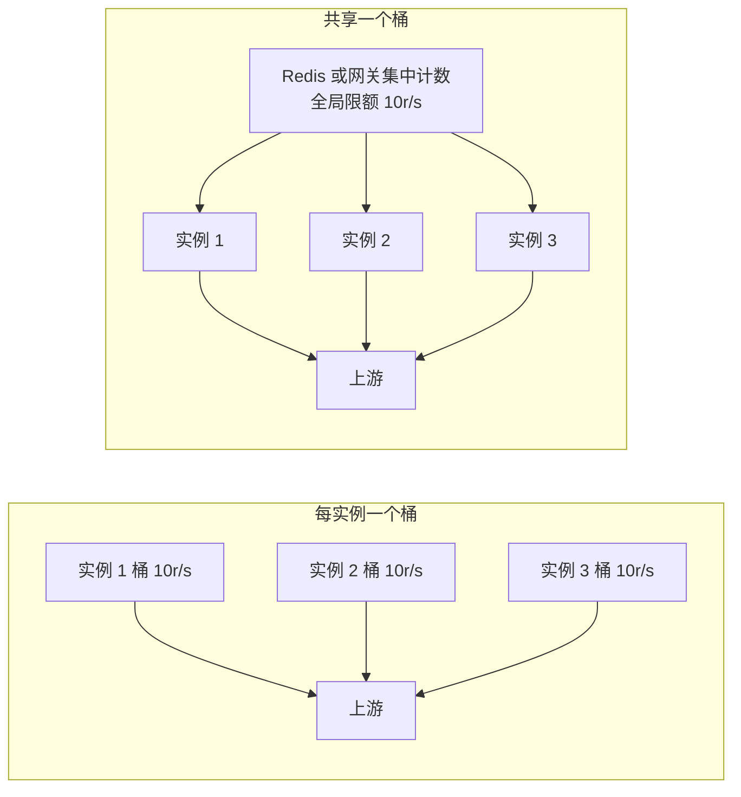

# 08 限流与熔断：leaky bucket 与 burst 参数的数学本质

**摘要：**

`limit_req` 的三行配置几乎人人会写，但 `burst=20` 到底放行几个请求、`nodelay` 改掉了哪一步、排队模式下的请求最长要等多久，多数人只记得一句"允许突发 20 个"。本文按模块源码的整数口径把这只桶拆开：`rate` 换算成每毫秒减少多少"毫请求"，`burst` 是桶里允许积压的请求个数，`nodelay` 把排队换成记账，1.15.7 引入的 `delay=n` 再把前 n 个请求直接放行、其余延迟，三种模式下的瞬时接受量、最大排队时长与恢复时间都可以算出来。另一本账由 `limit_conn` 记，它的计数点要求请求头已经读完、请求正在处理，这条不起眼的前提决定了慢头攻击为什么两个模块都看不见。第二半回答"限流了为什么还被打穿"：桶在每台机器上各算一份，键在分布式 IP 与 NAT 面前失准，`burst` 被当成配额用，并发维度没有人管，再加上 `rewrite` 与配置继承留下的位置缝隙，以及 zone 不足时 LRU 淘汰被反过来利用来冲刷账本。收尾写拒绝的姿态、dry run 的偏差、开源版熔断的三种近似，以及把桶搬进共享存储要付的代价。

---

## 第 1 章 三条同时出现的现象

### 1.1 限流生效了，后端还是倒了

一次大促或一轮爬虫之后，接入层常出现一组互相矛盾的事实：`error_log` 里 `limiting requests` 的日志刷屏，监控上 429 的占比明显上升，但上游的连接数、队列长度、502 与 504 也同步上涨，最终后端仍然被打到不可用。运维的第一反应通常是"限流没生效"，可日志明明在说话；第二反应是"阈值太小"，于是把 `burst` 调大，下一轮攻击来得更快。

这三条现象能同时成立，是因为它们量的不是同一件事。限流器记的是某个键在某个时间窗口内的速率，上游感受到的是同一时刻压过来的并发与在途请求数，而 429 只是被拒绝的那一部分。一个只记速率的账本，看不见慢速连接占着不放，也看不见桶在每台机器上各存一份。笔者在排查里见过最典型的一例：每台实例上 `rate=10r/s burst=20 nodelay` 写得整整齐齐，攻击流量经四层负载均衡均匀摊到八台机器上，每台看到的单 IP 速率都不到 2r/s，于是没有一台触发拒绝，集群实际放行量是配置值的八倍。

### 1.2 保护对象不同，参数的名字就不同

Nginx 在请求处理管道（详见 [[03 HTTP 请求处理管道：11 个阶段全解]]）里提供了两个准入模块，它们都注册在 PREACCESS 阶段，都在 ACCESS 鉴权之前执行，但记的是两本账。`limit_req` 按时间记账，单位是"请求/秒"，超限的表现是延迟或拒绝；`limit_conn` 按在途数量记账，单位是"个"，超限的表现直接是拒绝。再往后，`upstream` 的被动健康检查记的是第三本账，即某个后端最近失败了几次（见 [[04 反向代理与负载均衡：upstream 模块深度解析]]）。

把这三本账混在一起谈，就会出现"我限流配了，为什么还挂"式的困惑。限流解决的是**入口的速率与并发**，健康检查解决的是**出口的可用性**，前者防的是自己被压垮，后者防的是请求被送进一个已经坏掉的后端。本篇的落点在前两本账，第三本账只在熔断一节作为对照出现。

### 1.3 两个待答的问题

第一个问题关于参数本身：`burst` 是"允许突发 N 个"还是"允许积压 N 个"，`nodelay` 究竟取消了什么，排队模式下的请求最长等多久，桶被打满后要空闲多久才恢复。这些问题有确定的答案，答案藏在模块的整数算术里，而不是在博客的口耳相传里。

第二个问题关于失效：既然限流确实生效，为什么还会被打穿。这个问题没有单一答案，本篇归结为五个互相独立的边界——桶的边界（每实例一个）、键的边界（分辨率不对）、容量的边界（`burst` 过大）、视角的边界（只限速率）、位置的边界（改写与继承）。理解这五条，比再抄一份配置模板更有用。

---

## 第 2 章 一只用整数记账的漏桶

### 2.1 恒定出水，还是定量令牌

流量整形有两个经典模型。漏桶（leaky bucket）把请求想成倒进桶里的水，桶底有一个固定大小的孔，水以恒定速率漏出，桶满则溢出；令牌桶（token bucket）反过来，以恒定速率往桶里放令牌，请求取走令牌才能通过，桶里攒下的令牌允许短时突发。两者的差别不在平均速率，而在允许的突发形状：漏桶天然把流量削成平地，令牌桶允许把"攒下来的额度"一次性花掉。

Nginx 文档对 `limit_req` 的定性是明确的——使用漏桶方法。但它的实现比教科书更省：模块并不维护一个真实的队列，也不存在一个按毫秒滴水的定时器。它维护的是**每个键上的一笔欠账**，也就是当前积压了多少个请求当量的额度；每来一个请求加一笔，时间流逝按速率减一笔。延迟处理不是把请求放进某个缓冲队列，而是把这次请求的执行挂起一段时间后重新送回阶段链。理解这一点，"排队"这个词才不会误导人：排队的不是请求对象，而是请求的执行时机。

### 2.2 记账的整数口径

`limit_req_zone` 里的 `rate` 在配置解析之后变成一个整数，单位是千分之一请求每秒。`limit_req_zone $binary_remote_addr zone=api:10m rate=10r/s` 这一行的内部值是 `10000`；`rate=60r/m` 的内部值是 `1000`，换算过来正好是 1r/s。节点的 `excess` 字段用同一套单位，一个请求记 `1000`。

于是每次命中同一个键时，模块做的事情可以写成一行：

```text
excess = max(0, 上次的 excess - rate × 距上次请求的毫秒数 / 1000 + 1000)
```

这里的 `rate` 是千分之一请求每秒，`+1000` 是本次请求自己，`rate × Δ / 1000` 是这段时间漏掉的水。三个细节值得停一下。其一，结果做了下限截断，积压不会被算成负数，否则一个空闲很久的键会攒出额度，那就不再是漏桶而是令牌桶。其二，时间差先做了符号处理：时钟若回拨超过 60 秒，模块把间隔当作 1 毫秒，回拨不到 60 秒则当作 0，避免时间跳变把账本算成负数或免掉一笔账。其三，四舍五入被彻底避开，全部是整数除法，代价是微小的时间片被截断，收益是同样的输入在任何平台上都得到同样的判决。

还有一个容易忽略的细节：一个从未出现过的键，第一次请求建节点时 `excess` 记的是 `0` 而不是 `1000`。也就是说每个新键的第一个请求不占额度，第二次同键请求才开始按上面的公式记账。这个不对称解释了为什么 `burst=0` 时第一个请求总能过、紧接着的第二个立刻被拒——桶从空开始，而"空"的定义里已经含了一次免费通过。

### 2.3 一条状态在共享内存里长什么样

限流状态放在共享内存里，形态是红黑树加一条最近使用队列。树按键的 CRC32 短哈希排序，哈希相同再用完整键比较，节点里除了键本身，只有三个有效字段：上次请求时间、积压量、以及一个正在被处理的计数。这个计数用于多规则叠加时的两阶段记账——先在所有 zone 上试算并占位，再统一决定延迟多久或拒绝，中途失败要按顺序回滚。多进程并发访问由 slab 池上的互斥锁保护，锁的粒度是每个 zone 一把，不是每个键一把。

官方文档给的成本口径是：`limit_req` 每条状态在 64 位平台上固定占 128 字节，1MB 共享内存约能容纳 8000 条；32 位平台上每条 64 字节，1MB 约 16000 条。按结构体字段直接算，IPv4 的键只占 80 字节左右，差额来自 slab 页头、对齐与键长浮动——估算容量时用文档口径更稳妥，不要拿结构体大小做乘法。

`limit_conn` 的状态更简单，只有键和一个 16 位的连接计数，文档给的是 64 位平台上每条 64 字节，1MB 约 16000 条。两个模块共用同一套共享内存基础设施，但对"内存用完"的处理完全不同，这一点下一节单独说。

### 2.4 内存耗尽时的两种命运

`limit_req` 在分配不到新节点时，先从最近使用队列的尾部淘汰空闲超过 60 秒、且积压已经排空的节点；如果还不够，再强制删掉最旧的一条状态，连这一步都腾不出空间，才记一条 `could not allocate node` 的 ALERT，并按拒绝处理——请求拿到的就是 `limit_req_status` 设定的状态码。`limit_conn` 没有这层淘汰，分配失败意味着无法记账，模块的选择是把当前请求以及之后所有请求一起拒掉，文档对此的表述是"zone 存储耗尽时，服务器会对之后的所有请求返回错误"。

前者是尽力而为的降级，后者是宁可错杀。差异的根源在语义：速率账本漏记一笔只是少算一笔，并发账本漏记一笔就再也减不回来，宁可让流量先退回去。生产上这意味着一件事：`limit_conn` 的 zone 必须按键基数留足，不能像 `limit_req` 那样指望淘汰机制兜底。

下图把一次请求在准入点的完整分支画出来，注意延迟分支并没有离开阶段链，它只是在 PREACCESS 里挂起，到点后继续往后走。



---

## 第 3 章 rate 限的是间隔，不是每秒配额

### 3.1 两种单位只差一个缩放

`rate` 支持 `r/s` 与 `r/m` 两种写法，解析时后者除以 60，于是 `60r/m` 与 `1r/s` 是同一个内部值 `1000`。文档建议低于 1r/s 的速率用 `r/m` 表达，原因不在精度而在可读性：`rate=30r/m` 比 `rate=0.5r/s` 更不容易被写错，后者也根本不被解析器接受。

这里要纠正一个流传很广的说法：`rate=10r/s` 与 `rate=60r/m` 效果相同。前者是每秒 10 个，后者是每秒 1 个，相差十倍。真正"效果相同"的是 `10r/s` 与 `600r/m`，但后者已经超出"用 r/m 表达慢速率"的本意。

### 3.2 恒定间隔与零延迟的边界

因为账本是连续的，`rate=10r/s` 的准确含义是**相邻间隔不得短于 100 毫秒**，而不是"每秒的前 10 个放行、第 11 个拒绝"。按秒切窗口的计数器（固定窗口）在窗口交界处会放过两倍流量，漏桶没有这个问题，代价是它没有"配额"这个概念——你在 0.9 秒内用完的额度，不会在 1.0 秒时刷新。

刚好按 100 毫秒一个的节奏发请求，会发生一件很舒服的事：每个请求到达时，上次记下的积压已经被时间完全漏掉，新算出的 `excess` 回到 0，延迟为 0。也就是说完全贴合速率的流量在这只桶里没有任何额外代价，这是漏桶比"先排队再放行"的整形器更适合网关的原因之一。

稍快一点，账就开始累积。以 90 毫秒一个发请求、`rate=10r/s` 为例，每次净增 100 个毫请求单位，两万个单位的桶容量（`burst=20`）在 200 个请求之后被填满，计算上刚好是 18 秒；第 201 个请求开始被拒。此后进入稳定态：被拒的请求不改变账本，桶继续随时间漏，能过的只有速率允许的那部分，长期吞吐回落到 10r/s。这也解释了为什么"轻度超速"的故障总在几十秒后才显形——积压需要时间，而人往往在积压填满时才去看监控。

### 3.3 rate 的代价表

| rate 取值 | 内部整数 | 最小间隔 | 调大的代价 | 调小的代价 |
|---|---|---|---|---|
| `10r/s` | 10000 | 100ms | 单键能吃掉更多上游并发，攻击面变宽 | 正常用户的页面资源并发被误伤 |
| `1r/s` | 1000 | 1s | 大流量键仍可打满一个上游连接 | 登录、下单等正常操作开始排队 |
| `60r/m` | 1000 | 1s | 同 `1r/s`，且更易被误读成每分钟突发 60 | 同 `1r/s` |
| `30r/m` | 500 | 2s | 单键几乎无保护作用 | 交互型接口会被判为超速 |
| `600r/m` | 10000 | 100ms | 等于 `10r/s`，写法更绕 | 等于 `10r/s`，收益为零 |

这张表想说明的是，`rate` 的取值单位不是"每秒多少个"，而是"允许多密"。调大它买到的是单键的吞吐，付出的是上游的并发余量；调小它买到的是保护，付出的是正常用户的等待与误伤。真正决定用户体验的其实是下一章的 `burst` 与 `nodelay`，`rate` 只决定长期平均线。

---

## 第 4 章 burst 是桶容量，不是额外配额

### 4.1 桶里能积压几个请求

模块在判断拒绝时用的条件是 `excess > burst × 1000`，而 `excess` 里已经含了本次请求的 1000。把两个事实合起来：从空桶开始，同一个键能连续通过 `burst + 1` 个请求，第 `burst + 2` 个被拒。多出来的那一个是 2.2 节说的"新键首个请求不占额度"。

`burst=0` 并不等于"禁用"，它的意思是桶容量为零，只有间隔不小于 `1/rate` 的请求能过。对浏览器加载一个页面来说这太苛刻——HTML、CSS、JS、几张图往往是同时发出的，`burst=0` 会把它们判成超速。反过来，把 `burst` 理解成"每秒额外的 20 个配额"同样是错的，它是**瞬时容量**，与时间无关，也与每秒配额无关；积压会随时间漏掉，漏完就没有了。

### 4.2 排队模式：延迟从第二个请求开始

`limit_req zone=api burst=20;` 不写 `nodelay` 时，超速的请求不是被拒，而是被延迟执行。延迟时长由积压量换算：`(excess - delay×1000) × 1000 / rate` 毫秒，未写 `delay` 时 `delay` 为 0，于是延迟就是 `excess / rate × 1000` 毫秒，等价于"前面还欠几个请求，每个欠 1/rate 秒"。

以 `rate=10r/s`、`burst=20`、空桶起步、21 个请求在同一毫秒到达为例，逐个请求的账如下：第 1 个新建节点，不占额度，立即通过；第 2 个积压 1000，延迟 100 毫秒；第 3 个积压 2000，延迟 200 毫秒；一路递增，第 21 个积压 20000，延迟 2000 毫秒；第 22 个积压 21000，超过 20000，被拒。也就是说"排队模式下的最大等待时间"等于 `burst / rate`，这里是 2 秒。

两秒对多数前端 Ajax 来说已经等于超时。于是排队模式在实际系统里常表现为一种更隐蔽的故障：客户端等不及先断开，Nginx 这边的延迟请求还在连接上占着槽位，`worker_connections` 被慢慢吃掉，上游看到的请求数确实被削平了，接入层自己的并发却在上涨。这也是笔者不建议在面向用户的接口上用长 `burst` 排队的原因。

### 4.3 nodelay：延迟换成记账

加上 `nodelay` 之后，模块把 `delay` 参数设成一个极大的值，判断条件 `excess > delay` 永远不成立，于是所有在 `burst` 容量内的请求都立即执行，只留下**一次性的额度透支**。被拒的门槛没有变，仍是 `burst + 1` 个。

它的效果是把"排队缓冲"换成了"透支额度"：桶里积压的 20000 不会让请求停下来等，而是让后续请求在桶漏空之前继续被接受。`burst=20 nodelay` 从空桶开始能瞬间放行 21 个，之后每过 100 毫秒恢复一个名额，2 秒后完全恢复。这个行为已经非常接近令牌桶，区别只在桶满时的处理：令牌桶让请求等令牌，Nginx 直接拒绝。

`nodelay` 把延迟风险转成了并发风险。21 个请求瞬间打到上游，上游如果只剩 10 个并发余量，剩下的 11 个就在上游排队，排队时间计入 `proxy_read_timeout`，超时后变成 504。配置 `burst` 时真正该问的问题不是"用户会不会突发"，而是"上游还能不能再吃下这么多并发"。

### 4.4 delay=n：只让前 n 个插队

1.15.7 引入的 `delay=n` 把两种极端切开：积压不超过 `n` 个请求时不延迟，超过之后按超出的部分计算延迟。由于新键首个请求不占额度，立即通过的是 `n + 1` 个；从第 `n + 2` 个开始，每个延迟 `1/rate` 秒递增；最大延迟是 `(burst - n) / rate` 秒。仍以 `rate=10r/s`、`burst=20`、`delay=8` 为例：前 9 个立即通过，第 10 个延迟 100 毫秒，第 21 个延迟 1200 毫秒，第 22 个被拒。

这里最常见的误读正好相反：把 `delay=n` 记成"前 n 个延迟、其余立即"，而源码里的判定是积压不超过 `delay` 就不延迟，超过之后才排队。抱着前一种理解去调参，得到的行为会和预期完全颠倒。从工程角度看，`delay` 是一种务实的折中：用户的页面资源并发通常在 6 到 10 个之间，把 `delay` 设在 8 到 10、`burst` 设在 20 左右，正常页面载荷全部即时通过，只有真正异常的批量请求才进入排队；排队的上限又比纯队列模式短得多，不会把连接占满两秒。

### 4.5 三条可以背下来的公式

把上面的算术收敛成三条，在 `rate=r`、`burst=B`、`delay=D`、空桶起步的前提下成立：瞬间接受上限是 `B + 1` 个（含首个不占额度的请求）；其中立即通过的是 `D + 1` 个，其余按 `1/r` 秒递增延迟，最大延迟 `(B - D) / r` 秒；桶被打满之后，完全排空需要 `B / r` 秒，期间每 `1/r` 秒恢复一个名额。

这三条公式的价值在于它们把"配置直觉"换成了可以对话的数字。譬如有人要求"允许用户一秒内点 50 次"，你可以立刻反问：如果 `rate=10r/s`，50 次意味着 `burst` 至少 49，排队模式下最后一个是 4.9 秒，`nodelay` 下这 50 个请求会同时压到上游，哪一种你能接受。

### 4.6 四种组合放在一张表里

| 配置 | 桶容量内的行为 | 超出 `burst` | 空桶瞬时接受 | 最大排队 | 主要代价 |
|---|---|---|---|---|---|
| 无 `burst` | 超速即拒 | 拒绝 | 1 个 | 0 | 正常页面并发被误伤 |
| `burst=B` | 排队，按积压折算延迟 | 拒绝 | `B+1` 个 | `B/r` 秒 | 连接被长期占用，客户端易超时 |
| `burst=B nodelay` | 立即执行，消耗积压 | 拒绝 | `B+1` 个 | 0 | 突发流量直压上游，转成 504 |
| `burst=B delay=D` | 前 `D+1` 个立即，其余排队 | 拒绝 | `B+1` 个 | `(B-D)/r` 秒 | 两段语义并存，解释成本高 |

配套的算例表把三种模式在 `rate=10r/s`、`burst=20`、`delay=8` 下的数字并排放，排队延迟一栏是最容易被忽视的那一列。

| 第 k 个请求 | `excess` | 排队模式延迟 | `delay=8` 延迟 | `nodelay` 延迟 |
|---|---|---|---|---|
| 1 | 0 | 0 | 0 | 0 |
| 2 | 1000 | 100ms | 0 | 0 |
| 9 | 8000 | 800ms | 0 | 0 |
| 10 | 9000 | 900ms | 100ms | 0 |
| 21 | 20000 | 2000ms | 1200ms | 0 |
| 22 | 21000 | 拒绝 | 拒绝 | 拒绝 |

下图把三种模式在时间轴上的差别画在一起，注意 `nodelay` 那一支的请求全部压在 t=0，代价落在上游而不是接入层。



---

## 第 5 章 limit_conn 数的是在途请求

### 5.1 计数点决定了它看得见什么

文档对 `limit_conn` 的计数条件写得相当克制：并非所有连接都被计数，只有当一个连接上正在处理请求、且整个请求头已经被读完时，它才被计入。源码与此一致：计数在 PREACCESS 阶段加一，减一挂在请求内存池的清理函数上，也就是请求结束就归还，而不是等 TCP 连接关闭。

这两个事实推出三个结论。第一，空闲的 Keep-Alive 连接不占额度，一个流传很广的说法是 Keep-Alive 空闲连接也计入，这对现代版本并不成立，浏览器对同域保持 6 条空闲连接不会因此触发 `limit_conn`。第二，`limit_conn` 计的是**在途请求**，不是操作系统意义上的 socket 数量。第三，请求头还没读完的连接根本不在它的视野里，这一条是理解慢速攻击防御的钥匙，5.3 节展开。

HTTP/2 与 HTTP/3 下这条语义变得更直白：文档明确**每个并发请求算一条连接**。于是在多路复用的协议上，`limit_conn` 实际限制的是同键的并发流数量，一条 TCP 连接上开十个流就占十个名额。这一点在网关只做 HTTP/1.1 时容易被忽略，一旦开启 HTTP/2，同一份配置的严厉程度会翻倍。

### 5.2 它和 limit_req 的分工

两本账的分工可以用一个二维平面说清：横轴是一个键的请求速率，纵轴是该键同一时刻的在途请求数。`limit_req` 管横轴，超速的请求被延迟或拒绝；`limit_conn` 管纵轴，超量的请求直接被拒。绝大多数真实攻击落在两个角落之一：一个是高频短请求，横轴被打爆，`limit_req` 有效；另一个是低频长连接，横轴几乎为零，纵轴被打爆，只有 `limit_conn` 看得见。

这也解释了一个常见的配置误区：只写 `limit_req` 的接口，在面对慢连接攻击时完全没有保护，因为攻击的总速率可能不到 1r/s，却占着几千条连接。反过来，只写 `limit_conn` 的接口，面对高频短请求时也拦不住——每条连接只发一个请求就关，并发数永远不高，速率却可以很高。两本账都得记。



### 5.3 慢速攻击的三段，各归谁管

慢速攻击（slowloris）不是一个动作，是一族动作，按卡住的位置分三段。慢头：连上之后一个字节一个字节地发请求头，让请求永远处于"头未读完"的状态；慢体：头正常发完，声明一个很大的 `Content-Length`，然后极慢地发正文；慢读：请求已经处理完，但客户端极慢地读响应，把连接占住。

**慢头这一段不计入任何计数**，因为请求头没读完，计数条件不成立；`limit_req` 也看不见，因为速率低得可以忽略。真正管用的是连接建立之后的一系列超时与缓冲区上限：`client_header_timeout` 决定一个头最多允许读多久，`client_header_buffer_size` 与 `large_client_header_buffers` 决定头部缓冲占多少内存，`lingering_close` 决定服务端是否在关闭前多等一会儿把残余数据读完。这四个参数的合理取值，比任何限流指令都更能挡住慢头攻击。

慢体这一段落在 `limit_conn` 的视野里：头已读完，请求在途，计数成立；配合 `client_body_timeout` 与 `client_max_body_size` 效果更好。慢读这一段同样被计数，因为请求还在池子里没有结束；`send_timeout` 控制两次写之间的最长间隔，是这一段的主要防线。

所以"限流 + 并发限制才防得住 slowloris"这句话只对了一半。准确的说法是：`limit_req` 对慢速攻击无效，`limit_conn` 能兜住慢体与慢读，慢头必须靠超时与缓冲配置，外加四层（负载均衡或防火墙）的连接数限制。把慢头也算到 `limit_conn` 头上，是慢速攻击防护里最常见的一处误判。慢头之外的接入层攻击面——扫描、爆破、恶意 UA、越权探测——归 [[11 安全加固：常见攻击向量与防御配置]] 处理。

### 5.4 连接耗尽的算术

默认 `worker_connections` 是 512，四核机器常配到 1024 或 2048。取常见的 1024、4 个 worker 为例，接入层总连接槽位是 4096，其中还包括到上游的连接（一条代理请求占两条连接，见 04 篇）。`client_header_timeout` 默认 60 秒，意味着一条只发了一半头的连接最多占槽 60 秒。攻击者用 1000 条连接每 10 秒发一个字节，总速率 100 字节/秒、请求数为 0，却占掉四分之一的槽位；要占满全部槽位，只需要 4096 条这样的连接，对一台普通攻击机来说毫无难度。这是示例推算，具体数字随配置浮动，但量级关系不会变：慢头攻击的成本在攻击者一侧极低，在服务端一侧是每个连接一份内存与一个文件描述符。`worker_connections` 与内核参数的容量模型见 [[10 性能调优全攻略：worker 进程、连接数与内核参数]]。

### 5.5 limit_conn 的三个硬边界

第一个是键长上限：键超过 255 字节时，模块记一条错误日志后直接跳过这条规则，也就是不计数。用 `$binary_remote_addr$uri` 这类组合键时，URI 很长就会悄悄失效，而日志里只有一行容易被忽略的 error。第二个是数值上限：`limit_conn` 的第二个参数最大 65535，超过直接拒绝启动。第三个是 zone 耗尽即全拒，2.4 节已经说过。

| 维度 | `limit_req` | `limit_conn` |
|---|---|---|
| 记账对象 | 每键的时间速率 | 每键的在途请求数 |
| 状态字段 | 上次时间、积压量、在途计数 | 连接计数 |
| 单条状态成本 | 64 位平台 128 字节 | 64 位平台 64 字节 |
| 超限默认码 | 503 | 503 |
| 键长上限 | 65535 字节，超长跳过 | 255 字节，超长跳过 |
| zone 耗尽 | 先淘汰空闲节点，再拒 | 立即全拒 |
| 调大的代价 | 单键吞吐上升，上游并发风险上升 | 慢连接可长期占用更多槽位 |
| 调小的代价 | 正常用户突发被误伤 | 正常用户多标签页被误伤 |

---

## 第 6 章 key 的分辨率决定限流的精度

### 6.1 默认键与它的两个盲区

`$binary_remote_addr` 是二进制形式的客户端地址，IPv4 固定 4 字节，IPv6 固定 16 字节，比文本形式的 `$remote_addr` 省内存也省比较开销，官方文档直接推荐用它做键。它有两个盲区，一个来自地址空间，一个来自网络拓扑。

地址空间的盲区在 IPv6。一个终端用户通常能拿到一整段 /64，也就是 2 的 64 次方个地址，攻击者换地址的成本几乎为零，而按单个地址记账的桶永远只有一个请求的深度。开源版 Nginx 没有"按前缀聚合"的参数，要实现 /64 粒度只能靠 `map` 加正则去截取地址前缀，而 IPv6 的压缩写法（连续零用双冒号省略）让正则非常容易写错。务实的做法是把 IPv6 的聚合限流下沉到四层或网关侧，接入层只对 IPv4 做单地址限流。

网络拓扑的盲区在 NAT。公司出口、运营商级 NAT、容器集群的出口网关，都会把成千上万个用户压到一个源地址上。按 IP 记账的桶这时变成"整栋楼共用一个水龙头"，一个用户下载大文件就能把所有人的额度用光；反过来，攻击者如果和受害用户共享一个 NAT 出口，他的流量也会被算进同一只桶，误伤与打穿同时发生。

### 6.2 全站桶与组合键

把键换成 `$server_name`，得到的是整个虚拟主机的总桶，语义从"每个客户端多少"变成"这个站总共多少"。它可以当总闸用，但风险同样直观：任何一个客户端都能把这一个桶打满，等于给了攻击者一个单点。总闸应当与每键的桶叠加使用，并且总闸的阈值要显著高于所有正常键之和。

组合键是把分辨率调细的通用手段。`$binary_remote_addr$uri` 把保护单位从"每个 IP"细化到"每个 IP 的每个接口"，好处是热点接口与普通接口互不挤占，坏处是键基数乘以接口数，zone 的容量需求成倍上涨；`$binary_remote_addr$request_method` 则能把写请求与读请求分开限流。组合键的写法本身没有陷阱，陷阱在键长：两个模块的键长上限不同，`limit_conn` 的 255 字节很容易被 URI 撑破。

另一种组合是按身份记账，从 `Authorization` 或自定义头里取出用户标识或 API Key，用 `map` 提取后作为键，取不到时回退到地址。这条路的分辨率最准，前提是身份在 PREACCESS 阶段就能拿到——JWT 的校验通常发生在 ACCESS 阶段（见 03 篇），所以这里只能做"长得像令牌就按令牌算"的弱校验，真正的防伪仍要靠后端。键里放 `$http_authorization` 还有个副作用：令牌轮换会让同一个用户落到不同的桶里，阈值需要按轮换周期重新估算。

### 6.3 X-Forwarded-For 与信任边界

`$http_x_forwarded_for` 是客户端可以完全控制的请求头，直接拿它当键等于把限流开关交给攻击者：每次请求换一个假地址，桶就永远不满。要用它，必须先让 Nginx 知道"谁是可信的代理"，这正是 `realip` 模块的职责。

`realip` 的配置分三步：`set_real_ip_from` 声明可信代理的地址段，`real_ip_header` 指定从哪个头取地址，`real_ip_recursive` 决定取值方式。模块在 POST_READ 阶段就把连接的地址换掉，PREACCESS 的 `limit_req` 读到的已经是换过的值，原始对端地址保留在 `$realip_remote_addr` 里。`realip` 改的是连接结构上的地址，请求结束时会还原，因此它不会污染同一条连接上的后续请求。

取值方式的差别值得写清楚。`real_ip_recursive off` 时，模块取请求头里最右（最后）的那个地址；`on` 时从右往左扫描，跳过所有落在可信段里的地址，停在第一个不可信的地址上。前者适合"只有一层可信代理、且代理采用追加写法"的拓扑，后者适合多层代理串联。两种模式有一个共同前提：链头的那个代理必须是自己人，并且它必须**追加**而不是覆盖。如果 Nginx 直接暴露在公网、又把 `set_real_ip_from` 写成 `0.0.0.0/0`，那么任何人都能伪造整条链，`realip` 就从安全机制变成了伪造工具。

下图把一次跨代理请求里地址被改写的时点画出来，注意 `limit_req` 读到的是改写后的值，而 `$realip_remote_addr` 保留了原始对端。


### 6.4 zone 容量与键基数

zone 的大小要按"峰值在线键数"来配，而不是按"平均活跃用户数"。每台实例上同时被记账的键，等于这段时间内出现过请求的独立 IP 数（或者组合键数），一个爬虫扫一轮就能把这个数字抬高两个数量级。官方口径下，10MB 在 64 位平台上约能存 8 万条 `limit_req` 状态，按"峰值键数 10 万"估算，zone 至少要 16MB 才不紧张；`limit_conn` 单条 64 字节，同样键基数下 8MB 起步。

| 场景 | 键形态 | 单条状态 | 10MB 可存 | 100 万键需要 |
|---|---|---|---|---|
| 公网 API，IPv4 | `$binary_remote_addr` | 128 字节 | 约 8 万 | 约 128MB |
| 公网 API，IPv6 | `$binary_remote_addr` | 128 字节 | 约 8 万 | 约 128MB |
| 组合键，URI 30 字节 | 地址加 URI | 约 154 字节 | 约 6.5 万 | 约 154MB |
| 并发限制，IPv4 | `$binary_remote_addr` | 64 字节 | 约 16 万 | 约 64MB |

表里的换算按文档口径做示例推算，实际会因键长、平台与 slab 碎片浮动。它想说明的是一件常被忽略的事：zone 不够时，`limit_req` 的 LRU 淘汰会开始工作，而被淘汰的恰恰是"最近没用过"的键——攻击者用海量随机地址制造新节点，就能把正常用户的账本挤出去，正常用户下次再来时桶是空的，等于获得了全新额度。这种冲刷式攻击不需要猜任何配置，只需要足够的地址。

### 6.5 改 key 要重启，而且是硬失败

`limit_req_zone` 的 key 在 reload 时会做一致性校验：如果新配置里同名 zone 的 key 与旧的不同，模块直接报 EMERG 级别的错误，内容大意是"该 zone 之前用的是某个 key，现在换成了另一个"，reload 失败。`limit_conn_zone` 同理。

这条限制的运维含义比它看起来重要。key 不是可以随手调整的实现细节，它决定了共享内存里每个节点的字节布局，热切换会让新旧 worker 对同一块内存做出不同的解释。所以"限流键从 IP 换成 IP 加 URI"这种改动，实际是一次需要重启的配置变更，变更窗口、计数器清零、以及重启瞬间的桶重置都要提前算进方案里。

---

## 第 7 章 限流了为什么还被打穿

### 7.1 原因一：桶是每个实例的

`limit_req_zone` 用的是共享内存，所以同一台机器上的多个 worker 共享一份账本，worker 数不影响阈值——这是它相对于"每进程计数"的最大优势。但共享内存的作用域止于单机：两台 Nginx 各自维护一份桶，彼此不知道对方放行了多少。

于是**集群的有效阈值**等于单机阈值乘以实例数，有效桶容量也一样。设 `rate=10r/s`、`burst=20`、八台实例，攻击者经四层负载均衡均匀摊过来的流量每台分到八分之一，只要总速率低于 80r/s 就不会有任何一台触发限流；瞬时突发能通过的是 `8 × 21 = 168` 个请求，而不是 21 个。这就是"配置写着 10r/s，实际放着 80r/s"的由来。

APISIX 的文档把这个事实写得很直白：`limit-req` 默认的本地策略下，每个实例独立计数，流量分散时有效限流大约是"配置值乘以实例数"，要全局一致必须把策略切到 Redis。开源 Nginx 连这个开关都没有，只能靠部署形态与容量折算去弥补。

### 7.2 原因二：键的分辨率与攻击形态不匹配

分布式攻击与 NAT 是同一个问题的两面。面对十万个地址发起的攻击，按地址记账的桶每个都很浅，没有任何一个键会触发拒绝，而总流量足以打垮上游；面对一个 NAT 出口后的一万用户，按地址记账的桶只有一个，任何一个人的正常使用都可能把整栋楼拖进 429。

用数字说话（示例推算）：某企业出口 NAT 后有 5000 个用户，每人打开首页并发 30 个请求，若 `rate=10r/s`、`burst=20 nodelay`，这 15 万个请求里只有 21 个能通过，其余全部被拒，正常用户的页面直接白屏；而在攻击侧，攻击者用 20 万个地址各发 5 个请求，总请求 100 万个，每个地址的桶只用了 5 个额度，全部放行，等于限流器不存在。两种失效方向相反，根因相同：**键的粒度与流量分布不匹配**。

修正方向不是简单换一个键，而是分层。面向公网、地址不可信的场景，用地址加接口的组合键做粗保护，同时在边缘或网关按身份记账；面向内网、NAT 普遍的场景，身份键必须优先于地址键，地址键只作为身份缺失时的兜底，且阈值要按出口规模放大。

### 7.3 原因三：burst 给太大

`burst` 之所以常被调大，是因为它同时承担了"避免误伤"和"允许突发"两个职责，而调大它的副作用要到上游才显形。以 `rate=10r/s`、`burst=1000` 为例：空桶瞬间能接受 1001 个请求，桶被打满后需要 100 秒才能排空——这 100 秒里这个键的额度等于被一次性预支光了。

`nodelay` 下这 1001 个请求会在同一毫秒压到上游，如果上游单实例的并发余量只有 200，剩下的 800 个就在上游排队，排队时间计入 `proxy_read_timeout`，超时后表现为 504，重试再放大一轮，这正是第 1 章那组矛盾现象的来源。排队模式下则相反：1001 个请求全部挂起，最长等 100 秒，接入层的连接先被占满，攻击者甚至不需要发完请求，只要把连接开着就能赢。

合理的 `burst` 应当由两个上限反向夹住：上界是"上游还能再吃多少并发"，下界是"一个真实用户的页面资源并发数"。常见取值是用户并发数的 1.5 到 2 倍，并且用 `delay` 把绝大多数正常突发一次性放行。

### 7.4 原因四：只限速率，不限并发

第 5 章已经拆过 slowloris 的三段，这里只补它在"打穿"语境下的两个推论。其一，慢头攻击的请求速率接近零，`limit_req` 的桶永远是空的，配置多严都没用；`limit_conn` 也看不见它，因为计数条件要求请求头读完。挡它的是 `client_header_timeout` 与缓冲区上限，这些参数在默认配置下是 60 秒，足以让攻击者用极低成本占满连接。

其二，慢体与慢读虽然被 `limit_conn` 计数，但如果 `limit_conn` 的阈值按"并发连接数"直觉设成几十，而攻击者只需要几百条连接，阈值就形同虚设。并发限制的阈值应当与上游的连接池、线程池容量挂钩，而不是与"一个用户会开几个浏览器标签"挂钩。

结论是防护要分层：四层连接数与 SYN 速率限制挡住慢头的第一波，`client_header_timeout`、`client_body_timeout`、`send_timeout` 缩短占位时间，`limit_conn` 限制单键在途请求，`limit_req` 削掉高频短请求。少任何一层，攻击者换一个形态就能绕过去。

### 7.5 原因五：位置与继承留出的缝

前四条都在参数与语义层面，第五条在配置结构层面，也是最容易被忽略的一条。`limit_req` 与 `limit_conn` 只在 PREACCESS 阶段执行一次，它们绑定的是"请求最终落到哪个 location"。于是有三条缝。

第一条是 `rewrite ... last`。SERVER_REWRITE 与 REWRITE 阶段都在 PREACCESS 之前，一条 `rewrite ... last` 会把请求送到新的 location 重新走一遍 FIND_CONFIG，最终生效的是新 location 上的限流配置。如果改写目标是一个没有写 `limit_req` 的 location，那么原来 location 上的限流完全不参与。

第二条是继承的整体替换。文档写得很清楚：只有当当前层级没有任何 `limit_req` 指令时，才会继承上层的配置。这意味着在 server 级写了一条件流（譬如按 `$server_name` 的全站总闸），又在某个 location 里加了一条按 IP 的限流，这个 location 里 server 级那条总闸就消失了——两条规则不是叠加，而是替换。多规则叠加本身是并行检查、任一触发即拒绝，但要先保证它们真的都在同一个层级上生效。

第三条是内部重定向不再计数。同一个主请求被内部重定向（`error_page`、`try_files` 的兜底、后端返回的 `X-Accel-Redirect`）之后，阶段链会从头再走一遍，但 `limit_req` 看到主请求已经被标记过结果，就直接放行；`limit_conn` 同样如此。这避免了同一个请求被重复计数，副作用是重定向目标上的限流不会补一次，反之从受限 location 重定向到不受限 location 也不会被追加限制。

除了这三条缝，还有两个更细的失效点：键为空时不计数（这是白名单的正当用法，也可能被误配置成"全部不计数"），键超长时跳过（`limit_req` 超过 65535 字节、`limit_conn` 超过 255 字节）。再叠上 PREACCESS 早于 ACCESS 这一点，鉴权失败、被 WAF 拦下的请求其实已经消耗了额度，攻击者用无效凭证也能把桶打满——限流的账，记的从来不是"有效流量"。

### 7.6 一张判据表

| 现象 | 先看什么 | 可能的结论 | 修正方向 |
|---|---|---|---|
| 429 上涨但上游仍被打满 | 实例数、负载均衡分布 | 每实例一个桶，有效阈值乘了实例数 | 折算阈值或改共享存储 |
| 日志里没有 limiting 记录 | 键基数、攻击源分布 | 分布式 IP 撑破了键的分辨率 | 组合键或身份键 |
| 上游 504 与排队同时出现 | `burst` 与 `nodelay` 取值 | burst 过大，延迟或并发转移 | 按上游余量收 `burst` |
| 连接数打满、QPS 却很低 | `client_header_timeout`、`worker_connections` | 慢头攻击，两个模块都看不见 | 超时与缓冲区收紧，四层限制 |
| 某个 location 完全没限流 | `rewrite`、继承层级 | 改写越过或整组规则被替换 | 统一层级或改写目标保留规则 |

---

## 第 8 章 拒绝的姿态

### 8.1 503 是错的，429 才是对的

`limit_req_status` 与 `limit_conn_status` 的默认值都是 503，这是历史选择，语义上是错的。503 表示服务暂时不可用，通常意味着服务端故障或过载，客户端与中间层看到 503 的反应是重试或切换节点；429 表示"你发得太多了"，语义清楚地指向请求方，重试策略应当退避。

这个差别在真实系统里会被放大。搜索引擎与监控把 503 当故障计入可用性，一次限流风暴就能把整个站点的可用性数字拉下去；自动化客户端对 503 常常直接重试，反而加剧拥塞。改成 429 之后，网关、CDN、客户端库的行为都更容易预期。两个指令的取值范围是 400 到 599，写 200 之类的值会让配置直接报错。

429 响应默认不带 `Retry-After`。要加的话得注意 `add_header` 只对 2xx 与 3xx 生效，对 429 必须带 `always` 参数，否则头不会出现。要不要给、给多少，取决于业务：给一个固定的 1 秒是安全的下界，给按桶计算的值则需要额外的变量支持，成本高于收益。

### 8.2 日志里的原文

拒绝时的 error_log 是固定句式：`limiting requests, excess: 20.000 by zone "api"`，其中 `excess` 以"请求数.毫请求"的形式打印，20.000 表示积压了 20 个请求当量。延迟时的句式是 `delaying request, excess: 1.000, by zone "api"`。并发限制触发时是 `limiting connections by zone "addr"`。

级别方面，拒绝按 `limit_req_log_level` 设定（默认 error），延迟低一档（默认降到 warn），因此排队模式的日志不会在 error 级别上制造噪声。生产上常见做法是把这两个指令调到 warn，避免限流风暴把真正的错误淹掉；排查时再用 `grep "limiting requests"` 加 zone 名定位是哪个规则在起作用。

### 8.3 把结果写进 access_log

1.17.6 起，两个模块各提供一个内嵌变量：`$limit_req_status` 取值为 `PASSED`、`DELAYED`、`REJECTED`，dry run 时另有两个带后缀的值；`$limit_conn_status` 取值为 `PASSED`、`REJECTED`。把它们放进 `log_format`，就能在访问日志里直接按"被延迟/被拒绝"聚合，不必再从 error_log 反推。

这条能力改变了限流的可观测性口径。只看状态码只能知道"有 429"，看不出是哪个 zone、延迟了多少、拒绝了多少；带上状态变量之后，"被延迟但最终成功"的请求第一次变得可见，而这恰恰是排队模式的主要代价，也是最容易被忽略的那部分用户。

### 8.4 dry run 与它的偏差

灰度一份限流配置最怕的是"上线即误伤"。1.17.1 的 `limit_req_dry_run` 与 1.17.6 的 `limit_conn_dry_run` 提供了观测模式：不实际限制，但仍按规则记账并打日志，于是可以先看一天日志估算误伤率再决定是否真正开启。

这个模式有一个按源码推出来的偏差值得知道：被判定超限的请求在 dry run 下按放行处理，而放行路径不会把这笔账记入积压——也就是说 dry run 里"本会被拒"的请求不计入后续的判定。因此 dry run 报出的拒绝次数是一个下界，连续突发场景下真实拒绝量会比它高，评估阈值时应留出余量。

---

## 第 9 章 熔断：开源 Nginx 没有的那个东西

### 9.1 熔断是状态机，不是阈值

熔断（circuit breaker）这个名字来自电路，核心是**一个三态状态机**：闭合时正常放行并统计失败，失败率或失败数越过阈值就进入打开状态，打开期间直接拒绝、不再打后端；打开持续一段时间后进入半开，放少量探测请求过去，探测成功则闭合，失败则继续打开。它与限流的区别在于保护对象：限流保护的是自己不被请求压垮，熔断保护的是自己不被一个已经坏掉的下游拖垮。

开源版 Nginx 没有这个状态机。它有 `max_fails` 与 `fail_timeout`，有 `proxy_next_upstream`，两者能拼出一个近似的剔除机制，但缺的正是"半开"与"主动探测"这两个语义——冷却时间结束时，Nginx 拿第一个真实请求当探测请求，探测失败的代价由这个真实用户承担（细节见 04 篇）。

### 9.2 三种可用的近似

第一种是基于 `max_fails` 与 `fail_timeout` 的被动剔除。`fail_timeout` 同时是失败计数的统计窗口与剔除后的冷却时长，`max_fails` 是窗口内允许的失败次数。它的判定粒度是"后端节点"，不是"接口"，一个接口的故障会把整个节点摘掉。

第二种是 `proxy_next_upstream`，它决定什么算失败。默认只包含 `error` 与 `timeout`，不含 5xx，于是后端持续返回 500 时 Nginx 仍认为它健康，同时 `proxy_next_upstream` 还会把请求重试到下一台，上游故障期间请求量反而被放大。

第三种是接入层的兜底：对上游并发做 `limit_conn`，对上游返回的失败做告警，人工或外部系统改配置。这条路不优雅，但在没有网关层编排能力的小规模部署里是最实际的。

### 9.3 APISIX 的 api-breaker 做了什么

APISIX 用 `api-breaker` 插件补上了这个状态机。配置里声明哪些状态码算不健康（默认只有 500）、几次算不健康（默认 3 次）、哪些状态码算健康（默认 200）、连续几次算恢复（默认 3 次），以及打开期间返回给客户端的状态码。它的冷却不是固定时长，而是按 2、4、8、16 秒指数退避，直到 `max_breaker_sec`（默认 300 秒）为止，每次探测成功才把状态收回。

这个设计与 `max_fails` 的差别在两处：判定对象是路由（接口）而不是节点，恢复靠连续的探测成功而不是靠一次真实请求的运气；代价是多了一个外部组件与一份需要调参的状态机。用不用它，取决于你的规模是否需要"按接口熔断"这件事，而不取决于哪个更先进。插件挂在 Nginx 阶段链上的位置，见 [[14 APISIX 架构：etcd 配置中心与插件体系]]；OpenResty 侧自己实现时的协程与 cosocket 约束，见 [[12 OpenResty 架构：LuaJIT、cosocket 与协程调度]] 与 [[13 OpenResty 实战：lua-resty 生态与性能陷阱]]。

| 手段 | 判定依据 | 冷却与恢复 | 作用域 | 代价 |
|---|---|---|---|---|
| `max_fails` + `fail_timeout` | 节点级失败计数 | 固定冷却，首个真实请求探测 | 单实例的上游组 | 误摘与漏摘都存在 |
| `proxy_next_upstream` | 失败类型定义 | 无状态 | 单次请求 | 放大流量，可能重复提交 |
| `limit_conn` 兜底 | 在途请求数 | 无状态 | 键或全站 | 只保护自己，不感知下游 |
| APISIX `api-breaker` | 接口级状态码计数 | 指数退避加半开探测 | 网关全局 | 多一个组件与调参成本 |

---

## 第 10 章 全局限流：把桶搬出单机

### 10.1 桶的归属决定有效阈值

单机桶的折算有两种朴素做法。第一种是"阈值除以实例数"：想让全局限流 80r/s，八台就各配 10r/s。它在流量均匀分布时成立，但四层负载均衡按连接而不是按请求分发，长连接、粘性会话、不同实例的健康状态都会让分布偏斜，偏斜时部分实例先触发限流，另一些还在放行，全局限额既不准也不稳。

第二种是"放大单机阈值，靠单机桶兜底"：把每台的阈值设成全局限额，实际效果退化为"没有全局约束"。两种做法都不令人满意，因为它们都试图用本地状态去近似一个全局量。

### 10.2 共享存储与网关层

真正一致的做法只有一条：**让计数离开单机**。APISIX 的 `limit-req` 插件支持 `policy: redis`，把计数放进 Redis 或 Redis 集群，所有实例共用一份额度；OpenResty 侧则可以用 `lua-resty-limit-traffic` 的漏桶实现，把计数器放到共享字典里（单机），或者自己写 Redis 的原子脚本做跨机计数。前者简单但要接受 Redis 的延迟与可用性依赖，后者自由度高但要自己保证原子性与时钟一致性。

还有一条路是把限流集中在唯一的入口：让所有流量都经过一台或一组专门做限流的网关，网关前面没有并行的同类实例，桶就不必共享。代价是网关成为单点与新的容量瓶颈，需要自己做高可用，等于把问题从"状态共享"换成了"入口集中"。



### 10.3 商业版的 zone 同步

Nginx 商业版给 `limit_req_zone` 提供了 `sync` 参数（1.15.3 起），借助 zone sync 把共享内存状态同步到集群内的其他节点。它解决的是同一件事，但把一致性放在了 Nginx 自己的控制面里。开源版没有这个能力，选型时应把它当作商业特性而不是版本差异来评估。

| 方案 | 有效阈值 | 额外依赖 | 分布不均时的表现 | 适用规模 |
|---|---|---|---|---|
| 单机桶，阈值除以实例数 | 近似全局 | 无 | 随偏斜漂移，可能局部误伤 | 小规模、流量均匀 |
| 单机桶，按全局限额配 | 等于实例数倍 | 无 | 实际没有全局约束 | 仅作粗保护 |
| Redis 共享计数 | 全局一致 | Redis 可用性、额外 RTT | 稳定，但 RTT 影响长尾 | 中大规模 |
| 入口集中限流 | 全局一致 | 网关高可用 | 稳定 | 有统一网关的架构 |

---

## 第 11 章 反例与一份最小骨架

### 11.1 四个流传很广的错法

第一个是 `burst=1000`。它把桶容量设成了"一千个请求的预支额度"，瞬时放行量、排空时间、上游并发全部失控，7.3 节算过代价。`burst` 的取值应当由上游余量反推，而不是"越大越安全"。

第二个是只按 IP 限流。分布式攻击面前它等于不存在，NAT 面前它误伤整栋楼。至少要在公网入口按接口组合，在身份可得的地方按身份记账。

第三个是用 503 而不是 429。语义错误会污染可用性统计，也会诱导客户端直接重试。两个 `*_status` 指令都应当显式设成 429。

第四个是把 `$http_x_forwarded_for` 直接当键。这个头客户端可以随便写，等于把限流开关交出去；必须先配置 `realip` 并严格限定 `set_real_ip_from`，再用 `$binary_remote_addr`。

### 11.2 一份能落地的骨架

```nginx
http {
    # 可信代理只有内网那一层，绝不写 0.0.0.0/0
    set_real_ip_from 10.0.0.0/8;
    real_ip_header   X-Forwarded-For;
    real_ip_recursive on;

    # 每 IP 每接口一个桶：热点接口与普通接口互不挤占
    limit_req_zone $binary_remote_addr$uri zone=per_ip_uri:32m rate=20r/s;
    # 全站总闸，阈值显著高于所有正常键之和
    limit_req_zone $server_name zone=per_site:8m rate=2000r/s;
    # 并发账本，键不带 URI，避免 255 字节上限被撑破
    limit_conn_zone $binary_remote_addr zone=per_ip_conn:16m;

    server {
        location /api/ {
            # 单键：前 11 个即时通过，其余最多排 0.5 秒
            limit_req zone=per_ip_uri burst=20 delay=10;
            # 总闸只做粗保护，nodelay 避免全站请求排队
            limit_req zone=per_site burst=200 nodelay;
            # 并发上限按上游连接池容量反推，不按用户标签数
            limit_conn per_ip_conn 32;

            limit_req_status 429;
            limit_conn_status 429;
            limit_req_log_level warn;
            limit_conn_log_level warn;

            proxy_pass http://127.0.0.1:8080;
        }
    }
}
```

这份骨架里的每个数字都需要按自己的容量重算，可以直接照搬的只有结构：地址与接口组合的细桶、全站总闸的粗桶、以及独立的并发账本，三者缺一不可。另外别忘了配套的超时：`client_header_timeout` 收到 10 秒以内，`client_body_timeout` 收到 60 秒以内，`send_timeout` 按业务响应时长设定，这三项才是慢头攻击的正面对手。

### 11.3 怎么验证它真的生效

验证 `burst` 与 `delay` 的算术不需要压测工具，用 `curl` 并发几个请求即可：空桶状态下同时发 `burst + 2` 个请求，观察 `$limit_req_status` 的分布——应当是 `delay + 1` 个 `PASSED`、`burst - delay` 个 `DELAYED`、以及最后一个 `REJECTED`；再等 `burst / rate` 秒后发一个请求，应当回到 `PASSED`。把 `limit_req_status` 放进日志格式之后，这一条可以用一条 `awk` 验证，不必去猜 error_log 的时序。

验证 key 是否按预期生效，最直接的办法是看 error_log 里的 `by zone` 与 access_log 里的键值，确认经过 `realip` 之后的地址确实是客户端地址，而不是代理地址。笔者见过的最隐蔽的一例是 `realip` 配了但 `set_real_ip_from` 写错了网段，导致所有请求的键都退化成同一个代理地址，全站流量挤进一只桶，于是"限流很严格"与"按 IP 限流却不生效"同时成立。

---

## 第 12 章 结语

回到开头那两个问题。参数层面的答案可以压缩成一句话：`rate` 限的是间隔，`burst` 是桶容量，`nodelay` 把排队换成记账，`delay` 在两者之间切一刀，所有行为都能用"积压量除以速率"算出来。失效层面的答案也可以压缩成一句话：限流器只在一个键、一台机器、一个时间维度上记账，任何越过这三重边界的流量都不会被它看见。

这两句话合起来指向同一个判断：限流从来不是一道配置题，而是一道边界题。边界画在哪里，决定了它保护什么、放过什么；把边界当成参数来调，只会得到一份看起来很严格、实际处处漏风的配置。真正需要先想清楚的，是你要保护的是上游的并发余量、接入层的连接槽位，还是某个业务方的配额——三者的键、阈值与配套手段都不一样。

---

## 参考资料

1. [Nginx 官方文档：ngx_http_limit_req_module](https://nginx.org/en/docs/http/ngx_http_limit_req_module.html)（`burst`、`nodelay`、`delay` 的语义，zone 状态 64/128 字节口径，`limit_req_dry_run` 与 `$limit_req_status` 的版本）
2. [Nginx 官方文档：ngx_http_limit_conn_module](https://nginx.org/en/docs/http/ngx_http_limit_conn_module.html)（计数条件"请求头已读完"、HTTP/2 与 HTTP/3 按请求计数、zone 耗尽即全拒）
3. [Nginx 官方文档：ngx_http_realip_module](https://nginx.org/en/docs/http/ngx_http_realip_module.html)（`set_real_ip_from`、`real_ip_recursive` 两种取值语义、`$realip_remote_addr`）
4. [Nginx 源码：ngx_http_limit_req_module.c](https://github.com/nginx/nginx/blob/master/src/http/modules/ngx_http_limit_req_module.c)（`excess` 的千分之一口径、`burst × 1000` 判定、延迟换算、LRU 淘汰与节点结构）
5. [Nginx 源码：ngx_http_limit_conn_module.c](https://github.com/nginx/nginx/blob/master/src/http/modules/ngx_http_limit_conn_module.c)（请求池清理时减计数、255 字节键长上限、zone 分配失败即拒）
6. [Nginx 源码：ngx_http_realip_module.c](https://github.com/nginx/nginx/blob/master/src/http/modules/ngx_http_realip_module.c)（POST_READ 与 PREACCESS 双阶段注册、改写连接地址并在请求结束时还原）
7. [RFC 6585: Additional HTTP Status Codes](https://www.rfc-editor.org/rfc/rfc6585.html)（429 Too Many Requests 的定义与 `Retry-After` 的使用）
8. [RFC 2697: A Single Rate Three Color Marker](https://datatracker.ietf.org/doc/html/rfc2697)（令牌桶式标记器的标准形态，用于对照漏桶与令牌桶的差异）
9. [APISIX 文档：limit-req 插件](https://apisix.apache.org/docs/apisix/plugins/limit-req/)（`nodelay`、`rejected_code` 默认值、local 与 redis 两种计数器策略的有效阈值差异）
10. [APISIX 文档：api-breaker 插件](https://apisix.apache.org/docs/apisix/plugins/api-breaker/)（不健康/健康状态码计数与 2、4、8、16 秒指数退避）
11. [lua-resty-limit-traffic](https://github.com/openresty/lua-resty-limit-traffic)（OpenResty 侧的漏桶、并发与计数限制实现，跨实例一致性需自行解决）

---

> **下一篇**：[[09 日志体系与可观测性：access_log、error_log 与链路追踪]]

---

> [!note] 思考题
> 1. `rate=10r/s`、`burst=20`、`delay=8`，空桶起步同时到达 25 个请求，哪几个被立即处理、哪几个被延迟、各自延迟多少毫秒、哪几个被拒？把四个数字算出来之后，再回答：如果上游只剩 10 个并发余量，这份配置安全吗？
> 2. 八台接入层、每台 `rate=10r/s burst=20 nodelay`，攻击流量经四层负载均衡按连接分发。要估算集群真实放行量，除了乘以实例数，还需要知道哪两个分布特征？在什么条件下"阈值除以实例数"这种折算会反而造成误伤？
> 3. 一个 location 里同时写了 `limit_conn` 与 `limit_req`，一个慢速 POST 攻击（头正常、体极慢）会触发哪一个？如果攻击改成极慢地发请求头，两个模块为什么都拦不住，这时该由哪些参数接手？
> 4. `realip` 的 `real_ip_recursive` 取 `on` 与 `off` 在多级代理下分别取哪个地址？如果链头代理采用覆盖而非追加写法，两种模式各会得到什么结果，限流键会退化成什么？
> 5. 某接口的 `limit_req` zone 只配了 8MB，峰值独立键数约 20 万。除了"内存不足"之外，攻击者还能利用 LRU 淘汰做什么，为什么这种攻击不需要知道你的任何配置？
> 6. 单机桶、Redis 共享桶、入口集中限流三种全局方案，在"上游故障导致部分实例变慢"这个场景下分别会发生什么？哪一种会把局部故障放大成全站拒绝？
