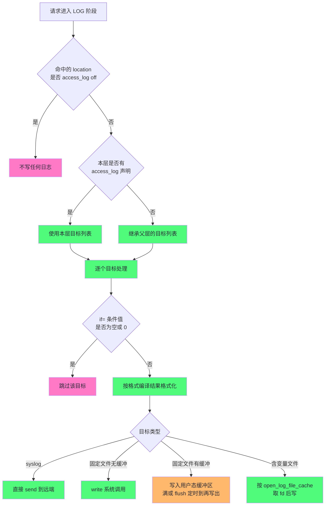
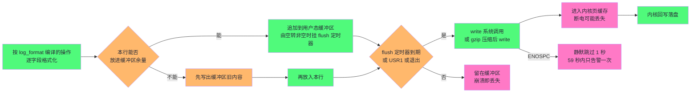
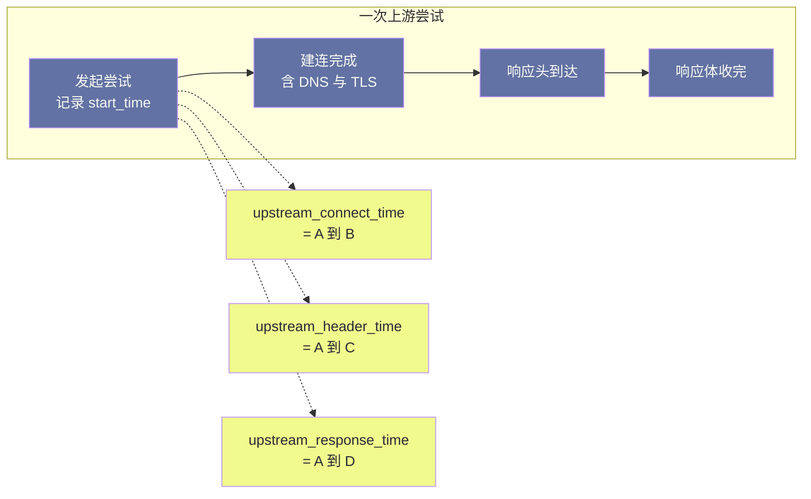
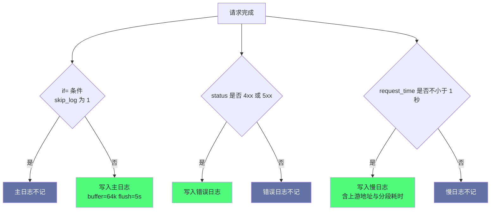
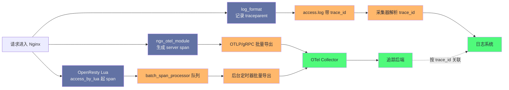

# 09 日志体系与可观测性：access_log、error_log 与链路追踪

**摘要：**

Nginx 的可观测性讨论常被简化为“把日志打开”，但一条 `access_log` 记录能回答的问题远比想象中窄：它能说出这次请求的状态码、字节数、上游是哪台机器、几段时间各花了多久，却说不出 TLS 握手用了多少、连接在 accept 队列里排了多久、上游内部是慢在数据库还是慢在 GC。本文围绕“日志能看出什么、看不出什么”这条主线展开：先给出 `log_format` 与 `access_log` 两套指令的真实语义（含缓冲、`flush`、`if=` 条件、多目标、继承与替换），再逐字段拆解 `$request_time`、`$upstream_response_time`、`$upstream_connect_time`、`$upstream_header_time` 的起点与终点，并给出“差值判据”和多个上游响应时间的解析方式；随后讨论 `error_log` 的级别分工与跨层替换行为、`$request_id` 的生成算法与信任边界，以及 `ngx_otel_module`、OpenResty 的 `opentelemetry-lua`、`log_format` 注入 `traceparent` 三条链路追踪路径的取舍；最后落到日志量估算、条件日志、脱敏与轮转，逐条纠正几个流传很广的错误读法。全文的技术主张只有一条：日志是一条有成本的证据链，每个字段的计时区间决定了它能证明什么；在预算之内，先把“能对上号”的请求 ID 与“能分段”的四个时间变量补齐，再谈全量记录与长期保留。

---

## 第 1 章 一行日志能回答什么

### 1.1 三类信号的边界

可观测性通常被拆成指标、日志、追踪三类信号，三者的差别不在传输格式，而在它们默认回答的问题不同。指标回答“这一类事情发生了多少次、分布在什么维度上”，它天然是聚合的，代价随标签基数增长而不是随流量增长；追踪回答“这一次请求在哪个环节变慢、谁调用了谁”，它天然分段，代价由采样率决定；日志是三者里最笨重的一种，它按请求逐个记录，既没有预先定义的维度，也没有跨服务的结构，胜在信息完整、事后可查、不需要事先知道要问什么。

这个差别决定了日志在排障中的位置：指标负责发现异常，追踪负责定位到服务与环节，日志负责给出那一次请求的具体证据。三者的成本曲线也完全不同：日志随请求数线性增长，指标随标签基数增长，追踪随采样率增长。把日志当指标用会得到一个昂贵且难以聚合的统计系统，把指标当日志用则会在需要看具体请求时发现维度都被抹平了。

笔者在后面几章会反复回到同一个贯穿案例：用户点开“我的订单”，请求经过浏览器、CDN、Nginx、订单服务、MySQL。Nginx 这一跳能留下的全部证据，就是 `access_log` 里的一行文本，加上 `error_log` 里可能出现的几条记录。这一行文本究竟能支撑多少结论，取决于当初 `log_format` 里写了哪些变量，也取决于读日志的人是否清楚每个变量的计时区间落在哪里。

### 1.2 日志回答不了的问题

先把边界划清楚，后面的机制才有意义。`access_log` 记录的是 Nginx 视角下“这一跳”的事实，因此凡是不发生在 Nginx 进程内、或者发生在 Nginx 开始计时的时点之前的事情，日志里一律没有。下图把这段时间轴画出来，粉色环节全部落在日志视野之外。


图中粉色部分是日志完全看不见的时间，绿色部分才是 `$request_time` 覆盖的区间。一个“用户说页面很慢”的报障，如果慢在 DNS、慢在 TLS 握手、慢在 SYN 重传，`access_log` 里的 `$request_time` 会非常漂亮地显示 `0.012`，然后把人引向“后端很快，应该没事”的错误结论。差值公式只在请求已经到达 Nginx 之后才成立，这条前提在后文会反复用到。

| 想回答的问题 | access_log 能回答吗 | 需要补充什么 |
|---|---|---|
| 这批请求错了多少、从几点开始 | 能，但要先聚合 | 指标更合适，日志只能事后统计 |
| 这次 502 是哪个上游返回的 | 能，看 `$upstream_addr` 与 `$upstream_status` | 上游自己的日志与错误码 |
| 慢在 Nginx 还是慢在上游 | 能，用两个时间变量的差值 | 差值里还混着客户端网络，需交叉验证 |
| 上游内部慢在数据库还是 GC | 不能 | 上游的追踪或日志 |
| TLS 握手花了多久 | 不能 | `$ssl_*` 只能给协议与套件，不给耗时 |
| 请求在 accept 队列排了多久 | 不能 | `listen backlog` 溢出计数、内核指标 |
| 客户端到机房的网络 RTT | 不能 | 客户端侧探针或 CDN 日志 |
| 响应体内容与错误原因 | 不能 | 应用日志，或 `error_log` 里的上游报文 |

### 1.3 记录的时机决定了字段的取值

`access_log` 的写入发生在请求处理管道的最后一个阶段，即 LOG 阶段，此时响应已经发送完毕、请求即将释放。阶段的完整顺序与各阶段能做的决定，见 [[03 HTTP 请求处理管道：11 个阶段全解]]，此处只取两个与日志直接相关的事实。

第一个事实是，日志写的是“处理结束时命中的那个 location”的配置，而不是最初匹配的那个。Nginx 文档对此的表述很直白：请求会在处理结束的 location 上下文中被记录，如果处理过程中发生了内部跳转，结束位置可能与起始位置不同。这意味着 `error_page` 跳到 `/50x.html`、`try_files` 回退到某个命名 location 之后，写日志用的是新 location 的 `access_log` 与 `log_format`。线上常见的困惑“为什么这批请求的日志跑到了另一个文件”，答案往往就在这里。

第二个事实是，日志字段里有一部分变量只在写日志的那一刻才有确定值。Nginx 文档把 `$bytes_sent`、`$request_time`、`$status`、`$msec` 这类变量单列为“只在写日志时存在的变量”，`$request_time` 的实现也确实是每次格式化日志行时现算一次时间差。因此它的终点严格说是“格式化日志行的瞬间”，而不是“最后一个响应字节发出的瞬间”；两者之间只差 LOG 阶段里排在写日志之前的那些处理函数，正常情况下是微秒级，但如果 LOG 阶段挂了 `log_by_lua` 并且在里面做了同步的远程调用，这段开销就会算进 `$request_time`，具体机制见 [[12 OpenResty 架构：LuaJIT、cosocket 与协程调度]]。

---

## 第 2 章 access_log 的两套指令

### 2.1 log_format：把变量编译成写入操作

`log_format` 只能在 `http` 上下文里定义，原因是格式对象挂在 HTTP 主配置上、所有 server 共享；`server` 与 `location` 只能通过 `access_log` 选择用哪个已定义的格式，不能就地定义新格式。指令的完整形式是 `log_format name [escape=default|json|none] string ...;`，多个字符串会被拼接，名字重复会直接报配置错误。

Nginx 在解析 `log_format` 时并不保存字符串模板，而是把它编译成一串操作（op）：纯文本编译成定长拷贝，`$status`、`$bytes_sent`、`$request_time` 这类高频变量编译成专用函数，其余变量编译成通用的变量取值操作。写日志时只需遍历这串操作、把结果依次填进缓冲区。这个设计解释了三个容易被忽略的现象。

其一，格式里写的变量名如果是拼错的，Nginx 不会在启动时报错。未知变量在写日志时取不到值，按默认转义规则会输出一个连字符 `-`，于是日志里出现一批莫名其妙的 `-`，而配置文件看起来毫无问题。其二，`log_format` 的改动必须 reload 才生效，因为编译结果是配置期产物，运行期无法替换。其三，变量越多，每条日志的格式化开销越大，`$upstream_response_time` 这类需要遍历上流状态数组、还要做多值拼接的变量，开销明显高于纯文本。

内置的 `combined` 格式在编译时就写死在代码里，它等价于：

```nginx
log_format combined '$remote_addr - $remote_user [$time_local] '
                    '"$request" $status $body_bytes_sent '
                    '"$http_referer" "$http_user_agent"';
```

如果没有在 `http` 层写任何 `access_log`，Nginx 会在该层自动补一条 `access_log logs/access.log combined;`。这个默认值会让“我只在某个 location 里关了日志”的配置出现意外：`http` 层的那条默认日志会把其它所有请求老老实实记下来。

### 2.2 escape 的三态与中文日志

`escape` 参数有三个取值，它们决定了变量值里的特殊字节如何输出，这一项对日志可读性的影响经常被低估。

| escape 取值 | 中文与高位字节 | 引号与控制字符 | 适用场景与代价 |
|---|---|---|---|
| `default`（默认） | 每个字节转成 `\xE4` 形式 | `"`、`\`、小于 32 或大于 126 的字节均转义 | 安全但中文不可读，grep 中文查不到 |
| `json` | 原样保留 UTF-8 | JSON 非法字符按 `\"`、`\\`、`\n`、`\u00XX` 转义 | 推荐，可读且合法，但要求格式本身是合法 JSON |
| `none` | 原样输出 | 一律不转义 | 最省 CPU，也最危险，用户代理里的换行可以伪造日志行 |

默认转义把大于 126 的字节逐字节转成 `\xXX`，于是任一中文参数在日志里会变成一长串 `\xE8\xAE\xA2\xE5\x8D\x95`，既占空间又搜不到。`escape=json` 自 1.11.8 起提供，`escape=none` 自 1.13.10 起提供；改用 `escape=json` 之后，UTF-8 原样输出，中文参数直接可读，这是 JSON 格式日志的第二个理由（第一个是合法 JSON 便于解析）。`escape=none` 只在日志行随后会被某个专门做转义的下游处理时才有意义，直接落盘时它等于把日志注入的入口敞开：一个带 `\n` 的 `User-Agent` 可以在日志里凭空造出一条状态码为 200 的假记录，审计场景下这是实打实的问题。

需要注意 `$status`、`$bytes_sent` 这类专用变量不受 `escape` 影响，它们走的是定长数字输出路径；`escape` 只作用于通用变量取值。因此 JSON 格式里把 `$status` 不加引号写成数字是安全的，而 `$request_time` 是字符串形式的小数，写成数字也合法。

### 2.3 access_log 的参数

`access_log` 的完整语法是 `access_log path [format [buffer=size] [gzip[=level]] [flush=time] [if=condition]];`，另有一条 `access_log off;`。它的上下文是 `http`、`server`、`location`、`location` 内的 `if`，以及 `limit_except`。

先看多目标。同一个层级可以写多条 `access_log`，每条指向不同的文件与格式，这是“一份给机器解析、一份给人看”或者“一份本地、一份远端 syslog”的常见做法。目标也可以是 `syslog:` 前缀，格式为 `syslog:server=unix:/dev/log,facility=local7,tag=nginx,severity=info`，但源码里明确禁止对 syslog 目标启用缓冲，配置了 `buffer=` 会直接报错；同理，文件名里带变量时也不允许缓冲。这两条限制不是保守：syslog 走的是逐条消息投递，动态文件名则每次都要重新打开，两者都没有固定的缓冲归属。

`access_log off` 的语义比字面意思强。文档说它取消当前层级上的所有 `access_log` 指令，而在配置合并阶段，只要本层出现了 `access_log`（无论是指向文件还是 `off`），就不再去继承父层的设置。这意味着在 `location` 里写 `off` 不仅关掉了本层，也关掉了从 `server`、`http` 继承下来的日志；想保留父层日志而只额外增加一份，只能在本层把父层那几条重新写一遍。

各参数的作用与代价见下表，调大调小的取舍集中在第 3 章展开。

| 参数 | 作用 | 调大的代价 | 调小的代价 |
|---|---|---|---|
| `buffer=size` | 在用户态累积多条日志后一次写出 | 崩溃时丢失的窗口变大、`tail -f` 延迟变高 | 系统调用次数上升，高 QPS 下 CPU 与锁竞争明显 |
| `flush=time` | 给缓冲设置强制刷出上限 | 实时性变差，事故现场可能还没落盘 | 刷出频繁，缓冲的合并收益被抵消 |
| `gzip[=level]` | 写出前压缩 | 压缩级别越高 CPU 越贵，压缩会增加写延迟 | 级别低则省 CPU、省盘少 |
| `if=condition` | 条件为 `0` 或空时不记 | 条件写错会静默丢掉需要的日志 | 记全量则日志量与 I/O 压力回升 |

有两处配置约束值得单独记住，它们都是启动期报错而不是运行期告警：只写 `flush=` 而不写 `buffer=` 会被拒绝，报 `no buffer is defined for access_log`；同一路径在配置里重复声明且参数不一致，会被拒绝并报 `already defined with conflicting parameters`。后一条在多文件包含（`include conf.d/*.conf`）的项目里相当常见，两个片段写了同一个日志文件、一个带 `buffer=64k` 一个不带，结果就是启动失败。

当路径里含变量时（譬如按 `$host` 分文件），日志的写入方式会退化成“每条日志 open、write、close”，文件名缓存由 `open_log_file_cache` 管理。它的默认 `valid` 是 60 秒，含义是“最多 60 秒后才检查这个文件名是否还存在”，配合日志轮转就会出现一个经典问题：文件被轮转、旧文件被删除，Nginx 仍在往旧 inode 写，最长 60 秒。这个缓存只对含变量的路径有意义，普通固定路径的日志文件描述符在 `USR1` 后会被重新打开，不需要它。

### 2.4 继承、替换与合并

`access_log` 的继承规则只有一条，但违反直觉：**本层声明即替换**。源码里合并在 `ngx_http_log_merge_loc_conf()` 中完成，逻辑是“若本层的 logs 数组非空或本层被标记为 off，直接返回；否则整体拷贝父层的 logs 与 off 标记”。于是几种常见组合在 `server` 与 `location` 上的结果如下表。

| http 层 | location 层 | 该 location 的实际日志目标 |
|---|---|---|
| `access_log a.log main;` | 未声明 | `a.log` |
| `access_log a.log main;` | `access_log b.log main;` | 只有 `b.log`，`a.log` 不再记录该 location |
| `access_log a.log main;` | `access_log off;` | 不记录 |
| `access_log a.log main;` | `access_log a.log main;` 加 `access_log b.log main;` | `a.log` 与 `b.log` 都记 |

想“既保留父层又多记一份”，正确写法是在本层把父层那一条也重写一遍，而不是指望 Nginx 自动叠加。这条规则与 `error_log` 的行为并不相同，后者在同一层级可以叠加多目标，但跨层级同样是替换，第 6 章会给出源码依据。

### 2.5 内存中的一次选择

把所有分支串起来，一个请求在 LOG 阶段看日志配置的流程大致如下。这张图同时也是后文讨论“日志为什么没写”的第一张排查路线图。



---

## 第 3 章 缓冲、flush 与丢失窗口

### 3.1 缓冲省下的到底是什么

“每条日志一次 `write()` 太贵”这个判断对，但理由经常被说错。`write()` 写日志文件并不触发磁盘同步，数据进入内核页缓存后立即返回，真正的落盘由内核回写线程择机完成。因此缓冲省下的不是“磁盘随机写的次数”，而是系统调用的次数、用户态与内核态的切换开销、以及多个 worker 写同一文件时的锁竞争。

按示例推算：一条 `combined` 格式的日志约 110 到 160 字节，一条带二十来个字段的 JSON 日志约 220 到 400 字节。取 300 字节、QPS 20000 估算，每秒产生约 6 MB 日志，未开缓冲时对应每秒 20000 次 `write()`；若每次系统调用连同格式化合计约 1 微秒，则每秒约 20 毫秒 CPU 花在这条路径上，约占单核的 2%。开启 `buffer=64k` 后，64 KB 大约容纳 218 行，写出次数从 20000 次降到约 92 次，系统调用开销基本消失。这个量级判断说明：在千级 QPS 以下，缓冲的收益几乎可以忽略；上万 QPS 时才值得为它承担丢失窗口的代价。

### 3.2 三个触写条件与一个例外

缓冲的实现在 `ngx_http_log_module.c` 的 `ngx_http_log_handler()` 里，逻辑比“攒满就写”要细。写入发生在以下情形：

第一，下一行日志放不进缓冲区剩余空间时，先把已经积累的字节整体写出，再把这一行放进清空后的缓冲区。注意顺序：是先写旧内容、再放新行，而不是“写满即写”；因此实际写出的块大小通常略小于 `buffer`，取决于行的边界。

第二，`flush` 定时器到期。定时器不是在每次写入时重置，而是在“缓冲区从空开始装入第一条日志”那一刻挂上（源码里判断 `p == buffer->start` 时才 `ngx_add_timer`）。这个细节决定了 `flush` 的准确含义：它限制的是“一条日志在用户态最多停留多久”，而不是“距离上次写出多久强制刷一次”。如果流量恰好让缓冲区每秒都写满，`flush` 永远不会触发，也就没有额外损失。

第三，worker 重新打开日志文件或退出时。`USR1` 触发的 reopen 与优雅退出都会把缓冲刷出，这是日志轮转不丢数据的前提。

例外是单行超长：如果一行的长度超过整个缓冲区大小，它永远不会被放进缓冲，而是单独分配内存直接写出。因此把 `buffer` 设得比最长的日志行还小，等于对所有行都关闭了缓冲；反过来，`buffer` 也不能随意设大，文档明确要求它不超过磁盘单次原子写的大小（FreeBSD 除外），超过之后一次写出可能被拆成多次，反而失去原子性。

### 3.3 丢失窗口的三种形态

把缓冲的丢失风险概括成“worker 崩溃丢 `flush` 时间内的日志”是一种常见的简化，它只覆盖了其中一种。按数据所在的层次，丢失窗口实际有三层。

| 丢失形态 | 丢的是什么 | 触发条件 | 缓解手段 |
|---|---|---|---|
| 进程崩溃 | 用户态缓冲区里未写出的行 | `kill -9`、OOM killer、段错误 | 缩短 `flush`、关键日志不缓冲 |
| 机器掉电或内核崩溃 | 已 `write()` 但未回写的页缓存 | 断电、宿主故障、内核 panic | 单独的同步通道，或直接写远端 syslog |
| 磁盘写失败 | 写不进去的整段缓冲 | 分区写满、inode 耗尽、只读重挂 | 监控磁盘、日志单独分区、`ENOSPC` 告警 |

第三种形态值得单独说，因为它的表现是静默的。源码在直接写日志失败且错误为 `ENOSPC` 时，会把该目标的 `disk_full_time` 记成当前秒，同一秒内后续写入全部跳过；缓冲路径不会跳过，但同样只以 ALERT 级别最多每分钟报一次，于是磁盘写满之后，`error_log` 里每分钟只有一条 `write() to ... failed`。这段时间里 `access_log` 看起来“正常”，实际什么都没记下来。审计场景遇到“某段时间日志缺失、但进程没有重启”，先查磁盘与 inode，比怀疑 Nginx 更有效。

### 3.4 缓冲的代价是可见性

除了丢失，缓冲还带来一个日常操作的代价：`tail -f` 看不到最近 `flush` 时间内的日志。排障时最怕“日志停在 10 秒前，是没请求还是没刷出”，因此不少团队把 `flush` 设在 1 到 5 秒，并在排障期间临时改成无缓冲。折中的判据可以写得很具体：若该日志要用于事后追责或计费，就不缓冲或 `flush=1s`；若只用于流量分析，`buffer=64k flush=5s` 足够；若日志同时写入远端 syslog，本地那份可以放心缓冲，因为远端那份已经是逐条发送。

`gzip` 参数值得一并说明：它默认给 64 KB 缓冲、压缩级别 1，比“先写文本再用 logrotate 压缩”省一次磁盘往返，代价是每次写出都要在 worker 里做压缩。级别从 1 提到 6 能多压几个百分点，但在万级 QPS 下这个 CPU 花得不划算；级别 1 的意义是“用很少的 CPU 换掉大部分体积”，文本日志通常能压到原体积的十分之一量级（经验值，随内容重复度变化很大）。压缩按块进行，因此 `zcat` 可以随时读，不需要等文件写完。

### 3.5 一次写入的完整路径

把上述机制画成一条路径，可以直观看出每个环节的失败点。



---

## 第 4 章 五个时间变量的精确语义

### 4.1 从一行日志读起

下面是贯穿案例里那笔订单查询请求在 Nginx 侧留下的记录（`log_format` 里显式写了变量名，便于逐字段对照）：

```text
remote_addr=10.20.3.77 status=200 request_length=842 body_bytes_sent=15234
request_time=3.417 upstream_addr=10.30.1.21:8080, 10.30.1.22:8080
upstream_status=504, 200 upstream_response_time=3.001, 0.312
upstream_connect_time=0.000, 0.001 upstream_header_time=3.000, 0.305
```

这行记录里至少藏着四个结论：请求总耗时约 3.4 秒；第一次尝试打到了 `10.30.1.21` 并等满 3 秒拿到 504；`proxy_next_upstream` 把请求重试到 `10.30.1.22`，第二次只用了 0.312 秒；上游整体等待中，建连几乎不花时间，第一次尝试的时间全耗在等响应头上。要读出这些，前提是清楚每个变量的起止点；读错任何一个，结论就会反掉。

| 变量 | 起点 | 终点 | 包含 | 不包含 |
|---|---|---|---|---|
| `$request_time` | 读到请求行第一个字节 | 格式化日志行那一刻 | 读请求体、Nginx 内部处理、上游全段、回写客户端 | TLS 握手、accept 排队、连接空闲 |
| `$upstream_response_time` | 本次上游尝试发起前 | 收到响应体最后一个字节 | 解析域名、建连、TLS、发请求、等响应头、收响应体 | 回写客户端、Nginx 内部处理 |
| `$upstream_connect_time` | 同一次尝试的起点 | TCP 连接建立完成 | 域名解析、TCP 握手、TLS 握手 | 发请求与等待响应 |
| `$upstream_header_time` | 同一次尝试的起点 | 收到响应头最后一字节 | 建连段加等响应头 | 收响应体的时间 |

### 4.2 $request_time：从第一个字节到写日志

Nginx 文档给出的定义是“从客户端读出第一批字节到最后一个字节发出后写日志之间的时间”，实现上则更偏向后者：请求结构体在分配时记下 `start_sec` 与 `start_msec`，`$request_time` 在每次格式化日志行时用当前时间减去这对起点，输出为秒加三位毫秒。由此可以推出三个常被忽略的结论。

其一，慢速上传的时间是算在内的。请求体在 Nginx 里是惰性读取的，`proxy_pass` 场景下常常边读边转发，但无论读得多晚，计时起点都在请求行到达时。设想一个 20 MB 的表单提交，客户端上传耗时 8 秒、后端处理 0.2 秒（示例推算），`$request_time` 会显示 8 秒出头，`$upstream_response_time` 取决于 `proxy_request_buffering` 的取值：开启时 Nginx 先收完请求体再连上游，差值会很大；关闭时上游在收体的同时处理，差值会小。那种“`$request_time` 不含读请求体”的说法与源码不符，它把“不含客户端到机房的网络传输”和“不含读请求体”混为一谈，而客户端上传恰恰发生在链路内。

其二，TLS 握手与连接排队不在其中。`$request_time` 的起点是“请求的第一个字节被读到”，而 TLS 握手发生在此之前，accept 队列的排队更早。这个边界有两个实际后果：一是前面的图里那些粉色阶段要靠内核与 TLS 层指标来覆盖；二是 keepalive 连接上的第二个请求，计时从它自己的第一个字节开始，与连接建立了多久无关，想判断“这条连接上跑了多少个请求”要看 `$connection_requests`。

其三，**终点是写日志**而不是发完响应。正常情况下这中间只有一次 LOG 阶段函数调用，差异在微秒级；但 LOG 阶段如果有别的处理函数排在日志模块之前（OpenResty 的 `log_by_lua` 就是典型），它们消耗的时间会被计入 `$request_time`。笔者见过把 HTTP 回调、埋点上报写在 `log_by_lua` 里的服务，`$request_time` 比 `$upstream_response_time` 多出几十毫秒，最后把 Nginx 自己写进了嫌疑人名单——这类问题只能靠对数、分阶段埋点来排除。

### 4.3 $upstream_response_time：包含建连的那一段

文档对它的描述只有一句“接收上游响应所花的时间”，容易被读成“建立连接之后才开始计时”。源码里不是这样：每次上游尝试开始时，`u->start_time` 在 `ngx_event_connect_peer()` 调用之前就被赋值为当前毫秒；`connect_time`、`header_time`、`response_time` 三者都是在各自的完成点用“当前时间减去同一个 `start_time`”得到的。三者的关系因此是包含而非并列：`connect_time` 是 `response_time` 的前一段，`header_time` 是中间到响应头为止的一段，`response_time` 覆盖到最后；下图把三个区间画在同一根时间轴上。



`$upstream_connect_time` 与 `$upstream_header_time` 分别自 1.9.1 与 1.7.10 起提供。这个起点带来的直接推论是：`$upstream_connect_time` 在某些情况下并不小。当 upstream 使用 `resolver` 加 `server ... resolve` 做动态解析时，域名解析发生在建连路径上，解析耗时落在 `connect_time` 里；静态解析在配置加载时完成，不占每次请求的时间（以对应版本文档为准）。开启 TLS 的上游，握手时间也计入 `connect_time`，文档对此有明确说明。所以看到 `connect_time=0.3` 时，先分清是 TCP 建连慢、TLS 握手慢，还是 DNS 慢，三者的排查路径完全不同。

另一点需要纠正的是“上游处理时间”这个说法。`$upstream_response_time` 度量的是 Nginx 与上游之间的一次往返，它既包含上游应用的处理时间，也包含数据在网络上的传输时间、上游把响应体推给 Nginx 的时间。上游返回一个 10 MB 的响应体，即使应用生成本身只花了 5 毫秒，`response_time` 也会因为传输而变大。要区分“应用算得慢”和“传得慢”，只能靠上游自己的追踪，Nginx 这一侧没有更细的切分。

### 4.4 差值判据与它的前提

由上述起点关系可以得到一条判据：`$request_time` 减去 `$upstream_response_time`，得到的是“不属于上游往返”的那段时间。它包含客户端上传请求体的耗时、Nginx 自身的处理耗时、以及向客户端回写响应的耗时。这个差值大而 `$upstream_response_time` 小，说明问题不在上游，在 Nginx 内部或客户端网络。

| 现象 | 差值特征 | 可能结论 | 下一步 |
|---|---|---|---|
| `request_time` 大、`upstream` 大、`body_bytes_sent` 也大 | 小 | 客户端接收慢形成背压，拖长了上游读取 | 看客户端地域与带宽、开压缩、减响应体 |
| `request_time` 大、`upstream` 小、`body_bytes_sent` 大 | 大 | 回写客户端慢 | 压缩、CDN、检查 `sendfile` 与 `tcp_nopush` |
| `request_time` 大、`upstream` 小、`body_bytes_sent` 小、状态 499 | 大 | 客户端提前断开 | 前端超时配置、首字节优化 |
| `request_time` 与 `upstream` 都小，用户仍报慢 | 无异常 | 慢在 Nginx 之前：DNS、TLS、排队 | 抓包、内核指标、TLS 层观测 |
| `upstream` 多值且首值接近超时阈值 | 不定 | 重试被触发，首台上游不可用 | 查 `upstream_status`、健康检查、超时配置 |

有一处反直觉的情况值得单列：两个数同时变大，并不一定是后端变慢。客户端接收慢时，Nginx 回写响应的缓冲区会被填满，随后停止从上游读取，上游继续写就会被 TCP 背压卡住，于是 `$upstream_response_time` 也跟着变长。此时若只看“上游慢”的结论，会去优化一个根本没问题的后端。区分的办法是看响应体大小与客户端特征：大响应体、弱网客户端、`body_bytes_sent` 接近 `upstream_response_length`，三个条件凑齐时优先怀疑背压。上游超时与重试参数本身的配置语义见 [[04 反向代理与负载均衡：upstream 模块深度解析]]。

### 4.5 多个值怎么读

三个上游时间变量都可能是多值，分隔符有两种，含义不同：

| 分隔符 | 出现的场景 | 解析要点 |
|---|---|---|
| 逗号加空格 `, ` | 同一个 upstream 组内发生多次尝试，如 `proxy_next_upstream` 重试 | 每个值与 `$upstream_addr` 的同一位置对应 |
| 空格加冒号加空格 ` : ` | 跨 upstream 组的内部跳转，如 `error_page` 或 `X-Accel-Redirect` | 冒号前后是两个不同组的尝试序列 |
| 单个 `-` | 该次尝试没有拿到响应（连接失败、超时、被放弃） | 不能当 0 处理，聚合时需单独计数 |

把 `$upstream_response_time` 当单值解析是日志分析脚本最常见的 bug：`awk` 里用 `sum += $n` 遇到 `3.001, 0.312` 只会取到 `3.001`，或者直接报类型错误。正确做法是先按分隔符切分、与 `$upstream_addr` 对齐，再决定聚合口径。这里有两套口径需要区分：**用户感知的总上游等待**应该把同一请求的多次尝试相加，而**单台上游的健康度**应该按地址分组取各自的值；用 `max` 去评价上游健康度会把“重试到快机器”的请求算成慢请求，用 `sum` 去评价单台延迟则会把重试次数混进延迟里。

下面这段脚本按地址聚合，并把“没有拿到响应”的尝试单独计数：

```python
import re

addr_re = re.compile(r'upstream_addr=(?P<addr>[^ ]+)')
rt_re = re.compile(r'upstream_response_time=(?P<rt>[^ ]+)')

def split_multi(s):
    # 冒号分隔 upstream 组，逗号分隔同组内的重试；统一切成扁平序列
    return [p.strip() for p in re.split(r'[:,]', s) if p.strip()]

stats = {}
for line in open('/var/log/nginx/access.log', encoding='utf-8', errors='replace'):
    m1, m2 = addr_re.search(line), rt_re.search(line)
    if not (m1 and m2):
        continue
    addrs = split_multi(m1.group('addr'))
    times = split_multi(m2.group('rt'))
    for i, addr in enumerate(addrs):
        rt = times[i] if i < len(times) else '-'
        rec = stats.setdefault(addr, {'ok': 0, 'miss': 0, 'sum': 0.0})
        if rt == '-':
            rec['miss'] += 1
        else:
            rec['ok'] += 1
            rec['sum'] += float(rt)

for addr, r in sorted(stats.items(), key=lambda kv: -kv[1]['sum']):
    avg = r['sum'] / r['ok'] if r['ok'] else 0.0
    print(f'{addr} ok={r["ok"]} miss={r["miss"]} avg_rt={avg:.3f}s total={r["sum"]:.1f}s')
```

脚本里用“下标对齐”而不是“把值加起来除以个数”，因为两个列表是按尝试次数同步增长的；只有一种情况会让两者的长度不一致，就是某次尝试在地址上有记录、时间上是 `-`，所以脚本用 `-` 单独计数来兜底。生产环境更好的做法是把日志写成 JSON，用 `jq` 或日志系统自带的解析器处理，正则解析器只适合做临时核对。

### 4.6 时间变量的六个陷阱

| 陷阱 | 现象 | 判据与处理 |
|---|---|---|
| 没走上游 | `upstream_response_time` 为 `-` | 命中缓存、被 `return` 或鉴权拦截、静态文件，都在此列 |
| keepalive 复用 | `connect_time` 接近 0 | 正常现象，说明复用了连接池，不是“上游没建连” |
| 流式响应 | `response_time` 等于整个流的时长 | SSE、大文件下载的 `response_time` 不代表首字节延迟 |
| HTTP/2 多路复用 | 同一连接上多个请求并发 | 计时互不影响，但连接级问题会同时打击多条请求 |
| LOG 阶段有耗时操作 | `request_time` 无故偏大 | 检查 `log_by_lua` 里的同步调用与子请求 |
| 缓存命中 | `upstream_cache_status=HIT` 且时间为 `-` | 此时 `request_time` 全部是 Nginx 与客户端的时间 |

缓存命中与失效的机制见 [[05 缓存机制：proxy_cache 的物理结构与失效策略]]。

`$upstream_header_time` 与 `$upstream_connect_time` 的差值同样有用：它近似等于“请求发出去到上游开始回响应头”的时间，用来判断“上游是不是在处理阶段卡住”。但要注意它包含 Nginx 发送请求体的时间，上传型接口的这个差值天然偏大，不能和查询型接口放在同一个基线里比较。

### 4.7 第五个时间变量与量级参考

与上游相关的时间字段还有第五个：`$upstream_queue_time`（1.13.9 起），记录请求在 `queue` 指令形成的上游等待队列里停留的时间。它把“排队等一台可用上游”与“上游真的在处理”分开，在多租户或 `max_conns` 限连的场景里是唯一能说明白“慢在排队”的字段；不过 `queue` 指令属于商业订阅能力，开源版里这个变量通常输出 `-`（以对应版本文档为准）。

| 区间 | 典型量级（示例推算） | 读法 |
|---|---|---|
| `request_time`，静态小文件或缓存命中 | 1 到 10 毫秒 | 几乎全是 Nginx 与客户端之间的时间 |
| `request_time`，正常代理请求 | 20 到 300 毫秒 | 上游占大头，差值通常在个位数毫秒 |
| `upstream_connect_time`，keepalive 复用 | 0 到 1 毫秒 | 复用连接，近乎为零而非“没建连” |
| `upstream_connect_time`，同机房新建连接 | 0.1 到 3 毫秒 | 三次握手，含 TLS 时明显变长 |
| `upstream_connect_time`，跨机房或公网 | 5 到 50 毫秒 | 与 RTT 同量级，TLS 握手叠加 |
| `upstream_header_time` 减 `connect_time` | 1 到 500 毫秒 | 上游应用处理与内部排队 |
| `upstream_response_time` 减 `header_time` | 与响应体大小成正比 | 大响应体显著拉长这一段 |
| `request_time` 减 `upstream_response_time` | 1 到 50 毫秒或更大 | Nginx 内部处理加回写客户端 |

这些数字是示例推算与量级判断，不是基准数据，不同机房、不同响应体大小会让结果差出一个数量级；它们的用处是判断“某个值是否离谱”，而不是拿来当 SLO 阈值。

---

## 第 5 章 条件日志与日志量治理

### 5.1 if= 的语义

`if=condition`（1.7.0 起提供）是降低日志量最直接的手段，语义只有一条：条件求值结果为空字符串或单个字符 `0` 时，跳过这条日志目标。源码里的判断是 `val.len == 0 || (val.len == 1 && val.data[0] == '0')`，注意它判断的是字符串，因此条件变量求值为 `0` 或空串时都不记，而求值为 `00` 时会记。

条件通常由 `map` 生成。健康检查与探针是最典型的应用：它们每秒产生固定数量的请求，状态码永远是 200，对排障毫无价值，却可能占掉总日志量的三成以上。静态资源同理，若把图片、字体、脚本记进主日志，真正的 API 日志会被淹没。

```nginx
# 健康检查与静态资源不记主日志
map $request_uri $skip_log {
    default                    0;
    "~^/healthz$"             1;
    "~^/readyz$"              1;
}

# if= 的语义是“值非空且非 0 才记”，所以要把 skip_log 反过来映射
map $skip_log $loggable {
    0        1;
    default  0;
}

server {
    access_log /var/log/nginx/access.log json_main if=$loggable;
    # 静态资源单独一份，缓冲可以开大、保留期可以短
    location ~* \.(?:jpg|png|gif|ico|css|js|woff2)$ {
        access_log /var/log/nginx/static.log combined buffer=128k flush=30s;
        expires 7d;
    }
}
```

### 5.2 只记 5xx、只记慢请求

“只记错误”是另一个高频需求，用 `map $status` 就够了：

```nginx
# json_main 与 json_slow 是前文定义过的 log_format 名称
map $status $is_error {
    ~^[45]   1;
    default  0;
}

access_log /var/log/nginx/error_access.log json_main if=$is_error;
access_log /var/log/nginx/access.log      json_main buffer=64k flush=5s;
```

两条 `access_log` 在同一层级，互不影响：错误请求同时进两个文件，正常请求只进主日志。这里要注意不要把“只记错误”当成“主日志可以关掉”，因为 4xx 与 5xx 的上下文（哪个上游、哪个 URI、耗时多少）恰恰要靠完整格式才有意义，而 `if=` 只决定记不记，不改变格式。

慢请求日志的判据要小心写。用 `~^\d{1,}\.` 匹配 `$request_time` 是流传很广的写法，本意是“整数部分至少一位，即不小于 1 秒”，但这个正则会匹配 `0.5`：`\d{1,}` 允许匹配单个 `0`，后面紧跟小数点即可成立。结果所有亚秒请求都被判成慢请求，慢日志失去意义。正确的写法是只匹配以 1 到 9 开头的数，或者显式处理两位数：

```nginx
# 只认 1 秒及以上：0.x 不匹配，1.x 到 9.x 匹配，10 以上以 1 开头也匹配
map $request_time $is_slow {
    "~^[1-9]"   1;
    default     0;
}

access_log /var/log/nginx/slow.log json_slow if=$is_slow;
```

把慢请求分流到独立文件的好处是便于做基线对比：主日志上百万行里筛慢请求很贵，慢日志只有几千行，可以直接看分布与上游分布。代价是多一份写放大，慢请求同时出现在两份文件里。三条判定路径的分叉位置如下图。



### 5.3 分级落盘

条件日志之上要先想清楚用途。同一份日志往往被四类需求同时拉扯，它们的完整性要求与成本结构完全不同，先把这四类拆开，分文件才有依据。

| 用途 | 对日志的要求 | 成本主要花在哪 | 不该做的事 |
|---|---|---|---|
| 审计 | 全量、不可篡改、可检索 | 存储与保留期 | 采样、大缓冲、经可丢链路投递 |
| 排障 | 上下文完整、接近实时 | 字段数量与写入实时性 | 只记状态码、没有请求 ID |
| 计费与统计 | 聚合准确、可去重 | 解析与幂等对账 | 直接数日志行、依赖采样数据 |
| 安全 | 脱敏、防注入、可追溯 | 脱敏管道与访问控制 | 记全量 `$args`、记认证头 |

把四类需求压在一个文件上，只能取最严的那一档，于是所有日志都按审计标准付成本。分文件之后，每个用途的配置可以独立调，保留期与缓冲参数各归各位，这是笔者见过最省钱也最可维护的做法。

| 日志文件 | 内容 | 是否全量 | buffer 与 flush | 保留期 | 主要用途 |
|---|---|---|---|---|---|
| 审计日志 | 全部请求，含身份与来源 | 全量 | 不缓冲或 `flush=1s` | 半年到一年 | 追责、合规 |
| 主访问日志 | 全部或抽样请求 | 近似全量 | `buffer=64k flush=5s` | 7 到 30 天 | 流量分析、排障 |
| 错误访问日志 | 4xx 与 5xx | 子集 | `buffer=32k flush=5s` | 30 天 | 错误分析、告警 |
| 慢请求日志 | 超过阈值的请求 | 子集 | 不缓冲 | 7 天 | 性能基线 |
| 静态资源日志 | 图片、脚本、字体 | 子集 | `buffer=128k flush=30s` | 3 天 | 缓存命中分析 |

审计日志单独一套的理由不只是保留期：它不能采样、不能按条件丢弃、不能用大缓冲，任何一份缺失都可能在事后成为不可解释的空白。

### 5.4 采样与它的失真

当流量规模大到条件日志也压不住时，剩下的一招是采样。按比例抽样的写法通常借 `split_clients`，用 `$request_id` 做哈希键：

```nginx
split_clients "$request_id" $sample {
    10%    1;
    *      0;
}

access_log /var/log/nginx/sampled.log json_main if=$sample;
```

`$request_id` 每个请求不同且分布均匀，用它做键可以保证同一个请求在多台机器上得到一致的采样结论（这与按 `$remote_addr` 采样不同，后者会把同一客户端的行为整体保留或整体丢弃）。采样的失真也要说清楚：它不适合审计，不适合计费，也不适合统计低频错误——1% 采样下，一天出现 5 次的 502 大概率一次都采不到。错误日志与慢日志不应该采样，它们本身就是稀疏子集。

### 5.5 脱敏：不要打的东西

访问日志泄露凭据是审计里最常见的发现，三类内容必须默认排除：

第一类是查询串全量。`$args` 与 `$request_uri` 会把 `?token=...`、`?password=...`、`?code=...` 原样写进日志，而这些参数可能长期有效。正确做法是用 `map` 白名单，只保留有诊断价值的参数（譬如 `page`、`size`、`trace`），其余丢弃；或者只记 `$uri` 加参数个数。

第二类是认证头与 Cookie。`$http_authorization` 绝不能进日志，`$http_cookie` 里通常含会话 ID，同样不应该记。这两项在很多日志模板里被当作“调试方便”默认带上，属于隐患。

第三类是路径里的令牌。重置密码链接 `POST /reset/abc123` 的令牌在路径上，日志会把它完整记下；这类接口应该在 Nginx 层把路径重写成固定形式再记录，或者只记路由模板而不记实际段。

除了泄露，还有一个方向相反的风险：日志注入。攻击者可以在 `User-Agent` 里塞入换行与伪造的日志行，让日志系统把一条请求解析成两条，从而掩盖真实行为。第 2 章的 `escape` 讨论已经覆盖了防御手段：保留默认转义或使用 `escape=json`，不要用 `escape=none`。审计场景还应校验 `$request_id` 的格式，因为外部传入的 `X-Request-Id` 同样可以携带控制字符。

### 5.6 日志量估算

日志成本等于“每条日志的字节数 × 请求数 × 保留时长”，三个因子都可以调。按示例推算，取 JSON 日志平均 300 字节、压缩比 1:8、保留 30 天：

| QPS | 每日日志量（未压缩） | 30 天（未压缩） | 30 天（gzip 后） | 量级判断 |
|---|---|---|---|---|
| 1000 | 约 25 GB | 约 760 GB | 约 95 GB | 单机磁盘可承受 |
| 10000 | 约 250 GB | 约 7.6 TB | 约 950 GB | 需要集中采集与冷热分层 |
| 100000 | 约 2.5 TB | 约 76 TB | 约 9.5 TB | 必须先做条件日志与采样 |

这些数字是示例推算，真实值取决于字段数量、URI 长度与压缩效果。它们的意义在于说明日志量对 QPS 是线性的：一个十万 QPS 的系统决定“全量记日志”，等于决定每年投入几十 TB 存储与相应的采集带宽。

---

## 第 6 章 error_log 的级别与用途分工

### 6.1 八个级别的真实含义

`error_log` 的级别常量在 `ngx_log.h` 里是从 1 到 8 递增的整数：`NGX_LOG_EMERG` 为 1、`NGX_LOG_ALERT` 为 2、`NGX_LOG_CRIT` 为 3、`NGX_LOG_ERR` 为 4、`NGX_LOG_WARN` 为 5、`NGX_LOG_NOTICE` 为 6、`NGX_LOG_INFO` 为 7、`NGX_LOG_DEBUG` 为 8；配置里写的 `error` 对应常量 `NGX_LOG_ERR`，写 `err` 不是合法取值。`error_log /var/log/nginx/error.log warn;` 这一行的含义是“只写严重度不低于 warn 的记录”，也就是 1 到 5 全部落盘。

| 级别 | 典型内容 | 适合长期开启吗 | 是否适合直接告警 |
|---|---|---|---|
| `emerg` | 无法绑定端口、内存耗尽、配置不可用 | 数量极少 | 是，最高优先级 |
| `alert` | 管道错误、日志写失败、共享内存异常 | 极少 | 是 |
| `crit` | 磁盘空间不足、`accept` 失败 | 少 | 是 |
| `error` | 上游连接失败、超时、`limit_req` 触发、worker 连接数耗尽 | 中等，需要聚合 | 是，需按错误文本分类 |
| `warn` | 上游响应异常、缓存目录问题 | 中等 | 部分场景 |
| `notice` | reload 完成、worker 启停、配置检查结果 | 少量 | 一般不看 |
| `info` | 客户端侧异常：超时、断连、非法请求头、请求行过长 | 较多 | 不建议直接告警 |
| `debug` | 事件循环、阶段流转、变量求值 | 不能 | 不能 |

### 6.2 error_log 不是错误专用

把 `info` 级别解释成“服务器启动、连接建立与关闭”是一处流传很广的误读，与源码的实际用法有偏差。Nginx 在 `info` 级别记录的大量内容是客户端侧的异常：`client closed connection`（客户端主动断开）、`client timed out`（读请求头或请求体超时）、`client sent invalid header`（非法请求头）、`client sent too long URI`（请求行过长）。这些记录的状态不是“服务器出错”，而是“这次请求没按协议正常走完”，本质上是一份连接生命周期与协议合规性的流水账；它们在排障里的价值往往高于 `error` 级别：一个 499 或 400 的请求，`access_log` 只能告诉你状态码，`error_log` 的 `info` 才会告诉你原因。

这也是生产环境把级别定在 `warn` 的隐患：`warn` 及以上会丢掉全部 `info` 记录，于是“客户端为什么断开”“为什么出现一批 400”这类问题在日志里彻底失去线索。更合理的配置是按用途拆成两个目标：

```nginx
# 主错误日志：warn 及以上，用于告警与长期保留
error_log /var/log/nginx/error.log warn;

# 客户端行为日志：notice 及以上，短保留期，用于排障
error_log /var/log/nginx/client_error.log notice;
```

同一个层级写多条 `error_log` 是允许的，实现上它们组成一条按级别降序排列的日志链，每条记录会按各自的阈值判断是否写出。`notice` 与 `info` 的取舍取决于流量规模：万级 QPS 下 `info` 每天可能产生数 GB（量级判断），而其中绝大多数是扫描器与移动端弱网造成的断连，价值密度低，用短保留期配合聚合统计更合适。

### 6.3 debug 的门槛

配置 `debug` 级别有一个硬前提：Nginx 编译时必须带 `--with-debug`。没有这个选项时，写 `error_log ... debug` 不会静默降级，而是启动直接报 `nginx was built without debug support`，这一点与很多“配置了没效果”的指令不同，报错反而是好事。

`debug` 的日志量级不适合生产长期开启：一个普通请求会产生几十条记录，涉及上游与文件操作的请求可以上百条。生产排障的正确姿势是 `debug_connection`，只对指定来源的连接开启 debug，其余连接维持原级别：

```nginx
events {
    debug_connection 10.20.3.77;
    debug_connection 10.20.4.0/24;
}
```

它同样要求 `--with-debug`，且只能写在 `events` 上下文。debug 日志的读法（如何从记录里看出请求当前落在哪个阶段、为什么 location 被重选）见 [[03 HTTP 请求处理管道：11 个阶段全解]]，那里对阶段流转有更完整的说明。

### 6.4 跨层级是替换，不是叠加

第 2 章讲过 `access_log` 的“本层声明即替换父层”，`error_log` 在这一点上行为类似，但细节不同：同一层级可以配置多条（写多个目标），跨层级则是本层配置整体生效、父层不再收到该请求的日志。

源码路径很清楚。配置合并时，`ngx_http_core_merge_loc_conf()` 只在 `conf->error_log == NULL` 时才从父层继承，否则保留自己的；而 `error_log` 指令的处理函数会直接把日志追加到本层的 `error_log` 链上。由于指令解析发生在合并之前，只要本层写了 `error_log`，合并阶段就不会继承父层。请求命中 location 时，`ngx_http_update_location_config()` 会把连接的日志对象切换到该 location 的 `error_log`，切换点就在 FIND_CONFIG 之后。因此：

- 写在 `http` 层的 `error_log` 收到的是未命中更具体配置的请求的日志，以及 HTTP 模块自身产生的记录；启动与配置解析阶段的记录走的是 main 上下文的 `error_log`；
- 写在 `server` 层的 `error_log` 会让该虚拟主机的请求日志只进自己的文件；
- 写在 `location` 层的 `error_log` 只对进入该 location 之后的日志生效，此前的日志还在上一级。

这条规则解释了两个常见现象：一是“我给某个 location 配了独立错误日志，结果主日志里还有它的一部分记录”，因为 FIND_CONFIG 之前的记录还走 main 与 http 的日志；二是“主错误日志里看不到某个 server 的错误”，因为那个 server 自己配了 `error_log`，把父层替换掉了。

### 6.5 从错误文本定位问题

`error_log` 的价值在于它带着上下文：客户端地址、请求行、上游地址与系统错误。下面这些文本覆盖了最常见的几类 Nginx 侧故障。

| 错误文本片段 | 含义 | 常见根因 |
|---|---|---|
| `connect() failed (111: Connection refused)` | 上游端口没有监听 | 进程崩溃、端口写错、只监听了 127.0.0.1 |
| `upstream timed out (110: Connection timed out)` | 等响应头超过 `proxy_read_timeout` | 上游处理慢、线程池耗尽、GC 停顿 |
| `upstream sent too big header` | 上游响应头超过缓冲区 | Cookie 过大、重定向链过长、头部字段膨胀 |
| `no live upstreams` | 组内所有上游被判定不可用 | `max_fails` 与 `fail_timeout` 叠加导致整体熔断 |
| `worker_connections are not enough` | 单 worker 连接数打满 | `worker_connections` 过小、上游连接泄漏 |
| `limiting requests, excess: ...` | `limit_req` 触发 | 客户端突发、阈值过严 |
| `write() to "/var/log/nginx/access.log" failed` | 日志写失败 | 磁盘满、inode 耗尽、权限变化 |

关于限流日志的级别，把它归到 `warn` 一档是一种常见印象，实际 `limit_req_log_level` 的默认值是 `error`，`limit_conn_log_level` 也是如此。这意味着默认配置下，限流触发会以 `error` 级别落进错误日志，量大的时候会把真正的错误淹掉；限流属于“预期内的拒绝”，把级别调到 `warn` 甚至 `info` 更合适，同时用指标统计拒绝率。

---

## 第 7 章 请求 ID 与三条链路追踪路径

### 7.1 $request_id 的生成机制

`$request_id` 自 Nginx 1.11.0 起提供，官方描述是“由 16 个随机字节生成的唯一请求标识，十六进制表示”，也就是 32 个小写十六进制字符。很多文章把它说成“从 `/dev/urandom` 取随机数”，读源码会发现实际实现更克制：每个 worker 维护一个静态计数器，启动后第一次用到该变量时准备一对 64 位密钥——如果编译了 OpenSSL，密钥来自 `RAND_bytes()`；否则由 `ngx_random()`、进程号与时间混合而成；此后每生成一个 ID，就把计数器自增两次、分别做 SipHash 得到 16 个字节，再转成十六进制。

这个实现说明了两件事。第一，唯一性靠的是“同一 worker 内计数器单调递增加哈希”，而不是熵池，所以它不是一个密码学随机数，不能当 CSRF token、不能当不可猜测的下载凭证。第二，跨 worker、跨机器的唯一性，在编译了 OpenSSL 时靠 `RAND_bytes()` 给出的随机密钥，未编译时才退回用进程号与时间混合，理论上存在碰撞可能，实际上不必担心，但这也意味着它不适合承担“全局唯一事实来源”的角色，需要审计级唯一性时应由业务侧生成并在网关校验。

### 7.2 $http_x_request_id 与信任边界

`$http_x_request_id` 是入站请求头 `X-Request-Id` 的变量形式，它的问题不在读，而在信。客户端可以随意传这个头，包括传入与另一个合法请求相同的值来污染日志，或者传入带控制字符的值来伪造日志行。因此它的使用必须带三道约束。

第一道是格式校验。用 `map` 做白名单正则，只接受形如 32 位十六进制的值，其余一律丢弃：

```nginx
map $http_x_request_id $trusted_rid {
    default                                              "";
    "~^[0-9a-f]{32}$"                                    $http_x_request_id;
}

map $trusted_rid $trace_id {
    ""      $request_id;
    default $trusted_rid;
}
```

第二道是来源限制。只信任内网网关或上一跳已知服务传来的值，公网请求一律用 Nginx 自己生成的。第三道是回显策略：无论用了哪个 ID，都应该通过 `add_header X-Request-Id $trace_id always;` 返回给客户端，这样用户报障时能直接提供 ID，客服与研发不用再从时间戳里猜是哪条请求。

```nginx
server {
    location /api/ {
        proxy_set_header X-Request-Id $trace_id;
        proxy_set_header X-Forwarded-For $proxy_add_x_forwarded_for;
        add_header X-Request-Id $trace_id always;
        proxy_pass http://order_backend;
    }
}
```

后端把 `X-Request-Id` 放进日志上下文（Java 的 MDC、Go 的 `context`、Python 的 `logging.Filter` 都是这个思路），一条 ID 就能把 Nginx 日志、应用日志、数据库慢查询日志串起来。这条链路成本几乎为零，问题只在“串起来之后仍然只有时间戳，没有分段”。

### 7.3 第一条路：ngx_otel_module

官方维护的 `ngx_otel_module` 把 OpenTelemetry 的链路能力做进了 Nginx 自身，支持 W3C Trace Context 传播与 OTLP/gRPC 导出。它以动态模块形式分发（预编译包自 1.25.3 起提供，商业版更早），使用时需要 `load_module` 加载，配置面则是几个 `otel_*` 指令。

```nginx
load_module modules/ngx_otel_module.so;

http {
    otel_exporter {
        endpoint otel-collector:4317;
        interval 5s;
        batch_size 512;
        batch_count 4;
    }
    otel_service_name edge-nginx;

    log_format otel '$remote_addr $status $request_time '
                    'trace_id=$otel_trace_id span_id=$otel_span_id';

    server {
        location /api/ {
            otel_trace on;
            otel_trace_context propagate;
            otel_span_name order_query;
            otel_span_attr order_channel $arg_channel;
            access_log /var/log/nginx/otel_access.log otel;
            proxy_pass http://order_backend;
        }
    }
}
```

`otel_trace_context` 的取值决定上下文如何传播：`extract` 只从入站请求继承、`inject` 覆盖写入新上下文、`propagate` 两者都做、`ignore` 不处理。`otel_span_name` 默认取 location 名，建议显式改成路由语义的名字，否则 trace 里全是 `/api/` 这种粒度太粗的标签。导出侧有三个参数会直接影响数据完整性：`interval` 默认 5 秒、`batch_size` 默认 512、`batch_count` 默认 4，每个 worker 待发批次超过上限时新的 span 会被丢弃。高流量下要么调大 `batch_count`，要么在 `otel_trace` 上用 `split_clients` 做采样（文档给出了 `$otel_trace_id` 配合采样变量的写法），把丢弃变成可控的抽样。

这条路的优点是精度高：Nginx 自己产生 span，`$request_time` 与 span 时长同源，`access_log` 里记下 `$otel_trace_id` 后，日志与追踪可以用一个字段关联。代价是模块加载、导出通道与采样策略都要额外维护，而且它是相对年轻的模块，接口细节以对应版本文档为准。

### 7.4 第二条路：OpenResty 的 opentelemetry-lua

在 OpenResty 里，追踪可以用 Lua 实现。`opentelemetry-lua` 是 Lua 版的 OpenTelemetry 实现，设计目标是 Nginx 与 OpenResty 生态，项目当前仍标注为 alpha 状态，接口与导出器都可能变化。

```lua
-- 示意代码，模块路径与函数名以对应版本 README 为准
-- access_by_lua_block：从入站请求提取上下文，开启 server span
local ctx_new = require("opentelemetry.context").new
local propagator = require("opentelemetry.trace.propagation.text_map.trace_context_propagator").new()
local parent = propagator.extract(ctx_new(), ngx.req)

local tracer = require("opentelemetry.global").tracer("edge")
local context, span = tracer:start(parent, "edge.request", {
    kind = require("opentelemetry.trace.span").kind.server,
    attributes = { require("opentelemetry.attribute").string("http.target", ngx.var.request_uri) },
})
ngx.ctx.otel_context = context
ngx.ctx.otel_span = span
```

span 在请求结束时收尾，收尾点通常放在 `log_by_lua`：此时状态码与各段耗时都已确定，可以一次性写入属性。这里有一个 OpenResty 的硬约束需要先知道——cosocket 在 `log_by_lua` 上下文里不可用（`lua-nginx-module` 文档明确列出 `set_by_lua`、`log_by_lua`、`header_filter_by_lua`、`body_filter_by_lua` 四个上下文禁用了 cosocket）。因此不能在 `log_by_lua` 里直接往 collector 发 OTLP 请求，必须交给批量处理器：`batch_span_processor` 会把 span 放进队列，由后台定时器批量导出，定时器上下文里 cosocket 可用。该处理器的默认参数是 `batch_timeout` 5 秒、`inactive_timeout` 2 秒、单批最多 256 个 span，队列满时默认丢弃新 span；它与 `ngx_otel_module` 的批量参数在设计上同构，差别只在一层在 C 里、一层在 Lua 里。

这条路适合已经在用 OpenResty 做网关、并且已经有鉴权、路由、限流等 Lua 逻辑的场景：追踪可以和应用侧的 Lua 逻辑共享上下文，属性可以精确到“命中了哪个路由、执行了哪些插件”。代价是 CPU 与内存：每个请求的 span 对象、属性表、队列与导出都在 Lua 层完成，万级 QPS 下需要实测；此外 alpha 状态的依赖意味着升级时要留出回归成本。

### 7.5 第三条路：log_format 里注入 traceparent

如果既不想加载 C 模块，也不想引入 Lua 依赖，剩下的一条路是“让日志自己带上追踪上下文”。W3C Trace Context 规定 `traceparent` 头的格式为 `version-trace-id-parent-id-trace-flags`，其中 `trace-id` 是 32 位十六进制、`parent-id` 是 16 位十六进制、两者都不能全零。`$request_id` 恰好是 32 位十六进制，天然可以充当 `trace_id`；`parent_id` 则可以从它里面截取 16 位。

```nginx
# 优先复用入站的合法 traceparent，否则用 $request_id 造一个
map $http_traceparent $incoming_tp {
    default                                          "";
    "~^00-[0-9a-f]{32}-[0-9a-f]{16}-[0-9a-f]{2}$"     $http_traceparent;
}

map $request_id $child_span_id {
    "~^(?<first16>[0-9a-f]{16})"   $first16;
}

map "$incoming_tp" $outgoing_tp {
    ""       "00-$request_id-$child_span_id-01";
    default  $incoming_tp;
}

server {
    log_format trace_json escape=json
        '{"ts":"$time_iso8601","rid":"$request_id","tp":"$outgoing_tp",'
        '"uri":"$uri","status":$status,"rt":$request_time,'
        '"urt":"$upstream_response_time"}';
    access_log /var/log/nginx/trace.log trace_json;

    location /api/ {
        proxy_set_header traceparent $outgoing_tp;
        proxy_pass http://order_backend;
    }
}
```

日志里多一个 `tp` 字段，采集侧（Vector、Fluent Bit、Filebeat 之类的解析器）把它拆成 `trace_id` 与 `span_id`，日志系统按 `trace_id` 建索引，就能把 Nginx 日志与后端用 OpenTelemetry 上报的 trace 关联起来。这条路的成本最低，也能覆盖“日志与追踪互相跳转”这个最常见的需求。

它的局限必须说清楚：自造的 `parent_id` 并不是真实存在的 span，下游 SDK 会认为 Nginx 这跳是一个父 span，而追踪系统里并没有它的记录，于是链路上出现一段“有 ID、无耗时”的空洞；反过来，如果选择透传入站的 `traceparent`，下游链路是完整的，但 Nginx 这一跳在追踪里完全缺席。两种做法都只解决“关联”，不解决“Nginx 自身的分段”。要补上分段，还是得回到前两条路。

### 7.6 三条路的取舍

| 维度 | ngx_otel_module | opentelemetry-lua | log_format 注入 |
|---|---|---|---|
| 部署成本 | 需要动态模块，升级要跟版本 | 需要 OpenResty 与 Lua 依赖 | 纯配置，零依赖 |
| 精度 | Nginx 真实 span，分段完整 | 真实 span，可精确到 Lua 逻辑 | 只有关联，无 Nginx span |
| 运行时开销 | 模块内部批量导出 | Lua 层对象与队列，需实测 | 一次字符串拼接 |
| 采样能力 | 官方支持变量采样 | 代码内控制 | 由日志采样间接实现 |
| 适用规模 | 需要链路下钻的网关 | 已有 OpenResty 网关 | 只要日志与 trace 对上号 |

三条路的数据流向可以并排放在一张图里。



---

## 第 8 章 轮转、采集与保留

### 8.1 USR1 与无损轮转

Nginx 不自己切割日志，轮转交给系统的 `logrotate`，靠的是一条信号约定：把文件改名、创建新文件，然后给 master 进程发 `USR1`，master 通知 worker 重新打开日志文件。从改名到 reopen 之间，worker 的 fd 仍指向旧 inode，日志继续写进被改名的文件，因此这段时间的数据不会丢；reopen 时若该日志启用了缓冲，缓冲会先被刷出再切换，文档明确把“worker 重新打开日志文件或退出”列为缓冲刷出的触发条件。

```ini
/var/log/nginx/*.log {
    daily
    rotate 30
    compress
    delaycompress
    notifempty
    create 0640 www-data adm
    sharedscripts
    postrotate
        if [ -f /run/nginx.pid ]; then
            kill -USR1 "$(cat /run/nginx.pid)"
        fi
    endscript
}
```

`delaycompress` 是给正在写的旧文件留缓冲：轮转刚完成时，上一个文件可能还有几秒的写入（在 reopen 之前），立刻压缩会读到不完整的内容，因此延迟一轮再压。`create` 的属主与权限必须与 worker 的运行用户匹配，否则 reopen 会失败，日志直接停写，而错误只会出现在 `error_log` 里。

不推荐 `copytruncate`。它的做法是复制文件后原地截断，Nginx 不需要 reopen，看起来更省事，但截断瞬间可能截在一条日志中间，留下半行；更麻烦的是进程持有的写偏移不会因为截断而回退，新写入会在文件里留下一个空洞，读日志时看到一堆 NUL 字节。它与“不丢日志”这个目标冲突，只在无法发信号的场景里作为兜底。

变量路径是另一个例外。第 2 章提过，文件名含变量时每条日志都要 open 与 close，fd 由 `open_log_file_cache` 缓存，默认 `valid` 为 60 秒。此时 `USR1` 解决不了问题：缓存里的旧 fd 在 `valid` 到期前会继续被使用，日志写进已删除的 inode。要么把 `valid` 调小（譬如 10 秒），要么干脆不用变量路径。

### 8.2 采集侧的三个坑

日志从文件到集中存储这一段，通常由采集器完成（Vector、Fluent Bit、Filebeat 等），坑集中在三处。

第一处是 inode 与文件位置。采集器按 inode 跟踪读取位置，轮转后新文件是新的 inode，需要能正确切换；配置通配路径又要按 inode 去重时需打开对应选项，否则会出现同一个文件被读两遍或轮转后停止采集。

第二处是解析成本。正则解析 `combined` 格式在百万行级别很贵，改成 JSON 后采集侧只需一次解码。这也是推荐 JSON 格式的实际理由之一：解析成本从“每行一次正则”降到“每行一次解析”，而且字段名即语义，不会因为格式微调而全盘失效。

第三处是多行日志。`error_log` 里的上游报文、Lua 报错、PHP 堆栈都是多行，采集器需要多行规则把它们拼成一条事件；否则一条错误会被拆成多行，检索时只能看到第一行。多行规则写错的典型表现是“采集器把整天的日志当成一条”。

### 8.3 保留与分层

保留期的确定应该由用途倒推，而不是由磁盘容量倒推：

| 数据 | 热保留 | 温保留 | 冷保留 | 依据 |
|---|---|---|---|---|
| 审计日志 | 30 天 | 180 天 | 1 年 | 合规要求，需可检索 |
| 主访问日志 | 7 天 | 30 天 | 90 天 | 排障主要看近一周 |
| 错误访问日志 | 30 天 | 90 天 | 180 天 | 错误趋势分析 |
| 慢请求日志 | 7 天 | 30 天 | 不保留 | 性能基线，滚动对比 |
| 追踪数据 | 7 天 | 30 天 | 不保留 | 成本高，主要看近期 |

分层的意义在于把“检索频率”与“保留时长”解耦：审计日志要留一年，但一年里真正被检索的只有几次，放在冷存储上成本可以压到热存储的几分之一。反过来，主访问日志需要高频聚合查询，放冷存储会拖慢整个分析链路。

### 8.4 处置手段的取舍

把降日志量的手段放在一起比较，可以看出它们作用于不同环节，也各有不能碰的场景。

| 手段 | 作用于 | 典型降幅 | 代价与风险 |
|---|---|---|---|
| `buffer` 与 `flush` | 写入路径 | 系统调用降到百分之一量级 | 崩溃丢窗口、可见性延迟 |
| 条件日志 `if=` | 记录范围 | 健康检查与静态资源可降三成以上 | 条件写错会静默丢日志 |
| 分文件与分级保留 | 存储与检索 | 按用途可降一半以上 | 配置文件变复杂 |
| 采样 | 记录范围 | 与采样率成正比 | 低频错误会被漏掉，不可用于审计 |
| 轮转与压缩 | 存储 | 压缩后可降到八分之一量级 | 需要正确的轮转配置 |
| 远程 syslog 投递 | 采集路径 | 本地落盘可再降一档 | 网络故障时日志可能丢在链路里 |

这些手段可以叠加，但优先级应该反过来排，**先分文件再降量**：先按用途分文件，再用条件日志去掉无价值流量，然后是缓冲与压缩，最后才考虑采样。反过来做，先用采样把量压下去，再发现审计缺数据，等于把可观测性做成了不可回溯。

---

## 第 9 章 反例与边界

第一个反例是只记总耗时、不分段。只写 `$request_time` 的日志在排障时几乎无用：3 秒的请求，无法判断是上游慢、回写慢还是 Nginx 内部慢。最小可用集合是 `$request_time`、`$upstream_response_time`、`$upstream_connect_time`、`$upstream_header_time`、`$body_bytes_sent`、`$status`、`$upstream_addr` 七个字段，缺任何一个都会让判据失效。

第二个反例是把 `$upstream_response_time` 当单值。重试场景下它是 `3.001, 0.312` 这种形式，无论用 `awk` 直接累加还是用监控系统直接 `avg`，得到的都是错的结果；更隐蔽的是内部跳转产生的冒号分隔，按逗号切分会把两个组的值混进一个列表。解析前先判断分隔符，解析后与 `$upstream_addr` 对齐，是这条日志可用的前提。

第三个反例是开了大 `buffer` 之后把丢日志归咎于 Nginx。缓冲确实会丢，但线上更常见的丢日志原因是进程被 `kill -9` 或 OOM 杀掉、磁盘写满后静默跳过、以及单行长度超过缓冲区导致缓冲失效。排查顺序应该是：先看进程退出记录，再看磁盘与 inode，最后才怀疑缓冲窗口。

第四个反例是把 `$args` 全量写进日志。查询串里出现 `token`、`code`、`password` 的概率远比想象中高，日志一旦落到集中存储并按保留期长期保存，泄露面就从“一次请求”变成“一年数据”。默认只记 `$uri`，确有需要时用 `map` 白名单，是成本最低的做法。

第五个反例是把 `error_log` 定在 `warn`。这一档会丢掉全部 `info` 记录，而客户端断连、请求头非法、请求行过长这些信息恰好都在 `info` 里。结果就是 499 与 400 大量出现时，日志里只剩数字，没有原因。拆成两个目标、给 `info` 一份短保留期的文件，是更实际的做法。

第六个反例是相信“`$request_time` 不含读请求体”。计时起点在请求结构体分配时，慢速上传会被完整计入；把这条当真会导致上传型接口的延迟分析全线偏移，把所有慢都算到后端头上。

第七个反例是以为 `location` 里的 `access_log` 会叠加父层。本层一旦声明就替换，想让两份日志同时生效必须在同一层把两条都写上，这条规则弄反的直接后果是某些 location 的日志凭空消失，而配置文件读起来一切正常。

第八个反例是拿访问日志做计费。日志会丢（缓冲、崩溃、磁盘满）、会被采样、会因为客户端重试而重复记录同一次业务动作，用它算钱必然对不上账。计费应该在业务侧埋点并做幂等，日志只用于对账与审计。

---

## 结语

日志的本质是一笔交易：用存储、I/O 与解析成本，换取“事后还能知道发生了什么”的确定性。这笔交易值不值，取决于能不能把字段读准。`access_log` 的两套指令决定了记什么、记多快、记到哪；五个时间变量决定了能看出什么、看不出什么；`error_log` 的级别与继承规则决定了排查时能不能拿到上下文；请求 ID 与三条追踪路径决定了单点日志能不能拼成链路。

读日志的人最容易犯的错，是把不同的时间区间当成同一个含义。`$request_time` 从请求第一个字节开始，`$upstream_response_time` 从发起上游尝试开始，两者的差值里混着客户端网络与 Nginx 自身的开销，只有把起点、终点、包含关系都摆正，差值才是一个判据而不是一个数字。同样地，`buffer` 的丢失窗口、`error_log` 的跨层替换、`access_log` 的本层覆盖，这些规则的共同点是：配置看起来生效了，实际行为取决于源码里那几行合并与刷出逻辑。

可观测性预算总是有限的。在预算之内，优先保证“能对上号”（请求 ID 贯穿全链路）与“能分段”（至少四个时间变量齐全），再谈全量记录与长期保留；这不是保守，而是把成本花在真正会用到的地方。日志该记多细、该留多久、该不该采样，答案不取决于工具，取决于这套系统出事时，你需要向谁证明什么。

---

## 参考资料

1. [Module ngx_http_log_module](https://nginx.org/en/docs/http/ngx_http_log_module.html)：`access_log`、`log_format`、`open_log_file_cache` 的参数与版本标注。
2. [Module ngx_http_upstream_module](https://nginx.org/en/docs/http/ngx_http_upstream_module.html)：`$upstream_addr`、`$upstream_connect_time`、`$upstream_header_time`、`$upstream_response_time` 的定义与多值分隔规则。
3. [Module ngx_core_module](https://nginx.org/en/docs/ngx_core_module.html)：`error_log` 的上下文与级别。
4. [Module ngx_otel_module](https://nginx.org/en/docs/ngx_otel_module.html)：`otel_*` 指令、批量导出参数与 `$otel_trace_id` 等变量。
5. [nginx 源码](https://github.com/nginx/nginx)：`src/http/modules/ngx_http_log_module.c` 的缓冲与写日志实现、`src/http/ngx_http_upstream.c` 的时间戳赋值、`src/http/ngx_http_variables.c` 的 `$request_id` 生成。
6. [W3C Trace Context](https://www.w3.org/TR/trace-context/)：`traceparent` 的字段格式与取值约束。
7. [lua-nginx-module](https://github.com/openresty/lua-nginx-module)：cosocket 在 `set_by_lua`、`log_by_lua`、`header_filter_by_lua`、`body_filter_by_lua` 上下文不可用。
8. [opentelemetry-lua](https://github.com/Shopify/opentelemetry-lua)：Lua 版 OpenTelemetry 实现，含 tracer、context 传播与批量 span 处理器。
9. [Controlling nginx](https://nginx.org/en/docs/control.html)：`USR1` 重新打开日志文件等信号语义。

---

> [!note] 思考题
> 1. 审计场景要求“一条都不能少”，你会怎么配 `access_log`？如果业务方坚持要开 `buffer` 换取吞吐，你用什么证据说明丢失窗口可以接受，或者不可接受？
> 2. 同一个请求的 `$upstream_response_time` 是 `3.001, 0.312`，计算“用户等待上游的总时间”应该用相加还是取最大？两种口径分别适合回答什么问题？
> 3. 只给你 `$request_time` 与 `$upstream_response_time` 两个数，你能重建用户感知的延迟吗？中间缺了哪几段，各自要用什么变量或手段补？
> 4. 把 `$request_id` 当 `trace_id` 打通日志与追踪，在什么条件下够用？什么信号出现时必须换到 `ngx_otel_module` 或 OpenResty 的追踪方案？
> 5. 条件日志把日志量降了一半，但某次事故发现关键请求没被记录。你会如何在“降量”与“可回溯”之间设计一条可验证的规则？
