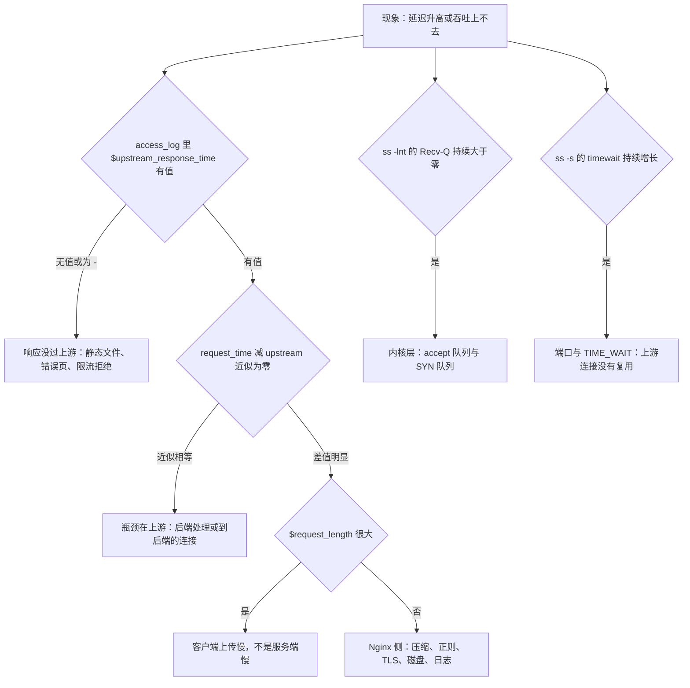
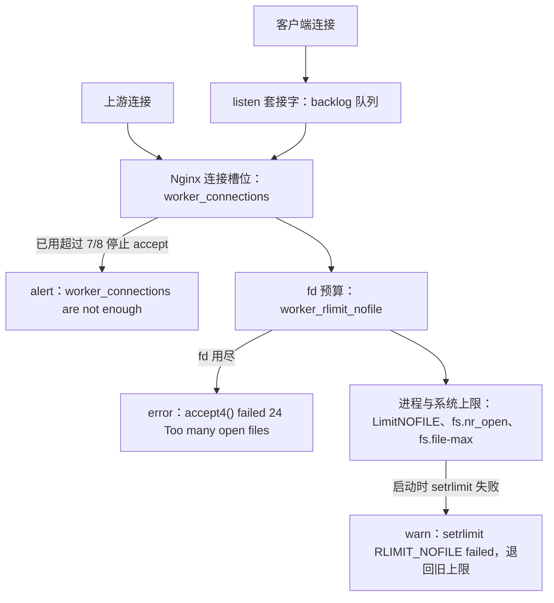
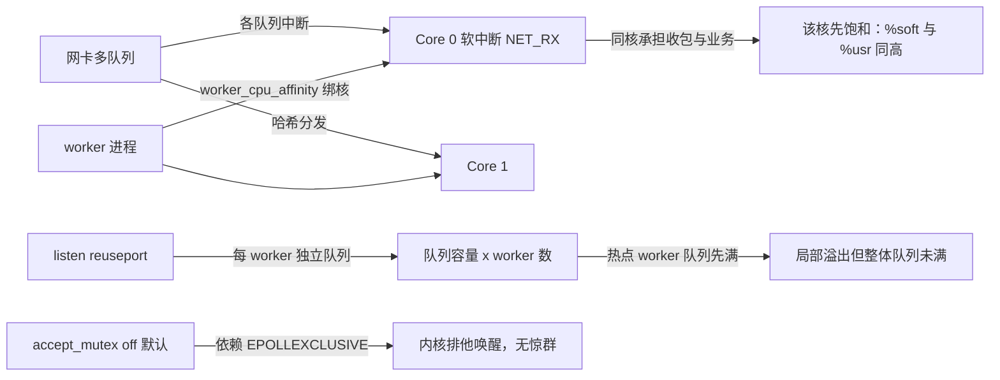
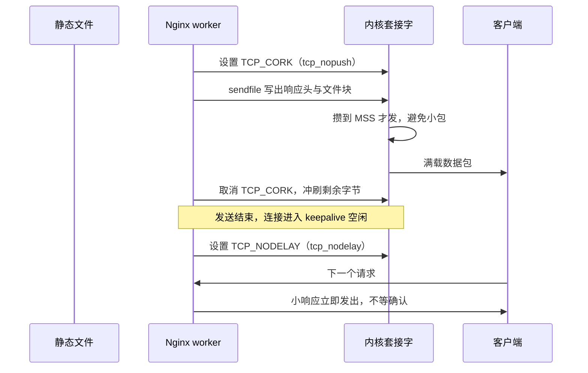
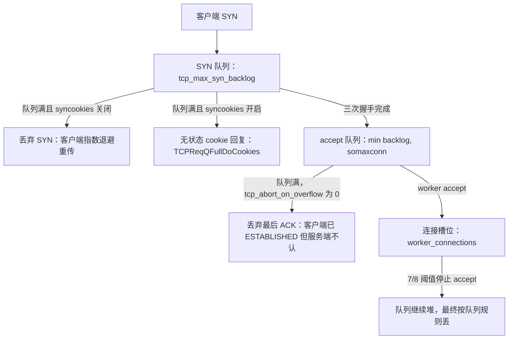
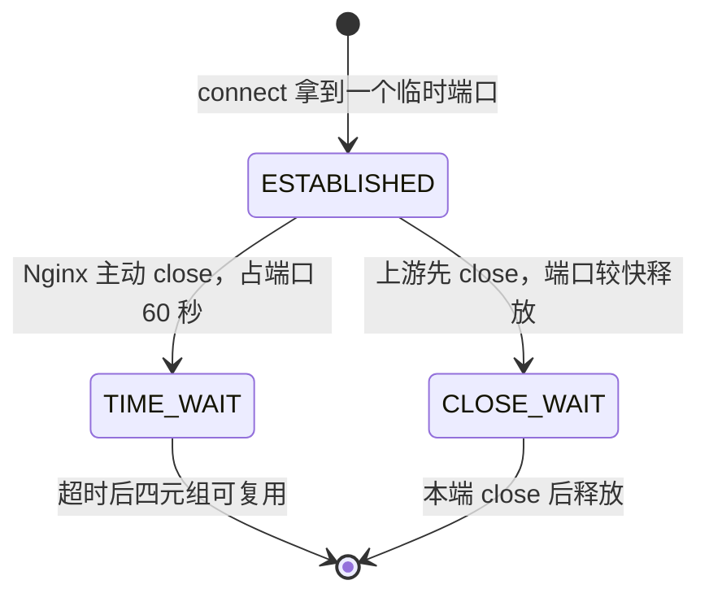

# 10 性能调优全攻略：worker 进程、连接数与内核参数

**摘要：**

Nginx 的调优文章大多写成了同一副模样：`worker_processes` 设成核数，`worker_connections` 设到六万五，`somaxconn` 与 `backlog` 一起设到六万五，`tcp_tw_reuse` 打开，`sendfile` 与 `gzip` 全开，抄完上线。这套动作的问题不在数字对错，而在它没有前提——同一份配置放在静态资源站上几乎无效，放在短连接密集的代理上可能把 CPU 打高。本文换个顺序：先讲清瓶颈的三层定位，即 Nginx 自身、上游、内核与网络，并给出可执行的判据——`$request_time` 与 `$upstream_response_time` 的差值、`stub_status` 的几组数字、`ss -s` 的队列与 TIME_WAIT、`netstat -s` 的溢出与重传；再逐个交代旋钮的收益边界与调大调小的代价，包括 `worker_processes` 为何不是越多越好、`worker_connections` 与 `worker_rlimit_nofile` 的两种失败形态、绑核与 `SO_REUSEPORT` 及中断亲和的三角关系、`keepalive_requests` 在 1.19.10 的默认值变化、`sendfile` 与 `gzip` 为何互斥；最后落到三个高发形态的真实成因——CPU 打满但 QPS 不高、建连慢而响应快、上游端口耗尽，以及几组常见反例：四倍核数的 worker、无脑打开的 `tcp_tw_reuse`、开着 `sendfile` 又指望 gzip 生效。至于三件靠调 Nginx 永远解决不了的事，另有一章交代。贯穿全篇的判断只有一条：调优的收益上界由架构决定，参数只能让你逼近这个上界。

---

## 第 1 章 先定位，再调参

### 1.1 调参的两种失败

调参失败有两种形态。第一种是调了没用：瓶颈在数据库的慢查询上，你却在把 `worker_connections` 从 1024 加到 65535，加完 QPS 一动不动，还白占了几十兆内存。第二种是调了更糟：`worker_processes` 设成核数的四倍，上下文切换与缓存失效把本就紧张的算力又吃掉一截，QPS 反而降了；`tcp_tw_reuse` 无脑打开，掩盖了上游连接复用率为零这个真问题，等到某天链路上换了中间设备、时间戳语义对不上，故障才集中爆发。

两种失败同一个根源：不知道瓶颈在哪一层就动参数。参数的本质是**容量与代价的交换**——队列调长，是用内存换抖动容忍度；进程调多，是用上下文切换换阻塞容忍度。不知道哪一段路在堵，拓宽车道只是把堵点挪到下一个路口。

### 1.2 三层模型

一次请求在路上要排**三种队**。第一种在 Nginx 内部：worker 是不是在忙、连接槽位够不够、正则和压缩吃了多少 CPU。第二种在上游：后端处理得慢、后端连接池不够、超时设得比后端还短。第三种在内核与网络：全连接队列有没有溢出、半连接是不是被丢、fd 到没到上限、作为上游客户端时本地端口是否耗尽。

三处排队各有各的容量与计时口径，混在一起看只能靠猜。打个比方，餐厅客人抱怨上菜慢，可能是在门口等位（内核 accept 队列），可能是服务员点单排队（worker 忙在别处），也可能是厨房出菜慢（上游）；站在前台喊“快点”不会让任何一处变快，先看队伍排在哪里，才知道该加桌子、加服务员还是加灶台。

### 1.3 四个判据

定位靠的是四个可以直接取到的证据。时间差回答“慢在哪一段”，`stub_status` 回答“连接在什么状态”，`ss -s` 与 `netstat -s` 回答“内核有没有丢东西”。下表把四类判据的读法与常见误判放在一起。

| 判据 | 数据来源 | 怎么读 | 常见误判 |
|---|---|---|---|
| 时间差 | `$request_time` 与 `$upstream_response_time` | 两者接近说明时间都在上游；差值为空说明响应没过上游；多值说明发生过重试 | 把客户端上传慢算成 Nginx 慢；把静态响应当代理响应分析 |
| 连接状态 | `stub_status` 的 Active、accepts、handled、Reading、Writing、Waiting | accepts 与 handled 的差额是被丢弃或未处理的累计；Waiting 是 keepalive 空闲连接，不是活跃请求 | 把 Waiting 当并发压力，据此加 worker |
| 队列与端口 | `ss -s`、`ss -lnt`、`ss -tan state time-wait` | LISTEN 的 Recv-Q 持续大于零说明 accept 跟不上；Send-Q 是实际生效的队列上限 | 把内核队列溢出当成 Nginx 处理慢 |
| 内核丢弃与重传 | `netstat -s` 或 `nstat -az` | 看 `listen queue overflowed`、`SYNs to LISTEN sockets dropped`、重传率是否在涨，静态绝对值没有意义 | 用开机以来的累计数判断“刚才发生了什么” |

判据的使用顺序是固定的：先用时间差把责任分给上游或本地，再看内核计数器确认有没有丢连接，最后才看进程与槽位。顺序颠倒的典型后果是——看到 `Waiting` 很多就去加 `worker_processes`，而 `Waiting` 恰恰是空闲连接，加进程只是让空转连接分摊到更多进程里。

下图把上面的判断整理成一条可执行的路径，注意右边三条都是从内核侧取证，它们回答的是“连接有没有被丢掉”，与“请求处理得慢不慢”是两个不同的问题。



### 1.4 日志看不见的那一段

`$request_time` 的定义是“从客户端读到的第一个字节到响应最后一个字节发完”，起点在请求头开始到达之后。这意味着它看不见两段真实存在的时间：三次握手，以及连接在 accept 队列里等待被取走的那一段。所以“连接建立慢但响应很快”这类故障，在 access_log 里几乎是**隐形**的，你必须去客户端侧看 `curl -w` 的 `time_connect` 与 `time_starttransfer`，或者去服务端看 `ss -lnt` 的 Recv-Q 与 `netstat -s` 的溢出计数。

反过来，`$upstream_response_time` 也有自己的口径陷阱。它记录的是 Nginx 与后端之间的一次交互，发生重试或内部跳转时会出现多个值，用逗号或冒号分隔；只取第一个值做统计，会把“重试了三次才成功”的请求算成一次漂亮的 20 毫秒。时间变量的完整语义与日志分析口径见 [[09 日志体系与可观测性：access_log、error_log 与链路追踪]]，本篇只借用它们做分层。

### 1.5 一次只动一个变量

定位清楚之后，改动还要守住两条纪律。一是改前留基线：把同一时段的 QPS、P99、`stub_status` 的几组数字与 worker 的 CPU 占用记下来，否则改完分不清是参数起了作用还是流量自己变了。二是一次只动一个变量：把 `worker_processes`、`worker_connections`、`somaxconn` 一起调，最后 QPS 涨了五个百分点，你不知道哪一样有用，换个环境也不敢照搬。

---

## 第 2 章 worker 进程数：核数的函数，不是倍数的函数

### 2.1 auto 读的是什么

`worker_processes auto` 在 Linux 上取的是内核报告的在线 CPU 数，等价于不带参数的 `nproc`。它不看 cgroup 的 CPU 配额，所以在一个 `cpu.max` 限制为 2 核、但能看到宿主 64 核的容器里，`auto` 会老老实实起 64 个 worker，然后用 2 核的配额去喂它们。这是 `auto` 在容器环境里最常见的偏差，验证方法很直接：启动后 `ps -eo cmd | grep 'nginx: worker' | wc -l` 数一眼，再跟配额比。

cpuset 与 `taskset` 造成的核数收缩则会如实反映在 `auto` 里，因为绑定后 `sysconf` 返回的就是可见核数。所以容器里出现“worker 数超出预期”时，先分清是 cgroup 的配额限制还是 cpuset 的核数限制，两者的处置完全不同：前者要显式写数字，后者 `auto` 本身就是对的。

### 2.2 为什么不是越多越好

Nginx 的 worker 是单线程事件循环，一个请求从解析到写出都在同一个线程里完成（事件循环的机制见 [[01 事件驱动模型：epoll 与 Master-Worker 进程架构]]），因此它天然适合“一个核一个进程”。进程数超过核数之后，多出来的进程并不会带来并行度，只会带来三样成本。

第一样是**上下文切换**。内核调度器在多于核数的可运行进程之间轮转，每次切换要保存与恢复寄存器状态，还会污染当前核心的缓存行。单次切换的代价在微秒量级，量级判断是：切换频率高到每秒数万次时，光切换本身就能吃掉几个百分点的 CPU。

第二样是缓存失效。worker 迁移到别的核之后，它在原来那颗核的 L1/L2 里留下的连接状态、解析缓冲、TLS 上下文全部变成冷数据，重新访问要走 L3 甚至内存。这部分开销不体现在任何计数器上，只体现在“配置没变、QPS 降了”这种难以归因的现象里。

第三样是内存线性增长。每个 worker 都会预分配自己的连接槽位数组与事件数组，各自维护 `open_file_cache`、上游 keepalive 池、TLS 会话缓存等进程私有结构。worker 数翻倍，这些私有结构跟着翻倍，且并不共享。连接数与内存的换算见 3.5 节。

### 2.3 什么时候多于核数有意义

有一种情况确实值得把进程数调到核数以上：worker 里存在会阻塞的操作，事件循环被卡住时其他进程还能接手。典型来源包括编译进去的第三方模块做了同步磁盘读写、日志写到慢速存储、`init_worker_by_lua` 里做了同步初始化、以及 Lua 代码里调用了非 cosocket 的阻塞库。这类场景下进程数相当于“阻塞容忍度”，调到 1.5 到 2 倍是用上下文切换与内存去换“一个进程卡住时还有别人能接活”。

但这是一笔应急的账，不是通用的建议。阻塞操作本身应该被消灭——把同步 IO 挪到 OpenResty 的 cosocket、把日志改成缓冲写、把慢初始化挪出请求路径。靠加进程数掩盖阻塞，等于在一条漏水的船上加人往外舀水，船越大舀得越慢。

### 2.4 什么时候少于核数有意义

反方向也有合理场景：CPU 配额远小于可见核数的容器里，显式写配额对应的数字比让 `auto` 起一堆抢配额的进程干净；只做几十路转发的边缘节点，两个 worker 足够，起八个是浪费；用 `reuseport` 时进程数应与接收队列数对齐，强行对齐 64 核而机器只有 8 个接收队列，只会让一部分 worker 的队列空转。

### 2.5 worker_shutdown_timeout：停机的上限

`worker_shutdown_timeout`（1.11.11 起）约束的是 worker 退出的时长，不是单次请求的时长。执行 `nginx -s reload` 或 `quit` 之后，旧 worker 会先停止接受新连接，等已有连接自然结束再退出；如果某个连接是 SSE 长推、大文件下载、或者客户端慢到几乎不动，旧 worker 就会一直活着，占着内存与旧配置，两代 worker 并存。

这个参数的语义是“超过这个时间就强制关闭剩余连接”，代价是那些被强关的请求会直接收到连接中断。设置它的理由不是性能，而是可运维性：没有上限的优雅停机，在有长连接的站点上会积累出一串退不掉的 worker，`ps` 里能看到好几代进程同时在跑，内存曲线只升不降。

### 2.6 worker_priority 的适用面

`worker_priority` 设置 nice 值，影响 CPU 竞争时的份额，不影响 IO 等待。在**混部**机器上（同机还跑着采集器、日志代理、监控 agent）把 nice 调到负值，能让 Nginx 在抢占时少吃点亏、减少延迟抖动；代价是同机其他进程更饿，抖动只是被转移给了别人。独占机器上这个参数没有意义。

---

## 第 3 章 连接数：两层约束，两种失败

### 3.1 worker_connections 数的是什么

`worker_connections` 是每个 worker 能同时持有的连接槽位数，官方文档对此有一句常被跳过的说明：这个数字包含所有连接，不只是客户端连接，到上游的连接、以及内部使用的连接都占槽位。所以在反向代理场景里，一个正在处理的请求往往占两个槽位——客户端一条、上游一条；纯静态文件服务则是一个请求一个槽位，因为响应直接从文件发出去，不开新连接。

这直接决定了两件事。第一，反代场景下可服务的客户端并发大约是槽位数的一半，而这个“一半”是稳态估算，不是硬上限：keepalive 空闲连接占槽位但不占上游槽位，所以实际比例取决于连接复用的程度。第二，`worker_connections` 与 `worker_rlimit_nofile` 不是同一个东西，前者数的是 Nginx 自己维护的槽位，后者数的是进程能从内核拿到的 fd 数量，两者分别对应两种完全不同的失败形态。

官方文档里这个指令的默认值一栏是空的，发行版随包的 `nginx.conf` 普遍显式写 1024；不写就依赖代码里的兜底值，不值得。

### 3.2 槽位不足：Nginx 自己拒绝

槽位不足时 Nginx 不会等到真正用光才反应。源码里的做法是留出余量：当空闲槽位少于总槽位的八分之一时，worker 主动停止参与新连接的 accept，把剩下的容量留给已有连接收尾。触发这条逻辑的那行判断在事件处理的主循环里，效果是“已用超过 **7/8** 就暂停接受”，直到有连接释放、空闲回升。

这条机制的实践含义有两层。一是日志：槽位耗尽时会打出 `worker_connections are not enough`，级别 alert，出现在 `error_log` 而不是 access_log 里，翻访问日志找不到线索。二是形态：因为 7/8 就开始减速，槽位不足通常不是雪崩而是一段缓慢劣化——新连接排队、`ss -lnt` 的 Recv-Q 涨起来、建连变慢，而已建立的连接一切正常，这种“只慢不挂”最容易被误判成网络问题。

### 3.3 fd 不足：内核拒绝

fd 不足是另一回事，它发生在更底层。连接槽位是 Nginx 自己内存里的数组下标，fd 是内核的资源，`worker_rlimit_nofile` 约束的是后者。当 worker 的 fd 用尽时，`accept` 系统调用会失败，错误是 **`EMFILE`**，日志里的原文形如 `accept4() failed (24: Too many open files)`。此时连接并没有丢，它还在内核的 accept 队列里等着，但 Nginx 已经拿不到它了，直到某个已有连接释放出 fd。

现代 Nginx 对这种情况有缓解：遇到 `EMFILE` 会临时关闭监听套接字的读事件，等有连接释放后再重新打开，避免在 epoll 里反复空转。但缓解不等于解决——这段时间里到达的连接全部堆积在队列里，队列满了就按队列的规矩丢，客户端侧表现为建连超时。

### 3.4 两层约束的关系

把两种失败放在一起看，就能得出配置原则：`worker_rlimit_nofile` 必须大于 `worker_connections`，且要留出额外的余量。常见的写法是把它设成 `worker_connections` 的两倍，这个经验只说对了一半——它只算到了连接本身，漏掉了同样占 fd 的东西：监听套接字、`access_log` 与 `error_log` 的文件句柄、临时文件的句柄、resolver 的 socket、上游 keepalive 池里虽然空闲但仍持有的连接（空闲连接同样占一个 fd），以及 reload 期间两代 worker 同时持有的那一份。

所以更准确的关系是：`worker_rlimit_nofile` 至少要覆盖 `worker_connections` 加上这些固定开销，再留一点浮动空间。写到刚好等于 `worker_connections`，等于把所有开销都挤在预算外，迟早撞上 `EMFILE`。下图把两层约束与两种失败形态画在一起。



### 3.5 连接数与内存的换算

连接槽位不是免费的。worker 启动时会一次性分配连接结构数组与读、写事件数组，每个槽位几百字节；真正的 KB 级开销来自按连接分配的缓冲区——请求头缓冲、请求体缓冲、响应输出缓冲。所以“把 `worker_connections` 调到一百万”这种动作，先要算一遍内存。

示例推算：4 个 worker、每个 `worker_connections` 16384，槽位总数 65536。仅结构数组按每槽位约 500 字节计，约 33 MB；若每个槽位平均再摊上一份 2 KB 的缓冲，又是 130 MB 量级；加上进程池、共享内存 zone、缓存区，实际 RSS 常见在 200 MB 量级。这个推算没有考虑上游连接与 TLS 会话的额外开销，只用来回答一个问题：槽位翻四倍，内存大概率也要翻倍，而且这部分内存在没有连接时就已经被数组占住了。

反过来的推算是容量规划里更常用的：已知峰值并发 3 万，反代场景、client 与上游各占一个槽位，按 7/8 的可用比例算，槽位需求约 3 万乘 2 再除以 0.875，约 6.9 万，分摊到 4 个 worker 就是每个 1.7 万，取 20480 是合理的起步值。这个数字是示例推算，真实环境还要按 keepalive 比例修正——复用率高时上游槽位需求会显著下降。

---

## 第 4 章 绑核、复用端口与中断

### 4.1 绑核买到的是什么

`worker_cpu_affinity` 把 worker 绑定到特定核心，收益来自缓存与 TLB。worker 的工作集（连接状态表、解析缓冲、TLS 上下文）落在被绑核心的 L1/L2 里，不做迁移就不会出现“换核之后全部冷启动”。绑定后 cache 命中率更稳定，延迟抖动也更小，这是它对高并发服务真正的价值，而不是“省下上下文切换”。

`worker_cpu_affinity auto`（1.9.0 起）会按可用核心数自动铺开，写法上比手写位图省事，但它只解决了“把 worker 按核均分”，没有解决“这些核上还跑着别的东西”。在 NUMA 机器上还要多看一眼：worker 绑在 Node 0 的核上，而它申请的内存落在 Node 1，每次访存都要付跨节点的延迟。这条约束不是靠 Nginx 配置能解决的，要配合 `numactl` 的内存本地优先策略，或者干脆别绑，交给调度器。

### 4.2 绑核的代价

绑核把灵活性换成了确定性，代价有三条。其一，某个 worker 因为长连接或大文件卡住时，它所在的那颗核闲着也不会有人来分担，没绑的话内核至少还能把别的 worker 挪过来。其二，连接在 worker 之间分布本来就不均匀，绑死之后不均衡会固化，出现“四颗核里两颗 90%、两颗 40%”的形态。其三，容器里可用核数可能被 cpuset 收窄，位图写死会在换规格时直接失效或错绑。

所以绑核适合的场景是：核数固定、负载形态稳定、对尾延迟敏感。不适合的场景是：规格经常变、与别的服务混部、或者已经在用 `reuseport` 把连接分布交给内核。

### 4.3 reuseport 改变了什么

`listen ... reuseport`（1.9.1 起）让每个 worker 拥有自己的监听套接字，内核按哈希把新连接分给其中一个。好处是没有惊群、没有 `accept_mutex` 的锁竞争，连接分布由内核负责。副作用是队列容量按 worker 数放大：每个 worker 各有自己的 accept 队列，总容量变成 worker 数乘以 `backlog`，同时也意味着热点不均——某个 worker 的队列可能先满，而其他 worker 的队列还空着。

选择上可以简化成一条：worker 数少、连接建立频繁、想彻底去掉 accept 竞争，用 `reuseport`；worker 数多、连接分布要求均匀、或者需要精确控制队列容量，不用 `reuseport`，交给共享监听套接字加内核的排他唤醒机制。两者混用不报错，但绑核与 `reuseport` 同时上时，哈希分布与绑定核两套逻辑会互相抵消一部分收益。

### 4.4 中断亲和：最容易被绑歪的地方

绑核最常见的翻车形态不是绑错了 worker，而是忘了网卡中断也在抢同一颗核。网卡的接收中断由某个 CPU 处理，软中断（收包、协议栈）默认倾向于在中断所在的核上跑；如果那个核同时又绑了一个 worker，它就同时承担收包与业务处理，成为整台机器最先饱和的点。表现是 `mpstat -P ALL 1` 里某颗核的 `%soft` 与 `%usr` 一起高，其他核闲着一半。

判断靠三样：`cat /proc/interrupts` 看网卡各队列的中断落在哪些核上，`cat /proc/softirqs` 看 `NET_RX` 在各核的累计分布，`mpstat -P ALL 1` 看实时占用。处置有两条路：一是把 worker 绑到与中断错开的核上，留出专门的收包核；二是把中断分散（多队列网卡配合 `irqbalance` 或手工写 `smp_affinity`，必要时用 RPS 把软中断摊开）。两条路的取舍是：专用收包核简单可控但浪费一颗核的算力，RPS 摊开省核但增加了跨核传递的开销。

### 4.5 accept_mutex 的今昔

`accept_mutex` 是一把防止惊群的锁：多个 worker 同时等在同一个监听套接字上，新连接到达时如果全部醒来，只有一个能 accept 成功，其余白跑一趟。早期做法是用这把锁串行化，代价是 accept 变成串行点。1.11.3 起这个指令的默认值改成了 off，原因是内核 4.5 之后提供了排他唤醒（`EPOLLEXCLUSIVE`），内核自己就只唤醒一个等待者，用户态的锁成了多余的东西。

现实里还留着 `accept_mutex on` 的配置，多半是十年以上的老模板。它的副作用在高连接建立速率下才明显：锁竞争加剧、accept 被串行化、队列更容易堆积。如果你看到配置里显式写了 `on`，先确认是不是有人为了绕过某个历史问题加的；没有明确理由的话，删掉它比留着更安全。`accept_mutex_delay` 只在锁开启时才有意义，一并清理。

下图是绑核、复用端口与中断三者之间的关系，右侧那条链是导致“绑歪”的路径。



---

## 第 5 章 连接的生命周期：keepalive 的三个旋钮

### 5.1 keepalive_timeout 是两段语义

`keepalive_timeout` 的第一段语义是响应头里 `Keep-Alive: timeout=` 的宣告值，第二段是服务端实际保留空闲连接的时间。两个值可以分开写，写成两个参数的写法（客户端宣告值在前）在老配置里常见。真正决定资源占用的是第二段：一个空闲连接即使什么都不做，也占着一个连接槽位、一个 fd，以及它那份缓冲区。

调大它的收益是减少握手与慢启动，客户端侧的连接复用率上升；代价是空闲连接长期占资源，`stub_status` 的 Waiting 数字会稳步上涨。在并发高、连接建立频繁的站点上，这个数字涨到几万很常见，而它并不代表压力——它代表的是“Nginx 替你留着的空转连接”。

### 5.2 keepalive_requests 在 1.19.10 改了默认值

`keepalive_requests` 限制单条连接上最多处理多少个请求，到达上限后 Nginx 主动关闭连接，客户端下次请求要重新建连。**1.19.10** 起这个默认值从 100 改成了 1000，改动理由不难推：100 这个数字在 HTTP/1.1 时代会让长连接过早退役，而每退役一次就多一次握手；在 TLS 站点上，一次额外握手还要多一次非对称运算，代价远高于留一条空闲连接。

这个改动还有连带影响：连接寿命变长，负载均衡的粒度变粗。客户端与某个上游之间的连接持续处理一千个请求，这段时间里上游扩缩容无法通过新连接体现；同样，连接级的计数（比如按连接分配的限流额度）也会被拉长。这不是缺点，只是需要知道的事实。

### 5.3 keepalive_time：硬上限

`keepalive_time`（1.19.10 起）是连接的绝对寿命上限，默认 1 小时，与空闲超时是两条独立的线：`keepalive_timeout` 管“闲多久关”，`keepalive_time` 管“活多久关”，谁先到谁生效。有了它，连接不会被无限复用下去，配合 `keepalive_requests` 构成“请求数上限 + 时间上限”的双闸门。

三个参数放在一起看，就能理解 Nginx 对长连接的态度：默认允许复用，但设上限，免得一条连接活成永久会话；上限让连接池自然轮换，配置变更与证书轮换最终能触达所有客户端。

### 5.4 上游连接是另一套

客户端 keepalive 与上游 keepalive 是两套独立的机制，参数不在同一个上下文，超时也不共享。客户端侧的空闲连接由 `keepalive_timeout` 管，上游侧的空闲连接由 `upstream` 块里的 `keepalive` 数量上限与 `keepalive_timeout` 共同管。两者最典型的错配是：客户端 keepalive 设得很长，上游 keepalive 根本没配，结果是客户端这边省下的握手成本，全在上游那边新建连接时付了出去，还顺带把本地端口耗掉。上游连接池的三个必要条件与超时阶梯见 [[04 反向代理与负载均衡：upstream 模块深度解析]]。

---

## 第 6 章 请求体与请求头：缓冲区的真实成本

### 6.1 请求体：超过缓冲就落盘

`client_body_buffer_size` 是 Nginx 在内存里为请求体准备的缓冲区，64 位平台默认 16 KB。请求体小于它，整个 body 留在内存；超过它，超出部分写入临时文件，再由 Nginx 读出来转发。代价很直接：多一次磁盘写、多一次磁盘读，延迟从微秒级变成毫秒级，磁盘若正在被日志刷写，抖动还会成倍放大。

`client_max_body_size` 是另一条线，默认 1 MB，超限直接返回 413，请求进不到业务。它的检查发生得很早：读完请求头、看到 `Content-Length` 就比一遍，所以大文件被 413 拒绝时，body 一个字节都没传上来。这两个参数的关系是闸门与缓冲的关系——闸门决定“允不允许这么大”，缓冲决定“这么大的东西放在哪里”。

调大 `client_body_buffer_size` 的收益是减少落盘，代价是每个并发上传连接多占一块内存；调大 `client_max_body_size` 的收益是支持大文件，代价是这条路径的内存与磁盘压力同时放大，需要配合 `client_body_temp_path` 的独立磁盘与容量监控。

### 6.2 请求头：两类不同的错误码

请求头相关的参数有两个：`client_header_buffer_size`（默认 1 KB）负责第一块缓冲，`large_client_header_buffers`（默认 4 个 8 KB）负责放不下的部分。名字里的 `large` 容易让人以为它只对超大请求头生效，其实请求行也走这套逻辑。

超限时的错误码**分两种**，文档里被合并描述为 414，实际实现是分开的：请求行（URI）太长返回 414，`error_log` 里的原文是 `client sent too long URI`；单个请求头字段或 Cookie 太长返回 400，原文是 `client sent too long header line`。排查时看到 400 就往 Cookie 与自定义头上找，看到 414 就往带参数的 GET 请求上找，方向完全不同。

调大这两个参数的收益是容纳更长的 Cookie 与更复杂的查询串，代价是每个连接可能多占几十 KB 内存（`large_client_header_buffers` 是 4 个缓冲，每个连接在需要时都会分配）。在网关场景里，如果上游会注入很长的认证头，这两个值确实要调，但要按实际头长度算，而不是无脑写 4 个 32 KB。

### 6.3 响应侧缓冲

响应方向的缓存在代理模块里（`proxy_buffers`、`proxy_buffer_size`），它先把后端响应的开头收进内存，再决定是否落盘或流式转发。唯一要记住的结论是：缓冲的意义是**缩短上游连接占用时间**，不是减少内存占用——把响应尽快从上游连接上搬走，那条连接才能尽快还给池子。

下表把连接与缓冲区相关的参数、默认值以及两个方向的代价并排放在一起，便于对照。

| 指令 | 默认值 | 调大 | 调小 |
|---|---|---|---|
| `worker_connections` | 文档未给 | 并发槽位增加，内存线性增长；已用超 7/8 仍会停止 accept | 省内存，但更早撞上槽位上限 |
| `worker_rlimit_nofile` | 文档未给 | 支撑更多 fd；超过进程硬限制时只告警、不生效 | 资源不变，先撞 `EMFILE` |
| `keepalive_timeout` | 75s | 复用率高、握手少，空闲连接长期占槽位与 fd | 周转快，握手与慢启动开销上升 |
| `keepalive_requests` | 1000（1.19.10 起） | 连接寿命长、TLS 握手更省，负载分布粒度变粗 | 分布更细，连接退役与握手更频繁 |
| `keepalive_time` | 1h（1.19.10 起） | 连接可长期复用，配置变更触达变慢 | 轮换快，复用收益下降 |
| `client_body_buffer_size` | 16k（64 位） | 大 body 不落盘，每连接内存增加 | 省内存，超出部分落盘 |
| `client_max_body_size` | 1m | 允许更大上传，内存与临时文件压力放大 | 更早返回 413 |
| `client_header_buffer_size` | 1k | 常规请求行不触发大缓冲，每连接固定多占 | 省内存，长请求行更早 414 |
| `large_client_header_buffers` | 4 8k | 长 Cookie 与长 URI 不被拒，需要时每连接多占数十 KB | 省内存，长头更早 400 |

---

## 第 7 章 sendfile 三件套：一个内核语义问题

### 7.1 两次拷贝与两次 DMA

传统 `read` 加 `write` 的路径要走四次搬运：磁盘经 DMA 到页缓存，CPU 把页缓存拷进用户缓冲区，再拷进套接字发送缓冲区，最后由网卡 DMA 取走。中间两次是 CPU 亲自搬的，文件越大搬得越多。

`sendfile` 把用户态这一段整个去掉：应用只发一次调用，内核把页缓存里的页直接交给套接字，网卡从页缓存取数据发走。严格说，能不能做到零 CPU 拷贝取决于网卡是否支持分散聚合（scatter-gather DMA）：支持的话，一次系统调用加两次 DMA 就结束；不支持的话，内核仍要把页缓存拷进发送缓冲区，省下的是用户态那一次与系统调用次数。这个区别值得知道，因为它解释了为什么同样开 `sendfile`，不同机器的吞吐提升幅度不一样。

`sendfile_max_chunk` 是这条路径上的闸门，默认 0 不限制；单个大文件因此可能长时间占满一次事件循环的写出，把其他连接的处理推迟。设成 512k 或 1m 是常见做法，代价是多几次循环调度。

### 7.2 tcp_nopush 就是 TCP_CORK

`tcp_nopush on` 对应套接字选项 **`TCP_CORK`**。它的语义不是“不发”，而是“攒够再发”：设置了 cork 之后，协议栈不再因为收到一小段数据就立即发包，而是等到数据攒到最大分段长度（MSS）或者 cork 被取消时才发出去。

这个语义与 `sendfile` 是天然一对。响应头通常只有几百字节，文件内容动辄几百 KB，两者如果分开发，第一包是个没装满的小包，TCP 于是要等这个小包被确认，吞吐被硬生生压低；cork 打开之后，响应头与文件开头的字节被攒进同一个满载包，小包问题消失。所以文档里那句“`tcp_nopush` 只在 `sendfile on` 时生效”不是实现限制，而是语义上它本来就是给“文件加响应头”这个组合准备的。

### 7.3 tcp_nodelay 只在 keepalive 状态生效

`tcp_nodelay on` 对应 `TCP_NODELAY`，作用是禁用 Nagle 算法，让数据立即发出。Nagle 的规则是“有未确认数据时，小片段先攒着”，在请求体分多次写入、或者 HTTP/1.1 流水线场景里，这条规则会引入一个 RTT 量级的额外等待。

它与 `tcp_nopush` 看起来互相矛盾：一个让协议栈攒，一个让协议栈立刻发。但 Nginx 的使用方式让两者并不冲突——`tcp_nodelay` 只在连接被切换到 keepalive 空闲状态时才启用，此时连接上没有文件要发，攒着的意义消失，立即发出的收益（低延迟）凸显。所以它们作用于连接生命周期的不同阶段，不是在同一时刻互相对抗。

下图按时间顺序把两者的作用区间画出来：cork 在发送响应期间生效，nodelay 在响应结束、连接进入空闲之后生效，中间那次取消 cork 的动作就是把缓冲区里剩余的数据冲出去。



### 7.4 组合语义

三个参数的价值在组合里，单独看任何一个都会得出错误结论。下表把常见组合的效果与代价列出来，第二行才是静态文件服务的标准配置，最后一行是最容易配错的。

| 组合 | 实际效果 | 适用场景 | 代价与风险 |
|---|---|---|---|
| `sendfile off`、`tcp_nopush off`、`tcp_nodelay on` | 全部走用户态拷贝，响应立即发 | 动态响应、小对象代理 | CPU 拷贝多；大文件时吞吐明显吃亏 |
| `sendfile on`、`tcp_nopush on`、`tcp_nodelay on` | 文件零拷贝，响应头与文件合并，空闲期低延迟 | 静态文件、大文件下载 | 与压缩响应互斥；`sendfile_max_chunk` 不设时长文件会独占循环 |
| `sendfile on`、`tcp_nopush off`、`tcp_nodelay on` | 零拷贝但响应头单独成小包 | 只需零拷贝、可接受小包 | 每个响应多一个小包与一次等待确认 |
| `sendfile on`、`tcp_nopush on`、`tcp_nodelay off` | 大文件吞吐好，但 keepalive 空闲期小数据被 Nagle 拖慢 | 纯下载站、短连接为主 | 长连接上的交互式请求会多一个 RTT |
| `sendfile on` 且响应被 gzip 压缩 | `sendfile` 退化为普通写出，压缩生效 | 需要压缩的文本响应 | 零拷贝失效，CPU 花在压缩上 |

### 7.5 gzip 与 sendfile 互斥

这是本篇最值得单独强调的一条：同一个响应上，`gzip` 与 `sendfile` 不可能同时生效。两者**互斥**，但不是“谁覆盖谁”的关系，而是处理位置不同。

`sendfile` 的价值在于让内核把页缓存直接交给网卡，数据不必进用户态；`gzip` 是响应体过滤器，它必须看到明文字节才能压缩，而文件里的字节是压缩前的原文。要让文件内容经过压缩再发出，数据必须先从页缓存读进用户态缓冲区、在用户态压完再写回套接字，零拷贝的前提在第一步就不成立了。所以只要响应被压缩，`sendfile` 那条路径自动失效，`tcp_nopush` 也随之失去主要作用对象。

正确的做法是把压缩挪到部署阶段而不是请求阶段：预压缩生成 `.gz` 文件，用 `gzip_static on` 让静态模块直接发预压缩结果。这条路径既恢复了零拷贝（发的是已经压好的文件），又把 CPU 成本从“每请求一次”降成“每次构建一次”。`gzip_static` 需要编译进 `ngx_http_gzip_static_module`，用发行版包时确认一下模块是否存在，`nginx -V` 的输出里能看到。

动态压缩的边界要说清。`gzip_comp_level` 默认值是 1，从 1 调到 6 通常只换来几个百分点的体积下降，CPU 消耗却上去一截；对已压缩格式（JPEG、PNG、MP4、字体）再压一遍是纯浪费，`gzip_types` 里不该出现它们。`$gzip_ratio` 可以按请求记录压缩比，比凭感觉调级别可靠。Brotli 是第三方模块，压缩率更好但单次成本更高，预压缩（`brotli_static`）比动态压缩划算。

### 7.6 open_file_cache 省的是系统调用

`open_file_cache` 缓存三类信息：打开的文件描述符及其大小与修改时间、目录是否存在、以及查找错误（文件不存在这类）。它省掉的是每次请求都要做的 `stat` 与 `open` 系统调用，以及路径逐级解析的开销；它不改变数据是否在页缓存里，也不负责“把文件读得更快”。

有一种流传颇广的说法是它缓存“dentry 查找结果”，这需要修正：dentry 与 inode 的缓存是内核 VFS 的职责，与 Nginx 无关；Nginx 缓存的是自己结论性的判断——这个路径能不能打开、打开了是什么 fd、上次看到的大小与修改时间是多少、哪个路径当时不存在。

代价在文件更新后的**感知延迟**。`open_file_cache_valid` 默认 60 秒，文件被替换后最长要等一分钟才会重新 `stat`；`open_file_cache_min_uses` 控制访问几次才进缓存，默认 1；`open_file_cache_errors on` 决定“不存在”这个结论要不要缓存。持续部署的环境里把 `valid` 调到几秒是常见折中，代价是验证频率上升、`stat` 变多，优化的收益被自己吃掉一部分。

### 7.7 静态文件的三条真路

静态文件的性能问题最终只有三条路，参数调优在其中只占很小一部分。一是让数据留在页缓存里，热文件反复被读，落盘读很少，瓶颈是内存容量而不是 Nginx；二是零拷贝加预压缩，`sendfile` 配 `gzip_static` 或 `brotli_static`，让 CPU 不参与压缩；三是把字节数拿走，CDN 或对象存储把请求挡在 Nginx 之外。

判断走哪条路的依据是带宽与请求结构：带宽打满时前两条路都无用，瓶颈在网卡与出口链路；请求集中在少数热点文件时页缓存命中率极高，`open_file_cache` 的边际收益随之变小。

---

## 第 8 章 内核队列：两个队列与两处丢弃

### 8.1 三次握手的两个落点

TCP 建连在内核里经过两个队列。收到 SYN，内核为这条半连接登记一个请求结构放进 SYN 队列（连接处于 `SYN_RECV`），回一个 SYN-ACK；收到最后的 ACK，连接被移到全连接队列等待 `accept` 取走。两处都可能满，丢的东西也不同。

SYN 队列满时，新到的 SYN 被丢弃，客户端收不到 SYN-ACK，只能指数退避重传；`tcp_syncookies` 打开时内核改用无状态 cookie 回复，不占队列，但 cookie 路径有速率与选项协商上的代价，属于兜底。全连接队列满时，内核默认丢弃最后的 ACK（`tcp_abort_on_overflow` 为 0），客户端认为已连上、服务端不认，服务端重传 SYN-ACK 而客户端已进 ESTABLISHED 不再理会，表现为“连上了但请求没响应，过一阵超时或重置”。

### 8.2 backlog 与 somaxconn 是取小关系

`listen 80 backlog=1024` 里的数字是请求值，实际生效值是它与 `net.core.somaxconn` 的**较小者**。这一点决定了配置的正确写法：把 `backlog` 写成 65535 而 `somaxconn` 还是默认值，等于写了 65535 却只得到默认值，`ss -lnt` 的 Send-Q 会把真实生效值暴露出来。

`somaxconn` 的历史默认值是 128，Linux 5.4 起改成 4096。这意味着很多老配置里“somaxconn 调到 1024 就够”的结论已经过期——5.4 之后的内核上不调它也可能有 4096 的队列，而 4.x 上不改就只有 128，建连一密集就溢出。查法：`sysctl net.core.somaxconn`，再核对 `ss -lnt` 的 Send-Q。

### 8.3 半连接队列与 syncookies

`net.ipv4.tcp_max_syn_backlog` 控制半连接队列的上限，实际长度大致取 `backlog` 与它的较小值，具体还受内核版本与 syncookies 开关影响。它的作用域与 `somaxconn` 不同：`somaxconn` 管全连接队列，`tcp_max_syn_backlog` 管半连接队列，两处各丢各的。

`tcp_syncookies` 有三个取值：0 关闭，1 在队列溢出时启用，2 无条件启用（只用于测试）。多数发行版默认是 1，较新的内核上游也倾向于默认开启，具体以 `sysctl` 读到的为准。开启 syncookies 之后，SYN 洪水不会把队列打满，代价是 cookie 计算占用少量 CPU，并且部分 TCP 选项在 cookie 路径上无法协商（比如窗口缩放），极端情况下吞吐会受影响。它是一个“别让队列被打死”的保险，不是性能优化项。

### 8.4 判据：谁在丢

队列溢出是累计计数，只有“在涨”才有诊断意义。三个工具各看一面：`netstat -s` 给出开机以来的累计值，适合看趋势；`nstat -az` 可以按需读指定计数器，更适合做前后对比；`ss -lnt` 的 `Recv-Q` 是当前瞬时值，适合确认“此刻是否在积压”。

```bash
# 全连接队列溢出与半连接丢弃，两个计数器分别对应两处队列
netstat -s | grep -iE 'listen queue|SYNs to LISTEN'

# 精确读取，避免 netstat 输出太长
nstat -az TcpExtListenOverflows TcpExtListenDrops TcpExtTCPReqQFullDrop TcpExtTCPReqQFullDoCookies

# 当前积压：LISTEN 状态下 Recv-Q 是已完成握手但未被 accept 的连接数
ss -lnt

# 半连接积压与全局连接状态分布
ss -s
```

读法上有个坑：`Recv-Q` 偶尔跳到几不代表有问题，队列本就是用来吸收抖动的；持续大于零且 `TcpExtListenOverflows` 在涨，才说明 accept 跟不上建连。还有更隐蔽的一种：队列没满但建连仍慢——accept 循环本身被阻塞，计数器全部正常，唯一异常是 `$request_time` 正常而客户端 `time_connect` 很高。

下图把两个队列的容量来源与两处丢弃点画在一起，注意两个队列的容量分别由不同的系统参数决定，调错参数等于没调。



### 8.5 队列是抖动缓冲，不是吞吐

需要拧正的一个观念是：队列**不改变处理能力**，只改变“突发流量被吸收掉多少”。`backlog` 从 511 调到 8192，超载差额会被暂时吸收，队列满之前客户端感觉良好；持续超载时队列迟早填满，丢弃照旧，只是来得晚一点，代价是客户端等得更久才失败。

所以回答“要不要调大队列”之前，先回答“建连速率为什么会超过处理速率”。原因如果是发布后的重连风暴、负载均衡器的健康检查频率、或者客户端库里写死的短连接，调队列是对的；原因如果是 worker 被阻塞导致 accept 慢，调队列只是把问题推迟。

---

## 第 9 章 端口、TIME_WAIT 与文件描述符

### 9.1 四元组与端口算术

Nginx 作为反向代理时，对上游来说它是客户端，每条到上游的连接都占用一个本地临时端口。一条连接的标识是**四元组**：源地址、源端口、目标地址、目标端口。目标固定的情况下，可用的源端口数就是并发的硬上限。

`net.ipv4.ip_local_port_range` 的默认值是 32768 到 60999，算下来 28232 个端口。TIME_WAIT 在 Linux 上持续 60 秒，于是单上游、单目标端口的稳态上限是 28232 除以 60，约每秒 470 条新建连接——这是示例推算，实际还受端口是否被其他进程占用、上游是否有多个 IP 影响。

这个算术解释了一个常见困惑：QPS 只有几千，上游却开始报“无法分配请求的地址”。每个请求都新建连接时，QPS 5000 意味着每秒 5000 条连接要在 60 秒窗口里各占一个四元组，需要 30 万个，而端口范围只给 28232 个。数量级差了十倍以上，调参数补不回来，只能靠复用。

### 9.2 TIME_WAIT 落在谁身上

TIME_WAIT 出现在**主动关闭方**。谁先发 FIN，谁在关闭后进入 TIME_WAIT 等待 60 秒（两个最大段生命周期），目的是防止旧连接上的延迟报文被误认为新连接的数据。这个“谁”决定了资源消耗落在哪台机器上。

代理链路里有两段连接，各有一个主动关闭方。客户端到 Nginx 这段，Nginx 先关（keepalive 超时到）则落在 Nginx，客户端先关则落在客户端；Nginx 到上游这段若 Nginx 先关，TIME_WAIT 落在 Nginx，占的还是本地临时端口——这正是端口耗尽的来源。理想是让上游先关，但难控制，更可靠的手段是复用连接：不快关就不会产生大量 TIME_WAIT。

下图是端口从分配到回收的生命周期，右侧那条长尾就是端口耗尽的来源。



### 9.3 tcp_tw_reuse 的真实边界

`net.ipv4.tcp_tw_reuse` 允许新的外出连接复用仍处于 TIME_WAIT 的四元组，前提是新连接的序列号足够新，这一点靠 TCP 时间戳（PAWS）保证。三个边界必须一起说清楚。

第一个边界是方向：它**只对外出连接**有效，对监听套接字上的入站连接无效。所以它帮的是“Nginx 连上游”这一段，帮不了“客户端连 Nginx”这一段。第二个边界是依赖：它依赖 `tcp_timestamps` 开启，时间戳被关掉时这个参数静默失效，看起来开了其实没开。第三个边界是语义：它把“安全等待”换成“时间戳比较”，安全性依赖两端与中间设备都正确处理时间戳；链路上如果有设备剥掉或重写时间戳，复用就可能把旧连接的延迟报文放进新连接。

更根本的问题是它解决的并不是主因。端口耗尽的第一处置是让上游连接复用起来、把每秒新建连接数压下去；`tcp_tw_reuse` 只是把等待期从 60 秒缩到可忽略。前者釜底抽薪，后者延后发作——在没配上游 keepalive 的链路上打开它，故障只会推迟到流量再涨一档时。

### 9.4 tcp_tw_recycle 已经不存在

`net.ipv4.tcp_tw_recycle` 在 Linux 4.12 被移除。它在 NAT 环境下的问题早已明确：同一出口 IP 后面多个客户端的时间戳各不相同，服务端按 IP 记录最近时间戳，后到的连接就被判为“过期”而丢弃，表现为随机、间歇、极难复现的建连失败。老模板里常见这一行，在任何内核上都不该出现。

### 9.5 放大端口范围的代价

把 `ip_local_port_range` 改成 1024 到 65535，可用端口从 28232 涨到 64512，代价有三条：低端口区间可能与本机其他服务的监听端口冲突，范围越宽争抢概率越高；连接跟踪表（conntrack）与防火墙状态表会被更多连接占满，`nf_conntrack: table full` 成为新报错；参数是全局的，改完本机所有客户端程序一起受影响。

真正需要大幅提升上游并发连接数时，比调端口范围更有效的做法是增加目标四元组的维度：上游有多个 IP、或者每个上游有多个端口，可用四元组就是端口数乘以目标数。这也是横向扩容天然缓解端口压力的原因。

### 9.6 fd 的三层上限

文件描述符的上限分三层，从内核到进程依次收紧：`fs.file-max` 是系统级总量，`fs.nr_open` 是单进程能设置的硬顶，`ulimit -n` 是进程的实际软硬限制——`ulimit -n` 不能超过 `fs.nr_open`，全系统 fd 总数不能超过 `fs.file-max`。

`/etc/security/limits.conf` 常被当作 fd 上限的正解，但它是通过 PAM 在登录会话时生效的，systemd 管理的服务不经过 PAM，在那里写 `nginx nofile` 对 systemd 启动的 Nginx 基本无效。正确的位置是服务单元：`LimitNOFILE` 写在 unit 的 `[Service]` 段，或者用 drop-in 覆盖。判断有没有生效不要看配置文件，要看进程：`cat /proc/$(pgrep -o nginx)/limits | grep 'open files'`，两列分别是软限制与硬限制。

Nginx 自己还有 `worker_rlimit_nofile`，启动时调用 `setrlimit` 抬高 worker 的上限；写的值超过进程硬限制时，日志里会出现 `setrlimit(RLIMIT_NOFILE, ...) failed` 的告警，Nginx 用旧上限继续启动。改完必须回读 `/proc/<pid>/limits`，那是唯一可靠的验证。

下表把本篇涉及的内核参数按层次归拢，收益与代价一栏尽量写成可判断的形态。

| 参数 | 语义 | 调大的收益 | 代价与边界 | 判据 |
|---|---|---|---|---|
| `net.core.somaxconn` | 全连接队列上限 | 吸收建连突发 | 只延迟溢出；队列过长会让客户端更晚失败 | `ss -lnt` 的 Send-Q、`TcpExtListenOverflows` |
| `listen backlog` | 请求的队列长度 | 同上 | 超过 `somaxconn` 部分无效 | 与 `ss -lnt` 的 Send-Q 对齐 |
| `net.ipv4.tcp_max_syn_backlog` | 半连接队列上限 | 抗 SYN 突发 | 内存开销小但收益也小，syncookies 开启时作用有限 | `TcpExtTCPReqQFullDrop`、`ss -s` 的 synrecv |
| `net.ipv4.tcp_syncookies` | 无状态建连兜底 | 队列满时不丢 SYN | cookie 路径牺牲部分选项协商 | `TcpExtTCPReqQFullDoCookies` |
| `net.ipv4.ip_local_port_range` | 临时端口范围 | 上游并发连接上限提高 | 与本地服务端口冲突、conntrack 压力上升 | `ss -tan state time-wait` 的数量与端口总数之比 |
| `net.ipv4.tcp_tw_reuse` | 复用 TIME_WAIT 端口 | 端口周转加快 | 仅外出有效、依赖时间戳、掩盖复用率低 | 上游连接复用率与 `timewait` 曲线 |
| `net.ipv4.tcp_fin_timeout` | FIN_WAIT_2 保留时长 | 更快回收半关闭连接 | 缩短后对方迟到的 FIN 会被重置 | `ss -tan state fin-wait-2` |
| `net.ipv4.tcp_max_tw_buckets` | TIME_WAIT 总量上限 | 避免表打满 | 超出时直接清掉 TIME_WAIT，可能引发协议异常 | `dmesg` 里的 time wait bucket overflow |
| `fs.file-max` | 系统 fd 总量 | 支撑更多并发 | 受内存限制，且不是性能瓶颈本身 | `/proc/sys/fs/file-nr` 的第三列 |
| `fs.nr_open` | 单进程 fd 硬顶 | 允许更大的 `ulimit -n` | 无收益上限风险，但配错会让 `setrlimit` 失败 | `/proc/<pid>/limits` |
| `net.core.netdev_max_backlog` | 网卡收包队列 | 抗收包突发 | 只在高 PPS 且软中断跟不上时才有意义 | `/proc/net/softnet_stat` 的 dropped 列 |

---

## 第 10 章 三个高发形态

### 10.1 CPU 打满但 QPS 不高

这个形态的特征很明确：`top` 里几个 worker 的 `%usr` 都在 80% 以上，`stub_status` 的 Active 不高，`ss -s` 的 TIME_WAIT 正常，QPS 上不去，P99 还在抖。CPU 被吃在每请求的固定成本上，原因只有那么几种。

第一种是压缩。`gzip on` 加上 `gzip_comp_level` 偏高，每个响应都要压一遍，文本类响应尤其明显；如果压缩比又不高（内容已经很紧凑，比如 JSON 里大量短键），这笔 CPU 是纯损失。判据是 `perf top` 里出现 gzip 过滤器相关的符号，或日志里 `$gzip_ratio` 长期低于 2 倍。处置：先确认内容是否值得压，再把级别降到 1 到 3 实测，最后把静态资源改成预压缩。

第二种是正则 location。每个 `location ~` 在每个请求上都要跑一次 PCRE 匹配，`location` 数量多、正则写得复杂时，这项开销会稳定地吃掉可观的 CPU。判据是 `perf` 里出现 `pcre_exec`（PCRE2 下是 `pcre2_match_8`）的调用栈，且开销与请求量成正比。处置有三条：能写成前缀匹配的就改成前缀匹配或 `^~`，让匹配走前缀树；编译时开 `pcre_jit on`（1.7.8 起），把正则编译成机器码；减少同一请求上的多次 location 重匹配（`rewrite` 会触发重新查找）。

第三种是 TLS 握手。握手的成本集中在非对称运算，短连接多、复用率低的站点上，握手次数与请求数同量级，CPU 就被握手吃掉。判据是 `perf` 里出现握手与签名验签相关的符号，且 CPU 曲线与新建连接数同形。处置是协议升到 TLS 1.3、打开会话复用与 ticket、确认客户端没有禁用复用；具体路径见 [[06 SSL-TLS 卸载：HTTPS 握手流程与性能优化]]。

第四种是 Lua 里的正则。`ngx.re.match` 每次调用都会走缓存查找，缓存未命中就编译一次；正则写得回溯爆炸时，单次调用能挂住整个 worker。判据是 `perf` 里出现 `pcre2_match` 且栈顶是 Lua 的执行路径，或者日志里出现明显的长尾请求集中在某几个 URL。处置是把正则在 `init_by_lua` 阶段预编译、用 `jo` 标志复用缓存、把 `ngx.re.find` 换成不需要捕获组的写法，并注意 `lua_regex_cache_max_entries`（默认 1024）被超出后缓存会失效、编译重新开始。cosocket 与 Lua 侧的完整性能陷阱见 [[12 OpenResty 架构：LuaJIT、cosocket 与协程调度]]。

### 10.2 连接建立慢但响应快

这个形态的诡异之处在于服务端日志一切正常：`$request_time` 很小，`$upstream_response_time` 也正常，业务指标看不出问题，但客户端抱怨“打开很慢”。原因在 1.4 节说过——握手与排队时间不在日志里。

客户端侧的判据最直接：`curl -w 'connect=%{time_connect} ttfb=%{time_starttransfer}\n'`，如果 `time_connect` 高而 `time_starttransfer` 与之接近，说明时间花在建连上，服务端处理并不慢。服务端侧的判据是队列：`ss -lnt` 的 Recv-Q 持续大于零，`nstat -az TcpExtListenOverflows` 在涨，`ss -s` 里 `synrecv` 不为零。

成因按频率排：队列容量小于建连速率（第 8 章的取小关系没理顺）、SYN 队列偏小且无 syncookies 兜底、accept 循环被阻塞导致取走慢、少量仍开着 `accept_mutex on` 的老配置制造串行点。还有一类易被忽略：worker 数少于网卡接收队列数，或绑核把收包与业务压在同一颗核上，accept 本身跑不快，队列自然堆积。

处置顺序是先看队列证据再动参数：队列没溢出而 `time_connect` 高，问题在握手前（网络、SYN 重传、防火墙丢包），调 `somaxconn` 无用；队列溢出而 `time_connect` 高，才是容量与 accept 速度的问题。

### 10.3 上游端口耗尽

特征最明显：`error_log` 里出现 `connect() failed (99: Cannot assign requested address) while connecting to upstream`，伴随上游请求的 502，而同一时刻 `ss -s` 的 `timewait` 数字很大。这个错误与后端无关，与网络无关，纯粹是本地没有可用的四元组了。

判据是三个数放在一起看：`cat /proc/sys/net/ipv4/ip_local_port_range` 给出的端口总数、`ss -tan state time-wait | wc -l` 的总量、以及上游连接的复用情况。如果 TIME_WAIT 总量逼近端口总数，且上游 keepalive 复用率接近零，那结论就是“每秒新建连接数超过了端口的周转能力”。

处置顺序是有先后的，**顺序错了就是白做功**。第一步让上游连接复用起来：`upstream` 块里配 `keepalive`，同时把 `proxy_http_version 1.1` 与 `Connection` 头处理对，三个条件缺一不可，细节见 [[04 反向代理与负载均衡：upstream 模块深度解析]]。第二步确认后端没有主动踢连接，如果后端超时比 Nginx 的 keepalive 短，连接池里的连接会不断被对端关掉，复用率依然上不去，表现是全套配置都对了但没有效果。第三步才是放大端口范围、增加上游目标数量来扩展四元组维度。`tcp_tw_reuse` 放在最后，作为压测或流量尖峰时的权宜手段。

下表把三种形态的症状、判据与处置顺序并排，实际排查时先对症状再对判据，避免一上来就改参数。

| 形态 | 表面症状 | 关键判据 | 第一处置 | 常见误判 |
|---|---|---|---|---|
| CPU 打满 QPS 不高 | worker `%usr` 高、Active 不高 | `perf` 热点落在压缩、PCRE、握手或 Lua | 降低压缩级别、改 location 结构、开正则 JIT | 加 worker 进程数 |
| 建连慢响应快 | 客户端 `time_connect` 高、日志正常 | `ss -lnt` 的 Recv-Q、`TcpExtListenOverflows` | 理顺 `backlog` 与 `somaxconn`，检查 accept 阻塞 | 加 `worker_connections` |
| 上游端口耗尽 | 502 伴随 `errno 99` | TIME_WAIT 总量与端口总数之比、上游复用率 | 配上游 keepalive 三件套 | 直接改 `ip_local_port_range` |

---

## 第 11 章 不能只调 Nginx 的三件事

### 11.1 后端慢：超时只是让失败更快

Nginx 侧所有与上游相关的超时，作用都是“在多长时间后放弃”，**不会让后端变快**。`proxy_read_timeout` 调大，长请求更容易成功，但慢请求占用连接的时间同步变长，上游连接池被慢慢耗尽；调小，失败更快、资源释放更及时，但正常的慢接口会被误杀。两种方向都不能提高后端的处理能力。

真正决定这一层上限的是后端的处理时间分布。后端的 P99 是 800 毫秒时，接入层无论怎么调，端到端 P99 都不可能低于 800 毫秒。判断是否该把精力放回后端，看一个比值就够了：`$upstream_response_time` 占 `$request_time` 的比例。这个比例长期在 0.8 以上，说明时间都在后端，接入层的调优空间只剩那一小截。

### 11.2 TLS：协议版本与会话复用

TLS 的成本结构决定了优化方向：握手期的非对称运算贵，数据传输期的对称加密便宜。所以能省的只有握手次数，而省握手次数的办法是把协议升到 1.3 并让会话复用真正生效。TLS 1.3 把完整握手压到一次往返，会话复用则让重复连接退化为对称密钥协商，两者叠加的效果远大于任何编译选项或加密套件微调。

需要警惕的是配置与现实的偏差：会话缓存放在共享内存 zone 里，reload 会重建 worker 与缓存，证书续签频繁的站点上每次续签都是一次复用率断崖；`ssl_session_cache` 的容量按会话数估，官方文档给的是每兆字节约四千个会话，10 兆约四万个，超出后旧会话被淘汰、复用率下降。完整的握手成本拆解见 [[06 SSL-TLS 卸载：HTTPS 握手流程与性能优化]]。

### 11.3 静态文件：把字节数搬走

接入层能做的优化有上限：零拷贝省的是 CPU 拷贝，预压缩省的是压缩 CPU，`open_file_cache` 省的是系统调用，但每一份字节仍然要经过这台机器的网卡。出口带宽打满时，以上全部无效，唯一的办法是让字节不经过这台机器。

CDN 与对象存储解决的就是这件事。判断是否需要它们，看的不是 Nginx 的 CPU 使用率，而是出口带宽利用率与静态资源的请求占比：静态占比高、带宽逼近上限、用户地理分散，三条同时成立时，接入层调优已接近天花板。

### 11.4 架构决定了收益上界

把三件事合起来看，结论一致：接入层的参数只能让你逼近架构给定的上界。后端处理时间是端到端延迟的下界，出口带宽是吞吐的下界，握手次数是 CPU 成本的下界；参数能改变“距离上界还有多远”，不能改变上界。

实用判断由此而来：某一层的参数调到极限、收益开始不可测时，这一层已不是瓶颈，继续调的边际收益接近零甚至为负——多出来的内存、更长的队列、更大的超时，都会在别处变成新风险。

---

## 第 12 章 反例与收益边界

### 12.1 worker_processes 设成核数的四倍

这个反例在“核数少、容器配额小”的环境里格外常见。四倍核数的 worker 互相抢占，上下文切换按倍数上升，每个 worker 的缓存工作集被稀释，QPS 可能不升反降，内存却按四倍增长。它唯一能救的场景是 worker 里存在阻塞调用，而那种场景里正确的做法是消灭阻塞。

### 12.2 tcp_tw_reuse 无脑打开

把它写进基础镜像的 sysctl 模板、在所有机器上生效，是最典型的“抄配置”行为。它对外出连接有效、依赖时间戳、不能替代连接复用；在入站方向上毫无作用，中间设备处理时间戳不规范时还可能引入难查的连接异常。合理的做法是只在确认上游端口耗尽的机器上开启，同时记录上游复用率，用数据证明它确实在起作用。

### 12.3 sendfile on 但响应要 gzip

很多流传的模板在同一个 `http` 块里既写 `sendfile on`，又写 `gzip on` 与一长串 `gzip_types`。文本响应全部走压缩路径，`sendfile` 对这些响应不生效，看上去两个优化都拿到了，实际只拿到了一个，还多付了压缩的 CPU。正确的组合是 `sendfile on` 配 `gzip_static on`，动态压缩只留给确实需要且压缩比高的接口。

### 12.4 其它几个常见错配

`backlog` 抄成 65535 而 `somaxconn` 没动，队列仍是默认值；`worker_connections` 加到十万而 `worker_rlimit_nofile` 没跟上，先撞 `EMFILE`；`gzip_comp_level` 设成 9，压缩比只多几个百分点而 CPU 翻倍；`keepalive_timeout` 设成 300 秒而客户端复用率低，空闲连接白占槽位与 fd；`sendfile_max_chunk` 留 0 而站点有 GB 级下载，单个文件占住 worker 循环。

### 12.5 收益边界的量化

最后用一张表把各旋钮的收益上界收拢。表里的数字都是**量级判断**或示例推算，用来建立预期，真实数字必须在自己机器上压测。

| 旋钮 | 收益上界（量级判断） | 收益归零的条件 | 验证方式 |
|---|---|---|---|
| `worker_processes auto` | 把并行度对齐核数，避免自伤 | 已是独占核数，再调无收益；容器配额小于可见核数时应显式写 | `ps` 数 worker，与配额比对 |
| `worker_connections` | 提升并发槽位上限 | 瓶颈在上游或 CPU 时无效；超过 fd 预算会先撞 `EMFILE` | `stub_status` 的 Active 与槽位总量之比 |
| `worker_cpu_affinity` | 减少迁移，稳定尾延迟 | 核数可变、混部、未处理中断亲和时可能为负 | `mpstat -P ALL`、`/proc/interrupts` |
| `keepalive_timeout` | 降低握手次数，TLS 站点收益更明显 | 客户端不复用、或上游连接池缺失时收益大幅缩水 | `stub_status` 的 Waiting 与新建连接数 |
| `keepalive_requests` | 减少连接退役带来的握手 | 请求量小、连接本来就用不满时无感 | 连接平均请求数（日志统计） |
| `sendfile` 加 `tcp_nopush` | 静态大文件吞吐提升明显，CPU 拷贝下降 | 响应被压缩、动态生成、小文件为主时收益很小 | `perf` 里拷贝相关符号、吞吐曲线 |
| `gzip` 降级与 `gzip_static` | 压缩 CPU 从每请求一次降为构建时一次 | 内容不可压缩或已预压缩时无效 | `$gzip_ratio`、`perf` 热点 |
| `somaxconn` 与 `backlog` | 吸收建连突发，减少 SYN 与 ACK 丢弃 | accept 本身慢、或流量持续超载时只是延后 | `TcpExtListenOverflows` 是否停止增长 |
| `ip_local_port_range` | 上游并发四元组上限提升一倍量级 | 上游连接已复用、或多目标已分摊时无必要 | TIME_WAIT 总量与端口总数之比 |
| `tcp_tw_reuse` | 端口周转加快，缓解尖峰 | 入站方向无效；时间戳关闭时静默失效 | 上游复用率与 errno 99 报错量 |
| 文件描述符三层 | 突破 `EMFILE` 与槽位浪费 | 不是性能项，只是资源上限；配错会启动告警 | `/proc/<pid>/limits` 回读 |

---

## 结语

调优这件事的顺序比参数重要：**先定位再调参**——先看在哪一层，再看这一层的容量上限，最后才是改哪个数字。三层里任何一层的容量上限都不是靠参数抬高的——上游的处理时间、出口的带宽、握手的次数，这些由架构与流量结构决定，参数只能减少你与上限之间的距离。

由此可以给出一句可操作的结论：每次改动之前先写下“我预期哪个计数器会变化”，改完之后去看那个计数器。计数器没动，说明判断错了，回滚；计数器动了但业务指标没动，说明这一层不是瓶颈，换一层。把这条纪律坚持下去，参数清单会自然收缩成几条真正与你系统相关的配置，而不是从别人模板里抄来的一整页。

接入层的资源模型到此讲完，下一步要处理的是另一类问题：当流量本身带着恶意来时，配置的正确性不再只是性能问题。常见攻击向量的防御形态、`$host` 与 `$http_host` 的安全语义差异、目录遍历的边界，见 [[11 安全加固：常见攻击向量与防御配置]]。

---

## 参考资料

1. [Nginx 官方文档：ngx_core_module](https://nginx.org/en/docs/ngx_core_module.html)（`worker_processes`、`worker_connections`、`worker_rlimit_nofile`、`worker_cpu_affinity`、`worker_shutdown_timeout`、`worker_priority`、`pcre_jit`、`accept_mutex` 的语义与默认值）
2. [Nginx 官方文档：ngx_http_core_module](https://nginx.org/en/docs/http/ngx_http_core_module.html)（`keepalive_timeout`、`keepalive_requests`、`keepalive_time`、`sendfile`、`sendfile_max_chunk`、`tcp_nopush`、`tcp_nodelay`、`client_body_buffer_size`、`client_max_body_size`、`large_client_header_buffers`、`open_file_cache` 系列、`listen` 的 `backlog` 与 `reuseport`）
3. [Nginx 官方文档：ngx_http_gzip_module](https://nginx.org/en/docs/http/ngx_http_gzip_module.html)（`gzip_comp_level` 默认值 1、`gzip_min_length`、`gzip_types` 默认只含 `text/html`）
4. [Nginx 官方文档：ngx_http_gzip_static_module](https://nginx.org/en/docs/http/ngx_http_gzip_static_module.html)（预压缩文件与静态模块的关系）
5. [Nginx 官方文档：ngx_http_stub_status_module](https://nginx.org/en/docs/http/ngx_http_stub_status_module.html)（Active、accepts、handled、Reading、Writing、Waiting 的精确含义，以及 accepts 与 handled 不一致的原因）
6. [Nginx 变更日志 CHANGES](https://nginx.org/en/CHANGES)（1.11.3 起 `accept_mutex` 默认 off、1.19.10 起 `keepalive_requests` 默认 1000 与 `keepalive_time` 引入、1.11.11 引入 `worker_shutdown_timeout`、1.25.1 引入独立的 `http2` 指令）
7. [Nginx 源码：ngx_event_accept.c](https://github.com/nginx/nginx/blob/master/src/event/ngx_event_accept.c)（`ngx_accept_disabled` 的 7/8 阈值、`EMFILE` 时的 accept 事件禁用）
8. [Nginx 源码：ngx_connection.c](https://github.com/nginx/nginx/blob/master/src/core/ngx_connection.c)（连接数组与事件数组的预分配、`worker_connections are not enough` 的产生位置）
9. [Linux 内核文档：ip-sysctl.txt](https://www.kernel.org/doc/Documentation/networking/ip-sysctl.txt)（`somaxconn`、`tcp_max_syn_backlog`、`tcp_syncookies`、`tcp_tw_reuse`、`ip_local_port_range`、`tcp_abort_on_overflow` 的语义）
10. [sendfile(2) man page](https://man7.org/linux/man-pages/man2/sendfile.2.html)（零拷贝路径与网卡分散聚合能力的关系）
11. [tcp(7) man page](https://man7.org/linux/man-pages/man7/tcp.7.html)（`TCP_CORK` 与 `TCP_NODELAY` 的语义）
12. [systemd.exec 文档](https://www.freedesktop.org/software/systemd/man/systemd.exec.html)（`LimitNOFILE` 与 `/etc/security/limits.conf` 的关系）
13. [ss(8) man page](https://man7.org/linux/man-pages/man8/ss.8.html)（LISTEN 状态下 `Recv-Q` 与 `Send-Q` 的含义）

---

> **下一篇**：[[11 安全加固：常见攻击向量与防御配置]]

---

> [!note] 思考题
> 1. access_log 里看不到握手与 accept 排队的时间，那么在不改客户端的前提下，服务端有哪几组计数器可以在建连变慢时留下证据？它们的采集成本如何？
> 2. 单上游、单目标端口、默认端口范围、TIME_WAIT 60 秒，稳态下每秒最多能新建多少条上游连接？如果业务 QPS 是 3000 且没有上游 keepalive，你需要放大多少倍的四元组维度才够用？
> 3. 把 `worker_processes` 设为核数四倍之后，`perf` 与 `/proc/stat` 会分别出现什么特征？为什么“QPS 不升反降”在这个配置下是可预期的？
> 4. 一个文本接口既想拿到 `sendfile` 的零拷贝，又想给客户端压缩后的字节，这两件事能同时满足吗？如果能，代价转移到了哪个环节？
> 5. 容器里 `worker_processes auto` 起了 64 个 worker 而配额只有 4 核，你怎么用两条命令确认这一点，并决定是改配置还是改配额？
> 6. 三个高发形态里，哪一种最容易被误判成“Nginx 处理慢”？如果只能用一个命令做初筛，你会选哪个，为什么？