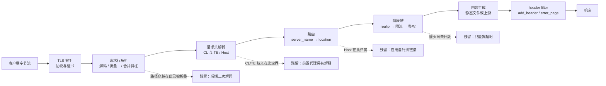
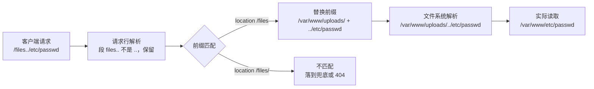
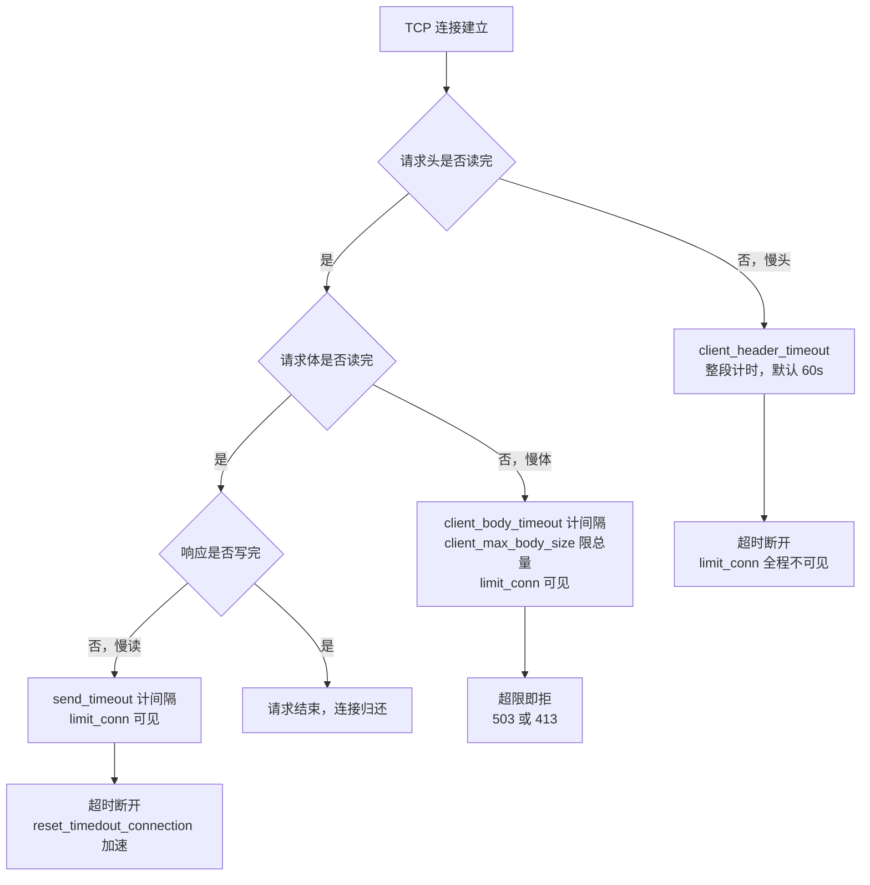
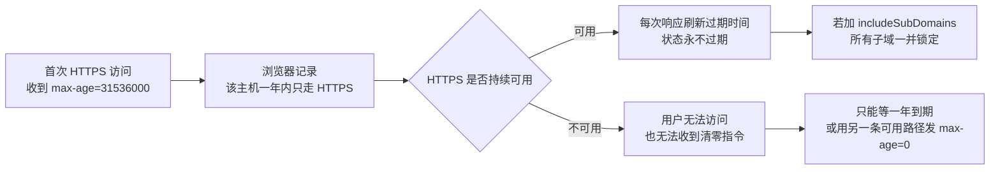
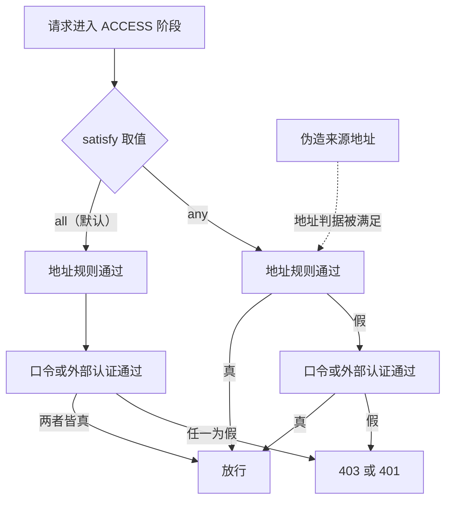

# 11 安全加固：常见攻击向量与防御配置

**摘要：**

一份渗透测试报告的结论页常常只有一行字：“通过 Host 头注入拿到密码重置令牌”，而同一个项目的 Nginx 配置评审报告里躺着二十几条整改建议，`server_tokens off`、`X-Frame-Options`、`limit_req`、`autoindex off` 一应俱全。两份文档放在一起看，荒诞感就出来了：加固动作全都落了地，攻击链却一步没被切断。原因不难找，配置项回答的是“我做了什么”，攻击链问的是“你拦住了哪一步”，这两件事之间隔着一层机制——URI 在哪一阶段被解码、报文边界由谁定义、响应头在什么条件下才被写出去。本篇按七个攻击向量组织：信息泄露、路径穿越、请求走私、Host 头注入、慢速攻击、暴力破解、TLS 降级，每一个都给出配置能防到哪一步、防不住什么；随后处理三块容易配错的公共设施——响应安全头与 `add_header` 的覆盖语义、访问控制的三种方式与它们的边界、两个“配了反而更危险”的反例；最后落到 Nginx 自身的安全更新、编译选项的暴露面与 WAF 的能力边界。全文不给配置清单，只建立一张“拦截点与残留面”的对应表。

---

## 第 1 章 三个检查点，决定了配置能防到哪一步

先看一个真实的评审场景。某内部系统的 Nginx 配置被安全扫描器打了 78 分，缺 `X-XSS-Protection`、`Server` 头暴露版本、目录可列举，三条都属实。工程师逐条补齐，两周后渗透测试仍然成功：攻击者构造了一个 `Host: admin.internal.example.com` 的请求，后端把密码重置链接拼成了这个域名，邮件发出，令牌落进攻击者手里。配置评审与渗透测试的分歧不在水平高低，而在它们看的东西不同——前者看配置项是否存在，后者看攻击链是否被打断。

要判断一条配置能防住什么，得先知道它插在哪一步。Nginx 对一条请求的干预机会集中在三个位置，每个位置能看见的信息、能做的动作、以及改完之后的效果都不一样。

### 1.1 第一个检查点：请求行解析

连接建立、TLS 握手完成之后，worker 读到的第一批字节是请求行与请求头。请求行里的 URI 在这里被解析，`%XX` 转义被解码，`.` 与 `..` 成分被折叠，连续的斜杠按 `merge_slashes` 的取值被合并，控制字符与非法字节被拒绝。这一步的产物有两个：`$request_uri` 保留客户端发来的原始串，含参数、含转义、含多余斜杠；`$uri` 保存规范化之后的路径，后续所有 location 匹配、`root` 拼接、日志里的路径都基于它。

这个顺序带来一条**硬结论**：路径穿越用的 `..` 序列，在进入任何一条配置之前就已经被解析掉了。所以“写一条正则拦住 `../`”这类做法，作用对象根本不存在；真正能穿出去的路径，一定是在规范化之后、由配置自己“造”出 `..` 段的写法，第 3 章展开。

### 1.2 第二个检查点：请求头解析与路由

请求头解析决定三件事：报文边界（`Content-Length` 与 `Transfer-Encoding` 谁说了算）、虚拟主机归属（`Host` 匹配哪个 `server`）、以及进入哪条 location。三者各对应一类攻击——请求走私、Host 头注入、location 绕过，共同点是攻击者构造的不是“坏内容”，而是“有歧义的合法内容”。

Nginx 在这一步的严格程度构成它对下游的保护上限：拒绝同时携带 `Content-Length` 与 `Transfer-Encoding` 的请求、拒绝非法的 chunk 长度，近年的版本还拒绝重复的 `Content-Length`，这些动作发生在任何 location 配置之前，不依赖运维是否写对某一行。但它的严格只对“以 Nginx 为解析方”的链路成立，前面若还有一层 CDN 或硬件负载均衡，解释权在那一层。

### 1.3 第三个检查点：响应组装

反向代理拿到上游响应之后，Nginx 走 header filter 链，`add_header`、`proxy_hide_header`、`error_page`、`sub_filter` 都在这一条链上工作。这里有两个约束反复制造“配了没生效”：其一，`add_header` 是否生效取决于状态码，默认只对 200、201、204、206、301、302、303、304、307、308 生效；其二，`add_header` 在当前层只要出现一条，父层的整组就被替换掉，继承不是追加。

也就是说，安全响应头这类“全局配置”，在 Nginx 里并不存在真正的全局语义。配置写在 `http` 块，可能被任意一个 `location` 顶掉；写在 `server` 块，可能被 `location` 顶掉；只有配合 `always` 与重复 `include`，才能覆盖到错误响应与全部路径。`add_header` 的继承规则与 `include` 的位置语义见 [[02 配置体系解析：指令、上下文与继承规则]]，本篇只讨论它造成的安全后果。

### 1.4 七个向量与它们的拦截点

把上面三个检查点横过来，七个攻击向量各自落在某个位置，也就各自有了明确的“能防”与“防不住”。下表是全文的骨架，后面每一章填一行。

| 攻击向量 | 主要拦截点 | 关键配置 | 最先失效的条件 |
|---|---|---|---|
| 信息泄露 | 响应组装 | `server_tokens`、`error_page`、`autoindex` | 上游自带的 `Server`、`X-Powered-By` 未清 |
| 路径穿越 | 请求行解析 + 路径拼接 | `alias` 的斜杠一致性、`merge_slashes` | 上游对同一串路径二次解码 |
| 请求走私 | 请求头解析 | `proxy_http_version 1.1`、上游解析一致性 | Nginx 前面还有一层解释报文的代理 |
| Host 头注入 | 路由 | `server_name`、默认站、`$host` | 应用自己拿 `Host` 拼链接与缓存键 |
| 慢速攻击 | 连接与超时 | `client_header_timeout`、`limit_conn` | 慢头阶段不计入 `limit_conn`，只能靠超时 |
| 暴力破解 | ACCESS 阶段 | `limit_req`、`auth_request` | 攻击源分散在大量 IP 上 |
| TLS 降级 | 握手 | `ssl_protocols`、HSTS、`ssl_reject_handshake` | 用户首次访问、证书本身出错 |

这张表的用法不是查配置，而是查盲区。任何一次加固评审，只要逐行问一句“这一行的失效条件我们是否已经承认”，就能避免把“配了”当成“防住了”。

### 1.5 一条贯穿全文的判据

沿三个检查点追下来，可以得到一条统一判据：Nginx 的配置只能**改变接入层对请求的解释**，改变不了后端对同一串字节的解释。不生效的加固几乎都能归到三类：**解释权**不在 Nginx 手里、**观察点**不在这个阶段、动作**不可撤回**。后面每一章的“防不住什么”，都是它的具体形态。把三个检查点串成一条链路，并把每一站的残留面标在旁支上：



图中虚线标出的是每一站的残留面。安全加固的判断力，多半来自对这些虚线的熟悉程度，而不是对实线配置的熟悉程度。

---

## 第 2 章 信息泄露：默认值里的指纹

信息泄露排在第一，不是因为它危害最大，而是因为它最容易被误判成“已经解决”。`server_tokens off` 只有一行，改完之后 `Server` 头从 `nginx/1.27.4` 变成 `nginx`，扫描器不再报“版本号暴露”，团队也就认为这件事结了。真实情况是，版本号只是指纹的一个维度，而且往往不是最有用的那一个。

### 2.1 server_tokens 改的只有两处

`server_tokens` 的默认值是 `on`，此时 Nginx 在响应头里写 `Server: nginx/<version>`，自己生成的错误页底部也带版本号。设成 `off` 之后，两处都只剩 `nginx`；设成 `build`（1.11.10 起），错误页会带上编译时指定的构建名。它能改的就这两处，管不到上游响应里自带的 `Server`，也管不到应用吐出的 `X-Powered-By`、`X-AspNet-Version`、`X-Generator`。

反代场景里最典型的残留是上游的 `Server`。后端是 Tomcat、Gunicorn、PHP-FPM 时，上游响应会带自己的 `Server` 或 `X-Powered-By`，Nginx 默认原样转发。清掉它得在对应的 location 里写 `proxy_hide_header Server;`，或用 `ngx_headers_more` 的 `more_clear_headers`；前者只能隐藏指定名字的头，后者能“清除后重新添加”，代价是引入一个第三方模块。

还有一个更隐蔽的残留：`proxy_hide_header` 只影响转发链路，不影响 Nginx 自己生成响应时的 `Server` 头。同一份配置里，静态文件响应带 `nginx`，代理响应带上游的 `Server`，两者并存，攻击者一眼就能分出哪些路径直连、哪些走了应用。

### 2.2 error_page：默认页泄露的不只是版本

`server_tokens off` 之后仍然存在的默认错误页，是一份信息量不小的样本：它说明这个服务是 Nginx、错误由接入层产生而不是应用产生，还暴露了各类畸形请求的处理语义（400 解析失败、413 体积超限、414 URI 过长、494 请求头过大）。对扫描器来说，后一条比版本号更有价值——它能据此判断哪些请求会在接入层被拦、哪些能穿透到应用。

`error_page` 的作用就是把这份样本换成自己的。三点要注意：错误页 location 要标 `internal`，否则外部可直接访问那个 HTML，读到可能残留的调试信息；`error_page` 的继承是整组替换，在某个 location 里只为 404 写一条，`server` 层为 502 写的那些就一起失效，清单见 [[02 配置体系解析：指令、上下文与继承规则]]；把 `error_page 404 =200 /index.html` 当“友好化”，等于把所有不存在的路径回成 200，安全侧就失去了用状态码区分“不存在”与“存在但无权”的能力。

### 2.3 autoindex：目录列表是一种文件枚举接口

`autoindex` 默认关闭，一个 `autoindex on` 就把它变成文件枚举接口。它显示文件名、大小、修改时间，对攻击者的价值是直接给出资产清单：备份文件、`.git` 目录、编辑器残留、上传目录里的用户文件，一次请求全拿到。更糟的是它与 `index` 的配合——目录下没有 `index.html` 时，列表成为默认响应，而这个响应没有任何鉴权可言。

关掉 `autoindex` 不等于关掉枚举。带哈希的静态文件名猜不中，但 `/backup/db-2026-11-01.sql`、`/config/app.yaml.bak` 这类路径猜得中。有效做法是三层同时收紧：目录列表关掉、敏感后缀与隐藏文件在 location 层拒绝、上传目录用不可预测的名字并禁止执行。

### 2.4 这一步防不住什么

即便 `server_tokens off`、`error_page` 配齐、`autoindex off`、上游头清干净，仍然防不住四类泄露：应用自己输出的堆栈与调试信息、业务响应里带出的内部 ID 与路径、时序与长度侧信道、以及从 TLS 套件顺序与扩展组合这类指纹推断出的部署形态。信息泄露的本质是“信息量”，不是“配置项”，配置能压低 HTTP 层的指纹，压不到应用层，也压不掉 TLS 与流量特征。这一条在第 11 章会以一个具体反例再算一遍账。

| 指令 | 关掉之后仍然存在的泄露 | 代价与副作用 |
|---|---|---|
| `server_tokens off` | 上游 `Server`、`X-Powered-By`、错误页仍承认是 Nginx | 几乎没有；排障时少了版本线索 |
| `error_page` 自定义 | 应用错误页、调试信息、响应长度差异 | 每个状态码都要维护页面，`internal` 漏写即成新入口 |
| `autoindex off` | 可预测命名的备份与配置文件 | 依赖文件名的资产仍然可枚举，需要配合后缀与隐藏文件规则 |

---

## 第 3 章 路径穿越：规范化之后还剩什么

路径穿越是最容易被“经验配置”糊弄过去的一类。很多团队的安全基线里都有一条 `location ~* (\.\./) { return 403; }`，看着很安心，实际上它匹配不到任何东西——因为进入 location 匹配的 `$uri` 里根本不会有 `..` 段。要理解为什么，得把规范化的时机与 `alias` 的拼接方式拆开看。

### 3.1 规范化在请求行解析期完成

Nginx 解析请求行时，若 URI 里含 `%` 或 `.` 成分，会走复杂 URI 解析路径：逐字节解码转义，遇到 `.` 段丢弃，遇到 `..` 段回退到上一个斜杠，连续斜杠按 `merge_slashes` 合并，遇到零字节或控制字符直接判为非法请求。这段逻辑的产物就是 `$uri`，它保证了两件事：里面没有 `.` 与 `..` 段，也没有未经解码的转义。

由此可以推出两个常用结论。其一，`%2e%2e%2f` 这类编码绕过在 Nginx 侧是无效的：解码发生在折叠之前，`%2e%2e%2f` 解码成 `../` 之后照样被折叠。其二，任何基于 `$uri` 的正则都看不到穿越序列，写 `\.\.` 的正则只能拦住字面量形式的字符串——而它在到达正则之前已经被处理掉了。相比之下，`$request_uri` 保留原始形态，观察攻击尝试时应该用它；做路径判定只能用 `$uri`。这两个变量的分工见 [[03 HTTP 请求处理管道：11 个阶段全解]]。

### 3.2 root 与 alias 的差别在字符串级别

`root` 与 `alias` 的差别经常被描述成“一个拼、一个换”，这个说法对，但不足以解释风险。真正的差别在于拼接发生在规范化的哪一侧。

`root` 的语义是“把规范化之后的完整 URI 接到根目录后面”。请求 `/files/logo.png`，`root /var/www` 得到 `/var/www/files/logo.png`。因为 `$uri` 里不可能有 `..` 段，拼出来的路径也不会凭空多出 `..`，`root` 因此天然免疫这类穿越。

`alias` 的语义是“用 alias 的值替换掉匹配到的 location 前缀”。这是**前缀替换**，字符级的，替换之后 Nginx 不再重新规范化路径，直接交给文件系统。问题就出在这个“不再规范化”上：如果 location 前缀不以斜杠结尾，而 alias 以斜杠结尾，一个精心构造的 URI 段会在替换之后变成 `..`。

```nginx
# 危险：location 前缀不带斜杠，alias 以斜杠结尾
location /files {
    alias /var/www/uploads/;
}

# 安全：两侧斜杠一致，前缀按目录边界匹配
location /files/ {
    alias /var/www/uploads/;
}
```

第一种写法下，请求 `/files../etc/passwd` 走完规范化仍然是 `/files../etc/passwd`——`files..` 不是 `..` 段，不会被折叠；它命中前缀 `/files`，前缀被替换成 `/var/www/uploads/`，剩下的 `../etc/passwd` 接在后面，得到 `/var/www/uploads/../etc/passwd`，文件系统解析后是 `/var/www/etc/passwd`。一次请求逃出一层目录。第二种写法下，前缀以斜杠结尾，`/files../etc/passwd` 的首段是 `files..`，不满足 `/files/` 的前缀条件，请求落到别处或直接 404。

一层是极限吗？不是，但也堆不深。在 URI 里堆更多 `..` 会在规范化阶段被依次折叠：`/files../../etc/passwd` 中的第二个 `..` 会把 `files..` 弹掉，最终得到 `/etc/passwd`，不再命中 `/files` 前缀。所以破坏力取决于 alias 根目录之上有什么——若 alias 指向 `/data/app/public/`，一层刚好到 `/data/app/`，足以读到配置与同级目录；若指向 `/srv/`，一层到 `/`，收益更大。判断风险时不能只看“能不能到 `/etc/passwd`”，要看“上一层目录里有什么”。把这条路径在字符串层面的走法画出来：



### 3.3 merge_slashes 与斜杠的语义

`merge_slashes` 默认为 `on`，把连续斜杠合并成一个。它看起来只是容错，实际上是一条访问控制语义的前提：合并之后，`//admin` 与 `/admin` 是同一个 URI，`location = /admin { deny all; }` 对两者都生效。

一旦有人为了兼容某个老应用把它设成 `off`，`//admin` 就成了一条独立路径：它不匹配 `location = /admin`，可能落到兜底的静态文件 location，而静态文件处理器把它映射到磁盘上的同一个目录——`/var/www//admin` 与 `/var/www/admin` 在 POSIX 语义下是同一个路径。于是拒绝规则被绕开，文件照样被读出来。这个组合在渗透测试里出现频率不低，原因是 `merge_slashes off` 往往写在 `http` 块里，写它的人只想着“保持原始路径”，不会想到它同时拆掉了访问控制。

`alias` 用在正则 location 里还有一条约束：正则没有“前缀长度”这个概念，alias 里必须包含捕获引用，否则替换结果与预期错位。这条与 location 前缀、正则的匹配优先级一起，见 [[07 Location 匹配：优先级规则与正则引擎]]。

### 3.4 二次解码：Nginx 防不住的那一半

到这里，Nginx 侧的账基本算清了：只要 `alias` 的斜杠一致、`merge_slashes` 保持默认、不在配置里用 `rewrite` 造出新的 `..`，路径穿越在接入层就被挡住了。真正防不住的是另一半——后端对同一串路径再解释一次。

反代场景里有两个常见形态。第一种是 `proxy_pass` 不带 URI 部分，此时 Nginx 会把客户端发来的原始请求行转给上游，包括未解码的 `%2e%2e%2f`；上游框架若先解码再拼文件路径，穿越就在那里发生，Nginx 全程只是搬运工。第二种是应用自己做 URL 归一化时把 `%2f` 当成普通字符，解码后得到 `/`，路径段结构随之改变。两种形态的共同点是：Nginx 的规范化只作用于它自己的 `$uri`，不作用于发出去的字节。

```nginx
# 不带 URI：原始请求行（含转义）转给上游，上游二次解码即成穿越
location /api/ {
    proxy_pass http://backend;
}

# 带 URI：按规范化路径重写，转义形态被抹平，副作用是上游拿不到原始路径
location /api/ {
    proxy_pass http://backend/api/;
}
```

这两种写法没有绝对的安全优劣，取舍在于“上游是否需要原始路径”。需要原始路径的场景（签名校验、按字节路由），就必须在上游侧自己做严格的路径归一化；不需要的场景，带 URI 的写法把转义形态抹掉，反而少一个入口。

### 3.5 剩下的三类残留

除了后端二次解码，还有三类残留。`disable_symlinks` 默认关闭，符号链接可以把路径指到文档根之外，Nginx 的规范化只管字符串，不管链接。`rewrite` 与 `try_files` 的内部跳转会重新进入 URI 处理，若规则里用变量拼路径，可能造出新的可疑段。上传目录若允许执行脚本，穿越之外的“直接访问上传文件”本身就是更大的面。这些都不在“拦 `..`”的范畴里，需要按目录、按后缀分别设规则。

---

## 第 4 章 请求走私：两个解析器之间的缝

请求走私（HTTP request smuggling）是七个向量里最依赖部署形态的一个。它不是一个请求本身的漏洞，而是两个 HTTP 解析器对同一段字节流给出不同解释时产生的缝。理解它，先要接受一个前提：HTTP/1.1 的**报文边界**不是自明的，`Content-Length` 与 `Transfer-Encoding` 是两套互斥的定界机制，谁优先、冲突时怎么处理，规范有规定，实现却各自为政。

### 4.1 缝的形状

最经典的构造是 CL.TE：请求同时带 `Content-Length` 与 `Transfer-Encoding: chunked`，前置代理按 `Content-Length` 截断，后端按 chunked 解析，于是 body 里那段“看起来像下一个请求”的内容被后端当成了新请求，而这个新请求是攻击者塞进别人连接里的。反过来 TE.CL 是前置按 chunked、后端按长度。第三种是 TE.TE：两边都认 chunked，但其中一边忽略了一个被混淆过的 `Transfer-Encoding` 头（大小写、重复、`chunked, identity` 这类组合），于是又回到不一致。

```http
POST / HTTP/1.1
Host: example.com
Content-Length: 13
Transfer-Encoding: chunked

0

GET /admin HTTP/1.1
```

同一段报文在不同解析器眼里长度不同：按 `Content-Length` 只读 13 字节，`GET /admin` 留在缓冲区；按 chunked，`0` 表示结束，后面的字节属于下一个请求。两个请求被拼到一条连接上，后一个可以是任何东西。真实利用还要配合连接复用与前缀干扰，但缝的本质就是这一处。

### 4.2 Nginx 的立场

Nginx 在请求头解析阶段就对歧义报文采取拒绝姿态：同时携带 `Content-Length` 与 `Transfer-Encoding` 的请求、重复的 `Content-Length`、非法的 chunk 长度，都会在进入任何 location 之前被拒绝，返回 400 并关闭连接。这条策略的价值在于它不依赖配置——即使运维什么都没写，Nginx 作为第一解析器也不会把歧义转发出去。

作为反代，Nginx 还有第二层动作：与上游通信的协议版本由 `proxy_http_version` 决定，默认是 1.0。1.0 没有 chunked，Nginx 会把请求体完整缓冲后按 `Content-Length` 发给上游，报文边界由 Nginx 单方面重新定义，歧义在这一跳被抹平。代价是缓冲——请求体先落进内存或 `client_body_temp_path`，大文件上传因此多一次磁盘往返，这也是很多人把它改成 1.1 的原因：

```nginx
upstream backend {
    server 10.0.0.11:8080;
    keepalive 64;
}

location /api/ {
    proxy_http_version 1.1;              # 与上游保持长连接、支持 chunked
    proxy_set_header Connection "";      # 清掉 close，keepalive 才生效
    proxy_pass http://backend;
}
```

改成 1.1 之后，Nginx 与上游之间也支持 chunked 流式转发，配合 `proxy_request_buffering off` 可边收边发。这组配置提升吞吐，同时去掉了“报文边界由 Nginx 单方面定义”这层保护：两端都按 chunked 理解，上游实现一有偏差，缝就重新出现。`proxy_http_version 1.1` 本身不是防护，它只是把解释权交回两端一致的规范，防护来自两端实现都严格。

### 4.3 缝不在 Nginx 手里的四种情况

Nginx 的严格只覆盖它自己解析的那一跳，四种情况里缝不在它手里：前面还有 CDN 或硬件负载均衡，那一层对 CL/TE 的处理与 Nginx 不同，歧义在到达 Nginx 之前已经形成；后面还有一层代理且重新组包；前置层把 HTTP/2 降级成 HTTP/1.1，重新生成 `Content-Length` 时边界可能错位；上游框架自己实现宽松解析，把畸形头当正常头接受。

这也解释了为什么请求走私的修复很少止于“改一条 Nginx 配置”。它是链路属性，不是单点属性：链路上每一跳的解析器都要么严格、要么被替换，缝才会消失。

---

## 第 5 章 Host 头注入：配置顺序的安全含义

Host 头是 HTTP/1.1 里唯一“由客户端声明自己在访问谁”的字段。服务端需要它来做虚拟主机选择，应用需要它来生成绝对链接，缓存需要它来区分站点——三个用途对应三种攻击面，而 Nginx 只能管住第一个。

### 5.1 server_name 匹配与默认站

Nginx 按 `Host` 选择 `server` 块的顺序是固定的：精确名字、前导通配（`*.example.com`）、后导通配（`www.example.*`）、正则（`~`），全都不中时落到该监听地址上的默认站。默认站的判定规则很简单：同一个 `listen` 上第一个出现的 `server` 块，或者显式标了 `default_server` 的那个。

“第一个”这个规则有安全含义，却经常被忽略。配置通常按 `include conf.d/*.conf` 组织，glob 返回字典序，于是“第一个 server”取决于文件名。新增虚拟主机时若文件名排序靠前，它可能不经意间成为默认站，接管所有未知 Host：扫描器的随机域名落到这个站点上，命中它的 location、日志与应用，轻则日志被污染，重则那个应用的 Host 拼接逻辑被喂进攻击者控制的域名。

更常见的形态是默认站就是业务主站。这时候任何 `Host: evil.com` 的请求都会进入业务逻辑，如果应用用 `Host` 拼密码重置链接、拼绝对跳转地址、拼缓存键，攻击链就完整了。修复不是“让默认站不业务”，而是“让默认站明确拒绝”：

```nginx
# 空壳默认站：未知 Host 直接拒绝，不进入任何业务逻辑
server {
    listen 80 default_server;
    listen 443 ssl default_server;
    ssl_reject_handshake on;     # 1.19.4 起：TLS 层直接拒绝未知 SNI
    return 444;                  # HTTP 层：关闭连接，不发响应
}
```

`return 444` 是 Nginx 的伪状态码，触发直接关闭连接，不写状态行、不写响应头，比 `400` 少给一屏信息。`ssl_reject_handshake` 则把拒绝提前到 TLS 握手阶段，未知 SNI 连证书都拿不到，CPU 与日志都省下。两者的组合在 [[06 SSL-TLS 卸载：HTTPS 握手流程与性能优化]] 里讨论过 SNI 侧的取舍，这里只强调一点：默认站必须是空壳，不能是业务站。

### 5.2 $host 与 $http_host 的真实差别

这两个变量的差别常被说成“`$host` 经过 server_name 验证”，这个说法是错的。`$host` 不校验自己是否在 `server_name` 列表里，它的取值优先级是：请求行里的绝对 URI 主机名、`Host` 请求头、匹配到的 `server_name`；取到之后再做小写化与去端口，遇到非法字符则返回 400。`$http_host` 则是 `Host` 头的原样拷贝，含端口、含大小写、含任何客户端愿意放进去的字节。

所以安全上的差别是**归一与校验**，不是“归属验证”。拿 `$host` 拼重定向，得到的仍然可能是攻击者控制的域名——它只是格式合法。要真正限制，得做白名单：

```nginx
map $host $host_allowed {
    default          0;
    example.com      1;
    www.example.com  1;
}

server {
    if ($host_allowed = 0) {
        return 421;     # Misdirected Request：明确告诉客户端走错了虚拟主机
    }
}
```

`421` 与 `444` 是个小权衡：`444` 更省字节、更难探测，但客户端与监控拿不到语义；`421` 语义正确、可被重试，代价是暴露“这里有虚拟主机路由”。对外部扫描流量 `444` 更干净，对内网多租户网关 `421` 更利于排障。`if` 在 location 与 server 上下文的边界见 [[02 配置体系解析：指令、上下文与继承规则]]。

### 5.3 应用侧的三条泄漏路径

Nginx 侧做对了，Host 注入仍然可能成功，因为应用还有三条自己的路径：生成绝对 URL（密码重置、邮件确认、支付回调的域名若取自请求头，攻击者控制 Host 就等于控制链接）、缓存键（用 `Host` 参与键计算，攻击者可用任意 Host 制造无限多条目或投毒）、重定向（登录后跳回“原地址”，若由 Host 拼成就成了开放重定向）。这三条的共同点是“Nginx 已经把请求交给了应用”，修复点在应用配置与代码里——把可信域名做成配置项、把缓存键收敛到规范化域名、把跳转目标限制为相对路径。Nginx 能做的是把不合法的 Host 挡在门外，做不了的是替应用决定“哪个域名可信”。

### 5.4 这一步防不住什么

默认站拒绝只能拦住“Host 不在白名单”的请求，拦不住“Host 在白名单但应用逻辑有洞”的场景；`$host` 的归一只能保证格式合法，保证不了来源可信；SNI 与 Host 可以不一致，若业务依赖两者一致做隔离，必须显式校验，否则一条 `curl --resolve` 就能构造出 SNI 与 Host 分离的请求。还有一个量级问题：公网扫描器每天用随机 Host 探测的量以万计，默认站若返回完整错误页，日志量会成为噪音源，这也是空壳默认站的实际收益之一。

---

## 第 6 章 慢速攻击：超时是主防线，限流是补充

慢速攻击（slowloris）经常被当成“限流问题”，于是团队去调 `limit_req`，调完发现毫无作用。原因在第 1 章那张图里已经埋下：`limit_conn` 的计数条件是“请求头已读完且请求在途”，而慢头攻击卡在“请求头没读完”，它压根不在计数视野里；`limit_req` 记的是请求速率，慢头攻击的速率低到可以忽略。真正挡住它的是超时与缓冲区，限流只在慢体与慢读这两段起作用。

### 6.1 三段卡位与各自的防线

慢速攻击不是一个动作，而是一族动作，按卡住的位置分成三段。慢头：连接建立后每次只发一个字节，请求头永远读不完。慢体：头正常发完，声明一个很大的 `Content-Length`，正文一点点挤。慢读：请求已处理完，客户端极慢地读响应，把连接占住不释放。三段对应的配置面完全不同，混着调只会互相干扰。

慢头的防线是 `client_header_timeout`，默认 60 秒，计的是“读完整个请求头的**总时长**”而不是两次读之间的间隔：只要总时长超过 60 秒，客户端发得再慢，连接也会被断开。默认值在公网环境偏宽松，调小到 10 至 15 秒是常见做法，代价是弱网移动端首次请求可能被误断，日志里表现为 408。

慢体落在 `client_body_timeout`（默认 60 秒）与 `client_max_body_size`（默认 1m）上，但要注意 `client_body_timeout` 计的是两次读之间的间隔，不是总时长——一个每 30 秒发一个字节的客户端可以永远不触发它。要限制总量，得靠 `client_max_body_size` 与四层的连接数限制。慢读靠 `send_timeout`（默认 60 秒，计两次写之间的间隔）与 `reset_timedout_connection on`，后者让超时连接发 RST 而不是走正常的四次挥手，回收 fd 更快。三段卡位与各自的防线可以画成一张判定图：



这张图解释了一个反复出现的误判：团队看到“慢速攻击”，第一反应是加 `limit_conn`，但攻击者只要把节奏控制在“请求头差最后一个字节”，`limit_conn` 就一次都不会触发。把三段分开看，才知道哪一段该配什么。

### 6.2 参数的代价结构

下表把几条关键参数的默认值、作用点与调整代价放在一起。所有“调小”的代价最终都表现为误杀正常用户，而误杀比攻击更难排查——攻击有告警，误杀只有零星投诉。

| 参数 | 默认值 | 作用点 | 调大的代价 | 调小的代价 |
|---|---|---|---|---|
| `client_header_timeout` | 60s | 读完整个请求头的总时长 | 慢头连接占槽更久 | 弱网用户首包被误断，408 增多 |
| `client_body_timeout` | 60s | 两次读请求体之间的间隔 | 慢体连接保持更久 | 大文件上传在弱网下被误断 |
| `client_max_body_size` | 1m | 请求体总量上限 | 单请求可占更多内存与临时磁盘 | 正常上传被 413 拒绝 |
| `large_client_header_buffers` | 4 8k | 单个请求头的缓冲上限 | 每连接内存占用上升 | 合法的大 Cookie 被 400 拒绝 |
| `send_timeout` | 60s | 两次写响应之间的间隔 | 慢读连接保持更久 | 慢网络下响应被截断 |
| `reset_timedout_connection` | off | 超时后发 RST | 无明显代价 | 无（建议开启） |

`large_client_header_buffers` 默认 `4 8k`，意味着最多四个 8KB 缓冲，请求行与单个 header 都受它约束。调大能容纳更大的 Cookie，也让每个连接的内存下限上升；`client_header_buffer_size`（默认 1k）同理。慢速攻击的一种变体正是靠超大 Cookie 把缓冲撑到上限，再靠极慢的发送拖住连接。

### 6.3 量化：一次慢头攻击的成本

取一台四核机器、`worker_connections 1024`，接入层总槽位约 4096，一条代理请求还要占两条连接。`client_header_timeout` 保持默认 60 秒时，一条只发了一半头的连接最多占槽 60 秒：1000 条连接、每 10 秒发一个字节，请求数为 0，却占掉四分之一槽位；把超时压到 10 秒，维持同样占用量需要六倍的连接建立成本。这是示例推算，量级关系稳定：慢头攻击对服务端的成本是每条连接一份内存加一个 fd，对攻击者几乎为零。

### 6.4 超时管不到的四类

超时能挡住慢头，但挡不住四类残留。其一，TLS 握手阶段的慢速攻击：`ssl_handshake_timeout` 默认 60 秒，握手没完成前请求头根本开始不了，这一段只能靠它与四层防护。其二，HTTP/2 流级慢读：一条连接可开多个流，`limit_conn` 按流计数，流数上限由 `http2_max_concurrent_streams` 控制，调大它等于放大这一面。其三，四层 SYN 洪泛与连接耗尽，属于内核与负载均衡层。其四，真实用户的长尾慢网络，任何压到极致的超时都会误伤，正确做法是按分位设定而不是按最坏情况设定。

---

## 第 7 章 暴力破解：限流与认证的分工

暴力破解是唯一一个“攻击流量看起来完全合法”的向量：每个请求都是格式正确的登录请求，攻击者要的只是试的次数。因此它的防御核心不是“识别恶意”，而是“限制尝试频率”与“提高单次尝试成本”，这两件事分别落在 `limit_req` 与认证方式上。

### 7.1 四种形态，四种成本

字典爆破是单点高频，一个 IP 对一个账号试几千个密码，`limit_req` 最有效；密码喷洒是低频广撒，单账号看毫无异常，防的是全局失败率；撞库用泄露凭证批量登录，请求分散；分布式爆破把请求摊到上万个 IP，每个只贡献几次尝试。四种形态对配置的敏感度完全不同：`limit_req` 按 IP 记账，对第一种有效，对撞库部分有效，对分布式基本无效——攻击者的 IP 池比桶还多。

### 7.2 limit_req 的边界

限流规则要写在登录接口对应的 location 上，而不是 `server` 层：写在 `server` 层会连带限制静态资源与正常 API，桶被正常流量占满，真正的登录请求反而被提前拒绝。写法上还有两个容易漏的参数：

```nginx
# 按真实客户端地址记账；realip 未配时这里记的是代理的地址
limit_req_zone $binary_remote_addr zone=login:10m rate=10r/m;

server {
    location = /api/login {
        limit_req zone=login burst=5 nodelay;
        limit_req_status 429;        # 默认 503，429 才是语义正确的答案
        proxy_pass http://auth_backend;
    }
}
```

`limit_req_status` 默认是 503，客户端与监控都会把它当成服务不可用；改成 429 之后，客户端可以按 `Retry-After` 退避，监控也能把“被限流”与“服务故障”分开统计。`burst` 与 `nodelay` 的组合决定突发如何被消化：`burst=5 nodelay` 允许瞬间五个请求直接通过，之后按 `rate` 排队，适合“用户手抖多点几次”的场景；不加 `nodelay` 则五个请求被依次延迟，单次登录的延迟会随排队变长。这两个参数的数学本质见 [[08 限流与熔断：leaky bucket 与 burst 参数的数学本质]]。

zone 容量是一条硬边界。`limit_req` 的单条状态在 64 位平台上约 128 字节，10MB 的 zone 大致容纳八万个键（示例推算）。超过之后模块按最近使用顺序淘汰，极端时会强制删除最旧状态，日志出现 `could not allocate node`。若键里拼了用户名（`$binary_remote_addr$arg_user`），键数按“IP 乘账号”膨胀，耗尽速度远超预期。

### 7.3 auth_basic：明文凭证上的锁

`auth_basic` 是最轻的认证方式：`auth_basic` 打开 realm，`auth_basic_user_file` 指向 htpasswd 文件，Nginx 在 ACCESS 阶段校验。它的定位是“给静态资源或内部工具加一道门”，不是用户体系。边界有四条。

第一，Basic 认证的凭证是 `用户名:密码` 的 Base64，**Base64 不是加密，是可逆编码**，任何能看到请求头的人都能还原密码，所以它必须跑在 HTTPS 上，且不能与明文端口共存。第二，浏览器会在每个请求上重复发送凭证直到标签页关闭，暴露面是整站所有请求，不只是登录那一次。第三，它没有锁定、没有冷却、没有审计粒度，试错成本完全由攻击者的带宽决定，必须与 `limit_req` 配合。第四，htpasswd 的哈希算法决定离线爆破难度：`crypt` 与 apr1 今天都算弱，`{SHA}` 是单轮 SHA-1，文件泄露后弱口令几分钟就能还原，`{PLAIN}` 等于明文。

还有两个运维细节：`auth_basic_user_file` 的路径若落在文档根之内，等于把密码文件本身暴露给静态文件服务；改动 htpasswd 需要 reload 才生效，而 reload 会重建 worker，对本已紧张的连接池是一次扰动。这两点在容器化部署里更容易出事，因为文件常被挂载进镜像、reload 由编排系统触发。

### 7.4 auth_request：把认证交给外部

`auth_request` 把认证判断委托给一个内部子请求：主请求进入 ACCESS 阶段后，Nginx 向指定的内部 location 发起子请求，子请求返回 2xx 则放行，401 或 403 则拒绝，其余状态码按错误处理（默认 500）。子请求里可以设置 `auth_request_set`，把上游返回的头或变量带回到主请求，用于传递用户 ID、角色、租户。

```nginx
location = /_auth {
    internal;
    proxy_pass http://auth_service/verify;
    proxy_pass_request_body off;                 # 子请求不需要原始 body
    proxy_set_header Content-Length "";           # 显式清空，否则上游可能等待 body
    proxy_set_header X-Original-URI $request_uri;
}

location / {
    auth_request /_auth;
    auth_request_set $user_id $upstream_http_x_user_id;
    proxy_set_header X-User-ID $user_id;
    proxy_pass http://app_backend;
}
```

这段配置的每个细节都有理由。`proxy_pass_request_body off` 与 `Content-Length ""` 必须成对出现，只关 body 不清长度头，上游可能按长度等待，子请求卡到超时。`auth_request_set` 拿的是子请求的响应头（`$upstream_http_*`），不是子请求的 body。子请求是独立请求对象，主请求里 `set` 的变量不会自动传进去，反过来也一样——这条与变量作用域有关，见 [[02 配置体系解析：指令、上下文与继承规则]]。

`auth_request` 的边界在于它是同步依赖：每个主请求都要等一次认证子请求返回，认证服务的延迟直接加在业务延迟上；认证服务不可用时 Nginx 不会自动放行，所有请求按 500 失败，这是 fail closed 的正确姿态，但需要配合超时、降级缓存与容量冗余。它也不做缓存——同样的 Cookie 每个请求都去问一次，认证服务承受的是全站 QPS 而不是登录 QPS；要做缓存只能靠 `proxy_cache` 加键设计，而键里放 Cookie 本身带来跨用户串用风险。

### 7.5 量化：阈值怎么定

阈值不能拍脑袋，要按“攻击者愿意付的成本”反推。若账号策略是“连续 5 次失败锁 15 分钟”，单账号每天的上限就是 480 次（示例推算），足以挡住人工爆破，挡不住分布式撞库。若目标是全站每分钟失败尝试不超过 100 次，按 IP 限流做不到，得上“按账号 + 全局”的两级桶，或者把判断搬进认证服务按账号冻结。下表是量级示例，不是推荐值。

| 防御目标 | 记账键 | 配置取向 | 逃逸方式 |
|---|---|---|---|
| 挡单点字典爆破 | `$binary_remote_addr` | `rate=10r/m, burst=5, 429` | 换 IP 池 |
| 挡密码喷洒 | 账号（需应用层） | 按账号失败计数并冻结 | 慢速广撒，低于阈值 |
| 挡撞库 | 设备指纹或全局 | 全局失败率告警 + 验证码 | 高命中率账号，无需大量尝试 |
| 挡分布式爆破 | 全局 | 接入层信誉库、四层清洗 | 真实住宅代理 |

### 7.6 尝试成功之后

`limit_req` 挡不住分布式低频尝试，`auth_basic` 挡不住离线破解与凭证泄露，`auth_request` 挡不住“认证通过但越权”的业务逻辑漏洞。三者共同的盲区是“尝试成功之后”：暴力破解的终点是拿到合法会话，而会话滥用属于越权与风控，不在接入层视野里。接入层能做的只有两件事——抬高尝试成本、让尝试可观测；后者靠日志字段与失败率告警，见 [[09 日志体系与可观测性：access_log、error_log 与链路追踪]]。

---

## 第 8 章 TLS：协议、HSTS 与不可撤回的动作

TLS 层的安全配置有一个区别于其他向量的特征：它的一部分动作是不可撤回的。协议与套件可以在下次 reload 时回退，证书可以换，但 HSTS 的 max-age 一旦写进浏览器，就只能等它过期或者靠一份仍然可达的 HTTPS 响应去清零。这一节只讨论与攻击链相关的取舍，握手性能与证书链细节见 [[06 SSL-TLS 卸载：HTTPS 握手流程与性能优化]]。

### 8.1 协议与套件的安全口径

`ssl_protocols` 只留 TLS 1.2 与 1.3；1.2 的套件由 `ssl_ciphers` 控制，只保留提供前向安全的 AEAD 组合，把 CBC 与静态 RSA 密钥交换排除在外；1.3 的套件不受 `ssl_ciphers` 影响，由 TLS 库的默认顺序决定，想调整得用 `ssl_conf_command Ciphersuites`。`ssl_prefer_server_ciphers` 只在 1.2 下有效。真正的风险点在实现：协议降级、重新协商与 0-RTT 重放——`ssl_early_data` 开着，就意味着非幂等请求可能被执行两次。

### 8.2 HSTS：一条会自己长大的配置

`Strict-Transport-Security` 的语义是“在接下来 max-age 秒内，这个主机只能用 HTTPS 访问”。浏览器把主机名与过期时间记进本地状态，之后所有 http 请求在发出前就被改写成 https；`includeSubDomains` 扩到所有子域，`preload` 把域名提交进浏览器内置列表。

这条头的危险不在写法，在时间。max-age 从最后一次收到头部开始重新计时，只要站点持续发，状态就永不过期。一旦 HTTPS 配置出了问题——证书过期、端口不通、CDN 回源失败——用户不会看到“无法安全连接”，而是看到一个连 http 兜底都进不去的错误页，而运维此时无法通过响应头去清零，因为响应根本送不到。这正是**不可撤回**的真实含义：不是技术上不能清，而是在最需要清的时候清不了。把 max-age 的生命周期摊开看：



由此得到一条上线纪律：HSTS 应当从短 max-age 起步，先观察一个完整的证书续签周期，确认没有 HTTP-only 的子域被 `includeSubDomains` 打死，再逐步拉长；`preload` 放在最后，且只对确实全站 HTTPS 的域名使用。`max-age=31536000` 即 365 天，量级上等于把全部回访用户锁进 HTTPS 一年（量级判断），把“一年 + includeSubDomains”作为初始配置，等于把首次上线的风险窗口设成一年。

### 8.3 ssl_reject_handshake 与默认站

1.19.4 起，`ssl_reject_handshake on` 可以在 `server` 上下文中直接拒绝握手。它最常见的用法是配合空壳默认站：未知 SNI 的客户端连证书都拿不到，握手在 TLS 层终止，既省 CPU 也避免证书错配告警。它与 `return 444` 的分工很清晰——前者挡在 TLS 层，后者挡在 HTTP 层，两者不冲突，默认站可以同时配置。

这个指令还有一个常被忽略的用途：多租户网关里，若某个租户的域名被下线，把它的 server 块改成拒绝握手，比删除配置更安全——删除会让它落到默认站，而默认站若是业务站，下线域名反而接管了业务逻辑。

### 8.4 协议层解决不了的

TLS 配置防不住四类问题。错签或被盗的证书不在协议层解决范围内，只能靠 CT 日志监控与吊销；用户首次访问没有任何 HSTS 保护，第一次仍然可能被降级；客户端忽略证书警告的习惯无法用服务端配置纠正；TLS 终止点之后的明文段（Nginx 到上游）若跨机器，前向安全在那一跳失效，需要 mTLS 或内网加密补齐。`ssl_verify_client` 能把 mTLS 加上，但它的代价是客户端证书的分发与轮换，通常只用于服务间调用，不用于面向用户的入口。

---

## 第 9 章 响应安全头：add_header 的覆盖语义是头号杀手

响应安全头是“配置写起来最简单、生效判断最复杂”的一类。它们的动作都发生在 header filter 链上，而这条链的行为受两个规则支配：状态码白名单与继承替换。不理解这两条，写出来的头一半不生效，而且不生效的方式很安静。

### 9.1 两个规则，两种失效

`add_header` 默认只对 200、201、204、206、301、302、303、304、307、308 生效。给 403 加一个 `X-Reason`，不加 `always` 就永远看不到；给错误页加 `X-Frame-Options`，同理。`always` 参数（1.7.5 起）把范围扩到所有状态码，代价是错误响应也带上这些头，若其中含 `Access-Control-Allow-Origin: *` 这类宽松值，等于把错误响应的跨域面也放开了。

继承规则更隐蔽：`add_header` 在当前层只要出现一条，父层的整组就被替换。`http` 块里写五条安全头，某个 location 为加一条 `Cache-Control` 写了一条 `add_header`，那五条在这里全部消失。1.29 之前没有合并开关，唯一解法是用 `include` 在每个需要的层级各引一次；规则推导见 [[02 配置体系解析：指令、上下文与继承规则]]，这里只强调后果：**安全头失踪**最常见的现场，是某个为缓存或跨域单独加头的 location。

### 9.2 五个头的正确配法与失效条件

| 响应头 | 防什么 | 推荐值 | 失效条件 |
|---|---|---|---|
| `Strict-Transport-Security` | 降级与明文访问 | `max-age=...; includeSubDomains`，仅在 HTTPS 响应上 | 首次访问；HTTP 响应上的头被忽略 |
| `Content-Security-Policy` | XSS、资源注入、点击劫持 | 按业务定制，先 Report-Only | 含 `unsafe-inline`；同源存在 JSONP 或上传 |
| `X-Frame-Options` | 点击劫持 | `DENY` 或 `SAMEORIGIN` | 被 CSP `frame-ancestors` 覆盖；旧浏览器忽略 |
| `X-Content-Type-Options` | MIME 嗅探导致的脚本执行 | `nosniff` | 服务端 `Content-Type` 本身错误 |
| `Referrer-Policy` | 敏感 URL 经 Referer 外泄 | `strict-origin-when-cross-origin` | 页面内自行设置的 referrer 策略覆盖 |

最后一列值得多看。`nosniff` 的前提是 `Content-Type` 正确，给 CSS 返回 `application/octet-stream` 时加 `nosniff`，浏览器会拒绝加载，安全头把性能问题变成了功能故障。`X-Frame-Options` 的 `ALLOW-FROM` 已不被主流浏览器支持；当下发 CSP 的 `frame-ancestors` 时，`X-Frame-Options` 会被忽略，只改 CSP 不改 XFO，实际生效的是 CSP。另外两个头要拨乱反正：`X-XSS-Protection` 不该再配 `1; mode=block`，现代浏览器已移除 XSS Auditor，OWASP 建议设成 `0` 或干脆不发；`Permissions-Policy` 是白名单语法，与 `Feature-Policy` 的黑名单语义相反，混用会得到“配了但没限制”的结果。

### 9.3 CSP 落地：从 Report-Only 到 nonce

CSP 的价值与复杂度成正比。一个可用起点是 `default-src 'self'; script-src 'self'; object-src 'none'; base-uri 'none'; frame-ancestors 'none'`，`object-src` 与 `base-uri` 常被漏掉，前者堵住插件内容，后者堵住 `<base>` 改写相对路径。直接上强制模式会立即打断页面，正确路径是先用 `Content-Security-Policy-Report-Only` 观察，把 `report-uri` 或 `report-to` 指向能落日志的端点，逐条确认是改代码还是加白名单，再切强制。

内联脚本是落地难点。`'unsafe-inline'` 能让页面立刻跑起来，同时让 CSP 对 XSS 基本失效；替代方案是 nonce 或 hash——服务端为每个响应生成随机 nonce，写进 CSP 与每个 `<script nonce>`，静态页面则用脚本内容的 SHA-256。nonce 的前提是服务端渲染，纯静态站点做不到，这正是很多团队退回 `unsafe-inline` 的原因。

### 9.4 同源信任与门槛

安全响应头防不住“同源内的信任滥用”。`script-src 'self'` 看似严格，但同源上若存在 JSONP 端点、开放重定向或允许上传 HTML 的接口，攻击者可以借同源资产执行脚本，CSP 不会拦。它也防不住服务端渲染的模板注入（输出已经在 HTML 里）、CSRF（那是 `SameSite` 与 token 的领域）与越权。头部配置的意义是**提高门槛、缩小利用面**，不是消灭 XSS。

有一个版本细节值得记下：`add_header` 的整组替换语义一直保持到 1.27.x，官方在 1.29 系列才补上 `add_header_inherit merge`。写本文时若在 1.27 上做配置，不要指望用一条指令解决继承问题，重复 `include` 是唯一正确写法；升级到 1.29 之后才谈得上“合并”。以对应版本文档为准。

---

## 第 10 章 访问控制：三种方式与各自的边界

访问控制回答的是“谁能进来”。Nginx 提供三种正交的方式：按来源地址（`allow`/`deny`）、按共享口令（`auth_basic`）、按外部认证（`auth_request`）。它们都在 ACCESS 阶段执行，可以组合，但组合语义（`satisfy`）与各自的判据边界经常被搞混。

### 10.1 allow 与 deny：判据是 $remote_addr

`allow`/`deny` 的判据是 `$remote_addr`，规则按顺序匹配，命中即停，`deny all` 兜底。它简单、快、没有额外依赖，但判的是“TCP 对端地址”，部署在负载均衡后面时对端是负载均衡器。要判到真实客户端，必须启用 `realip`，用 `set_real_ip_from` 明确列出可信代理，再让它从 `X-Forwarded-For` 右端剥离可信地址。

风险全在这条信任边界上。若 `set_real_ip_from` 写成 `0.0.0.0/0`，任何客户端都能用 `X-Forwarded-For` 自称任意地址，`allow`/`deny` 与按 IP 的限流一起失效；完全不配 `realip`，所有请求的来源都是代理地址，规则要么全拒要么全放。`realip` 为什么在 POST_READ 与 PREACCESS 各注册一次，见 [[03 HTTP 请求处理管道：11 个阶段全解]]。

另外三个边界：NAT 后的整栋楼共享出口地址，拒绝一个地址等于拒绝一群人；IPv6 下运营商常在 `/64` 内轮换；`deny` 只能挡在 Nginx 这一层，挡不住绕过 Nginx 直连上游的内部横向流量。

### 10.2 auth_basic：口令层面的门

`auth_basic` 的判据是用户名与口令，适合内部工具、临时预览环境、静态资源目录这类“不需要用户体系，但需要一道门”的场景。它的边界在 7.3 节已经算过：明文凭证（必须 HTTPS）、每请求重复携带、无锁定、无审计、哈希算法决定离线爆破难度。把它当用户认证体系用，会缺掉会话管理、登出、多因素、权限模型一整层。

### 10.3 auth_request：把判据外置

`auth_request` 的判据由外部服务给出，适合已有 SSO 的组织。语义在 7.4 节讲过：2xx 放行、401/403 拒绝、其他按错误处理、每请求一次子请求、无缓存。它比 `auth_basic` 强在判据可以任意复杂，弱在把可用性耦合进业务链路。

### 10.4 satisfy：组合语义的陷阱

`satisfy` 决定多个访问控制模块之间是“与”还是“或”。默认是 `all`，即 `allow`/`deny`、`auth_basic`、`auth_request` 全部通过才放行；设成 `any` 则任意一个通过即可。这个开关看起来只是逻辑选择，实际上是一个经典的绕过点：

```nginx
location /admin/ {
    satisfy any;                 # 任意一个条件满足即放行
    allow 10.0.0.0/8;            # 内网地址直接放行
    deny all;
    auth_basic "admin";
    auth_basic_user_file /etc/nginx/conf.d/admin.htpasswd;
}
```

这段配置的意图是“内网免密，外网要密码”，`satisfy any` 在语义上确实实现了它。但它同时意味着：任何能让请求看起来来自 `10.0.0.0/8` 的手段都可以绕过密码——`realip` 配置不当、上游代理透传伪造的 `X-Forwarded-For`、或 SSRF 从内网发起请求。如果意图是“内网也要密码，只是额外允许某些地址”，应该用默认的 `satisfy all`：地址限制与口令校验同时成立。判断用 `any` 还是 `all`，要先问一句“这两道门是互补还是冗余”。两种组合语义的判定路径如下：



图中下方那条虚线是这个开关最容易被忽略的后果：`any` 把“地址”变成了单点判据，而地址判据的可信度完全取决于 `realip` 的信任配置。

### 10.5 入口之内的空白

三种方式都防不住“进来之后”的问题：认证通过的用户可以越权访问他人数据，这是应用层授权；被盗 Cookie 在有效期内与合法用户无异；内部人员操作不在判据里。它们也防不住判据被污染——伪造来源地址、泄露的共享口令、被绕过的认证子请求。访问控制定义“入口”，定义不了“边界内的行为”。

| 方式 | 判据 | 强度 | 主要边界 |
|---|---|---|---|
| `allow`/`deny` | `$remote_addr` | 低（依赖网络位置） | `realip` 未配即失效；NAT 与 IPv6 粒度问题 |
| `auth_basic` | 共享口令 | 中低（明文凭证） | 必须 HTTPS；无锁定、无会话、无审计 |
| `auth_request` | 外部服务判定 | 中高（判据可复杂） | 每请求一次子请求；认证服务故障即全站失败 |

---

## 第 11 章 两个“配了反而更危险”的反例

安全配置的收益有一个反直觉的性质：配错比不配更糟。不配的时候，团队知道这里有洞，会去做输入过滤、会去评审代码；配了之后，扫描器不再报警，评审清单上打了勾，真正的防线却一寸没往前。下面两个反例都属于这一类，它们的共同点是“配置的可见性”被误当成了“防护的有效性”。

### 11.1 反例一：server_tokens off 之后，错误页还在说话

现场通常是这样一份配置：`http` 块里一行 `server_tokens off`，`server` 块里照抄了一套 location 规则，没有 `error_page`，也没有 `autoindex off`。改完之后响应头从 `Server: nginx/1.27.4` 变成 `Server: nginx`，扫描器的“版本号泄露”条目消失，整改闭环。

真正的信息面从三条命令就能读出来：触发 414 或 413，默认错误页底部仍写着 `nginx`，而这几类错误由 Nginx 自己产生，根本不经过业务 location 的 `add_header`；请求一个存在的目录，`autoindex` 没关就直接给出文件清单；看代理路径的响应，上游的 `Server`、`X-Powered-By` 原样返回，与 Nginx 自己的 `Server: nginx` 同时出现，攻击者据此把静态路径与动态路径分开。

这个反例之所以更危险，是它把注意力从真正的信息面转移走了。版本号被隐藏并不妨碍确认“这是 Nginx”：错误页、header 排列、404 与 403 的响应差异、TLS 指纹，任何一条都能完成同样的判断。要真正收敛信息面，得 `server_tokens off`、完整 `error_page`（含 `internal`）、`autoindex off` 与静态后缀拒绝、上游头清除一起动，最后用一组固定请求验证——改配置不是验收，验证才是。

### 11.2 反例二：CSP 里写了 unsafe-inline

现场是另一份很常见的配置：`Content-Security-Policy` 写了长长一串，`default-src 'self'`、`script-src 'self' 'unsafe-inline'`、`img-src 'self' data:`，看起来非常完备。评审时这一条会被勾掉，“XSS 已由 CSP 防护”。

`'unsafe-inline'` 让这条 CSP 对脚本注入**几乎没有作用**。CSP 的判定单位是“这段脚本的来源是否被允许”，而内联脚本没有来源——页面自己的 `<script>` 与攻击者注入的 `<script>` 在策略眼里都是内联脚本，要么一起允许，要么一起拒绝。加上 `'unsafe-inline'` 就是选择一起允许，剩下的只有对外链域名的白名单，而 XSS 最常见的载荷根本不需要外链。

这份配置比不配 CSP 更糟的地方在于它堵死了后续改进的路。团队发现页面坏掉，第一反应是加 `'unsafe-inline'`，而不是把内联脚本抽出去；下一次评审看到 CSP 存在，就不再追问 nonce 与 hash。还有一个规范细节：CSP3 规定，当 `script-src` 里同时存在 nonce 或 hash 时，`'unsafe-inline'` 会被忽略——于是可能出现“既有 nonce 又有 unsafe-inline”的状态，团队把它误判为“没生效”，继续堆更多例外。

正确的路径只有一条：先用 `Content-Security-Policy-Report-Only` 观察违规，把内联脚本改成外链或加 nonce/hash，清掉 `eval` 类用法，报告归零后再切强制模式。样式是另一个战场——`style-src 'unsafe-inline'` 的风险面比 `script-src` 小一个量级，用 `style-src-attr` 单独收窄比整体放开更划算。

### 11.3 两个反例的共同点

两条配置都“存在”，都不“生效”。它们的共同结构是安全项被当作合规项管理，验收标准从“攻击链是否被打断”退化成“配置项是否存在”。要避免这种退化，验收方式必须换掉——不是看配置文件里有没有那一行，而是用一条真实的攻击请求去跑，看它停在哪一层。

---

## 第 12 章 版本、安全公告与编译选项

Nginx 自身也会有漏洞，有争议的是怎么对待它。工程里两种极端都存在：把 Nginx 当成不会出问题的底座几年不升级，或见到 CVE 编号就紧急升级、连影响面都没确认。两者都不对，正确的姿势是“以官方安全公告为准，按影响面决策”。

### 12.1 公告怎么读

Nginx 官方在站点上维护安全公告列表，每条给出受影响版本区间、问题类型、修复版本，以及是否影响默认构建。读公告要抓三个字段：影响的功能模块（`http_v2`、`http_v3`、`resolver`、`mp4`、`range` 等）、触发条件、修复版本。历史公告集中在几类：HTTP/2 实现里的资源耗尽、DNS 解析器的长度与边界计算、媒体与范围请求模块的整数处理、`error_page` 内部跳转与请求体处理不一致导致的报文边界问题。具体编号与版本区间以官方公告原文为准，不要按“版本号看起来旧”来推断。

发行版维护的 Nginx 与上游不是同一条线。Debian、Ubuntu、RHEL 会把修复回移到打包版本上，所以 `nginx -v` 没变不代表没修；自己从源码编译的不会自动获得回移，必须跟着上游发版。OpenResty 与 APISIX 又各有一层，核查时把 Nginx 内核版本、OpenResty 版本、APISIX 版本分开看。

### 12.2 编译选项也是攻击面

每一个编进二进制的模块都是一段会被请求触发的代码。用不到的可选模块用 `--without-http_autoindex_module`、`--without-http_ssi_module` 这类开关裁掉，减少的是“可能出问题的地方”；为功能加上去的模块要单独评估：`--with-http_v3_module`（1.25.0 起）让 Nginx 具备 QUIC 与 HTTP/3 能力，需要链接支持 QUIC 的 TLS 库，开启后还要配 `listen 443 quic` 与 `Alt-Svc`，整条链路实现都是新的。用不用 HTTP/3 是性能决策，也是安全决策。模块拆分还带来版本敏感点：`http_v2` 与 `http_v3` 是两个独立模块，`listen ... http2` 在 1.25.1 之后被 `http2 on` 取代，只换二进制不改配置时，旧写法可能报错或被忽略。

第三方模块是另一类暴露面。`ngx_headers_more`、ModSecurity 连接器、各种 Lua 扩展都用 `load_module` 加载，发布节奏与维护状态与官方无关。把 WAF 做成动态模块的好处正在这里：补规则、换版本不必重编译 Nginx；代价是多一条供应链，升级时要重新验证 ABI 兼容。

### 12.3 补丁之外的部分

版本管理防不住零日，也防不住“配置比漏洞更容易被利用”这个现实。绝大多数被拿下的 Nginx 不是因为 CVE，而是因为默认站配成了业务站、`alias` 斜杠不一致、限流只按 IP、TLS 版本没关旧协议。公告能修的是代码缺陷，修不了配置缺陷。升级流程本身也有代价：reload 会重建 worker，长连接与缓存会短暂受影响，这部分见 [[02 配置体系解析：指令、上下文与继承规则]] 与 [[10 性能调优全攻略：worker 进程、连接数与内核参数]]。

---

## 第 13 章 WAF 的边界

前面十二章讲的都是“用 Nginx 自己的机制把请求挡在门外”。这些机制有一个共同前提：它们判断的是请求的形态（地址、速率、路径、头部），不是请求的语义。SQL 注入、命令注入、反序列化载荷这些攻击，在形态上完全是合法请求，只能靠内容匹配来识别——这就是 WAF 的位置，也是它的天花板。

### 13.1 Nginx 内核不做内容检查

原生 Nginx 没有任何检查请求体内容的能力。`access` 按地址判，`limit_req` 按速率判，`auth_request` 把判断外置，`rewrite` 只做字符串改写。想在 Nginx 里做内容匹配只有三条路：用 `ngx_lua` 在 access 阶段读 body 跑正则、接 ModSecurity、或把流量引到独立 WAF 集群。前两条在进程内做，第三条多一跳。

### 13.2 ModSecurity 与 CRS

ModSecurity v3 是独立引擎，通过 Nginx 连接器接入，规则来自 OWASP CRS。它的能力边界很清晰：对已知攻击模式的请求级匹配，包括 SQL 注入、XSS、路径遍历、命令注入、协议异常、扫描器特征。它识别不了业务逻辑漏洞——越权、价格篡改、批量注册、接口滥用，这些请求在规则眼里与正常请求没有区别。

误报是它的主要运维成本。CRS 开箱即用时，对含特殊字符的合法请求（搜索框、JSON 载荷、富文本提交、代码片段）误报率不低，业务形态越复杂，误报越多。合理的上线流程是：先 `DetectionOnly` 观察两到四周，按规则 ID 统计命中，逐条判断是攻击还是误报，用 `SecRuleRemoveById` 或规则排除做白名单，再把 paranoia level 从 1 逐步提到 2，最后在低峰期切到拦截并盯住 4xx 率。误报率的具体数字高度依赖业务，任何“CRS 误报率是百分之几”的说法都只能作为量级参考。

性能代价同样要算。请求体检查意味着 body 必须被读入，`SecRequestBodyLimit` 决定上限，大文件上传要么被截断检查、要么绕过；每条请求要过几百条规则，CPU 开销与规则数量、paranoia level 成正比，高并发下需要按 worker 数做容量规划。这些代价是“持续付费”，不是一次性的部署成本。

### 13.3 OpenResty 的 Lua WAF

在 OpenResty 里，WAF 通常是一个挂在 `access` 阶段的 Lua 脚本：`ngx.req.read_body()` 把请求体读进内存或临时文件，用 `ngx.re` 跑一组正则，命中则 `ngx.exit(403)`。灵活度高于 ModSecurity——可以读写 Redis 做频次统计、可以调外部风控、可以按租户加载规则集，代价是规则集要自己维护；社区里几个老项目的维护活跃度参差，选型要看最近提交、规则来源与已知绕过，而不是 star 数。`ngx.re` 支持 PCRE JIT，正则本身不慢，慢的是把 body 读进来：`client_body_buffer_size` 之内的部分在内存，超出落临时文件，规则要检查完整 body 就得等文件写完。APISIX 把限流、IP 限制、CORS、CSRF 做成了插件，WAF 类插件在插件链里的位置见 [[12 OpenResty 架构：LuaJIT、cosocket 与协程调度]] 与 [[13 OpenResty 实战：lua-resty 生态与性能陷阱]]。

### 13.4 止损层不是边界

WAF 防不住四类东西：编码与语义变形、业务逻辑漏洞、0day、以及 TLS 之后的横向流量。它的定位是“止损层”——挡掉批量扫描、降低噪音，让真正的异常浮出来，而不是“边界”；边界的定义仍在认证、授权与输入处理里。把 WAF 当安全边界的组织，通常会在第一次业务逻辑漏洞上吃大亏。

还有一个反直觉的代价：WAF 的误报是可用性风险。一条规则误杀登录接口，影响面是全站用户；而攻击是概率事件。误报治理不到位时，WAF 造成的业务损失可能高于它挡住的攻击损失，这也是“先 DetectionOnly”这条纪律的由来。

---

## 第 14 章 小结：把动作排到正确的位置上

回到第 1 章那张拦截点图。七个攻击向量、响应头、访问控制、TLS、WAF 都能在图上找到位置，而每一个位置的“防不住什么”都由一条判据推出：解释权不在 Nginx 手里、观察点不在这个阶段、动作不可撤回。安全加固的功夫，多半花在承认这三条上。

给加固动作排序，笔者的建议是按“是否改变解析结果”分层。第一层改变解析：协议收紧、默认站空壳化、`alias` 斜杠对齐、`merge_slashes` 保持默认、超时与体积上限收紧，一旦生效，整类请求直接进不来。第二层提高成本：`limit_req` 按接口记账、认证方式升级、`auth_request` 对接统一认证，不拒绝请求，只让尝试变贵。第三层降低收益：隐藏指纹、补安全头、上 WAF，让攻击者少拿信息、多触发告警，不改变“能不能进”的判断。HSTS 与 preload 单独放最后，它们是唯一“上线即锁定”的动作。

至于取舍，安全与其他非功能属性从来没有免费选项：超时收紧换来弱网误杀，WAF 上线换来误报治理，HSTS 换来不可撤回，`auth_request` 换来可用性耦合。没有哪套配置能同时最优，能做的是把“我们接受哪一种代价”写清楚，并让监控看见它。机制细节见 [[02 配置体系解析：指令、上下文与继承规则]]、[[06 SSL-TLS 卸载：HTTPS 握手流程与性能优化]]、[[08 限流与熔断：leaky bucket 与 burst 参数的数学本质]]，OpenResty 侧的 WAF 实践见 12 与 13 篇。

---

## 参考资料

1. [Nginx 官方文档：ngx_http_core_module](https://nginx.org/en/docs/http/ngx_http_core_module.html)（`server_tokens`、`error_page`、`alias`、`merge_slashes`、`client_header_timeout` 等指令的语义与默认值）
2. [Nginx 官方文档：ngx_http_headers_module](https://nginx.org/en/docs/http/ngx_http_headers_module.html)（`add_header` 的状态码白名单与 `always` 参数）
3. [Nginx 官方文档：ngx_http_access_module](https://nginx.org/en/docs/http/ngx_http_access_module.html)（`allow`/`deny` 的匹配顺序）
4. [Nginx 官方文档：ngx_http_auth_basic_module](https://nginx.org/en/docs/http/ngx_http_auth_basic_module.html) 与 [ngx_http_auth_request_module](https://nginx.org/en/docs/http/ngx_http_auth_request_module.html)
5. [Nginx 官方文档：ngx_http_ssl_module](https://nginx.org/en/docs/http/ngx_http_ssl_module.html)（`ssl_protocols`、`ssl_reject_handshake`、`ssl_early_data`）
6. [Nginx 安全公告列表](https://nginx.org/en/security_advisories.html) 与 [CHANGES](https://nginx.org/en/CHANGES)（版本行为变更，含 HTTP/2 与 HTTP/3 相关调整）
7. [RFC 6797：HTTP Strict Transport Security](https://www.rfc-editor.org/rfc/rfc6797)（max-age 语义、includeSubDomains 与 preload 的关系）
8. [RFC 9112：HTTP/1.1 报文语法](https://www.rfc-editor.org/rfc/rfc9112)（`Content-Length` 与 `Transfer-Encoding` 的定界规则）
9. [OWASP Secure Headers Project](https://owasp.org/www-project-secure-headers/) 与 [OWASP ModSecurity Core Rule Set](https://coreruleset.org/)
10. [MDN：Content-Security-Policy](https://developer.mozilla.org/en-US/docs/Web/HTTP/CSP)（指令语义、Report-Only 与 nonce/hash）

---

> [!note] 思考题
> 1. `server_tokens off` 之后，你会用哪三条请求去验证“指纹已经收敛”？如果三条里有一条仍然泄露信息，它泄露的是“版本”还是“部署形态”？
> 2. `alias` 的前缀替换为什么能造出 `..`，而 `root` 不能？若一个站点的 alias 根目录位于 `/data/app/public/`，一次成功穿越能读到什么？
> 3. 前置 CDN 与源站 Nginx 对 `Content-Length` 与 `Transfer-Encoding` 的处理不一致时，Nginx 的严格解析是否仍然有效？如果无效，责任该由哪一跳承担？
> 4. HSTS 的 `max-age` 从最后一次收到头部开始计时，这个语义如何影响“证书续签失败”时的恢复路径？你会怎样设计灰度？
> 5. `auth_request` 是 fail closed 的，这个选择在可用性与安全性之间做了哪种交换？若认证服务只允许 5% 的失败率，超时与降级缓存该怎么设？
> 6. 一个团队把 CSP 从 `'unsafe-inline'` 改到 nonce，改造量主要来自哪几类页面？这笔成本应该记在安全预算还是前端架构预算里？