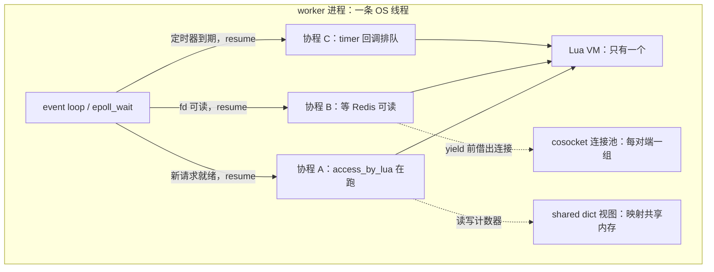
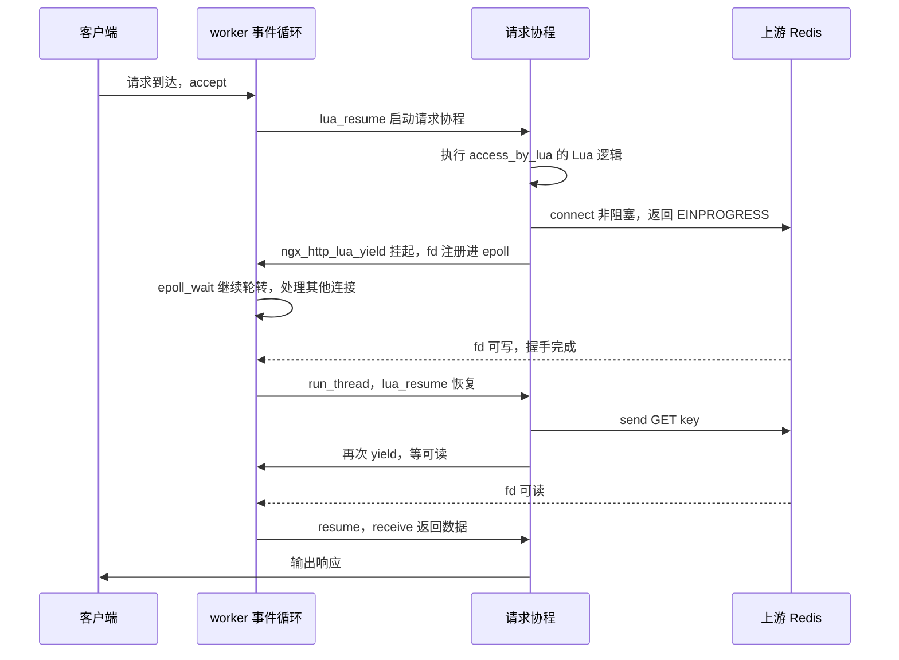
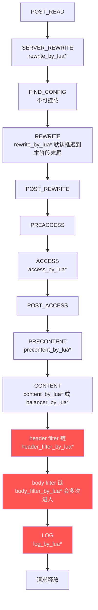
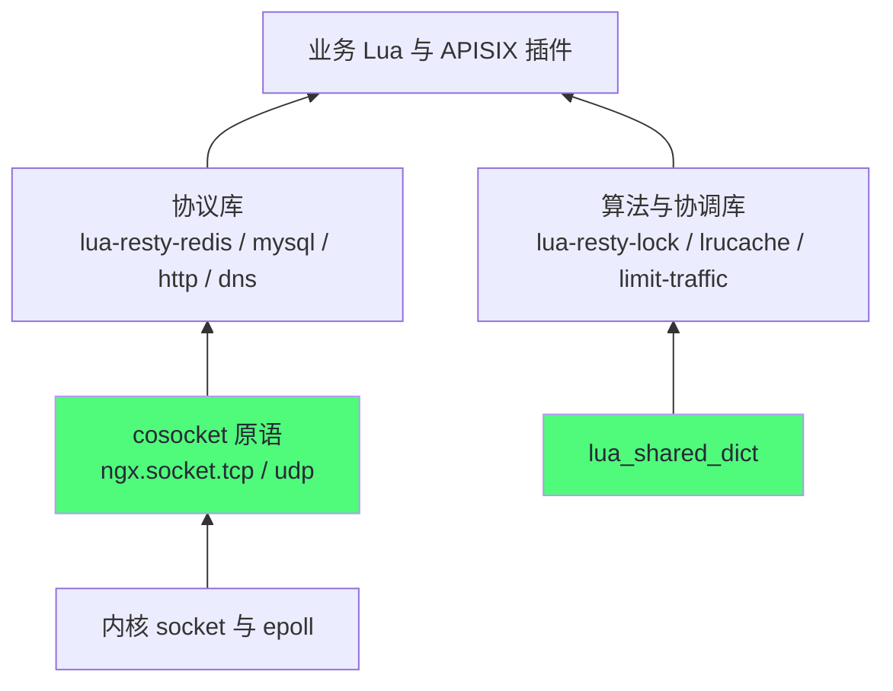

# 12 OpenResty 架构：LuaJIT、cosocket 与协程调度

**摘要：**

把 OpenResty 当成"带 Lua 的 Nginx"是最常见也最贵的一层误解。它的执行底座没有变：一个 worker 仍然是一条 OS 线程、一个 epoll 事件循环、一个 Lua VM，请求被切成协程在这条线程上轮流跑，没有任何抢占。LuaJIT 的三级执行（汇编解释器、trace 编译、FFI 直调 C）负责把单条指令的成本压下去，cosocket 负责在等待网络时把线程让出来，两者都只买到"单位 CPU 做更多事"，买不到"两件事同时做"。本文以一次 `sock:connect()` 的内部时序为骨架，讲清 yield 与 resume 如何穿过 Lua 协程、ngx_lua 的请求挂起与 Nginx 的读写事件三层；并把"能不能 yield"还原成一张阶段表，说明为什么 `log_by_lua`、`header_filter_by_lua`、`set_by_lua` 里调 Redis 必然失败，以及 zero-delay timer 为何是唯一干净的绕法。随后逐项交代 LuaJIT 的边界：NYI 导致 trace 中断、`jit.off()` 的真实场景、FFI 不能 yield、以及没有真正多线程时 CPU 活只能靠 `ngx.run_worker_thread` 挪走。共享内存一节给出容量算术与 LRU 强淘汰的语义，明确它不是存储。生态部分给出判断第三方库阶段可用性的统一方法，性能章节收敛为四个陷阱、三个完整反例与一份量级判断，最终回答两个问题：这段 Lua 会不会拖垮整个 worker，以及在没有真正多线程的前提下，哪些活只能挪走、哪些活必须换实现。

---

## 第 1 章 协程不等于线程

### 1.1 一个把 worker 卡死的写法

某网关团队为了让鉴权规则可热更新，把规则文件放在本地磁盘，在 `access_by_lua_block` 里用 `io.open` 每次请求读一遍，理由是"文件只有 4KB，操作系统有 page cache，不会慢"。上线后现象很整齐：八核机器上 `worker_processes 8`，八条 worker 线程的 CPU 全部钉在 95% 以上，QPS 从两万掉到三百，`upstream_response_time` 毫无变化，Redis 与后端服务的监控一片平静，`nginx -s reload` 能暂时缓解，几分钟后重新恶化。运维的第一反应是"流量涨了"或者"Redis 抖动"，可两者都不成立。

问题的位置可以用一句话定位：`io.open` + `read` 是**一次同步的系统调用**，它阻塞的不是那个请求，而是**那条 worker 线程**；而这条线程上还排着这个 worker 负责的上千条连接。当磁盘 IO 偶发变慢（一次 page cache miss、一次日志文件与规则文件落在同一块盘的争抢），整条线程上所有连接的响应时间一起抬升。请求数越多，读文件的次数越多，磁盘越忙，于是"QPS 越高越慢"的正反馈出现，直到 CPU 时间全花在等待与重试上。

这段代码的错误不在写法，而在心智模型：作者默认"每个请求有自己的执行流，所以慢的只是自己"。在 OpenResty 里这句话不成立。请求确实各有协程，但协程不是线程，它没有独立的时间片，也不能被抢占；一条协程开始跑，就必须一直跑到主动让出为止。任何不经过 yield 点的耗时——同步文件 IO、`os.execute`、`ffi.C.sleep`、一次几十万次的循环、一段深度回溯的正则——都发生在持有线程的那条协程里，整条 worker 一起停摆。

### 1.2 一个 worker 的全部家当

把 worker 内部的结构摊开，比记住任何一条调优建议都有用。在 Nginx 1.27.x 与 OpenResty 1.27 的模型里，一个 worker 进程绑定一条 OS 线程，线程上跑一个 epoll 事件循环，事件循环持有一个 Lua VM，VM 里同时存在若干条协程，每条协程对应一个正在处理中的请求或一个定时器回调。除此之外，worker 还持有一份按对端地址分组的 cosocket 连接池，以及若干块共享内存的映射视图。



这张图里有三个"一"值得记住：一条线程、一个 VM、一个事件循环。协程是这唯一线程上的执行片段，数量可以成千上万，但同一瞬间只有一条在跑。协程带来的收益是**等待时不占线程**，不是"计算时不占线程"。这是理解后面所有限制的前提——包括为什么共享内存不可替代，也包括为什么 Lua 里一段慢代码与 Nginx 原生模块里一段慢代码造成的后果完全一样。这条进程与事件循环的模型在 [[01 事件驱动模型：epoll 与 Master-Worker 进程架构]] 里有完整交代，此处只取它对 Lua 的含义。

### 1.3 两类阻塞的同一后果

Nginx 原生模块里也有同步阻塞的写法：早期的 `proxy_pass` 域名解析走阻塞的 `getaddrinfo`，某些第三方模块在 handler 里 `sleep`，本地文件读取走同步 `read`。这些做法在社区里被反复批评，理由正是"阻塞了 event loop"。Lua 代码里的阻塞之所以更危险，是因为它看起来不像阻塞。

原生模块的阻塞至少还在 C 代码里，review 的时候带着 `read()`、`open()`、`getaddrinfo()` 的函数名，很容易被看出来。Lua 把这些操作包装成了语言原语：`io.open` 看起来和 `table.insert` 一样轻，`os.execute` 看起来和 `string.format` 一样平常，`ffi.C` 更直接——它把任意 C 函数暴露成 Lua 里的一个字段，调用它的语法成本与调用一个普通函数没有区别。语法上的对称掩盖了语义上的天壤之别，这是把 OpenResty 当作"带 Lua 的 Nginx"使用时最容易踩的坑。

判断标准其实只有一条：这段代码**会不会让出线程**。会让出的只有几类明确的点——cosocket 的读写与连接、`ngx.sleep`、`ngx.thread.wait`、`ngx.timer.at` 的注册（注意不是回调执行）、`ngx.exit` 与 `ngx.req.socket` 的阻塞读。除此之外的一切 Lua 语句都是纯 CPU 计算，跑多久就占线程多久，没有例外。

### 1.4 三种"慢"需要三套判据

排障现场最常见的误判是把三件事混为一谈：上游慢、Nginx 自身慢、事件循环停摆。它们在监控上的表现不同，处置方向也完全相反。

上游慢的特征是 `$upstream_response_time` 与 `$request_time` 同向抬升，差值稳定，worker 的 CPU 不高，连接处于 `waiting` 状态。Nginx 自身慢（比如 SSL 握手、压缩、日志写盘）的特征是 `$request_time` 抬升而上游时间不变，CPU 或磁盘 IO 出现对应的增长点。事件循环停摆的特征最特殊：`$request_time` 全线抬升且分布很窄（所有请求几乎同时变慢，而不是长尾变长），QPS 出现断崖，worker CPU 却很高或者出现"CPU 不高但不出活"的怪异状态，`active` 连接数快速堆积而 `reading`/`writing` 比例失衡。

第三种情况才是本文的主题。它之所以难判，是因为它假扮成前两种：上游的响应时间被算进了 `$request_time` 的差值里，看起来像"网关慢"；CPU 高看起来像"流量大"。第 4 章会给出四层可以落地的判据，从指标到 gdb 栈。

---

## 第 2 章 LuaJIT 的三级执行与它管不到的地方

### 2.1 解释器、trace 与 FFI

标准 Lua 5.1 是一个纯粹的字节码解释器：源码编译成字节码，VM 逐条取指、解码、执行，每条字节码背后是几十条 CPU 指令，外加一次间接跳转，分支预测器基本无能为力。LuaJIT 在这个基础上加了两层，形成三级执行结构。

第一级是解释器本身。LuaJIT 的解释器不是用 C 写的循环，而是用 DynASM 生成的汇编代码，每个字节码对应一段展开的机器码，省掉了 C 函数调用与参数传递的开销。这一级的定位是"所有代码的起点"和"编译失败时的兜底"，相对标准 Lua 5.1 有显著提升，具体倍率是量级判断，取决于负载类型与循环密度，不宜当成可直接引用的基准。

第二级是 trace 编译。LuaJIT 不按函数编译，而是按执行路径编译：某条循环回边（loop back edge）被执行超过 `hotloop` 次（默认 56），或某个函数调用被反复走到，VM 就进入记录模式，把从循环头开始的一条路径上发生的每一条操作记成中间表示（IR），直到回到循环头或函数返回，然后把这条线性路径编译成机器码。之后再次走到同一个入口就直接跳进机器码。路径上的条件分支如果与记录时不符，就会触发一次 side exit，退回解释器继续，并把这条分支的后续也记录成一条 side trace，`hotexit` 默认 10 次之后开始生成。

第三级是 FFI。它允许 Lua 代码声明 C 类型与函数签名，然后以接近原生调用的方式调进 C 世界，不需要写 C 扩展、不需要经过 Lua/C API 的栈操作。FFI 调用可以被 trace 内联，`lua-resty-core` 正是用 FFI 重写了 `ngx.re`、`ngx.base64`、`ngx.md5` 这些高频接口，让它们从"Lua 调 C 函数"变成"trace 里的一段机器码"。

| 层级 | 触发条件 | 能力上限 | 代价与失效点 |
| --- | --- | --- | --- |
| 汇编解释器 | 所有代码的起点，以及 trace 中断后的兜底 | 逐条字节码执行 | 相对标准 Lua 快数倍，但仍是解释执行，循环密集处差距明显 |
| trace 编译 | 循环回边超过 `hotloop`（默认 56）次 | 单条 trace 最长 `maxrecord`（默认 4000）条 IR，全缓存 `maxtrace`（默认 1000）条，机器码总量 `maxmcode`（默认 2048KB） | 编译在 worker 线程上同步发生；类型不稳定则不断 side exit，编译成果作废 |
| FFI 调用 | 代码显式使用 `ffi.C`、cdata 或结构体 | 按 C ABI 直调，可被 trace 内联 | 不经过 Lua 栈，不能 yield；越界不报错，直接段错误 |
| 运行时库 | `require "resty.core"` 后自动生效 | 把常用 `ngx.*` 换成 FFI 实现 | 依赖 OpenResty 打包的 luajit2，用系统 LuaJIT 会缺这些补丁 |

表中 `hotloop`、`maxrecord`、`maxtrace`、`maxmcode` 的默认值来自 LuaJIT 2.1 的运行参数文档（`-O` 选项），OpenResty 打包的 luajit2 一般不改动它们；真实环境以 `luajit -e "print(jit.version)"` 与实际 `jit.opt` 状态为准。

有一处常被忽略的成本：trace 编译发生在 worker 线程上。它**不是后台线程异步做的**，而是在第一个把循环跑热的请求里同步完成的。编译一条 trace 的耗时在几十微秒到几毫秒之间（量级判断，取决于 trace 长度），这意味着服务刚启动、或者某条冷路径第一次被流量打到时，会有一小段尾延迟毛刺。`jit.off()` 的价值在这一刻才显出来——它不是"关掉性能优化"，而是"用确定的解释执行换掉不确定的编译抖动"。

### 2.2 trace 中断与 NYI

trace 编译不是无条件的。任何一条不满足编译条件的操作都会让记录中途放弃，已记录的部分作废，代码退回解释器执行。原因分几类：未实现的语法或库函数（NYI，Not Yet Implemented）、trace 太长超出 `maxrecord`、类型在多次执行之间不稳定导致 IR 爆炸、以及跨越 C 调用边界的回调。

第四类最隐蔽。LuaJIT 能编译"Lua 调 C 函数"，但编译不了"C 函数回调进 Lua"——比如 `table.sort` 的比较器、`string.gsub` 的替换函数、`ffi` 注册给 C 库的回调。这类中断在 `-jv` 的输出里表现为 `NYI: return to lower frame`，意思是"要返回的帧在机器码之外，我编不了"。另一种常见输出是 `NYI: unsupported variant of fast function`，出现在内建函数被以不支持的参数形态调用时。

这里有一个方法论：不要相信任何一份"LuaJIT 不支持某某语法"的静态清单。NYI 的覆盖范围随版本变化，OpenResty 维护的 luajit2 与上游 LuaJIT 2.1 也有细微差异，社区文章里的清单往往过期三五年。唯一可靠的来源是**你自己环境的输出**。LuaJIT 自带两个诊断模块，`jit.v` 打印编译进度，`jit.dump` 打印 trace 的 IR 与机器码：

```lua
-- 在 nginx.conf 的 init_by_lua_block 里打开，把输出重定向到文件
-- 注意 jit.v 默认写 stdout，在 nginx 里 stdout 通常指向 error_log 或 /dev/null
local ok = pcall(function()
    require("jit.v").start("/tmp/jit-v.log")
end)
if not ok then
    -- OpenResty 默认不装 jit.v，需要把 LuaJIT 源码里的 lib/jit 拷到 lua_package_path
    ngx.log(ngx.WARN, "jit.v not available")
end
```

输出形如 `[TRACE --- foo.lua:42 -- NYI: return to lower frame at foo.lua:57]`，文件行号与原因码都在里面。再配合 `jit.opt.start("hotloop=1")` 把阈值降到 1，可以让每条路径立刻尝试编译，把所有 NYI 原因一次暴露出来；这只适合在测试环境做一次性体检，绝不能留在生产配置里。

### 2.3 什么时候该 `jit.off()`

`jit.off()` 的目标不是提高性能，而是**消除不确定性**。它接受三种形态：无参数关闭整个 VM 的编译，传函数名只关闭该函数，传 `true` 关闭当前函数的编译。真正需要它的场景有四类。

第一类是"只跑一次的长任务"。`init_by_lua_block` 里预处理几万条规则、构建路由索引、或者把配置树展开成查找表，这些代码天然是长循环，但整个进程生命周期只执行一次。trace 编译的成本永远收不回来，反而会在启动时多花几十毫秒，用 `jit.off()` 让解释器一路跑完更划算。

第二类是"启动预热与内存受限"。trace 与机器码占用的是 LuaJIT 自己的内存，`maxmcode` 封顶 2MB 只是机器码，IR、snapshot、常量池还要另算。在容器内存贴着 limit 跑的网关里，关闭 JIT 换来的是完全可预测的内存占用。代价是循环密集的逻辑慢数倍，需要按实际负载评估。

第三类是"抖动敏感的低延迟服务"。JIT 编译发生在请求线程上，`hotloop=56` 意味着大多数请求路径在几十次之后才开始编译，编译完成前的那批请求承担了额外的 CPU 与延迟。对于 p99 直接决定 SLA 的场景，把编译动作挪到启动阶段（预热流量）或者直接关闭，都是可选的工程手段。

第四类是调试。用 `jit.v` 观察中断原因时关闭编译更容易看清解释执行路径；用 `gdb` 抓栈时，机器码栈帧可读性远差于解释器帧。

```lua
-- 只关掉单个热点函数：适合启动期的一次性批处理
local function build_rule_index(rules)
    -- 上百万次表操作，只在 init_by_lua 里跑一次
end
jit.off(build_rule_index)

-- 或者整段关闭，跑完再打开
jit.off()
build_rule_index(rules)
jit.on()
```

### 2.4 FFI 的能力与代价

FFI 让 Lua 直接摸到 C 世界，能力边界很宽：声明结构体并按字节布局读写、把 Lua 字符串当作 `const char*` 零拷贝传给 C、调用任意已加载的共享库符号、用 `string.buffer` 高效拼装大字符串。`lua-resty-core` 的整个性能改进都建立在这一点上：把 `ngx.re` 从"经过 Lua/C API 的 C 函数"改成"FFI 声明 + trace 内联"，省掉的是每次调用的栈封送与边界检查。

代价同样明确。其一是安全性从"运行时检查"退回"程序员自觉"：Lua 的 `t[100]` 越界返回 `nil`，FFI 数组的 `buf[100]` 越界就是读一块不属于你的内存，写越界则是内存破坏，症状是 worker 随机崩溃且没有任何 Lua 层的错误信息。其二是不能 yield：通过 FFI 调用的 C 函数运行在同一条线程上，且不在 Lua 的协程调度视野里，在 FFI 调用内部触发 cosocket 的 yield 会得到 `attempt to yield across C-call boundary`。其三是 ABI 依赖：`ffi.cdef` 声明的结构体布局必须与目标平台的 C 编译器一致，跨架构（x86_64 与 ARM64）、跨 libc 的字段对齐差异会让 FFI 代码在迁移时静默出错。其四是内存生命周期：`ffi.new` 分配的 cdata 由 LuaJIT 的 GC 管理，交给 C 持有的指针必须用 `ffi.gc` 挂上释放函数，否则泄漏。

一个良性用法足以说明它与 cosocket 的分工：

```lua
local ffi = require "ffi"
local buffer = require "string.buffer"

-- 拼装 4KB 的日志行：string.buffer 在 C 侧维护一块可增长缓冲区
-- 比 table.concat 少一次全量拷贝，且不受 Lua 字符串不可变的影响
local buf = buffer.new(4096)
for i = 1, #fields do
    buf:put(fields[i], " ")
end
local line = buf:get()          -- 只在最后生成一次 Lua 字符串
ngx.log(ngx.INFO, line)
```

这段代码没有 yield 点，是纯 CPU 工作，放在 `content_by_lua` 里依然会占线程；FFI 与 `string.buffer` 只是把同样的工作做得更快，不改变它是同步执行的事实。把这两件事分清，可以避免"用了 FFI 就不阻塞"的错觉。

### 2.5 没有真正的多线程

LuaJIT 的 VM 在设计上就不是线程安全的：它没有为并发访问提供任何同步原语，因为设计假设就是"一个 VM 一条线程"。OpenResty 严格遵守这条假设——每个 worker 一个 VM，VM 只在 worker 自己的线程上被访问，协程切换完全在用户态完成，不存在任何跨线程的栈切换。

由此推出几条硬结论。`ngx.thread.spawn` 创建的是"轻线程"（light thread），本质仍是协程，共享同一个 VM、同一条线程，不会并行，**只能并发等待**。`ngx.shared.DICT` 之所以必须存在，正是因为两条 worker 的 Lua 状态物理上不共享。`lua_shared_dict` 的原子性来自 Nginx 的 slab 自旋锁，而不是 Lua 语言层的任何机制。

那么真正的并行出口在哪里？只有一个官方支持的：`ngx.run_worker_thread`。它把一次调用丢进 Nginx 的线程池（需要 `--with-threads` 编译），在独立线程上执行一个 Lua 模块函数，调用方协程 yield 直到结果返回。它的限制相当硬：仅 Linux 可用、标注为实验性 API、只能在 `rewrite`/`access`/`content` 三个阶段调用、被调用的函数里只能用白名单内的少数 API（编解码、摘要、`ngx.shared.DICT` 等），cosocket 一律不可用。

```lua
-- nginx.conf: thread_pool default threads=8;
local ok, res = ngx.run_worker_thread("default", "my.crypto", "sign", payload)
if not ok then
    ngx.log(ngx.ERR, "worker thread failed: ", res)
    return ngx.exit(500)
end
```

它适合的正是那些"无法改成异步"的工作：调一个阻塞的 C 库、算一次大对象的摘要、读写一个本地文件。判断标准是"这段工作能不能被切走"——能被切走就切，切不走就只能承认它会占住 event loop，然后用容量规划把它挡在门外。

---

## 第 3 章 cosocket：把异步 I/O 写成同步语句

### 3.1 单线程里的同步 socket 有多贵

假设 worker 只有一条线程，代码里做一次同步的 Redis 查询，往返 1ms。这段时间线程什么也做不了，只能等。若这个接口的目标是每秒 2000 次查询，那么每秒需要的等待时间是 2000×1ms = 2 秒，也就是两条线程的容量全被等待吃掉，还没算任何真实计算。这就是为什么"单线程 + 同步 IO"在网关这种场景下根本不可行：不是慢，是**差了两个数量级**。

回调式异步能解决等待问题，代价是代码结构。Node.js 早期的回调地狱是标准案例：一次"查 Redis、再查 MySQL、再调上游"的流程要被拆成三层嵌套，错误处理散落在每一层，业务语义被切碎。协程提供的第三条路是：让代码用同步的顺序书写，由运行时在底层把"等待"翻译成"挂起 + 注册事件 + 恢复"。

### 3.2 一次 `connect` 的内部时序

`ngx.socket.tcp()` 创建的 cosocket 对象在 Lua 侧只是一张表，真正的状态挂在 `ngx_http_lua_ctx_t` 与一个 socket 上下文结构上。调用 `sock:connect(host, port)` 时，模块依次做这几件事：先检查当前上下文是否允许 yield（这一步就是第 3.5 节那张表的来源）；再按 `host:port` 查本 worker 的连接池，命中空闲连接就直接复用，`getreusedtimes()` 从此非零；未命中则把 fd 设为非阻塞，调 `connect()`，得到 `EINPROGRESS`。

接下来是核心：模块把该 fd 的读写事件处理器换成 `ngx_http_lua_socket_tcp_handler`，用 `ngx_handle_write_event` 把 fd 注册进 epoll，然后调用 `ngx_http_lua_yield` 挂起当前协程。yield 之后，请求的处理函数向 Nginx 返回一个"未完成"的状态，事件循环照常轮转，这条请求就此从 CPU 上消失，只占内存。

epoll 报告该 fd 可写，说明三次握手完成或失败。处理器被调用，用 `getsockopt(SO_ERROR)` 取出真实结果，然后走 `ngx_http_lua_run_thread` 恢复协程——本质是一次 `lua_resume`，Lua 代码从 `connect()` 那一行继续，拿到返回值，仿佛刚才什么都没发生。若连接失败，返回值是 `nil` 加错误串；若超时，注册的定时器先触发，处理器以错误路径 resume，返回 `lua tcp socket connect timed out`。文中出现的 `ngx_http_lua_yield`、`ngx_http_lua_socket_tcp_handler`、`ngx_http_lua_run_thread` 都是 lua-nginx-module 里的真实符号，具体签名以对应版本的源码为准。



整条时序里，worker 从没"等"过任何东西。它做的事只有两类：处理就绪的事件，或者在无事可做时挂在 `epoll_wait` 上睡眠。协程的价值至此兑现——它把"等待"**从时间轴上删掉**，只留下"状态"。

清理路径同样不能漏。cosocket 对象注册了请求级的 cleanup：客户端提前断开、请求结束、或者 worker 退出时，未归还的连接会被关闭。这解释了为什么 socket 对象不能跨请求保存：它的生命周期与请求绑定，请求释放时对象就被回收。

### 3.3 yield 的三层结构

把 yield 想清楚，后面所有限制都能自己推出来。一次挂起要穿过三层。

Lua 层是 `lua_yield` 与 `lua_resume`，切换的是一条协程的栈，代价在百纳秒量级（量级判断）。这一层只负责"停在这里，之后从这里继续"。

ngx_lua 层要把"这条协程在等什么"记下来：等着读、等着写、等着连接、等着定时器、还是等着子协程。信息记在协程上下文里，请求处理函数返回一个中间状态，Nginx 不释放请求，也不认为它出错。这一层还负责 postpone——把 Lua 代码放到阶段末尾执行的机制，第 5 章展开。

Nginx 层是真正的 I/O 多路复用：fd 与事件类型注册到 epoll，超时用 `ngx_add_timer` 挂到红黑树上。事件就绪或超时到期，回调触发，逐层往回走，最终 `lua_resume`。

三层里有任何一层不具备条件，yield 就无法完成。`header_filter_by_lua` 与 `body_filter_by_lua` 处在输出过滤器链里，请求的响应头/响应体正在被逐块处理，Nginx 的输出链没有"暂停后从中间继续"的机制；`log_by_lua` 处在请求的收尾阶段，请求即将释放，没有可以挂起的宿主。模块的选择是**直接禁用**，而不是让用户掉进一个更难查的坑。

### 3.4 连接池：per worker、按对端分组

`set_keepalive(max_idle_timeout, pool_size)` 不是关闭连接，而是把连接还给池。池的键是对端标识（`host:port` 或 unix socket 路径），池的粒度是 **worker**——八个 worker 就有八份独立的池，互不可见。`pool_size` 默认 30，含义是"每个 worker、每个对端最多保留 30 条空闲连接"，超出时按 LRU 关闭最久未用的空闲连接。

这里有两个经常算错的数。第一个是池容量与并发的匹配：八个 worker、每个池 30 条，则到 Redis 的常驻连接上限是 240 条。若网关峰值并发请求是 2000，且每个请求串行做两次 Redis 调用，那么池里永远不够用，大部分请求都要新建连接，池的意义被抵消。此时要么调大 `lua_socket_pool_size`，要么把两次调用合并成一次 pipeline，要么重新审视"每个请求两次 Redis 往返"这个设计本身。

第二个是对端的连接上限。池是客户端视角的缓存，服务端只看到连接数。把池调到 128×8=1024 之前，先确认 Redis 的 `maxclients` 与文件描述符上限撑得住。

池里的连接也可能已经失效：Redis 的 `timeout` 配置会主动断开空闲连接，中间的 NAT 或负载均衡会清理长时间空闲的会话，而客户端此刻还不知道。复用一条死连接的表现是第一次读返回 `closed`。正确做法是判断 `red:get_reused_times() > 0` 时重试一次：

```lua
local redis = require "resty.redis"

local function query(key)
    local red = redis:new()
    red:set_timeouts(200, 200, 200)     -- connect / send / read，毫秒

    local ok, err = red:connect("127.0.0.1", 6379)
    if not ok then return nil, "connect: " .. err end

    local reused = red:get_reused_times()
    local res, err = red:get(key)
    if not res and reused > 0 then
        -- 池里的连接已被对端关闭，重连后重试一次
        red:close()
        ok, err = red:connect("127.0.0.1", 6379)
        if not ok then return nil, "reconnect: " .. err end
        res, err = red:get(key)
    end
    if not res then
        red:close()                      -- 出错时不要还池，直接关
        return nil, "get: " .. err
    end

    red:set_keepalive(60000, 100)        -- 空闲 60s，池大小 100
    return res
end
```

还有一条容易被忽略的规则：只有在连接上没有未读数据时才能 `set_keepalive`。如果上一次读只读了一半（比如 `receive("*l")` 之后还有后续行没读完），把这种连接还回池，下一次复用时协议就错位了。模块会拒绝这种归还并给出 `connection in dubious state`，这个错误串在排障时意味着"上一条请求没把响应读干净"。

### 3.5 cosocket 的四个限制

把限制整理成表，比记四条禁令有用：三条来自阶段（初始化类、同步求值类、输出链类），第四条来自池的语义，四者的背后都是同一个"能不能 yield、什么时候 yield"的问题。

| 上下文 | 能否用 cosocket | 模块报错 | 为什么 | 干净的绕法 |
| --- | --- | --- | --- | --- |
| `init_by_lua*` | 否 | `API disabled in the context of init_by_lua*` | Master 进程没有事件循环，也没有请求宿主 | 只做纯内存初始化，I/O 交给 `init_worker` 的 timer |
| `init_worker_by_lua*` | 否 | 同上 | 模块尚未支持（文档明确这不是 Nginx 核心限制） | `ngx.timer.at(0, handler)`，回调里可以 yield |
| `set_by_lua*` | 否 | 同上 | 变量求值必须同步返回一个值，调用方没有等待的语义 | 改用 `rewrite_by_lua` 或 `access_by_lua` 计算并写入变量 |
| `header_filter_by_lua*` | 否 | 同上 | 响应头正在输出链上，没有挂起后从中间继续的机制 | 提前到 `access`/`content` 阶段取数，结果放 `ngx.ctx` |
| `body_filter_by_lua*` | 否 | 同上 | 同上，且会按 buffer 多次进入 | 同上；需要改写响应体就只做纯计算 |
| `log_by_lua*` | 否 | 同上 | 请求进入收尾，即将释放，没有可挂起的宿主 | `ngx.timer.at(0, ...)` 异步投递（第 7 章） |
| `rewrite`/`access`/`content`/`balancer`/`timer`/`ssl_certificate` | 是 | — | 有请求或轻线程宿主，事件循环可调度 | — |

第四条限制与阶段无关：连接池按 `pool_size` 在每个 worker 内复用，容量、可见性、失效检测都由客户端自己负责。这一条经常被当成"性能优化选项"，实际上是正确性的一部分——不还池的代码在低流量下毫无问题，流量上来后以 TIME_WAIT 与握手延迟的形式爆发。

### 3.6 并发等待：`ngx.thread.spawn`

如果一次请求要同时查 Redis 与调上游，串行执行会让总耗时等于两个往返之和。`ngx.thread.spawn` 生成轻线程，两条子协程各自跑到 yield 点，父协程用 `ngx.thread.wait` 等它们，总耗时取决于较慢的那个。

```lua
location /api/detail {
    content_by_lua_block {
        local function fetch_user(uid)
            -- 内部是 cosocket 调用，会 yield
            return query_redis("user:" .. uid)
        end

        local function fetch_order(uid)
            return query_http("/orders?uid=" .. uid)
        end

        local t1 = ngx.thread.spawn(fetch_user, uid)
        local t2 = ngx.thread.spawn(fetch_order, uid)

        local ok1, user = ngx.thread.wait(t1)
        local ok2, order = ngx.thread.wait(t2)
        -- 任一失败都要显式处理，否则错误被吞掉
        if not ok1 or not ok2 then
            ngx.log(ngx.ERR, "fanout failed")
            return ngx.exit(502)
        end
        ngx.say(cjson.encode({ user = user, order = order }))
    }
}
```

它不会变快，原因仍在调度模型里：轻线程只并发"等待"，不并发"计算"。两条子协程里的 Lua 逻辑仍然在同一条线程上串行执行，spawn 的开销就是两次协程创建加两次挂起恢复。若子协程里做的是 CPU 活，spawn 只会让代码更复杂。

---

## 第 4 章 协程调度的真相

### 4.1 调度单位是请求，调度方式是协作

OpenResty 的调度器非常朴素：不排队、不记账、不切时间片。请求到达时创建一个协程并 resume，协程跑到 yield 点就挂起，事件就绪再 resume。谁先就绪谁先跑，没有优先级，没有配额，也没有"跑太久就被打断"的机制。

协作式调度（cooperative scheduling）这个词在这里是字面意思：**调度权在代码自己手里**。一段没有 yield 点的 Lua 代码一旦开始执行，就没有任何力量能把它从线程上拿下来，除非它自己结束或者进程被杀。这一点与 Go 的 goroutine 有本质区别——Go 运行时会在函数调用点插入抢占检查，一个死循环最多拖住一个 P 一个时间片；Lua 协程没有这个保护。


这张图是排障时最有用的心智模型：所有症状都由"一条协程占住线程"这一个原因派生，所以它们必然同时出现、同时消失。

### 4.2 CPU 密集的 Lua 会阻塞整个 worker

算术很直接。设某接口的 Lua 逻辑（含 JSON 编解码、签名、模板渲染）每请求消耗 C 毫秒纯 CPU，单 worker 的吞吐上限就是 1000/C 次每秒，与连接数、上游响应速度全部无关。

| 每请求 Lua CPU 耗时 | 单 worker 理论上限 | 8 worker 集群上限 | 典型来源 |
| --- | --- | --- | --- |
| 0.5ms | 2000 QPS | 16000 QPS | 轻量鉴权、少量表操作 |
| 2ms | 500 QPS | 4000 QPS | 1KB JSON 解码 + 简单校验 |
| 8ms | 125 QPS | 1000 QPS | 上百 KB JSON 解码 + 字段改写 |
| 20ms | 50 QPS | 400 QPS | 大对象序列化、图片处理、慢正则 |

表中的数字是示例推算，用于说明量级，不构成任何基准。它的价值在于把"Lua 慢一点没关系"这句话量化：不是慢一点，是**吞吐按倒数衰减**。更麻烦的是这 8ms 是"整段占住"的，同一时刻该 worker 上其他几百条连接的响应时间全部被推后，表现为整个 worker 的 p99 一起变差，而不是只有慢接口变差。这就是为什么这类故障经常被误判成"网络抖动"或"机器负载高"。

### 4.3 四层判据：确认是 Lua 在跑

第一层是指标。看 `$request_time` 与 `$upstream_response_time` 的差值，若差值抬升而分位数分布变窄（所有请求一起变慢），基本可以锁定 Nginx 自身。再看 worker 的 CPU：Lua 阻塞时 CPU 一定高或者至少不低（纯计算型 100%，IO 等待型表现为 `iowait` 上升而 CPU 有空闲）。最后看连接状态，`active` 快速堆积而 `reading` 比例下降，是事件循环轮转不过来的典型形态。

第二层是 `--with-debug` 与 debug 日志。OpenResty 需要编译时带 `--with-debug`，`error_log` 设为 `debug`，才能看到 ngx_lua 的阶段日志。要提前说清它的能力边界：debug 日志会打印"进入 lua access phase""lua close request"这类**阶段锚点**，但不会打印"你这段 Lua 执行了多久"。它能证明阶段走到了哪里、请求卡在哪个阶段之后，不能证明耗时落在哪一行。

```nginx
# 只在排障窗口打开，debug 日志的量级足以打满磁盘
error_log /var/log/nginx/error-debug.log debug;
```

第三层是自埋点，也是定位到具体代码行的唯一手段。`ngx.now()` 返回缓存的当前时间，精度到毫秒，且不会触发系统调用，适合在关键节点前后打点：

```lua
local t0 = ngx.now()
local decoded = cjson.decode(body)      -- 怀疑点
local t1 = ngx.now()
local signed = sign(decoded)            -- 怀疑点
local t2 = ngx.now()

if t1 - t0 > 0.005 or t2 - t1 > 0.005 then
    ngx.log(ngx.WARN, "slow lua: decode=", t1 - t0, " sign=", t2 - t1,
            " uri=", ngx.var.uri)
end
```

`ngx.now()` 的单位是秒，`0.005` 即 5ms。注意它依赖缓存的时钟，被 `ngx.update_time()` 或部分 API 更新；在需要更细的粒度时用 `ngx.req.start_time()` 与 `ngx.now()` 配合，不要指望它给出微秒级的准确度。

还有一种更巧的探针：用定时器测事件循环的排队延迟。注册一个每 100ms 触发的 timer，记录实际触发时刻与预期时刻的偏差，这个偏差就是事件循环被占用的直接证据：

```lua
init_worker_by_lua_block {
    local shm = ngx.shared.metrics
    local expected = ngx.now()
    local function tick(premature)
        if premature then return end
        local now = ngx.now()
        local drift = (now - expected) * 1000    -- 毫秒
        expected = now + 0.1
        if drift > 50 then
            ngx.log(ngx.WARN, "event loop drift: ", drift, "ms")
        end
        ngx.timer.at(0.1, tick)
    end
    ngx.timer.at(0.1, tick)
}
```

第四层是现场采样。`gdb -p <worker_pid>` 连上去，看当前线程的 C 栈：栈里是 `epoll_wait` 说明这条 worker 空闲；是 `lj_dispatch`、`lua_pcall`、`ngx_http_lua_run_thread` 说明它正在跑 Lua。连续抓十几次，统计落在 Lua 栈帧的比例，就得到了"事件循环被 Lua 占用的时间占比"。更省事的做法是 `perf top -p <pid>`，看 `lj_*` 与 `ngx_http_lua_*` 符号的占比，若 `lj_` 系列符号长期占据榜首，答案已经很清楚。

### 4.4 `lua_check_client_abort` 能做什么

`lua_check_client_abort` 默认关闭。打开后，ngx_lua 会监听下游连接的提前关闭事件，一旦用户断开，就调用 `ngx.on_abort` 注册的回调，没有注册回调时直接停掉当前请求的所有轻线程。对长轮询、SSE、大文件下载这类场景，它能省掉大量"用户已经走了还在算"的浪费。

但它不是阻塞的解药。它解决的是"请求已经没意义了还在跑"，不解决"这段 Lua 占线程 20ms"。用它挡住 CPU 密集接口的慢，等于**用止损代替止损原因**。另外两个细节：若客户端在 Lua 通过 `ngx.req.socket` 读完请求体之前断开，模块既不会停轻线程也不会调回调，读操作会返回 `client aborted`；以及它依赖 TCP keepalive 才能及时发现半开连接，系统层的 `net.ipv4.tcp_keepalive_*` 需要一并调。

### 4.5 `worker_cpu_affinity` 的定位

把 worker 绑到固定核上，收益有两个：缓存局部性（Lua VM 与 JIT 机器码在固定核的 L1/L2 里更稳定）与采样稳定性。后者在排障时更有价值——绑核之后 `perf` 与 `gdb` 采到的样本不会因为线程迁移而抖动，判断"是不是 Lua 在跑"会干净很多。

它不解决阻塞。绑核只改变线程在哪里跑，不改变"一条线程上只能有一条协程在跑"这个事实。`worker_processes` 与内核参数配合起来的整体口径见 [[10 性能调优全攻略：worker 进程、连接数与内核参数]]。在容器里还要额外小心：`worker_cpu_affinity auto` 依赖 `sched_getaffinity` 的结果，若 cpuset 与 `worker_processes` 不一致，绑核会失败或部分 worker 空闲，这类问题在 Kubernetes 的 CPU limit 与 cpuset 混合场景里很常见。

| 排查目标 | 首选判据 | 交叉验证 | 结论方向 |
| --- | --- | --- | --- |
| 上游慢 | `$upstream_response_time` 抬升 | 上游自身监控、后端日志 | 与 Lua 无关，查后端 |
| Nginx 自身 CPU 慢 | `$request_time` 减上游时间同步抬升 | `perf top` 看 `lj_*` 占比 | 定位到具体 Lua 代码 |
| 事件循环停摆 | timer 心跳漂移、`active` 堆积 | `gdb` 抓栈看是否在 Lua 栈帧 | 找阻塞调用（io/os/ffi/大循环） |
| 正则慢 | 单请求耗时与 URL 长度强相关 | `lua_regex_match_limit` 设限后是否缓解 | 回溯爆炸或未开 jit 选项 |

---

## 第 5 章 阶段映射与 `no_postpone`

### 5.1 挂载点

Nginx 的 11 个阶段见 [[03 HTTP 请求处理管道：11 个阶段全解]]，这里只把 ngx_lua 的指令贴回那条管道上，并标注每个点能否 yield。图中红色节点是"能进入但不能等待"的位置，所有"在 log 阶段查 Redis"的写法都撞在这三个红点上。



还有几个位置不在这条链上：`init_by_lua*` 在配置加载期、`init_worker_by_lua*` 在 worker 启动期、`exit_worker_by_lua*` 在 worker 退出期、`ssl_certificate_by_lua*` 与 `ssl_session_fetch_by_lua*` 在 TLS 握手期。TLS 阶段是可以用 cosocket 的，这让"按 SNI 动态查证书"成为可行方案，也是它和 `ssl_session_store_by_lua*`（不可用）的分界线。

### 5.2 postpone 的真实语义

`rewrite_by_lua*` 与 `access_by_lua*` 默认被"推迟"到各自阶段的末尾执行。文档里 `rewrite_by_lua_no_postpone` 与 `access_by_lua_no_postpone` 的默认值都是 `off`，含义是"允许推迟"——Lua 代码被放到 rewrite/access 阶段所有标准模块处理完之后才跑。

这带来两个实际后果。其一，同一 location 里的 `set`、`if`、`rewrite` 指令总是先于 Lua 执行，这保证了 Lua 里读 `$var` 时拿到的是标准指令算完的值，是绝大多数配置依赖的行为。其二，若前面某个 `rewrite ... last` 触发了内部重定向，控制流已经离开当前 location，被推迟的 Lua 代码就根本不会执行——这类"Lua 没跑"的诡异现象，根因在 postpone 而不在 Lua。

打开 `no_postpone` 后，Lua 代码就在它在配置中出现的那个位置执行，与 `rewrite`、`set` 指令按书写顺序交织：

```nginx
http {
    # 三个 no_postpone 开关的上下文都是 http，只能全局配置
    rewrite_by_lua_no_postpone on;

    server {
        location /api/ {
            set $tier "free";
            rewrite_by_lua_block {
                -- 默认 postpone off 时，这段在 rewrite 阶段末尾才执行
                -- 打开 no_postpone 后，它与上面的 set 按书写顺序执行
                ngx.var.tier = classify(ngx.var.arg_token)
            }
        }
    }
}
```

需要留意的是，`rewrite_by_lua_no_postpone`、`access_by_lua_no_postpone`、`precontent_by_lua_no_postpone` 三个开关的作用域都是 `http`，不是 `location`。它们在配置里只有一处能写，一开就是全局生效，所有 location 的相对顺序同时改变。这也是为什么它很少被改动：**收益局部，影响全局**。指令的作用域与继承规则见 [[02 配置体系解析：指令、上下文与继承规则]]。

| 指令 | 默认 | 上下文 | 打开后的效果 | 代价 |
| --- | --- | --- | --- | --- |
| `rewrite_by_lua_no_postpone` | off | http | Lua 与 rewrite 指令按书写顺序执行 | 全局生效；依赖"标准指令先算完"的配置会读到旧值 |
| `access_by_lua_no_postpone` | off | http | Lua 在 access 阶段内立即执行 | 与 `allow`/`deny`/`auth_basic` 的先后关系改变，可能放行或误拒 |
| `precontent_by_lua_no_postpone` | off | http | 在 precontent 阶段内立即执行 | 与 `try_files` 的顺序改变，可能提前返回 |
| `lua_code_cache` | on | http/server/location | 关闭后每请求独立 VM | 每请求重新加载所有模块，吞吐断崖式下降，仅用于开发 |

### 5.3 `*_by_lua_file` 与 inline 的差别

inline（`*_by_lua_block`）的内容在配置解析阶段就被编译成字节码，存进配置结构，`lua_code_cache` 对它不起作用——改了代码**只能 reload**。`*_by_lua_file` 指向的文件在第一次使用时加载，`lua_code_cache on` 时缓存到 worker 结束，`off` 时（0.9.3 起）每个请求都新建一个 Lua VM 从头加载。

两者的选择不只是风格问题。file 形式可以被 `luacheck` 静态检查、被 `busted` 单元测试覆盖、被 git 正常 diff、被 IDE 跳转，可以拆成多个文件并用 `require` 组织；inline 只能靠肉眼 review，且没法单测。稍微复杂一点的网关逻辑都该用 file。

inline 还有一个历史包袱：`*_by_lua '...'` 的字符串形式里，`\d`、`\s`、`\w` 这类反斜杠会被 Lua 词法与 Nginx 配置解析各吃一遍，正则写成 `"\d+"` 实际得到 `"d+"`，匹配永远失败。0.9.17 之后 `*_by_lua_block {}` 解决了这个问题，这也是所有新代码都该用 block 形式的直接理由。

### 5.4 阶段与能力的交叉表

| 阶段 | 典型指令 | 能否 yield | 常见用途 | 写错的后果 |
| --- | --- | --- | --- | --- |
| 配置加载 | `init_by_lua*` | 否 | 预加载模块、构建只读索引 | 用 cosocket 直接报错；做耗时初始化会拖慢 reload |
| worker 启动 | `init_worker_by_lua*` | 否（需 timer） | 启动定时任务、预热 | 直接调 cosocket 报错，须包在零延迟 timer 里 |
| 变量求值 | `set_by_lua*` | 否 | 简单变量计算 | 调 cosocket 报错，且返回值必须是单个字符串或数字 |
| 改写 | `rewrite_by_lua*` | 是 | 路由改写、灰度标记 | 默认被推迟，可能被 `rewrite last` 跳过 |
| 准入 | `access_by_lua*` | 是 | 鉴权、限流、黑名单 | 大量 CPU 活会阻塞；`ngx.exit` 之后的代码不再执行 |
| 内容 | `content_by_lua*` | 是 | 完全接管响应 | 做重活阻塞全局；与 `proxy_pass` 同位置只有一个生效 |
| 负载均衡 | `balancer_by_lua*` | 是 | 动态选后端 | 只能改 peer，不能改请求体；重试次数受 `proxy_next_upstream` 约束 |
| 响应头 | `header_filter_by_lua*` | 否 | 改响应头 | 调 cosocket 直接失败；不能调 `ngx.say` |
| 响应体 | `body_filter_by_lua*` | 否 | 流式改写响应体 | 会按 buffer 多次进入，需自己维护状态与 `ngx.arg[2]` 判断结尾 |
| 日志 | `log_by_lua*` | 否 | 打点、计量 | 调 cosocket 失败；`ngx.ctx` 仍可读但请求即将释放 |

---

## 第 6 章 `lua_shared_dict`：跨 worker 的唯一手段

### 6.1 为什么必须有共享内存

`fork()` 之后，每个 worker 拥有独立的 Lua VM 与独立的堆。在 `init_by_lua` 里建好的 Lua table 确实被所有 worker 继承，但那是拷贝写（Copy-on-Write）语义：只要有一个 worker 往表里写，内核就复制一份物理页给这个 worker，从此它和其他 worker 看到的是两份不同的数据。所以"在 init 阶段建一个全局配置表、运行时按需修改"这种写法，结果一定是每个 worker 各改各的。

跨 worker 的状态只有三条路：共享内存、外部存储（Redis/DB）、进程间通信。OpenResty 提供的是第一条，`lua_shared_dict` 声明一块由所有 worker 共同映射的内存区。

### 6.2 结构与容量算术

底层是 Nginx 的 slab 分配器：内存被切成页，按 size class 切成不同大小的槽位，每个槽位一次分配固定大小。字典本身维护一棵红黑树（按 key 排序索引）与一条 LRU 队列（按最近使用排序，用于淘汰）。每个条目除了 key 与 value 的字节，还有节点结构、队列节点、对齐填充的固定开销。

固定开销是容量估算的关键。经验值是每条目 100 字节上下（量级判断，取决于架构与对齐），所以真实的条目容量远低于"总容量除以 value 大小"：

| 字典大小 | key | value | 每条目估算 | 可容纳条目 | 说明 |
| --- | --- | --- | --- | --- | --- |
| 10MB | 32B | 64B | 约 200B | 约 5 万 | 小对象缓存，可行 |
| 10MB | 64B | 512B | 约 680B | 约 1.5 万 | 限流计数器已偏大 |
| 100MB | 32B | 4KB | 约 4.2KB | 约 2.4 万 | 大 value 会浪费页内空间 |
| 1MB | 32B | 64B | 约 200B | 约 5000 | 只够放少量计数与开关 |

表中的数字是示例推算，实际以 `dict:free_space()` 与 `dict:capacity()` 的观测为准。slab 的页内碎片会让"理论可容纳"与"实际可容纳"相差两成以上，尤其当 value 大小分布很散时。

### 6.3 API 的语义细节

| 方法 | 关键语义 | 容易踩的边界 |
| --- | --- | --- |
| `set(k, v, exptime?, flags?)` | 无条件写入，返回 `success, err, forcible` | 内存不足时按 LRU 强淘汰其他有效条目，`forcible` 为真即"你的写入挤掉了别人的数据" |
| `safe_set` | 同上，但绝不淘汰 | 空间不够直接返回 `no memory`，适合必须保住旧数据的场景 |
| `add` / `replace` | 仅当不存在 / 仅当存在时写入 | 是构建分布式锁的基础原语 |
| `get` / `get_stale` | 取值；后者在过期后仍返回旧值 | 过期条目在 `get_stale` 里可读，需自己判 TTL |
| `incr(k, v, init?, init_ttl?)` | 原子自增，不存在时用 `init` 初始化 | 不传 `init` 时返回 `not found`；这是限流计数器的正确写法 |
| `ttl` / `expire` | 查剩余时间 / 重设过期 | `ttl` 对无过期时间的条目返回 `nil` |
| `flush_all` | 标记全部条目过期 | 不释放内存，只是让它们"看起来过期"，空间要等后续写入才复用 |
| `flush_expired` | 主动回收已过期条目 | 大字典上会持有锁一段时间，慎用 |
| `get_keys(max_count?)` | 列出 key | 文档明确警告：大字典上会长时间锁住字典，阻塞所有 worker，不要在请求路径用 |
| `capacity` / `free_space` | 容量与剩余 | 用于容量告警，比"猜"可靠 |

`forcible` 这个返回值经常被忽略，但它是判断"共享内存是否已经开始互相踩"的最直接信号。限流计数器被缓存条目挤掉，限流就失效；缓存被计数器挤掉，只是命中率下降。两者混在同一个字典里，故障表现会非常难查——这也是为什么生产配置通常把缓存、限流、配置分成不同的 `lua_shared_dict`。

### 6.4 原子性的边界

所有单条方法都是原子的，靠的是 slab 的自旋锁。但"多条操作组合"不原子：共享内存操作本身不 yield，所以单 worker 内两条紧邻的 `dict:get` 与 `dict:set` 之间不会被别的协程插入，风险不在协程交错，而在多 worker 的真并行——两个 worker 同时读到旧值再各自加一，结果少加一次。

```lua
-- 错误：读改写不是原子操作，多 worker 下会丢计数
local cur = dict:get(key) or 0
dict:set(key, cur + 1)

-- 正确：用 incr 把读改写压进一次原子操作
local newval, err = dict:incr(key, 1, 0, 60)   -- 不存在则以 0 初始化，TTL 60s
```

需要更复杂的临界区时用 `lua-resty-lock`，它基于 `dict:add` 实现互斥，还带上了等待队列与超时。要注意锁的三个经典坑：锁的 TTL 短于临界区执行时间会导致锁被自动释放（两个持有者同时进入）；持有者崩溃会让锁等到过期；等待队列本身占用共享内存。锁是最后手段，能用 `incr` 解决的都不要用锁。

### 6.5 它不是数据库

把 `lua_shared_dict` 当业务存储会同时踩到五条硬限制。其一，无持久化：reload 时内容保留，但服务退出就全丢。其二，强淘汰：内存不足时 LRU 直接删掉有效条目，`set` 只用一个 `forcible` 提示你，业务代码通常不看。其三，容量固定：`lua_shared_dict` 的大小只能在配置里写死，改大小要 reload，且热加载时共享内存会被重新分配。其四，不跨节点：三台网关就是三份独立的字典，任何依赖全局一致性的逻辑（分布式配额、全局黑名单）在这里都是错的。其五，`get_keys` 会锁字典，导致"某天有人加了一个统计接口，全站抖动"这种事故。

它的正确位置只有两类：可重建的缓存（丢了只是回源），以及近似计数器（丢了只是统计不准）。凡是不满足"**丢了能重建**"或"丢了无所谓"的数据，都不该放进来。

---

## 第 7 章 `lua-resty-*` 生态的定位

### 7.1 分层

生态的层次很清楚：最底下是 cosocket 与应用内的共享内存，中间是协议库与算法库，最上面是业务代码与网关框架。分层的意义在于：上层库的阶段可用性完全由底层决定，不看它的文档，看它有没有调 cosocket。生态里每个库的设计取舍与累计的误用清单，见 [[13 OpenResty 实战：lua-resty 生态与性能陷阱]]。



### 7.2 阶段可用性由底层决定

| 库 | 底层依赖 | 是否受 yield 限制 | 可用阶段 | 非 yield 阶段的替代 |
| --- | --- | --- | --- | --- |
| `lua-resty-redis` | cosocket | 是 | rewrite / access / content / timer / ssl_certificate | 零延迟 timer 异步投递 |
| `lua-resty-mysql` | cosocket | 是 | 同上 | 同上 |
| `lua-resty-http` | cosocket | 是 | 同上 | 同上 |
| `lua-resty-dns` | cosocket | 是 | 同上 | 同上 |
| `lua-resty-limit-traffic` | shared dict | 否 | 任意阶段，含 header_filter / log | 无（本就不需要） |
| `lua-resty-lrucache` | worker 内存 | 否 | 任意阶段 | 无，但数据不跨 worker |
| `lua-resty-lock` | shared dict + 协程等待 | 部分 | rewrite / access / content | 等待锁需要 yield，log 阶段不可用 |
| `lua-resty-core` | FFI 重写的 `ngx.*` | 否 | 任意 | 无 |

这张表解释了一个常见困惑：为什么 `lua-resty-limit-traffic` 的计数器能在 `log_by_lua` 里用，而 `lua-resty-redis` 不行。答案是前者**只碰共享内存**，后者要等网络。判断一个第三方库能不能在某阶段用，最快的办法是看它的源码里有没有 `ngx.socket` 或 `ngx.sleep`。

### 7.3 限流库的例子

`lua-resty-limit-traffic` 提供三个模块：`limit.conn` 管并发连接数，`limit.req` 管请求速率，`limit.count` 管时间窗口内的计数。三者都建立在共享内存的 `incr` 之上，所以是"原子上近似"：计数准确，但窗口边界会有滑动误差，且所有 worker 共享一份计数——这正是单机限流该有的语义。

```lua
local limit_req = require "resty.limit.req"
-- rate=100 每秒放行 100 个，burst=50 允许的突发队列长度
local lim, err = limit_req.new("limit_req_store", 100, 50)
if not lim then
    ngx.log(ngx.ERR, "failed to instantiate: ", err)
    return ngx.exit(500)
end

local key = ngx.var.binary_remote_addr
local delay, err = lim:incoming(key, true)
if not delay then
    if err == "rejected" then
        return ngx.exit(503)
    end
    return ngx.exit(500)
end
if delay >= 0.001 then
    ngx.sleep(delay)      -- 排队等待，这里会 yield
end
```

`ngx.sleep(delay)` 那一行是关键：它让请求真的等一会儿，而等待期间线程被让出去。这个设计只有在 access/content 这类可 yield 的阶段才成立，所以 `limit.req` 的排队模式不能搬到 log 阶段——虽然它本身不碰 cosocket。限流与漏桶的数学见 [[08 限流与熔断：leaky bucket 与 burst 参数的数学本质]]。

### 7.4 非 yield 阶段的唯一绕法

log 阶段要写外部系统（日志服务、计量、审计），标准解法是零延迟 timer。`ngx.timer.at(0, handler, data)` 在当前 handler 让出执行后立刻触发回调，回调运行在独立的轻线程里，具备完整的 yield 能力。

```lua
log_by_lua_block {
    -- 注意：这里不能连 Redis，但可以登记一个回调
    local entry = {
        uri = ngx.var.uri,
        status = ngx.status,
        rt = ngx.var.request_time,
        -- ngx.ctx 在这里还能读到，但要复制出来，timer 里没有请求上下文
        uid = ngx.ctx.user_id,
    }
    local ok, err = ngx.timer.at(0, ship_log, entry)
    if not ok then
        ngx.log(ngx.ERR, "failed to create timer: ", err)
    end
}

-- 定义在 init_worker_by_lua 或模块文件里的回调
local function ship_log(premature, entry)
    if premature then return end
    local red = redis:new()
    -- 这里可以 connect，因为在轻线程里
    local ok, err = red:connect("127.0.0.1", 6379)
    ...
    red:set_keepalive(60000, 100)
end
```

这条路径有三个必须知道的边界。第一，timer 回调里没有请求对象，`ngx.var`、`ngx.req`、`ngx.ctx` 全部不可用，数据必须通过参数传进去，且参数是值拷贝。第二，timer 的错误不会回流到请求，回调里失败就是失败，必须自己记日志或落共享内存。第三，timer 的数量受 `lua_max_running_timers`（默认 256）限制，超限时新到期的回调被跳过并打印 `N lua_max_running_timers are not enough`——高 QPS 下每请求一个 timer 会让这个上限直接打满，正确做法是先写共享内存、由周期性 timer 批量投递。

### 7.5 APISIX 的位置

APISIX 把插件挂在 rewrite、access、header_filter、body_filter、log 五个阶段上，插件能做什么完全受限于本文第 5 章那张表。它的 `limit-req`、`limit-conn` 走共享内存（etcd 同步配置、`lua_shared_dict` 存计数），`proxy-rewrite`、`traffic-split` 只在请求路径上做计算，需要查外部服务的插件（`authz-keycloak`、`wolf-rbac`）一律挂在 access 阶段。理解"插件阶段由框架固定、能力由阶段决定"，比记住每个插件的参数有用得多，详见 [[14 APISIX 架构：etcd 配置中心与插件体系]]。

---

## 第 8 章 四个性能陷阱

### 8.1 `ngx.log` 打大字符串

`ngx.log(level, ...)` 的可变参数会先在 Lua 侧拼接成一个字符串再交给 C。拼一个 8KB 的日志行意味着一次 8KB 的分配与拷贝，若这个日志在每请求的高频路径上，分配压力会直接体现在 GC 上。更大的成本在写：`error_log` 指向文件时，Nginx 的日志是带 buffer 的 fd 写，buffer 满了同步 `write()`，磁盘慢的时候这个写会变成阻塞。

量化一下：每请求 2KB 日志、5000 QPS，写入速率是 10MB/s，一天 800GB 上下。这不只是磁盘问题，日志轮转、grep、传输都会跟着崩。判据很直接：`error_log` 所在分区的写入速率与 `iowait`，以及日志量（字节/秒）与 QPS 的乘积是否稳定。

处置手段按代价排序：先降级日志（把 trace 级别的逐请求日志改成采样），再减量（只打字段不打印整个 body/整个响应），再异步（`lua-resty-logger-socket` 或 timer 批量投递），最后才是扩容磁盘。特别注意不要把请求体或上游响应体整个打进日志——那既是 CPU 拷贝，也是敏感数据泄漏。

### 8.2 在 `content_by_lua` 里做 CPU 重活

这类代码的清单比想象中长：上百 KB 的 JSON 编解码、手写的模板渲染、图片缩放与缩略图、RSA/ECDSA 签名、逐字符解析、深度回溯的正则、几十万次的字符串拼接。它们的共同点是"没有任何 yield 点"，执行期间整条 worker 停止轮转，症状见 4.1 节那张图。

正则一条要单列。`ngx.re` 背后是 PCRE，嵌套量词构成的模式会触发灾难性回溯，一个精心构造的输入就能让匹配时间从微秒级涨到秒级。OpenResty 为此提供了 `lua_regex_match_limit`，默认值是 0，含义是"不限制匹配步数"——也就是**默认不设防**。

```nginx
# 给正则匹配设一个步数上限，超限时 ngx.re 返回错误而不是卡死
lua_regex_match_limit 100000;
```

代价是合法但复杂的长文本匹配可能被误判为超限，需要按实际输入调参，而不是无脑调大或调小。

处置顺序：先问这段活是否必须逐请求做（很多"响应改写"其实可以在上游做完），再问能否缓存（同样的输入没必要算两遍），再看能否挪走（`ngx.run_worker_thread` 或外部服务），最后才是"接受它，然后按 4.2 节的算术规划容量"。

### 8.3 每次请求新建 cosocket 不复用

漏掉 `set_keepalive` 的代码在功能上完全正确，在性能上是灾难。每次请求新建 TCP 连接意味着：一次完整握手（同机房 0.1-0.5ms 量级）、一个 TIME_WAIT 状态占住端口、一条新的 fd、对端一次新的 accept 与连接对象分配。QPS 上千时，TIME_WAIT 会在几十秒内堆到几万个，本地端口耗尽，新建连接开始失败。

判据有三个：`ss -s` 看 TIME_WAIT 数量是否与 QPS 同量级增长；`ss -tn state established` 看目的地为 Redis/MySQL 的连接数是否远小于并发请求数；在代码里打印 `red:get_reused_times()`，若长期为 0，说明池从未命中。

```lua
-- 正确的收尾：还池而不是关闭
local ok, err = red:set_keepalive(60000, 100)
if not ok then
    red:close()
end
```

还要检查分支覆盖：错误路径、`ngx.exit` 之前、提前 return 的分支，都容易漏掉归还。一个实用的习惯是把"取连接、用、还"封成一个函数，用 `pcall` 保证异常路径也会还池。

### 8.4 `ngx.re` 不用 `jit` 选项

`ngx.re.match(subject, pattern, options)` 的第三个参数里，`j` 表示启用 PCRE 的 JIT 编译，`o` 表示只编译一次并缓存。两者的收益不同：`j` 是让匹配本身跑在 PCRE JIT 生成的机器码上，与解释执行相差数倍（量级判断，取决于模式复杂度与输入长度）；`o` 是省掉重复编译，编译一次的开销在微秒级，但每请求编译一次在万级 QPS 下也是可观的。

```lua
-- 推荐写法：既 JIT 又缓存
local m, err = ngx.re.match(uri, "^/api/v(\\d+)/", "jo")
```

`o` 选项有一个必须知道的反作用：缓存按"pattern 字符串 + options"作键。若 pattern 是运行时拼出来的（比如把用户输入的路径片段拼进正则），每请求都会产生一个新键，缓存条目无限增长。`lua_regex_cache_max_entries` 默认 1024，打满之后新正则不再缓存，并且只在 `error.log` 里警告一次：

```
[warn] 31997#0: *1 lua exceeding regex cache max entries (1024), ...
```

加载了 `resty.core.regex` 之后缓存是 LRU 的，不会无限膨胀，但"动态 pattern 加 `o`"依然是设计错误，它让正则失去了编译一次的意义，还挤掉了其他真正该缓存的模式。反过来，静态 pattern 不加 `o` 则是纯粹的浪费。

| 陷阱 | 现象 | 第一判据 | 代价量级 | 处置 |
| --- | --- | --- | --- | --- |
| 大字符串日志 | 磁盘写满、`iowait` 高、日志服务跟不上 | 日志字节/秒 与 QPS 的乘积 | 每请求 2KB 即 10MB/s 量级 | 降级、采样、异步投递 |
| content 阶段 CPU 重活 | 整个 worker 的 p99 一起抬升 | timer 心跳漂移、`perf top` 见 `lj_*` | 每请求 8ms 即吞吐上限 125 QPS | 前置、缓存、线程池、容量规划 |
| 不复用连接 | TIME_WAIT 堆积、新建连接失败 | `ss -s`、`get_reused_times()` 恒为 0 | 每请求一次握手 0.1-0.5ms | `set_keepalive`，覆盖所有分支 |
| 正则未开 jit/o | 单请求耗时与 URL 长度强相关 | `lua_regex_match_limit` 设限后是否缓解 | 解释与 JIT 差数倍 | 加 `jo`，静态 pattern 必须加 `o` |

---

## 第 9 章 三个反例的推演

### 9.1 在 `log_by_lua` 里查 Redis

这是最高频的错误写法，通常出现在"想在日志阶段补一个用户维度的统计"时：

```lua
log_by_lua_block {
    local red = redis:new()
    local ok, err = red:connect("127.0.0.1", 6379)   -- 直接失败
    ...
}
```

症状是 `error.log` 里出现 `API disabled in the context of log_by_lua*`，且每条请求一条，日志量瞬间翻倍。判据就是这条错误串本身——它不会随机出现，只要写了就必然出现，所以"偶发失败"的猜测一律排除。

根因要回到机制：log 阶段请求已经走过输出链，响应可能已经写完并 flush，请求对象即将释放，Nginx 的请求生命周期里没有"在这里挂起，之后再回来"的钩子。模块的选择是在入口处检查上下文能力，直接拒绝。

处置有三条，按推荐度排序。其一，把要采集的字段写进共享内存，由一个 1 秒周期的 timer 批量取出并写入 Redis——这是唯一能在高 QPS 下站住的方案，写放大被批量化吸收。其二，用零延迟 timer 每请求投递一次，实现简单但受 `lua_max_running_timers` 限制，几千 QPS 就会打满，只适合低流量。其三，改用独立的日志采集链路（`access_log` 写文件 + 外部 agent 采集），把"写外部系统"这件事从 Nginx 里彻底移出去。第三种在工程上往往最省心，代价是链路多一跳。日志阶段的字段来源与 `$request_time` 的语义见 [[09 日志体系与可观测性：access_log、error_log 与链路追踪]]。

### 9.2 在 Lua 里写大循环做 JSON 解析

有些代码不使用 `cjson`，而是手写一个逐字符状态机，理由是"cjson 太重"或者"只要取一个字段"。这段逻辑是纯 Lua 的大循环，每请求执行一次，长度与 body 大小成正比：

```lua
-- 反面写法：手写扫描器，1MB body 上做几十万次循环
local function extract_field(body, name)
    local i, n = 1, #body
    while i <= n do
        -- 逐字符比较、跳过空白、处理转义……
        i = i + 1
    end
end
```

除了 CPU，还有一个更隐蔽的成本：请求体的存放位置。`client_body_buffer_size` 默认只有 8KB 或 16KB（随平台），超过这个大小的 body 会被写到临时文件。此时 `ngx.req.get_body_data()` 返回 `nil`，只有 `get_body_file()` 能拿到文件路径——而在 Lua 里读这个文件是同步 IO，直接踩回第 1 章那个坑。

```lua
ngx.req.read_body()
local body = ngx.req.get_body_data()
if not body then
    local file = ngx.req.get_body_file()   -- 说明 body 已落盘
    -- 此时不要在 Lua 里 io.open 读它，而是把请求转给上游或直接拒绝
    return ngx.exit(413)
end
```

判据是 `$request_body` 大小分布与 `client_body_temp` 目录的写入量；若临时目录有写入，说明大 body 已经在走磁盘路径。处置：给接口设 body 大小上限（`client_max_body_size`），在 Lua 里只做流式校验与必要字段抽取，真正的解析交给上游服务；确实需要在网关做时，用 `cjson` 而不是手写循环，并且接受它带来的毫秒级 CPU 成本。

### 9.3 `lua_shared_dict` 当业务存储

一个典型的演化路径：先是"用共享内存缓存一下配置，反正 reload 也不丢"，接着"顺便把用户会话放进去，比 Redis 快"，最后"订单状态也放进去吧，反正有 100MB"。三周后开始出现"偶发会话丢失""订单状态回退""重启后用户全掉线"。

症状的特征是"偶发且不可复现"：因为触发条件是 LRU 淘汰，只在内存紧张时发生，且被淘汰的条目没有任何日志。判据：在读的地方加上 `dict:get` 的 miss 统计与 `dict:free_space()` 的监控，若 miss 率与 `free_space` 呈负相关，淘汰就是原因；写的地方检查 `set` 的第三个返回值 `forcible`，为真是铁证。

根因是**语义错配**：共享内存是"带容量上限、满则强淘汰、无持久化、不跨节点"的缓存，而业务存储要求"写入即持久、满则报错、跨节点一致"。二者在任何一个维度上都不重合。

处置：把"可重建"与"不可重建"的数据分开。会话、订单、配额这类不可重建的数据放 Redis 或数据库；路由表、证书、开关、限流计数这类可重建或可丢失的数据留在共享内存。迁移时机的判据也简单：一旦在代码里为了"怕被淘汰"而开始给某个 key 设很长的 TTL、或者开始禁止写其他 key，就说明它已经不该放在这里了。

---

## 第 10 章 量化的边界

### 10.1 各类操作的成本量级

| 操作 | 量级 | 说明 |
| --- | --- | --- |
| Lua 协程切换 | 百纳秒级 | 用户态栈切换，无系统调用 |
| OS 线程切换 | 微秒级 | 涉及内核调度与 TLB 影响，跨核更贵 |
| cosocket 一次往返 | 等于网络 RTT | 同机房 Redis 通常亚毫秒 |
| 复用一个池中连接 | 省掉一次握手 | 握手 0.1-0.5ms 量级，复用后仅剩 RTT |
| trace 编译一条路径 | 几十微秒到毫秒 | 发生在 worker 线程上，是启动抖动的来源 |
| LuaJIT 机器码 vs 解释执行 | 数倍差距 | 循环密集处差距明显，I/O 密集处几乎无差别 |
| shared dict 一次 get | 亚微秒到微秒 | 含自旋锁，跨 worker 争用会变慢 |
| `cjson` 解码 100KB | 毫秒级 | 纯 CPU，无 yield 点 |

表中所有数字都是量级判断，用于建立直觉与做容量估算，不能当作基准测试结论。真实数值随 CPU、编译选项、数据形态大幅变化，任何容量决策都该在自己的环境里压一遍。

### 10.2 单 worker 容量的推算方法

把 worker 看成一个预算有限的执行器：每秒可用的 CPU 时间是 1000ms（单核）。每个请求要花掉的总时间是"Lua 逻辑 + 编解码 + 日志格式化 + 框架开销"，再加上不可压缩的等待（这部分不占 CPU，但在并发受限时会变成排队）。

```text
示例推算（数字均为假设）：

单 worker CPU 预算           1000 ms/s
每请求 Lua 逻辑              0.6 ms
每请求 JSON 编解码           1.2 ms
每请求日志格式化与写入       0.2 ms
每请求框架与变量开销         0.3 ms
------------------------------------------
每请求合计                   2.3 ms
单 worker 上限               1000 / 2.3 ≈ 435 QPS
8 worker 集群上限            ≈ 3480 QPS
留 30% 余量后的规划值        ≈ 2400 QPS
```

这个模型的价值不在于准确，而在于它把"加机器"与"减 CPU"放在同一个坐标系里比较：把 JSON 编解码从 1.2ms 优化到 0.4ms，等价于凭空多出近一半的集群容量；而模型也解释了为什么"CPU 只有 40% 但 QPS 上不去"的情况一定另有原因——那通常是等待或锁，不是 CPU。

### 10.3 参数与代价

| 参数 | 默认 | 调大的代价 | 调小的代价 | 何时该动 |
| --- | --- | --- | --- | --- |
| `lua_shared_dict` 大小 | 无默认 | 占用常驻内存，reload 时重建；过大掩盖容量问题 | 更早触发 LRU 淘汰，业务数据被静默清除 | 观测到 `forcible` 频繁为真时，同时排查是否放错数据 |
| `lua_socket_pool_size` | 30 | 对端连接数上升，可能撞上 `maxclients` 与 fd 上限 | 池频繁未命中，握手成本回归 | 并发请求数显著高于"worker 数×30"时 |
| `set_keepalive` 的空闲超时 | 60s | 连接长期占用对端资源，对端先断会导致复用失败 | 复用率下降，握手变多 | 对端有 `timeout` 配置时，取略小于它的值 |
| `lua_regex_cache_max_entries` | 1024 | 缓存条目内存上升 | 正则反复编译，CPU 上升 | 静态 pattern 数量多时适度调大；动态 pattern 应改代码 |
| `lua_regex_match_limit` | 0（不限） | 无（这就是不加限制） | 复杂长文本匹配被误判超限 | 面向公网的正则一律设上限 |
| `lua_max_running_timers` | 256 | 并发 timer 更多，但每条都是 CPU 竞争者 | 高 QPS 下 timer 被跳过，异步投递丢失 | 用 timer 做逐请求投递时必然要调，但更好的做法是批量 |
| `lua_check_client_abort` | off | 每个请求多注册一个事件，开销小但非零 | 客户端断开后仍继续计算 | 长轮询、SSE、大响应体场景开 |
| `lua_code_cache` | on | 无（on 就是最优） | 每请求独立 VM，吞吐断崖 | 只在开发环境关 |
| `worker_cpu_affinity` | 未设置 | 绑核后无法利用全部核的迁移弹性 | 不绑则采样抖动大、缓存局部性差 | 排障与低延迟服务可绑，容器内注意 cpuset |
| `client_body_buffer_size` | 8k/16k | 大 body 留在内存，单请求内存占用上升 | 更早落盘，触发同步文件 IO | 已知 body 大小分布时按 p99 设定 |

---

## 结语

OpenResty 的能力边界可以用一句话概括：它让等待不再占住线程，但没有让计算离开线程。LuaJIT 的三级执行让单条指令更便宜，cosocket 让等待不占线程，两者合起来把单 worker 的吞吐推到相当高的位置；而"一段没有 yield 点的 Lua 会占住整条 worker"这个事实从未改变，它的后果与 Nginx 原生模块里的阻塞完全等价。

由此可以**自洽地推出全部限制**：`log_by_lua` 不能查 Redis，是因为请求已经走到收尾、没有可挂起的宿主；`set_by_lua` 不能 yield，是因为变量求值必须同步返回；`lua_shared_dict` 存在，是因为 fork 之后 worker 之间物理上不共享 Lua 状态；`ngx.run_worker_thread` 存在，是因为没有真正的多线程，CPU 活想挪走只能挪进线程池。

工程判断因此变得简单：看到一段 Lua，先问它有没有 yield 点、占线程多久、每秒被调用多少次，再用 10.2 节那个预算模型算一遍。三个数都清楚之后，是否需要优化、优化到什么程度、要不要换实现，都不再需要争论。

---

## 参考资料

- [lua-nginx-module 官方文档（cosocket 上下文限制、shared dict、ngx.timer）](https://github.com/openresty/lua-nginx-module)
- [LuaJIT 运行参数与 JIT 编译控制（hotloop/maxrecord/-jv/-jdump）](https://luajit.org/running.html)
- [LuaJIT FFI 语义与调用约定](https://luajit.org/ext_ffi_semantics.html)
- [LuaJIT 状态与版本策略](https://luajit.org/status.html)
- [lua-resty-core：用 FFI 重写的 ngx.* 实现](https://github.com/openresty/lua-resty-core)
- [OpenResty 官方站点与组件文档](https://openresty.org/en/)
- [lua-resty-redis（get_reused_times 与连接池用法）](https://github.com/openresty/lua-resty-redis)
- [lua-resty-lock](https://github.com/openresty/lua-resty-lock)
- [lua-resty-limit-traffic](https://github.com/openresty/lua-resty-limit-traffic)

> [!note] 思考题
> 1. 如果一条 worker 上同时有 500 条协程在等 Redis，而其中一条协程里有一段 30ms 的纯 CPU 计算，另外 499 条请求的响应时间会受什么影响？这个影响与"Redis 变慢 30ms"在监控上如何区分？
> 2. `lua_check_client_abort` 打开后，用户断开连接能省掉后续计算。它能减少的 CPU 与"把接口的 CPU 活挪到线程池"能减少的 CPU，是同一笔账吗？
> 3. 在 `log_by_lua` 里用零延迟 timer 投递日志，`lua_max_running_timers` 默认 256。若 QPS 是 5000，这个方案会在什么时间尺度上失效？换成共享内存加批量 timer，需要额外处理哪些一致性问题？
> 4. 你能否构造一段 Lua 代码，它在 `-jv` 输出里同时出现 `NYI: return to lower frame` 与 `NYI: unsupported variant of fast function`？这两类中断分别意味着"编不了"还是"这次编不了"？
> 5. `lua_shared_dict` 的 `set` 返回 `forcible = true` 时，业务上意味着什么？如果你的限流计数器所在的字典返回了 `forcible`，限流结果会偏松还是偏紧？
> 6. 假设有人提议把网关的会话从 Redis 迁到 `lua_shared_dict`，理由是"省一次网络往返"。你会用哪几个判据在十分钟内给出结论？