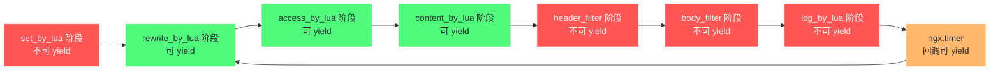
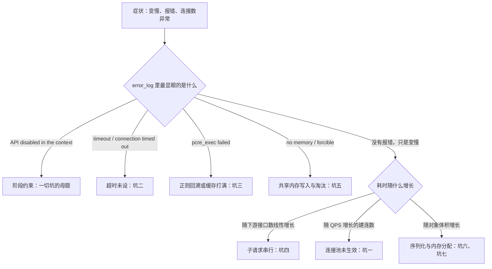
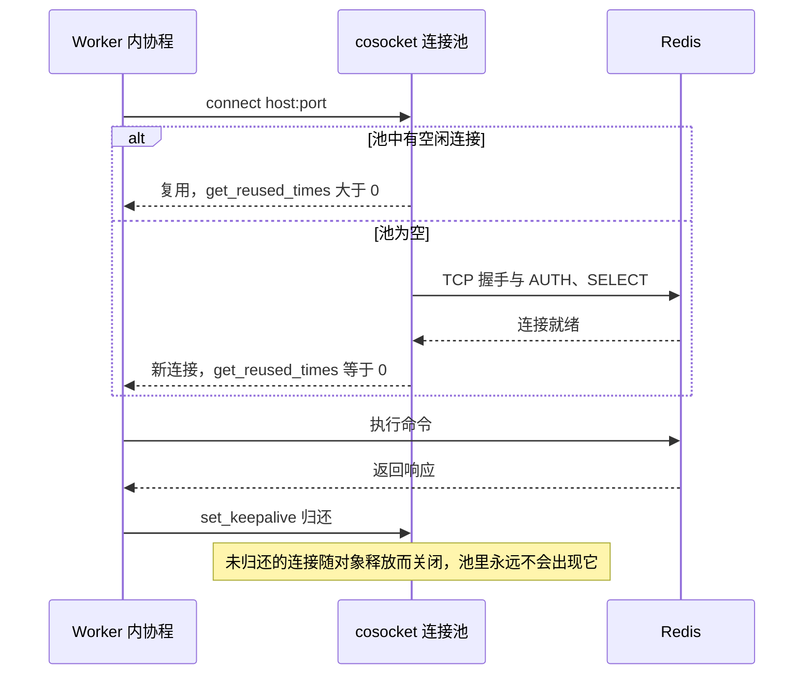
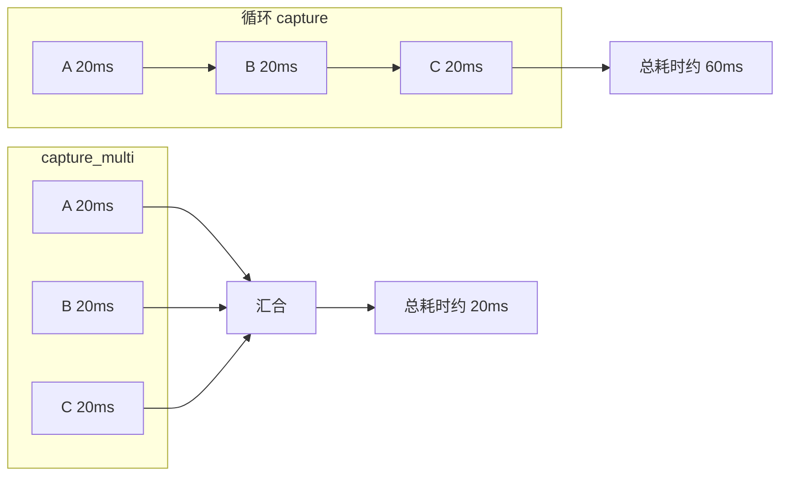
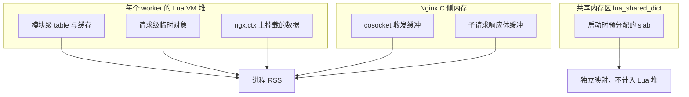

# 13 OpenResty 实战：lua-resty 生态与性能陷阱

**摘要：**

lua-resty 生态里的库，几乎每一个都在文档开头写着一句「基于 cosocket 实现」，却很少有文档把这句前提展开：cosocket 需要协程让出执行权，而 Nginx 只在少数阶段允许 Lua 代码让出。于是同一段查询 Redis 的代码，写在 content_by_lua 里正常返回，搬进 log_by_lua 就只剩一行 API disabled；同一份连接池配置，在开发机上看起来省了时间，上线后连接数却随 QPS 线性上涨。本文不列库清单，也不复述 API，而是把七个反复出现的坑按一次请求的生命周期摊开：连接池没有真正生效、超时沿用 60 秒默认值、ngx.re 缺 j 与 o 选项、用循环 capture 做并行、把共享内存字典当数据库、用 cjson 搬运大对象与大整数、把 Lua 堆、共享内存与 C 侧缓冲三本账算混。每个坑先给症状，再给第一判据，最后给改法与它的代价，并补上 timer、light thread、resty 命令行与 error_log debug 的边界。七个坑的前提只有一条：能不能 yield 由阶段决定，库本身不改变这条规则，因此排查的顺序也应当是先阶段、后库、再参数。文中的量化一律标注为示例推算，给的是算法而不是结论，换一套参数可以自己复算。全文想回答的只有一句话：在写下任何一行 lua-resty 调用之前，先确认此刻有没有 yield 的权利。

---

## 第 1 章 共同底座：cosocket 与阶段约束

### 1.1 一行报错暴露的前提

lua-resty 系列的库，在 2009 年 lua-nginx-module 出现之后慢慢长成一片生态，Redis、MySQL、Memcached、HTTP 客户端、JWT、限流、分布式锁，几乎每个后端协议都有一个对应的封装，几十个库的接口风格高度一致，都是 `new`、`connect`、命令方法、`set_keepalive` 这几步。这种一致性不是巧合，它们全部落在同一个能力上：协程套接字（cosocket）。

笔者见过一位做网关的同行，他把 access_by_lua 里校验 token 的 Redis 查询原样抄进 log_by_lua，用来补一份审计流水。请求照常返回 200，业务日志里没有任何异常，error_log 却每隔几毫秒刷出一行：

```text
2026/03/11 10:22:41 [error] 8123#0: *77123 lua entry thread aborted: runtime error:
API disabled in the context of log_by_lua*, client: 10.12.7.31, server: api.example.com
```

这行日志不是 Redis 库抛出来的，也不是网络问题，而是 ngx_lua 在 C 层直接拒绝了这次调用。它拒绝的理由，恰好是后面七个坑共同的母题：调用本身没有错，错的是调用发生的时刻。

### 1.2 只有能挂起的上下文才配谈异步

cosocket 的做法并不神秘。它把 socket 的文件描述符交给 Nginx 的事件循环，当前 Lua 协程让出执行权（yield），等 fd 上出现可读或可写事件，再把协程恢复（resume）。一次 `connect` 在代码里只有一行，背后是「注册事件、挂起协程、等待事件、恢复协程」四步。所以每次 cosocket 调用都在回答同一个问题：挂起之后，**谁来恢复我**。

在 rewrite_by_lua、access_by_lua、content_by_lua、ssl_certificate_by_lua 这些上下文里，答案很明确。请求处理函数本身就是一条 entry thread，事件循环握着它的引用与它所属请求的连接，事件一到就能恢复。在 log_by_lua、header_filter_by_lua、body_filter_by_lua、set_by_lua 里，答案是不存在：响应已经发出，请求进入收尾路径，这些回调挂在 Nginx 自身的输出过滤链和变量求值路径上，没有可以重新调度的请求上下文。lua-nginx-module 的文档把原因归结为 Nginx 内核的限制（internal limitations in the Nginx core），没有给出更细的推导，但行为是确定的，跨版本一致，也没有在 1.27 上被放宽。协程挂起与恢复的完整调度过程，[[12 OpenResty 架构：LuaJIT、cosocket 与协程调度]] 里有基于源码的推导。

还有一层更隐蔽的约束：yield 不能穿过 C 调用边界。LuaJIT 调用 C 函数时，协程栈上多了一层 C frame，此时让出会直接报 attempt to yield across C-call boundary。`dofile` 与 `require` 在 LuaJIT 里是 C 函数，所以在一个被 require 的文件顶层直接写 `ngx.location.capture` 或 `ngx.exit`，会撞上这层边界；把调用挪进自己定义的 Lua 函数，边界就消失了。这条约束与阶段无关，纯粹是 LuaJIT 的调用约定，因此更容易在代码评审里被漏掉。

### 1.3 阶段与能力的对应表

把阶段与两项能力对齐，能用的与不能用的就一目了然。之所以把「创建定时器」单列一栏，是因为创建 timer 这个动作本身不需要 yield，它在日志阶段格外有用，第 10 章会展开。

| 上下文 | cosocket | 创建 timer | 典型用途 |
|---|---|---|---|
| set_by_lua* | 禁用 | 可创建 | 变量计算 |
| init_by_lua* | 禁用 | 禁用 | 加载配置、预热 |
| init_worker_by_lua* | 禁用 | 可创建 | worker 级周期任务 |
| rewrite_by_lua* | 可用 | 可创建 | 改写、灰度路由 |
| access_by_lua* | 可用 | 可创建 | 鉴权、限流 |
| content_by_lua* | 可用 | 可创建 | 内容生成、网关逻辑 |
| balancer_by_lua* | 禁用 | 可创建 | 动态选择后端 |
| header_filter_by_lua* | 禁用 | 可创建 | 改响应头 |
| body_filter_by_lua* | 禁用 | 可创建 | 流式改包体 |
| log_by_lua* | 禁用 | 可创建 | 日志、埋点、审计 |
| ssl_certificate_by_lua* | 可用 | 可创建 | 动态证书 |

表 1 是本文后面所有判断的坐标系。阶段之间的先后与返回码语义，[[03 HTTP 请求处理管道：11 个阶段全解]] 已经逐层拆过，这里只取与 cosocket 相关的结论，有三点需要先记住。其一，这张表对应 lua-nginx-module v0.10.29（2025 年 10 月发布）与 OpenResty 1.27 的行为，版本敏感的细节以对应版本文档为准。其二，access_by_lua 不会在子请求中执行，这条看起来与阶段无关的事实，会在第 6 章变成一个大坑。其三，ssl_certificate_by_lua 之所以能 yield，是因为它运行在 TLS 握手阶段，握手本身可以被事件驱动地挂起，这与普通 HTTP 阶段的处境不同。

把这条管道画成图，出口只有几个，颜色越暖的地方越危险。



图中唯一一条从红色区域通向绿色区域的路径，就是 timer。它在红色区域里的作为只有一件事：把「要做的 I/O」登记下来，交给别人去做。理解了这条边，也就理解了为什么日志阶段的正确写法不是直接连 Redis，而是先落一个 timer。

### 1.4 库没有骗人，组合骗了人

这些库的作者并不打算隐藏限制。`lua-resty-redis` 的文档第一段就写明它基于 cosocket，`lua-resty-http` 也一样；问题在于库这一层只依赖 `ngx.socket.tcp()`，它默认调用者已经处在合法上下文。真正做检查的是 ngx_lua 的 C 层，报错也发生在那一刻，于是症状表现为「库函数调用失败」，而不是「库不支持这种用法」。如果有人据此得出「lua-resty-redis 在日志阶段有 bug」的结论，方向就偏了。

换成会议的场景更容易说清。阶段决定的是「你能不能中途离席去接一个电话」，cosocket 决定的是「离席之后还能不能回到原位接着发言」。content 阶段是一场还在进行的会议，你出去接完电话回来，主持人会继续点你的名；log 阶段是会议已经散场，会议室都锁了，没有人会再点你的名，你打的电话只能另找一个人转达。七个坑，本质上就是这条前提在七个不同层面的投影：建连、等待、匹配、转发、共享、序列化、回收。它们的共同解法也可以压成一句话：**阶段先于库**。

---

## 第 2 章 七个坑的分布

### 2.1 为什么错误总是出现在别处

这七个坑有一个共同的性格：肇事点与症状点不在一处。连接池没生效，报错的是 Redis 的连接数告警；超时没设，报错的是网关自己的 499；正则少了两个字母，报错的是业务方发现某个接口偶发 404；共享字典存了大对象，报错的是另一条链路的缓存命中率。因为**症状外溢**，排查时很容易在错误的地方深挖，最后得出「某个库性能不行」的结论。

把七个坑按一次请求内的时间顺序排开，会看到一条完整的生命周期：建立连接、等待响应、匹配字符串、发起内部转发、跨 worker 共享状态、序列化数据、回收内存。前四个在单个请求内完成，后三个的代价会跨请求累积。这个排序也决定了诊断顺序：先用日志和指标确定「哪一段在花时间」，再往对应章节找判据，而不是一上来就翻库的源码。

### 2.2 从症状到判据的分诊

下图是一张粗糙但有效的分诊表，从 error_log 里最显眼的那一行出发，先落到大类，再进具体章节。它的价值不在精确，而在于把「猜」换成「查」。



把七个坑的症状与第一判据并排放在一张表里，排查时可以直接按行对照。

| 序号 | 坑 | 典型症状 | 第一判据 | 主要代价 |
|---|---|---|---|---|
| 一 | 连接池未生效 | 后端连接数随 QPS 上涨，TIME_WAIT 堆积 | `get_reused_times()` 恒为 0 | 每次请求多付一个建连 RTT |
| 二 | 超时未设 | 单个后端半死拖慢整站，499、504 增多 | error_log 的 timeout，活跃连接涨而 QPS 不涨 | 协程槽位被长期占用 |
| 三 | ngx.re 缺 j 与 o | 单核跑满而 QPS 不涨，偶发误判不匹配 | error_log 的 pcre_exec() failed: -8 | CPU 与尾延迟 |
| 四 | 循环 capture | 接口耗时随下游数量线性上升 | 总耗时约等于各次耗时之和 | 请求时长与内存峰值 |
| 五 | 共享字典误用 | 命中率抖动，写入偶发失败 | `set` 的第三个返回值 forcible | 跨 worker 锁竞争与淘汰 |
| 六 | cjson 滥用 | 大整数精度丢失，GC 抖动 | 编码结果与原 JSON 对比 | CPU 与内存分配率 |
| 七 | 内存与 GC 失察 | RSS 单调上涨，周期性变慢 | Lua 堆计数与 RSS 的走势分离 | 进程重启与 OOM |

这七行的排列顺序，后面七章就按它展开。需要说明的是，表格里的「代价」一列写的是稳态成本，不包括故障放大效应：一个没设超时的网关，在故障期的表现会比稳态差一个数量级，而这恰恰是线上最不能接受的部分。

---

## 第 3 章 坑一：连接池没有真正生效

### 3.1 症状：连接数随 QPS 上涨

笔者在压测现场最常看到的现象，不需要任何专业工具就能观察到。压测时把 QPS 从 500 拉到 3000，Redis 侧的 `connected_clients` 跟着从几十涨到上千，停止压测后又慢慢回落；应用侧的 p99 随 QPS 近乎线性上升，CPU 却只涨了一半，多出来的时间耗在 sys 态。用 `ss` 数一下内核里的连接状态，TIME_WAIT 的数量在几万到十几万之间摆动。

这就是连接池没有生效的典型画像。每一次请求都新建一条 TCP 连接，用完就关，建连的握手、认证、以及关闭时的四次挥手全部落在请求的关键路径上。Redis 客户端还好，一次 AUTH 加一次命令；MySQL 客户端更贵，一条新连接要做握手、认证、字符集协商、会话变量初始化，单次成本可以到毫秒级。

### 3.2 池的键、生命周期与归属

cosocket 的连接池不是一个全局大池子，它有三个必须记住的属性。

第一，**池按 worker 进程划分**。每个 Nginx worker 有自己的池，`lua_socket_pool_size` 的 30 是每个 worker 的上限，四个 worker 就是四条独立的池、最多 120 条空闲连接。理解这一点，才能理解为什么「池大小调成 100」在 32 核机器上意味着最多 3200 条到后端的空闲连接。

第二，池的键默认由 `host:port` 拼成。`lua-resty-redis` 在这个基础上还会追加数据库与 ACL 用户，`127.0.0.1:6379/db=1` 与 `127.0.0.1:6379/db=2` 是两个池；用域名连和用 IP 连同一台实例，也是两个池；连接池的 `pool` 选项可以显式指定池名，但一旦指定，所有调用方都必须用同一个名字，否则各建各的。池名不同，复用率就归零，症状看起来和完全没开池一样。

第三，**池是懒创建的**，直到第一个连接被 `set_keepalive` 归还才算真正存在，而大小一旦定下就不能再改。文档里有一句容易读漏的话：调用 `connect` 时如果既没传 `pool_size` 也没传 `backlog`，就不会创建池，连接用完即关。换句话说，池不是「配置了就存在」，而是「第一次归还连接时才存在」，而归还动作需要代码显式调用。

下面的时序图画出了这条路径上的两个分支，差别只在最后一步。



### 3.3 set_keepalive 与被忽略的 pool_size

`set_keepalive` 的语义与 `close` 相同，都是「这个连接我不用了」，区别在归还与销毁。它接受两个参数：空闲超时（毫秒）与池大小。常见的错误写法有三种：完全不调用，调用在错误分支之外导致异常路径漏掉连接，以及调用时把池大小写成一个拍脑袋的数。三种错误的表现一致，都是连接不复用。

```lua
-- 错误：没有 set_keepalive，也没有任何超时
local redis = require "resty.redis"
local red = redis:new()
local ok, err = red:connect("10.0.8.11", 6379)   -- 建连超时默认 60 秒
if not ok then
    return nil, err
end
local val, err = red:get("user:" .. uid)
-- 连接对象随 GC 释放，池里没有它，下一次请求重新建连

-- 正确：超时、参数、归还三件事一次说清
local red = redis:new()
red:set_timeouts(300, 500, 800)                  -- connect、send、read 分离设置
local ok, err = red:connect("10.0.8.11", 6379)
if not ok then
    return nil, "redis connect: " .. err
end
local val, err = red:get("user:" .. uid)
local ok2, err2 = red:set_keepalive(30000, 100)  -- 空闲 30 秒，每 worker 最多 100 条
if not ok2 then
    red:close()
    ngx.log(ngx.WARN, "redis keepalive failed: ", err2)
end
```

还有一个细节：`connect` 的选项表是「每次调用」的，而池是「首次创建」的。第二次调用时即使把 `pool_size` 改成 500，也不会改变已经建好的池的大小，因为池的大小在创建时就固定了。这条规则在排查时会制造错觉：配置文件里写的是 500，实际生效的是某次早期调用留下的 100。

### 3.4 三个判据

判据一在 Lua 侧，最直接：连续两次请求，第二次的 `red:get_reused_times()` 应该大于 0。如果恒为 0，说明池没有生效，不用再往下猜。这个函数在 `lua-resty-http` 里同样存在，连接对象换成了 HTTP 客户端。

判据二在服务端：`INFO clients` 的 `connected_clients` 与 QPS 的关系。池生效时，连接数应该稳定在「worker 数 × 每 worker 并发」这个量级，与 QPS 无关；池没生效时，连接数近似等于 QPS 乘以平均处理耗时。这个比值是判断「池到底有没有在工作」的最快方式。

判据三在内核：`ss -tan state time-wait | wc -l`。如果 TIME_WAIT 数量接近本机的临时端口上限（Linux 默认范围大约 2.8 万个端口），说明这台机器正在以很高的速率主动关闭连接，也就是每个请求都在新建连接。这个指标不需要进 Redis 也不用改代码，是故障现场最容易拿到的一手证据。

### 3.5 量化：池省下的是什么

举一个可以自己改参数复算的例子，以下数字均为示例推算。假设单 worker 承担 3000 QPS，到 Redis 的同机房 RTT 为 0.2 毫秒，每次请求访问 Redis 一次，平均处理耗时 2 毫秒。

不开池时，每个请求多付一次 TCP 握手（约 1 个 RTT，0.2 毫秒）和一次关闭；3000 QPS 乘以 0.2 毫秒，相当于每秒 0.6 秒的 CPU 时间，也就是 0.6 个核被建连吃掉。同时，主动关闭方每秒产生 3000 个 TIME_WAIT，存活 60 秒，稳态就是 18 万个四元组，远超默认临时端口范围，sockets 会先于 CPU 成为瓶颈。开池之后这两笔成本都趋近于零，代价是每个 worker 常驻 100 条空闲连接，也就是 400 条到后端的连接，对一台 Redis 来说完全在承受范围内。

但如果把池大小从 100 调到 1000，代价就不对称了：后端连接数上限被放大十倍，Redis 的 `maxclients`、每连接的输出缓冲区、以及内核的 conntrack 表都要跟着放大；而收益只是「极端突发时少建几次连」。池大小的合理起点是「单 worker 的峰值并发」，再留一点余量，不是越大越好。

| 参数 | 默认 | 建议起点 | 调大的代价 | 调小的代价 |
|---|---|---|---|---|
| lua_socket_pool_size | 30 | 与单 worker 峰值并发同量级 | 每 worker 常驻 fd 与内存上涨，后端连接上限被放大 | 命中率下降，建连次数回升 |
| lua_socket_keepalive_timeout | 60s | 小于后端 idle timeout，30 到 60 秒 | 空闲连接占住后端名额，故障切换后旧连接存活更久 | 命中率下降，归还即失效 |
| connect 的 pool_size | 不传且无 backlog 则不建池 | 显式传入，固定值 | 创建后不能改，误配置要重启才纠正 | 命中率下降，突发时建连回升 |
| connect 的 backlog | 不设即不限制排队 | 单 worker 并发的 10% 到 20% | 排队请求占住协程，尾延迟变长 | 直接返回 too many waiting connect operations |
| lua_socket_connect_timeout | 60s | 后端建连 P99 的 1.5 到 2 倍 | 故障时挂得更久 | 正常抖动即被判失败 |

### 3.6 池化之后的新问题

连接复用解决了建连成本，也带来了三个新问题，处理不好会让「有池」比「没池」更难排查。

第一个是残留状态。池里的连接是「带着上一次会话状态」被复用的，譬如 `SELECT` 切过的库、`AUTH` 认证过的用户、甚至未结束的事务都会跟着连接走。`lua-resty-redis` 的处理方式是给带 `db` 与 `username` 的连接单独建池，并明确拒绝把处于事务中的连接归还（返回 in transaction）；`WATCH` 不在跟踪范围内，必须在归还前手工 `unwatch` 或关闭。业务代码如果自己拼连接，就要自己承担这份状态管理。

第二个是空闲超时错配。池的空闲超时是 60 秒，而 Redis 服务端可能配置了更短的 `timeout`（默认 0 表示不主动断开，但很多团队会设 300 秒或更短）。当服务端的空闲超时短于池的保留时间，连接会在池里「悄悄死掉」，下一次复用时第一次读操作报 closed。这类错误只在低峰出现，高峰反而正常，判据是错误集中在流量低谷且错误信息里带 closed。

第三个是池不是并发上限。池只保留空闲连接，不限制正在使用的连接数量；要限制总连接数，必须用 `backlog` 让超出的连接请求排队，或者在上层用信号量限并发。把「池大小」误当「并发上限」，是压测时后端连接数超预期最常见的原因。

---

## 第 4 章 坑二：超时默认一分钟

### 4.1 一分钟是怎么吃掉 worker 的

`lua_socket_connect_timeout`、`lua_socket_send_timeout`、`lua_socket_read_timeout` 的**默认值都是 60 秒**，`lua_socket_keepalive_timeout` 也是 60 秒。`lua-resty-redis` 与 `lua-resty-http` 都没有改动这些默认值，只有在显式调用 `set_timeout` 或 `set_timeouts` 时才会覆盖。也就是说，一段从来没设过超时的代码，连接、发送、读取三段各允许卡一分钟。

一分钟在网络健康时完全无害，因为操作都会在毫秒级返回；它在故障时才会显出威力。设想一个后端的一半实例因为内核参数被改坏，SYN 包被丢弃，客户端会一直重传；没有超时的话，每次 `connect` 都会在 60 秒后才放弃。这段时间里，请求的协程一直挂在事件循环上，占着一条连接记录、一份请求内存、一个 worker 的并发槽位。

故障的放大过程是这样的：一开始只有少数请求变慢，QPS 下降；随后慢请求越积越多，worker 的 `worker_connections` 被占满，新连接进不来；最后整站表现为大面积超时，而 CPU 使用率并不高，因为大家都在等。这种「CPU 空闲但服务不可用」的形态，最容易让值班同学误判成「Nginx 没在干活」。连接数与内核参数如何配合，[[10 性能调优全攻略：worker 进程、连接数与内核参数]] 里有更系统的算法。

### 4.2 三个超时各不相同

三个超时对应三个不同的故障面。连接超时管的是「连不上」，典型原因是对端进程挂了、iptables 丢包、安全组没放行、DNS 解析到了错误地址。发送超时管的是「写不进去」，典型原因是请求体很大而链路带宽被打满，或者对端读缓冲区满。读取超时管的是「等不到回应」，典型原因是后端慢查询、锁等待、GC 停顿、被更上游的流量压住。

`lua-resty-redis` 早期只有一个 `set_timeout`，一个值同时作用于三段，粒度太粗；v0.28 之后新增 `set_timeouts(connect_timeout, send_timeout, read_timeout)`，文档也建议优先用它。`lua-resty-http` 提供的是同名的 `set_timeouts`，参数顺序与单位一致，都是毫秒。

| 超时 | 默认 | 覆盖方式 | 判断依据 | 调大的代价 | 调小的代价 |
|---|---|---|---|---|---|
| connect | 60s | lua_socket_connect_timeout 或 set_timeouts 第一参 | 后端建连 P99 的 1.5 到 2 倍 | 半死后端把每个请求拖长 | 建连毛刺被判成失败 |
| send | 60s | lua_socket_send_timeout 或第二参 | 请求体大小除以可用带宽再加余量 | 慢链路占住协程 | 大请求体被误杀 |
| read | 60s | lua_socket_read_timeout 或第三参 | 后端响应 P99.9 加余量 | 慢查询拖垮整个 worker | 正常慢请求变错误 |
| keepalive | 60s | set_keepalive 第一个参数 | 小于后端 idle timeout | 池里留下对端已关闭的连接 | 命中率下降 |

还有两个容易漏掉的超时。一个是 DNS 解析，cosocket 在使用域名时走 Nginx 的 `resolver`，由 `resolver_timeout` 控制（默认 30 秒，以对应版本 Nginx 文档为准），它的默认值同样不适合放在请求路径上。另一个是「总预算」，三个分段超时叠加之后，最坏情况可能远超业务能容忍的时间，而分段超时本身对此一无所知。

### 4.3 判据：是等待还是计算

判断「慢在等待」还是「慢在计算」，最省事的办法是看两个量的关系：QPS 下降、CPU 不涨、活跃连接数上升，三者同时出现，几乎可以断定请求卡在 I/O 等待上。反过来，CPU 打满而连接数不高，才轮到怀疑计算与正则（第 5 章）。

第二个判据是延迟分布的形状。健康接口的延迟分布是单峰长尾；出现超时拖尾时，会在超时阈值附近冒出一个次峰，因为所有卡住的请求都在同一个时间点被放弃。看到 60 秒附近有次峰，不用再问后端为什么慢，先问超时为什么是 60 秒。

第三个判据是错误字符串。连接失败与读取超时给出的错误不同，前者是 connect 阶段的 timeout 或 connection refused，后者是 read 阶段的 timeout 或 closed。把错误串与调用点一起打出来，能立刻区分故障面，避免「一个超时背所有锅」。

### 4.4 超时预算的算法

超时不该逐个拍脑袋，而应该从请求的外部预算往下分配。假设一个网关对外承诺 3 秒，一次请求内部要访问 Redis 两次、下游 HTTP 一次。先按直觉分配：Redis 单次 connect 300 毫秒、read 500 毫秒，两次最坏 1.6 秒；下游 HTTP connect 300 毫秒、read 1 秒，合计 1.3 秒；两者相加 2.9 秒，再给 HTTP 一次重试，最坏路径变成 4.2 秒，超出预算。于是只有两个选择：要么去掉重试，要么把 Redis 的 read 压到 200 毫秒、HTTP 的 read 压到 500 毫秒，把最坏路径压回 3 秒以内。

这里有一条硬约束：**超时之和要封顶**，分段超时之和不大于总预算，有重试时还要乘以重试次数。很多线上事故的根因不是某一个超时设得离谱，而是三个 1 秒的超时叠了两次重试，最坏路径变成 6 秒，而业务方的客户端早已在 3 秒时断开，服务端却还在为一个没人要的响应继续等待。

```lua
local http = require "resty.http"
local httpc = http.new()
httpc:set_timeouts(300, 1000, 1000)   -- connect、send、read 分离，总计不超过 2.3 秒

local res, err = httpc:request_uri("http://10.0.9.21:8080/price?sku=" .. sku, {
    method = "GET",
    keepalive_timeout = 30000,
    keepalive_pool = 100,
})
if not res then
    -- 只对连接类失败重试一次，读超时重试会放大后端压力
    httpc = http.new()
    httpc:set_timeouts(300, 1000, 1000)
    res, err = httpc:request_uri("http://10.0.9.21:8080/price?sku=" .. sku, { method = "GET" })
end
```

超时也不是越小越好。把 read 超时压到 100 毫秒，等于把后端正常的 P99 抖动当作故障处理，错误率反而上升；把 connect 超时压到 50 毫秒，跨机房调用会因为一次路由抖动全军覆没。合理的位置是「正常分布的尾部之外、业务预算之内」，并且随后端扩容与链路变更重新校准。

---

## 第 5 章 坑三：ngx.re 少了两个字母

### 5.1 编译缓存与它的上限

`ngx.re.match(uri, pattern)` 这样写，每一次调用都会把 pattern 交给 PCRE 做编译与预分析，然后才执行匹配。PCRE 的编译不是免费的：它要把模式串解析成内部状态机，做 JIT 的话还要生成机器码。请求量一大，这部分成本就从「可以忽略」变成「可观」。

两个字母能省掉其中大部分。`j` 打开 PCRE 的 JIT 编译（前提是 PCRE 在编译时带了 `--enable-jit`），`o` 打开「编译一次、后续复用」的缓存。文档明确建议两者一起用：`jo`。加了 `o` 之后，**缓存的是编译结果**，按 pattern 加选项为键，缓存在当前 worker 进程内，所有请求共享；如果用的是 `lua-resty-core` 提供的实现，这个缓存是 LRU，条目上限由 `lua_regex_cache_max_entries` 控制，默认 1024。

上限这件事经常被忽略。超过 1024 条之后，新的 pattern 不再进缓存，等同没有加 `o`，error_log 里只会出现一次警告：

```text
2026/03/11 10:31:02 [warn] 8123#0: *77190 lua exceeding regex cache max entries (1024), ...
```

「只警告一次」这个设计很合理，却让排查变得困难：日志里出现一行警告，之后就是静默的性能退化。更麻烦的是缓存污染，也就是用动态拼接的 pattern 配 `o`。每来一个用户 ID 就拼一个新 pattern，1024 个请求之后缓存被打满，之后所有 pattern 都不再缓存，包括那些本来应该是静态的。文档专门提醒过，不要给动态生成、且组合近乎无限的 pattern 加 `o`。

### 5.2 find 与 match 的取舍

同样是匹配，`ngx.re.find` 与 `ngx.re.match` 的成本不同。`match` 返回一张 captures 表，成功时要创建 table、把每段捕获的字符串复制进去；`find` 只返回匹配的起止下标，不建表、不建字符串，需要内容时再用 `string.sub` 截取。文档里对 `find` 的评价是「快得多」，理由正是少了这些分配。

高频路径上的差别会被放大。譬如一个网关在每个请求上做三到五次正则判断，用 `match` 就是三到五次 table 分配，全部变成 GC 的原料；换成 `find`，只留下几次整数比较。若确实需要捕获组，`match` 还有第五个参数可以传入一张复用的结果表，省掉建表的开销。

```lua
-- 每次请求都新建 captures 表，且 pattern 没有预编译
local m = ngx.re.match(ngx.var.uri, "^/api/v([0-9]+)/")

-- 模块顶层只编译一次，热路径用 find 避免分配
local VERSION_RE = "^/api/v([0-9]+)/"
local function api_version(uri)
    local from, to, err = ngx.re.find(uri, VERSION_RE, "jo", nil, 1)
    if not from then
        return nil, err
    end
    return tonumber(string.sub(uri, from, to))
end
```

### 5.3 灾难性回溯的现场

正则的性能问题里，最致命的一种是灾难性回溯。`^(\w+\s?)+$` 这类「嵌套量词」的模式，在匹配失败时会把同一段输入用不同方式反复切分，回溯次数随输入长度指数增长，30 个字符就足以把候选路径推到十亿量级。

PCRE 有自我保护：回溯次数超过 match limit 时就放弃，`ngx.re` 把这次失败作为错误返回，字符串是 `pcre_exec() failed: -8`。`lua_regex_match_limit` 可以调整这个上限，默认值 0 表示使用 PCRE 编译时的默认值（约 1000 万次，以 PCRE 版本为准）。按单次回溯几个纳秒的量级判断，一千万次在单核上就是几十毫秒的 CPU；单次不致命，QPS 一高就会叠成尖刺，而把上限调大只是把尖刺拉长。

真正的危险在于**超限被当成不匹配**。`ngx.re` 的返回约定是成功返回捕获、失败返回 nil，出错时返回 nil 加错误串；如果代码只写 `if m then ... end`，那么「超限」与「不匹配」走的是同一条分支。于是一个本来该命中灰度规则的请求被放行到了默认分支，表现为「某些正常请求偶发走了错的逻辑」，而 error_log 里只有一行不起眼的 pcre_exec 错误。

```lua
-- 危险：把超限错误当成不匹配
local m = ngx.re.match(path, "^(/a+)+$")
if m then
    route_to_a()
else
    route_to_default()   -- 回溯超限时也走这里
end

-- 稳妥：区分 nil 与 err，并给输入长度设上限
if #path > 256 then
    return nil, "path too long"
end
local m, err = ngx.re.match(path, "^(/a+)+$", "jo")
if err then
    ngx.log(ngx.ERR, "regex failed: ", err)
    return nil, err
end
if m then
    route_to_a()
else
    route_to_default()
end
```

### 5.4 判据与改法

判据一在 CPU：单个 worker 的 CPU 打满而 QPS 不涨，`top -H` 看到热点集中在一两个 worker 上，且这些 worker 的请求数并不比别的多。判据二在日志：`pcre_exec() failed: -8` 或 `lua exceeding regex cache max entries`。判据三在复现：笔者习惯把可疑的 pattern 与最坏输入拿到 `resty` 里跑一遍，用 `ngx.now()` 卡时间，几秒钟就能确认。

顺带澄清一个流传很广的写法：lua-nginx-module 的 `ngx.re` 只提供 match、find、gmatch、sub、gsub 五个入口，并没有 `ngx.re.compile`；所谓「预编译」在 OpenResty 里就是带 `o` 选项调用一次，编译结果由 worker 级缓存持有。

改法有明确的优先级。先把静态 pattern 全部提到模块顶层并加 `jo`；再把热路径上只需要判断「有没有」的地方换成 `find`；然后给用户可控的输入加长度上限，并对嵌套量词做人工审查；最后，如果某个 pattern 确实无法避免回溯，就考虑 `d` 选项走 DFA 匹配——DFA 不回溯，但要对每个字节推进状态机，常规情况下更慢，属于「用平均成本换最坏成本」的取舍。

| 选项 | 作用 | 代价与边界 |
|---|---|---|
| j | 打开 PCRE JIT 编译 | 需要 PCRE 带 JIT，首次编译更慢，之后显著更快 |
| o | 编译一次并缓存 | 缓存上限默认 1024，动态 pattern 会把它打满 |
| d | DFA 模式，最长匹配 | 不回溯，但逐字节推进，平均更慢 |
| a | 锚定模式，只从开头匹配 | 非锚定语义会变，改错等于改业务 |
| u | UTF-8 模式 | 需要 PCRE 带 UTF-8，校验本身有成本 |

---

## 第 6 章 坑四：用 capture 拼并行

### 6.1 子请求不是一次 HTTP 调用

`ngx.location.capture` 发起的是 Nginx 子请求（subrequest），不是一次对外 HTTP 调用。它不产生新的 TCP 连接，不走网卡，也不经过 IPC，所有事情都在 C 层完成，因此它的开销比「自己连一个 HTTP 客户端」低得多。文档的措辞是：子请求只是模仿了 HTTP 接口，背后没有额外的 HTTP 或 TCP 流量。

但「没有 TCP」不等于「没有成本」。子请求要重新做一次 location 定位，重新走一遍阶段链，重新执行目标 location 上的 rewrite、content 逻辑，还要把响应体完整缓冲进内存再交给父请求。文档明确说，capture 总是把子请求的响应体整体缓冲在内存里，响应体很大时应该改用 cosocket 流式处理。它还有一条排除清单：带 `add_before_body`、`add_after_body`、`auth_request`、`echo_location` 这类子请求指令的 location 不能被 capture，行为会不符合预期。

### 6.2 阶段链里少了一环

子请求会走阶段链，但不是完整的阶段链。文档里有两句话放在一起看很有意思：一句是「与其它 rewrite 阶段处理器一样，rewrite_by_lua 也会在子请求中执行」，另一句是「与其它 access 阶段处理器一样，access_by_lua 不会在子请求中执行」。

这两句话合起来，推翻了一类常见设计——**子请求不跑 access 阶段**。有人为了复用鉴权逻辑，把校验写在某个 internal location 的 access_by_lua 里，然后在业务 location 里用 capture 去「调一下」。结果子请求根本不会执行 access 阶段，鉴权被跳过，capture 拿回来的是受保护内容本身；如果那个 location 只有 access 阶段而没有 content 处理器，才会得到一个空响应。正确的位置是 content_by_lua 或 rewrite_by_lua，或者干脆不用子请求，把鉴权写成普通的 Lua 函数。

`ngx.ctx` 的隔离也是同一类陷阱。每个请求（包括子请求）都有自己的 `ngx.ctx` 副本，父请求设置的上下文在子请求里读不到，除非显式传 `{ ctx = ngx.ctx }` 让两者共享同一张表。这一点在写「先 capture 再读上下文」的代码时经常被忘记，表现为子请求里拿到的用户 ID 永远是 nil。

### 6.3 串行的真相与 capture_multi

**capture 必须同步等待**：调用之后，当前协程挂起，直到子请求完成才继续。所以一个循环里写三次 capture，三次子请求是一次接一次跑的，总耗时约等于三次之和。文档对 `capture` 与 `capture_multi` 的关系说得很直白：`capture` 就是 `capture_multi` 只传一个元素的特例。

要让多个子请求并行，只有一个函数：`capture_multi`。它接受一个请求列表，一次把全部子请求发出去，等所有子请求结束后按顺序返回结果，总耗时约等于最慢的那一个，而不是所有之和。它同样会等全部完成才返回，因此不能拿它做「先返回先处理」。

```lua
-- 串行：三次子请求依次执行，总耗时约 3t
local a = ngx.location.capture("/internal/price?id=" .. id)
local b = ngx.location.capture("/internal/stock?id=" .. id)
local c = ngx.location.capture("/internal/coupon?id=" .. id)

-- 并行：一次发出，总耗时约 max(t)，返回值顺序与请求顺序一致
local resps = { ngx.location.capture_multi({
    { "/internal/price?id=" .. id },
    { "/internal/stock?id=" .. id },
    { "/internal/coupon?id=" .. id },
}) }
for i = 1, #resps do
    if resps[i].truncated then
        ngx.log(ngx.WARN, "subrequest ", i, " truncated")
    end
end
```

不妨把两种写法的时间轴并排放，差别一目了然。



还有一个必须检查的返回值：`res.truncated`。文档说明，子请求的响应体可能被截断，截断的原因是远端中途断开或读超时这类不可恢复的错误；截断时 `res.status` 仍然可能是 200，`res.body` 却只有半截。不做这个检查，解析半截 JSON 抛出的错误会把人引向 JSON 库，而真正的问题在网络。

### 6.4 判据：总耗时是加还是取最大

判断「是不是在串行」有一个几乎不需要工具的判据：把下游数量从 1 增加到 3，如果接口耗时变成原来的三倍，就是串行；如果基本不变，才是并行。这个实验在压测环境里做一次即可，比读代码更可靠。

第二个判据是日志里的时间戳。给每个子请求前后打 `ngx.now()`，看三个区间是首尾相接还是相互重叠；重叠的才是并行。第三个判据在内存：capture 全缓冲响应体，如果下游接口返回几百 KB，单个请求的 RSS 会明显抬升，QPS 一高就是内存曲线同步上扬。

量化一下串行的代价，以下为示例推算。三个内部接口各 20 毫秒，循环 capture 是 60 毫秒，capture_multi 是 20 毫秒，单请求差 40 毫秒。按 500 QPS 算，每秒多消耗 2 万毫秒，也就是 20 个核的等待时间——注意是「等待时间」而不是「CPU 时间」，但协程槽位与连接是被实打实占住的。如果这些子请求还要访问下游服务，串行还意味着下游的并发压力被拉长，尾部延迟进一步恶化。

---

## 第 7 章 坑五：共享内存字典不是数据库

### 7.1 一次读操作的完整代价

`lua_shared_dict` 在 `http` 块里声明之后，Nginx 在启动时就分配好这块共享内存，所有 worker 通过 mmap 看到同一片区域。这带来两个直接结果：一是容量在启动时确定，运行期不能扩；二是配置 reload 时内容保留，进程重启时内容丢失。后者常被误认为「缓存会持久化」，实际上它只是一块随进程生灭的内存。与 [[05 缓存机制：proxy_cache 的物理结构与失效策略]] 里「共享内存放键、磁盘放响应体」的两层设计不同，共享字典只有内存一份，没有落盘。

一次 `get` 并不像读 Lua 表那样便宜。它要获取这个 zone 的共享锁，在红黑树里查到键，把值从共享内存复制到当前 worker 的 Lua 堆，再释放锁。字符串值需要新建一个 Lua 字符串，数字与布尔值虽然轻，但同样经过一次加锁与查表。读共享字典的代价因此与「读进程内 Lua 表」不是一个量级，它更接近一次本机 IPC。

**get 返回副本**，这一点必须记住。`get` 拿到的是拷贝，改动它不会影响共享内存里的原值，想更新必须再调一次 `set`。这层拷贝在值很大时尤其昂贵：一个 10 KB 的 JSON 串，每次 `get` 都要在 Lua 堆里复制 10 KB，QPS 5000 就是每秒 50 MB 的复制量，这些复制出来的短命字符串随后全部变成 GC 的原料。下面这张内存账本图把三类内存分开，它们各有各的生死规则。



### 7.2 容量、淘汰与返回值

共享字典满的时候不会阻塞等待，而是按最近最少使用（LRU）的顺序强制淘汰尚未过期的条目。文档特别指出，LRU 的优先级高于过期时间：即使某些条目马上要过期，只要它们最久没被访问，也会先被踢出去。`set` 返回三个值：是否成功、错误串、以及是否发生了强制淘汰（forcible）。第三个值是最有价值的信号，频繁出现 `forcible = true`，说明这块字典的容量已经在临界点上。

淘汰也不是无限的。文档的说法是，内存不足时会尝试淘汰「几十个」条目，如果仍然挤不出空间，就返回 `no memory`。这里的「挤不出」除了容量真不够，还有一个隐蔽原因：slab 分配器的碎片。共享内存按固定大小分级分配，不同尺寸的值混放会让某些尺寸的 slab 页被占满而另一些空闲；`free_space()` 返回 0 时仍可能写得进去，因为它只统计未分配的页，不统计已分配页里的空位。

`safe_set` 与 `safe_add` 是不淘汰版本，容量不足时立刻失败，适合「宁可写不进去也不能挤掉别人」的场景，代价是调用方必须处理失败。`get_keys` 则是另一个极端：它要遍历整块字典并加锁，文档明确提醒不要在键很多的字典上调用，否则会让所有访问这块字典的 worker 一起卡住。把这些规则合起来，共享字典的定位就很清楚：本机、易失、容量固定、写满即淘汰的键值缓存，不是数据库，也不该被要求承担数据库的职责。

| 方法 | 语义 | 误用后果 |
|---|---|---|
| get | 返回值的副本，过期或不存在返回 nil | 以为拿到引用，改了却不回写 |
| set | 空间不足时按 LRU 强制淘汰，返回 forcible | 大对象挤掉热数据，命中率抖动 |
| safe_set / safe_add | 不淘汰，满即失败 | 适合不可丢的写入，但要处理失败分支 |
| incr | 单次调用原子，非数字返回 not a number | 用 get 加 set 做计数会丢更新 |
| get_keys | 一次性取键列表，期间持锁 | 热路径调用会卡住全部 worker |
| capacity / free_space | 容量与空闲页字节数 | 只看 free_space 会误判碎片状况 |

### 7.3 incr 的原子性到哪里为止

文档说共享字典的方法都是原子操作，这句话的边界是「一次方法调用」。`incr` 一次调用内部的读、加、写是原子的，所以多个 worker 同时对同一个键做 `incr` 不会丢计数；但 `get` 与 `set` 是两次调用，中间可以插进别的 worker 的操作，于是「读出来加一再写回去」在并发下必然丢更新。限流、计数、去重这类逻辑如果自己用 `get` 加 `set` 拼，压测时数字对不上，原因就在这里。

`incr` 还有两个使用细节。它对非数字值返回 `not a number`，如果某个键之前被写成了字符串，之后的 `incr` 会一直失败，需要先处理旧值。它支持 `init` 与 `init_ttl` 两个可选参数，键不存在时用 `init` 初始化并同时设置过期时间，这比「先 add 再 expire」少一次调用，也少一个竞争窗口。

### 7.4 热点键与锁竞争

共享字典的每个 zone 只有一把锁。同一块字典上的所有操作，无论读写，都要排队进这把锁。读多写少的缓存场景影响不大，因为临界区很短；但一个写非常频繁的热点键会把这把锁变成串行瓶颈，8 个 worker 同时 `incr` 同一个键，吞吐上限就是一除以临界区时间，与 CPU 核数无关。

判据是「加并发不加吞吐」：压测线程从 4 加到 32，QPS 曲线走平，CPU 使用率停在 30% 到 40%，p99 呈阶梯状上升。用 `resty` 写两个小脚本，一个压同一个键，一个压分散的键，对比 QPS，几秒钟就能确认是不是锁竞争。

缓解办法按代价从低到高排：把计数器分片，键名后面加一个从 0 到 N 的随机后缀，读取时把所有分片求和，代价是读变复杂；把写聚合到本地，每个 worker 在 Lua 侧累加，用 timer 周期性合并，代价是精度有延迟；干脆不用共享字典做高频写，改用外部计数器或者接受近似值。

### 7.5 两级缓存的正确写法

共享字典最适合的角色是二级缓存：值不大、读多写少、允许短暂不一致。配合每个 worker 进程内的 `lua-resty-lrucache` 做一级缓存，可以把绝大多数读挡在 Lua 堆内，只有一级未命中时才碰共享内存与锁。

```lua
-- nginx.conf: lua_shared_dict api_cache 10m;
--             lua_shared_dict api_cache_lock 1m;
local lrucache = require "resty.lrucache"
local lock = require "resty.lock"
local cjson = require "cjson.safe"   -- 解析失败返回 nil 与错误，不抛异常

-- L1：每个 worker 独立，容量固定，无锁
local l1 = assert(lrucache.new(2000))
local L1_TTL, L2_TTL = 2, 30

local _M = {}

local function load_from_backend(key)
    -- 真实实现里在这里连 Redis 或数据库，并设置超时与连接池
    return { key = key }
end

function _M.get(key)
    local val = l1:get(key)
    if val then
        return val
    end

    local dict = ngx.shared.api_cache
    local raw = dict:get(key)
    if raw then
        local decoded = cjson.decode(raw)
        if decoded then
            l1:set(key, decoded, L1_TTL)
            return decoded
        end
    end

    -- 回源前用共享内存锁做单飞，避免缓存过期瞬间全部打穿
    local l = lock:new("api_cache_lock", { exptime = 5, timeout = 2 })
    local elapsed, err = l:lock(key)
    if not elapsed then
        ngx.log(ngx.WARN, "cache lock timeout: ", err)
        return load_from_backend(key)   -- 降级：不阻塞请求
    end
    local again = dict:get(key)
    if again then
        l:unlock()
        local decoded = cjson.decode(again)
        l1:set(key, decoded, L1_TTL)
        return decoded
    end

    local data = load_from_backend(key)
    local encoded = cjson.encode(data)
    if encoded then
        local ok, serr, forcible = dict:set(key, encoded, L2_TTL)
        if not ok then
            ngx.log(ngx.WARN, "shm set failed: ", serr)
        elseif forcible then
            ngx.log(ngx.WARN, "shm evicted other keys for ", key)
        end
        l1:set(key, data, L1_TTL)
    end
    l:unlock()
    return data
end

return _M
```

这段代码把两级缓存的骨架搭完整了：L1 命中直接返回，L2 命中回填 L1，回源之前用锁做单飞，写 L2 时检查 `forcible`，锁等待失败就走降级。`require` 全部提到模块顶层，`cjson.decode` 失败有分支处理，连后端的部分要求带上超时与连接池。缓存层看起来只是「查两次、写两次」，真正决定它稳不稳的是这些失败分支：缓存的事故很少出在命中的那条路径上。

---

## 第 8 章 坑六：cjson 的两笔账

### 8.1 大整数在解码时就已经变了

LuaJIT 里的数字是双精度浮点，能精确表示的整数上限是 2 的 53 次方，约 9×10^15，也就是 16 位十进制数。`cjson.decode` 把 JSON 里的数字一律解成这种双精度数，**解码时精度已经丢了**：19 位的雪花 ID、20 位的订单号、纳秒时间戳都会在这一步丢精度；再 `encode` 回去时，默认只输出 14 位有效数字（`encode_number_precision` 的默认值，可调范围 1 到 14），于是往返一次，ID 已经面目全非。

```lua
local cjson = require "cjson.safe"
local raw = '{"order_id": 1234567890123456789}'
local obj, err = cjson.decode(raw)
-- 解码后得到的是双精度近似值，编码回去只剩 14 位有效数字
```

这类问题在链路上极其阴险：网关只是透传 JSON，看起来什么都没做，下游却开始报「订单不存在」。判据很简单，对真实样本做一次 round-trip 对比，或者直接打印 `type()` 与 `%d` 格式化结果。正解不在 cjson 这一侧，而在协议设计：ID 用字符串承载。如果上游已经发成了数字，网关能做的只有尽量不解析、不重组这段 JSON，或者把该字段单独用字符串拼接的方式透传，代价是放弃统一的解析与校验。

### 8.2 大表编码的分配成本

`cjson.encode` 是 C 实现，单次调用很快，但它做的事情并不少：递归遍历整张表、为每个值做类型判断、把输出写进一个会不断扩容的缓冲区、最后生成一个 Lua 字符串。`cjson.decode` 更重，它要为每个对象分配一张 Lua 表、为每个字符串键分配 Lua 字符串，数组元素也要占去表槽位。表越大，分配越多，GC 越频繁。

单次成本可以用 `resty` 直接量出来，不必凭感觉。把生产环境里最大的那份响应样本存成文件，在 `resty` 里循环解码一万次，打印耗时与 `collectgarbage("count")` 的差值，两个数字就能说明问题。以下为示例推算：一份 200 KB 的响应，解码后若有 3000 个值，一次请求就要新建 3000 多个 Lua 值；1000 QPS 就是每秒 300 万个对象，如果再 encode 一次，分配量还要翻倍。这样的分配率下，GC 会从「偶发」变成「周期性抖动」。

| 配置 | 默认 | 容易踩的地方 | 建议 |
|---|---|---|---|
| encode_number_precision | 14 | 有效数字不足，大数精度变低 | 不要为了省 CPU 继续调低 |
| decode_max_depth | 1000 | 超深嵌套直接抛错 | 对上游 JSON 做结构约束 |
| encode_sparse_array | 过度稀疏时报错 | 稀疏数组被拒绝编码 | 先规整成数组或对象 |
| encode_invalid_numbers | 报错 | NaN、Infinity 直接抛错 | 计算侧先做有限性检查 |
| cjson.null | 唯一值 | 与 nil 比较永远不相等 | 用 `== cjson.null` 判断 |

### 8.3 safe 与全局配置

`cjson.decode` 遇到非法 JSON、超深嵌套、非法数字时会直接抛 Lua 错误。在 content_by_lua 里，这个错误会让请求返回 500，错误信息里还带着一段用户输入；在 body_filter 里，抛错会让响应中途中断。`cjson.safe` 是同一个库的包装，失败时返回 nil 与错误串，把控制权交回业务代码，是唯一适合处理外部输入的方式。

另一个容易被忽略的点是「配置是全局的」。`encode_number_precision`、`decode_max_depth`、`encode_sparse_array` 都是模块级设置，改一次会影响当前 worker 里所有使用 `cjson` 的代码，包括别人写的插件。需要独立配置时用 `cjson.new()` 创建实例，不要在生产路径上随手改全局值。JSON 里的 null 会被解成 lightuserdata 类型的 `cjson.null`，它既不是 nil 也不是 false，`if data.field then` 对 null 字段判断为真，这是业务判空写错的高发点。

---

## 第 9 章 坑七：内存与 GC 失察

### 9.1 三本账：Lua 堆、共享内存与 C 侧

排查 OpenResty 的内存问题，第一件事是把账分开。第一本是每个 worker 自己的 Lua VM 堆，由 LuaJIT 的 GC 管理，`collectgarbage("count")` 返回的就是它的 KB 数，只统计 Lua 对象。第二本是共享内存区，启动时预分配，不参与 GC，`lua_shared_dict` 的大小就是它的上限。第三类是 Nginx C 侧的内存，包括 cosocket 的收发缓冲、子请求缓冲下来的响应体、以及每个 timer 的假请求（fake request）结构，这部分既不在 Lua 堆里，也不在共享内存里。

三本账混在一起看，就会得出错误的结论。最常见的误判是「`collectgarbage("count")` 很小，所以没有内存问题」，而实际上 RSS 已经涨到几个 GB，涨的部分是 C 侧的连接缓冲或子请求 body。反过来，Lua 堆持续上涨而 RSS 平稳，说明泄漏在模块级缓存或全局表，GC 只是暂时没回收。

### 9.2 没有硬上限的堆

`lua_shared_dict` 有明确的大小，写满会失败或淘汰；**VM 堆没有硬上限**。lua-nginx-module 的指令集里没有给 Worker 的 Lua 堆设置上限的开关，读到 `lua_shared_dict 10m` 就以为整个 Lua 环境被限制在 10 MB，是一个流传很广的误解。VM 堆只受进程可用的地址空间、cgroup 限额与内核 OOM killer 约束，也就是说，泄漏不会被拦下，只会被杀死。

这意味着两件事。其一，任何「无上限增长」的模块级数据结构都是定时炸弹，缓存必须有容量或 TTL。其二，内存问题只能靠观测而不是靠配置兜底，`worker_connections`、`lua_max_running_timers` 这类上限保护的是连接与并发，不是堆。

### 9.3 泄漏的三个常见来源

第一个来源是模块级缓存。为了省一次请求内的重复计算，在模块顶层放一张表，键是请求参数，值是结果，看起来是缓存，实际是只增不减的内存池。判据是 `collectgarbage("count")` 随运行时长单调上升，且重启后归零。

第二个来源是连接对象。cosocket 的连接如果既不 `set_keepalive` 也不 `close`，会一直挂到 GC 才释放，期间占着 fd、读写缓冲与 Nginx 连接结构。这类泄漏在 QPS 高时表现为 fd 数接近上限、`worker_connections` 告警，而 Lua 堆看起来并不夸张。每个 `new` 出来的连接对象，都必须在所有分支上被归还或关闭，异常分支最容易漏。

第三个来源是 timer。文档专门提醒过，每个 timer 都基于一个假请求，而 Nginx 的内存释放依赖连接关闭；如果在 timer 里反复做 `tcpsock:connect` 这类申请内存的操作，内存会持续累积，建议「运行若干次之后新建一个 timer」以释放资源。这条建议不是风格问题，是内存模型决定的：timer 的假请求生命周期比普通请求长，累积的缓冲不会随请求结束立刻释放。

### 9.4 判据：RSS 与 Lua 堆的走势

把两个数字按时间对齐采样：进程 RSS 与 `collectgarbage("count")`。三种走势对应三类根因。

第一种，Lua 堆涨、RSS 同步涨，说明泄漏在 Lua 侧，去查模块级表、`ngx.ctx` 上挂的大对象、以及没有上限的缓存。第二种，Lua 堆平稳、RSS 涨，说明泄漏在 C 侧，去查 cosocket 连接是否归还、子请求 body 是否过大、timer 是否频繁创建。第三种，两者都平稳而 RSS 缓慢上涨，先看分配器碎片与长连接缓冲，再用 `smaps` 区分 anonymous 与 mmap 的构成；共享内存区是固定映射，总量在启动时就定了，不会成为 RSS 持续上涨的来源。

GC 调参放到最后。LuaJIT 的 GC 是增量式标记清扫，没有分代，短命对象多就意味着更频繁的标记与清扫；调大 `setpause` 能减少 GC 次数，代价是堆峰值更高、单次停顿更长。这类参数改变的是「什么时候疼」，不改变「疼的总量」，先把分配率降下来才是正路：复用 table、避免每请求 encode 大对象、把只读数据放到模块顶层。

---

## 第 10 章 timer：不能 yield 的上下文里的出口

### 10.1 创建不 yield，回调才 yield

**创建 timer 不 yield**，这是 `ngx.timer.at` 能在日志阶段使用的原因：它只是把一个回调登记到 Nginx 的定时器红黑树上。真正的 I/O 发生在回调里，而回调运行在一条独立的轻量线程（light thread）中，cosocket、共享字典、`ngx.sleep` 都可以用。文档列得很清楚：timer 上下文中，subrequest API、`ngx.req.*`、`ngx.say` 这类下游输出 API 是禁用的，cosocket 则是启用的。

这条差异正好构成了日志阶段的正解。`log_by_lua` 里不能连 Redis，但可以在那里把审计数据写进一个 worker 本地的缓冲区，再创建一个零延迟 timer 去做批量落库：

```lua
-- log_by_lua 里只做内存操作，把 I/O 推迟到 timer 回调
local buf = ngx.ctx.audit_buf or {}
buf[#buf + 1] = ngx.var.request_id
if #buf >= 50 then
    ngx.ctx.audit_buf = {}
    ngx.timer.at(0, function(premature, batch)
        if premature then
            return
        end
        local ok, err = pcall(flush_to_backend, batch)  -- I/O 全部在回调里
        if not ok then
            ngx.log(ngx.ERR, "audit flush failed: ", err)
        end
    end, buf)
else
    ngx.ctx.audit_buf = buf
end
```

周期任务用 `ngx.timer.every` 比递归 `at` 稳：`every` 不允许 0 延迟，会一直创建到 worker 退出，语义上更接近 cron；`at` 需要在回调里再调一次 `at` 才能续期，一旦续期那行没被执行，任务就永久消失，而没有任何请求会因此报错。

### 10.2 错误、取消与 premature

timer 回调里的运行时错误没有「接收方」。请求早已结束，没有 HTTP 状态码可以设置，错误只会作为一行 `lua entry thread aborted: runtime error: ...` 落进 error_log。更隐蔽的是，未捕获的错误会终止本次回调的执行，如果续期调用写在可能出错的行之后，这个定时任务从此静默消失。

所以回调的第一行应该是保护，续期应该放在最前面：

```lua
local function refresh()
    local ok, err = pcall(do_refresh)      -- 先把错误接住
    if not ok then
        ngx.log(ngx.ERR, "refresh failed: ", err)
    end
end

local ok, err = ngx.timer.every(5, function(premature)
    if premature then                     -- worker 正在退出
        return
    end
    refresh()
end)
if not ok then
    ngx.log(ngx.ERR, "failed to create timer: ", err)
end
```

取消定时器没有现成的 API。lua-nginx-module 的文档里，timer 相关函数只有 `at`、`every`、`running_count`、`pending_count` 这几个，没有 cancel。要停掉一个周期任务，只能在共享字典里放一个版本号或开关，回调每次进来先读一次，发现版本不对就直接 return。副产品是可控的：想立刻停任务，改共享字典即可，不需要 reload。

判据方面，定时任务消失的现场通常有三种痕迹：error_log 里有一次 `lua entry thread aborted` 之后业务指标停止更新；`ngx.timer.pending_count()` 从某个值掉到 0；共享字典里本应被周期刷新的键开始变旧（用 `ttl` 方法能直接看到）。

### 10.3 数量上限与假连接

timer 不是免费的。文档给出两个默认上限：待触发的定时器（pending）最多 1024 个，正在运行的定时器（running）最多 256 个；每个正在运行的 timer 会占用一条「假连接」，并计入 `worker_connections`。超过上限时，新到期的回调不会被运行，error_log 里出现 `N lua_max_running_timers are not enough`；创建过多定时器则会出现 pending 超限的错误。

这两个上限与请求量之间有一条容易忽略的换算。以下为示例推算：如果每个请求都创建一个零延迟 timer，回调平均耗时 100 毫秒，那么 2000 QPS 就意味着任意时刻约有 200 个回调在运行，已经逼近 256 的上限；再叠加真实的客户端连接，`worker_connections` 也会先于预期被打满。此时提高上限只是把问题往后推，正确做法是把 per-request timer 换成固定频率的批量任务：请求只写内存队列，timer 每 50 毫秒统一 flush 一次，timer 数量与 QPS 脱钩。

---

## 第 11 章 thread 与 semaphore：并行不是线程

### 11.1 light thread 的调度边界

`ngx.thread.spawn` 创建的是轻量线程，本质仍是 Lua 协程，**不是 OS 线程**，由 ngx_lua 调度。文档说得很清楚：它不是抢占式调度，不做时间片轮转，一条轻量线程会独占 CPU 一直跑到「遇到无法立即完成的非阻塞 I/O」「主动 yield」「被 Lua 错误或 `ngx.exit` 终止」这三种情况之一。因此它能在多个后端之间做并行，却不能让一段 CPU 密集的计算变快——计算期间，同一个 worker 里的其它协程都只能等。

使用场景很明确：一个请求内要同时访问几个后端，再把结果拼起来。这与 `capture_multi` 平行，区别是 `capture_multi` 只能发子请求，轻量线程里可以用任意 cosocket，还能一边收一边处理。

限制也要记住。只有父协程能 kill 自己创建的子线程；挂着 Nginx 子请求的线程不能被杀，这是 Nginx 内核的限制；要中止一个挂着子请求的线程，只能用 `ngx.exit` 加 `ngx.ERROR`、408、444、499 这几个状态码。这些限制决定了轻量线程适合「短、可等」的并发，不适合当后台任务池。

判据只有一条：总耗时是取最大还是求和。在 spawn 之后立刻 wait，等于什么都没并发；只有在所有线程都发起之后统一 wait，才是并行。

### 11.2 信号量的两种用法

`ngx.semaphore` 提供经典的 PV 语义：`new` 创建，`wait` 等待，`post` 释放，`count` 查看余量。它解决的是「同一时刻最多几个在跑」的问题，恰好补上了连接池不做并发上限的缺口。

```lua
local semaphore = require "ngx.semaphore"
local sem = semaphore.new(5)     -- 同一 worker 内最多 5 个并发回源

local function fetch(url)
    sem:wait()                    -- 没有配额就在这里挂起
    local ok, res = pcall(http_get, url)
    sem:post()
    return ok and res or nil
end
```

两种典型用法。一种是请求内的闸门，把扇出限制在可控范围，避免一个请求瞬间打出去几十个连接；另一种是跨请求的协调，同一个 worker 里的多个协程共享一个信号量，用来实现「同一时刻只允许一个协程回源刷新缓存」。后者依赖 `lua_code_cache on`，文档明确说明跨请求共享信号量需要开启代码缓存，关闭代码缓存是调试期的做法，不能带上线。这些阶段与上下文边界在 APISIX 的插件体系里被统一封装，[[14 APISIX 架构：etcd 配置中心与插件体系]] 有完整拆解。

---

## 第 12 章 调试手段

### 12.1 resty 命令行

`resty` 是 OpenResty 自带的命令行工具，它起一个无头的 nginx 实例，把你的 Lua 代码放在 timer 回调里执行。这个细节决定了它的能力边界：cosocket、共享字典、`ngx.sleep`、`ngx.re`、cjson 都能验证，`ngx.location.capture` 这类依赖请求阶段的 API 则不能，因为它根本不在一个真实请求里。

常用参数不多：`-e` 直接执行一段代码；`-I` 追加 Lua 模块搜索路径；`--shdict 'name size'` 声明共享字典；`--http-conf` 向 http 块注入配置；`--errlog-level debug` 打开详细日志；`-j off|v|dump` 关闭 JIT 或输出 trace 信息。量一个正则的最坏输入、看一次 cjson 的往返精度、试一次 Redis 的连接复用，都用它，不必动生产配置。

### 12.2 日志分级与 debug 编译

`ngx.log` 的级别从 `ngx.STDERR`、`ngx.EMERG`、`ngx.ALERT`、`ngx.CRIT`、`ngx.ERR`、`ngx.WARN`、`ngx.NOTICE`、`ngx.INFO` 到 `ngx.DEBUG`。线上通常开在 error 或 warn，定位问题时临时调到 info，debug 级别只在排障窗口打开。日志字段的组织方式见 [[09 日志体系与可观测性：access_log、error_log 与链路追踪]]。

想看阶段流转、子请求的创建与结束、连接池是否命中，需要 `--with-debug` 编译的 Nginx 加上 `error_log logs/error.log debug;`。这类日志的量级极大，短窗口内就能写出上百 MB，所以它只能用于定位窗口，不能常开。另外要留意一个成本：日志级别过滤发生在 C 层，但拼接参数的代码在 Lua 侧已经执行了，热路径上写 `ngx.log(ngx.DEBUG, "a" .. x .. "b")` 即使不输出，字符串也已经生成，该省的地方要先用 `if` 判断级别。

### 12.3 状态端点与判据组合

运维上通常把 `stub_status` 挂到 `/status` 端点，只对内网开放。它给出的四个数是最便宜的健康画像：active 是当前活跃连接数，reading 是正在读请求头的数量，writing 是正在写响应的数量，waiting 是空闲的 keepalive 连接数。三个数的组合能区分故障类型：active 高而 writing 高，说明慢在后端或写响应；active 高而 reading 高，说明客户端在建连或慢速发送；waiting 高而 active 低，说明连接池空闲、压力不大。

access log 里的 `$request_time` 与 `$upstream_response_time` 负责粗定位。前者减去后者，剩下的时间花在 Nginx 自身，包括 Lua 代码、子请求、日志写入；后者只在走 upstream 模块时有值，cosocket 的耗时不在其中，要靠自己埋点。

| 手段 | 能看到 | 看不到 |
|---|---|---|
| resty -e | API 行为、正则、JSON、cosocket、GC 计数 | 依赖请求阶段的 capture 与响应输出 |
| ngx.log 与 error_log | 业务埋点、错误上下文、连接失败原因 | 高频事件的完整时间线 |
| --with-debug 与 debug 日志 | 阶段流转、子请求、连接池命中 | 生产环境不可常开，日志量极大 |
| stub_status | 连接状态分布 | 单个请求的耗时构成 |
| $request_time | 端到端耗时、与 upstream 的差值 | cosocket 内部各段的等待拆分 |

---

## 第 13 章 三个反例的回放

### 13.1 log_by_lua 里连 Redis

症状是请求正常返回 200，业务指标却缺数据，error_log 里反复出现 `API disabled in the context of log_by_lua*`。判据很硬：报错字符串直接指向上下文，不需要再查网络与后端。根因是 cosocket 在日志阶段被禁用，而业务代码把它放在了响应之后。

改法不是「换一个能在日志阶段用的客户端」，那个客户端不存在。正确做法是把 I/O 挪到 timer 回调（见第 10 章），日志阶段只做内存操作；如果审计数据可以容忍少量丢失，就用本地队列加周期性 flush，如果不可丢，就在 content 阶段结束后同步落一次，接受它带来的延迟。选择哪一种，取决于审计数据的价值与请求延迟的预算，没有统一答案。

### 13.2 循环 capture 做并行

症状是接口耗时随下游数量线性增长，下游从 1 个加到 3 个，耗时也变成三倍。判据是「总耗时约等于各次之和」以及时间戳日志里三个子请求首尾相接。根因是 `capture` 同步等待，循环只是把等待叠加了三次。

改法两条路。要发子请求，用 `capture_multi` 一次发出，总耗时降到最慢的那一个；要处理流式响应或需要更细的控制，用 `ngx.thread.spawn` 加 cosocket，边收边处理。两条路都要检查 `truncated` 与子请求的递归深度限制，别让并行的收益被一次异常放大成故障。

### 13.3 共享字典存大对象

症状是缓存命中率周期性抖动，写入偶尔失败，日志里出现 forcible 警告或 `no memory`。判据是 `set` 的第三个返回值与 `free_space()` 的走势：forcible 频繁说明容量被大对象挤爆，free_space 长期接近 0 说明容量本身不够。根因是把共享内存当成了可以无限扩张的存储。

改法按对象大小分层。几十字节到几 KB 的小值放共享字典，配短 TTL 与 `safe_set`，避免淘汰别人；更大的对象放 `lua-resty-lrucache`，接受每个 worker 一份副本与短暂不一致；再大的、必须共享的，走外部缓存。共享字典的容量应该按「热数据量 × 1.5」估，而不是按「全部数据量」估，因为它本来就是缓存而不是仓库。

---

## 结语

七个坑排在一起，会看到同一个结构：库的默认值面向「能跑通」，正确性留给使用者；错误被降级成返回值或者日志，症状出现在离肇事点很远的地方。连接池的默认是不建池，超时的默认是一分钟，正则的默认是每次编译，子请求的默认是串行，共享字典的默认是满就淘汰，cjson 的默认是把数字解成双精度，内存的默认是没有上限。

对付这种结构，**判据比结论重要**。先确认请求此刻落在哪个阶段，再看 error_log 的第一行是什么，然后用一个最小的复现把「猜」换成「测」，最后才谈参数。参数没有普适值，只有与业务延迟预算匹配的分配：超时之和不超过总预算，池大小对齐单 worker 峰值并发，字典容量对齐热数据量。所谓实战经验，多半就是把这些账提前算清楚，而不是等故障发生后再回头找默认值。

---

## 参考资料

- [lua-nginx-module 官方文档](https://github.com/openresty/lua-nginx-module)：cosocket 上下文限制、`lua_socket_*` 默认值、`ngx.timer` 与 `ngx.thread` 语义、`ngx.shared.DICT` 方法定义
- [lua-resty-redis](https://github.com/openresty/lua-resty-redis)：连接池键的构成、`set_timeouts`、`set_keepalive`、`get_reused_times`
- [lua-resty-http](https://github.com/ledgetech/lua-resty-http)：`set_timeouts`、`set_keepalive`、`request_uri` 的 keepalive 参数
- [lua-resty-core](https://github.com/openresty/lua-resty-core)：FFI 实现、自 OpenResty 1.15.8.1 起默认加载
- [lua-resty-lock](https://github.com/openresty/lua-resty-lock) 与 [lua-resty-lrucache](https://github.com/openresty/lua-resty-lrucache)：两级缓存的锁与进程内缓存
- [lua-cjson 手册](https://github.com/openresty/lua-cjson/blob/master/manual.adoc)：数字精度、深度限制、稀疏数组与 `cjson.null`
- [resty-cli](https://github.com/openresty/resty-cli)：命令行工具的执行上下文与参数
- [OpenResty 官方下载页](https://openresty.org/en/download.html)：版本线与打包组件

---

> [!note] 思考题
> 1. 如果一套网关的 `lua_socket_read_timeout` 保持在 60 秒，而业务 P99 是 200 毫秒，什么样的故障形态会先把这个默认值暴露出来，暴露时最先撑不住的是连接数还是 CPU？
> 2. 子请求不执行 access_by_lua 这条事实，会怎样改变「把鉴权做成内部接口」的设计？如果坚持复用，鉴权逻辑应该放在哪个阶段？
> 3. 用共享字典做限流计数器与用 `lua-resty-limit-traffic` 相比，热点键在 32 核机器上的吞吐差异来自锁、分片还是算法本身？
> 4. cjson 把 19 位订单号解成双精度之后，网关层有没有办法无损透传？放弃解析与改造上游协议，两种代价分别是什么？
> 5. resty 能复现 cosocket 的问题却复现不了 capture 的问题，这个差异反过来能帮你在排查时快速区分哪一类故障？