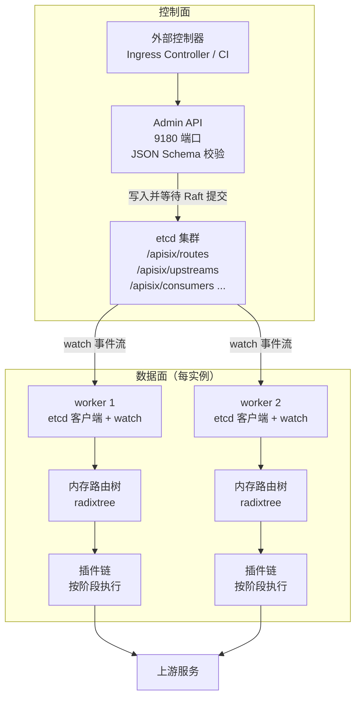
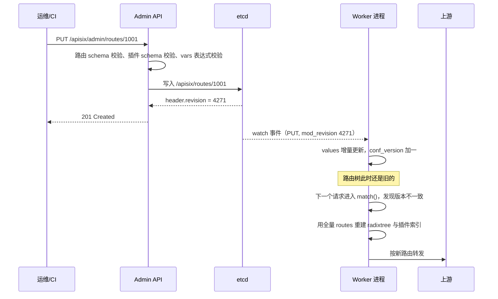
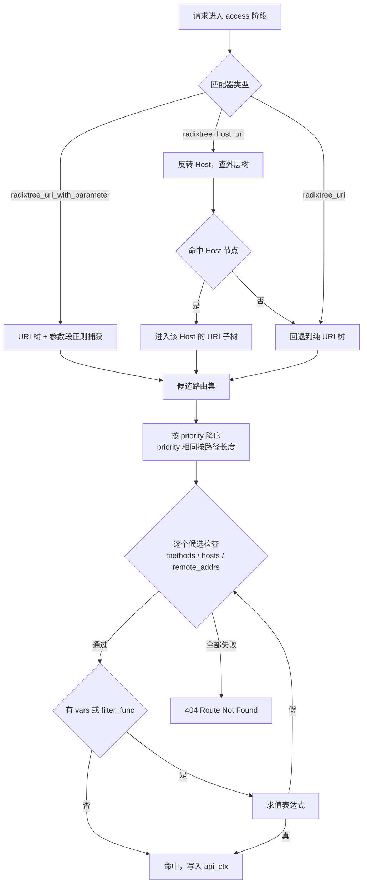
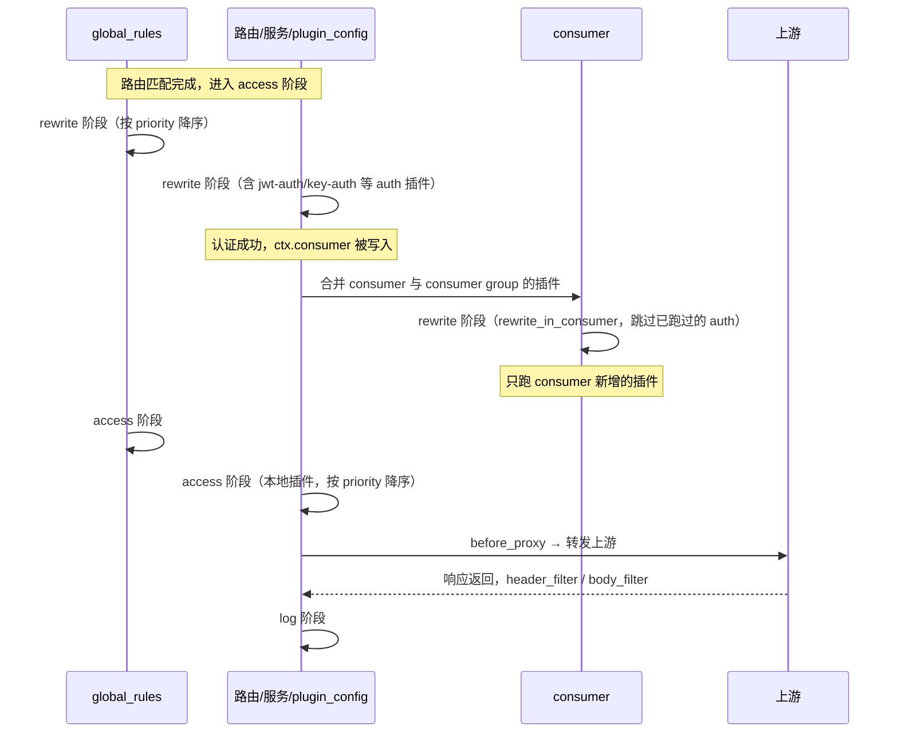

# 14 APISIX 架构：etcd 配置中心与插件体系

**摘要：**

APISIX 与 Nginx 最根本的分野不在性能，而在配置的存在形式：Nginx 的配置是文件，改一次要 reload 一次进程；APISIX 的配置是 etcd 里的键值，改动通过 watch 推进 worker 内存，全程不 reload、不断连接。这套"配置在 etcd 里、运行时在内存里"的架构换来了动态性，也把一份分布式系统的复杂性搬进了网关：etcd 成为新的单点候选，配置传播出现窗口期，路由树与插件链在每次版本变化后要重建。本文按四层结构展开——控制面、数据面、插件体系、路由匹配：先讲清一条路由从 Admin API 写入到某个请求命中的完整路径，再拆开三种 radixtree 匹配器与优先级规则，然后把插件的阶段、优先级、四层挂载点的合并顺序逐条对齐到源码行为，最后用一整章分析配置同步的代价与故障形态：etcd 挂掉时数据面靠什么活着、watch 风暴为什么会让所有实例同时重建路由树、Admin API 一旦暴露为什么等于全站失守。读完应当能回答两个问题：什么规模的系统值得为动态性引入 etcd，以及已经上了 APISIX 的团队该盯住哪几个指标。

---

## 第 1 章 一次 reload 的账单

### 1.1 reload 究竟做了什么

Nginx 的配置模型是"文件即状态"。运维改完 `nginx.conf`，执行 `nginx -s reload` 或向 master 进程发 `HUP` 信号，master 重新解析配置文件，语法通过后启动一批新的 worker 进程，再给老 worker 发退出通知；老 worker 不再接受新连接，把手上的请求处理完才真正退出。listen socket 由 master 持有、新老 worker 共享，所以 accept 队列不会断，客户端也感觉不到连接的瞬间丢失。

这一套设计让 Nginx 在 2000 年代就做到了"不重启换配置"，比同时代很多服务器软件优雅得多。但优雅不等于免费，账单分散在四个地方。

第一笔是进程冷启动。新 worker 起来时，Lua 虚拟机要初始化，`lua_package_path` 下的模块要重新 `require`，LuaJIT 的 trace 要重新预热。业务峰值期 reload，头几万个请求跑在解释执行路径上，延迟会出现一个可观测的台阶。共享内存区（`lua_shared_dict`）只要尺寸没变就在 reload 之间被继承，缓存不丢；但一旦改了 zone 大小，新建的区是空的，等于缓存整体失效。

第二笔是上游连接池。每个 worker 各自维护到 upstream 的 keepalive 连接池，worker 退出，池里的连接随之关闭。新 worker 面对突发流量要重新与后端握手，几十个 worker 乘以几十条上游，后端连接数就会在几秒内翻倍——数据库和 Java 服务对这种"连接风暴"通常很敏感。

第三笔是进程驻留时间。老 worker 不是立刻退出的，它在等长连接结束。WebSocket、SSE、gRPC streaming 这类连接的存活时间以小时计，超时设置不当的话，一次 reload 之后两批 worker 会长期同时驻留，内存近似翻倍。所谓"reload 不断连接"，代价恰恰是旧的连接不肯断。

第四笔是全量重算。reload 没有"增量"概念，改一个 upstream 的地址和重写整个文件等价，整份配置重新校验、整棵 location 树重新编译。配置越大，单次 reload 的 CPU 尖峰越高；而且配错一处就是全量失败，回滚还得再来一次 reload。至于这份配置究竟是怎样被解析成指令上下文与 location 树的，见 [[02 配置体系解析：指令、上下文与继承规则]]。

### 1.2 变更是常态，重启是例外

单机时代，路由变更是一周一次的事，reload 的账单一年也开不了几张。到了 Kubernetes 时代，upstream 的 IP 随 Pod 启停而变，灰度发布要求按权重把流量切到新版本，多租户平台每天新增几十条 API，变更频率从"周"掉到"分钟"。这时候 reload 的账单开始按月结算：一天几百次 reload，累加出来的连接风暴和 P99 抖动，比任何一次单点故障都更难排查，因为它没有报错，只有一个缓慢上抬的尾巴。

APISIX 要解决的就是这件事。它把配置从文件搬到 etcd（一个基于 Raft 的强一致键值存储），网关进程只做一件事：watch 自己关心的那几类键，键变了就更新内存里的结构。整个过程没有新 worker、没有老 worker、没有连接池重建。把这套做法比作"给营业中的店铺换菜谱"是恰当的：厨房不关、灶不熄、服务员继续上菜，只是从下一单开始按新菜谱做。限定了这个比喻——换的只是菜谱，如果换的是炉子（OpenResty 版本、Nginx 指令集），该重启还是得重启，APISIX 也躲不掉。

### 1.3 两条技术路线

于是网关演化出两条路线。一条是 Nginx 系的"文件派"：配置是文本，校验靠 `nginx -t`，生效靠 reload，回滚靠版本管理工具。另一条是云原生系的"中心派"：配置是 API 对象，校验靠 JSON Schema，生效靠 watch，回滚靠再调一次 API。

文件派的长处是确定性：任意时刻机器上的文件和运行状态一一对应，`diff` 一下就知道改了什么，出问题 `git checkout` 加 reload 就能回到上一版。它的短处是粒度粗：文件是最小变更单元，一个上游地址的变化也要推动整份配置。

中心派的长处是粒度细、生效快、天然适配多实例：一次写入，所有实例同时看到，不需要逐台分发。它的短处是把复杂度从"文件"转移到了"同步"：一旦引入配置中心，就必须回答配置中心挂了怎么办、写入成功但没传到位怎么办、所有人同时改配置会不会把路由树打崩。复杂性不会消失，只会转移，这句话在这里体现得尤其充分。

---

## 第 2 章 四层结构与配置的旅程

### 2.1 控制面、数据面、插件、路由

理解 APISIX 的架构，可以按四层来看：最上面是控制面（Control Plane），由 Admin API 和 etcd 组成；中间是数据面（Data Plane），即 OpenResty 的 worker 进程；数据面内部再分两层逻辑——插件体系按阶段挂在请求管线上，路由匹配负责把请求分派到正确的上游。四层之间只有两条路径：控制面到数据面的单向配置流，以及数据面到上游的流量流。二者不交叉，这是整套架构最要紧的约束。数据面之所以能在一个进程内同时处理上万连接又保持可编程，靠的是 LuaJIT 与 cosocket 的协程模型，那部分机制见 [[12 OpenResty 架构：LuaJIT、cosocket 与协程调度]]，建立在这一模型之上的库生态与性能陷阱见 [[13 OpenResty 实战：lua-resty 生态与性能陷阱]]。



这张图上有一根箭头常被忽略：etcd 到每个 worker 的 watch 是**每个 worker 各连一份**，不是每台机器一份。worker 数乘以资源类型数，就是单个 APISIX 实例持有的 watch 流数量，这一点在第 6 章讲配置同步的代价时会再次出现。

### 2.2 一条路由从 API 到请求

把一条路由从写入到生效的路径摊开，可以看清"热更新"三个字背后到底发生了什么。



几个细节值得停下来看。

Admin API 的校验发生在写入之前，不在请求路径上。路由的 `uri`、`methods`、`vars` 会被 JSON Schema 和表达式解析器过一遍，插件的配置按各自 schema 校验；带 `post_arg.*` 的表达式还会走一次单独检查，因为它要求数据面在匹配阶段读请求体。路由还可以写 `filter_func`——一段 Lua 函数的源码字符串，Admin API 会用 `loadstring` 试着加载它来确认语法可编译。校验不过直接 400，不会写进 etcd，这意味着脏配置进不了数据面。

写 etcd 是一次 Raft 提交，返回里带全局单调递增的修订版本（Revision）。这个版本号是全集群唯一的写入序号，也是 watch 的游标。注意它单调但不连续，因为其他 key 的写入也会消耗版本号。

worker 侧收到 watch 事件后，并不是立刻就重建路由树。它只把新值写进内存里的 `values` 表和哈希索引，把 `conf_version` 加一。真正的重建是**懒**的：在下一个请求进入路由匹配时，代码才比较当前 `cached_router_version` 与配置版本，不一致才调 `create_radixtree_router` 全量重建。这个设计把重建成本摊到了请求路径上，好处是没人访问就不浪费 CPU，坏处是变更后的第一个请求要承担整个重建的延迟——路由数量大时这个毛刺能被监控抓到。

还有一个容易忽略的细节：etcd 给出的 key 是 `/apisix/routes/1001` 这样的完整路径，worker 会把最后一段截出来当作路由 id 回填。如果直接改 etcd（绕过 Admin API）写了一个不带合法 schema 的对象，worker 在收到事件时会校验失败，此时的处理是**保留旧值继续服务**，只在 error 日志里留一行。这算是一种兜底，也意味着"我改 etcd 了为什么不生效"的第一现场往往在 error.log 而不是 Admin API 的返回。

### 2.3 与 Nginx 的根本差别

把两套配置模型并排放在一起，差别不只是"快慢"，而是变更语义完全不同。

| 维度 | Nginx（文件驱动） | APISIX（etcd 驱动） |
|---|---|---|
| 配置载体 | `nginx.conf` 及各 include 文件 | etcd 键值，前缀 `/apisix/` |
| 生效方式 | `reload`，master 重启 worker 批次 | watch 推送到内存，不发信号 |
| 生效延迟 | 数百毫秒起，随配置规模与 worker 数增长 | 毫秒到百毫秒级，受网络与重建成本影响 |
| 连接影响 | 老 worker 驻留至长连接结束，上游连接池重建 | 进程不变，连接池与 Lua 状态保留 |
| 变更粒度 | 整份配置全量重算 | 单个对象增量更新，路由树仍全量重建 |
| 校验时机 | `nginx -t` 或 reload 时解析失败即整体拒绝 | 写入前按对象 schema 校验，逐条拒绝 |
| 回滚方式 | 换回旧文件再 reload | 再调一次 API 写回旧内容 |
| 多实例一致性 | 每台各自分发，靠配置管理工具保证 | 单一数据源，各实例 watch 同一份 |
| 失败模式 | 配置解析错误导致 reload 失败，旧进程继续服务 | etcd 不可用则无法更新，内存配置继续服务 |
| 额外依赖 | 无 | etcd 集群、网络、运维心智 |

最要紧的一行是"连接影响"和"额外依赖"。前者是收益，后者是代价，而中间几行是收益与代价的具体形态。第 3 章先把代价这一侧讲清楚——etcd 在这个架构里到底承担什么。

---

## 第 3 章 etcd 的三个作用

### 3.1 配置存储

etcd 在 APISIX 里最直观的角色是配置存储。所有对象按类型分前缀存放：`/apisix/routes/`、`/apisix/services/`、`/apisix/upstreams/`、`/apisix/consumers/`、`/apisix/ssl/`、`/apisix/global_rules/`、`/apisix/plugin_configs/`、`/apisix/plugin_metadata/`、`/apisix/consumer_groups/`、`/apisix/secrets/` 等。对象内容是 JSON，写入路径由 Admin API 维护，前缀可以在 `conf/config.yaml` 的 `deployment.etcd.prefix` 里改。

选 etcd 而不是 MySQL、Redis，理由是三条能力的组合：强一致的线性读，保证任意实例读到的配置是同一份；watch 的流式推送，把轮询变成事件；以及 Raft 的多数派提交，让"写入成功"这件事在单节点故障下依然有意义。换成最终一致的存储，就会出现"A 实例看到新路由、B 实例还在用旧路由"的长期分裂，这在网关这种按请求做决策的组件上是不可接受的。

但 etcd 是键值存储，不是数据库。它没有二级索引、没有联表、没有复杂查询，单次请求大小有硬上限（`--max-request-bytes` 默认 1.5 MiB），后端存储有配额（`--quota-backend-bytes` 默认 2 GiB）。这意味着 APISIX 的单个配置对象必须小：一条路由加上内联的 upstream、插件配置，通常几百字节到几 KB；把整份 OpenAPI 文档塞进 `plugin_metadata`、或者把几千个节点的 upstream 内联写进路由，都会撞上这些上限。撞上 1.5 MiB 的请求上限时，Admin API 会直接报错；撞上 2 GiB 的配额时更麻烦，etcd 会触发 NOSPACE 告警并转入只读，所有写入操作开始失败，而数据面还在跑旧配置——这是第 6 章要展开的故障形态之一。

### 3.2 多实例同步

第二个作用是集群内多实例的配置同步。这一条比"存储"更值钱，因为它决定了 APISIX 能不能水平扩容。

设想三个 APISIX 实例、每个 8 个 worker。如果配置只存在本地文件，扩一个实例就要分发一次配置，且无法保证三份文件在某一刻完全相同；如果配置存在中心，新实例起来后自己从 etcd 拉一遍全量，立刻与服务中的实例对齐——扩容变成纯粹的加法。

同步的语义由 etcd 的 watch 保证：客户端从某个 revision 开始监听前缀，etcd 按序推送之后的所有变更事件，连接断开重连时可以从上次的 revision 续上（`start_revision`）。APISIX 的实际做法是"全量加增量"：初始化时 `readdir` 拉全量并记下 revision，之后走 `waitdir` 增量；如果 etcd 返回 `compacted`（历史版本已被压缩）或 revision 倒退（etcd 被重建），就把 `need_reload` 置真，退回全量拉取。这套兜底逻辑是配置同步能长期稳定的关键——watch 断流、etcd 重启、版本压缩三种情况都有明确出口。

这里要纠正一个流传很广的说法：APISIX 与 etcd 之间的 watch 走的是 HTTP/JSON 长连接，不是原生 gRPC。APISIX 的 Lua 实现 `lua-resty-etcd` 基于 `lua-resty-http` 和 cosocket，访问的是 etcd 的 gRPC-gateway（`/v3/watch` 之类的 HTTP 端点），响应以 chunked 方式持续下发。底层同样是流式推送，但它依赖 HTTP 而非 gRPC，这对排障有实际影响：抓包看到的是 HTTP 请求而不是 HTTP/2 帧，而 `lua-resty-etcd` 也要求 etcd 版本不低于 3.4。

### 3.3 租约与选主

第三个作用是带时限的键，也就是租约（Lease）。etcd 的键可以绑定一个租约，租约到期键自动消失，不需要任何人来删——租约本身的事件流语义与续约细节见 [[04 Watch 与 Lease——事件流与带时限的键]]。APISIX 用这个能力实现"会自己过期的配置"：通过 Admin API 创建路由时带上 `?ttl=60`，这条路由就被写在一个 60 秒的租约上，60 秒后自动从 etcd 消失，所有实例的 watch 收到删除事件，路由随之下线。临时把某个租户的调试入口放开半小时，用这个特性比手工删要可靠得多。

至于选主，需要分清"etcd 能做什么"和"APISIX 用它做了什么"。etcd 本身提供 `Campaign`、`Proclaim`、`Resign` 这套选举原语，键值存储加租约可以搭出标准的分布式选主，`/apisix/leader` 这类键常被自建方案拿来做单写者锁：抢到租约的实例才执行某些全局动作，租约到期自动让位。但 APISIX 3.x 的网关本体没有把选主做进数据面——多个实例是**对等**的，每个实例都独立 watch 全量配置，谁也不比谁特殊。真正需要选主的是外围组件：Kubernetes 上的 Ingress Controller 用 Kubernetes 的 Lease 对象做多副本选主，只有 leader 才向 Admin API 同步；数据面本身则是无状态复制。

理解这一点很重要，因为它决定了扩容与故障时的预期：APISIX 实例之间不交换心跳、不互相转发、不依赖谁是主，杀掉任意一个实例，剩下的照常服务；反过来说，也没法通过"只让主实例写 etcd"来防止误写，`deployment.role: data_plane` 的实例虽然会在代码层面拒绝写 etcd 并打一行警告，但控制面本身没有第二道闸。

### 3.4 etcd 不承担什么

把 etcd 的角色划完边界，剩下的都是它不该做的事。

| etcd 承担 | etcd 不承担 |
|---|---|
| 存路由、上游、消费者、插件配置 | 存请求日志、调用明细、审计流水 |
| 通过 watch 把变更推给所有实例 | 做服务发现（那是 `discovery` 模块与注册中心的事） |
| 用租约实现带 TTL 的临时配置 | 做限流计数（那是共享内存或 Redis 的事） |
| 用 revision 给配置排序 | 做配置的历史版本管理与回滚（那是 CI 与 Git 的事） |
| 用 Raft 保证写入在多数派落盘 | 承载高频写（每次写要多数派 fsync） |

最后一行是性能上的边界。etcd 的每次写都要经 Raft 复制到多数派并落盘，单次提交的成本以 fsync 为主。用 SSD 时单次 fsync 在亚毫秒到毫秒量级，串行化下来整个集群的写入吞吐在千级每秒，具体数字取决于磁盘、批量与网络，这里只作量级判断（示例推算，不作基准引用）。对网关配置来说这个量级远远够用——配置写入是"人"或"控制器"触发的，一天几千次已经算高频；但如果把 etcd 当业务计数器用，几秒钟就会把它压垮。

---

## 第 4 章 路由匹配：三种匹配器与优先级

### 4.1 三种匹配器

APISIX 的路由匹配不是一套写死的逻辑，而是在 `conf/config.yaml` 的 `apisix.router.http` 里选的策略。三种取值对应三种索引方式，代价和表达力各不相同。

| 匹配器 | 主索引 | 能力 | 代价 |
|---|---|---|---|
| `radixtree_uri` | 仅 URI | 绝对匹配、前缀通配、`vars` 过滤 | 最快，但不同 Host 的同一路径要靠 `vars` 或 `hosts` 二次过滤 |
| `radixtree_uri_with_parameter` | URI（支持 `:param`） | 在上一者基础上支持路径参数 | 参数段要拆段并用正则捕获，路径模式 LRU 缓存会抖动 |
| `radixtree_host_uri` | Host + URI | Host 参与主索引，隔离性好 | 多一级树、两层 dispatch，单次匹配成本更高 |

默认值有过一次变更，这一点必须按版本说话：3.2 及更早的版本默认是 `radixtree_uri`，3.3 起的默认值改为 `radixtree_host_uri`（以对应版本文档为准）。官方文档也明说 `radixtree_uri` 性能更好，如果只按 URI 匹配就够用，可以继续用它。实际选型时这条建议往往被忽略：多租户网关里同一个 `/api/users` 被十几个域名共用，如果主索引只有 URI，一条 URI 节点下会挂十几个候选路由，每次请求都要逐个比对 hosts 与 vars；换成 host_uri 之后，Host 直接参与第一级索引，候选集在根上就分开了。

顺带说明底层实现：APISIX 的路由树库是 `libradixtree`，用 Lua 写的自适应压缩前缀树（Radix Tree，又称基数树），底层通过 FFI 调用 antirez 的 rax 实现。压缩前缀树的要点是把只有一个子节点的链合并成一个节点，节点数由"所有路径的总字符数"降到"分支点的数量"，查找复杂度是 O(m)（m 为 URI 长度），与路由条数无关——这正是它能撑住上万条路由的原因。

### 4.2 host_uri 的两级树

`radixtree_host_uri` 的实现里有个巧妙的工程手法，值得单独看：它构造的是两级树，外层按 Host 建树，内层按 URI 建树。

第一级树的键是**反转后的 Host 字符串**。比如 `api.example.com` 反转成 `moc.elpmaxe.ipa`，`*.example.com` 反转成 `moc.elpmaxe.*`。反转的目的是把后缀匹配变成前缀匹配：通配域名 `*.example.com` 在正序下是"以什么结尾"，反转之后就成了"以什么开头"，可以直接丢进前缀树，不必为通配另写一套匹配逻辑。这是把"另一种匹配语义"翻译成"已有数据结构能处理的形态"的典型做法。

每个 Host 节点挂一个子路由树，节点上的 `filter_fun` 是一个闭包，负责把请求的 URI 丢进该 Host 专属的子路由器做 dispatch。不带 Host 的路由（通配所有域名）被收进另一个独立的 `only_uri_router`，在主树匹配失败后再试一次。

于是单次匹配的实际路径是：反转 Host 查外层树，命中则进内层树查 URI；未命中再查一次纯 URI 树。这意味着 host_uri 模式下一次请求在最坏情况下要做两次树查找，比纯 URI 模式多一层。这也是官方建议"能只用 URI 就用 URI"的实际原因，而不只是文档上的一句性能提示。

### 4.3 优先级的三重规则

"多条路由都能匹配时选哪条"是路由引擎最容易出错的地方，APISIX 的规则可以拆成三层，理解顺序不能颠倒。

第一层是**路径精确度**：全匹配优先于前缀匹配，深前缀优先于浅前缀。`/blog/foo/bar` 与 `/blog/foo/*` 同时存在时，请求 `/blog/foo/bar` 命中前者；这样的规则与 Nginx location 的直觉一致，但不必像 Nginx 那样记一长串 `=`、`^~`、`~` 的优先级表。

第二层是**路由的 `priority` 字段**：只在 URI 相同时才起作用。两条路由 `uri` 都是 `/hello`，一条 `priority: 3`、一条 `priority: 2`，请求全部落到前者。官方文档的说法是"`priority` 优先于除 `uri` 之外的其他规则"，也就意味着不要指望用 `priority` 去压过更长的路径。

第三层是**路径长度**：`priority` 相同时，URI 更长（更具体）的那条排在前面。这一条藏在 `lua-resty-radixtree` 的排序函数里，先比 `priority`，相等再比路径长度。它不是文档重点，但恰好解释了为什么"我加了一条更细的路由却没生效"这类问题极少出现在 APISIX 上。

还有一条容易被忽略：同一 URI 的多条路由靠 `hosts`、`methods`、`vars` 区分时，候选集中的每一条都要过条件检查，检查顺序按上面的排序进行。候选越多，条件求值次数越多——这是第 4.5 节要算的账。

### 4.4 vars 与它的求值成本

`vars` 是 APISIX 路由表达力的主要来源，也是它比 Nginx 慢的主要原因之一。写法是三元组的数组：`[变量名, 运算符, 值]`，外层数组之间默认为逻辑与。变量直接取 Nginx 内置变量，比如 `http_host`、`cookie_device_id`、`arg_name`、`remote_addr`、`http_x_user_type`；运算符覆盖相等与不等、数值比较、正则匹配（`~~`）、集合成员（`in`）、数组包含（`has`）以及 IP 网段匹配。

```json
{
  "uri": "/index.html",
  "vars": [
    ["http_host", "==", "example.com"],
    ["arg_age", ">", "18"],
    ["arg_address", "~~", "China.*"]
  ],
  "upstream": {
    "type": "roundrobin",
    "nodes": {"10.0.0.11:8080": 1}
  }
}
```

除了普通变量，`vars` 还能读请求体：`post_arg.name` 匹配表单字段，`post_arg.messages[*].content[*].type` 能穿透 JSON 数组，`graphql_operation`、`graphql_name`、`graphql_root_fields` 能按 GraphQL 语义匹配。这些能力很实用，代价却不像看起来那么轻：要匹配 `post_arg.*`，APISIX 必须在路由匹配阶段读取并解析请求体，这是数据面上最贵的一类操作。为此 APISIX 设了两道闸：GraphQL 只读前 1 MiB（`graphql.max_size`），JSON 与 multipart 的读取受 `apisix.max_post_args_readable_size` 限制（默认 64 MB，超过上限则不参与匹配，设为 0 关闭限制）。

把"按请求体路由"放进网关，表达力上确实赢过 Nginx location，但它在延迟上的位置很尴尬：请求体越大、解析越深，首字节延迟越高，而这个成本发生在任何插件之前——限流插件还没机会拦住异常流量。笔者见过的合理用法是把它限制在小体积的 JSON API（几百字节）上，用于按业务字段分流；一旦请求体到 MB 级，更好的做法是让上游自己判断。

### 4.5 比 location 灵活，也更慢

把 APISIX 的匹配过程与 Nginx 的 location 匹配放在一起看，能更清楚地知道"灵活"买的是什么。



Nginx 的 location 匹配发生在配置解析期：配置文件读进内存时，location 树、正则表达式、前缀表都已经编译好，请求到来时只做字符串比较与正则执行，且匹配结果与配置文件书写顺序强相关——这套优先级规则的完整推导见 [[07 Location 匹配：优先级规则与正则引擎]]。APISIX 的匹配发生在运行期，而且多出两件事：一是候选集的**排序与逐条过滤**，二是 `vars` 表达式的**逐候选求值**。

量化一下这两件事的量级（示例推算，非基准数据）。假设 1 万条路由，平均 URI 长度 20 字节，前缀树查找大致对应 20 次节点跳转，每次是一次哈希或指针比较，合计在微秒以内；如果请求恰好命中某条 URI 下有 5 条候选路由，每条要过 methods、hosts、remote_addrs 三项比较和一次 `vars` 求值，`vars` 求值按 LuaJIT 下的几十纳秒到几百纳秒计，5 条候选就是几百纳秒到两微秒。放在 1 万 QPS 的实例上，两微秒乘以一万等于每秒 20 毫秒的 CPU 时间，占单核约 2%；放到 10 万 QPS 就是 20% 单核。也就是说，"每请求都要过 radixtree 加 vars 求值"在中小流量下几乎测不出来，在极高 QPS 的单实例上会变成实打实的成本。

这个成本能不能避免？部分可以：把能用 `hosts`、`methods` 表达的过滤交给树本身（它们参与索引与比较，比 `vars` 便宜），把 `vars` 留给真正需要表达式的少数路由；不要在热门路径上写多个正则；同一 URI 的路由数量要控制。至于和 Nginx 的 `location` 相比谁更快，答案是 Nginx 更快，因为它把能预编译的都预编译了，而 APISIX 用运行期重建换来了配置可变——这是第 8 章取舍表的起点。

---

## 第 5 章 插件：阶段、优先级与合并顺序

### 5.1 生命周期与请求阶段

APISIX 的插件不是"一堆钩子函数的集合"，而是按 OpenResty 的请求阶段精确挂载的组件。这里要区分两组概念，混淆是很多误配的源头。

第一组是进程级生命周期：`init` 在 master 读取配置后执行一次，`init_worker` 在每个 worker 启动时执行，`exit` 在 worker 退出时执行。这三个用于准备进程级资源——建立连接池、初始化共享内存、注册定时器。它们与单个请求无关，写错位置的典型症状是"每个请求都重新建连"。

第二组是请求级阶段，一共六个：`rewrite`、`access`、`before_proxy`、`header_filter`、`body_filter`、`log`。它们与 Nginx 的处理阶段大致对应，但语义上有 APISIX 自己的约定：`rewrite` 用于改请求（改 URI、加请求头）与完成身份识别；`access` 用于访问控制（鉴权、限流、黑白名单）；`before_proxy` 是 APISIX 特有的，在请求即将转发到上游前的最后一刻执行，适合做那些必须等上游信息确定后才能做的修改；`header_filter` 与 `body_filter` 处理响应；`log` 在响应结束后执行，用于上报指标与写访问日志，不影响延迟。这些阶段在 Nginx 侧的完整拓扑——包含 `post_read`、`server_rewrite`、`content` 等——见 [[03 HTTP 请求处理管道：11 个阶段全解]]，APISIX 只用了其中的一段。

WebSocket 路由是个例外：`upstream.scheme` 为 `ws` 或 `wss` 时，`rewrite`、`access`、`before_proxy`、`log` 照常执行，但 `header_filter`、`body_filter` 会被替换为 `ws_handshake`、`ws_client_frame`、`ws_upstream_frame`、`ws_close` 四个 WebSocket 专用阶段。给 WebSocket 路由挂 `body_filter` 插件，代码不会报错，只是永远不会被调用。

### 5.2 priority 的真实数值

插件执行顺序由优先级决定，而优先级是插件代码里的常量，不是配置里的书写顺序。这一点与 Nginx 的 `nginx.conf` 顺序语义完全相反：在 APISIX 里，你在 JSON 里先写 `limit-req` 还是先写 `cors`，对执行顺序没有任何影响。

下表是 3.x 官方默认配置里的一部分优先级（以对应版本文档与 `conf/config.yaml` 注释为准，不同小版本可能有微调）：

| 插件 | 优先级 | 主要阶段 | 定位 |
|---|---|---|---|
| `real-ip` | 23000 | rewrite | 还原真实客户端 IP，几乎所有依赖 IP 的插件都要它先跑 |
| `client-control` / `proxy-control` | 22000 / 21990 | rewrite | 调整客户端与代理行为，属于"管线参数" |
| `request-id` | 12015 | rewrite / header_filter | 生成并回写请求 ID |
| `zipkin` / `skywalking` / `opentelemetry` | 12011 / 12010 / 12009 | rewrite | 链路追踪，必须尽早开始计时 |
| `fault-injection` | 11000 | rewrite | 故障注入，要先于业务插件 |
| `serverless-pre-function` | 10000 | rewrite | 任意 Lua 前置函数 |
| `cors` | 4000 | header_filter | 跨域响应头 |
| `ip-restriction` | 3000 | access | IP 黑白名单，先于昂贵的鉴权 |
| `uri-blocker` | 2900 | rewrite | URI 黑名单，要在改写之前拦 |
| `multi-auth` / `openid-connect` | 2600 / 2599 | rewrite | 多认证编排与 OIDC |
| `authz-casbin` | 2560 | access | 基于策略的鉴权 |
| `hmac-auth` / `basic-auth` / `jwt-auth` / `key-auth` | 2530 / 2520 / 2510 / 2500 | rewrite | 认证类，auth 类型插件 |
| `consumer-restriction` | 2400 | access | 消费者维度限制 |
| `forward-auth` / `opa` / `authz-keycloak` | 2002 / 2001 / 2000 | access | 外部鉴权服务 |
| `proxy-cache` | 1085 | rewrite/header_filter | 响应缓存 |
| `proxy-rewrite` | 1008 | rewrite | 改写上游 URI 与请求头 |
| `api-breaker` | 1005 | access | 熔断 |
| `limit-conn` / `limit-count` / `limit-req` | 1003 / 1002 / 1001 | access | 限流三件套 |
| `gzip` | 995 | header_filter | 压缩 |
| `traffic-split` | 966 | access | 按权重或规则分流 |
| `response-rewrite` | 899 | header_filter | 改写响应 |
| `prometheus` | 500 | log | 指标上报 |
| `serverless-post-function` | -2000 | rewrite | 任意 Lua 后置函数 |
| `ext-plugin-post-resp` | -4000 | body_filter | 外部插件链的响应阶段 |

这张表里藏着两条设计原则。

第一条是"依赖倒置"：`real-ip` 的优先级高到 23000，因为它决定 `remote_addr` 的值，而 `ip-restriction`、`limit-*`、`prometheus` 全都要读这个值。如果 `real-ip` 排在它们后面，限流就会按代理 IP 计数，所有客户端被拧成一股。同理，链路追踪插件拿到 12xxx 的高位，是因为它要从请求最开始计时。

第二条是"认证先于一切需要身份的事"。`jwt-auth`、`key-auth` 这一类 auth 类型插件的优先级集中在 2500 附近，高于限流（1001 至 1003）、高于熔断（1005）、高于响应改写。原因在限流的账上：限流通常按消费者或按 IP 计数，如果先限流再认证，攻击者可以用无效 Token 消耗合法用户的配额，用一个漏洞换另一个漏洞。先认证的好处是无效请求在 401 处终止，不消耗任何计数。

优先级冲突是一类真实存在的事故，而且症状隐蔽。两个插件优先级相同时，`table.sort` 并不保证稳定，执行顺序取决于插件在 `local_plugins` 列表里的位置，而那个位置由 `config.yaml` 里的插件加载顺序决定——也就是说，两个实例如果插件列表写法不同，理论上可能出现执行顺序不同。要消掉这种不确定性，用 `_meta.priority` 显式指定：

```json
{
  "limit-count": {
    "count": 100,
    "time_window": 60,
    "rejected_code": 429,
    "_meta": {
      "priority": 3010
    }
  }
}
```

这里有一个限制必须记住：`_meta.priority` 只在**同一阶段、同一分组**内改变顺序，不能让 `access` 阶段的插件跑到 `rewrite` 阶段前面。想把 `limit-count` 提到同一个 access 阶段的 `ip-restriction`（3000）之前，把它的值改成 3010 就够了；但想让一个 access 阶段的插件早于 `real-ip` 这种 rewrite 阶段的插件，改多大都没用——优先级不能跨阶段，跨阶段只能靠换插件位置，而插件位置由它自己实现的函数决定，配置改不了。

### 5.3 真实执行顺序

文档给的四条顺序是"全局 rewrite、本地 rewrite、全局 access、本地 access"，这个描述正确但不完整。源码里的编排更细，尤其是 consumer 插件插入的位置。



几个关键点。

全局规则先于本地插件，但只按阶段交织：全局 rewrite 一定在本地 rewrite 之前，全局 access 一定在本地 access 之前，而本地的 rewrite 又一定在全局的 access 之前。这条"本地的早阶段先于全局的晚阶段"的规则，决定了插件的可见范围——本地 rewrite 里能影响全局 access 看到的东西，反之不行。

consumer 插件的插入点在本地 rewrite 之后、全局 access 之前。原因是鉴权类插件在 rewrite 阶段完成身份识别并写入 `ctx.consumer`，只有拿到消费者之后，才能知道该合并哪些 consumer 插件。合并之后，APISIX 会对新增的 consumer 插件再跑一遍 rewrite（内部阶段名 `rewrite_in_consumer`），并跳过已经在路由侧跑过的 auth 插件，避免重复认证。

如果路由配了 `script`，执行路径会整体切换到脚本模式：不再走"插件链"的常规编排，而是先跑全局 rewrite，再载入脚本、跑全局 access，然后执行脚本的 `access` 函数。脚本模式里插件仍然生效，但顺序与常规路径不同，这一点在混用脚本与插件时容易踩坑。

### 5.4 三层挂载与覆盖规则

插件可以挂在五个位置：Route、Service、Consumer、Consumer Group、Plugin Config，再加一个全局的 Global Rule。它们的合并规则分成两类，混起来理解必然出错。

第一类是**覆盖型**：同一个插件挂在多个本地对象上时，只有一份配置生效，优先级顺序是 `Consumer > Consumer Group > Route > Plugin Config > Service`。注意 `Plugin Config` 排在 `Route` 之后、`Service` 之前，也就是说 `plugin_config` 只是 Route 的补充——Route 自己写了同名插件，`plugin_config` 里那份就被忽略。实现上，合并时先把 Route 的插件表克隆一份，然后只在"Route 没有的键"上填 `plugin_config` 的值，代码逻辑是"缺则补，有则让"。

第二类是**叠加型**：同一个插件同时挂在 Global Rule 和某个本地对象上时，两份配置都会执行，先后按阶段交织。全局规则不是"默认值"，而是"额外的一次执行"。这解释了为什么把 `limit-count` 同时挂全局和路由上会出现"请求数被算两遍"的现象——不是配置写错了，是语义如此。

| 挂载点 | 作用范围 | 与同名插件的合并规则 | 典型用途 |
|---|---|---|---|
| Global Rule | 所有请求（含未匹配路由的 404） | 与本地插件叠加执行，不覆盖 | 全站日志、全站追踪、全站限流兜底 |
| Route | 单条路由 | 覆盖 Plugin Config 与 Service | 业务级鉴权、改写、限流 |
| Service | 一组路由共享的模板 | 最低优先级，被 Route 覆盖 | 同一后端服务的公共配置 |
| Plugin Config | 可复用的插件集合 | 补 Route 的缺，不覆盖 Route | 多个路由共享同一套插件参数 |
| Consumer | 单个调用方 | 最高优先级，覆盖以上所有 | 按调用方的鉴权凭据、配额 |
| Consumer Group | 一组调用方 | 仅次于 Consumer | 租户级公共策略 |

还有一个细节与性能有关：这些合并结果带缓存。`plugin_config` 的合并用 `prev_plugin_config_ver` 记住上次合并的版本，版本未变直接返回；consumer 的合并 flags 里带上路由与消费者的 `modifiedIndex`，配置没变就不重新深拷贝。这也是为什么"改了一条 consumer 的凭据，所有路由的插件链都要重建一次"——缓存的键变了。在 consumer 数量大的网关里，这个重建成本值得留意。

### 5.5 consumer：鉴权类插件的落点

鉴权插件与别的插件有个本质区别：它们的配置主体不是路由，而是调用方。`key-auth` 的 key、`jwt-auth` 的密钥、`basic-auth` 的口令，都挂在 Consumer 对象上；路由上挂的是"启用哪种认证方式"，不带凭据。

```json
{
  "username": "svc-order",
  "plugins": {
    "key-auth": {
      "key": "b4f1c9a7e2d84603"
    },
    "limit-count": {
      "count": 5000,
      "time_window": 60,
      "key_type": "var",
      "key": "consumer_name",
      "rejected_code": 429
    }
  }
}
```

这条 consumer 上同时挂了认证与限流，路由只需写 `"plugins": {"key-auth": {}}`。请求进来后，`key-auth` 在 rewrite 阶段从 Header、Query 或 Cookie 里取出 key，查 `consumers` 表找到对应消费者，把身份写进 `ctx.consumer`；随后 consumer 的插件被合并进来，`limit-count` 用 `consumer_name` 作为计数键，于是每个调用方各有各的配额。

把限流挂在 consumer 上而不是路由上，是多租户网关的常规做法：配额是"谁调用"的属性，不是"调用哪个接口"的属性。至于限流的具体算法（漏桶、令牌桶、`burst` 与 `nodelay` 的数学关系），以及共享内存与 Redis 两种计数载体的取舍，属于限流机制本身的话题，可参看 [[08 限流与熔断：leaky bucket 与 burst 参数的数学本质]]。

这里有一个容易忽略的配置陷阱：consumer 的 `rewrite` 阶段有个例外——路由侧插件的 rewrite 先执行，然后才执行 consumer 侧（auth 类除外）的 rewrite。也就是说，如果你在 consumer 上挂了一个"改写请求头"的插件，它看到的请求头已经是路由侧插件改过的版本；反过来，路由侧的插件看不到 consumer 插件加的请求头。这类顺序依赖在排障时很难从配置里看出来，抓包或开 debug 日志是最可靠的手段。

---

## 第 6 章 配置同步的代价与故障形态

### 6.1 etcd 不可用时的三种处境

"etcd 挂了 APISIX 还能服务"这句话是对的，但它只描述了一种处境。按故障发生的时点，至少要分三种情况看。

**运行期失联**。etcd 集群整体不可用或网络不通，worker 的 watch 断流。此时内存里的 `values` 和已经建好的路由树都在，请求照常匹配、照常转发、照常跑插件——这是 APISIX 相比 Nginx reload 模型更稳的地方：Nginx 的配置在文件里，文件系统不出问题就能 reload；APISIX 的配置在内存里，配置中心出问题也不影响已经加载的配置。受影响的是"变更"：Admin API 写 etcd 失败，新配置进不来。watch 侧的重连由 `resync_delay`（默认 5 秒，实际等待为 5 秒加 50% 随机抖动）控制，etcd 健康检查超时由 `health_check_timeout`（默认 10 秒）控制，两者共同决定恢复后的追赶速度。

**启动期失联**。新实例启动时 `core.config.new` 初始化拉不到配置，按 `startup_retry`（默认 2）重试，仍失败则该实例无法进入可服务状态。这一点常被误解成"APISIX 无 etcd 也能启动"——不能。无配置的网关等于所有请求 404，让这种实例进入负载均衡才是真正的事故。这也是为什么滚动发布时 etcd 的可用性优先级高于网关本身。

**恢复期追赶**。etcd 恢复后，worker 从旧 revision 起重连 watch；如果期间 etcd 做过压缩（compaction），历史版本已不可读，worker 会收到 `compacted` 并退回全量拉取。恢复瞬间所有实例同时做全量拉取加路由树重建，这是配置面最重的一次负载，容易在这个窗口里看到 CPU 尖峰与延迟毛刺。

```mermaid
%%{init: {'theme': 'dracula'}}%%
graph TD
    A["故障发生的时点"] --> B{"etcd 是否可达"}
    B -->|"启动期不可达"| C["startup_retry 重试<br/>失败则不对外服务"]
    B -->|"运行期不可达"| D["watch 断流"]
    D --> E["内存 values 与路由树继续服务<br/>仅新配置无法写入"]
    D --> F["按 resync_delay 加抖动重试<br/>health_check_timeout 判定健康"]
    F -->|"etcd 恢复"| G{"revision 是否连续"}
    G -->|"连续"| H["从断点续 watch<br/>增量补齐"]
    G -->|"已被压缩或 etcd 重建"| I["need_reload 置真<br/>全量 readdir 重拉"]
    H --> J["conf_version 递增<br/>请求时重建路由树"]
    I --> J
    J --> K["恢复正常"]
```



| 故障形态 | 症状 | 判据 | 处置 |
|---|---|---|---|
| etcd 全部失联 | 流量正常，配置改不动 | Admin API 返回 5xx；error.log 出现 `no healthy etcd endpoint available` | 修 etcd；期间不要重启网关实例 |
| 单实例 watch 断流 | 该实例配置落后，其他实例正常 | 对比各实例 Control API 的 `/v1/routes`；日志出现 `watchdir err` 或 `wait watch event` 后重连 | 网络与 etcd 连接数排查；`resync_delay` 后可自愈 |
| 启动时 etcd 不可达 | 新实例起不来或全 404 | 启动日志有 `failed to fetch data from etcd` | 回滚发布，先恢复 etcd |
| etcd 被压缩或重建 | 配置全量重拉，短时 CPU 尖峰 | 日志 `etcd compacted` 或 `received smaller revision` | 全量同步完成后自愈；压缩避开变更高峰 |
| etcd 存储超配额 | 所有写入失败，数据面正常 | etcd 日志 NOSPACE；`etcd_server_quota_backend_bytes` 指标触顶 | 压缩加碎片整理，或扩容配额 |
| 单个对象超限 | 该对象写入被拒 | Admin API 返回请求过大错误 | 拆分对象：大 upstream 用独立对象引用 |

### 6.2 watch 风暴与全量重建

配置同步最容易被低估的代价，是"一次变更"和"一次重建"并不等价。

路由树的更新是全量的。前面看过那段代码：`match()` 里比较版本，不一致就调 `create_radixtree_router(user_routes.values)` 从头建一棵树，遍历所有路由、重新解析路径模式、重新编译过滤器。一条路由变化，代价是重建整棵树。10 条路由时这无关紧要，1 万条路由时一次重建的耗时可能到毫秒级甚至更高，而重建发生在请求路径上。

把这两个事实叠起来，就能推出 watch 风暴的形态：假设某个控制器在 5 秒内批量创建了 200 条路由，每条都是一次独立的 etcd 写入、一次独立的 watch 事件，worker 侧就是 200 次 `conf_version` 递增。如果这 5 秒里持续有流量，那么"版本一直在变"意味着每个请求进来都可能看到新版本、都要重建一次树——200 次全量重建乘以 1 万条路由，CPU 会被这段代码吃掉一大块，表现为网关自身的延迟抖动，而上游一切正常。更糟的是三个实例、每个 8 个 worker，全部同时经历同样的重建，抖动在集群尺度上同步发生。

这类问题在压测里几乎测不出来（压测不改配置），只有真实的高频变更场景才会暴露。缓解手段有四条：批量写入而不是循环单条写（一次 watch 事件携带多个 kv，`conf_version` 只推进一轮）；变更窗口避开峰值；控制单个 etcd 事务的对象数量，别用一次 `PUT` 塞几百条路由；在超大路由规模下重新评估匹配器选择与 worker 数——worker 越多，每个 worker 各建一棵树，总计算量是乘出来的。

### 6.3 配置版本不一致

第二种代价是"写入成功"与"全部生效"之间的窗口。Admin API 返回 201，只代表 etcd 的多数派已经提交，不代表每个 worker 都已经把新配置装进内存。这个窗口通常只有几十毫秒，但它是真实存在的，而且会在两种场景下放大。

第一种是滚动发布。新实例起来的瞬间，它要拉全量配置；如果此时 etcd 正在被大量写入，新实例可能拉到"半新半旧"的一份快照——注意这不是错误，etcd 的读是线性一致的，只是快照对应某个 revision，之后的事件还得靠 watch 补齐。真正的问题是：负载均衡器不该在实例还没拿到配置时就把流量切过去。APISIX 为此提供了两样东西：一是 `apisix.status` 开启后的 `/status/ready` 端点，只要有任一 worker 没收到配置就返回 503；二是 `worker_startup_time_threshold`（默认 60 秒）与 master 预加载配置的配合——master 在 init 阶段预载一次配置传给 worker，避免每个 worker 各自全量拉一遍，但如果 master 已运行很久、worker 才新起，会重新全量拉取。

第二种是绕过 Admin API 直改 etcd。这时候没有 schema 校验，写入的坏数据会被 worker 拒收并保留旧值，于是"etcd 里有新值、内存里是旧值"，两边不一致。判据是 error.log 里的校验失败日志，处置是修数据或删掉那个 key。

还有一个概念要分清：`conf_version` 在 APISIX 里有两层含义。作为配置对象的版本（每个资源类型各自一个），它在每次有效事件后被加一，用来判断路由树要不要重建；作为请求上下文的字段，它由路由与服务的 `modifiedIndex` 拼接而成，用于插件侧的缓存键——例如 `proxy-cache` 用它判断"配置变了，缓存实例要不要重建"。排障时如果怀疑"某个 worker 用了旧配置"，最直接的办法不是看 `conf_version`，而是比对各实例 Control API 返回的 `/v1/routes` 内容，那个是内存视图的直接投影；同一个接口族里的 `/v1/schema` 则能取回该实例当前生效的 schema，插件升级后核对字段要求是否与预期一致时很有用。

### 6.4 容量、压缩与写入上限

第三种代价最容易被拖到出事才发现：etcd 是会满的。

etcd 的默认后端配额是 `--quota-backend-bytes` 2 GiB（以对应版本文档为准），达到上限后 etcd 触发 NOSPACE 告警并进入只读模式。此时所有写入失败，Admin API 全面 5xx，数据面继续用内存里的旧配置服务。这个状态很危险，因为它看起来"网关还活着"，没有触发任何流量告警，只有配置变更静默失败——如果此时正好在做故障切换，想改路由改不动，就会误判成网关本身出了问题。

etcd 的空间被三样东西吃掉：键值本身、历史版本、碎片。历史版本的增长速度取决于写入频率，而 etcd 3.5 默认不做自动压缩（`--auto-compaction-mode` 为空，不同版本行为以对应文档为准），需要运维显式配置按 revision 或按时间压缩；磁盘与成员维度的边界见 [[06 etcd 运维——磁盘、成员与灾备的边界]]。APISIX 侧对压缩的处理是"退回全量拉取"，所以压缩本身不会造成配置丢失，但会带来一次全量同步的负载，压缩的时间点应避开变更高峰。

单个对象的上限是另一个约束：`--max-request-bytes` 默认 1.5 MiB，超过的请求 etcd 直接拒绝。APISIX 的配置对象通常远小于这个值，但有两种情况会撞线：把大量节点的 upstream 内联进路由（几千个 Pod 的场景完全可能），以及把整份 OpenAPI 文档或大段 Lua 脚本写进 `plugin_metadata`。规避方式是把大的东西外置——upstream 独立成对象、脚本放对象存储或代码仓库。

写入吞吐的边界前面算过：etcd 的每次写要多数派 fsync，集群级写入吞吐在千级每秒的量级（示例推算）。APISIX 的配置写入是低频事件，这个上限在正常情况下不会成为瓶颈；真正需要注意的是"变更的放大效应"——一个控制器用循环单条写的方式同步 1000 条路由，就是 1000 次 Raft 提交加 1000 次 watch 事件加可能的 1000 次树重建。同样的 1000 条路由，如果用一个批量接口写入，代价差一个数量级。这也是为什么 APISIX 与 Kubernetes 生态的集成最终都走向了"声明式全量同步加差异计算"，而不是逐条调 Admin API。

---

## 第 7 章 Admin API 的安全边界

### 7.1 默认配置的三个错觉

Admin API 是 APISIX 最危险的面。它没有任何业务鉴权，一把 admin key 就是全部权限，而默认配置容易给人三个错觉。

第一个错觉是"默认只监听本机"。3.x 的 `config.yaml.example` 里 `admin_listen` 的默认值是 `0.0.0.0:9180`，靠 `allow_admin` 的 IP 白名单（默认 `127.0.0.0/24`）把外部访问挡回去。也就是说，默认安全来自白名单而不是监听地址——只要有人为了"方便调试"把 `allow_admin` 改成 `0.0.0.0/0`，Admin API 就整体暴露在公网上。另外这个形态本身也是版本相关的：3.0 之前 Admin API 与数据面共用 9080 端口，路径是 `/apisix/admin`；3.0 起才拆到独立的 9180 端口。"Admin API 只监听 127.0.0.1"这句话在不同版本上并不成立，必须按自己部署的版本核对。

第二个错觉是"有 admin_key 就安全"。`admin_key_required` 在 3.x 默认为真，这是好事；但默认配置里 `key` 是空字符串，需要部署者自己填。空 key 加白名单的部署能跑，一旦白名单被放宽，等于没有认证。更强的做法是给 Admin API 加 TLS 与 mTLS（`https_admin` 与 `admin_api_mtls`），并把 key 的轮换纳入常规运维。

第三个错觉是"Admin API 只读的可能性"。可以用 `role: viewer` 再配一把只读 key，给监控与审计用；写入 key 只在 CI 与控制器上使用。很多团队把同一把 admin key 发给所有人，等于把写权限平摊给了整个研发团队——而网关的写权限等价于流量控制权。

### 7.2 暴露之后能做什么

把 Admin API 暴露出去有多严重，取决于攻击者能用它做什么。逐条列出来，结论很直接：等于全站失守。

它可以新建一条路由，`upstream` 指向任意地址。攻击者不需要碰内网一台机器，只要在网关上开一条 `/internal/*` 指向内网某服务，就完成了一次以网关为跳板的访问——如果该服务信任来自网关网段的流量，效果等同于拿到了内网入口。

它可以读到所有消费者的配置。`key-auth` 的 key、`basic-auth` 的口令、consumer 上的自定义元数据，都通过 `/apisix/admin/consumers` 可取。3.x 的 `data_encryption.enable_encrypt_fields` 默认开启，会对插件 schema 里声明的敏感字段做加密存储，密钥在 `keyring` 里——但这是"静态加密"，通过 Admin API 读回时仍然是可用的值，它防的是"偷 etcd 备份"，防不了"拿到 Admin API"。

它可以替换 SSL 证书。把某个域名的证书换成自己的，配合 DNS 或中间人，就能解密整条链路的流量。

它可以注入任意 Lua。这一条最致命：`serverless-pre-function` 与 `serverless-post-function` 允许在配置里直接写 Lua 代码，`global_rules` 让这段代码对所有请求生效。攻击者写一段读文件、发外连、改响应的代码，就在网关进程里拿到了任意代码执行——而且这段代码是以 APISIX 自身的权限运行的，通常能看到挂载的证书与配置文件。

它还可以关掉防护。把 `ip-restriction`、`limit-count` 从路由上删掉，或者把 `plugin_config` 换成放行的版本，都是合法的 API 调用。

### 7.3 加固清单

| 加固项 | 具体做法 | 为什么 |
|---|---|---|
| 网络隔离 | Admin API 只在内网或管理网可达；`allow_admin` 收紧到具体网段 | 暴露面是第一道闸，其余都是第二道 |
| 强制认证 | 设置非空的 `admin_key`，`admin_key_required` 保持为真 | 空 key 等于无认证 |
| 双层密钥 | 写 key 只给 CI 与控制器；另配 viewer key 给监控与只读排障 | 避免写权限在研发侧扩散 |
| TLS 与 mTLS | 开启 `https_admin`，需要时配 `admin_api_mtls` | 防内网嗅探与中间人 |
| 关闭不用的 Admin UI | `enable_admin_ui` 按需关闭 | 内嵌控制台扩大攻击面 |
| 变更留痕 | 所有变更走 CI 或控制器，禁止人手 curl；Git 保留期望状态 | 事后追溯与快速回滚 |
| 审计 | 网关侧记录 Admin API 的访问来源；etcd 侧监控写入 QPS 异常 | 及时发现有人在批量改配置 |
| 禁写数据面 | 数据面实例用 `deployment.role: data_plane` | 减少一个可写 etcd 的入口 |

把这份清单与第 3 章的 etcd 边界合起来看，会发现一个结构性的结论：APISIX 把"配置即权限"这件事暴露得很彻底。Nginx 时代，改配置需要登录机器、有文件写权限，天然有主机边界；APISIX 时代，改配置只需要一把 HTTP 的 key，边界从"主机"变成了"网络加令牌"。安全模型变了，运维习惯不跟着变，就是事故的起点。

---

## 第 8 章 取舍判据与反例

### 8.1 判据表

回到最初的设问：什么情况下该从 Nginx 走向 APISIX。笔者倾向于按下面这张表逐行比，而不是用"要不要动态"一句模糊的话带过。

| 判据 | 倾向 Nginx | 倾向 APISIX |
|---|---|---|
| 变更频率 | 天级、周级，变更需要审批与窗口 | 分钟级、由控制器自动同步 |
| 路由规模与租户数 | 单租户或少量站点，几十条 location 量级 | 多租户，成百上千条路由，按 Host 与消费者隔离 |
| 功能诉求 | TLS 终止、静态文件、简单反代、缓存 | 需要认证、限流、灰度、灰度按标签、可观测的插件生态 |
| 团队能力 | 只有一两个人维护入口层 | 有平台团队，愿意运维 etcd 与控制器 |
| 故障容忍 | 不接受"配置中心挂了改不了配置" | 接受，并用双活 etcd 与变更预案兜住 |
| 性能位置 | 极限 QPS 场景，每微秒都重要 | 网关不是瓶颈，业务逻辑与 IO 才是 |

前两行是决定性的。如果变更真的是天级、路由真的只有几十条，APISIX 带来的动态性用不上，而 etcd 的运维成本是实打实的：一个三节点集群要占三台机器或三个 Pod，要监控磁盘与配额，要做备份，要有 etcd 不可用时的预案，还要处理"配置写入成功但实例没生效"这类跨组件问题。为了一个用不上的能力引入一个分布式依赖，是典型的过度设计。

反过来，如果一天改几百次路由、有几十个租户共享同一个入口，文件加 reload 的模型会持续制造麻烦：配置文件成了并发编辑的热点，reload 的抖动成了常态噪音，每次变更都要走一遍"改文件、分发、reload、验证"的流程。这时候 etcd 的那份复杂性是值得的，因为它把"分发"这件事消灭了。

性能上的取舍要单独说一句。第 4 章算过，路由匹配与插件链让 APISIX 的单请求成本高于裸 Nginx，具体差距取决于路由数、插件数与匹配器选择。如果网关的位置是"每台机器几十万 QPS 的静态内容入口"，这份成本是纯负担，Nginx 加 OpenResty 手写逻辑更合适；如果网关的位置是"业务 API 的统一入口"，那里的每请求延迟预算是毫秒级，几十微秒的匹配成本无关紧要。判断标准是"网关在延迟预算里占多少"，而不是"谁更快"。

### 8.2 四个反例

第一个反例是 Admin API 暴露公网。它的成因往往很朴素：测试环境为了方便，把 `allow_admin` 放开到全网，配置文件后来被复制到生产。药方是把 Admin API 的监听与白名单写成不可覆盖的基线，并在 CI 里做配置漂移检查。

第二个反例是把 etcd 与应用部署在同一台机器。etcd 对磁盘延迟敏感，每次写要 fsync，业务进程的 IO 抖动会直接拖慢配置写入；更糟的是两者争抢内存与 CPU，etcd 一旦被 OOM 杀掉，网关进入"改不了配置"的状态。etcd 应该独立部署，用本地 SSD，并且不要与高 IO 的业务混部。

第三个反例是在 `vars` 里写复杂表达式。见过把十几个条件串成一条 `vars`、其中还带正则与 `post_arg` 的配置，其后果是每个候选路由都要解析请求体、跑一串正则。表达式能表达的逻辑，未必是路由层该承担的逻辑——把"哪个客户走哪个后端"的复杂判断放进网关，等于把业务规则埋在基础设施里，后续既不好测试也不好演进。

第四个反例是不知道优先级冲突。两个插件优先级相近，靠"配置里先写谁"来决定顺序，在单实例上测试通过，上线后发现某个实例行为不同——因为 `table.sort` 不稳定，而插件加载顺序在不同部署里可能不同。药方是显式写 `_meta.priority`，并在代码评审里把"插件顺序是否被依赖"当作必查项。

---

## 结语 配置的位置决定了运维的形状

APISIX 与 Nginx 的差别，表面是"动态与静态"，实质是配置这一份状态被放在了哪里：Nginx 把它放在文件系统里，于是运维的形状是"分发文件、reload、验证"，确定性高但粒度粗；APISIX 把它放在 etcd 里、把运行副本放在每个 worker 的内存里，于是运维的形状是"调用 API、等 watch、观察重建"，粒度细但引入了同步问题。

收益与代价是同一枚硬币。不 reload 换来了连接不断、JIT 不冷、状态不丢，代价是每次变更都要重建路由树、每次重建都发生在请求路径上、每个 worker 各持一份 watch。配置中心换来了多实例天然一致，代价是 etcd 成为新的可用性依赖，并且会满、会只读、会在压缩后被全量重拉。插件体系换来了功能复用，代价是执行顺序由优先级常量而非配置顺序决定，且四层挂载点的合并规则需要记清。

所以选型不该问"哪个更先进"，而该问"我的变更频率、租户规模、团队能力，配得上这份复杂性吗"。一个只有几十条路由、一周改一次的入口，用 Nginx 加一份版本管理的配置是最省心的；一个每天几百次变更、几十个租户共享入口的平台，用 etcd 加控制器的组合是唯一能规模化的做法。架构即权衡，这句话在网关这一层尤其不需要修饰。

---

## 参考资料

- [APISIX Router 术语文档（三种匹配器与默认值）](https://apisix.apache.org/docs/apisix/terminology/router/)
- [APISIX router-radixtree（匹配规则、优先级与 vars）](https://apisix.apache.org/docs/apisix/router-radixtree/)
- [APISIX Plugin 术语文档（阶段、执行顺序、合并优先级）](https://apisix.apache.org/docs/apisix/terminology/plugin/)
- [APISIX Admin API 文档](https://apisix.apache.org/docs/apisix/admin-api/)
- [APISIX 部署模式（traditional / control_plane / data_plane / standalone）](https://apisix.apache.org/docs/apisix/deployment-modes/)
- [APISIX Dashboard 与 Admin key 配置说明](https://apisix.apache.org/docs/apisix/dashboard/)
- [lua-resty-etcd（基于 HTTP/JSON gateway 的 etcd v3 客户端）](https://github.com/api7/lua-resty-etcd)
- [lua-resty-radixtree（基于 rax 的自适应压缩前缀树）](https://github.com/api7/lua-resty-radixtree)
- [etcd API 文档：Watch 与 Lease](https://etcd.io/docs/v3.5/learning/api/)
- [etcd 运维：空间配额与压缩](https://etcd.io/docs/v3.5/op-guide/maintenance/)

---

> [!note] 思考题
> 1. 如果 etcd 集群整体失联 30 分钟，你们的网关会出问题吗？请按"运行期失联、启动期失联、恢复期追赶"三种处境分别写出你会看到的症状与处置顺序。
> 2. 一个控制器要在 10 秒内同步 500 条路由变更。用循环单条调 Admin API，和用一次全量声明式同步，在 worker 侧的重建次数上是怎样一个量级差？你会怎么在上线前验证这个差异？
> 3. 为什么 APISIX 把路由树的重建做成"请求到达时懒重建"，而不是"收到 watch 事件立即重建"？这个选择在哪种流量形态下会变成问题？
> 4. 假设你要在一个已经有 Nginx 入口的团队里引入 APISIX，只允许它承接一部分流量。你会选哪一类流量先切，用什么判据判断可以继续扩大范围？
> 5. `plugin_config` 与 Route 上写同名插件时，哪一份生效？如果你的预期相反，会导致什么线上现象？请构造一个能暴露该差异的最小配置。
> 6. Admin API 的 admin_key 泄露之后，攻击者最短的拿站路径是哪几步？针对这条路径，哪一层防护能真正阻断，哪一层只是延缓？