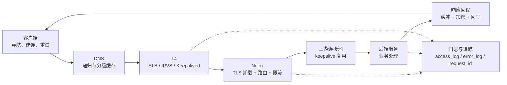
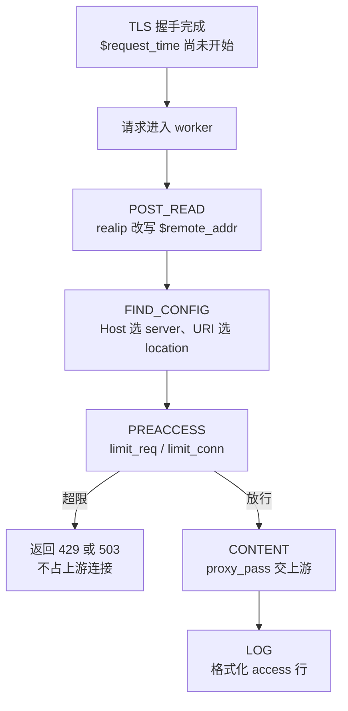
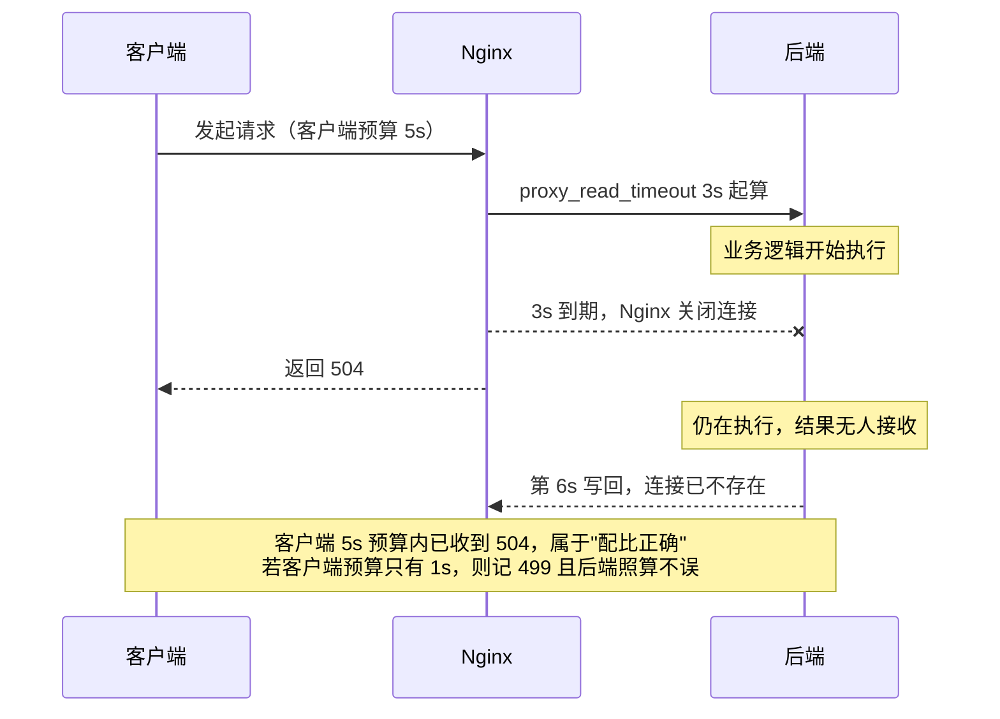
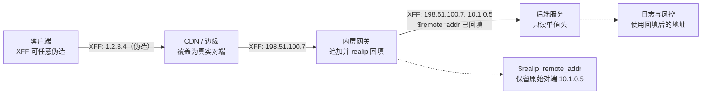
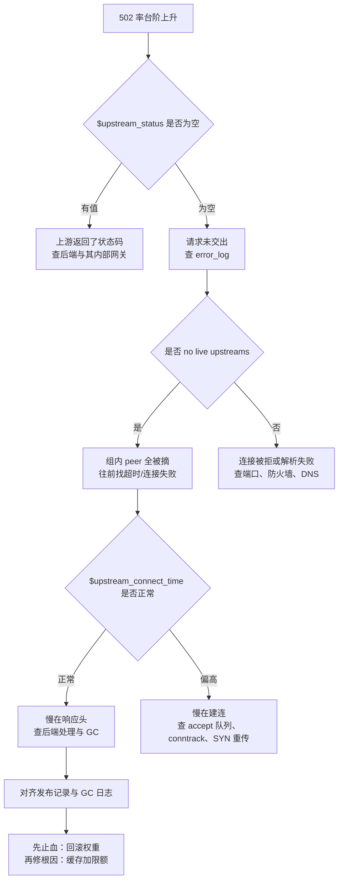

# 15 生产实战：完整流量链路与专栏知识体系总结

**摘要：**

把一次线上故障的复盘记录摊开看，最耗时间的通常不是找出异常，而是确认异常落在哪一段：监控说 5xx 抬升，Nginx 说上游超时，后端同学说接口本身只花了八十毫秒，三个说法都对，因为各自只看得见自己那一跳。本篇以一条真实请求穿过生产链路的过程为骨架，把它切成八跳——客户端、DNS、L4、Nginx、上游连接池、后端服务、响应回程、日志与追踪——每一跳只回答三个问题：负责什么、坏掉长什么样、用什么证据钉死。在此之上处理三类跨越链路的问题：超时链的配比为什么必须由外向内逐层放大、`X-Forwarded-For` 与 `realip` 的信任边界划在哪里、以及"慢"到底该记在谁账上。后半部分给出一份 502 率上升的完整回溯，展示判定顺序为什么一步都不能颠倒；再用六层归位把前面各篇放回它们各自回答的问题上，最后落成一份每条都带判据的上线检查清单。全篇的判据指向同一个结论：链路上的错误几乎都能被某一跳的证据单独确认或排除，难的是决定按什么顺序去取。

---

## 第 1 章 一条请求的八跳

要终结"各说各话"式的排查，需要一个共同的坐标系。笔者选的办法是把一次请求从用户按下按钮到响应落回屏幕，切成八个职责清晰、可独立观测的段落，每段都追问同一组问题：这一跳替谁承担了什么，它失效时外部看到的是什么形状，以及在不重启、不改配置的前提下，哪一份证据能把它钉死。

### 1.1 按跳切，而不是按知识点排

按知识点组织的排查手册有个共同毛病：每条知识都对，但用的时候不知道该先看哪一条。看到 502，手册里有十个可能原因，于是人开始在十个方向之间来回跳，每一个都试一下，试到第七个时事故已经扩大了。按跳组织的顺序天然带有优先级：流量有方向，证据有先后，某一跳的证据会直接排除掉它前面所有跳的嫌疑。

这条顺序不能颠倒，原因在于证据的可获得性不同。客户端和 DNS 的证据在别人的机器上，拿一次要几分钟；L4 与 Nginx 的证据在本机日志里，拿一次几秒；后端的证据要开发同学配合，拿一次十几分钟。先取便宜且区分度高的证据，把范围压到一个跳以内，再去取昂贵的证据，这是排查的基本经济学。

### 1.2 八跳的职责与代价

下表是全篇地图，后面每章展开其中一到两跳。"耗时量级"一栏是笔者在数个同城机房部署里见过的区间，标注为示例推算，跨地域、带 TLS 的链路要按 RTT 叠加。

| 跳 | 谁负责 | 耗时量级（示例推算） | 典型失败形态 | 第一判据 |
|---|---|---|---|---|
| 客户端 | 解析、建连、发请求、重试 | 与用户网络同量级 | 超时短于链路预算、重试放大流量 | access_log 的 499 占比 |
| DNS | 名字到地址，按 TTL 分级缓存 | 命中 0-2ms，递归 20-120ms | TTL 过长拖慢切换、多 A 记录含坏地址 | `dig` 结果与 TTL 剩余 |
| L4 | VIP、四层转发、健康检查 | 0.05-0.5ms | 只探端口导致"全绿但全挂"、连接表满 | SLB 健康检查日志、后端 SYN 到达 |
| Nginx | TLS 卸载、路由、限流 | 0.1-3ms | 默认 server 接业务、键退化、状态码错位 | `$status` 分桶、error_log |
| 上游连接池 | 复用连接、限并发、摘节点 | 复用时约 0，新建 0.1-3ms | 僵尸连接、池容量不足、排队 | `$upstream_connect_time` 分布 |
| 后端服务 | 业务处理 | 5-200ms | 排队、GC、锁、下游串行 | `$upstream_header_time` 曲线 |
| 响应回程 | 缓冲、压缩、加密、回写 | 与响应体大小同量级 | 慢客户端占住上游连接 | 差值、`$body_bytes_sent` |
| 日志与追踪 | 留下可对账的证据 | 微秒到毫秒 | 缓冲丢窗口、时钟不同步 | 同一 `$request_id` 能否拼齐 |

这张表值得注意的不是数字，而是结构上的不对称：前三跳的证据不在自己机器上，后三跳的证据不在自己权限里；能由值班同学完全掌控的只有中间三跳，所以排查落点几乎总是先用它们把范围切掉一半，再向两侧要证据。



虚线是要强调的一层：日志不是第九跳，它横跨所有跳，记录点却分散在各跳自己的进程里；一条请求走过八跳，可能只有三跳留下同一个 ID 的痕迹，剩下五跳只能靠别的信号推断，这就是证据链会断的根源。

### 1.3 同一个请求，四本时间账

排查中最容易出错的地方，是把不同来源的时长当成同一个东西比较。同一次请求至少在四个地方被计过时，起点与终点都不一样。

L4 记的是连接级时长：从三次握手完成到连接关闭，一条 keepalive 连接上可能跑过几十个请求，所以它的时长天然大于其中任何一个请求。Nginx 记的是 `$request_time`，起点是读到请求行第一个字节，终点是写日志那一瞬，TLS 握手、accept 排队都在它之前。后端记的是 span 时长，起点通常是框架收到完整请求，终点是响应写完，它前面的 accept 队列、线程池调度、框架中间件都不在内。客户端记的是墙钟，从用户点击到页面可用，包含前面全部，还要加上浏览器渲染。

把**四本账直接相减**，得到的往往是一个没有意义的数。正确的用法是逐段对账：用 `$request_time` 减去 `$upstream_response_time` 得到"不归上游的那段"，再用后端 span 减去 Nginx 的 `$upstream_response_time` 得到"上游内部但不在业务代码里的那段"。这两段差值各自有明确的归属，第 9 章会把它们逐一拆开。

### 1.4 复盘需要的最小证据链

不必全量日志也能复盘，前提是四份记录能被同一个键串起来。判据很朴素：随机挑一条五分钟前的 5xx，要求一分钟内拼出四份记录——SLB 连接日志、Nginx 的 access 行与 error 行、后端应用日志或 trace；拼不齐的那一环，就是下次事故会卡住你的一环。

拼接的键必须是服务端生成并在入口处覆盖的。客户端传上来的 `X-Request-Id` 一律不可信，它可能重复、可能为空、可能是恶意的，一旦被写进日志，你面对的就是两条毫不相干的请求共用同一个 ID。`$request_id` 由 Nginx 在请求期生成，是 32 位十六进制串，长度足够防碰撞，代价只有一个变量和几字节日志，这是整条链上性价比最高的一处改造。

---

## 第 2 章 前三跳：客户端、DNS、L4

这三跳有个共同点：它们发生的时间都不在 `$request_time` 里。慢在 DNS、慢在 SYN 重传、慢在 L4 的连接表，Nginx 的日志都会显示一个漂亮的小数字，然后把人引向错误的方向。理解这一点，比记住任何一条配置都重要。

### 2.1 客户端：超时上限的制定者

客户端这一跳的职责朴素到容易被忽略：解析域名、建立连接、发出请求、等待响应、必要时重试。但它是整条链路超时预算的实际制定者——服务端所有超时都得小于客户端愿意等待的时间，否则用户先走了，服务端的错误码再准也没人看见。

失效形态有四种，各自留下的痕迹不同。第一种是客户端超时短于链路总预算，服务端最终记一条 499，表示"响应还没写完，对端已经关了"。第二种是客户端无退避地重试，故障时流量被放大成两到三倍（示例推算：两次重试即三次请求），本该被限流挡住的压力直接压到后端。第三种是客户端自己的连接池或并发上限，排队发生在用户设备内部，服务端完全无感，只看到 QPS 掉了。第四种是移动网络切换导致的半开连接，服务端这边的 socket 会一直挂到 `client_body_timeout` 或 `send_timeout` 到期，看起来像"请求很慢"，其实对端早已消失。

判据是 499 的占比与它的时间分布。499 不是错误率，它是一份"用户比你先放弃"的证据。把 499 计入 5xx 一起告警，会让故障归因系统性地跑偏：真正的问题可能是后端 P99 已经涨到 6 秒，而 5xx 曲线因为后端最终都返回了 200 而毫无波动。反过来，499 占比在 0.5% 以上且集中在特定地域，先查的是该地域到边缘的 RTT 与客户端版本，而不是后端。

### 2.2 DNS：故障切换的延迟器

DNS 的职责被简化成"把名字变成地址"，实际它是"把名字变成一组地址、并按策略给出顺序"，而这组地址会按 TTL 在四层缓存里各留一段时间：浏览器与操作系统、运营商的 LocalDNS、权威服务器、以及做智能调度的 GSLB。任何一层不遵守 TTL，切换的实际延迟就会超过设计值。

失效形态按后果排序，第一种最隐蔽：TTL 设得太长，机器已经下线、DNS 记录已经改掉，仍然有相当比例的客户端在解析旧地址，表现为"部分用户连不上"，而且服务端日志里看不到任何异常，因为那些请求根本没到。第二种是负缓存，新域名上线初期如果权威返回过 NXDOMAIN，递归服务器会按 SOA 里的 MINIMUM 缓存这个"不存在"的结论，时长可能远大于你以为的 TTL。第三种是多条 A 记录里混进一台坏机器，客户端按顺序尝试，每台都要等一个连接超时，用户侧体感是"有时快有时慢"，服务端只看到流量少了一截。第四种是 CNAME 链过长被运营商改写，这类问题在跨网访问时尤其常见。

判据是三次解析结果的对比：`dig +short` 看本机递归给出的答案，`dig @<权威服务器>` 看权威给出的答案，`dig +trace` 看中间经过谁。三个结果不一致，问题就在缓存层而不是权威层；一致但服务端 QPS 少了一个机房的量，问题在 GSLB 的地域判定——它依据的是 LocalDNS 的出口 IP，而运营商的出口与用户真实位置可能隔着几个省，EDNS Client Subnet 缺失时这种错判几乎是必然的。

### 2.3 L4：理解不了 HTTP 的那一层

L4 这一跳做四件事：持有 VIP、按四层规则转发、对后端做健康检查、必要时做会话保持。它不理解 HTTP，所以它对"应用是否健康"的判断永远是近似的，而这个近似正是很多"后端全挂、L4 全绿"事故的起点。

最典型的失效形态是**探端口不等于探能力**。配置成 TCP 端口探测时，只要进程还在、端口还在 listen，检查就通过；但此时 Nginx 的 worker 可能已经卡在某个同步调用上，或者连接数耗尽、accept 队列堆满，实际一个请求也处理不了。这种情况下 L4 会把流量继续均匀地送给一台不工作的机器，监控大盘上 L4 的健康状态是满绿，用户的错误率却在爬升。判据有两个：SLB 侧的健康检查日志（看它探的是哪个端口、什么协议、返回什么），以及后端 `ss -lnt` 里 listen socket 的 `Recv-Q` 是否持续堆积——后者是 accept 队列被填满的直接证据。

第二种失效形态是摘除窗口。健康检查间隔乘以失败阈值就是摘除延迟，间隔 2 秒、连续 3 次失败意味着 6 秒内 100% 的流量仍然打向坏节点；如果后端 Nginx 自己也配了 `max_fails` 与 `fail_timeout`，两个窗口会叠加，最坏情况下坏节点在二十几秒里持续接流量（示例推算：6 秒 + 10 秒 + 若干探测周期）。这个数字决定了故障的初始影响面，也解释了为什么"后端只挂了一台，错误率却是 33% 而不是 0"。

第三种是表容量。四层转发如果是 NAT 模式，回程也要经过 L4 的连接表，表满之后新连接直接被丢弃，用户看到的是"连接超时"，而 Nginx 一条日志都没有，因为请求从未到达。判据在系统层：`conntrack -C` 与 `/proc/sys/net/netfilter/nf_conntrack_max` 的比值，`dmesg` 里是否有 `nf_conntrack: table full, dropping packet`，IPVS 侧看 `ipvsadm -Ln --stats` 的连接数是否贴近上限。

第四种是 Keepalived 的脑裂。VRRP 心跳走单条链路，链路一断，两台机器都认为自己是 master，同一个 VIP 同时出现在两台机器上，ARP 冲突导致请求随机丢失，表现为"间歇性连接失败、重试就好"。判据是 `arping -I <网卡> -c 3 <VIP>`，从两台机器分别执行，看谁在回应；再对一遍两台机器 `ip addr` 的 VIP 状态。

还有一个会改变排查方法的细节：DR 模式的后端直接把响应回给客户端，回程不经过 L4，在 L4 抓包只能看到请求方向；要抓完整会话，抓包点得放在后端或客户端侧。

### 2.4 前三跳的共同结论

这三跳的证据特征一致：能证明"请求到过这里"，不能证明"这里处理得怎么样"。SYN 到了、健康检查过了、DNS 解析对了，都只推出链路通，推不出应用可用；要把两者分开，得进第四跳。

---

## 第 3 章 第四跳：Nginx 的三件事

Nginx 在链路里承担三件事，它们分别发生在请求生命周期的不同阶段，失效时的外部表现也完全不同。把这三件事的时序搞清楚，可以省掉大量"改了配置不生效"的困惑。

### 3.1 TLS 卸载：发生在计时开始之前

TLS 握手发生在请求行到达之前，所以它不在 `$request_time` 里。这条边界有两个实际后果：一是握手的性能问题无法从 access_log 看出来，只能靠 `$ssl_session_reused`、抓包或 OpenResty 的 SSL 阶段打点来观测（开源版没有内置的握手耗时变量，以对应版本文档为准）；二是握手失败与请求失败在日志里是两类东西，前者往往连 access_log 都没有，只在 error_log 留一行 `SSL_do_handshake() failed`。

失效形态里最常见、也最容易误判的是**证书链缺中间证书**。配置只装了站点证书、漏了中间证书，桌面浏览器因为能靠 AIA 扩展补齐而表现正常，旧版 Android、部分 Java 客户端、某些命令行工具则会直接握手失败——`curl` 是否通过不能作为判据，它的 CA 路径构建比很多客户端宽容。判据是 `openssl s_client -connect <host>:443 -servername <host> -showcerts`，看输出里有几张证书，以及 `-verify_return_error` 是否报错。

另一个不报错但拖慢首字节的细节是 `ssl_buffer_size`，默认 16KB 意味着即使响应只有 200 字节，也要等缓冲填满或 flush 才会发出第一个 TLS record。API 场景下把它调小能让 TTFB 提前一个 RTT 的量级，代价是 record 数量增加、单 record 开销占比上升，这是拿带宽换延迟的典型取舍。OCSP Stapling 配置错误则是另一种"静默失效"：`ssl_stapling on` 配了但 `resolver` 没配或不可达，stapling 不会生效也不会报错，客户端照样握手，只是每次都可能自己去查 OCSP，把延迟转移到用户侧。

### 3.2 路由：两次选择，两种错法

Nginx 的路由是两次选择：先按 `Host` 选 `server` 块，再按 URI 选 `location`。第一次选择决定"这是谁的流量"，第二次决定"交给谁来处理"，两次都可能错，且错法完全不同。

第一次选择的典型错误是默认 server 接了业务流量。没有显式 `default_server` 时，第一个监听该端口的 server 块会接管所有未匹配的 Host；如果那个块恰好是主站，那么用任意 Host 打过来的扫描流量都会被当成正常请求处理，返回业务页面。判据是 `curl -s -o /dev/null -w '%{http_code}' -H 'Host: random.invalid' http://<ip>/`，期望是空响应（`curl` 报 Empty reply，退出码 52）或 421，如果返回 200 就说明默认 server 是业务 server。

第二次选择的错误更隐蔽，因为它依赖 URI 的形状。`location` 的匹配优先级、正则的配置顺序、`^~` 的真实语义，这些在 [[07 Location 匹配：优先级规则与正则引擎]] 里已经推到源码级；在链路视角下，只需要记住一条判据：拿一条线上真实的 URI 放进 `nginx -T` 的输出里手工走一遍匹配，看命中的 `location` 与 `$upstream_addr` 是否一致。不一致的地方，通常就是某条正则写在了更靠前的位置。

### 3.3 限流：在最便宜的位置拒绝

限流的位置是 PREACCESS 阶段，早于内容生成、早于代理转发，这意味着被拒绝的请求不消耗上游连接、不占用后端线程，是整条链上成本最低的一种拒绝。这个位置选择本身就是权衡的结果：放得更早（比如接入层）能把压力挡在 TLS 之外，但拿不到足够的上文；放得更晚（比如后端）保护更精确，但代价已经付出去了。

失效形态有三种。第一种是键退化：`limit_req_zone` 的键如果用了 `$binary_remote_addr`，而 `realip` 没有正确生效，那么所有请求的键都是代理地址，"每 IP 限流"退化成"整个机房共用一个桶"，桶被瞬间打满，正常用户跟着被拒。判据是看 error_log 里 `limiting requests, excess: ... by zone` 的密度是否与真实客户端数量成正比，而不是与实际入口数量成正比。第二种是 `burst` 把拒绝变成排队，P99 被自己推高，很多"限流之后更慢了"的案例都是这个原因，[[08 限流与熔断：leaky bucket 与 burst 参数的数学本质]] 里给出的延迟表达式可以直接用来算这笔账。第三种是状态码混入错误率：`limit_req_status` 默认 503，被拒的请求与后端真实故障在监控上合并成一条 5xx 曲线，于是限流触发的告警被当成后端故障去排查。

### 3.4 状态码是最短的判定路径

到这一跳，请求已经在 Nginx 自己的账本上留下了状态码。多数时候，状态码加一行 error_log 就足以把嫌疑压到一跳以内。

| 状态码 | 通常由谁产生 | 第一份证据 | 常见误判 |
|---|---|---|---|
| 499 | Nginx 记录客户端提前断开 | access 行里 status=499 的时间分布 | 当成后端错误去查 |
| 502 | 连不上、被 RST、无可用节点 | error_log 的连接失败行 | 以为后端返回了 502 |
| 504 | 读上游超时 | `$upstream_status` 是否为空 | 分不清是 Nginx 判的超时还是后端自己返回的 |
| 503 | 限流拒绝，或后端透传 | `limit_req_status` 与 zone 日志 | 一律当成服务不可用 |
| 413 / 414 | 请求体或头部超过缓冲 | `client_max_body_size` 与 header buffer | 当成客户端 bug |

这张表里最值钱的一行是 504，**它的来源有两种**。Nginx 自己判定的 504，`$upstream_status` 为空、`$upstream_addr` 有值（它连上了，只是没等到响应头）；后端自己返回的 504，`$upstream_status` 是 504。两者都叫"网关超时"，但一个要查 Nginx 的超时配置与后端耗时，另一个要查后端内部的网关调用，方向完全相反。



从图中能看出两件事：限流站在 `proxy_pass` 之前，被拒的请求连上游连接池都没碰过；`realip` 必须抢在最前面，它改写的 `$remote_addr` 是限流键、访问控制与日志第一列的共同来源。

---

## 第 4 章 第五跳：上游连接池

从 Nginx 到后端的这段，是整条链上唯一由"池"管理的地方。这个池**只管 TCP 建连成本**，不管后端处理能力，两者混在一起谈，就会得出"加大 keepalive 就能扛住流量"的错误结论。

### 4.1 池管的是什么

`upstream` 块里的 `keepalive` 指令激活的是空闲连接缓存，后面的数字是"每个 worker 最多缓存多少条空闲连接"，不是并发上限。连接被复用要同时满足三个条件：`proxy_http_version 1.1`、请求头里不出现 `Connection: close`（通常写成 `proxy_set_header Connection ""`）、上游返回的响应允许复用。缺任何一个，池就是空的，每个请求都新建连接，`$upstream_connect_time` 从接近零变成毫秒级，后端侧则堆积大量 TIME_WAIT。

[[04 反向代理与负载均衡：upstream 模块深度解析]] 已经把这几个条件与 `max_fails`、`fail_timeout` 的记账语义拆得很细，这里只补链路视角的两点。第一，池的大小影响的是"建连次数"而不是"并发数"：并发由 `QPS × 平均响应时间` 决定（利特尔法则，示例推算：2000 QPS 乘 20 毫秒等于 40 条并发连接），并发超过池容量时并不会排队，只是连接用完就被关掉，下次再建。第二，池里的空闲连接会被后端单方面关闭，这是后端重启、后端 keep-alive 超时短于池内空闲时间时的必然结果，下一次复用拿到的是一条已经死掉的 socket。

### 4.2 三种失败形态

僵尸连接是最典型的一种。表现是低频、随机、无法复现的 502，集中在后端发布后的几分钟里，error_log 里是 `recv() failed (104: Connection reset by peer)` 或 `upstream prematurely closed connection`。这类失败的特点是不成规模——同一时间只有少数请求踩中，因为只有那些恰好复用到"刚被关掉"的连接才会失败。判据是 `$upstream_connect_time` 为 `-`（表示复用了已有连接）而 `$upstream_status` 为空，同时 `$request_time` 极短。处置不是调大重试次数，而是让上游的空闲超时严格小于后端 keep-alive 超时，把"谁先关"这件事定下来。

池容量不足是第二种。它不表现为排队，而表现为建连次数暴涨、后端 TIME_WAIT 堆积、`$upstream_connect_time` 的 P99 上升。判据是把 QPS 与 `keepalive` 的乘积和实际建立的连接数对比：如果稳态 QPS 是 3000、响应时间 5 毫秒、并发只有 15 条，而 `ss` 显示每秒新建几百条连接，那说明池几乎没起作用，回去查那三个条件。

第三种是 `max_conns` 与 `zone` 共同造成的排队。给节点设了并发上限之后，超出的请求会在 Nginx 内部等待可用的 peer 位，这段等待发生在"选中 peer 之前"，此时 `$upstream_*` 系列变量还没开始计时，所以它的代价全部落在 `$request_time` 与 `$upstream_response_time` 的差值里。第 9 章会回到这一点：差值为大而 `$upstream_response_time` 正常，未必是回写慢，也可能是在等 peer 位。

### 4.3 容量算术与常见误读

把连接数算清楚，比背参数有用。假设后端平均响应 8 毫秒、入口 QPS 4000，则并发连接约 32 条；`keepalive 64` 足够把这些连接全部缓存下来。若后端因为一次 GC 停顿把平均响应拉到 800 毫秒，并发瞬间变成 3200 条，此时 `keepalive 64` 只能缓住其中 64 条，其余全部走新建——但真正的瓶颈已经不是连接数，而是后端只有这么点处理能力，加大池只会让更多连接同时压在里面，让 GC 更频繁。

连接池看起来像容量开关，实际只是握手成本的摊销器：真正的上限在 `worker_connections`、后端线程数与后端连接池三处，任何一处满了，症状都是排队而不是报错，而排队在任何 `proxy_*_timeout` 里都没有专门字段，只能靠差值和时间分布推断。

---

## 第 5 章 第六跳与第七跳：后端与回程

请求离开 Nginx 之后，责任交到了后端；响应开始返回之后，责任又回到 Nginx 与客户端之间的这段网络上。两跳挨着，失败形态却几乎相反：后端的问题是"算得慢"，回程的问题是"传得慢"，而两者在 access_log 里都可能只表现为一个偏大的 `$request_time`。

### 5.1 后端：慢的四种来源

后端的慢可以粗分成四类，它们对上游的表现各不相同。第一类是 CPU 排队，请求已经进入业务代码但抢不到核，表现为 span 时长稳定偏大、CPU 使用率贴顶、可运行队列长度上升。第二类是垃圾回收或内存分配停顿，表现为周期性尖刺：多数请求 10 毫秒，每隔十几秒有一批请求突然变成 1 到 3 秒（示例推算），曲线呈锯齿状而不是整体平移。第三类是锁竞争与连接池耗尽，表现为 P50 正常、P99 极高，且尖端集中在少数接口上。第四类是下游依赖串行，表现为自身 CPU 空闲、span 内部有明显的等待子 span。

这四类对 Nginx 可见的信号是同一个：`$upstream_header_time` 上升而 `$upstream_connect_time` 正常。建连很快说明网络与后端 accept 没问题，响应头来得慢说明后端在处理路径上卡住了。要把四类分开必须进后端看 span 与运行时指标：用 Nginx 的曲线定位"慢在后端"，用后端的曲线定位"慢在 GC"。

### 5.2 回程：缓冲区的两难

响应回程的风险几乎全部来自速度不匹配。Nginx 从上游读响应通常比向客户端写响应快得多，中间必须有缓冲，而 `proxy_buffering` 的开关决定了这个缓冲放在哪里。

开启时（默认），Nginx 尽快把上游响应读进内存缓冲，读满之后再写到客户端，上游连接可以从容释放回池里。代价是内存：每个请求占用 `proxy_buffers` 与 `proxy_buffer_size` 声明的空间，响应大到超出内存缓冲时会落临时文件，磁盘 I/O 与 `proxy_max_temp_file_size` 随之进入视野。关闭时，响应边收边转，上游连接必须一直活到客户端收完为止，一个用 2G 网络下载大文件的用户，会把一条上游连接占住几十秒；并发一多，池被慢客户端占满，正常请求反而拿不到连接。

这个取舍在链路视角下有明确的判据：`$request_time` 大、`$upstream_response_time` 大、`$body_bytes_sent` 也大，说明上游连接被客户端速度拖住了，方向是开压缩、上 CDN、或者对这类接口单独关掉缓冲并使用流式下发（上游返回 `X-Accel-Buffering: no` 也能达到同样效果）。反过来，`$request_time` 大、`$upstream_response_time` 小、`$body_bytes_sent` 小、状态码 499，方向是客户端提前断开，问题在客户端超时或首字节延迟，与回程带宽无关。

### 5.3 两跳之间的错误归因

后端与回程最容易被混为一谈的地方，是"上游时间包含传输时间"。`$upstream_response_time` 的终点是收到响应体最后一字节，中间包含上游把响应体发过来的时间；因此一个响应体 5MB 的接口，即使后端只花 20 毫秒生成，`$upstream_response_time` 也可能显示 800 毫秒（示例推算：5MB 走千兆内网约 40 毫秒，若上游出口拥塞或跨机房则显著放大）。要把生成时间与传输时间分开，得看 `$upstream_header_time` 与 `$upstream_response_time` 的差，这个差近似等于响应体的传输耗时。

这个区分直接决定优化方向：差大而 header 时间正常，优化回程（压缩、减少字段、分页）；header 时间本身就大，优化后端。

---

## 第 6 章 第八跳：日志与追踪

这一跳不产生业务结果，只产生证据。它的价值在事故当天看不出，在事故之后决定你能不能复盘；它的失效也同样安静——日志少了几秒，谁也不会立刻发现，直到需要在时间轴上对齐某一次发布。

### 6.1 四份记录拼一条链

一条完整的链路证据由四份记录组成：L4 的连接日志（连接建立与关闭时间、后端地址、健康状态）、Nginx 的 access 行（状态码、上游地址、三个时间变量）、Nginx 的 error 行（失败原因）、后端的应用日志或 trace（span 时长、内部调用）。四份记录能拼起来的前提是同一个键在四份里都出现，且这个键由服务端生成。

单独一份只能证明局部：L4 证明请求到过机房，access 行证明到过这一层，error 行给出失败原因，后端 span 证明处理推进到哪一步；缺一份，结论就退化成推测。

### 6.2 缓冲带来的丢失窗口

`access_log` 的 `buffer` 与 `flush` 参数换来了 IOPS 的节省，代价是日志落盘的延迟。`buffer=64k flush=5s` 意味着最坏情况下最后 5 秒的日志还在进程内存里；如果事故是一次 OOM 或被 kill，这 5 秒恰好就是最关键的那 5 秒。判据是事故后 `grep` 日志能否看到失败时刻的前后各若干行——如果日志在事故时刻整齐地断掉，不是"没有请求"，而是"缓冲没来得及写"。

[[09 日志体系与可观测性：access_log、error_log 与链路追踪]] 里把三个触写条件与丢失窗口的三种形态拆得很清楚，链路视角只补一句：缓冲的代价是可见性，而可见性在事故中是稀缺资源，所以核心域名的网关层通常把 `flush` 压到 1 秒以内，代价由日志采集侧的写入压力承担。

### 6.3 时钟：拼不起来的隐形原因

即使四份记录都在，也可能拼不起来，原因是时钟。主机之间的 NTP 偏差在几十毫秒以内时不易察觉，超过一秒就会让"谁先谁后"的判断失效；容器化环境里如果宿主机时间漂移而上层没有同步，偏差可能到分钟级。判据很直接：取同一个 `$request_id` 在三台机器上的时间戳，差值应当与链路耗时同量级（几毫秒到几百毫秒），如果出现负数或几秒的跳跃，先修时钟再谈归因。

时区同理：`$time_iso8601` 带偏移、`$time_local` 不带，两者混进同一套采集管道，时间轴会整体错位八小时；统一用带偏移的格式是最低成本的做法。

---

## 第 7 章 跨越链路的三类问题之一：超时链

前三章把八跳逐一看过，接下来要处理的是"不属于任何单独一跳"的问题。第一类是超时链：每一跳都有自己的超时，而这些超时之间必须满足一个不等式，否则链路会在错误的地方断开，留下一堆无法解释的状态。

### 7.1 三种超时被当成了一种

先要把三种语义分开。连接超时管"握手多久算失败"，`proxy_connect_timeout` 属于此类，它不覆盖请求处理，默认 60 秒在跨机房场景下过于宽松。读间隔超时管"两次读到数据之间最长隔多久"，`proxy_read_timeout` 属于此类，它不是总时长；一个每 30 秒吐一行的心跳接口，在 `proxy_read_timeout 60s` 下可以永远不超时，而一个算 90 秒后一次性返回的接口，会在第 60 秒被判死。总时长超时管"整个请求最多允许多久"，Nginx 在代理链路上没有这样一个独立参数，它是上面几种超时叠加出来的结果。

第三种最容易被误解为"配一个大的就行"。实际上一旦有重试，总时长就变成了 `建连超时 + 尝试次数 × 读超时` 的组合，配 60 秒读超时加 3 次重试，最坏情况是 180 秒以上的总时长，任何客户端都等不了这么久。这也是 `proxy_next_upstream_timeout` 存在的原因，它给整串重试加了一个总闸，而它的默认值是 0，含义是不限——一个默认值就把闸门打开了。

### 7.2 不等式：由外向内逐层放大

超时链的正确形状是**由外向内逐层放大**的一组嵌套区间：客户端的等待时间最长，Nginx 的每一层比它短，后端的总预算比 Nginx 短，后端对下游单次调用的超时更短。写成不等式：

```text
客户端读超时  ≥  Nginx proxy_read_timeout  ≥  后端处理总预算  >  后端对下游单次调用超时
```

方向反了会出两类事故，症状完全不同。任何一层短于它的内层，都会出现"内层还在算、外层已经关"的局面：后端白算一遍（CPU 与下游调用都花掉了，结果没人收），客户端拿到 502 或 504，而日志里既没有后端的错误也没有真正的慢请求——因为 Nginx 记的是"我关了它"，后端记的是"我算完了"。另一种是外层过短导致的 499：用户先走了，服务端仍把请求算完，然后发现写不出去。

反例一：客户端 3 秒、Nginx 60 秒。用户在 3 秒时放弃，Nginx 记 499，后端继续算到 8 秒才结束。结果是错误率里出现大量 499，而后端监控显示一切正常，两边对不上账。反例二：Nginx 5 秒、后端预算 30 秒。Nginx 在第 5 秒返回 504，后端在第 20 秒完成计算并写日志，日志里是一条成功记录——这条成功记录永远等不到对应的请求。反例三：L4 空闲超时 60 秒、Nginx 的 `keepalive_timeout` 75 秒。连接空闲到 60 秒时 L4 先关，Nginx 仍认为连接可用，下一个请求复用这条连接时立刻被 RST，用户看到的是"偶尔一次莫名其妙的失败"。

### 7.3 一条自洽的参考配比

下表是笔者在一套"客户端为移动端 App、Nginx 后接同机房后端、后端再调两个内部服务"的拓扑里用过的配比，数值标注为示例推算，目的是展示量级关系而不是给出通用答案。

| 层 | 参数 | 示例值 | 定值依据 | 调大的代价 | 调小的代价 |
|---|---|---|---|---|---|
| 客户端 | 读超时 | 5s | 用户耐心与重试成本 | 故障时用户长时间无反馈 | 正常慢请求被批量误杀 |
| L4 | 空闲超时 | 75s | 略大于 Nginx 空闲超时 | 僵尸连接占用表项更久 | 复用中的连接被提前关 |
| Nginx | `keepalive_timeout` | 60s | 小于 L4 空闲超时 | 空闲连接占用 fd 更久 | 握手次数上升 |
| Nginx | `client_header_timeout` | 15s | 慢速攻击与正常首包的界线 | Slowloris 占位时间变长 | 弱网用户首包被截断 |
| Nginx | `client_body_timeout` | 30s | 上传体分段到达的最长间隔 | 慢上传拖住连接 | 大文件上传中途失败 |
| Nginx | `send_timeout` | 30s | 客户端接收停顿上限 | 慢客户端占住 worker 更久 | 弱网下响应被截断 |
| Nginx | `proxy_connect_timeout` | 2s | 同机房建连远超此值即异常 | 后端半死时请求挂更久 | 后端瞬时抖动被误判 |
| Nginx | `proxy_send_timeout` | 30s | 请求体写出的间隔上限 | 大请求体写出更从容 | 上传型接口易失败 |
| Nginx | `proxy_read_timeout` | 快接口 3s / 慢接口 30s | 按接口分档，不全局一刀切 | 后端卡死时客户端等更久 | 正常慢接口被误杀 |
| Nginx | `proxy_next_upstream_tries` | 2 | 第二次尝试仍失败则放弃 | 单请求放大后端压力 | 摘除抖动时直接暴露错误 |
| Nginx | `proxy_next_upstream_timeout` | 5s | 整串重试的总闸 | 客户端等待上限被拉长 | 重试来不及生效 |
| 后端 | 处理总预算 | 2.5s | 小于快接口的读超时 | 拖慢整体 P99 | 正常计算被中断 |
| 后端 | 下游单次调用 | 800ms | 小于总预算并留余量 | 下游慢时放大总体延迟 | 下游正常抖动即失败 |

这张表里有两组关系值得单独记住。第一组是请求类超时由外向内递减：客户端 5 秒 > Nginx 快接口 3 秒 > 后端预算 2.5 秒 > 下游 800 毫秒。第二组是空闲类超时让"持有连接池的一方"先关，方向和请求类相反：Nginx 的 `keepalive_timeout` 60 秒要小于 L4 的空闲超时 75 秒，Nginx 上游池的空闲超时又要小于后端的 keep-alive 超时。两组方向相反的原因很实际——请求超时回答"谁等谁"，越外层越像用户；空闲超时回答"谁先关"，谁持有这条连接的池谁就先关，这样关闭动作是干净的，不会留下一条对端已死、本地还认为可用的连接。

### 7.4 重试把超时放大成乘积

单独看每个超时都合理，叠上重试就未必。最坏总时长约等于：

```text
最坏时长 ≈ proxy_connect_timeout + tries × proxy_read_timeout
```

代入示例值：2 秒 + 2 × 3 秒 = 8 秒，已经超过客户端 5 秒的读超时；如果慢接口的读超时是 30 秒，同样的公式给出 62 秒。要让重试真正有意义，必须同时满足两个条件：最坏时长不超过客户端超时，且 `proxy_next_upstream_timeout` 明确设成一个有限值。否则重试带来的不是可用性，而是让故障期间每个请求都多消耗一份后端资源。

还有一层语义要留意：`proxy_next_upstream` 的默认值只包含 `error` 与 `timeout`，5xx 不在其中，所以后端持续返回 500 时 Nginx 既不重试也不记账，节点一直"健康"。**重试只覆盖连接层失败**，应用层错误它一概不管，这与大多数人的直觉相反。

### 7.5 超时之后，上游还在算

HTTP/1.1 没有请求取消语义。Nginx 关掉连接，只是关掉自己这一侧的 socket，后端线程仍会把这段逻辑跑完；写回响应时发现对端不在，才丢掉结果。这段"白算"是结构性的，不能靠配置消除，只能靠预算配比把它压到很小。要真正做到取消，需要协议层支持——HTTP/2 的 RST_STREAM、gRPC 的 deadline 传播、或者业务层自己用上下文传递截至时间。理解这一点，就不会再问"为什么超时了后端 CPU 还是满的"。



---

## 第 8 章 跨越链路的三类问题之二：头部与真实 IP

第二类跨链路问题是"身份"的传递。链路上每一个代理都能改写请求头，而下游通常只认一个头、一种格式；一旦中间某跳的写法与下游的读法不一致，整条链上的身份判断就会集体失真，且不会报错。

### 8.1 追加语义与可信方向的建立

`$proxy_add_x_forwarded_for` 的定义是：请求里已有 `X-Forwarded-For` 就在后面追加 `, $remote_addr`，没有就等同于 `$remote_addr`。这个语义让整条路径被记录下来，代价是它不校验已有值——客户端可以自带一个 `X-Forwarded-For: 1.2.3.4`，代理照原样保留再追加真实地址，于是列表最左边那个值是伪造的，最右边那个值才是最近一跳看到的对端。

由此得到一条方向性结论：XFF 的可信度从右向左衰减。最右边一项由离你最近的可信代理写入，最可信；越往左越可能是客户端自填。任何"取第一个值"的读法都会取到最不可信的那一项，这是这一类问题的根因，[[04 反向代理与负载均衡：upstream 模块深度解析]] 与 [[03 HTTP 请求处理管道：11 个阶段全解]] 分别从代理头和模块时序两个角度讲过。

### 8.2 每一跳该做什么

| 跳 | 该做的动作 | 不该做的动作 | 做错的后果 |
|---|---|---|---|
| 客户端 | 无（不可信） | 自填 XFF 与 X-Real-IP | 若被采信，身份即被伪造 |
| CDN / 边缘 | 用 `$remote_addr` 覆盖 XFF，截断伪造 | 在公网入口使用追加语义 | 伪造值贯穿整条链 |
| 内层 Nginx / 网关 | 对可信上游追加，并在入口层启用 `realip` | 内层再次覆盖 XFF | 丢失中间跳信息 |
| 后端服务 | 只读单值头，或从右向左跳过可信段 | 自写正则取第一个值 | 风控、限流、审计全部打偏 |

这张表的顺序有个容易忽略的前提：覆盖只应发生在"客户端不可控"的那一跳之后。如果第一层就是公网 Nginx、前面没有 CDN，那么它自己就是边界，应当用 `$remote_addr` 覆盖 `X-Forwarded-For`，把伪造值挡在门外；如果前面有 CDN，则边界上移到 CDN，Nginx 只做追加，并通过 `set_real_ip_from` 承认 CDN 的网段。

### 8.3 realip 的信任边界

`realip` 模块的作用是把 `$remote_addr` 整体替换成头里携带的客户端地址，替换后的值会参与后续所有判断：`allow`/`deny`、限流键、`geo` 映射、日志第一列。因此 `set_real_ip_from` 声明的不是"从哪里取地址"，而是"谁有权告诉我客户端是谁"——它是一份**信任名单，不是匹配规则**。

名单只能写自己的代理。写成 `0.0.0.0/0` 的后果是三重的，且都不报错。第一，访问控制失效：任何外部请求只要带一个 `X-Forwarded-For: 10.0.0.1`，在 Nginx 眼里就成了内网来源，`allow 10.0.0.0/8` 形同虚设。第二，限流键被伪造：每个请求带不同的假 IP，就能把"每 IP 一个桶"变成"每请求一个桶"，限流彻底失效。第三，审计被污染：日志里的客户端地址与真实来源无关，事后追溯等于没有。

`real_ip_recursive` 的选择取决于代理层数。只有一层可信代理且它采用追加写法时，取最右一项即可；多层代理串联时，需要从右向左逐跳剥离可信段，停在第一个不可信地址上——这正是 `real_ip_recursive on` 的语义。两种模式的共同前提是：链头那个代理必须可信，且它必须追加而不是随意覆盖。原始对端地址会保留在 `$realip_remote_addr` 里，日志里同时记它和 `$remote_addr`，才能在出问题时判断"改写是否被滥用"。

还有一条与四层转发有关的边界。如果 L4 做了 SNAT，后端 Nginx 看到的对端地址全部是 SLB 的地址，此时 XFF 里根本没有真实客户端，唯一能传递来源的通道是 PROXY protocol 或 TOA 一类内核模块。要在这类拓扑里拿到真实 IP，必须在 `listen` 上声明 `proxy_protocol`，并让 `real_ip_header` 从 `proxy_protocol` 取值；不声明而直接解析 XFF，拿到的第一项永远是伪造值。

> [!warning] 一条可以立刻执行的验证
> 从公网打一条 `curl -H 'X-Forwarded-For: 203.0.113.9' http://<边缘IP>/<任意返回客户端 IP 的接口>`，然后看 access_log 的 `$remote_addr`。仍然是你出口的真实地址，说明信任边界正确；变成 203.0.113.9，说明 `set_real_ip_from` 过宽，这条链上的身份判断全部不可信。

### 8.4 后端应该怎么读

后端的正确做法是"只读一个明确的值，且这个值由边界层写入"。最省事的是让边界层覆盖写入 `X-Real-IP`，后端只读这一个头，不做任何解析；复杂度更高但更标准的是读 `Forwarded` 头或从右向左解析 XFF，前提是后端自己知道可信代理的网段。

最不该做的是在后端用正则取 XFF 的第一项，或者直接拿 `X-Forwarded-For` 的完整字符串去建限流键——前者取到伪造值，后者让同一客户端在不同路径上被算成不同身份，两种都会让风控数据慢慢变脏，而且不会有任何报错。



---

## 第 9 章 跨越链路的三类问题之三：慢的责任归属

第三类问题是归因。用户报"慢"，八跳里每一跳都可能慢，而多数团队能拿到的只有 Nginx 的日志。好消息是，日志里的几个时间变量相互组合，足以把范围压到一到两跳。

### 9.1 三个变量构成的分流

`$upstream_connect_time` 回答"建连花了多久"，`$upstream_header_time` 回答"从发出请求到收到响应头花了多久"，`$upstream_response_time` 回答"从发出请求到收完响应体花了多久"，`$request_time` 回答"从读到请求行到写日志花了多久"。四个变量的起点终点在 [[09 日志体系与可观测性：access_log、error_log 与链路追踪]] 里有逐字段的对照，这里只用它们做分流。

第一刀切在建连：`$upstream_connect_time` 高，说明问题在 TCP 层。可能是后端 accept 队列满了（`ss -lnt` 的 `Recv-Q` 堆积、`netstat -s` 里的 listen overflow 计数）、可能是 conntrack 表满、可能是 SYN 重传，也可能是上游用了 `resolver` 动态解析而 `resolver_timeout` 与 DNS 本身慢。这一刀切对了，后面所有关于后端应用的问题都不用看。

第二刀切在响应头：建连正常而 `$upstream_header_time` 高，说明请求发出去了但后端迟迟不返回首字节，属于应用处理慢。第三刀切在响应体：`$upstream_header_time` 正常而 `$upstream_response_time` 明显更大，说明响应体传输慢，方向是响应体过大、上游出口拥塞或跨机房。

第四刀是减去上游：`$request_time` 减去 `$upstream_response_time`，得到"不归上游的那段"。这段包含 Nginx 自身处理、请求体读取、回写客户端，也包含第 4 章提过的 peer 排队。差值大而其他变量正常时，先看客户端是否慢（`$body_bytes_sent` 大、499 多），再看 Nginx 内部是否有 LOG 阶段的耗时操作（`log_by_lua` 里的同步远程调用是最常见的一种）。

### 9.2 与后端对账：差值落在哪里

Nginx 说 3 秒、后端说 200 毫秒，这类矛盾几乎每次事故都会出现，而它通常不是谁在说谎。**两者的计时起点不同**：`$upstream_response_time` 从发出请求算起，后端 span 从框架收到完整请求算起，中间隔着后端 accept 队列、线程池调度、框架中间件、以及可能的连接复用排队。3 秒减 200 毫秒剩下的 2.8 秒，就落在这段"后端入口"里。

判据是把后端的入口指标与 Nginx 的曲线放在同一时间轴上：如果后端的 QPS 与 Nginx 的一致，而 span 时长明显小于 `$upstream_header_time`，问题在后端入口而不是业务代码；如果后端 span 时长与 `$upstream_header_time` 基本一致，问题在业务代码内部，接着看下游调用的子 span。这个对账动作能把"到底谁的锅"这类争论在十分钟内终结。

### 9.3 归属对照表

| Nginx 侧观察 | 后端侧观察 | 归属 | 下一步证据 |
|---|---|---|---|
| `connect_time` 高，`header_time` 正常 | 收到请求的时间晚于 Nginx 发出时间 | 建连或后端入口排队 | `ss -lnt` 的 Recv-Q、conntrack 计数、SYN 重传 |
| `connect_time` 正常，`header_time` 高 | span 时长同样高 | 后端业务处理 | 下游子 span、GC 日志、锁等待 |
| `header_time` 高，span 很低 | 入口排队明显 | 后端入口 | 线程池队列、accept 队列、框架中间件耗时 |
| `response_time` 远大于 `header_time` | span 早已结束 | 响应体传输 | 响应体大小、上游出口带宽、压缩是否生效 |
| 四个变量都正常，用户仍报慢 | 正常 | 链路之前：DNS、TLS、客户端 | 抓包、TLS 复用率、客户端上报的 TTFB |
| 差值大、`body_bytes_sent` 大、499 多 | 正常 | 回写客户端 | 客户端带宽与超时配置 |

最后一行值得单独看：**用户报慢不等于服务端慢**。服务端 P99 完美，用户体验照样可能很差——慢在 DNS、慢在 TLS 握手、慢在移动网络 RTT，证据不在服务端日志里，只能靠客户端埋点与拨测。

---

## 第 10 章 一次 502 的回溯

下面这份回溯记录取自一个真实事故的脱敏版本，数量级保留、具体数字取整。选它作为收束，是因为它把前面所有判据都用了一遍，也把"顺序错了会怎样"演示得最清楚。

### 10.1 现象与三个错误假设

14:03 起，商品详情接口的 502 率从 0.02% 抬到 3.7%，同时 P99 从 90 毫秒涨到 4.2 秒（示例复盘）。当时能立刻拿到的三条信息互相矛盾：L4 的健康检查显示三台负载均衡后端全部正常，后端监控显示 CPU 使用率 42%，QPS 曲线没有上涨。

于是出现了三个假设：假设一"后端挂了"，与健康检查全绿、CPU 空闲冲突；假设二"网络抖动"，可同机房其他接口的 502 没有变化；假设三"被打"，但 QPS 没有上涨。三个假设都有一点支持、又被另一点否定，说明证据还不够定性，需要换个问法：不是"哪一跳坏了"，而是"这个 502 在哪一跳被造出来的"。

### 10.2 第一步：确认 502 的制造者

`$upstream_status` 这一列是分水岭：它有值，说明请求到达了某个上游、对方回了这个状态码；它为空而 `$upstream_addr` 也没有有效地址，说明请求根本没交出去。

```bash
# 从 JSON 日志里按上游状态把 502 分桶（字段名对应自定义 log_format）
jq -r 'select(.status==502) | [.up_addr, .up_status] | @tsv' \
  /var/log/nginx/edge.log | sort | uniq -c | sort -rn | head -5
```

本例的输出是 `-  -` 一类的空值占了绝大多数，`$upstream_addr` 里只有失败尝试的占位，没有任何一台真实后端地址。这一条就把嫌疑从"后端返回了 502"改写成"**Nginx 无法把请求交给后端**"。方向一变，后面所有关于业务代码的检查都可以先放下。

### 10.3 第二步：error_log 定性

```bash
grep -c 'no live upstreams' /var/log/nginx/error.log
```

```text
2026-11-18T14:05:12+08:00 [error] 18231#0: *88231941 no live upstreams while
connecting to upstream, client: 198.51.100.23, server: api.example.com,
request: "GET /api/product/12345 HTTP/1.1", upstream: "http://product_v2/",
host: "api.example.com"
```

`no live upstreams` 的字面意思是"组内没有活着的节点"，但它是**结果**：组里的 peer 全部处于不可用状态，请求连尝试连接的机会都没有。把它当成原因，会直接走向"后端进程挂了"的错误结论，而本例的后端进程活得很好。

### 10.4 第三步：节点是被谁摘掉的

往上翻三十秒的日志，能看到更早的另一类错误：

```text
upstream timed out (110: Connection timed out) while reading response header
from upstream, client: 198.51.100.31, server: api.example.com, request:
"GET /api/product/12345 HTTP/1.1", upstream: "http://10.0.2.1:8080/api/product/12345"
```

时间顺序是：先是若干条读响应头超时，然后出现 `no live upstreams`，两者间隔正好是 `fail_timeout` 的整数倍。配置里 `max_fails=1`、`fail_timeout=10s`，一次读超时就足以把节点摘十秒；两台 peer 先后踩中超时，组内就没有可用节点了。摘除是**超时的后果**，不是超时的原因，这个先后关系决定了下一步该查什么。

### 10.5 第四步：超时该怪建连还是怪处理

看分钟级的两个变量：`$upstream_connect_time` 稳定在 0.3 毫秒，`$upstream_header_time` 的 P99 从 0.09 秒一路涨到 3.1 秒。建连正常说明网络可达、后端 accept 队列没有堆积；响应头来得慢说明后端拿到请求之后迟迟不吐第一个字节。同一时间段 `$upstream_response_time` 与 `$upstream_header_time` 同步上涨，说明慢的不是响应体传输。

两个变量一起涨是应用处理问题，只有后者涨是传输问题，这个区分把范围又缩小了一层。

### 10.6 第五步：后端为什么慢

进了后端，中位数还是 40 毫秒，P99 却是 3.8 秒——只看均值或中位数的监控在这里会得出"后端正常"的结论。只看 Nginx 日志的排查也会停在这里：日志能证明慢在上游，证明不了上游为什么慢，GC 与变更记录都在另一个系统里。GC 日志给出了直接答案：年轻代回收从 30 毫秒涨到 900 毫秒，Full GC 每 20 秒一次、单次停顿 1.6 到 2.1 秒，堆使用率 92%。应用线程在停顿期间不响应，Nginx 那边看到的就是响应头延迟。

再往前一步是变更记录：13:55 把 v2 版本的灰度权重从 1% 调到 10%，v2 引入了一个本地缓存，没有设容量上限。命中率一上来，对象存活率随之上升，晋升到老年代的速度加快，Full GC 变得频繁。到这里链条才闭合：灰度放量 → 缓存无上限 → 老年代增长 → Full GC 频繁 → 响应头延迟 → 读超时 → 节点被摘 → 无可用节点 → 502。

### 10.7 第六步：曲线为什么是台阶加锯齿

如果只是后端变慢，502 率应该随延迟上升而平滑抬升。实际曲线是 0.02% 直接跳到 3.7% 的台阶，之后在 3% 到 4% 之间锯齿波动。台阶来自摘除：两台 peer 全被摘掉的那一刻，请求从"部分超时"直接变成"全部无可用节点"。锯齿来自冷却：`fail_timeout` 到期后第一个被派给节点的请求充当探测，此时 GC 还在，探测又超时，于是节点再被摘十秒，每十秒重演一次。

这个形状本身就是判据。台阶意味着"某个二元状态翻转了"（节点可用到不可用），锯齿意味着"有一个固定周期的探测在反复失败"（冷却窗口）。看到这种形状，先找摘除参数与健康检查周期，而不是去找流量的变化。



### 10.8 判定顺序为什么不能颠倒

| 步序 | 这一看确定的结论 | 若提前跳到后面会怎样 |
|---|---|---|
| ① 状态码与上游字段 | 502 由 Nginx 制造，请求未发出 | 先看后端监控，会判定"后端正常，问题在网络" |
| ② error_log 定性 | 组内无可用节点，前置原因是读超时 | 只看到"无可用节点"就去重启后端，掩盖真实原因 |
| ③ 建连时间与响应头时间 | 慢在应用处理，不在链路 | 看到建连 0.3 毫秒就说"链路没问题"，转去找 DDoS |
| ④ 后端 P99 与 GC | 应用停顿，非业务逻辑退化 | 只看中位数会得出"后端很快"，回到假设二的死胡同 |
| ⑤ 发布与配置变更 | 灰度放量触发缓存膨胀 | 从"最近改了什么"入手，属于运气而非方法 |
| ⑥ L4 健康检查 | 检查只探端口，不能证明应用可用 | 以"健康检查全绿"排除后端故障，排除掉真因 |

这个顺序的本质是**按证据的区分度排序**：第①步把"谁制造的错误"确定下来，后面每一步都在缩小范围，且每一步的结论都能被下一步验证。反过来从⑤或⑥开始，得到的都是偶然——恰好最近有发布，恰好健康检查探的是端口，这种偶然无法复现，也就无法沉淀成方法。

### 10.9 止血与根因

处置分两段。止血只做一件事：把流量权重切回 v1。这一步十秒内生效，因为它改的是控制面配置，不触发 reload，也不影响已有连接。有人会想先把 `max_fails` 调大或把 `fail_timeout` 调长，这在本例里是反的——调大只会让坏节点停留更久，更多请求踩中停顿；调短则更早全摘，502 来得更快。摘除参数是观测口径，不是修复手段。

恢复之后再做根因：给本地缓存加容量上限与淘汰策略，把 GC 指标接进灰度门禁（老年代使用率、Full GC 次数作为放量的放行条件），并把该接口的读超时从全局的 30 秒改成快接口档位，缩短"慢请求被判死"之前的窗口。复盘时最值得写进规范的一条是：**灰度门禁不能只有错误率**，还要有延迟分位与运行时指标，因为本例中错误率在相当长一段时间里是正常的，等到它动的时候，节点已经被摘光了。

---

## 第 11 章 六层归位

八跳回答"在哪一跳出事"，六层回答"该用哪一套概念去解释它"。**两套坐标交叉起来**，前面那些散落的知识点才有位置可放。

| 层 | 篇目 | 回答的问题 | 归错层会怎样 |
|---|---|---|---|
| 配置层 | 02、07 | 我改的这一行在哪个上下文、对哪些请求生效 | 改在错的层级，继承被整组替换，配置静默失效 |
| 处理层 | 03 | 请求按什么顺序经过模块，为什么先于/晚于某件事 | 把该在 POST_READ 做的事写到 ACCESS，判断全部失真 |
| 连接层 | 01、04（另含 10 的容量与 05 的缓存） | 连接与事件怎么调度、上游怎么被选中与摘除 | 把握手成本当成容量上限，越扩容越慢 |
| 安全层 | 06、11 | 攻击者能看到、能伪造、能重放什么 | 信任边界划错，日志与风控同时失真 |
| 流量治理层 | 08 | 超额流量在哪一跳、以什么代价被拒 | 拒绝发生在昂贵的位置，保护变成放大 |
| 可观测层 | 09 | 出事时用什么证据证明是谁的责任 | 判据缺字段，所有归因退化为推测 |
| 扩展层 | 12、13、14 | 配置表达不了时，代码放在哪个阶段最便宜 | 逻辑塞进错误阶段，阻塞事件循环 |

配置层与处理层的关系最容易被低估：`if` 会生成隐式 location，`proxy_set_header` 在同一层内整组替换，两条合起来的效果是写在 A 层的配置在 B 层完全不可见。第 10 章第①步能靠状态码分桶，前提是日志字段在正确层级被定义；写错层级，字段会静默变空，排查时看到的是"没有数据"而不是"配置错了"。

连接层与流量治理层的耦合点在限流键。限流站在 PREACCESS 阶段，它读到的 `$remote_addr` 已经过 `realip` 回填，所以"每 IP 限流"能不能成立，同时取决于连接层（谁是对端）与处理层（回填发生在哪个阶段）。这条耦合边是很多"限流配置看起来完全正确却不生效"的根源。

可观测层横跨所有层：没有 `$request_id`，四份记录拼不起来；没有四个时间变量，第 9 章的分流作废；没有 `$upstream_status`，第 10 章第①步无从下手。把它当成"最后再补"的附属品，等于让其他五层的判断都失去凭据。

扩展层的位置由处理管道决定。OpenResty 的 `*_by_lua` 指令，本质是"把我的代码注册进某个阶段"；APISIX 的插件 `priority`，是同一件事的另一种表达。它们的能力与风险都来自同一个事实：代码一旦放进事件循环，任何阻塞调用都会拖住整个 worker。这条边界在 [[12 OpenResty 架构：LuaJIT、cosocket 与协程调度]] 与 [[14 APISIX 架构：etcd 配置中心与插件体系]] 里各有展开，落到链路视角只有一句：扩展层的位置选错，前面五层的性能假设全部失效。

| 跳 | 主要由哪一层回答 | 次要判据来源 |
|---|---|---|
| 客户端 | 可观测层 | 客户端埋点 |
| DNS | 配置层（解析与 TTL） | 权威与递归解析对比 |
| L4 | 连接层 | 健康检查日志、内核计数 |
| Nginx | 处理层 + 配置层 | access 与 error 日志 |
| 上游连接池 | 连接层 | 两个上游时间变量 |
| 后端服务 | 处理层（外部视角） | 应用 trace 与运行时指标 |
| 响应回程 | 连接层 + 流量治理层 | 差值、字节数、499 |
| 日志与追踪 | 可观测层 | 时钟与请求 ID |

---

## 第 12 章 上线前检查清单

清单的价值不在条目多，而在**每条都能被执行、都有期望值**。凡是写成"检查一下""确认配置合理"的条目，在紧张的上线窗口里都会被跳过。

### 12.1 入口与路由

| 检查项 | 判据 | 不通过说明什么 |
|---|---|---|
| 默认 server 不是业务 server | `curl -s -o /dev/null -w '%{http_code}' -H 'Host: random.invalid' http://<ip>/` 返回空响应（curl 退出码 52）或 421 | 扫描流量被当正常请求处理 |
| 未知 Host 不泄露业务内容 | 同上，响应体里不含业务字段与版本信息 | 信息泄露面扩大 |
| HTTP 强制跳转与 HSTS | `curl -I http://<host>/` 得 301/308 指向 https；响应头含 `Strict-Transport-Security` | 首跳明文可被劫持 |
| 证书链完整 | `openssl s_client -showcerts` 输出不少于两张证书，加 `-verify_return_error` 无报错 | 部分客户端握手失败而桌面浏览器正常 |
| 路由命中与上游一致 | 取一条线上真实 URI，在 `nginx -T` 输出里手工走一遍匹配 | 正则顺序错了，请求进了别的 location |
| 真实 IP 不可伪造 | 带 `X-Forwarded-For: 203.0.113.9` 请求，access_log 的 `$remote_addr` 不变 | `set_real_ip_from` 过宽，信任边界失效 |

### 12.2 超时与重试

| 检查项 | 判据 | 不通过说明什么 |
|---|---|---|
| 三层超时不倒挂 | `nginx -T` 里取出读超时与后端预算，满足"客户端 > Nginx > 后端 > 下游" | 有一层会白算，错误码也会错位 |
| 最坏时长可控 | 连接超时 + 重试次数 × 读超时 ≤ 客户端读超时 | 重试把总时长放大到用户等不了 |
| 重试总闸有值 | `proxy_next_upstream_timeout` 不是默认的 0 | 重试串没有上限，故障时雪崩 |
| 空闲超时方向正确 | Nginx 的 `keepalive_timeout` 小于 L4 空闲超时 | 连接被对端先关，偶发 RST |
| 慢接口单独分档 | 长耗时接口有自己的读超时，不沿用全局值 | 全局值要么误杀慢接口，要么拖长摘除窗口 |
| 摘除参数有余量 | `max_fails` 不小于 2，且与 L4 健康检查窗口不叠加成数十秒 | 单次抖动即摘除，恢复靠运气 |

### 12.3 连接与容量

| 检查项 | 判据 | 不通过说明什么 |
|---|---|---|
| keepalive 真正生效 | 稳态下多数请求的 `$upstream_connect_time` 为 `-` | 三条件缺一，池是空的，建连成本全额付出 |
| 连接表有余量 | `conntrack -C` 与上限比值低于 70%，`ipvsadm -Ln --stats` 未贴近上限 | 高峰期新连接被静默丢弃 |
| 并发余量足够 | `worker_connections` 不低于峰值并发的一点五倍 | 高峰期出现 `worker_connections are not enough` |
| 上游空闲超时小于后端 | 池内空闲超时小于后端 keep-alive 超时 | 僵尸连接带来低频随机 502 |

### 12.4 证据链

| 检查项 | 判据 | 不通过说明什么 |
|---|---|---|
| 请求 ID 由服务端生成 | 入口覆盖 `X-Request-Id`，日志中 `$request_id` 非空且不重复 | 客户端传什么就记什么，链路会串号 |
| 四个时间变量齐全 | 日志含 `$request_time`、`$upstream_connect_time`、`$upstream_header_time`、`$upstream_response_time` | 第 9 章的四刀分流全部作废 |
| 上游字段齐全 | 日志含 `$upstream_addr` 与 `$upstream_status` | 第 10 章第①步无法执行 |
| 缓冲窗口可控 | 核心域名的 `flush` 不超过 1 秒 | 事故最后几秒的日志丢失 |
| 时钟与格式统一 | 各主机 `chrony` 偏差在毫秒级，日志时间戳带时区偏移 | 四份记录时间轴对不齐 |
| 错误码分开监控 | 499、502、504、429 各自有曲线，不合并成一条 5xx | 限流触发被当成后端故障 |

### 12.5 症状到证据的归位

| 症状 | 第一份证据 | 第二份证据 | 不要先做的事情 |
|---|---|---|---|
| 502 率台阶上升 | access_log 的 `$upstream_status` 是否为空 | error_log 是否有 `no live upstreams` | 不要先重启后端 |
| 发布后偶发 502 | `$upstream_connect_time` 是否为 `-` | 后端 keep-alive 超时与池空闲超时 | 不要先加机器 |
| P99 上升而 5xx 不变 | `$upstream_header_time` 曲线 | 后端 span 的 P99 与 GC 日志 | 不要先看 CPU 均值 |
| 429 集中出现 | error_log 的 `excess` 与 zone 日志 | 限流键是否按真实 IP 分桶 | 不要先调大 rate |
| 连接失败且 Nginx 无日志 | L4 健康检查日志与后端 SYN 到达 | conntrack 与 IPVS 连接表 | 不要先查 Nginx 配置 |
| 用户报慢而服务端正常 | 客户端上报的 TTFB | DNS 与 TLS 复用率 | 不要先扩后端容量 |

清单的有效期取决于配置变更频率：每次改超时、改头部、改上游，都会让几条判据失效，能自动化的部分应接进发布流水线——默认 server 与真实 IP 用脚本跑，证书链与超时倒挂做成配置检查，证据链字段做成日志 schema 校验。

---

## 参考资料

- [ngx_http_upstream_module（upstream、keepalive、max_fails 语义）](https://nginx.org/en/docs/http/ngx_http_upstream_module.html)
- [ngx_http_proxy_module（proxy_pass 与四层超时参数）](https://nginx.org/en/docs/http/ngx_http_proxy_module.html)
- [ngx_http_realip_module（set_real_ip_from 与 real_ip_recursive）](https://nginx.org/en/docs/http/ngx_http_realip_module.html)
- [ngx_http_log_module（时间变量与日志缓冲参数）](https://nginx.org/en/docs/http/ngx_http_log_module.html)
- [ngx_http_limit_req_module（漏桶与 burst）](https://nginx.org/en/docs/http/ngx_http_limit_req_module.html)
- [Apache APISIX 健康检查教程](https://apisix.apache.org/docs/apisix/tutorials/health-check/)
- [Google SRE Book: Addressing Cascading Failures](https://sre.google/sre-book/addressing-cascading-failures/)
- [AWS Builders' Library: Timeouts, retries, and backoff with jitter](https://aws.amazon.com/builders-library/timeouts-retries-and-backoff-with-jitter/)
- [RFC 7239: Forwarded HTTP Extension](https://www.rfc-editor.org/rfc/rfc7239)
- [Linux Virtual Server（IPVS）项目主页](http://www.linuxvirtualserver.org/software/ipvs.html)

---

> [!note] 思考题
> 1. 你手上的链路里，哪一层的超时是"因为历史原因配成 60 秒"的？把它改成按接口分档，需要先拿到哪些数据才不至于误杀正常请求？
> 2. 如果客户端超时不可控（比如第三方 App 写死 3 秒），服务端的超时预算该从哪里反推？
> 3. `set_real_ip_from 0.0.0.0/0` 的后果里，哪一条最难在事后发现？为什么？
> 4. 一次请求在客户端、Nginx、后端三处记录的时长相差数秒时，你会先向谁要哪一份数据来确认差值落在哪一段？
> 5. 把这份检查清单接进流水线，哪些条目适合做成静态配置检查，哪些必须靠运行时数据才能判定？