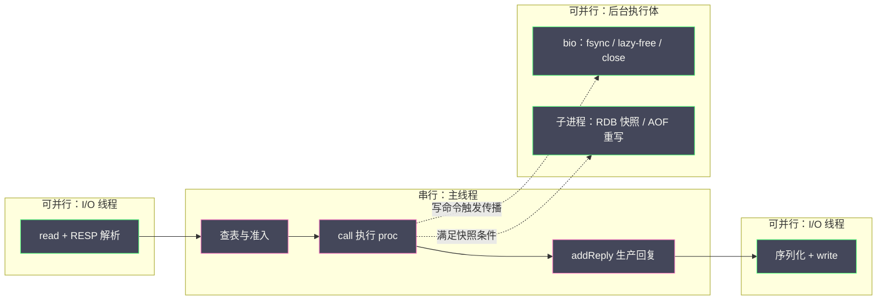
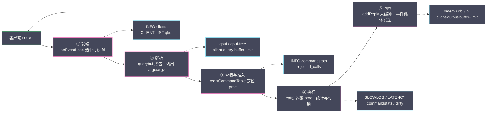
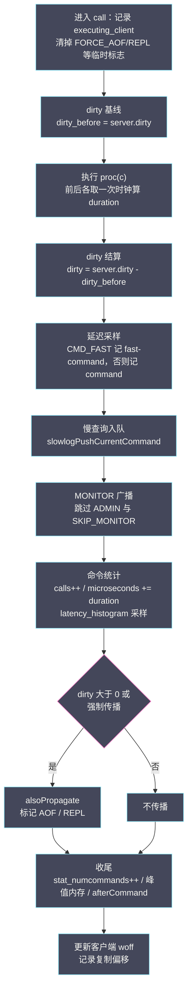
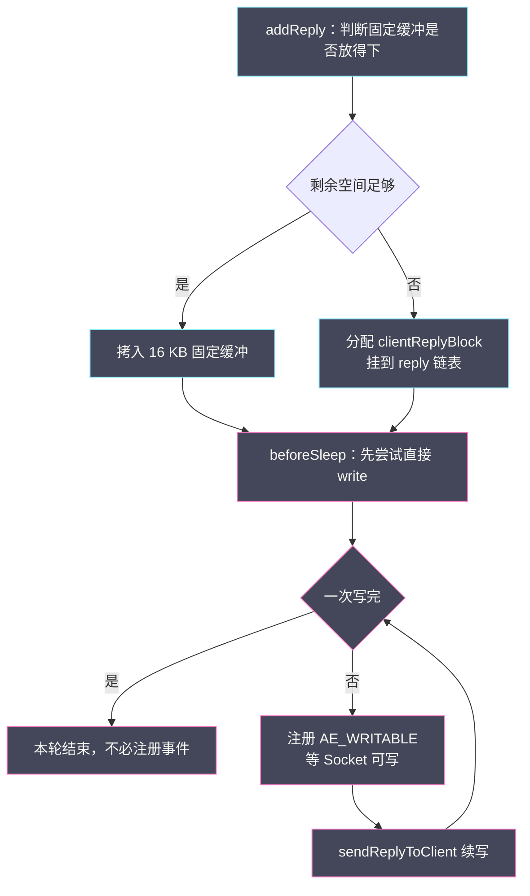
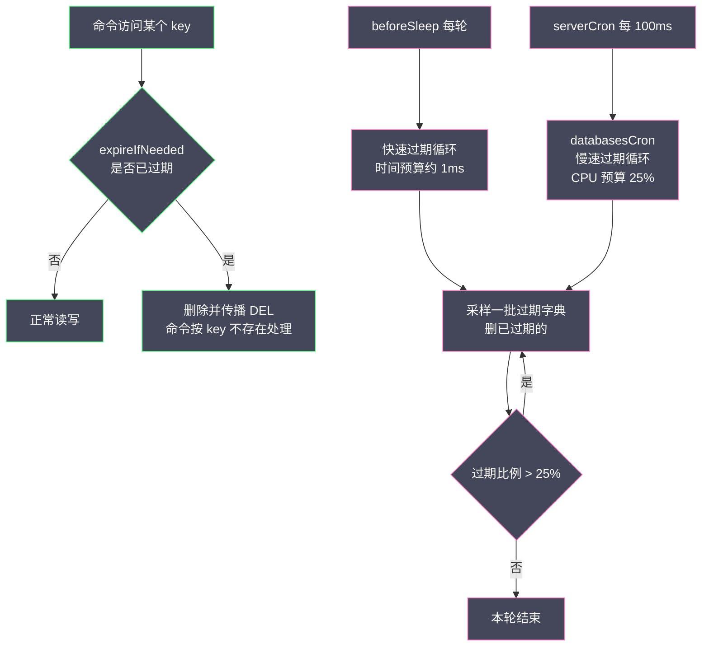

# 01 Redis 全局架构——一次请求的完整生命周期

**摘要：**

理解 Redis 的全局架构，最省力的切入方式不是读模块清单，而是把一条命令从进入 Socket 到响应离开网卡的全过程摊开，看它在每一层被怎样接手、又被交给谁。本文以 `SET name Alice` 为贯穿样本，把这条路径切成五段：Socket 就绪、按 RESP 解析出参数、在命令表里查到函数指针、由 `call()` 包裹执行、写入输出缓冲后由事件循环回写。其中 `call()` 是最容易被跳过的一段，它不只是"调用命令函数"，还要在这一层完成耗时统计、慢查询记账、`MULTI` 队列的收尾、`dirty` 计数以及向 AOF 与复制链路的传播决策，理解了它，才能解释为什么 AOF 里出现的命令往往不是客户端发来的原文，为什么有些写命令不进复制流，为什么慢查询看不到 fork 造成的停顿。本文同时给出每一段的可观测点：`INFO commandstats`、`SLOWLOG`、`LATENCY`、`INFO clients`、`CLIENT LIST` 的 `omem` 与 `qbuf` 各自能看到什么、看不到什么，并把常见延迟来源按命令复杂度、fork、刷盘、网络与系统因素归位。落点是一个判断：Redis 的单线程模型只保证命令执行的串行化，I/O 与后台任务早已分层并行，把它当成"整机只有一个线程"来排查问题，方向从一开始就错了。

---

## 第 1 章 从「一次请求」切开 Redis

讲 Redis 的内部结构，常见的组织方式是按模块罗列：网络层、协议层、命令表、数据结构、持久化、复制。这种讲法便于索引，但读完之后往往仍然答不出一个具体问题——为什么一个明明只有 `O(1)` 复杂度的 `GET`，会在某几秒里出现几十毫秒的尾延迟。原因是模块清单描述的是静态分层，而延迟与故障是沿着调用链动态累积的，两者的坐标系并不重合。

本文换一个坐标系：以一条命令的生命周期为主线，把模块挂到链路的各个环节上。贯穿样本选 `SET name Alice`，理由是它足够短——三个参数、一条写命令、一个 `+OK` 响应，任何额外的耗时都只能来自链路本身而不是命令逻辑；同时它又足够完整——`SET` 带 `write` 与 `denyoom` 标志，会触发内存检查、`dirty` 计数与传播，能把这篇文章要讲的机制全部点亮。

链路被切成五段，切分的依据不是代码文件的归属，而是**责任与代价的转移点**：一段结束、下一段开始时，耗时的主要来源会发生变化。第一段是从 Socket 到这个客户端的读事件被事件循环选中，代价在系统调用与连接管理；第二段是把字节流解析成 `argc` 与 `argv`，代价在协议边界与缓冲区拼装；第三段是拿命令名查表并做准入判断，代价在查表与规则校验；第四段是 `call()` 包裹下的执行，代价在数据结构操作与传播决策；第五段是把响应写进输出缓冲并由事件循环回写，代价在内存拷贝与 Socket 可写性。这四处切点各自对应一类可观测指标与一种干预手段。

范围上需要先划两条线。其一，本文讲机制与代价，不讲安装与命令用法，`CONFIG SET` 的例子只为说明连带后果。其二，版本口径以 Redis 7.x 与 8.x 的源码与官方文档为准，凡涉及版本差异的地方会单独标注；7.x 与 8.x 在这条请求路径上没有结构性改动，变化集中在后台任务的线程组织与个别配置默认值上，所以文中提到的函数名以 7.2 为准，8.0 的差异单独点出。数据结构本身的实现细节（SDS 的头部布局、字典的双表 rehash、listpack 与 quicklist 的选择）属于 [[02 SDS 与 Redis 对象系统]]、[[03 字典与渐进式 Rehash]]、[[04 跳跃表 压缩列表与 Listpack]] 的范围，本文只在链路需要时引用其结论。

---

## 第 2 章 进程模型：单线程说的是哪一段

### 2.1 先给边界，再谈优势

"Redis 是单线程的"这句话在传播中被压缩掉了限定语。完整表述应当是：**客户端的命令执行是单线程的**，所有命令在主线程里一条接一条地执行，任一条命令执行期间不会插入另一条命令；但读取、解析、写回、文件落盘、内存释放这些工作，早就不是主线程一个人在做。把这个边界记住之后，"单线程"就不再是一个神秘的性能神话，而是一条清晰的设计约定：只有会触碰数据集的代码必须串行，其余工作只要能证明不碰数据集，就可以并行。

按这个约定把 Redis 进程里的线程与进程列清楚，比笼统地说"多线程"更有用：

| 执行体 | 职责 | 是否触碰数据集 | 引入版本 |
| :--- | :--- | :--- | :--- |
| 主线程 | 事件循环、命令准入与执行、`call()`、写回尝试、周期任务 | 是，独占 | 全版本 |
| `bio` 后台线程 | 延迟 `close(2)`、AOF `fsync`、lazy-free 释放、AOF 文件关闭 | 否 | 2.4 起逐步扩充 |
| I/O 线程 | 读取客户端数据、解析 RESP、序列化并写回响应 | 解析与序列化阶段不触碰 | 6.0 起可选 |
| jemalloc 后台线程 | 归还脏页、整理内存 | 否 | 取决于 jemalloc 配置 |
| RDB / AOF 重写子进程 | 快照落盘、重写 AOF | 否，靠 COW 拿到快照 | 2.x 起 |

关于 `bio`，版本差异值得单独说清，因为很多资料仍按 4.0 时代的印象在描述。Redis 2.4 引入后台线程时只为一个目的服务：把 AOF 的 `fsync` 从主线程挪走，避免磁盘抖动直接变成命令延迟。后来 `close(2)` 的系统调用、以及 4.0 引入的 lazy-free（把大对象的逐元素释放交给后台），各自成为新的任务类型。到 7.2，`bio.h` 里的任务枚举有四类——关闭文件、AOF `fsync`、lazy-free、关闭 AOF 文件——每类配一个 worker 线程。8.0 重新组织了这块：worker 收敛为三类（关闭文件、AOF `fsync`、lazy-free），关闭 AOF 文件降级为任务类型而非独立 worker，另加了一组完成通知任务用于回调。这个差异不影响请求路径，但在读 `INFO` 的线程相关字段、或者用 `strace -f` 数线程时，会看出区别。

### 2.2 I/O 线程不是"一直开着"

Redis 6.0 的多线程 I/O 经常被误解成一打开就有 N 个线程一直在分担工作。源码里的实际行为要克制得多：`io-threads` 的默认值是 1，也就是关闭；把它设为 4 之后，线程虽然被创建，但**待写回客户端达到 `io-threads` 两倍才激活**，低于这个阈值时 `stopThreadedIOIfNeeded()` 会把线程重新停掉。判断依据是待写回队列的长度，一旦这个长度不够，连读侧的并行也一并关掉。

这个阈值值得琢磨。线程激活与退出本身有代价：互斥量唤醒、缓存行迁移、主线程与 worker 之间的 fan-out / fan-in 同步，待处理任务很少时这些代价换不回并行收益。所以多线程 I/O 只在真的有一批客户端同时等着时才生效。观察点很直接：`INFO server` 里的 `io_threads_active` 在运行时会随负载在 0 与 1 之间切换，不看你配了什么，只看此刻有没有必要。

读侧的路径也与"主线程直接读"不同。开启 `io-threads-do-reads` 之后（默认 no），可读事件的处理函数 `readQueryFromClient` 不再当场读数据，而是把客户端挂进待读队列 `clients_pending_read`，真正的读取与解析发生在下一轮 `beforeSleep` 调起的 `handleClientsWithPendingReadsUsingThreads()` 里。I/O 线程只负责读满缓冲并解析出第一条完整命令，随后给客户端打上 `CLIENT_PENDING_COMMAND` 标记就停手——执行必须回到主线程。这个"解析可以并行、执行不能并行"的分界线，就是单线程模型真正的边界所在。

把这条链路上哪些区间必须串行、哪些已经并行画出来，边界会更直观：



### 2.3 哪些工作不在单线程模型里

把不在模型内的工作列全，排查时才能准确定位"到底是谁卡住了主线程"：

- **fork 的瞬间**：RDB 快照或 AOF 重写要 fork 子进程，`fork()` 本身在主线程里同步执行，需要复制页表，进程内存越大耗时越长，这段时间主线程完全不处理命令。
- **AOF 的 `write()` 与 `fsync`**：`write` 在主线程（`beforeSleep` 里）完成，`fsync` 在 `everysec` 策略下交给 `bio`；`always` 策略则在主线程里同步 `fsync`，这也是它慢的根本原因。
- **大对象的释放**：`UNLINK`、以及开启 `lazyfree-lazy-*` 系列配置之后，逐元素释放内存的工作交给 `bio`，主线程只做摘链。
- **网络数据的搬运**：读与写可以交给 I/O 线程，但**协议解析之后的命令执行**以及**回复内容的生产**（`addReply` 系列）仍在主线程。
- **子进程的退出回收**：`serverCron` 里用 `waitpid` 非阻塞地收尸，本身很快，但子进程的退出码与耗时统计在这一步才被记录。

### 2.4 单线程仍然成立的理由

既然 I/O 已经并行了，为什么不顺手把命令执行也并行，让多核都参与进来。答案不是"做不到"，而是代价与收益不成比例。命令执行触碰的是共享数据集：`INCR` 是读改写，`LPUSH` 与 `LPOP` 会改变同一个链表的头尾，`ZADD` 可能触发跳表与字典的联动更新，一旦并行，就要为每一种数据结构设计细粒度锁或版本校验，还要处理 `MULTI/EXEC`、Lua 脚本、`WATCH` 这些本来就依赖"执行期间世界静止"的语义。反过来，单线程带来的收益是结构性的：没有锁竞争、没有死锁检测、没有缓存行在核间来回失效，`INCR`、`GETSET` 这类复合操作天然原子，客户端观测到的顺序就是命令到达的顺序。

把这条推理落到数字上也成立。示例推算：一条 `SET` 在单线程里的 CPU 时间大约在数微秒量级（含读、解析、查表、写字典、写回复），按 8 µs 计，单核每秒可执行约 12 万条；这与公开基准里十万级 QPS 的量级一致。换句话说，在内存操作足够快的前提下，单线程的吞吐上限由**每条命令的固定开销**决定，而不由 CPU 核数决定，这也解释了为什么优化 Redis 吞吐的最有效手段往往是"减少命令数量"（用 pipeline、用批量命令）而不是"增加 CPU"。

不过这里有个反直觉的推论必须讲清：单线程不等于延迟稳定。串行化意味着**尾延迟由最慢的那条命令决定**，而不是由平均耗时决定。这正是 `KEYS`、`SMEMBERS`、大 key 的 `DEL` 这类 `O(N)` 操作在 Redis 上格外危险的原因——它们不是"自己慢一点"，而是"让所有人一起慢"。

---

## 第 3 章 五段链路全景

把五段串起来，一条命令的路径可以画成这样：



这张图的右侧是本文的第二个目的：**指标与环节一一绑定**。看到 `usec_per_call` 升高，先怀疑第四段；看到 `omem` 涨而 `usec_per_call` 平稳，问题多半在第五段或客户端消费速度；看到 `qbuf` 异常大而命令都很轻，注意力应放在第二段的拼包与客户端发送方式上。指标的归属搞错了，优化就会打偏。

各段的代价量级可以放在一张表里对照。表中数值是量级判断，不是基准数据，实际取决于 CPU 主频、内存延迟、内核版本与网络形态：

| 环节 | 主要动作 | 典型耗时（量级判断） | 变慢的常见原因 |
| :--- | :--- | :--- | :--- |
| ① 就绪 | `epoll_wait` 返回、回调分发 | 亚微秒到数微秒 | 连接数过大、事件就绪过于集中 |
| ② 解析 | 系统调用读入、RESP 状态机切分 | 数百纳秒到数微秒 | 参数体积大、pipeline 过深、缓冲区反复扩容 |
| ③ 查表与准入 | 字典查表、标志与 ACL 校验 | 百纳秒级 | 命令被改名或包装、子命令容器查找 |
| ④ 执行 | 数据结构操作、统计、传播 | 数百纳秒到数微秒 | `O(N)` 命令、扩容与 rehash、驱逐 |
| ⑤ 回写 | 缓冲区拷贝、`write` 系统调用 | 微秒级 | 响应体积大、客户端读得慢、`omem` 触顶 |

一条命令在这五段上的 CPU 时间合计通常在数微秒到十几微秒，而一次同机房往返的网络 RTT 在 0.1 到 0.5 毫秒量级——也就是说，**网络在端到端延迟里通常占大头**。这个比例关系决定了两件事：一是做低延迟优化时，减少往返次数（pipeline、批量命令）的效果通常远大于抠服务端 CPU；二是当服务端指标一切正常而客户端仍然觉得慢时，先查网络与队列，再查 Redis。

下面五章按段展开。事件循环本身的实现（`ae` 的文件事件、时间事件、`aeApiPoll` 的跨平台封装）属于 [[05 单线程模型与事件驱动架构]] 的范围，本章只在"请求如何被选中"这一点上触及；RDB 的 fork 与 COW、AOF 的刷盘与重写分别见 [[07 RDB 持久化——快照的 fork 与 COW 机制]] 与 [[08 AOF 持久化与混合持久化]]。

---

## 第 4 章 第一段：从 Socket 到「事件就绪」

### 4.1 连接是怎么被接住的

Redis 启动时在配置端口上创建监听 Socket，并把它注册进事件循环，回调是 `acceptTcpHandler`。有连接到达时，这个回调做四件事：`accept()` 拿到客户端 fd、把 fd 设为非阻塞、创建 `client` 结构体、把这个 fd 的可读事件注册进事件循环，回调指向 `readQueryFromClient`。此后这个连接的每一次数据到达，都会以"事件就绪"的形式回到主线程。

非阻塞是整条链路的前提。若 fd 是阻塞的，一次 `read` 在数据未到时会挂起主线程，哪怕只有几十微秒，也足以让后面所有客户端的命令排队。设为非阻塞之后，`read` 在没有数据时立即返回 `EAGAIN`，主线程永远"有多少处理多少、没有就去处理别人"，这正是事件驱动模型的全部秘密。

连接建立本身也有成本：`accept` 要分配 fd、初始化 `client`，其中还包括一块回复用的固定缓冲（7.x 中单独分配 16 KB），连接上万时内存与初始化时间都不小。`maxclients` 给这个成本设上限，超出时新连接被拒并计入 `rejected_connections`——是拒绝而非排队，客户端看到的是连接失败或超时。

### 4.2 client 结构体：一段路径的状态载体

`client` 是链路上最重要的数据结构，它把一个连接在五个阶段里的状态全部装在一起。删掉与具体命令无关的字段，7.x 里与这条路径相关的部分大致如下：

```c
typedef struct client {
    int fd;                      // 连接的文件描述符（resp 等字段决定协议版本）
    int db;                      // 当前选中的数据库编号
    sds querybuf;                // 输入缓冲：未解析完的字节都留在这里
    size_t qb_pos;               // 已解析到的位置，容器不缩，位置前移
    size_t qbuf_peak;            // 输入缓冲的历史峰值，供 CLIENT LIST 展示
    int argc;                    // 本次命令的参数个数
    robj **argv;                 // 本次命令的参数数组
    int reqtype;                 // 请求类型：内联或多批量
    int multibulklen;            // 多批量剩余元素数
    long bulklen;                // 当前 bulk 参数待读长度
    char *buf;                   // 回复固定缓冲（7.x 为单独分配，16 KB）
    size_t bufpos;               // 固定缓冲的写入位置
    list *reply;                 // 回复链表：放不进固定缓冲的部分
    size_t reply_bytes;          // 回复总字节数
    size_t sentlen;              // 已发出的字节数
    uint64_t flags;              // CLIENT_* 标志位（阻塞、待执行、待关闭等）
    long long woff;              // 最后一次引起传播后主节点的复制偏移量
    monotime lastinteraction;    // 最后交互时间，超时管理用
    mstime_t duration;           // 本次命令累计执行耗时（阻塞命令会跨轮累计）
} client;
```

几个字段值得单独说明。`querybuf` 与 `qb_pos` 的组合是容器不缩、位置前移：解析时只推进 `qb_pos`，不移动内存，省掉每次解析后的 `memmove`；缓冲真正回收发生在 `clientsCron` 或缓冲被判定长期闲置时。`qbuf_peak` 记峰值而非当前值，因为要排查的是这个连接曾把缓冲撑到多大，当前值读完就回落。`woff` 记该客户端最后一条引起传播的命令执行后的主节点复制偏移量，`WAIT` 判断副本确认位置依赖它。

### 4.3 读进来之后先攒着

`readQueryFromClient` 被触发时，通常先用一个固定大小的缓冲（`PROTO_IOBUF_LEN`，16 KB）从 Socket 读一次，把读到的字节追加到 `querybuf` 尾部，然后交给解析。这里有两个容易忽略的细节。

第一个是大参数的特殊路径。当解析器已经知道当前命令的某个 bulk 参数长达 32 KB 以上（`PROTO_MBULK_BIG_ARG`）时，Redis 会把 `querybuf` 调整成恰好容纳剩余参数的大小，然后**直接读进对齐位置**。目的是让大参数在缓冲区里从边界开始存放，否则一次大参数读入会在 sds 上触发多次扩容与搬迁，而扩容时的拷贝量是数据量的两倍以上。这是用一点内存管理的复杂度换掉一次内存拷贝的取舍。

第二个是缓冲区的上限。`client-query-buffer-limit` 默认 1 GB，超过之后连接会被当作协议异常处理并断开。这个上限之所以存在，是因为 `querybuf` 是纯内存缓冲：如果客户端发了一半就不再发，而这半条命令有 800 MB，主线程已经为它分配了 800 MB，并且会一直占着直到连接断开。1 GB 是个很宽的阈值，但它保证了"未完成的命令"不会无限膨胀成内存事故。判断当前值是否异常，看 `CLIENT LIST` 里的 `qbuf` 与 `qbuf-free`：`qbuf` 大而 `qbuf-free` 小意味着缓冲几乎占满且无法回收，通常是客户端在发超大参数，或者用极深的 pipeline 一次写入了大量命令。

### 4.4 这一段的可观测点

- `INFO clients` 的 `connected_clients` 与 `maxclients` 的比值，反映连接容量还剩多少。
- `INFO stats` 的 `rejected_connections`，只在超过 `maxclients` 或 fd 上限时增长，非零说明连接被挡在了门外。
- `CLIENT LIST` 的 `qbuf`、`qbuf-free`、`qw`（输入缓冲峰值），以及 `events` 字段（`r` 表示注册了可读事件、`w` 表示注册了可写事件）。
- `INFO clients` 的 `client_recent_max_input_buffer` 是整个实例输入缓冲峰值的最大值，比逐个连接看更快。

如果这一段出问题，症状通常是"连接建立慢"或"新连接直接被拒"，而不是"命令执行慢"。区分方法是看 `connected_clients` 是否贴近 `maxclients`、`rejected_connections` 是否在涨；这两者都正常，就可以把注意力移到下一段。

---

## 第 5 章 第二段：解析——边界在缓冲，不在数据包

### 5.1 RESP 的两层结构

RESP 是 Redis 的序列化协议，客户端与服务端之间的通信、主从之间的传播、AOF 的内容，用的都是它。RESP2 有五种基本类型：

| 前缀 | 类型 | 示例 | 解析要点 |
| :--- | :--- | :--- | :--- |
| `+` | 简单字符串 | `+OK\r\n` | 读到 `\r\n` 为止，不能含换行 |
| `-` | 错误 | `-ERR unknown command\r\n` | 与简单字符串同构，语义上是错误 |
| `:` | 整数 | `:1000\r\n` | 直接按十进制解析，无长度前缀 |
| `$` | 批量字符串 | `$5\r\nAlice\r\n` | 长度前缀，按长度读，二进制安全 |
| `*` | 数组 | `*3\r\n$3\r\nSET\r\n...` | 元素个数前缀，逐元素递归解析 |

`SET name Alice` 在线上长这样：

```text
*3\r\n          # 数组，3 个元素
$3\r\nSET\r\n   # "SET"，长度 3
$4\r\nname\r\n  # "name"，长度 4
$5\r\nAlice\r\n # "Alice"，长度 5
```

RESP3（6.0 起，客户端需显式 `HELLO 3` 协商）在 RESP2 基础上补齐了语义类型：

| 前缀 | 类型 | 用途 |
| :--- | :--- | :--- |
| `_` | 空值 | 替代 RESP2 中 `$-1` 与 `*-1` 的歧义 |
| `,` | 双精度浮点 | 避免字符串转换带来的精度与解析开销 |
| `#` | 布尔 | `#t` / `#f` |
| `%` | 映射 | `HGETALL` 之类直接返回键值对，不必客户端按奇偶组装 |
| `~` | 集合 | 无序集合类型化 |
| `>` | 推送 | 服务端主动推送，供 Pub/Sub 与客户端缓存失效通知使用 |
| `=` | 原文字符串 | 带格式声明的字符串（如 `txt`、`mkd`） |

RESP3 的价值不在"更快"，而在"类型信息更完整"：RESP2 里 `HGETALL` 返回一个扁平数组，客户端必须自己按位置配对成映射，字段顺序、空值语义都要靠约定；RESP3 直接给映射类型，服务端推送也有了独立通道，不必再复用订阅回复的格式。两种协议在这条链路上的解析成本处于同一量级，区别只在类型分支更多。

### 5.2 内联命令与多批量

`processInputBuffer` 是解析的总入口，它先做一个判断：缓冲区当前位置的字节是不是 `*`。是，则走多批量路径（`processMultibulkBuffer`）；不是，则走内联路径（`processInlineBuffer`）。

内联命令是给人用的：整行以换行结尾，参数按空格切分，支持引号包裹含空格的参数，`telnet` 连上去敲 `SET name Alice` 就能用。它的解析依赖 `sdssplitargs`，比起多批量更慢，也更脆弱——引号不配对会直接报协议错误并断开连接。内联路径有两条硬限制：单行长度超过 64 KB（`PROTO_INLINE_MAX_SIZE`）报 `Protocol error: too big inline request`；主节点连接上出现内联命令会被视为协议错误，因为复制流必须是严格的多批量格式。

多批量路径是一个显式状态机，状态载体就是 `client` 上的三个字段。`multibulklen` 记录本轮还剩几个元素没读，`bulklen` 记录当前 bulk 参数还差多少字节，`qb_pos` 记录已经消费到缓冲区的哪个位置。每读到一个完整的元素就减一，减到零并且 `argc` 被填满，一条命令才算解析完成。这个设计最要紧的性质是**可中断**：如果数据不够，函数返回 `C_ERR`，字段保留当前状态，等下一次可读事件触发时从断点继续，绝不会阻塞等待。

### 5.3 拼包与粘包：为什么解析必须容忍边界

TCP 是字节流，不保留消息边界。客户端一次 `write` 的三个字节，可能被拆成两个数据包先后到达；客户端连续 `write` 的三条命令，也可能被合并成一个数据包一次到达。因此服务端不能假设"一次读到的就是一个完整命令"，只能假设"缓冲区里的字节是连续的前缀"。

Redis 的处理方式是容器 + 位置：每次可读事件把新数据追加到 `querybuf` 尾部，解析器从 `qb_pos` 开始尝试切分，切出一个完整命令就执行，剩余字节留在缓冲里等下一次。这里有两种极端都会考验这段代码：

- **半条命令**：只收到 `*3\r\n$3\r\nSET` 就没了。解析器记住状态返回，下一次数据到达后接着解析。
- **一次很多条**：一次收到 1000 条 `SET` 的完整编码。`processInputBuffer` 用一个 `while` 循环把它们逐条切出来执行，直到缓冲耗尽或遇到中断条件（客户端被阻塞、有待执行命令、正在关闭等）。

拼包与粘包也解释了为什么把 pipeline 开得越深越好是错的。客户端一次写入 1 万条命令，服务端的 `querybuf` 就要容纳这 1 万条命令的完整编码；执行完之后 1 万个 `+OK` 又要全部进入输出缓冲。输入与输出两端同时膨胀，中间还夹着逐条执行的串行过程，任一侧触顶都会引发连接被断开的连锁反应。合理深度通常在几十到几百条之间，取决于单条响应体积与客户端消费速度。

### 5.4 解析阶段的限制

解析是外部输入进入 Redis 的第一道关口，几乎所有防止恶意或异常输入的约束都集中在这里：

| 限制对象 | 默认值 | 超限行为 | 关联配置 |
| :--- | :--- | :--- | :--- |
| 内联命令单行长度 | 64 KB（硬编码） | 报协议错误并断开 | 不可配置 |
| 单个 bulk 参数长度 | 512 MB | 报 `invalid bulk length` 并断开 | `proto-max-bulk-len` |
| 未认证连接的数组元素数 | 大于 10 即拒绝 | 报协议错误并断开 | 无需认证时生效 |
| 未认证连接的 bulk 长度 | 大于 16 KB 即拒绝 | 报协议错误并断开 | 无需认证时生效 |
| 输入缓冲总长度 | 1 GB | 断开连接 | `client-query-buffer-limit` |
| 单条命令参数个数 | 数组长度上限 | 报 `invalid multibulk length` | 受 `INT_MAX` 约束 |

后两行里的认证限制常被忽略，但它有个实际用途：在没有启用密码的实例上，攻击者可以先用一个声明为超大长度的 `$` 头部让服务端分配巨量内存，再做别的动作。把未认证连接的参数尺寸压到很小，等于在认证完成前不给对手分配大内存的机会。

### 5.5 这一段的可观测点

解析阶段的耗时很难单独测出来，`INFO commandstats` 里的 `usec` 从 `call()` 开始计时，不含解析。可用的间接信号有三个：`CLIENT LIST` 的 `qbuf`、`qbuf-free`、`qw` 反映输入缓冲水位；`INFO stats` 的 `total_net_input_bytes` 与 `total_commands_processed` 相除得到平均每条命令的入站字节数，这个数远大于命令的合理体积时，说明有超大参数或过深 pipeline；`INFO clients` 的 `client_recent_max_input_buffer` 给出全局峰值。解析本身出问题的典型症状是连接被服务端主动断开，而 `SLOWLOG` 里什么都没有——因为命令根本没被执行到。

---

## 第 6 章 第三段：查表与准入——命令名变成函数指针

### 6.1 命令表从哪里来

客户端发来的是字符串 `SET`，内核里真正被调用的是 `setCommand` 这个函数。把前者变成后者的那张表，就是命令表。

一个常见的误解是"Redis 启动时把命令表建出来"。更准确的说法分两层：**命令表本身是编译期生成的静态数组**，运行时另外建一个字典做名字到数组元素的索引。7.0 起，命令的权威定义不再是手写的 C 结构体，而是 `src/commands/` 下的 JSON 文件——每条命令一个文件，里面写着 `arity`、`command_flags`、`acl_categories`、`key_specs`、`function` 等字段，`SET` 的 `arity` 就是 `-3`，标志是 `WRITE` 与 `DENYOOM`。构建时 `utils/generate-command-code.py` 把这些 JSON 汇总成 `commands.def`，再生成 `commands.c`，最终产出的数组仍叫 `redisCommandTable`。生成链路的意义不只是少写重复代码：命令文档、`COMMAND DOCS`、ACL 分类与集群的 key 定位规则都来自同一份定义。

表里每个元素是一个 `redisCommand`，7.x 的关键字段可以按"声明期"与"运行期"分开看：

| 字段 | 性质 | 作用 |
| :--- | :--- | :--- |
| `declared_name` | 声明期 | 命令名，`SET` |
| `proc` | 声明期 | 处理函数指针，`setCommand` |
| `arity` | 声明期 | 参数个数，负数表示至少 N 个 |
| `flags` | 声明期 | `CMD_WRITE`、`CMD_DENYOOM`、`CMD_FAST`、`CMD_ADMIN` 等位标志 |
| `acl_categories` | 声明期 | ACL 分类位图，如 `@string`、`@write` |
| `key_specs` | 声明期 | key 的位置与读写性质，集群重定向与 ACL key 模式依赖它 |
| `subcommands` | 声明期 | 子命令数组，容器型命令（`CONFIG`、`CLIENT`）用 |
| `calls` | 运行期 | 调用次数，`INFO commandstats` 直接读它 |
| `microseconds` | 运行期 | 累计执行耗时，单位微秒 |
| `rejected_calls` | 运行期 | 准入阶段就被拒的次数 |
| `failed_calls` | 运行期 | 执行阶段返回错误的次数 |
| `latency_histogram` | 运行期 | 延迟分布直方图，`INFO latencystats` 的分位数从这里来 |

查表本身由 `lookupCommand` 完成：先按命令名在 `server.commands` 字典里查，找到之后如果是容器型命令，还要按第二段参数去 `subcommands_dict` 里找子命令；子命令在表里以 `父|子` 的全名存在（`CONFIG|GET`），并各自持有独立的统计与 ACL 位。这就是为什么 `INFO commandstats` 里能看到 `cmdstat_config|get` 这样的条目，也是为什么 ACL 可以只放开某个容器的特定子命令。

### 6.2 准入：一整排检查按顺序过

查到函数指针不等于可以执行。`processCommand` 在调用 `call()` 之前要过一排检查，顺序是固定的，理解这个顺序对读指标很关键，因为**卡在准入的请求不进 `calls`**：

| 顺序 | 检查项 | 触发条件 | 客户端看到的错误 |
| :--- | :--- | :--- | :--- |
| 1 | 命令是否存在 | 名字不在表里 | `unknown command` |
| 2 | 参数个数 | `argc` 不满足 `arity` | `wrong number of arguments` |
| 3 | 认证 | 未认证且命令不在白名单 | `NOAUTH` |
| 4 | ACL | 用户没有该命令或该 key 的权限 | `NOPERM` |
| 5 | 集群归属 | key 的槽不在本节点 | `MOVED` / `ASK` |
| 6 | 内存 | 带 `DENYOOM` 且 `maxmemory` 已达上限 | `OOM command not allowed` |
| 7 | 持久化状态 | 快照失败且开了 `stop-writes-on-bgsave-error` | `MISCONF` |
| 8 | 副本只读 | 本节点是副本且命令要写 | `READONLY` |
| 9 | 上下文限制 | 订阅模式下执行不允许的命令 | 视协议版本而定 |
| 10 | 暂停状态 | `CLIENT PAUSE` 生效期间 | 命令挂起而非报错 |

内存检查与驱逐的耦合值得细看。带 `DENYOOM` 的命令在 `maxmemory` 达上限时先触发一轮驱逐，成功则继续执行，驱逐后仍不满足才返回 `OOM`。这意味着**`OOM` 错误的出现时机取决于驱逐策略能否腾出空间**：`noeviction` 下没有淘汰对象，`OOM` 立刻返回；`allkeys-lru` 下先删一批 key，客户端看到的是延迟升高而非错误。把 `OOM` 当成内存压力的唯一信号，在 `allkeys-lru` 上会漏掉早期迹象，更可靠的是 `used_memory` 曲线配合 `evicted_keys` 的增长速率。

持久化检查（第 7 项）是另一个容易误判的地方。开启 `stop-writes-on-bgsave-error` 之后，只要最近一次快照失败，写命令会统一被拒，返回 `MISCONF`。这个设计把"磁盘写不进去"从静默的数据风险变成了显式的写失败——宁可让应用报错，也不要让它在以为持久化正常的情况下继续写。排查这类故障时，`INFO persistence` 的 `rdb_last_bgsave_status` 会给出 `err`。

准入阶段的拒绝会记在 `rejected_calls` 而不是 `failed_calls` 里，这是 6.2 之后逐步细化出来的区分：前者表示"命令没跑，被规则拦下"，后者表示"命令跑了，返回了错误"。两者的排查方向完全不同，前者看权限、内存、集群拓扑，后者看命令实现与输入数据。7.0 还额外提供了 `INFO errorstats`，按错误前缀统计，比如 `errorstat_ERR`、`errorstat_WRONGTYPE` 的计数，这比翻日志快得多。

### 6.3 这一段的可观测点

- `INFO commandstats`：每个命令的 `calls`、`usec`、`usec_per_call`、`rejected_calls`、`failed_calls`。`usec_per_call` 是判断"命令本身是否变慢"的基线。
- `INFO latencystats`：按命令给出 `p50`、`p99`、`p99.9` 分位数。平均值会掩盖长尾，分位数不会；7.x 中 `latency-tracking` 默认开启，采集本身有开销但很低。
- `INFO errorstats`：按错误类型聚合的计数，定位"哪类错误在涨"。
- `COMMAND COUNT`、`COMMAND INFO`、`COMMAND DOCS`：确认某个命令在**当前版本**是否存在、参数个数、标志位是什么。当代码在一批实例上跑出不同行为时，先用 `COMMAND INFO` 对齐命令定义，比读文档更快。
- `CONFIG RESETSTAT`：清零全部统计，压测或变更验证前先清零。

---

## 第 7 章 第四段：`call()` 里被塞进去的七件事

### 7.1 为什么这个函数值得单开一章

`call()` 本身没有多少行代码，很容易被理解成"给 `proc` 加个计时器的包装"。但在这几十行里，Redis 完成了统计、慢查询、监控流、传播决策、脏标记结算、客户端缓存记账与阻塞命令的收尾，几乎是所有"横切关注点"的集中地。很多看似矛盾的现象都要到这里找答案：为什么 AOF 里的命令和客户端发的不一样、为什么有些写命令没有进复制流、为什么慢查询记录不到 fork 停顿、为什么 `EXEC` 本身不传播。

下面这张图是把 7.x 的 `call()` 按执行顺序摊开的样子：



### 7.2 计时只覆盖 `proc`

`call()` 在调用命令函数前后各取一次单调时钟，差值就是 `duration`。这个计时的边界非常明确：**只包含命令函数自己花掉的时间**，不包含网络读写、不包含在事件循环里的排队等待、不包含 fork 造成的停滞，也不包含同一条连接上前一条命令的耗时。理解这一点，就能解释一个常见的困惑——主线程明明被 RDB fork 卡了几百毫秒，`SLOWLOG` 却是空的：fork 不发生在任何命令的 `proc` 里。

`duration` 还有一个细节：阻塞命令（`BLPOP`、`BRPOP`、`WAIT`）会先把客户端标记为阻塞，`duration` 不在此时清零，而是在解除阻塞、命令真正返回之后才随慢查询一起结算。这样做的原因是阻塞命令的"执行"在逻辑上跨越了两段时间，但计时器只累计命令函数被调用时的执行时间，阻塞等待的那段不算在里面，否则所有阻塞命令都会进慢查询。

### 7.3 慢查询记录的是什么

`slowlogPushCurrentCommand` 在 `duration` 超过 `slowlog-log-slower-than`（默认 10000 微秒）时入队，队列长度由 `slowlog-max-len`（默认 128）限制。7.x 的慢查询条目有六个字段：自增 id、发生时间戳、耗时微秒、参数数组、客户端地址、客户端名。最后两个字段是后来补上的，实际价值很高：同一个慢命令如果只来自某一个客户端名，问题多半在调用方；如果来自所有客户端，问题在命令或数据。

慢查询有几个固定的盲区，值得在做容量规划时记住：它看不到排队时间（一条命令在事件循环里等了多久才开始执行，不在计时范围）、看不到网络时间、看不到 fork 与 AOF `fsync` 造成的全局停顿、也看不到被准入拒绝的请求。所以"`SLOWLOG` 干净"只能证明命令函数本身不慢，不能证明实例不慢。补上这些盲区要靠 `LATENCY` 与外部指标，见第 10 章。

入队本身有代价：慢查询会复制一份参数数组，一个 1 MB 的 `SET` 进了慢查询就多占 1 MB 内存，`slowlog-max-len` 设得很大时这笔账会累积。阈值应按需要关注的慢来设，而不是设成 0 全记。

### 7.4 `dirty` 决定要不要传播

`server.dirty` 是一个全局计数器，任何改变数据集的命令都会在实现里给它加数。`call()` 在 `proc` 前后各读一次，差值就是这条命令造成的"脏增量"。这个增量有三个用途：一是决定是否传播（`dirty` 大于 0 才进 AOF 与复制流）；二是作为 RDB 保存点的判断依据（`save 900 1` 里的"1 次变更"比的就是它，`INFO persistence` 里显示为 `rdb_changes_since_last_save`）；三是让"没有产生实际变更的写命令"不进传播流。

第三条最容易被忽略，也最值得举反例。`SET name Alice` 即使 key 已存在且值相同，也会写一次字典并加 `dirty`，所以它一定会被传播；但 `EXPIRE` 对一个不存在的 key 返回 0、不产生任何变更，`dirty` 不变，于是既不进 AOF 也不进复制流。这不是 bug，而是刻意为之——传播一个不产生效果的命令只会让 AOF 与副本多做无用功。代价是排查时必须意识到：**传播的是产生了效果的命令**。用 `MONITOR` 看到的流与 AOF 里读到的内容不一致，一部分原因就在这里。

### 7.5 传播：为什么 AOF 里的命令常常不是原文

`call()` 里的传播不是直接往 AOF 缓冲和副本连接里写，而是调用 `alsoPropagate`，把待传播的命令挂到 `server.also_propagate` 数组里，等到这一批命令执行完，再由 `propagatePendingCommands()` 统一展开。这种"先收集、后统一发"的结构解决了两类问题：一是脚本与事务里一条命令可能派生多条传播项，需要保证它们作为整体出现；二是传播内容可能需要改写。

改写是这条链路上最反直觉的一环。`EXPIRE key 60` 传播出去的内容其实是 `PEXPIREAT key <绝对毫秒时间戳>`——因为相对时间在副本重放与 AOF 重新加载时会失真，只有绝对时间戳才能保证重放后过期时刻一致。类似地，`SETEX`、`PSETEX` 会被改写成带 `PX` 的 `SET`，`SPOP` 会被改写成 `SREM` 加具体成员，`INCRBYFLOAT` 会被改写成 `SET` 加计算结果。这些改写由 `rewriteClientCommandVector` 完成，改写后的命令进入传播流。看 AOF 时发现"没有 `EXPIRE` 只有 `PEXPIREAT`"，原因就在这里。

`EXEC` 本身是不传播的。事务里每条写命令各自传播，但如果这些命令是在 `MULTI` 上下文中执行的，`propagatePendingCommands` 会在它们外面补上 `MULTI` 与 `EXEC` 包裹，保证副本以原子方式重放。脚本同理：一个 Lua 脚本里产生了多条写命令，传播时会自动包上事务边界，否则副本上的原子性就没了。

传播方向的开关由几个客户端标志控制，理解它们能解释一些奇怪的观测结果：

| 标志 | 效果 | 典型用途 |
| :--- | :--- | :--- |
| `CLIENT_FORCE_REPL` | 即使 `dirty` 为 0 也传播到复制流 | 需要副本同步"无变更"的语义时 |
| `CLIENT_FORCE_AOF` | 即使 `dirty` 为 0 也写入 AOF | 同上，针对 AOF |
| `CLIENT_PREVENT_REPL_PROP` | 阻止本次传播到复制流 | 只在本节点生效的维护动作 |
| `CLIENT_PREVENT_AOF_PROP` | 阻止本次写入 AOF | 临时性数据，不需要持久化 |

### 7.6 其余的记账

`MONITOR` 的广播发生在 `call()` 里、`proc` 之后，且会跳过 `ADMIN` 类命令与带 `CMD_SKIP_MONITOR` 标志的命令。所以 `MONITOR` 看不到某些管理命令，而挂着的 `MONITOR` 连接会让实例明显变慢：每执行一条命令，都要把参数重新编码一份、写到所有 `MONITOR` 客户端的输出缓冲里，这条路径同样占用主线程。

命令统计在 `call()` 末尾结算：`calls` 加一、`microseconds` 累加、开启延迟跟踪时向直方图采样一次。`INFO commandstats` 里的 `usec_per_call` 就是这两个数相除。需要注意的是它统计的是执行时间，与慢查询的计时口径一致，同样不含排队与网络。

`stat_numcommands` 是 `INFO stats` 里 `total_commands_processed` 的来源，`stat_peak_memory` 记录执行完这条命令时的内存峰值，`afterCommand` 处理一些与命令收尾相关的维护动作（客户端缓存失效通知的入队、跟踪相关的清理等）。最后，若这条命令引起了传播，`woff` 会被更新为最新复制偏移量，`WAIT` 据此判断写入是否已被 N 个副本确认。

### 7.7 这一段的可观测点

`SLOWLOG` 与 `INFO commandstats` 是主信号，`LATENCY` 用来补盲区。要判断一条命令是不是"真的慢"，正确做法是对比三组数：`INFO commandstats` 里的 `usec_per_call`（命令逻辑的均值）、`INFO latencystats` 里的 `p99`（长尾）、以及 `SLOWLOG` 里的具体条目（长尾的样本）。三组数一致升高，是命令或数据的问题；只有 `p99` 升高而 `usec_per_call` 平稳，多半是偶发事件（fork、驱逐、rehash、网络抖动）在拖尾；只有 `SLOWLOG` 有零星条目而均值正常，说明是少量大 key 或大参数触发的个案。

---

## 第 8 章 第五段：写回——两级缓冲与 `omem` 的账

### 8.1 两级缓冲

响应不是直接 `write` 出去的。命令函数通过 `addReply` 系列接口生产响应，这些接口先判断固定缓冲还有没有空间：7.x 的 `client` 有一块 16 KB 的回复缓冲（`PROTO_REPLY_CHUNK_BYTES`），放得下就逐字节拷贝进去；放不下就转到链表结构，由若干个 `clientReplyBlock` 串成一条链，每块的容量至少 16 KB，单条响应特别大时按需分配更大的块。两级结构的好处很直接：`GET` 返回一个小字符串这类绝大多数场景完全不触碰链表，省掉一次节点分配；而 `LRANGE` 返回几百 MB 的场景也不会因为固定缓冲太小而反复搬迁。

链表块的复用有一个细节：末尾块剩余空间不足 16 KB 时，新数据另起一块而非硬塞进去，牺牲少量内存利用率换取块内空间足够连续这一简单假设。

产生响应的过程有一个容易踩的坑：**回复生产在主线程**。`KEYS *` 在一个有 100 万 key 的库上，会把 100 万个 key 全部 `addReply` 进输出缓冲，主线程在这段时间里既不能处理其他命令，也无法感知自己的内存是否已经被这个客户端吃光。输出缓冲的硬上限（`client-output-buffer-limit`）是唯一能拦住这件事的机制，但它的检查是异步的，要等到下一轮才生效。

### 8.2 三种客户端，三套限额

`client-output-buffer-limit` 按客户端类别分别配置，参数是"硬上限、软上限、软上限持续时间"三个值：

| 客户端类别 | 默认配置 | 超限后的处置 | 为什么单独设 |
| :--- | :--- | :--- | :--- |
| 普通客户端 | `0 0 0`（不限制） | 不主动断开 | 普通客户端由应用自己控制消费 |
| 副本客户端 | `256mb 64mb 60` | 断开复制连接，触发重连 | 副本滞后时缓冲会持续增长 |
| Pub/Sub 客户端 | `32mb 8mb 60` | 断开订阅连接 | 订阅端消费不过来时消息会堆积 |

普通客户端默认不限制，因为 Redis 无法判断应用是不是在慢消费但终将消费：批量导出任务确实可能要几秒才读完 100 MB 响应。这不等于安全，7.0 的客户端内存驱逐（`maxmemory-clients`，默认关闭）把控制点从单连接上限转到所有连接的总量，超限时按内存占用从大到小断开；两套机制一个按连接、一个按总量，才能同时防住单个大响应与上千个中等响应叠加。

副本客户端的限额与主从稳定性直接相关。主节点写得很猛、副本网络跟不上时，主节点的副本输出缓冲会持续增长，涨到硬上限就断开——断开意味着副本要重新做一次全量同步，而全量同步又要 fork、又要传输 RDB，代价远大于"多占一点内存"。所以这个限额的实际含义是"宁可断开重来，也不让缓冲无限膨胀"，调大它是用内存换同步的稳定性，调小它则相反。

回复从产生到离开进程有两条路径，画出来更容易看清缓冲水位是怎么堆高的：



### 8.3 什么时候真正发出去

响应进入缓冲后并不会立刻发送，发送有两个时机。第一个时机是 `beforeSleep`：`handleClientsWithPendingWritesUsingThreads()` 遍历待写回队列，**先尝试直接 `write`**，一次能写完的（绝大多数小响应属于此类）就当场完成，压根不注册可写事件；写不完的（`write` 返回 `EAGAIN`，说明内核发送缓冲已满）才注册可写事件，等下一轮事件循环在 Socket 有空间时再发。第二个时机就是可写事件触发时的 `sendReplyToClient`。

这个"先试写、失败再注册"的顺序是一处很实际的优化：如果每次都注册可写事件再等下一轮，每条命令都要多一次事件循环往返，系统调用次数与延迟都会上升。反过来，如果每次都尝试写到完，遇到慢客户端就会阻塞在 `write` 上，主线程被一个客户端拖住。先试一次、失败即让位，是这两种极端之间的折中。

开启多线程 I/O 之后，写回这一步可以被分发给 I/O 线程：主线程把待写回的客户端按轮转分配，各 I/O 线程并行做序列化与 `write`，主线程忙等所有线程完成。这里同样有阈值约束（待写回客户端数达到 `io-threads` 的两倍），理由是微秒级的任务用同步原语交接反而更慢。

还有一个状态标志会影响发送时机：`CLIENT_CLOSE_AFTER_REPLY`。设置它之后，客户端在缓冲区的数据全部写完之后会立即关闭连接，典型场景是协议错误、`SHUTDOWN` 的响应、以及部分安全策略下的强制断开。这也解释了为什么协议错误时客户端还能收到那条错误信息——错误先入缓冲，关闭发生在写完之后。

### 8.4 这一段的可观测点

`CLIENT LIST` 的 `omem`（输出缓冲总内存）、`obl`（输出链表长度）、`oll`（输出链表节点数）以及 `rbs`/`rbp`（回复缓冲大小与峰值）是主要信号。`INFO clients` 的 `client_recent_max_output_buffer` 给出全局峰值。判断症状与原因的组合大致如下：

- `omem` 高而 `oll` 与 `obl` 都很小：说明单条响应就很大，问题在命令本身返回了过多数据（`KEYS`、`SMEMBERS`、`LRANGE 0 -1`）。
- `omem` 高且 `oll` 持续增长：说明客户端消费速度跟不上生产速度，问题在调用方或网络。
- `omem` 高且出现在副本客户端上：说明主从链路带宽或副本处理能力不足，下一步该看 `INFO replication` 的偏移量差距。
- `omem` 正常但客户端仍报超时：问题不在输出缓冲，去看 `LATENCY` 与网络。

---

## 第 9 章 事件循环的空窗期：周期任务在做什么

命令不会一直来，事件循环在两次 `epoll_wait` 之间还有一批必须完成的工作，它们分布在 `beforeSleep`（每轮迭代）与 `serverCron`（默认每 100 毫秒）里。这部分容易与事件驱动的实现细节混淆，本文只讲"谁在什么频率上做了什么、对请求路径有什么影响"，`ae` 的实现属于 [[05 单线程模型与事件驱动架构]]。

### 9.1 beforeSleep：每轮迭代都跑

`beforeSleep` 在 `epoll_wait` 之前执行，跑的是"延迟一小会儿就会明显影响功能"的任务，按 7.x 的调用顺序大致是：

| 顺序 | 任务 | 对请求路径的影响 |
| :--- | :--- | :--- |
| 1 | 分发多线程读 | 把待读客户端交给 I/O 线程读取与解析 |
| 2 | 处理连接类型的待处理数据 | TLS 等场景的收尾 |
| 3 | 集群状态更新 | 集群模式下可能改变节点状态 |
| 4 | 处理被阻塞的客户端 | `BLPOP` 等命令的唤醒时机 |
| 5 | 快速过期循环 | 见 9.2 |
| 6 | 向副本请求 ACK | `WAIT` 的响应速度 |
| 7 | 客户端缓存失效通知广播 | `CLIENT TRACKING` 的正确性 |
| 8 | AOF 缓冲写入文件 | `appendfsync` 策略的实际生效点 |
| 9 | 分发多线程写回 | 响应真正离开进程 |
| 10 | 异步释放客户端 | 断连后的资源回收 |
| 11 | 裁剪复制积压缓冲 | 全量同步的内存峰值 |
| 12 | 客户端内存驱逐 | `maxmemory-clients` 生效点 |

这张表解释了为什么"命令都执行完了但客户端还没收到响应"是正常现象：`addReply` 只把字节放进缓冲，真正 `write` 要等这一轮的 `beforeSleep` 或可写事件。也解释了 `appendfsync always` 为何显著拉低吞吐——第 8 步在每轮迭代里同步 `fsync`，把磁盘延迟摊到每批命令上。

### 9.2 过期键：两条删除路径

过期键的清理不是一条路径，而是两条，加上一条兜底。

**惰性删除**发生在访问时：任何读写命令在查 key 之前都会调用 `expireIfNeeded`，如果 key 已过期就当场删掉并把这次删除传播出去，命令本身按"key 不存在"处理。这条路径保证了"过期的 key 永远不会被读到"，但只对"有人访问"的 key 有效——一个再也不会被访问的过期 key，会一直占着内存。

**定期删除**补上这个缺口，由两处驱动：`beforeSleep` 里的快速循环（`ACTIVE_EXPIRE_CYCLE_FAST`）和 `serverCron` → `databasesCron` 里的慢速循环（`..._SLOW`）。两者的算法相同：从过期字典中随机采样一批 key，删除其中已过期的，如果过期比例超过 25%（`ACTIVE_EXPIRE_CYCLE_ACCEPTABLE_STALE`），说明过期 key 还很密集，继续采下一批；同时受时间预算约束，快速循环单次最多占用约 1 毫秒（`ACTIVE_EXPIRE_CYCLE_FAST_DURATION`），慢速循环按不超过 25% 的 CPU 时间（`ACTIVE_EXPIRE_CYCLE_SLOW_TIME_PERC`）控制。采样基数默认 20 个 key，`active-expire-effort` 从 1 调到 10 时基数会按 `20 + 20/4 * effort` 放大，也就是最多约 70 个。



这套机制在副本上的行为与主节点不同，值得单独记住：**副本不会主动删除过期键**，它只在读取时把已过期的 key 视为不存在，真正的删除动作要等主节点传来的 `DEL`。这样做的原因是过期删除本身也是一次写操作，如果副本自己删，主从数据会分叉。副作用的后果是副本上的 `expired_keys` 长期为 0，以及副本内存可能比主节点高——过期键在副本上"逻辑上不存在、物理上还占着"，直到主节点的删除传播过来。

### 9.3 其他周期任务

`serverCron` 的执行频率由 `hz` 控制（默认 10，即每 100 毫秒一次），`dynamic-hz` 默认开启，会在连接数变化时调整实际频率，所以 `INFO server` 里同时有 `hz` 与 `configured_hz` 两个字段——用 `CONFIG SET hz` 之后发现 `hz` 立刻变了而实际负载没变，是正常现象。

| 任务 | 频率 | 与请求路径的关系 |
| :--- | :--- | :--- |
| 客户端超时检查与缓冲峰值统计 | 每轮 cron | 决定 `timeout` 配置的精度 |
| 渐进式 rehash 推进 | 每轮 cron，时间片约 1 毫秒 | 大字典扩容期间每轮都要付出这点时间 |
| 过期删除慢循环 | 每轮 cron | 见 9.2 |
| 活跃碎片整理 | 每轮 cron（开启时） | `activedefrag` 打开后与命令争 CPU |
| RDB 保存点检查 | 每轮 cron | 比较 `server.dirty` 与 `save` 配置 |
| AOF 重写触发检查 | 每轮 cron | 按增长比例与最小体积判断 |
| AOF 缓冲补刷 | 每轮 cron | `everysec` 下的兜底 |
| 复制 cron | 每秒一次（故障转移期间 100 毫秒一次） | 心跳、重连、超时判定 |
| 集群 cron | 每 100 毫秒 | Gossip 通信 |

rehash 那一行值得多看一眼。字典扩容是渐进式的，旧表的桶逐个搬到新表，`databasesCron` 给这一步的时间片在 1 毫秒量级，扩容期间每轮 cron 都要为主线程加上这点固定开销；库很大时它持续可见，表现为 `instantaneous_ops_per_sec` 小幅下滑与 `p99` 轻微抬升，不让哪条命令特别慢，但让所有命令都慢一点。

---

## 第 10 章 可观测点地图：每个指标能证明什么

前九章的"这一段该看什么"在这里汇总成一张对照表，读法是先确定怀疑哪一段，再看该段的指标，最后看判据——**指标本身不代表问题，指标的组合才代表问题**。

| 怀疑的环节 | 首要指标 | 辅助指标 | 判据与误读 |
| :--- | :--- | :--- | :--- |
| 连接层 | `INFO clients` 的 `connected_clients` / `maxclients` | `rejected_connections` | 比值贴近 1 且拒绝数在涨，是容量问题；比值低则与本层无关 |
| 输入缓冲 | `CLIENT LIST` 的 `qbuf`、`qw` | `client_recent_max_input_buffer` | `qbuf` 大且 `qbuf-free` 小，是超大参数或过深 pipeline |
| 解析 | `total_net_input_bytes` / `total_commands_processed` | 连接被断开时的错误日志 | 入站字节数远高于命令体积，说明有超大参数 |
| 准入 | `commandstats` 的 `rejected_calls` | `INFO errorstats` | `rejected_calls` 涨说明被规则拦下，不是执行慢 |
| 执行 | `commandstats` 的 `usec_per_call` | `latencystats` 的 `p99` | 两者同涨是命令问题；只 `p99` 涨是偶发事件 |
| 执行长尾 | `SLOWLOG GET` | `LATENCY LATEST` | 慢查询有样本但均值正常，是个案大 key |
| 全局停顿 | `LATENCY LATEST` 的 `fork`、`aof-fsync-always` | `INFO persistence` 的 `latest_fork_usec` | 慢查询为空但客户端普遍超时，先怀疑这里 |
| 输出缓冲 | `CLIENT LIST` 的 `omem`、`oll`、`obl` | `client_recent_max_output_buffer` | `omem` 高且 `oll` 小，是单条大响应；`oll` 涨是消费慢 |
| 刷盘 | `INFO persistence` 的 `aof_delayed_fsync` | `aof_last_cow_size`、`rdb_last_cow_size` | 延迟刷盘计数增长，说明 `fsync` 跟不上写入 |
| 内存 | `used_memory`、`mem_fragmentation_ratio` | `lazyfree_pending_objects`、`evicted_keys` | 碎片率高会抬高分配延迟；待释放对象堆积说明 lazy-free 落后 |
| CPU | `INFO cpu` 的 `used_cpu_sys` 与 `used_cpu_sys_children` | 系统层 `mpstat`、`pidstat` | 子进程 CPU 高说明 fork 与重写在吃资源 |

几个使用上的要点。

`SLOWLOG` 与 `LATENCY` 的分工必须分清。`SLOWLOG` 记录的是"命令执行慢"，`LATENCY` 记录的是"主线程被什么事耽搁了"，后者的事件源是内置的，包含命令执行（`command`、`fast-command`）、`fork`、`aof-fsync-always`、`aof-write`、`expire-cycle`、`eviction-del`、`eviction-cycle` 等。`latency-monitor-threshold` 默认是 0，也就是关闭，要显式设一个毫秒阈值才有数据；开启之后 `LATENCY LATEST` 给出每个事件源最近一次的最长耗时，`LATENCY HISTORY` 给出时间序列，`LATENCY DOCTOR` 会用人话给出一段诊断。它把"不是命令慢、而是主线程被别的事卡了"这种情况单独拎出来，这恰是单线程模型下最典型的尾延迟来源。

`INFO commandstats` 的 `usec_per_call` 要配合调用量看。一个 `usec_per_call` 只有 2 微秒的命令，如果每秒被调用 50 万次，它一项就吃掉 1 秒 CPU，也就是整整一个核。判断"谁在消耗主线程"的正确算法是 `calls × usec_per_call` 的排序，而不是单看 `usec_per_call`。`CONFIG RESETSTAT` 之后压测一段固定时间，这个排序就是主线程的时间去向表。

外部测量不可省略。`redis-cli --latency` 给的是客户端视角的往返延迟，`--intrinsic-latency 100` 给的是内核与硬件本身让进程停顿多久；若这个数就有几十毫秒，客户端不可能拿到毫秒级尾延迟，问题在 THP、虚拟化或 CPU 抢占，而不在 Redis。

---

## 第 11 章 延迟从哪来：链路上的六个加法项

把上面所有环节的耗时加起来，得到的是"服务端处理时间"；客户端观测到的延迟还要再加上网络往返、排队与各种全局停顿。按来源归类有六类：

| 来源 | 机制 | 量级判断 | 判据 | 缓解手段 |
| :--- | :--- | :--- | :--- | :--- |
| `O(N)` 命令 | 单条命令遍历全部元素，主线程被独占 | 10 万元素在毫秒级，百万元素在十毫秒级 | `SLOWLOG` 有样本、`usec_per_call` 突增 | 拆 key、分页、改用游标类命令 |
| 大 key 删除 | 逐元素释放内存 | 千万级元素可达数百毫秒 | `INFO memory` 的 `lazyfree_pending_objects` | `UNLINK`、开 `lazyfree-lazy-user-del` |
| fork | 复制页表，进程内存越大越慢 | 10 GB 实例在几十到上百毫秒 | `latest_fork_usec` | 控制实例大小、避开高峰期快照 |
| AOF 刷盘 | `always` 同步 `fsync`；`everysec` 落后时堆积 | 单次 SSD `fsync` 在毫秒级，机械盘更高 | `aof_delayed_fsync` | 用 `everysec`、换盘、拆实例 |
| swap | 内存页被换出，访问变磁盘延迟 | 从微秒跳到毫秒，无上限 | 系统层 `si/so`、`vmstat` | 关 swap 或限制 `vm.swappiness` |
| 网络与网卡 | 往返时延与带宽上限 | 同机房 0.1 到 0.5 毫秒，跨机房数毫秒 | `--latency` 与 `--intrinsic-latency` 的差值 | 同机房部署、pipeline 摊薄往返 |

把这六类放进具体算术里，感受会更实在。

示例推算一：`KEYS *` 的代价。100 万 key 的库要遍历整个字典，桶扫描加模式匹配，100 万次随机指针跳转大约在几十毫秒量级；命中的 10 万个 key 还要全部 `addReply`，按平均 40 字节算响应体约 4 MB。于是主线程被占几十毫秒（这期间其他客户端的命令全部排队），同时给一个客户端分配 4 MB 输出缓冲。换成 `SCAN` 加游标，单次只返几百个 key，把这段耗时摊到几十次往返里，主线程单次占用降到微秒级。

示例推算二：大 key 删除的代价。一个 500 万元素的 Hash，`DEL` 时要逐个释放 entry 与 SDS，即便每次释放只要几十纳秒，500 万次也在百毫秒量级，加上释放过程中的内存管理开销，实际会更长。若改用 `UNLINK`，主线程只做"从键空间摘掉这个 key"这一步（微秒级），逐元素释放交给 `bio` 的 lazy-free 线程，代价从"主线程停顿百毫秒"变成"后台线程忙一会儿 + 内存稍晚归还"。这也解释了为什么 `UNLINK` 不是"删除更快"，而是"把删除的成本挪出主线程"。

示例推算三：一次往返的构成。同机房一次 `GET` 的客户端观测延迟若为 0.3 毫秒，服务端处理可能只占 5 微秒，其余是两段网络传输、内核协议栈与客户端调度；把 Redis 挪到另一个可用区、或在前面加一层代理，延迟会成倍上升，而 Redis 侧指标毫无变化。

### 11.1 被低估的三个系统因素

透明大页（THP）。开启 THP 时 fork 后的写时复制以 2 MB 为单位触发，原本只复制 4 KB 页的写入变成复制 2 MB，内存放大与延迟抖动同时出现，fork 也要为更大的页表多花时间。数据库进程通常建议关闭 THP，Redis 启动时会检测并告警。

CPU 绑核与超线程。全部命令压在一条核上，这条核的频率、是否被邻居抢占、是否与网卡中断同核，都直接决定尾延迟；与高 CPU 负载的邻居同机部署时，`--intrinsic-latency` 能立刻测出抖动。

内存分配器与碎片。`mem_fragmentation_ratio` 持续大于 1.5 时，说明分配器手里的内存远多于实际使用，碎片会抬高分配延迟并增加 fork 的页表规模。`activedefrag` 可以整理，但它自己在主线程里跑，会与命令争 CPU——这是一个典型的"用一种开销换另一种开销"的取舍，开启前应当先用 `--intrinsic-latency` 与 `p99` 量化当前抖动是否值得。

---

## 第 12 章 四则反例：链路知识用错地方的样子

### 12.1 用 `KEYS` 做扫描

把 `KEYS prefix:*` 写进业务代码，是这条链路上最常见的误用。复杂度 O(N)，N 是整库 key 数而非匹配数；返回全量结果，没有游标与分批；在主线程执行，期间所有命令排队。三条叠加，小库能用、中等规模偶发卡顿、大库直接事故。

正确的做法是 `SCAN` 加游标：`SCAN cursor MATCH prefix:* COUNT 500`，每次返回一批和下一个游标，游标回到 0 表示遍历结束。它的语义比 `KEYS` 弱——遍历期间如果发生 rehash，同一个 key 可能被返回两次，也可能有 key 在遍历区间内被漏掉，所以客户端必须自己去重，并且不能把 `SCAN` 的结果当作一致性快照。这不是缺陷，而是"允许并发修改"换来的"不阻塞主线程"；需要一致性快照时，应该走 RDB 备份或者从副本上取。字典扩容与 rehash 对 `SCAN` 的具体影响见 [[03 字典与渐进式 Rehash]]。

### 12.2 在单线程里做 `O(N)` 的大 key 操作

`SMEMBERS`、`HGETALL`、`LRANGE 0 -1`、`ZRANGE 0 -1 WITHSCORES` 都有同样的形态：一次返回集合的全部内容。元素上万时，主线程要遍历全部元素、逐个 `addReply`，同时给这个客户端分配可观的输出缓冲。它们在开发环境里毫无问题，因为测试数据只有几十个元素；上线之后元素数量随业务增长，某一天就会突然变成慢查询，而代码一行没改。

识别这类问题要先知道哪些 key 是大 key。`redis-cli --bigkeys` 扫描全库并按类型给出最大的 key，但它本身是一次全量遍历，不要在生产高峰期跑；`MEMORY USAGE key SAMPLES n` 可精确估算单个 key 的内存，`OBJECT ENCODING` 能看出它处于哪种编码（Hash 从 listpack 转为哈希表，往往意味着元素数量或单体体积过了阈值）。处理方式两条：按业务维度把大集合拆成多个小 key（分桶），或改用游标类命令（`SSCAN`、`HSCAN`、`ZSCAN`）分批取；前者改数据结构，后者改访问方式，按读取模式选。

### 12.3 把 Redis 当消息队列做长阻塞

`BRPOP queue 0` 这种写法在小规模下能跑通，规模上去之后会暴露一串问题。先说清一个常被搞错的机制：**阻塞命令不会阻塞主线程**。`BRPOP` 在队列为空时把客户端挂到阻塞表上，主线程转身去处理别的命令，等有数据 `push` 进来时再唤醒。所以这类用法的代价不在 CPU，而在别处：

- 连接被长期占用，消费者数量一多，连接数与内存都被吃满，`maxclients` 成了吞吐瓶颈。
- 没有确认语义。`BRPOP` 取出即消失，消费者在拿到消息后崩溃，消息就丢了；也没有超时重投与死信机制。
- 无法水平扩展消费者语义。多个消费者竞争同一个 list，天然是"抢"而不是"分配"，做不到按消费组隔离。

需要队列语义时，Redis 5.0 起的 Stream 是更合适的选择：`XADD` 写入、`XREADGROUP` 按消费组读取、`XACK` 确认、未确认消息留在 PEL 里可以重投，`XAUTOCLAIM` 处理僵尸消费者。若只需要"取出即完成"的简单队列，`BRPOPLPUSH`（或 6.2 起的 `BLMOVE`）配合业务侧的成功删除，至少能补上一个"处理中"的中间态。若需要的是严格的持久化与重投，Redis 本身就不是最优解，这是选型问题而不是配置问题。

### 12.4 无界 pipeline 与在线诊断命令

pipeline 是把往返次数摊薄的最有效手段，但深度无界时它会从优化变成事故：一次写入 10 万条命令，服务端 `querybuf` 要容纳全部编码，执行完之后 10 万条响应又要进输出缓冲，中间还有逐条执行的串行过程；任何一侧触顶（`client-query-buffer-limit`、`client-output-buffer-limit`、客户端自身内存）都会导致连接被断开或者客户端被驱逐。合理深度通常在几十到几百条之间，按单条响应体积调整。

在线诊断命令同样需克制：`MONITOR` 会把每条命令重新编码写入它的输出缓冲，长期挂着会让所有命令变慢；`DEBUG SLEEP` 直接冻结主线程；`FLUSHALL`、同步 `SAVE`、`KEYS` 在高峰期执行都是自伤。原则是用采样代替全量、用副本代替主节点、用短时开启代替长期挂载。

---

## 第 13 章 收束：单线程模型的位置

把一条命令走完五段之后，"单线程"的位置就清楚了：它约束第四段，命令执行必须串行，执行期间世界静止；它不约束第一段与第五段的网络搬运，也不约束磁盘与内存释放。真正需要保护的只有一样东西：数据集的读写顺序。一旦接受这个划分，很多看似矛盾的现象都能对齐——为什么开着多线程 I/O 却仍然怕大 key（并行的是搬运，不是执行）、为什么 `SLOWLOG` 看不到 fork 造成的停顿（计时只覆盖执行）、为什么 AOF 里的命令与客户端发的不一致（传播前有改写与筛选）、为什么副本上的过期键不会被自己删掉（删除是写操作，必须由主节点驱动）。

代价与收益都很明确：收益是数据结构极致简单、命令天然原子、顺序天然一致、诊断只有一条主线程；代价是所有慢操作都变成全局的，尾延迟由最慢的命令决定，容量规划必须按"单核每秒能执行多少条命令"来算。多线程 I/O 与 `bio` 把能挪走的成本挪走了，挪不走的那部分仍需在应用侧用命令设计、数据分片与访问方式解决。

判断一个实例是否健康不该只看一个数字：连接层看容量、执行层看 `usec_per_call` 与 `p99`、停顿层看 `LATENCY` 与 `--intrinsic-latency`、缓冲层看 `omem` 与 `qbuf`，四组数各答不同问题，混在一起看只剩"感觉有点慢"。链路拆得越细，指标归属越准，干预越有针对性。

---

## 参考资料

1. Redis 源码（7.2 分支，`server.c` 的 `call()` 与 `processCommand`、`networking.c` 的 `processInputBuffer` 与回复缓冲、`expire.c` 的活跃过期常量）：https://github.com/redis/redis/tree/7.2/src
2. Redis 源码（8.0 分支，`bio.h` 的 worker 组织变化）：https://github.com/redis/redis/blob/8.0/src/bio.h
3. 命令定义与生成脚本（`src/commands/*.json`、`utils/generate-command-code.py`）：https://github.com/redis/redis/tree/7.2/src/commands
4. RESP 协议规范：https://redis.io/docs/latest/develop/reference/protocol-spec/
5. INFO 命令与各 section 字段说明：https://redis.io/docs/latest/commands/info/
6. SLOWLOG 与慢查询配置：https://redis.io/docs/latest/commands/slowlog-get/
7. LATENCY 命令与延迟监控机制：https://redis.io/docs/latest/commands/latency-latest/
8. 延迟问题诊断指南（官方文档的 latency 章节）：https://redis.io/docs/latest/operate/oss_and_stack/management/optimization/latency/
9. 客户端输出缓冲限制（`client-output-buffer-limit`）：https://redis.io/docs/latest/develop/reference/clients/
10. 黄健宏，《Redis 设计与实现》（第二版），机械工业出版社

---

> [!note] 思考题
> 1. `SLOWLOG` 的计时边界是命令函数本身，因此 fork 停顿、AOF 同步刷盘、排队等待都不会被记录。如果让你只用 Redis 自带能力（不引入外部监控）来定位一次"所有客户端同时超时 200 毫秒"的事故，你会按什么顺序取哪几个指标，各自能排除什么、不能排除什么？
> 2. `EXPIRE` 传播时被改写为 `PEXPIREAT`，`SPOP` 被改写为 `SREM`。假设有一个运维脚本依赖 `MONITOR` 输出做审计，它在统计"每分钟有多少次过期设置"时会出现什么偏差，又该如何校正？
> 3. 副本不主动删除过期键，只在读取时逻辑上视为不存在。这个设计在故障切换的瞬间会带来什么后果——新主节点上是否可能存在一批"逻辑已过期、物理仍存在"的键，它们会在什么时候被清理？
> 4. 多线程 I/O 只在待写回客户端数量达到 `io-threads` 的两倍时才激活。如果你的实例连接数不多但每条响应都很大，多线程 I/O 会带来收益还是负担，判断依据是什么？
> 5. `client-output-buffer-limit` 对普通客户端默认不限制，7.0 又引入了 `maxmemory-clients` 做总量控制。这两套机制各自能防住哪种形态的内存膨胀，为什么单独任何一套都不够？