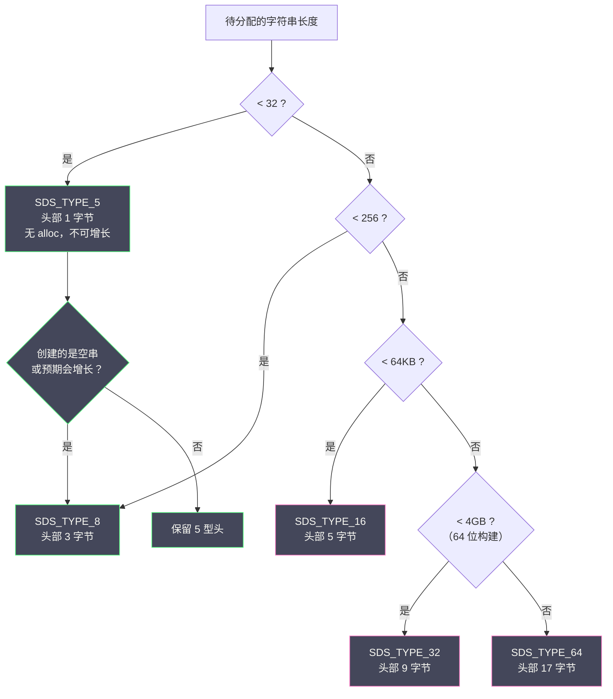
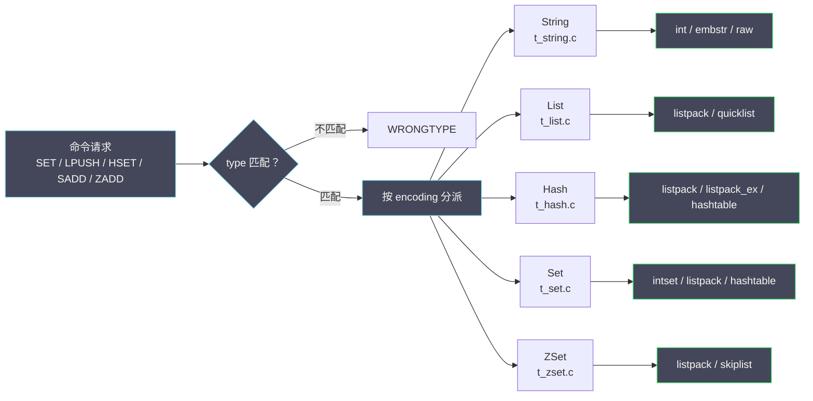
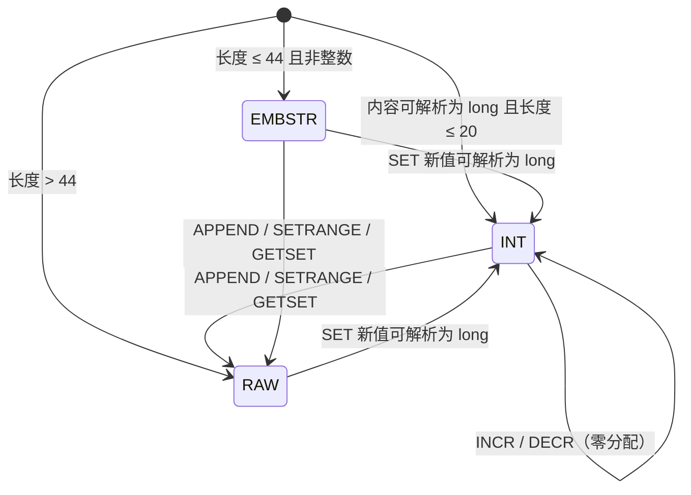
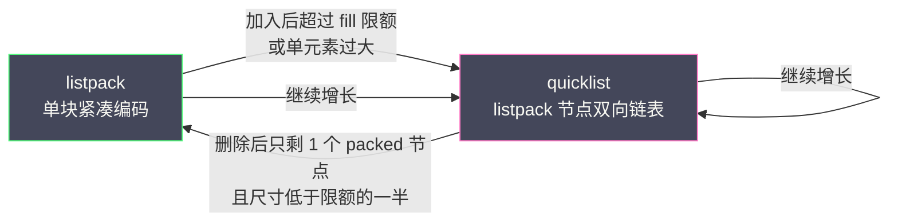
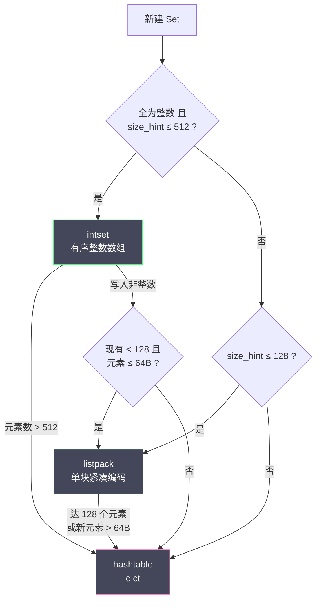
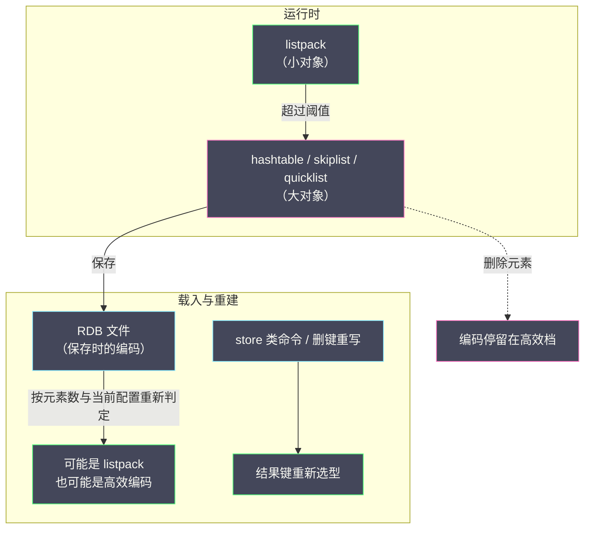

# 02 SDS 与 Redis 对象系统

**摘要：**

Redis 用 C 写成，却几乎不用 C 的字符串。这个选择牵出的是一整套关于"同一个逻辑类型可以有多个物理编码"的规则：SDS 把长度、容量、二进制安全从约定变成字段，redisObject 把 type 与 encoding 拆成两个维度，让五种对外类型各自挂上一串可以互相转换的物理形态。本文沿这条主线走三遍。第一遍看 SDS 的四个字段与五种头部，为什么在 sdshdr16 已经够用的年代还要单独保留一个 3 字节的 sdshdr8；第二遍把 type × encoding 铺成总表，逐个校准 44、512、128、64、8KB 这些阈值的出处，以及它们在 Redis 7.x 与 8.x 之间的差异，其中好几处被广泛引用的数字其实是旧版本的；第三遍看方向性——转换在什么条件下单向，什么条件下会被 RDB 载入或重建型命令改回来，共享整数对象为什么在 LRU/LFU 策略下必须关闭。落到运维，这套规则解释了两类最常见的手感异常：删掉元素内存不降，以及照着博客调完阈值性能反而更差。本文不给通用参数建议，只把"改一个数字会连带改变什么"算清楚。

---

## 第 1 章 从 char* 到 sdshdr：字符串为什么要带前缀

### 1.1 C 字符串的五处不适

C 语言的字符串是一条以 `\0` 结尾的字节数组，语言本身既不记录长度，也不记录容量。这套约定在内核与系统编程里工作得极好——零额外开销、能与任意字节缓冲互操作、传给系统调用不需要转换。Redis 的键值空间却是另一回事：客户端可以塞进 JPEG、Protobuf 序列化结果、压缩后的块，键的长度从几个字节到几百 KB 不等，而 `STRLEN`、`APPEND`、`GETRANGE`、`SETRANGE` 这些命令把字符串当成可读、可写、可增长、可截断的缓冲区，而不是一次性读完的文本。在这两个前提下，C 字符串的每一处含蓄都变成了实际的麻烦。

第一处是长度。`strlen` 必须从头扫到 `\0`，复杂度 O(N)，而 `STRLEN` 对外承诺的就是 O(1)。若底层真的靠扫描，一个 1MB 的 value 每次求长度都要把 1MB 内存走一遍，更糟的是这个成本会渗进别的地方——`DEBUG JMAP`、`MEMORY USAGE`、复制时的序列化估算，凡是要拿长度做算术的路径都会被拖慢。

第二处是**二进制安全**（binary safe）。`\0` 同时扮演"数据边界"和"可能出现在数据里的普通字节"两个角色，一旦内容本身含有 `\0`，所有以 `\0` 判尾的函数都会提前收工。Redis 作为通用键值存储不能对 value 的内容做任何假设，这条限制直接排除了 C 字符串作为唯一表示的可能。

第三处是越界。`strcat`、`strcpy` 在写入前不检查目标缓冲区容量，空间不足就直接覆盖后面的内存，这是 C 程序里最经典的一类漏洞来源。安全版本的 `strncat`、`snprintf` 把责任推回给调用方，而调用方要自己维护容量记账——在一个有成百个命令处理函数的服务器里，把这件事散落到每个调用点，等同于把缺陷分布到全代码库。

第四处是重分配。C 字符串的长度和底层数组长度是绑定的，长一字节就要重新分配一次，缩短一字节也无法归还空间。内存重分配不是免费的：`realloc` 可能在原地扩展，也可能申请新块并拷贝，还可能触发分配器内部的分级调整。`APPEND` 是 Redis 里高频且往往成批出现的命令，一条一条精确重分配的代价会被放大到不可接受。

第五处常被漏掉：C 字符串没有"已分配但尚未使用"的概念。没有冗余空间，就没有用空间换时间的余地——无法预支一点容量来吸收接下来的增长，只能每次都精确到位。

### 1.2 SDS 的四个字段

SDS（Simple Dynamic String）的解法非常直白：在字符数组前面加一个头部，把"用了多少""分了多少""是哪一种头部"写成字段。以 `sdshdr8` 为例，四个组成部分是 `len`（已使用字节数）、`alloc`（已分配且可用的字节数，不含头部与结尾 `\0`）、`flags`（低 3 位存头部类型）、`buf`（柔性数组，真正的内容）。

```c
/* sds.h —— 头部按长度分档，__packed__ 去掉编译器插入的填充 */
struct __attribute__ ((__packed__)) sdshdr8 {
    uint8_t len;          /* 已使用长度，最多 255 */
    uint8_t alloc;        /* 分配的可用长度，不含头部和 \0 */
    unsigned char flags;  /* 低 3 位是类型，高 5 位留空 */
    char buf[];           /* 柔性数组：内容从这里开始 */
};
```

`__attribute__ ((__packed__))` 的作用是禁止编译器插入对齐填充。不加这个属性，结构体成员会按自然边界补齐，头部可能从 3 字节胀到 4 或 8 字节。代价是字段可能落在非自然对齐的地址上，在严格对齐的架构上需要编译器拆成多次小宽度访存；Redis 的目标平台（x86-64、ARM64）都能容忍未对齐访问，而收益是确定的——每个字符串省下几个字节，乘上数千万个键就是几十上百 MB。

### 1.3 sds 指针指向 buf，而不是头部

代码里的 `typedef char *sds` 说明了一件事：`sds` 指向的是 `buf` 的起始位置，不是结构体的起始位置。这样一来，任何拿到 `sds` 的函数都可以把它当作普通 C 字符串使用——因为 `buf` 后面确实还有一个 `\0`，`printf("%s", s)`、`strcmp`、`strlen` 都能直接工作，不需要为"Redis 的字符串"写一套平行函数。

反向访问头部只需要做一次减法，减去的量由 `flags` 决定：

```c
#define SDS_HDR(T,s) ((struct sdshdr##T *)((s)-sizeof(struct sdshdr##T)))
#define SDS_TYPE(s)  ((s)[-1] & 7)          /* s 前一个字节就是 flags */

static inline size_t sdslen(const sds s) {
    unsigned char flags = s[-1];
    switch (flags & 7) {                    /* 按类型选择减去的头部长度 */
        case SDS_TYPE_5:  return flags >> 3;                 /* 长度藏在 flags 高 5 位 */
        case SDS_TYPE_8:  return SDS_HDR(8,s)->len;
        case SDS_TYPE_16: return SDS_HDR(16,s)->len;
        case SDS_TYPE_32: return SDS_HDR(32,s)->len;
        case SDS_TYPE_64: return SDS_HDR(64,s)->len;
    }
    return 0;
}
```

| C 字符串的缺陷 | SDS 的对策 | 代价 |
| :--- | :--- | :--- |
| 长度 O(N) | 头部存 `len`，`sdslen` O(1) | 每个字符串多 3~17 字节头部 |
| 非二进制安全 | 以 `len` 判断边界，内容可含 `\0` | 内容后仍多写 1 字节 `\0` |
| 缓冲区溢出 | 写入前统一走扩容函数，容量自动检查 | 扩容路径的代码分支变多 |
| 每次修改都重分配 | 预分配 + 惰性释放 | 冗余空间可能长期闲置 |
| 不能复用 C 库 | 末尾保留 `\0`，只读函数可直接调用 | 无（这 1 字节已计入头部成本） |

反过来说，若不用 SDS 会怎样？设想一个只用 C 字符串的 Redis：`STRLEN` 退化为 O(N)，`APPEND` 每次都精确 `realloc`，二进制对象的存取得靠一层长度字段另行维护，`SETRANGE` 之后无法判断剩余空间。每一条都不致命，但每一条都在最热的路径上。SDS 并不试图证明 C 字符串错了，它只是把 C 字符串留给调用方的那部分记账工作，收进了结构体内部。

---

## 第 2 章 五种头部：一次关于边界的精确计算

### 2.1 分档规则

Redis 3.2 之前只有一种头部，`len` 与 `free` 各占 4 字节，头部固定 8 字节——对一个 5 字节的 value 来说，头部比内容还长。3.2 引入按长度分档的头部设计，判断逻辑落在 `sdsReqType`：

```c
static inline char sdsReqType(size_t string_size) {
    if (string_size < 1 << 5)  return SDS_TYPE_5;    /* < 32 字节 */
    if (string_size < 1 << 8)  return SDS_TYPE_8;    /* < 256 字节 */
    if (string_size < 1 << 16) return SDS_TYPE_16;   /* < 64KB */
#if (LONG_MAX == LLONG_MAX)                          /* 64 位构建 */
    if (string_size < 1ll << 32) return SDS_TYPE_32; /* < 4GB */
    return SDS_TYPE_64;
#else
    return SDS_TYPE_32;                              /* 32 位构建用不到 64 位头 */
#endif
}
```

分档的边界点很讲究：31 与 32、255 与 256、65535 与 65536。因为 `len` 字段的宽度决定了它能表示的最大值，而"最大值 + 1"才需要升档。`sdshdr8` 的 `len` 是 `uint8_t`，能表示 0~255，所以 255 字节的字符串还留在 8 位头里，256 字节才升到 16 位头。

| 头部 | 字段宽度 | 头部字节 | 可表示长度 | 出现条件 |
| :--- | :--- | :--- | :--- | :--- |
| sdshdr5 | 无 len/alloc，长度在 flags | 1 | 0~31 | 长度 1~31 的短串直接创建；结构体仅作布局文档，实现直接读 flags |
| sdshdr8 | uint8 | 3 | 0~255 | 绝大多数键名与小 value |
| sdshdr16 | uint16 | 5 | 0~65535 | 中等长度的 JSON、序列化片段 |
| sdshdr32 | uint32 | 9 | 0~4GB-1 | 大 value，或 1MB 以上的累积追加 |
| sdshdr64 | uint64 | 17 | 至 2^64-1 | 理论分支，实际几乎不会出现 |

为什么值得为 3 字节单独设一档？因为 Redis 里的字符串绝大多数都很短：键名十几到几十字节，value 常见在几百字节以内。若统一用 `sdshdr32`，每个键多背 6 字节；一个 5000 万键的实例，仅头部一项就多出 300MB。反过来，若只留 `sdshdr8`，超过 255 字节的 value 就装不下。按长度分档的价值不在"省了多少"，而在于让"短字符串"这个绝对多数的成本贴近下限。

### 2.2 sdshdr5 的特殊之处

`sdshdr5` 是唯一没有 `alloc` 的形态，长度直接编码在 `flags` 的高 5 位里，`sdsavail` 对它恒返回 0。这意味着它不能就地增长——任何扩容都要整体换头。因此 `sdsMakeRoomFor` 一旦发现当前是 `SDS_TYPE_5`，会先无条件升级到 `SDS_TYPE_8`；空字符串在创建时也被直接提升为 8 位头，源码注释给出的理由是"空串通常是为了后续追加而创建的"。

`sdshdr5` 的这段历史值得单独提一句：`sds.h` 里对它的注释是"never used, we just access the flags byte directly"。这句注释会让初次读源码的人困惑——既然不用，为何保留结构体定义？答案是它作为布局文档存在，让 `sdslen` 里 `case SDS_TYPE_5: return flags >> 3;` 这一行有可参照的内存图。同时 `sdsResize` 用 `would_regrow` 参数显式回避 5 型头：一段会缩了又涨的字符串，不该退回到最不适合增长的形态。

### 2.3 头部类型会在重分配时改变

头部类型不是创建时定死的不变量。`sdsResize` 会按新的长度重新调用 `sdsReqType`，再决定怎么搬：

```c
sds sdsResize(sds s, size_t size, int would_regrow) {
    char type = sdsReqType(size);                  /* 目标长度对应的最小头 */
    if (would_regrow && type == SDS_TYPE_5) type = SDS_TYPE_8;
    int use_realloc = (oldtype == type || (type < oldtype && type > SDS_TYPE_8));
    /* 同型、或从大档降到仍大于 8 位的小档：原地 realloc 即可；
     * 跨档太远（譬如 32 位头降到 8 位头）则整块重分配，换新头部 */
}
```

因此一个 `sdshdr16` 的字符串被截断到 100 字节后，可能变成 `sdshdr8`，头部从 5 字节缩到 3 字节。这是 SDS 层面少见的"可逆"设计——与后文对象层面的编码转换方向性形成对照：字节级结构可以降档，但整个对象不会因为变短而换编码。

### 2.4 分档决策的全貌

下面这张图把"长度 → 头部 → 是否可增长"串起来，注意 `sdsReqType` 与创建、扩容两条路径之间的差异。



---

## 第 3 章 预分配、惰性释放与二进制安全

### 3.1 空间预分配：把 O(N) 的 realloc 摊成 O(log N)

SDS 扩容的核心是 `sdsMakeRoomFor`。它先看剩余空间够不够，不够才分配，分配时按当前长度分两档处理：

```c
sds sdsMakeRoomFor(sds s, size_t addlen) {
    size_t avail = sdsavail(s);
    if (avail >= addlen) return s;              /* 预留空间够用，直接返回 */
    size_t len = sdslen(s), newlen = len + addlen;

    if (newlen < SDS_MAX_PREALLOC)              /* SDS_MAX_PREALLOC = 1MB */
        newlen *= 2;                            /* 小字符串：翻倍 */
    else
        newlen += SDS_MAX_PREALLOC;             /* 大字符串：每次多给 1MB */

    char type = sdsReqType(newlen);
    if (type == SDS_TYPE_5) type = SDS_TYPE_8;  /* 5 型头没有 alloc，不能留 */
    /* 同型头 -> s_realloc；换型头 -> 按新头部整块重分配 */
}
```

两档策略对应两种不同的风险。小字符串翻倍，是在用"可能浪费一半"换"少调几次分配器"；大字符串每次只多给 1MB，是因为翻倍在大尺寸上会浪费得没有边——一个 100MB 的字符串翻倍就多占 100MB，而此时多给 1MB 已经足够吸收常见的增量追加。

这条规则对 `APPEND` 的效果可以算一下。设初始为空串，每次追加 10 字节，容量按"已用长度翻倍"增长：

| 阶段 | 已用长度 | 触发 realloc 时的新容量 |
| :--- | :--- | :--- |
| 1~2 次追加后 | 10~20 | 40 |
| 第 3 次 | 30 | 80 |
| …… | 按 2 倍递增 | …… |
| 累计约 1 万字节 | 10,000 | 略大于 20,000 |

容量每翻一倍，可容纳的追加次数也翻倍，因此达到 10,000 字节总共只需要十次上下的 realloc，而不是一千次。这是量级判断，不是精确值：实际次数取决于每次追加的字节数与初始容量，但结论稳定——重分配次数从 O(N) 降到 O(log N)。

### 3.2 惰性释放：缩短字符串不动内存

反向操作（缩短）采取**惰性释放**策略：只改 `len`，不还内存。清空一个 SDS 只要把长度置零并在首字节写 `\0`：

```c
void sdsclear(sds s) {
    sdssetlen(s, 0);    /* alloc 不变，空间留着 */
    s[0] = '\0';
}
```

好处是"先截断再追加"的典型用法不必两次分配——`SETRANGE` 把字符串改短、随后又被拉长，预留空间可以立刻派上用场。代价是这部分空间在被复用或被释放之前一直占着。

Redis 并没有放任预留空间无限膨胀。真正回收空间的入口是 `sdsRemoveFreeSpace`，而它在对象层的唯一常用调用点是 `trimStringObjectIfNeeded`：

```c
void trimStringObjectIfNeeded(robj *o, int trim_small_values) {
    if (o->encoding != OBJ_ENCODING_RAW) return;   /* 只有 raw 能裁 */
    size_t len = sdslen(o->ptr);
    if (len >= PROTO_MBULK_BIG_ARG || trim_small_values ||
        (server.executing_client && server.executing_client->flags & CLIENT_SCRIPT
         && len < LUA_CMD_OBJCACHE_MAX_LEN)) {
        if (sdsavail(o->ptr) > len / 10)            /* 冗余超过 10% 才裁 */
            o->ptr = sdsRemoveFreeSpace(o->ptr, 0);
    }
}
```

三个条件叠在一起，说明裁剪是例外而非常规：只对 raw 编码、只在"大参数直接复用查询缓冲区"或"Lua 参数缓存"这类特殊来源上做，且冗余必须超过已用长度的 10%。`APPEND` 反复追加后留下的冗余空间，通常不会因为这个函数被收回——它会跟着键一起活到删除或重写。

### 3.3 二进制安全与末尾 `\0` 的双重收益

SDS 判断边界只看 `len`，因此可以存任意字节序列。同时它在 `buf[len]` 处仍写一个 `\0`，这个字节不计入 `len`，只为了让 `printf`、`strcmp`、`strstr` 这些只读函数能直接作用在 `sds` 上。

这两件事并不冲突，但有一个细节值得记住：那 1 字节是实打实的分配开销，它出现在所有长度算术里。后文解释 44 字节上限时，这个 1 就是减法中的一项。

### 3.4 这些机制在对象层留下了什么痕迹

SDS 的三个机制在对象系统里各有对应物：预分配对应 `APPEND` 的高效；惰性释放对应"改小 value 不还内存"的手感；二进制安全对应 `int`/`embstr`/`raw` 三分法里那条"能否解析成整数"的判断。理解 SDS 之后，对象层那些看起来繁琐的阈值才有了共同的立足点——它们都在回答同一个问题：这块内存布局，能否容纳下一种更省的形式。

---

## 第 4 章 redisObject：一张二维表撑起对象系统

### 4.1 16 字节的头部

```c
struct redisObject {
    unsigned type:4;        /* 逻辑类型：STRING/LIST/SET/ZSET/HASH */
    unsigned encoding:4;    /* 物理编码：int/embstr/raw/... */
    unsigned lru:LRU_BITS;  /* 24 位：LRU 时钟或 LFU 频次 */
    int refcount;           /* 引用计数，4 字节 */
    void *ptr;              /* 指向底层结构，8 字节（64 位系统） */
};
```

三个位域合计 32 位，加上 `refcount` 的 4 字节与 `ptr` 的 8 字节，`sizeof(robj)` 为 16 字节。这个数字反复出现在后文的算术里：embstr 的 44 字节上限要减掉它，`MEMORY USAGE` 的每一项都要加回它，一处优化若不能省掉一个完整的对象头，就很难在账面上显出来。

`lru` 只给 24 位而不是完整时间戳，也是被规模逼出来的：数千万个对象，每个省 4 字节就是上百 MB。24 位能表示 1677 万个单位，按秒计约 194 天回绕一次，对"判断谁最近没被访问"这个用途足够。

### 4.2 type：五种逻辑类型与 WRONGTYPE

`type` 只有四个取值位，够用：

| type | 宏 | 对外命令族 | 命令执行前的类型检查 |
| :--- | :--- | :--- | :--- |
| 0 | `OBJ_STRING` | GET/SET/INCR/APPEND | 不匹配返回 WRONGTYPE |
| 1 | `OBJ_LIST` | LPUSH/RPOP/LRANGE | 同上 |
| 2 | `OBJ_SET` | SADD/SMEMBERS/SINTER | 同上 |
| 3 | `OBJ_ZSET` | ZADD/ZRANGE/ZSCORE | 同上 |
| 4 | `OBJ_HASH` | HSET/HGET/HGETALL | 同上 |

类型检查在命令表层面完成，与编码无关。对 String 执行 `LPUSH` 得到的 `WRONGTYPE` 判断只看 `type`，不关心 String 当前是 `int` 还是 `raw`——这正是把 **type 与 encoding 拆开**的第一个好处：对外语义稳定，对内实现自由。

### 4.3 encoding：物理编码的完整枚举

`encoding` 的取值在 `server.h` 里是一张整数表，其中若干取值已属历史遗留：

| 值 | 宏 | 状态 |
| :--- | :--- | :--- |
| 0 | `OBJ_ENCODING_RAW` | 使用中（SDS 独立分配） |
| 1 | `OBJ_ENCODING_INT` | 使用中（整数存在 ptr 里） |
| 2 | `OBJ_ENCODING_HT` | 使用中（dict 哈希表） |
| 3 | `OBJ_ENCODING_ZIPMAP` | 保留值，旧版小 hash 编码 |
| 4 | `OBJ_ENCODING_LINKEDLIST` | 保留值，旧版 list 编码 |
| 5 | `OBJ_ENCODING_ZIPLIST` | 保留值，旧版紧凑编码 |
| 6 | `OBJ_ENCODING_INTSET` | 使用中（整数集合） |
| 7 | `OBJ_ENCODING_SKIPLIST` | 使用中（跳表 + dict） |
| 8 | `OBJ_ENCODING_EMBSTR` | 使用中（SDS 与对象同块） |
| 9 | `OBJ_ENCODING_QUICKLIST` | 使用中（listpack 节点链表） |
| 10 | `OBJ_ENCODING_STREAM` | 使用中（rax + listpack 节点） |
| 11 | `OBJ_ENCODING_LISTPACK` | 使用中（listpack 紧凑编码） |
| 12 | `OBJ_ENCODING_LISTPACK_EX` | 使用中（Redis 7.4 起，带字段过期的 hash） |

保留值不是垃圾，而是兼容性资产：RDB 文件里可能还躺着旧版本的编码类型字节，加载路径要能识别并转换。删掉这些枚举，老 RDB 就再也读不进来。

### 4.4 二维总表

把 type 作为行、encoding 作为列，得到的是全篇的骨架。下表同时给出每个单元格的触发条件与默认阈值，阈值部分在后续章节逐个展开核对。

| type | 编码 | 底层结构 | 进入条件（Redis 7.x / 8.x 默认） |
| :--- | :--- | :--- | :--- |
| String | int | 整数直接存在 ptr | 可解析为 long，且长度不超过 20 字符 |
| String | embstr | robj + sdshdr8 同块 | 长度不超过 44 字节且不是整数 |
| String | raw | robj + 独立 SDS | 长度超过 44 字节 |
| List | listpack | 单块 listpack | Redis 7.2 起；未超过 `list-max-listpack-size` 的限额 |
| List | quicklist | listpack 节点的双向链表 | 超过单节点限额，或版本早于 7.2 |
| Hash | listpack | 单块 listpack | 字段数不超过 `hash-max-listpack-entries`（默认 512）且字段、值均不超过 64 字节 |
| Hash | listpack_ex | listpack + 过期元数据 | 对 listpack hash 首次执行 HEXPIRE 系列命令 |
| Hash | hashtable | dict | 超过条目或长度阈值 |
| Set | intset | 有序整数数组 | 全部元素为整数，且数量不超过 512 |
| Set | listpack | 单块 listpack | 7.2 起；元素数不超过 128、单元素不超过 64 字节 |
| Set | hashtable | dict | 超过 intset/listpack 阈值，或含超长非整元素 |
| ZSet | listpack | 单块 listpack | 元素数不超过 128，且元素不超过 64 字节 |
| ZSet | skiplist | 跳表 + dict 双结构 | 超过条目或长度阈值 |

这张表有三处容易记错的地方，正好对应三种常见误读。其一，Hash 的条目阈值默认是 512 而不是 128——128 是 ZSet 与 Set 的 listpack 默认值，也是早年某些配置模板沿用的数字。其二，List 在 7.2 之前根本没有 listpack 编码，小 List 也是 quicklist，`OBJECT ENCODING` 会返回 `quicklist`。其三，Set 的 listpack 编码同样是 7.2 才有的，此前小 Set 要么是 intset 要么直接是 hashtable。

### 4.5 命令如何按编码分派

对象层只负责"是什么"，具体操作下放到各类型实现文件：`t_string.c`、`t_list.c`、`t_hash.c`、`t_set.c`、`t_zset.c`，每个函数内部按 `encoding` 分支。这套分工的直接收益是：新增一种物理编码，只需要在对应类型的实现文件里加一个分支，命令表、类型检查、对象生命周期都不用动。下面这张图把"逻辑类型 → 编码 → 实现文件"的对应关系画出来。



---

## 第 5 章 String 的三条路：int、embstr 与 raw

### 5.1 int：把值塞进指针

`SET counter 42` 执行完之后，`counter` 这个键并不持有任何字符数组。`tryObjectEncoding` 先做判定：

```c
if (len <= 20 && string2l(s, len, &value)) {   /* 20 是 -2^63 的字符数 */
    if (可取共享整数) { decrRefCount(o); return shared.integers[value]; }
    o->encoding = OBJ_ENCODING_INT;
    o->ptr = (void*) value;                    /* 不是指针，是值本身 */
    return o;
}
```

20 这个上限来自 `long` 的取值范围：64 位有符号整数最小是 -9223372036854775808，连负号共 20 个字符，字符串更长就不可能解析成 `long`，无需再尝试。解析用的是严格的 `string2ll`，它拒绝前导零、拒绝空白、拒绝 `+` 号，因此 `SET k 007` 得到的是 `embstr` 而不是 `int`——一个长度只有 3 的字符串因为格式不合规而没能进入最省的编码。

int 编码的收益是零额外内存：不需要 SDS 头部，不需要字符缓冲，16 字节的对象就是全部。`INCR` 在这个编码上只改 `ptr` 里的值，不分配任何内存。代价是语义上的：一旦对象是 int 编码，`GETRANGE`、`APPEND` 之类需要字符视图的命令都要先把值 format 回字符串，再构造一个临时对象。

### 5.2 embstr：一次分配与 44 字节的来历

长度不超过 44 且不是整数时，Redis 选择 embstr。它的构造只有一次内存申请：

```c
robj *createEmbeddedStringObject(const char *ptr, size_t len) {
    robj *o = zmalloc(sizeof(robj) + sizeof(struct sdshdr8) + len + 1);
    struct sdshdr8 *sh = (void*)(o+1);   /* 头部紧挨着对象 */
    o->ptr = sh+1;                       /* ptr 指向 buf */
    sh->len = len;
    sh->alloc = len;                     /* 注意：没有预留空间 */
    sh->flags = SDS_TYPE_8;
    memcpy(sh->buf, ptr, len);
    sh->buf[len] = '\0';
    return o;
}
```

**44 是减出来的**：jemalloc 在 64 位构建下的小尺寸分级是 8、16、32、48、64、80、96 这样的序列，64 字节是一个分界。对象头 16 字节、`sdshdr8` 头部 3 字节、末尾 `\0` 1 字节，合计 20 字节；64 减 20 得 44。源码里那行 `#define OBJ_ENCODING_EMBSTR_SIZE_LIMIT 44` 上方的注释把这层意思写得很直白——"最大的 embstr 对象仍然能放进 jemalloc 的 64 字节 size class"。

若允许 45 字节，申请量变成 16+3+45+1 = 65，跨过 64 进入 80 字节的分级，一条字符串凭空多出 15 字节的碎屑，而且一次分配要覆盖 65 字节，size class 直接跳到 80。44 这个数字的意义不是"44 字节以内的字符串更省内存"这种笼统说法，而是"卡在分配器分级边界的内侧"。

> [!note] 44 的另一种读法
> 44 不是一个语义上的长度限制，而是分配器分级与对象布局共同算出来的常数。换一套内存分配器（譬如直接走 libc 的 malloc），最优边界会变，但源码里的常量不会跟着变——它只对 jemalloc 的 64 字节档位成立。

`sh->alloc = len` 这行同样关键。embstr 不预留任何空间，`sdsavail` 恒为 0，因此没有原地增长的余地。所有修改类命令统一走 `dbUnshareStringValue`：

```c
robj *dbUnshareStringValueWithDictEntry(redisDb *db, robj *key, robj *o, dictEntry *de) {
    serverAssert(o->type == OBJ_STRING);
    if (o->refcount != 1 || o->encoding != OBJ_ENCODING_RAW) {
        robj *decoded = getDecodedObject(o);          /* 统一取出字符视图 */
        o = createRawStringObject(decoded->ptr, sdslen(decoded->ptr));
        decrRefCount(decoded);
        dbReplaceValueWithDictEntry(db, key, o, de);   /* 替换掉原对象 */
    }
    return o;
}
```

条件写得很清楚：引用计数必须是 1，编码必须是 raw，否则先重建再改。embstr 与共享对象都过不了这道关，这解释了 `APPEND` 为什么会让一个 5 字节的字符串变成 raw——不是 realloc 技术上有困难，而是修改路径只认 raw 这一种形态。

### 5.3 raw：两次分配，可以就地改

长度超过 44，Redis 申请两个独立内存块：一个 16 字节的对象头，一个带完整头部的 SDS。SDS 的头部类型随长度走，44 到 255 字节之间是 `sdshdr8`，到 64KB 以内升 `sdshdr16`，再往上 `sdshdr32`。

raw 是唯一支持就地修改的 String 编码：`APPEND` 直接在 SDS 上调用 `sdsMakeRoomFor` 并追加，`SETRANGE` 直接写指定的偏移。代价是两次分配、两次释放，以及两块内存可能不在同一缓存行内。

| 维度 | int | embstr | raw |
| :--- | :--- | :--- | :--- |
| 进入条件 | 长度不超过 20 且能解析为 long | 长度不超过 44 且不是整数 | 长度超过 44 |
| 分配次数 | 1（只有对象头） | 1（对象头与 SDS 同块） | 2（对象头 + SDS） |
| 是否可原地修改 | 否（需先转字符视图） | 否（修改即转 raw） | 是 |
| 典型堆上占用 | 16 字节 | 16+3+len+1，向上取 size class | 16 + (4+len 向上取整) |
| 触发退化的操作 | 值变长或带前导零写入 | APPEND、SETRANGE、GETSET | 无（已是最后一档） |

### 5.4 转换发生在哪些命令上

String 的编码转换不像集合类型那样有一个集中判断点，它散在几条路径上，但每条都很确定：

| 操作 | 转换方向 | 说明 |
| :--- | :--- | :--- |
| SET / SETNX / GETSET / MSET | 新建对象时调用 `tryObjectEncoding` | 按内容与长度一次性选最省编码 |
| APPEND / SETRANGE | int、embstr、共享对象 → raw | 统一经 `dbUnshareStringValue` 重建 |
| INCR / DECR / INCRBY | raw 或 embstr → int（能解析时） | 结果在 long 范围内即转 int |
| RESTORE / RDB 载入 | 按恢复后的内容与长度重建 | 长度决定 embstr 或 raw，内容决定能否 int |
| GETRANGE / STRLEN | 不改变编码 | 只读路径不做转换 |

最后一行值得记住：读操作永远不改变编码，写操作几乎总在改变编码。这决定了"读多写少"的键更可能长期停留在紧凑编码上，而"被追加过几次"的键会永久留在 raw 上。

### 5.5 一次追加的代价

先算一个常见场景：10 万个键，值都是 44 字节的短标识符。embstr 下每条占一个 64 字节的 size class，10 万条约 6.4MB。

现在对其中一批键执行 `APPEND`，把值推到 60 字节。这一步让它们全部变成 raw：对象头 16 字节（16 字节 size class），SDS 需要 3+60+1 = 64 字节（64 字节 size class），合计 80 字节一条。相比原来的 64 字节，每条多 16 字节，10 万条多 1.6MB，同时分配次数与释放次数都翻倍。

这里有一个反直觉的地方需要说清：44 字节时 embstr 与 raw 的总占用其实是相同的——embstr 是 16+3+44+1 = 64 落在 64 档，raw 是 16 落在 16 档加 48 落在 48 档，也是 64。embstr 省下的**不是字节总量**，而是分配次数、释放次数与一次指针追逐。把 embstr 说成"一定更省内存"是过度简化的说法，它真正稳定带来的收益是更少的分配器调用与更好的局部性。

下图是 String 编码之间的流转，注意 int 与 embstr 之间没有直接边——整数只能由"内容可解析"的对象升上来，而已经是 int 的对象要么被读取，要么被重建。



---

## 第 6 章 List：listpack 与 quicklist 之间的闸门

### 6.1 版本分界

List 的编码史比其它类型更曲折。从 Redis 3.2（quicklist 引入）到 7.0，List 只有 quicklist 一种物理形态，没有任何 listpack 编码——小 List 是一个只含单个 listpack 节点的 quicklist，`OBJECT ENCODING` 返回的是 `quicklist`；更早的版本则用 ziplist 与普通双向链表。Redis 7.2 才引入 `OBJ_ENCODING_LISTPACK` 作为 List 的独立编码，新建 List 直接分配一块 listpack，超过限额再转 quicklist。

这个版本差异会直接影响判读。如果你在 7.0 的实例上看到所有 List 都是 `quicklist`，那不是阈值没配好，而是当时还没有 listpack 这一档；同理，照着 7.0 的运维笔记去 7.2 上核对，会误以为配置没生效。

### 6.2 闸门判据

7.2 之后的 List 用一个函数决定要不要升级为 quicklist：

```c
/* fill 即 list-max-listpack-size；new_sz 为加入后 listpack 总字节，new_count 为元素数 */
int quicklistNodeExceedsLimit(int fill, size_t new_sz, unsigned int new_count) {
    if (fill >= 0) {                              /* 正数：按元素个数限 */
        if (!sizeMeetsSafetyLimit(new_sz)) return 1;   /* 仍受 8KB 字节上限约束 */
        return new_count > (unsigned int)fill;
    } else {                                      /* 负数：按字节数限 */
        return new_sz > quicklistNodeNegFillLimit(fill);
    }
}
```

`list-max-listpack-size` 的默认值是 **-2**，也就是按字节限制，每个 listpack 节点不超过 8KB。负数档位与字节的对应关系是固定的：-1 对应 4KB、-2 对应 8KB、-3 对应 16KB、-4 对应 32KB、-5 对应 64KB，超过 -5 的绝对值会被夹到 64KB。正数则被解释为"每个节点最多放几个元素"，但同时仍要过 8KB 的安全上限——这是为了防止"元素很少但每个都很大"的节点把单块内存撑得过肥。

| 配置值 | 含义 | 单节点上限 | 适合的数据 |
| :--- | :--- | :--- | :--- |
| 128 | 元素个数 | 128 个，且不超过 8KB | 元素很小、长度稳定的队列 |
| 0 | 元素个数 | 1 个 | 几乎等同每元素一个节点，最费内存 |
| -1 | 字节数 | 4KB | 追求最紧凑的分段 |
| -2（默认） | 字节数 | 8KB | 通用折中 |
| -5 | 字节数 | 64KB | 元素多、迭代多、分配次数敏感 |

这条闸门有一个容易被忽略的推论：**单个超大元素**也会把 List 推成 quicklist。因为判据看的是加入后的总字节数，塞进一个 10KB 的元素，即便列表里只有两个成员，也已超过默认的 8KB，编码立刻变成 quicklist。

### 6.3 反向转换：7.2 起 List 是双向的

List 是五种类型里唯一在小版本后获得"降级"能力的。`listTypeTryConvertQuicklist` 会在删除操作之后尝试把 quicklist 变回 listpack：

```c
static void listTypeTryConvertQuicklist(robj *o, int shrinking, ...) {
    quicklist *ql = o->ptr;
    /* 只有一个 packed 节点，才可能退化成单块 listpack */
    if (ql->len != 1 || ql->head->container != QUICKLIST_NODE_CONTAINER_PACKED) return;

    size_t sz_limit; unsigned int count_limit;
    quicklistNodeLimit(server.list_max_listpack_size, &sz_limit, &count_limit);
    if (shrinking) {          /* 因删除而缩小：阈值减半，避免反复横跳 */
        sz_limit /= 2;
        count_limit /= 2;
    }
    if (ql->head->sz > sz_limit || ql->count > count_limit) return;
    /* 取出唯一节点里的 listpack，释放 quicklist 骨架 */
    o->ptr = ql->head->entry;
    ql->head->entry = NULL;
    quicklistRelease(ql);
    o->encoding = OBJ_ENCODING_LISTPACK;
}
```

两个细节值得留意。其一，只有"整条 List 恰好只剩一个 packed 节点"时才可能回退，多节点 quicklist 即便删到很小也不会合并节点后再降级——它只会逐个节点释放。其二，因删除触发的降级用半额阈值（默认 -2 时是 4KB），这是防抖设计：若用全额 8KB，在 8KB 附近反复增删就会反复转换，每次转换都要整块重建。

### 6.4 分段粒度决定开销

同样是 10 万个 8 字节元素，`fill` 取值不同，内存差别很大：

| 分段方式 | 节点数 | 节点骨架开销 | 数据区 | 合计（示例推算） |
| :--- | :--- | :--- | :--- | :--- |
| fill = 1（每元素一节点） | 10 万 | 10 万 × 40B ≈ 4MB | 约 1MB | 约 5MB |
| fill = -2（默认 8KB 一段） | 约 125 | 约 5.9KB | 约 1MB | 约 1.02MB |
| 单块 listpack（仅小 List 可能） | 1 | 6B 头 + 1B 尾 | 约 1MB | 约 1MB |

`quicklistNode` 结构本身有 40 字节：前后指针各 8 字节、entry 指针 8 字节、记录 entry 大小的 `size_t` 8 字节、以及 count/encoding/container 那组位域 4 字节，对齐后 40 字节。默认 8KB 分段时，每条元素分摊的节点开销只有 0.06 字节量级，可以忽略；一旦把 `fill` 设成 1，节点骨架就超过数据本身，List 的内存占用会翻数倍。这也是 `fill = 0` 在源码里被特判为 1 的原因：它没有独立的语义，只能退化为最细粒度。



---

## 第 7 章 Hash：被引用最多的 128，其实是 512

### 7.1 判据与两条检查路径

Hash 的紧凑编码条件由两个配置项共同确定：`hash-max-listpack-entries` 管字段数量，`hash-max-listpack-value` 管字段名与字段值各自的字节长度。默认值分别是 512 与 64——**注意前者不是 128**。

检查分两处。批量写入（一次 `HSET` 带多个字段）走前置检查 `hashTypeTryConversion`：

```c
size_t new_fields = (end - start + 1) / 2;        /* 参数成对出现，除以 2 */
if (new_fields > server.hash_max_listpack_entries) {
    hashTypeConvert(o, OBJ_ENCODING_HT, &db->hexpires);
    dictExpand(o->ptr, new_fields);               /* 直接按预估大小预分配 */
    return;
}
for (i = start; i <= end; i++) {
    size_t len = sdslen(argv[i]->ptr);
    if (len > server.hash_max_listpack_value) {   /* 字段名或值超长 */
        hashTypeConvert(o, OBJ_ENCODING_HT, &db->hexpires);
        return;
    }
}
```

单条写入则在插入之后回查一次 `hashTypeLength(o) > server.hash_max_listpack_entries`。两处判断用的都是严格大于，因此 512 个字段的 Hash 仍然是 listpack，第 513 个字段到来时才转成 hashtable。长度那一项同样是严格大于：64 字节合法，65 字节触发转换。

这套双路径设计有一个副作用：转换可能发生在写入之前，也可能发生在写入之后，但无论如何都不会"先写进去再发现放不下"。

### 7.2 一个超长 value 的代价

这是 Hash 最容易踩的坑。设想一个存用户资料的 Hash，除了十几个短字段，还有一个 `bio` 字段放了一段 300 字节的签名文本。因为 300 大于 64，第一次写入这个字段时整个 Hash 就转成 hashtable——哪怕此前只有 3 个字段、此后也再没增长。

后果是双重的。内存上，十几个字段从"每字段约 20 字节"跳到"每字段约 70 字节"。性能上，原本 O(N) 但常数极小的 listpack 扫描变成了哈希查找，单次访问更快，可一旦字段数只有十几个，这个"更快"根本感觉不到，反而每个字段都多背了 dict 的固定开销。

更麻烦的是不可逆。把 `bio` 字段 `HDEL` 掉之后，编码仍然停在 hashtable，`OBJECT ENCODING` 不会变回 listpack，`MEMORY USAGE` 也不会降回原值。唯二能让它回去的办法是删键重写，或者靠 RDB 载入时按当前尺寸重新归一化——后者在第 10 章展开。

### 7.3 listpack 的 O(N) 到底有多贵

Hash 在 listpack 编码下的查找是线性的：`lpFind` 从头逐个比较字段名。字段数上限 512 时，平均比较次数在两百多次的量级，每次都是短字节串的 `memcmp`，常数很小——这就是默认值敢设到 512 的底气。这也意味着上限是"平均成本可接受"的边界，而不是"性能最优"的取值。

阈值一旦调到几千，账就变了。字段数 5000 时平均比较 2500 次，单次 `HGET` 的 CPU 时间按线性增长，而 Redis 是单线程处理命令的——一次慢查询会阻塞排在后面的所有请求。因此调大 `hash-max-listpack-entries` 的收益（省内存）与代价（长尾延迟）不是对称的：内存省下来是静态的，延迟恶化是每次访问都发生。阈值调大、单键字段数又恰好上千，这个组合最容易在压测或线上被看见。

### 7.4 listpack_ex：字段级过期带来的第三种编码

Redis 7.4 引入 Hash 字段级过期（`HEXPIRE`、`HPEXPIRE`、`HTTL`、`HPERSIST` 等命令）。实现上，一个原本 listpack 编码的 Hash 在首次执行这类命令时会被转成 `OBJ_ENCODING_LISTPACK_EX`：外层加一个 `listpackEx` 元数据（保存所属键，用于把 Hash 注册进全局过期字典），内层 listpack 从"字段、值"两个元素一组变成"字段、值、TTL"三个元素一组，字段按 TTL 重新排序。

由此带来两点实际影响。内存上，每个字段多一个 TTL 条目，listpack 的体积明显增加，`OBJECT ENCODING` 会显示 `listpackex`。语义上，字段过期需要维护"最早过期的字段在 listpack 头部"这个不变量，因此更新 TTL 时不能原地改，而要删除后重新插入到有序位置——写入路径比无过期时更重。

### 7.5 十万字段的两种账

设一个 Hash 有 10 万个字段，字段名形如 `f:123456`（8 字节），值形如 `v:000001`（8 字节）。先算 hashtable：

| 组成 | 每个字段 | 说明 |
| :--- | :--- | :--- |
| 桶数组分摊 | 8 字节 | 桶数取 2 的幂（13 万个桶），每个桶 8 字节指针 |
| dictEntry | 24 字节，分配器取整到 32 | key 指针、value 指针、next 指针 |
| 字段名 SDS | 3+8+1 = 12，取整到 16 | sdshdr8 头部 + 内容 + `\0` |
| 字段值 SDS | 12，取整到 16 | 同上 |
| 合计 | 约 72 字节 | 10 万字段约 7.2MB |

再算 listpack（假设把 `hash-max-listpack-entries` 调到 10 万，仅为对比）：

| 组成 | 每个字段 | 说明 |
| :--- | :--- | :--- |
| 编码头 | 1 字节 | 长度不超过 63 的字符串用 1 字节头 |
| 内容 | 8 字节 | 字段名或值本身 |
| backlen | 1 字节 | 记录本条目总长度，供反向遍历 |
| 合计 | 每字段约 20 字节（字段名与值各 10） | 10 万字段约 2.0MB |

两者相差约 3.6 倍。若字段名与值都是极短的小整数（listpack 里整数只占 1 字节编码、0 字节数据、1 字节 backlen），比例可以拉到十几倍；反之若字段名长达 40 字节，比例会缩到 2 倍出头。常被引用的"listpack 比 hashtable 省 5 到 10 倍"只在短元素这一侧成立，把它当成通用结论会在长字段名的业务上失准。

需要说明的是，上表是示例推算：桶数与分配器取整取决于实际规模与 jemalloc 的分级，真实值应以 `MEMORY USAGE` 的实测为准，量级判断则是可靠的——hashtable 的每字段固定成本**在 70 字节上下**，listpack 的每字段成本约等于两倍内容长度加 4 字节。

---

## 第 8 章 Set：intset、listpack 与 hashtable 的三态

### 8.1 intset：有序整数数组

`intset` 的结构只有 8 字节头部加一段紧凑数组：

```c
typedef struct intset {
    uint32_t encoding;    /* 2 = int16, 4 = int32, 8 = int64 */
    uint32_t length;      /* 元素个数 */
    int8_t   contents[];  /* 按 encoding 宽度紧密排列，升序 */
} intset;
```

数组保持升序，查找用二分，复杂度 O(log N)。元素宽度按当前最大值自适应：全部落在 -32768~32767 就用 2 字节存，出现更大的值就整体升到 4 字节，再大则升到 8 字节。升级是一次全量重分配——要把每个元素按新宽度重写一遍，且升级之后不会降回。

插入则是 O(N)：数组要保持有序，插入点之后的元素都要 `memmove` 后移。这就是 `set-max-intset-entries` 默认只有 512 的真正原因——它**不是内存约束，而是 CPU 约束**。512 个 int64 元素才 4KB，内存上完全撑得住更大的数量，但单线程下每次 `SADD` 都可能搬动几 KB 内存，收益与风险不成比例。

### 8.2 创建时的编码选择

集合在创建时就要定下初始编码，判断依据是"第一个元素能否解析为整数"加上"本次命令预计要加多少个成员"：

```c
robj *setTypeCreate(sds value, size_t size_hint) {
    if (isSdsRepresentableAsLongLong(value, NULL) == C_OK &&
        size_hint <= server.set_max_intset_entries)
        return createIntsetObject();
    if (size_hint <= server.set_max_listpack_entries)
        return createSetListpackObject();
    return createSetObject();          /* 直接建 hashtable */
}
```

`size_hint` 是本次命令带的成员数：单条 `SADD key 42` 的 hint 是 1，所以得到 intset；单条 `SADD key abc` 的 hint 也是 1，得到 listpack；一次 `SADD key 1 2 3 ... 1000` 的 hint 是 1000，超过两个阈值，直接建 hashtable 并按 1000 预扩容。用批量参数预估容量，避免一边插入一边扩容，是 7.2 之后几个容器类型共同的优化。

### 8.3 转换规则

Set 的三态之间有四条转换边，全部发生在写入路径上：

| 起点 | 触发条件 | 终点 | 是否可逆 |
| :--- | :--- | :--- | :--- |
| intset | 元素数超过 `set-max-intset-entries`（默认 512） | hashtable | 否 |
| intset | 写入非整数元素，且现有元素数、元素长度都在 listpack 限额内 | listpack | 否（但可被重建命令重新选型） |
| intset | 写入非整数元素，但已超出 listpack 限额 | hashtable | 否 |
| listpack | 已有 128 个元素，或新元素超过 64 字节 | hashtable | 否 |

intset 遇到非整数元素时的那条判断值得单独看：它要同时确认现有元素数小于 `set-max-listpack-entries`、新元素长度不超过 `set-max-listpack-value`、现有元素的最大十进制位数也不超过该值，还要确认总字节数在 1GB 的安全上限内，四条都满足才转 listpack，否则直接跳 hashtable。这种"先看能不能落到中间档，不行就直接到顶档"的写法，避免了两次转换。

### 8.4 重建型命令会重新选型

`SINTERSTORE`、`SUNIONSTORE`、`SDIFFSTORE` 计算的目标是一个新键，实现上会按结果规模重新创建对象。源码里对"结果全为整数"的情况有专门处理（`maybeConvertToIntset`），会先把结果写成普通集合，再整体转成 intset；在结果规模足够小时，也会落到 listpack。

这给了一条实用的降级路径：一个因历史写入而变成 hashtable 的 Set，如果用 store 类命令把它重算到一个新键，新键的编码会按结果规模重新判定，可能回到 intset 或 listpack。代价是要在业务侧改写键名并做一次切换，且中间有双写或多写窗口。

### 8.5 百万整数的两种账

设一个 100 万元素的整数集合，数值都在 int64 范围、且不小于 2^31（因此 intset 用 8 字节宽度）：

| 编码 | 每元素成本 | 100 万元素合计（示例推算） |
| :--- | :--- | :--- |
| intset（int64） | 8 字节 | 约 8MB |
| intset（int16，数值都小于 32768） | 2 字节 | 约 2MB |
| hashtable | 桶 8 + dictEntry 32 + SDS 16 ≈ 56 字节 | 约 56MB |

差距在 7 倍到 28 倍之间，取决于数值大小。这个量级足以解释为什么"把整数集合的阈值调到几万"在某些业务上看起来诱人——但代价是 `SADD` 的 O(N) 搬移，以及每次插入都可能触发的整块重分配。更稳妥的做法是让数据自然停在 intset 的默认上限内，超过就接受 hashtable：省内存的手段应优先选"拆键"，而不是把单键的紧凑编码撑到性能不可接受。



---

## 第 9 章 ZSet：listpack 与 skiplist 的双结构

### 9.1 一个类型，两种排序手段

ZSet 需要同时支持两类访问：按成员取分数（`ZSCORE`）与按分数区间取成员（`ZRANGE`、`ZRANGEBYSCORE`）。前者用 dict 最合适，O(1)；后者用有序结构最合适，跳表 O(log N)。大规模 ZSet 于是同时持有两者，共享同一份成员字符串；小规模 ZSet 用一块 listpack 同时承担两种职责——listpack 里的元素按分数升序排列，成员与分数成对存储，`ZSCORE` 退化为线性扫描，`ZRANGE` 则天然有序。

跳表与 dict 的内部构造留在 [[04 跳跃表 压缩列表与 Listpack]]，这里只看编码切换的闸门。

### 9.2 判据

ZSet 的紧凑条件是两个阈值的同时满足：元素数不超过 `zset-max-listpack-entries`（默认 128），单个成员长度不超过 `zset-max-listpack-value`（默认 64）。判断发生在插入之前：

```c
if (zzlLength(zobj->ptr) + 1 > server.zset_max_listpack_entries ||
    sdslen(ele) > server.zset_max_listpack_value ||
    !lpSafeToAdd(zobj->ptr, sdslen(ele)))
{
    zsetConvertAndExpand(zobj, OBJ_ENCODING_SKIPLIST, zsetLength(zobj) + 1);
}
```

三处条件里，第一个用的是"加一个之后是否超过"，因此 128 个元素的 ZSet 仍是 listpack，第 129 个触发转换。第二个判的是成员长度，分数本身不参与判断——分数是 double，无论多大都只占固定字节。第三个是 1GB 的 listpack 安全上限，正常情况下不会碰到。

多参数 `ZADD` 还有一条前置的预估路径 `zsetTypeMaybeConvert`：若本次要加的元素数已经超过 128，直接把目标键转成 skiplist 并按规模预扩容，省掉边插入边转换的开销。这和 Hash 那两条检查路径是同一个思路。

### 9.3 回退只发生在构建路径上

`ZREM` 删掉元素之后，ZSet 不会从 skiplist 变回 listpack。源码里确实存在 `zsetConvertToListpackIfNeeded`，但它的调用点只在"构建一个新 ZSet"的路径上：`ZUNIONSTORE`、`ZINTERSTORE`、`ZDIFFSTORE` 计算出的目标键，`ZRANGESTORE` 则是创建目标键时由 `zsetTypeCreate` 按长度直接选型，RDB 载入处是内联的同款判断。函数本身也要同时满足三个条件才转换——元素数在限额内、最大成员长度在限额内、总字节安全。

所以对 ZSet 来说，"删元素降编码"这件事只在两种情况下发生：把结果写到另一个键，或者整库重载。前者可控，后者代价高。

### 9.4 十万元素的账

设 10 万个成员的 ZSet，成员名 13 字节、分数为整数。skiplist 编码下每个成员要占三处内存：

| 组成 | 每元素成本 | 说明 |
| :--- | :--- | :--- |
| dict 桶数组分摊 | 8 字节 | 约 13 万个桶，每桶 8 字节 |
| dictEntry | 24 字节，取整到 32 | 与 Hash 的 hashtable 相同 |
| 跳表节点 | 约 45 字节 | 成员指针 8 + 分数 8 + 后退指针 8，加上平均 1.33 层的层数组（每层 16 字节） |
| 成员 SDS | 3+13+1 = 17，取整到 32 | 与 dict 共享同一份 SDS，只分配一次 |
| 合计 | 约 120 字节 | 10 万元素约 12MB |

listpack 编码下，每个成员是"成员 + 分数"两个条目：成员 1 字节编码头 + 13 字节内容 + 1 字节 backlen，分数若是小整数按整数编码 1 字节加 1 字节 backlen，合计约 17 字节，10 万元素约 1.7MB。两者相差约 7 倍。

这张表也解释了为什么阈值是 128 而不是 512：ZSet 的 listpack 每元素成本随成员长度线性增长，而 skiplist 的固定开销更大，两个方向的交叉点比 Hash 更靠前。128 是"在这个数量内 O(N) 扫描还能接受"的**经验边界**，与内存无关。

---

## 第 10 章 方向性：为什么删了元素内存不降

### 10.1 一张方向矩阵

把五种类型的转换方向并排看，差异很清楚：

| 类型 | 升档（紧凑 → 高效） | 降档（高效 → 紧凑） | 触发降档的路径 |
| :--- | :--- | :--- | :--- |
| String | int/embstr → raw，未超长也可被修改命令强制转 raw | 不自动发生 | 只有 SET 新值或 RDB 载入重建 |
| List | listpack → quicklist | 自动发生（Redis 7.2 起） | 删除后只剩一个 packed 节点且低于半额阈值 |
| Hash | listpack → hashtable | 不自动发生 | 删键重写、RDB 载入、AOF 重放 |
| Set | intset/listpack → hashtable | 不自动发生 | store 类命令重算、RDB 载入 |
| ZSet | listpack → skiplist | 不自动发生 | store 类命令重算、RDB 载入 |

**只有 List** 在 7.2 之后获得了运行时自动降档的能力，其余三种聚合类型都停在升级后的编码上。这就是"删了元素内存不降"的直接原因：删除只是从容器里移除条目，容器的物理形态不会因为变空而回头。

> [!warning] 删除不等于释放
> 从 hashtable / skiplist / quicklist 里删元素，只会移除条目，容器的物理形态不变。`MEMORY USAGE` 的读数会下降，但编码仍是升级后的那一档，`INFO memory` 的 `used_memory` 也回不到更小规模时的水位——dict 桶数组与分配器的 size class 已经按大尺寸铺开了。

### 10.2 为什么不做降档

三个原因叠在一起，任何一条单独看都不足以否决降档，合起来却足以让人放弃。

第一是检查成本。判断一个 Hash 能否回到 listpack，需要知道当前字段数与最大字段长度；字段数好办，最大长度要遍历全部字段才能确定。删除是高频操作，为每次 `HDEL` 付一次 O(N) 遍历，等于把 O(1) 的删除变成 O(N)。

第二是抖动。设想阈值附近反复增删：删到 511 个字段降档，加回 513 个又升档，每次切换都要整块重建，包括重新计算每个元素在 listpack 里的编码宽度。这种来回迁移的代价远高于多占一点内存。

第三是复杂度反噬。降档意味着从 O(1) 查找回到 O(N) 扫描。一个刚被删到只剩 100 个字段的 Hash 确实能用 listpack 存，但它随时可能再长回去；在"看起来很小"的容器上用线性查找，会把一次偶发的批量写入变成后续所有读请求的延迟来源。Redis 选择宁可多占内存，也不让单键的复杂度因为一次删除而偷偷退化。

### 10.3 哪些路径会重算编码

运行时不做的事，加载与重建路径做了。RDB 载入是最好的例子：文件里保存的是保存那一刻的编码类型，但加载时会按当前元素数量与当前配置重新归一化。Hash 的载入分支先建成 listpack，若元素数超过 `hash-max-listpack-entries` 才转 hashtable；Set 先按元素数在 intset 与 hashtable 之间选，遇到非整数再往 listpack 试；ZSet 全部插进跳表后，再判断能否整体转 listpack；List 统一按 quicklist 拼装，最后调用一次 `listTypeTryConversion` 让它在只有一个节点且尺寸合规时退回 listpack。

这条行为带来一个不太直观的结论：**一次 RDB 往返**可以把"编码只升不降"的历史欠账一次性清掉。`DEBUG RELOAD` 就利用了这一点，它在测试里常被用来验证序列化正确性，在运维里也可以当作"让所有键按当前尺寸重新选编码"的手段。代价是这一过程会把整库读进内存并重新构建，期间实例不可用或至少存在明显的阻塞窗口，只适合在维护窗口里做。

同样是重建语义的还有几条路径，各自的代价差得很远：

| 手段 | 是否重算编码 | 主要代价 |
| :--- | :--- | :--- |
| `DEBUG RELOAD` | 是 | 全库重建，阻塞窗口大，仅测试或维护窗口可用 |
| 重启并从 RDB 载入 | 是 | 业务中断或切换到从节点 |
| `DUMP` + `RESTORE` | 是 | 需要逐键搬移，RESTORE 会带上序列化时的版本约束 |
| store 类命令（`SINTERSTORE`、`ZRANGESTORE` 等） | 是（结果键） | 需要新键名与切换逻辑 |
| 删键后用命令重写 | 是 | 应用侧改造，写入量等于全量数据 |

`DEBUG RELOAD` 与 `RESTORE` 都会重新走载入分支，因此"保存时是 hashtable、载入后变 listpack"是完全可能的：一个曾经有 600 个字段、被删到 100 个字段的 Hash，保存时按 hashtable 落盘，载入时按 100 个字段重新判断，落回 listpack。

### 10.4 处置顺序

遇到"内存不降"的现场，我们建议的处置顺序是先确认再动手，而不是先调参。

第一步，抽样看编码分布。用 `SCAN` 遍历键空间，对每种前缀统计 `OBJECT ENCODING` 的取值，找出"本应紧凑却已经退化"的键族。

第二步，看单键内存。`MEMORY USAGE` 给出的是**采样估算**，对聚合类型默认只抽样 5 个元素再按比例外推，元素尺寸差异大时偏差会很明显；需要精确值就传 `SAMPLES 0`，代价是遍历整个容器。

第三步，判断是否值得降级。一个 100 字段的 Hash 从 hashtable 回到 listpack，省下的可能是几十 KB，而重建过程要承担一次写入放大；一个 10 万字段的 Hash 即便回到 listpack 也超过限额，重建没有意义。

第四步，如果确实要降级，优先选影响面最小的路径：单键用 `DUMP`/`RESTORE` 或应用侧重写，整库的历史欠账留在维护窗口用重启解决。



---

## 第 11 章 共享对象：0 到 9999 的边界

### 11.1 共享池里有什么

`createSharedObjects` 在启动时构造两类共享对象。一类是 1 万个整数，覆盖 0 到 9999；另一类是协议层的固定回复，`+OK`、`-ERR`、`-WRONGTYPE ...`、`$-1`（旧版协议的 NULL）、`*0`（空数组）等，都预先拼成了带协议前缀的字符串。两者的"共享"机制并不相同：整数对象走引用计数共享，`+OK` 这类回复对象只是预先拼好的常量串联，回复时把内容直接写进输出缓冲，不参与引用计数的增减。

整数对象的引用计数被设成特殊值 `OBJ_SHARED_REFCOUNT`，也就是 `INT_MAX`：

```c
robj *makeObjectShared(robj *o) {
    serverAssert(o->refcount == 1);
    o->refcount = OBJ_SHARED_REFCOUNT;    /* 2147483647，永不归零 */
    return o;
}
```

好处是引用计数的增减永远碰不到 0，释放路径不可能误删共享对象。代价也很直接：`OBJECT REFCOUNT` 对共享整数返回的是 2147483647，第一次看到这个数字的人常以为对象泄漏了。

启动成本不高：1 万个对象头，每条 16 字节，合计约 160KB，换来的是"所有小整数 value 不再单独分配"。

### 11.2 三条使用条件

共享整数不是无条件生效的，`tryObjectEncoding` 里的判断同时卡了三处：

```c
if ((server.maxmemory == 0 ||
     !(server.maxmemory_policy & MAXMEMORY_FLAG_NO_SHARED_INTEGERS)) &&
    value >= 0 && value < OBJ_SHARED_INTEGERS)
{
    decrRefCount(o);
    return shared.integers[value];
}
```

条件一是 `maxmemory` 与淘汰策略的组合，下一小节展开。条件二是值必须非负，负数没有预建对象，`-1` 会走正常的 int 编码。条件三是值必须小于 10000，10000 及以上同样走 int 编码，只是不共享。

还有一条更靠前的前置条件：`tryObjectEncoding` 一开头就判断 `if (o->refcount > 1) return o;`。已经在被多个键引用的对象不会被再次编码——共享对象的不可变性靠的就是这道闸门，任何试图修改共享对象值的命令都会先在 `dbUnshareStringValue` 里复制出一份私有 raw 对象。

### 11.3 与 maxmemory 的相互作用

源码里那个宏的名字已经说明了原因：`MAXMEMORY_FLAG_NO_SHARED_INTEGERS` 的定义就是把 LRU 与 LFU 两个标志位并起来。换句话说，只要淘汰策略是 LRU 或 LFU，且 `maxmemory` 不是 0，共享整数就被关闭，每个小整数都退回普通 int 编码对象。

原因是 **`lru` 字段只有一份**。共享对象只有一份 24 位的 `lru`，被所有引用它的键共用：键 A 在凌晨访问过一次，键 B 在刚才访问过，两者指向同一个对象，`lru` 只能记录其中一个时间。淘汰时按这个字段排序，等于把两个键的访问历史混成一个，LRU 的近似就不再成立。关闭共享后，每个键各自持有对象，各自记录访问时间，代价是每个小整数多占一个 16 字节对象头。

反过来，当 `maxmemory` 为 0（不限制内存），或者策略是 `noeviction`、`allkeys-random`、`volatile-random`、`volatile-ttl` 这些不需要精确访问时间的策略时，共享整数照旧生效。

| maxmemory | 淘汰策略 | 共享整数是否生效 | 原因 |
| :--- | :--- | :--- | :--- |
| 0 | 任意 | 是 | 不做淘汰，`lru` 字段无意义 |
| 非 0 | LRU 系列（volatile/allkeys） | 否 | 需要每键独立的 `lru` |
| 非 0 | LFU 系列（volatile/allkeys） | 否 | 同上，`lru` 还要存频次 |
| 非 0 | noeviction | 是 | 不做淘汰 |
| 非 0 | random / ttl 系列 | 是 | 不依赖 `lru` 字段 |

这条规则解释了一个常被忽略的容量变化：一个开了 `maxmemory` 与 `allkeys-lru` 的实例，仅把策略改成 `noeviction`（其它条件不变），同样数据的内存占用会下降——因为成千上万个小整数从独立对象变成了共享对象。反向切换则会让内存上涨，且这部分上涨不会被 `MEMORY USAGE` 单个键的读数显式提示。

### 11.4 字符串为什么不共享

整数可以共享，字符串不能，原因在比较成本与命中率。整数比较是一次寄存器级比较，O(1)；字符串比较要先算哈希再逐字节 `memcmp`，为了判断"这个 value 是否等于某个已有对象"，每次 `SET` 都要做一次与共享池的查找，池子越大越不划算。而字符串的取值空间近乎无限，共享池的命中率会低到没有意义；整数只有 10000 个常客，命中率高得多。

共享对象还要求引用者绝不修改它。字符串是最常被 `APPEND`、`SETRANGE` 修改的类型，一旦共享，每次修改都要先复制，等于把省下的分配又还回去。

---

## 第 12 章 refcount 与 lru：一个字段的两种解释

### 12.1 refcount 的三个特殊值

`refcount` 是一个普通 `int`，但它的取值有一张不成文的表：

| 取值 | 含义 | 出现场景 |
| :--- | :--- | :--- |
| 1 | 普通对象，单引用 | 绝大多数键值 |
| 大于 1 | 多引用，释放时只减计数 | 共享对象之外的显式引用，譬如命令参数复用 |
| `INT_MAX`（2147483647） | 共享对象，永不释放 | `shared.integers`、`shared.redacted` |
| `INT_MAX - 1` | 栈上对象，静态分配 | 命令实现里临时构造、不参与释放 |

判断顺序很关键：`decrRefCount` 先看计数是否为 1，是则真正释放；否则只减一。共享对象的计数永远不会到 1，因此不可能被误释放；栈对象的计数同样被排除在释放逻辑之外。

### 12.2 lru：24 位的两种读法

同一个 24 位字段，在 LRU 策略下是"最后访问时间"，在 LFU 策略下是"频次与衰减时间"：

```text
LRU 模式（24 位全部用于时间，单位秒）:
  23                                0
  ┌────────────────────────────────┐
  │         last access clock       │
  └────────────────────────────────┘
  回绕周期 = 2^24 秒 ≈ 194 天

LFU 模式（高 16 位时间，低 8 位频次）:
  23              8  7              0
  ┌─────────────────┬──────────────┐
  │ last decrement  │  log counter │
  │   （分钟）       │   （0~255）   │
  └─────────────────┴──────────────┘
```

LRU 侧的时钟精度是一秒（`LRU_CLOCK_RESOLUTION` 为 1000 毫秒），`estimateObjectIdleTime` 用当前时钟减对象时钟得到空闲时长，减法要处理回绕。LFU 侧把 16 位给分钟级时间戳，2^16 分钟约 45 天回绕，8 位给频率计数器。

### 12.3 LFU 的概率递增与衰减

8 位计数器最大 255，要在一个字段里区分跨越数个数量级的访问频率，靠的是概率递增：

```c
uint8_t LFULogIncr(uint8_t counter) {
    if (counter == 255) return 255;
    double r = (double)rand() / RAND_MAX;
    double baseval = counter - LFU_INIT_VAL;    /* LFU_INIT_VAL = 5 */
    if (baseval < 0) baseval = 0;
    double p = 1.0 / (baseval * server.lfu_log_factor + 1);
    if (r < p) counter++;
    return counter;
}
```

计数器越大，递增概率越低，增长曲线因此是对数的。`lfu-log-factor` 默认 10，它决定曲线被压得多平：因子越大，达到同一个计数值需要的访问次数越多，高访问量之间的区分度越好。计数器初始值不是 0 而是 5，这个偏置让新对象不至于因为初始频率太低而在刚创建时就被淘汰。

衰减在读取时惰性计算，`LFUDecrAndReturn` 按"经过的分钟数除以 `lfu-decay-time`"扣减计数，默认每经过 1 分钟扣 1。这意味着 LFU 的记忆会随时间淡出，一个昨天很热、今天很冷的键不会永久占据高位。

### 12.4 共享对象与淘汰的冲突

第 11 章那条"LRU/LFU 下关闭共享整数"的规则，本质是**同一个字段不能服务两种语义**。共享对象的 `lru` 只有一份，若允许共享，就等于把多个键的访问时间折叠成一个，淘汰池里按 `lru` 排序的结果会失真。Redis 的处理方式是直接关掉共享，而不是给共享对象加一层间接层——后者会让每次访问都多一次查表，成本高于多占的 16 字节。

| 现象 | 解释 |
| :--- | :--- |
| `OBJECT IDLETIME` 返回很大的数 | LRU 模式下时钟回绕或对象长期未访问 |
| `OBJECT IDLETIME` 在 LFU 策略下报错 | 该命令只在 LRU 策略下有意义 |
| `OBJECT FREQ` 返回 0 到 255 之间的整数 | LFU 模式下的当前频次估计 |
| 新键的 `OBJECT FREQ` 一开始就是 5 | `LFU_INIT_VAL` 的初始偏置 |
| 共享整数的 `OBJECT REFCOUNT` 是 2147483647 | 共享对象永不释放 |

`OBJECT IDLETIME` 与 `OBJECT FREQ` 都只反映"当前策略下该字段的解释"，在错误的策略下取值没有意义，命令本身也会用错误提示拒绝执行。排查访问模式时先确认 `maxmemory-policy`，再看这两个读数，顺序反过来得到的结论往往是错的。

---

## 第 13 章 观察与调参：先看编码，再动阈值

### 13.1 OBJECT 与 DEBUG OBJECT

`OBJECT` 命令族是观察对象的最小工具集。`OBJECT ENCODING` 看物理编码，`OBJECT REFCOUNT` 看引用计数（共享对象会给出 2147483647），`OBJECT IDLETIME` 与 `OBJECT FREQ` 分别只在 LRU、LFU 策略下有定义。`DEBUG OBJECT` 则一次给出编码、序列化长度、`lru` 字段的原始值与空闲秒数，适合在单键上做一次完整快照。

```bash
SET counter 42
OBJECT ENCODING counter          # int
APPEND counter 0
OBJECT ENCODING counter          # raw（被任何修改命令强制重建）

HSET user:1 name Alice age 30
OBJECT ENCODING user:1           # listpack
HSET user:1 bio "（一段 300 字节的自我介绍）"
OBJECT ENCODING user:1           # hashtable：一个超长值让整个 Hash 退化
HDEL user:1 bio
OBJECT ENCODING user:1           # 仍是 hashtable：降档不会自动发生
```

最后两行是本文最值得记住的一组对照。它同时展示了三个事实：单个超长字段足以改变整个容器的物理形态；改变发生在写入路径上；删除不会把它改回来。

### 13.2 MEMORY USAGE 的采样语义

`MEMORY USAGE key` 对聚合类型默认只抽取 5 个元素（`OBJ_COMPUTE_SIZE_DEF_SAMPLES`）计算平均大小，再乘以元素总数外推。抽样对元素尺寸均匀的集合足够准，对"大部分很短、少数极长"的集合会明显低估或高估。需要精确值时传 `SAMPLES 0`，它会遍历整个容器，对大键本身就是一次昂贵操作。

这个语义解释了两种常见误判：一是看到 `MEMORY USAGE` 加起来远小于 `INFO memory` 的 `used_memory`，以为存在泄漏——两者口径不同，前者是对象结构估算，后者包含分配器元数据、复制缓冲、AOF 缓冲等；二是按单键读数乘以键数估算容量，忽略了抽样偏差与 per-key 固定开销（每个键在 dict 里还要占一个 `dictEntry` 与一份 SDS 键名）。

### 13.3 抽样看编码分布

调参之前先确认现状。用 `SCAN` 抽样并统计编码，比盯着单个键更有用：

```bash
# 对某前缀抽样 1000 个键，统计各编码出现次数
redis-cli --scan --pattern 'user:*' | head -1000 | \
  while read -r k; do redis-cli OBJECT ENCODING "$k"; done | sort | uniq -c
```

如果输出里 `hashtable` 占绝大多数，而键的值都是短字符串，那问题在数据形状或历史遗留，不在阈值——把阈值调大也不会让已存在的键回退。只有当"绝大多数键的字段数接近但略低于当前阈值"时，调大阈值才有意义，且这种调大只对之后写入的键生效。

### 13.4 配置总表

下面这些配置项都是 `CONFIG SET` 可动态修改的，但修改**只影响之后发生的判断**，不会触发存量键的重新编码。

| 配置项 | 默认值 | 作用 | 调大的代价 | 调小的代价 |
| :--- | :--- | :--- | :--- | :--- |
| `list-max-listpack-size` | -2（8KB/节点） | 单块 listpack 的容量上限 | 节点变大，插入与删除时的整体重分配变重 | 节点变多，`quicklistNode` 骨架开销上升 |
| `hash-max-listpack-entries` | 512 | listpack hash 的字段数上限 | `HGET` 线性扫描变长，单线程下长尾延迟上升 | 更多 Hash 提前退化为 hashtable，每字段多约 50 字节 |
| `hash-max-listpack-value` | 64 | 字段名与字段值的长度上限 | 单块 listpack 更容易被长值撑大 | 长字段直接触发 hashtable |
| `set-max-intset-entries` | 512 | intset 的元素数上限 | `SADD` 的 O(N) 搬移变重 | 更多整数集合变成 hashtable，每元素多约 40 字节 |
| `set-max-listpack-entries` | 128 | listpack set 的元素数上限 | `SISMEMBER` 线性扫描变长 | 提前转 hashtable |
| `set-max-listpack-value` | 64 | listpack set 的单元素长度上限 | 单块 listpack 变大 | 长元素直接触发 hashtable |
| `zset-max-listpack-entries` | 128 | listpack zset 的元素数上限 | `ZSCORE` 与范围查询的常数上升 | 提前转 skiplist，每元素多约 100 字节 |
| `zset-max-listpack-value` | 64 | listpack zset 的成员长度上限 | 单块 listpack 变大 | 长成员直接触发 skiplist |

### 13.5 三个反例

第一类反例是把阈值当成"越大越省"。一个实例把 `hash-max-listpack-entries` 从 512 调到 10000，期望省内存，结果 `HGET` 的平均扫描步数从 256 涨到 5000，p99 延迟明显抬升，而内存几乎没有变化——因为存量的 hashtable 键并没有回退，新写入的键又大多只有几十个字段，本来就在 listpack 里。这是只承担了代价、没有拿到收益的典型。

第二类反例是删除后等内存回落。把一个 100 万字段的 Hash 删到 1000 个字段，`DEL` 掉的只是条目，`MEMORY USAGE` 的下降幅度会让人满意，但编码仍是 hashtable，`INFO memory` 里的 `used_memory` 也不会回到当初 1000 字段时的水位——那些 dict 桶数组与分配器的 size class 碎片还在。要真正回到紧凑形态，只能重建。

第三类反例是不看 `OBJECT ENCODING` 就按业务直觉设计结构。把一段 10KB 的 JSON 塞进 Hash 的一个字段，看上去"用 Hash 存一个对象"很自然，实际第一次写入就让整个 Hash 变成 hashtable，十来个短字段也跟着背上的 dict 开销；正确的做法是把大字段拆出去存成独立 String，让 Hash 留在 listpack 里，或者干脆整段存成 String 让调用方自己解析。

---

## 第 14 章 收束：一张表、两组阈值、一个方向

Redis 的对象系统没有试图为每种类型找一个最优结构，而是承认同一个逻辑类型在不同规模下应该有不同的物理形态，再为这些形态之间的迁移定好规则。SDS 与 redisObject 是规则的载体：前者用四个字段把字符串的元信息收进结构内部，后者用 type 与 encoding 两个维度把"对外语义"与"对内表示"解耦。

这些规则的落点集中在三处。一是那张 type × encoding 表，它同时是内存模型——每读到一个编码，就应当能估出每个元素的固定成本量级。二是两组阈值，条目数与单元素长度，它们决定何时从紧凑编码退出；阈值两侧的代价并不对称，内存是静态收益，延迟是每次访问都要付的成本。三是方向性，只有 List 在 7.2 之后会**自动回退**，其余类型停在升级后的形态上，这条差异直接决定"删了元素内存不降"是故障还是常态，也决定了运维动作应该走重建而不是等待。

更值得记住的是这些规则的边界：它们都是对"多数数据长什么样"的假设。44 字节假设对象头加头部加结尾刚好卡在 64 字节的分级内，512 与 128 假设元素足够短、扫描足够快，10000 个共享整数假设小整数是常态。假设不成立时编码不会报错，它只会安静地退到另一档，把代价留在内存与延迟上。因此判断一个实例的对象配置是否合理，靠的不是背默认值——笔者更愿意把它换成一次采样：把 `OBJECT ENCODING` 的分布与业务的实际数据形状对上，编码分布本身就是一份不需要额外埋点的数据结构体检报告。

字典与渐进式 rehash 是编码表下面一层的机制，`hashtable` 那一列的性能与内存都落在那里，见 [[03 字典与渐进式 Rehash]]；listpack、quicklist、skiplist 的内部构造见 [[04 跳跃表 压缩列表与 Listpack]]；`maxmemory` 与淘汰策略如何消费 `lru` 字段，见 [[06 内存管理与过期淘汰策略]]。

---

## 参考资料

1. Redis 源码 `sds.h` / `sds.c`（头部定义与 `sdsReqType`、`sdsMakeRoomFor`、`sdsResize`）：https://github.com/redis/redis/blob/8.0/src/sds.h
2. Redis 源码 `server.h`（`redisObject`、编码枚举、`OBJ_SHARED_INTEGERS`、`MAXMEMORY_FLAG_NO_SHARED_INTEGERS`）：https://github.com/redis/redis/blob/8.0/src/server.h
3. Redis 源码 `object.c`（`tryObjectEncoding`、`createEmbeddedStringObject`、`OBJ_ENCODING_EMBSTR_SIZE_LIMIT`、`objectComputeSize`）：https://github.com/redis/redis/blob/8.0/src/object.c
4. Redis 源码 `t_list.c` / `t_hash.c` / `t_set.c` / `t_zset.c`（各类型的编码转换判据）：https://github.com/redis/redis/tree/8.0/src
5. Redis 源码 `rdb.c`（载入时按元素数与配置重新归一化编码）：https://github.com/redis/redis/blob/8.0/src/rdb.c
6. Redis 源码 `quicklist.c`（`quicklistNodeLimit`、`optimization_level`、`SIZE_SAFETY_LIMIT`）：https://github.com/redis/redis/blob/8.0/src/quicklist.c
7. Redis 源码 `evict.c` / `db.c`（LRU 时钟、LFU 概率递增与衰减、`dbUnshareStringValueWithDictEntry`）：https://github.com/redis/redis/blob/8.0/src/evict.c
8. Redis 文档 Memory optimization：https://redis.io/docs/latest/develop/reference/memory-optimization/
9. jemalloc 手册（size class 分级）：https://jemalloc.net/jemalloc.3.html
10. 黄健宏《Redis 设计与实现》第二版，第 2 章 SDS、第 8 章 对象
11. Redis 7.2 与 8.0 发布说明（listpack 用于 list/set、Hash 字段级过期）：https://github.com/redis/redis/releases

---

> [!note] 思考题
> 1. 一个 Hash 曾有 600 个字段，被删到 100 个后编码仍是 `hashtable`。除了 `DEBUG RELOAD`，还有哪些代价更低的手段能让它回到 `listpack`，各自的约束是什么？
> 2. 把 `hash-max-listpack-entries` 从 512 调到 5000，哪些键会真正受益、哪些不会？如何在调参前后用 `OBJECT ENCODING` 的分布证明收益存在？
> 3. List 是唯一会在运行时自动降档的聚合类型，为什么 Hash、Set、ZSet 在 Redis 8.0 里仍然没有跟进？
> 4. 开启 `maxmemory` 与 `allkeys-lru` 后写入上百万个小整数，内存为什么会比 `noeviction` 下更高？`OBJECT REFCOUNT` 能验证这一点吗？
> 5. 一个 44 字节的字符串先 `SET` 再 `APPEND` 一个字符，占用发生了什么变化？为什么 44 这个上限不等于"44 字节内一定更省内存"？
> 6. 为什么 ZSet 的 listpack 元素数阈值是 128，而 Hash 是 512？这个差异来自内存成本还是访问模式？