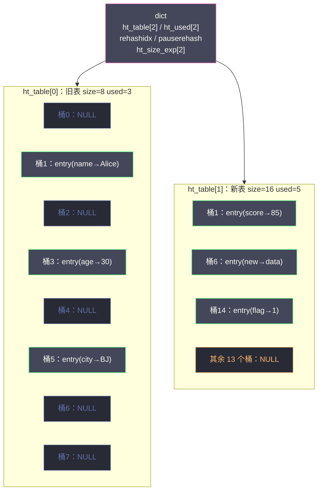
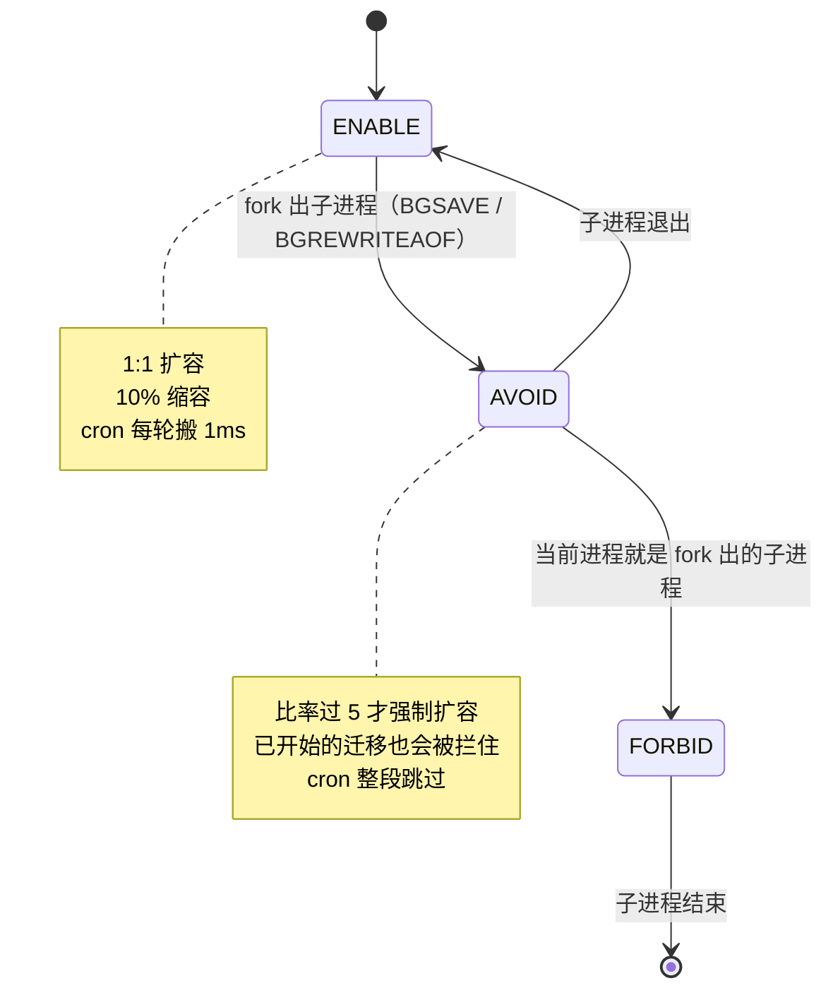
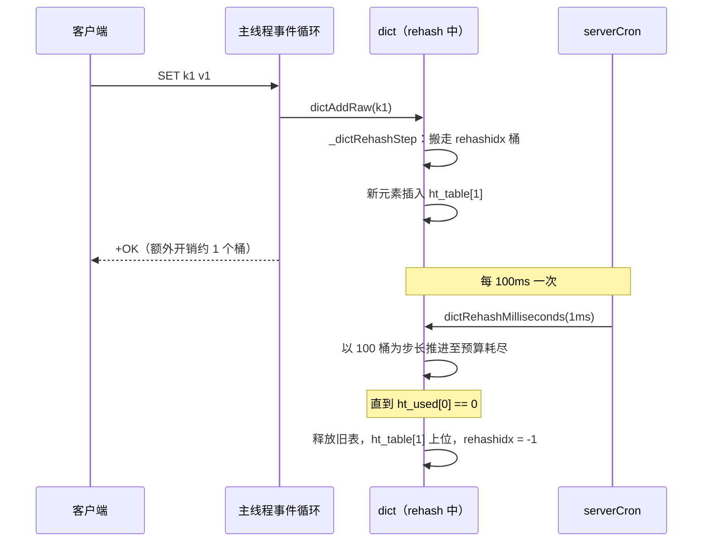
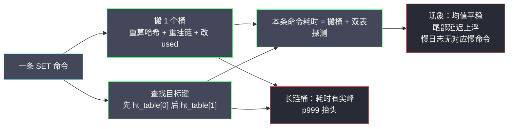
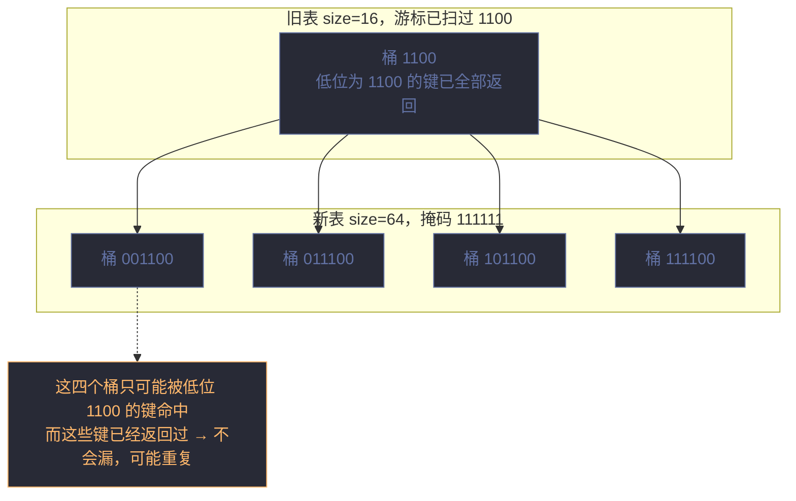
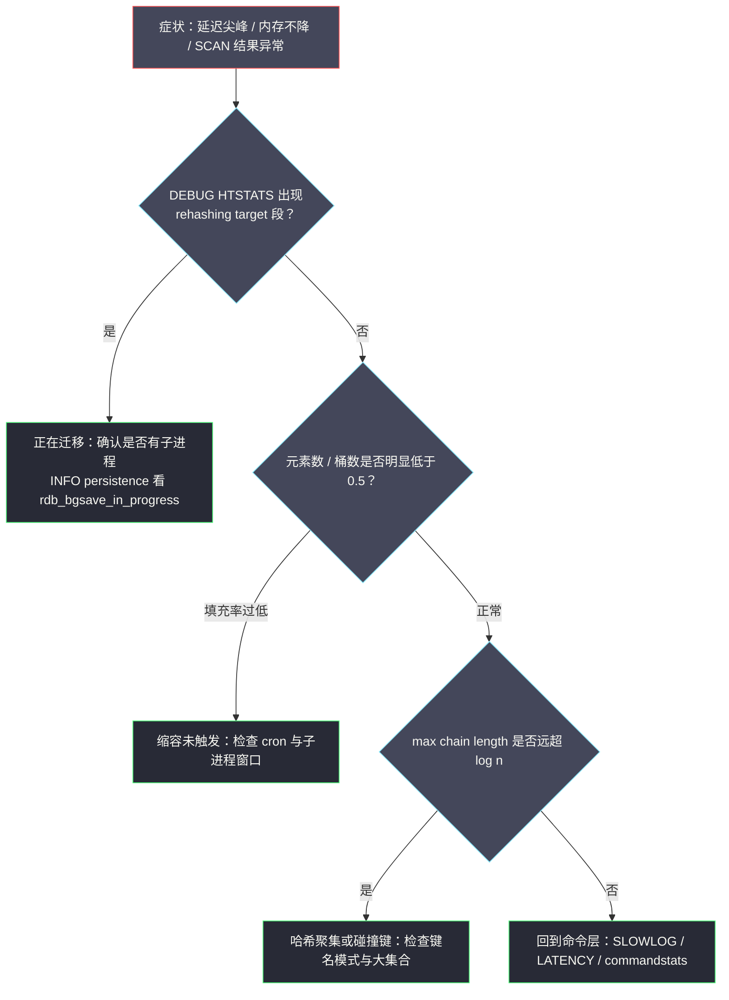

# 03 字典与渐进式 Rehash

**摘要：**

Redis 的键空间就是一张 dict，而这张 dict 的主人只有一个线程。这个组合决定了扩容不能一次做完：一百万个键重新散列需要几十到几百毫秒，这段时间里主线程既不读也不写。渐进式 rehash 把这次搬迁切成以桶为单位的碎片，塞进每一次命令的前置动作和 `serverCron` 的 1 毫秒预算里，代价是字典在很长一段时间里同时持有两张表。本文沿三条线展开。第一条是结构：`dict` → `dictht` → `dictEntry` 的三层形态，以及它在 7.0、7.2、8.0 里被拆平、被封装、被加上集合专用优化的过程。第二条是判定：`hash & sizemask` 的等价条件、SipHash 的随机种子、1:1 与 5:1 两条扩容线、`dict_can_resize` 的三态与 fork 窗口的耦合，逐一钉到源码与常量上。第三条是账单：内存放大的只是桶数组而非键值对、忙时一次搬桶可能搬走一整条长链、对象内部的 dict 拿不到 cron 的照顾、`SCAN` 的游标只承诺至少一次而不承诺不重。落点不在"渐进好不好"，而在三个具体数字上：你的库有多大、p99 预算多少、fork 窗口多长。把这三个数字代进去，才知道自己要为一次扩容还多久的债。

---

## 第 1 章 一次查找背后的两次定位

如果 Redis 只允许保留一张哈希表，一次 `GET` 最坏会停顿多久？这个问题的答案不在命令处理函数里，而在它下面那层几乎从不抛头露面的数据结构里。要回答它，得先把"键空间"这个词拆开看清楚：它不是抽象概念，而是一个具体的 `dict` 指针。

### 1.1 键空间就是一个 dict

`redisDb` 结构体里有两个字典指针，`dict` 存全部键值对，`expires` 存设置了过期时间的键。前者是整套命令体系的入口——`GET`、`SET`、`DEL`、`EXPIRE`，无论哪条路径，最终都要落到 `dictFind`、`dictAddRaw`、`dictDelete` 这三个函数之一上。`expires` 并不复制 key 字符串，它把主字典里那个 SDS 的指针直接拿来当自己的 key，value 存一个 `long long` 的毫秒时间戳，这也是为什么给一千万个键设置过期时间并不会让内存翻倍。

在 7.x 及以前，一个数据库只有这两张字典。8.0 引入了 kvstore，把键空间拆成多张 dict（Cluster 模式下按槽位划分，数量由 `num_dicts_bits` 决定），目的是让槽迁移与内存统计更精细，但每一张 dict 仍然是本文讨论的同一份实现，渐进式 rehash 的机制、阈值和代价一模一样。尺度感可以这样建立：一个一千万键、负载因子六成左右的实例，主字典的桶数是 2 的 24 次方，桶数组本身就占 128MB，而 rehash 时要为它准备一张 2 的 25 次方的表，也就是 256MB 的新桶数组。

### 1.2 单线程的时间预算

Redis 的网络模型是一个事件循环：`aeProcessEvents` 在一轮里先把可读事件处理掉、执行完这些客户端发来的命令，再看时间事件是否到期。`serverCron` 默认 `hz=10`，也就是每 100 毫秒被调用一次。整个循环里没有任何"后台执行体"能替主线程分担命令相关的内存操作，因此一条命令占用的 CPU 时间，就是这段时间内所有其他客户端被推迟的时间。

把这一点和"一次搬迁"放在一起，冲突就出现了。假设字典里有一百万个键，一次性 rehash 需要重新计算一百万个键的哈希、把一百万个节点的 `next` 指针重挂到新表、再释放旧桶数组。SipHash 处理一个十几个字节的短键在纳秒量级，加上访存和指针写的开销，单键成本落在几十纳秒到一百纳秒之间，整体就是几十毫秒到一百多毫秒——这是量级判断，真实的数字取决于 key 长度、CPU 缓存命中率和 jemalloc 的页行为。对于 p99 要求在个位数毫秒的在线服务，一次一百毫秒的停顿意味着这一秒内所有请求的超时预算都被吃光。

这种停顿不像慢查询那样有明确的触发命令，它藏在任意一条普通的 `SET` 里——正好是那次把负载因子推过阈值、触发扩容的命令。运维视角下看到的是一段"莫名其妙"的延迟尖峰，日志里没有任何一条慢命令对应它。

### 1.3 本文的三条线

第一条线回答"结构为什么长这样"：三层结构各自承担什么职责，为什么一定要两张表，`sizemask` 为什么存在，以及这些字段在 7.0 之后被拆平、在 7.2 之后被封装、在 8.0 之后被加上集合专用优化，分别换来了什么。

第二条线回答"判定条件是什么"：负载因子的两条扩容线从哪来，`dict_force_resize_ratio` 为什么在 7.x 是 5 而在 8.0 变成 4，缩容为什么必须等 cron，`dict_can_resize` 的三态如何与 fork 窗口联动。这些阈值不是随便定的，每一个背后都对应一种具体的故障形态。

第三条线回答"账单怎么结"：内存放大到底放大了什么，单次搬桶的抖动上界在哪里，半迁移状态会滞留多久，`SCAN` 的游标为什么不承诺不重复。这三条线合起来，才构成对一个设计的完整评价——只说"化整为零很巧妙"，等于什么都没说。

---

## 第 2 章 三层结构：从 dictEntry 到 dict

概念上的字典分三层：`dict` 是管理者，持有两张哈希表；`dictht` 是哈希表本身，持有桶数组和三个计数；`dictEntry` 是链表节点，一个节点承载一个键值对。这个分层在 7.0 之后被压平成两个实体，但理解时仍应按三层来看，因为职责边界没有变。

不妨拿门牌体系做个类比：`dict` 是物业的登记簿，`dictht` 是楼层索引，`dictEntry` 是具体的房门，找人时登记簿只说去第几层，楼层索引把人引到门牌，门牌后面才是住户。类比的失真处在第三层以后——现实里的门牌不会因为住客变多而被整体重排，而哈希表的"楼层"会在住客数量跨过阈值时重建一次，且重建过程不能把所有人一次性赶到新楼里。

### 2.1 dictEntry：链表节点

7.0 的 `dictEntry` 是下面这个样子，字段布局从 2.x 一直沿用到 7.1：

```c
typedef struct dictEntry {
    void *key;              /* 指向 SDS 或整数编码的 key */
    union {
        void *val;          /* 指向 redisObject 或内部结构 */
        uint64_t u64;       /* 过期时间戳、集合基数这类直接存值 */
        int64_t s64;
        double d;           /* ZSet 的 score */
    } v;
    struct dictEntry *next; /* 链地址法的后继指针 */
} dictEntry;
```

三个指针宽度，64 位下 24 字节，jemalloc 的尺寸类里落到 32 字节。联合体的存在是为了让"值不是指针"的字典不必再分配一次——`expires` 存时间戳、`dict` 存计数字典的计数，都直接把数字塞进 `v.u64`，省掉一次间接寻址和一块 16 字节的 `redisObject`。

插入用**头插法**。`dictInsertAtPosition` 把新节点的 `next` 指向原桶首节点，再把桶指针改成新节点，两次写就完事；尾插要先走完整条链，在发生冲突时退化成 O(链长)。源码注释里给的理由不只是快：数据库系统里刚写入的键更可能被立刻访问，放在链首能让下一次查找少走几步。

头插的代价落在删除上。单链表没有前驱指针，`dictGenericDelete` 必须在遍历时维护一个 `prevHe`，命中后分"删链首"和"删中间"两种情况处理。库层面还准备了 `dictTwoPhaseUnlinkFind` 与 `dictTwoPhaseUnlinkFree` 这组两阶段接口，原因是删除路径中间要插进模块通知、阻塞客户端唤醒、异步释放这些动作：先把节点从表里摘掉，把释放留到这些回调之后，回调里就不必担心表结构被自己改动过。

7.2 把这一层封装了起来：`dictEntry` 从 `dict.h` 里消失，变成不透明类型，外部只能通过 `dictGetKey`、`dictGetVal`、`dictGetNext` 这些访问器操作。封装的目的不是审美，而是为了给"集合语义"腾地方。当 `dictType` 的 `no_value` 标志置位时，字典被当成 Set 使用，value 永远是 NULL；如果同时满足所有 key 的地址都是奇数（SDS 指针天然满足），桶里就可以直接存这个 key 指针而不分配 `dictEntry`。区分"桶里存的是 entry 还是 key"靠指针最低三位的标记——8 字节对齐保证了这三位是自由的。一个装了百万整数的 Set，省下的正是那一百万个 32 字节的 entry 分配。

> [!info] 版本提示
> `no_value` 与 `keys_are_odd` 是 7.2 引入的。7.0 与 7.1 的 `dictEntry` 仍是公开结构体，没有这套指针标记。读源码时若在 7.0 的分支里找不到 `entryIsKey`，不是读错了文件。

### 2.2 dictht：桶数组与三个数

在 6.2 及以前，哈希表是一个独立结构体：

```c
typedef struct dictht {
    dictEntry **table;      /* 桶数组，每个元素是链首指针 */
    unsigned long size;     /* 桶数，恒为 2 的幂 */
    unsigned long sizemask; /* size - 1，缓存下来做位与 */
    unsigned long used;     /* 已挂载的节点数 */
} dictht;
```

`size` 与 `sizemask` 是同一个数的两种表示。把它们都存下来，是为了在所有查找路径上只做一次位与，而不必每次算 `size - 1`；`used` 是负载因子的分子，扩容与缩容的判定全靠它。

7.0 把 `dictht` 拆掉了，字段直接摊进 `dict`：

```c
struct dict {
    dictType *type;
    dictEntry **ht_table[2];   /* 两张表的桶数组 */
    unsigned long ht_used[2];  /* 两张表各自的节点数 */
    long rehashidx;            /* 迁移游标，-1 表示未在迁移 */
    int16_t pauserehash;       /* 暂停计数 */
    signed char ht_size_exp[2];/* 桶数只存指数，size = 1 << exp */
    void *metadata[];          /* 调用方自定义附加区 */
};
```

这次改动省掉的是每张表两个 `unsigned long` 的冗余：`size` 和 `sizemask` 都能从指数推出来，于是 `size` 只留一个 `signed char`。宏 `DICTHT_SIZE(exp)` 与 `DICTHT_SIZE_MASK(exp)` 承担了原来的字段访问，`exp == -1` 表示这张表还不存在、桶数为 0。对一个存了上亿键的实例，字典对象本身的这点节省微不足道，但 Redis 里字典的数量远超数据库数量——每个 Hash、每个 Set、每个 ZSet 都带一份——单个结构省 14 字节，乘以千万级的对象数就不是小数目了。8.0 又在这个结构尾部加了 `pauseAutoResize`，把"暂停 rehash"和"暂停自动扩缩容"拆成两个计数，因为缩容下沉到删除路径之后，两者需要独立控制。

### 2.3 两张表：为迁移准备的第二个槽位

`ht_table[2]` 是整个设计的支点。不迁移时只有 `ht_table[0]` 有效，`ht_table[1]` 为空指针，`rehashidx == -1`。迁移开始时，新表被分配到 `ht_table[1]`，`rehashidx` 置 0；此后每一次搬迁都在缩小第一张表、扩大第二张表；迁移结束时把第二张表整体搬回第一个槽位，第二个槽位复位。



图中 `rehashidx == 2`：桶 0、1 已经搬空，桶 2 起还是旧数据；新表里既有从旧表迁过来的 `name`、`age`，也有迁移期间新写入的 `new`、`flag`、`score`。这正是渐进式 rehash 中间态的标准长相——两张表都非空，`ht_used` 之和才是字典的真实元素数。

### 2.4 dictType：把哈希与比较外置

`dict` 本身不知道 key 是什么类型，所有与类型相关的动作都通过 `dictType` 的函数指针完成：`hashFunction` 算哈希、`keyCompare` 判等、`keyDestructor` 释放、`keyDup` 复制，此外还有 7.0 引入的 `expandAllowed` 回调，以及 7.2 引入的 `no_value`、`keys_are_odd` 两个标志位。这套策略模式让同一份哈希表代码同时服务于字符串键空间、`IP:Port` 节点表、整数集合、带过期时间的 `expires`，以及 Cluster 里以二进制节点 ID 为键的字典。

`expandAllowed` 值得单独说一句。它把"这次扩容是否被允许"的决定权交还给调用方，Redis 侧的实现会在内存逼近 `maxmemory` 时拒绝扩容——因为扩容本身要分配一块新的桶数组，在内存已经告急时再要几百 MB，很可能直接把实例送进 OOM 淘汰逻辑，甚至触发内核的 OOM Killer。这条回调把"哈希表要健康"与"进程要活着"这两个目标的优先级显式化了：活着优先。

---

## 第 3 章 sizemask：把取模换成位与的等价条件

第二章里 **sizemask** 一直挂在那里没有解释。它不是性能优化的小把戏，而是一条数学性质在工程上的落地，而这条性质反过来约束了哈希表大小只能取 2 的幂。

### 3.1 等价性的证明与反例

设表大小 `size = 2^n`，则 `sizemask = size - 1` 的二进制是低 n 位全 1、其余全 0。对任意整数 `h`，`h % size` 等于 `h` 除以 `size` 的余数，而 `size = 2^n` 意味着这个余数正是 `h` 的低 n 位，高位被整除部分带走。于是 `h & sizemask` 与 `h % size` 逐位相等，位与只是把余数"取出来"，没有做任何额外运算。

反例能说明这个条件有多紧。取 `size = 10`，`sizemask` 若按 `size - 1` 算得 9，二进制 1001。取 `h = 11`，`11 & 9 = 1001` 得 9，而 `11 % 10 = 1`，两者不等。原因是 10 的二进制 1010 并非全 1 的低位掩码，位与会把某些本该进位的高位留下、把某些该保留的位抹掉。

所以"扩容后的桶数必须是 2 的倍数"这个说法只说对了一半：**桶数必须取 2 的整数次幂**，扩大一倍只是最常见的那一种情形。缩容同理，`dictResize` 算出的目标大小也经过 `_dictNextExp` 向上取整到 2 的幂。这个约束贯穿全部代码路径：初始大小 `DICT_HT_INITIAL_SIZE = 4` 是 2 的幂，扩容目标 `_dictNextExp(used + 1)` 是 2 的幂，就连 `DICTHT_SIZE_MASK` 宏在表不存在时返回 0 也保持了"掩码是 2 的幂减一"的形式。

### 3.2 位与的代价落在哈希质量上

省下一次除法的代价，是把均匀性要求前移到了哈希函数。取模对任意 size 都能把哈希值均匀映射到桶上，位与只保留低位——如果哈希函数的低位分布不均，冲突就会集中在少数桶里。这也是为什么 Redis 不用 `CRC32` 之类低位性质不佳的校验和，而要求一个雪崩效应良好的哈希：输入改一个 bit，输出约一半 bit 翻转，低位自然也是均匀的。

顺带解释了一个常见困惑：为什么 Redis 的哈希表不会出现"某个桶巨长、其他桶空着"的情况。在随机哈希假设下，n 个键映射到 n 个桶，最大链长的期望是 O(log n / log log n) 量级——一百万个键时这个值大约在 5 到 6 之间。反过来，一旦观察到 `DEBUG HTSTATS` 里最大链长远超这个量级，就说明要么键的分布本身有结构，要么哈希函数被绕过，而不是负载因子出了问题。

### 3.3 位运算性质在 rehash 里的二次利用

幂等大小还带来两个结构性质，后面几章会反复用到。

第一个性质关于扩容。新表大小是老表的两倍，`sizemask` 从 `2^n - 1` 变成 `2^(n+1) - 1`，恰好多出最高一位。于是旧表里桶 `i` 上的所有节点，在新表里只会落到 `i` 或 `i + 2^n` 两个桶——决定去哪的只是哈希值新增的那一位。这条性质是 `SCAN` 游标能工作的全部依据：遍历旧表一个桶时，同时遍历新表里对应的两个桶，就不会遗漏任何元素。

第二个性质关于缩容。新掩码是老掩码的子集，所以旧桶索引与新桶索引之间只差一次位与，连哈希都不用重算。7.2 的 `dictRehash` 里有一段专门处理这种情况：

```c
if (d->ht_size_exp[1] > d->ht_size_exp[0]) {
    /* 扩容：需要哈希值的高位，得重新算 */
    h = dictHashKey(d, key) & DICTHT_SIZE_MASK(d->ht_size_exp[1]);
} else {
    /* 缩容：新掩码更小，直接把旧桶号再掩一次 */
    h = d->rehashidx & DICTHT_SIZE_MASK(d->ht_size_exp[1]);
}
```

注意缩容分支里用的是 `rehashidx` 而不是 `h`。这不是偷懒：因为 `hash & mask0 == rehashidx` 是元素能待在这个桶里的定义，把它再与更小的掩码位与，结果当然就是新桶号。省掉一次哈希重算，在一百万个键的缩容里就是一百万次 SipHash 的开销。

---

## 第 4 章 哈希函数：从 MurmurHash2 到 SipHash

位与把哈希值的低位直接暴露成桶号，这带来一个安全问题：如果哈希函数可预测，攻击者就能构造一批全部落到同一个桶的键，把 O(1) 的查找退化成 O(n) 的链表遍历。Redis 为这个问题换过一次哈希函数，这次更换的时间点、选型和后续影响，恰好是"安全与吞吐如何取舍"的一个完整案例。

### 4.1 MurmurHash2 与固定种子

3.2 及以前的版本用 MurmurHash2，种子是一个编译期常量：

```c
/* redis 3.2 src/dict.c */
static uint32_t dict_hash_function_seed = 5381;
```

MurmurHash2 是 Austin Appleby 在 2008 年发布的一族非加密哈希，设计目标是快且分布均匀：按 4 字节或 8 字节为一个块做乘加与移位，现代 CPU 上单次处理十几个字节只需十几纳秒，雪崩效应也足够好。以"随机输入"为前提，它完全胜任。

问题出在前提上。服务端面对的输入不是随机的，而是攻击者可控的。种子固定意味着哈希值可离线复算，攻击者可以在一台机器上找出几万个哈希值低位相同的键，一次性灌进 Redis，让它们全部落进同一个桶。此时每次 `GET` 都要走几万次指针跳转和字符串比较，单线程被这一条链吃满，整个实例对正常请求失去响应。这类攻击在 2011 年前后随几篇针对哈希表的论文进入主流视野，同一时期多门语言的运行时都改用了带随机种子的哈希，Redis 的动作发生在 2017 年的 4.0。

### 4.2 4.0 的选择：SipHash-1-2 加随机密钥

4.0 的 release notes 里有一行直白的记录："Use SipHash hash function to mitigate HashDos attempts."。实现上换了三件事：算法换成 SipHash；密钥从 4 字节常量变成 16 字节随机数；随机数在进程启动时由 `getRandomBytes` 从系统熵源取，位置在 `main()` 里、`initServerConfig()` 之前。

SipHash 是 Aumasson 与 Bernstein 在 2012 年提出的带密钥伪随机函数，两个数字分别指每个消息块的压缩轮数与收尾混合轮数，1-2 即压缩一轮、收尾两轮。antirez 在 `siphash.c` 的文件头注释里写清了选型理由：1-2 的安全强度不如推荐值 2-4，但"没有已知的针对减少轮数的简单攻击"，而且它与原先的 MurmurHash2 大致**同速**，2-4 则会让 Redis 整体慢约 4%。

这个 4% 的取舍值得停一下。对一个每秒处理几十万次操作的实例，4% 是实打实的吞吐损失；而 1-2 的强度在"防止构造碰撞"这个具体目标上已经够用——攻击者要找到碰撞，面对的是密钥未知的 64 位输出，而不是固定种子的确定性映射。安全强度不是越高越好，是"够挡住这类攻击"就好，多出来的强度会被吞吐成本抵消。这是典型的工程判断，不是密码学判断。

### 4.3 随机种子的三个副作用

第一，重启后桶分布会变。种子不落盘，RDB 里只存键值不存哈希，载入时按新种子重新计算桶号。这意味着同一批键在两次启动后的物理分布不同，`SCAN` 的返回顺序也随之改变——本来就不承诺顺序，但把顺序当成可复现的调试依据会踩坑。

第二，主从与 Cluster 不受影响，因为复制传的是命令而不是哈希值，从库自己按自己的种子重算。反过来说，任何"用 Redis 内部哈希做分片"的客户端方案都是错的：客户端算不出服务端的种子，也就无法预测键落在哪张表。

第三，`DEBUG HTSTATS` 之类工具的输出在重启前后不具备可比性，做容量基线时要么在同一次进程生命周期里比，要么只比桶数与链长分布的统计量，不比具体桶号。

| 算法 | 输出宽度 | 种子 | 抗构造碰撞 | Redis 中的使用区间 |
|---|---|---|---|---|
| MurmurHash2 | 32/64 位 | 编译期常量 5381 | 否 | 3.2 及以前 |
| SipHash-1-2 | 64 位 | 每进程 16 字节随机 | 是 | 4.0 起 |
| SipHash-2-4 | 64 位 | 每进程 16 字节随机 | 是 | 官方未采用，约慢 4% |
| CRC32 / MD5 | 32 / 128 位 | 无 / 无 | 否 / 慢 | 均不用于字典 |

---

## 第 5 章 何时搬：两条扩容线、一条缩容线与 fork 窗口

阈值是最容易被二手资料写错的部分。倒不是因为数字难记，而是因为这些数字随版本变过，而"变过"这件事本身就携带信息——每次调整都对应一种被观察到的故障。

### 5.1 扩容：1:1 与 5:1

7.2 的判定逻辑压缩成一行条件：

```c
if ((dict_can_resize == DICT_RESIZE_ENABLE &&
     d->ht_used[0] >= DICTHT_SIZE(d->ht_size_exp[0])) ||
    (dict_can_resize != DICT_RESIZE_FORBID &&
     d->ht_used[0] / DICTHT_SIZE(d->ht_size_exp[0]) > dict_force_resize_ratio))
{
    return dictExpand(d, d->ht_used[0] + 1);
}
```

第一个分支是常规扩容：**负载因子达到 1:1**（元素数等于桶数）且全局开关处于允许状态。第二个分支是强制扩容：即使开关处于"尽量避免"的状态，只要元素数超过桶数的 5 倍，也必须扩。两个分支的差别解释了 5 这个数字的来历——它不是容量目标，而是"容忍上限"：在没有子进程的时候，负载因子根本到不了 5，因为在 1:1 时就已经扩过了；只有开关被降级、且当时没有正在进行的迁移，元素才会一路堆到 5 倍，此时链长已经把查找拖慢，值得无视代价强行整理一次。这里有个容易被忽略的前置条件：`_dictExpandIfNeeded` 开头第一句就是 `if (dictIsRehashing(d)) return DICT_OK;`，一旦有一轮迁移停在那里，后续所有扩容请求都被静默丢弃，强制分支也不例外。

`dict_force_resize_ratio` 的位置也说明它的性质：不在 `server.h` 的配置常量区，而是 `dict.c` 内部的静态变量，7.x 取 5，8.0 改成 4。8.0 同时把 `HASHTABLE_MIN_FILL` 从 10 调到 8，两处在 AVOID 模式下给出的容忍区间是扩容侧 4 倍、缩容侧 32 倍（即 `1 / (HASHTABLE_MIN_FILL × 4)`），源码注释只陈述这组数字，没有写推导。可以确认的是这两个阈值必须成对维护：只改其中一个，删除与插入交替进行时，表就可能在两次操作之间反复扩缩。

### 5.2 扩容目标：`used + 1`，不是 `used * 2`

很多资料写"新大小是第一个不小于 `used * 2` 的 2 的幂"。这个写法在 6.x 的源码里就已经对不上了，实参是 `ht_used[0] + 1`，目标大小由 `_dictNextExp` 向上取到 2 的幂：

```c
static signed char _dictNextExp(unsigned long size) {
    if (size <= DICT_HT_INITIAL_SIZE) return DICT_HT_INITIAL_EXP;
    if (size >= LONG_MAX) return (8*sizeof(long)-1);
    return 8*sizeof(long) - __builtin_clzl(size-1);
}
```

两种写法在常规扩容时结果相同，因为触发点是 `used == size`，此时 `used + 1` 正好越过 2 的幂，取整后就是两倍。差异在强制扩容时暴露：桶数 1024、元素数 6000（比率 5.86），按 `used + 1` 得到 6001，向上取整是 8192；按 `used * 2` 得到 12000，向上取整是 16384。真实实现选 8192，把负载因子从 5.86 拉回 0.73，既解决了链长问题，又没有多分配一倍桶数组。这个细节对估算扩容瞬间的内存峰值很关键：按错的公式算，会高估一倍。

### 5.3 缩容：一条线加三个前置条件

缩容的判定函数在 `server.c`：

```c
int htNeedsResize(dict *dict) {
    long long size = dictSlots(dict), used = dictSize(dict);
    return (size > DICT_HT_INITIAL_SIZE &&
            (used*100/size < HASHTABLE_MIN_FILL));
}
```

`HASHTABLE_MIN_FILL` 在 7.x 是 10，也就是填充率低于 10% 才缩；8.0 改成 8，对应 12.5%。目标大小是 `dictExpand(d, max(used, 4))`，同样是向上取 2 的幂。这解释了"删掉九成键、内存却不降"的常见现象，原因有三个：其一，缩容的触发线是 10% 而不是 50%，删掉一半根本不触发；其二，判定发生在 `databasesCron` 的 `tryResizeHashTables` 里，而这段代码被包在 `if (!hasActiveChildProcess())` 中，只要有 RDB 或 AOF 重写子进程在跑，本轮就不检查；其三，每次 cron 只轮询 `CRON_DBS_PER_CALL`（16）个库，库多的时候一轮下来覆盖不全。

8.0 把缩容判定塞进了删除路径：`dictGenericDelete` 摘掉节点、`ht_used` 减一之后立刻调用 `_dictShrinkIfNeeded`，缩容不再依赖 cron。这个改动的收益是"删完就收"，代价是删除操作多了一次比率判断，而且在 fork 窗口里还得靠 `dict_can_resize` 拦住——于是有了 `pauseAutoResize` 这个独立计数。

| 动作 | 条件 | 7.x 取值 | 8.0 取值 | 调大或调小的代价 |
|---|---|---|---|---|
| 常规扩容 | 元素数 ≥ 桶数 | 1:1 | 1:1 | 调小则频繁扩容，每次都要分配新桶数组 |
| 强制扩容 | 元素数 / 桶数 > 比率 | 5 | 4 | 调大则长链拖慢查找；调小则 fork 窗口内频繁大块分配 |
| 缩容 | 填充率 < 阈值 | 10% | 12.5% | 调大则频繁缩容；调小则空桶长期占内存 |
| 初始大小 | 首次插入 | 4 桶 | 4 桶 | 调大则小字典浪费；调小则小对象多一次扩容 |

### 5.4 三态开关与 fork 的耦合

**dict_can_resize** 在 6.0 之前是布尔量，之后变成三态枚举，这个变化本身就是对"fork 期间能不能搬表"这个问题的一次细化：

```c
void updateDictResizePolicy(void) {
    if (server.in_fork_child != CHILD_TYPE_NONE)
        dictSetResizeEnabled(DICT_RESIZE_FORBID);
    else if (hasActiveChildProcess())
        dictSetResizeEnabled(DICT_RESIZE_AVOID);
    else
        dictSetResizeEnabled(DICT_RESIZE_ENABLE);
}
```

**FORBID** 只出现在 fork 出的子进程里——子进程只负责写 RDB 或重写 AOF，它自己不该再去动哈希表，否则会把自己那份页弄脏。**AVOID** 用在有子进程存活的父进程上：不主动扩容，但如果已经开始的迁移比率过关（扩容时新表不足老表 5 倍 / 缩容时老表不足新表 32 倍），可以继续搬。



这个状态的杀伤力在 `dictRehash` 的开头：

```c
if (dict_can_resize == DICT_RESIZE_FORBID || !dictIsRehashing(d)) return 0;
if (dict_can_resize == DICT_RESIZE_AVOID &&
    ((s1 > s0 && s1 / s0 < dict_force_resize_ratio) || ...))
{
    return 0;
}
```

也就是说，**AVOID** 不只是"不新开迁移"，已经进行到一半的那次迁移也会停住。一条 `BGSAVE` 触发的 fork 存活期间，父进程的字典会保持"两张表都非空"的状态，每次查找要多探测一张表，桶数组的内存也占着不放。而 `databasesCron` 里那段 `if (!hasActiveChildProcess())` 又把 resize 与 cron rehash 一起挡住，形成双重保险。

为什么对 fork 这么敏感，答案在写时复制。fork 之后父子进程共享物理页、页表却是只读的，任何一方写入某个页，内核就要复制那一页。搬桶是密集的写操作：改桶指针、改 `next` 指针、改 `ht_used`，一千万个桶的表搬起来会把大量原本共享的页变成父进程私有的副本，内存占用在快照过程中暴涨。RDB 的 fork、COW 与 THP 的关系属于另一条主线（见 [[07 RDB 持久化——快照的 fork 与 COW 机制]]），这里只需要记住结论：rehash 与 fork 争的是**同一批页**，也抢同一条内存带宽，所以 Redis 选择在 fork 窗口里让 rehash 退让。

---

## 第 6 章 渐进式 rehash 的机制

### 6.1 被切碎的是什么

被切碎的不是"工作量"，而是"停顿"。总工作量一分未减，甚至略有增加——每次迁移都要重新算哈希（缩容除外）、都要判断游标、都要维护两个 `used` 计数。渐进式设计换来的东西只有一个：任何一次函数调用都不再需要几百毫秒。

切分的单位是桶，不是节点。`dictRehash(d, n)` 的语义是"处理 n 个非空桶"，一个桶上的整条链在一次调用里搬完，所以单次工作量取决于链长而不是元素总数。这个选择很实际：桶内节点本来就要遍历整条链才能挂到新表，拆开反而要额外记住"上次搬到哪个节点"。

拿搬家打个比方：不是某天把整栋楼推平重建，而是每天拎走一只纸箱，其余时间住户照常过日子。类比的失真处在箱子的大小——现实里箱子可以再拆小，这里的"桶"却是一次搬完的最小单位，一只箱子里塞了两百个节点，那天就得一口气搬两百个。

### 6.2 游标：rehashidx 的语义与边界

**rehashidx** 表示"`ht_table[0]` 里下标小于它的桶已经搬空"。初值 0 表示从桶 0 开始，-1 表示不在迁移。它在整个迁移过程中单调递增，且被断言保护：

```c
assert(DICTHT_SIZE(d->ht_size_exp[0]) > (unsigned long)d->rehashidx);
```

这个断言成立的前提是"只要 `ht_used[0] != 0`，游标就一定还没走到表尾"——因为搬家只会让第一张表变空，不会让它变长。缩容时也一样：虽然 `ht_table[1]` 比 `ht_table[0]` 小，但搬的方向仍是 0 → 1，游标语义不变，只是索引重算走掩码分支。

完整的主体逻辑如下，注释解释了为什么空桶要有上限：

```c
int dictRehash(dict *d, int n) {
    int empty_visits = n*10;   /* 空桶访问上限，防止稀疏表里长时间空转 */
    if (!dictIsRehashing(d)) return 0;

    while (n-- && d->ht_used[0] != 0) {
        dictEntry *de, *nextde;
        /* 跳过连续空桶，但最多跳过 n*10 个 */
        while (d->ht_table[0][d->rehashidx] == NULL) {
            d->rehashidx++;
            if (--empty_visits == 0) return 1;
        }
        de = d->ht_table[0][d->rehashidx];
        while (de) {                       /* 整条链搬完 */
            nextde = de->next;
            uint64_t h = /* 扩容重算哈希 / 缩容直接掩码 */;
            de->next = d->ht_table[1][h];  /* 头插进新表 */
            d->ht_table[1][h] = de;
            d->ht_used[0]--;
            d->ht_used[1]++;
            de = nextde;
        }
        d->ht_table[0][d->rehashidx] = NULL;
        d->rehashidx++;
    }
    if (d->ht_used[0] == 0) {              /* 收尾：第二张表上位 */
        zfree(d->ht_table[0]);
        d->ht_table[0] = d->ht_table[1];
        d->ht_used[0] = d->ht_used[1];
        d->ht_size_exp[0] = d->ht_size_exp[1];
        _dictReset(d, 1);
        d->rehashidx = -1;
        return 0;
    }
    return 1;
}
```

`empty_visits` 这个上限容易被忽略，但它处理的是一个真实场景：缩容后的表填充率可能只有 10%，意味着连续九个桶都是空的。如果没有上限，一次 `dictRehash(d, 1)` 可能扫过成千上万个空桶才找到一个节点，单次调用时间不可控。上限设成 `n * 10`，配合调用方传入的 `n`，把"扫空桶"的代价也包进了预算里。

### 6.3 三个驱动入口

第一张表不会自己变空，得有东西去推。Redis 有三个推手。

命令驱动。`dictFind`、`dictAddRaw`、`dictDelete`、`dictUnlink` 等几乎所有操作在开头都有一句 `if (dictIsRehashing(d)) _dictRehashStep(d);`，而 `_dictRehashStep` 在暂停计数为 0 时调用 `dictRehash(d, 1)`。注意它发生在业务逻辑之前：先搬一个桶，再做这次查找或插入。因此一次命令的额外开销就是"搬一个桶 + 本次操作照常"。

cron 驱动。`databasesCron` 在有子进程时整段跳过，否则先调 `tryResizeHashTables` 检查缩容，再调 `incrementallyRehash`：

```c
int incrementallyRehash(int dbid) {
    if (dictIsRehashing(server.db[dbid].dict)) {
        dictRehashMilliseconds(server.db[dbid].dict, 1);
        return 1;
    }
    if (dictIsRehashing(server.db[dbid].expires)) {
        dictRehashMilliseconds(server.db[dbid].expires, 1);
        return 1;
    }
    return 0;
}
```

`dictRehashMilliseconds` 以 100 个桶为步长、以 1 毫秒为预算循环调用 `dictRehash`，超时即停。8.0 把它换成 `dictRehashMicroseconds`，并把预算常量提成 `INCREMENTAL_REHASHING_THRESHOLD_US = 1000`，配合 kvstore 在多张 dict 之间共享这 1 毫秒。

手动驱动。`dictExpand` 可以由模块、`DEBUG` 命令或内部逻辑直接发起，`dictResize` 走的也是同一条路。发起之后并不会同步搬完，`rehashidx` 置 0 就返回，后续仍由前两个推手推进。

| 入口 | 触发者 | 单次预算 | 受 fork 影响 | 覆盖范围 |
|---|---|---|---|---|
| 命令驱动 | 每次 dict 操作 | 1 个非空桶（最多跳 `n*10` 个空桶） | 是，AVOID 下直接返回 | 被操作的每一个 dict |
| cron 驱动 | `serverCron` → `databasesCron` | 100 桶步长、1ms 上限 | 是，整段跳过 | 仅 `db->dict` 与 `db->expires` |
| 手动驱动 | 模块 / `dictExpand` | 只建立迁移状态，不搬 | 是，建立时会校验 | 调用者指定的 dict |

### 6.4 两张表并存时的读写规则

迁移期间，任何一次访问都可能撞上"数据一半在旧表、一半在新表"的局面。四条规则把它约束成一个可以推理的状态机。

查找先旧后新。`dictFind` 拿哈希值算两次索引，先查 `ht_table[0]`，没找到且正在迁移才查 `ht_table[1]`，两边都没有才返回 NULL。

插入只进新表。`dictAddRaw` 在计算插入位置时，用 `htidx = dictIsRehashing(d) ? 1 : 0` 决定往哪张表里放。这条规则是迁移能终止的根本保证：旧表的元素数只减不增，只要没有新元素进来，游标一定能走到表尾。

删除两张表都试。`dictGenericDelete` 对 `table = 0` 和 `table = 1` 各扫一遍，命中即摘。因为一个键要么在旧表、要么在新表，不存在同时存在于两处的情况。

计数求和。`dictSize(d)` 返回 `ht_used[0] + ht_used[1]`，`dictSlots(d)` 返回两张表的桶数之和。任何用单表 `used` 去判断"字典空不空"的代码都会在迁移期间出错，源码里因此提供了 `dictIsEmpty` 这个宏而不是让调用方自己比较。

这四条合起来构成一个不变量：`ht_used[0]` 单调递减，`ht_used[1]` 单调递增，且两者之和等于字典元素总数。只要插入不进旧表，第一条就不会被破坏，进度必然收敛。

### 6.5 暂停：pauserehash 为什么是计数器

有些时刻不能让表动。`dictScan` 在回调期间、安全迭代器在整个遍历期间，都会把 **pauserehash** 加一；对应的恢复动作减一。用计数器而不是布尔量，是因为暂停可能嵌套：一次 `SCAN` 触发的回调里如果又调用了会遍历字典的内部函数，两层暂停各自加减，只有全部退出后才真正恢复。

这里要纠正一个流传很广的因果。`pauserehash` 不是为了"保证 `SCAN` 结果一致"——`SCAN` 在 rehash 期间本来就会返回重复元素，暂停改变不了这一点。源码注释写得很清楚：`dictScan` 暂停是为了"以防回调里做了 `dictFind` 之类的操作"，即防止回调持有 entry 指针时表被搬走，导致悬空访问。真正决定 `SCAN` 语义的是第 8 章的反向二进制游标，与暂停无关。

暂停的代价是真实存在的。一个安全迭代器从第一次 `dictNext` 起就把迁移挂起，直到 `dictReleaseIterator` 才恢复；如果这段代码在大字典上执行得慢，迁移就会被拖住相应的时间。这也是为什么 Redis 内部的迭代器大多短命——挂着一个长时间不释放的迭代器，等于给 rehash 踩了刹车。

### 6.6 完成时刻

`ht_used[0]` 归零的那次调用做四件事：释放旧桶数组、把新表的三个字段整体拷到槽位 0、把槽位 1 复位、游标置 -1。此后字典回到"一张表"的常态，后续查找恢复单次探测。整个过程中元素节点一次都没有被复制，只是被重新挂链——这也是第 7 章内存账目的基础。



---

## 第 7 章 代价：内存、抖动与半迁移

一个设计解决了什么问题容易说清，付出了什么代价才是评价的起点。渐进式 rehash 的账单有四项：内存放大、单命令抖动、半迁移滞留、读路径退化。

### 7.1 内存：放大的是桶数组，不是键值对

常见说法是"rehash 期间内存翻倍，因为有两张表"。这句话的方向对，量级错得离谱。节点本身不复制：`de->next = d->ht_table[1][h]` 只是把同一个 `dictEntry` 重新挂到新桶上，键和值都还在原地。真正同时存在两份的只有桶数组。

按示例推算：一百万个键刚好把表填到 1:1，当前桶数 2 的 20 次方（1,048,576 个桶，8.4MB），扩容后 2 的 21 次方（2,097,152 个桶，16.8MB）。迁移期间两份桶数组共存，瞬时多出 8.4MB。同一批数据的节点开销按每键 32 字节 entry 加三四十字节的 key 对象估算，约 70MB。也就是说，瞬时放大只占数据量的 12% 左右，而不是 100%。

不过"只有桶数组"不等于"可以忽略"。桶数组是一次性 `zcalloc` 出来的连续内存：一千万键的实例扩容到 2 的 25 次方桶，就是单次 256MB 的零初始化分配。这种大块分配本身就可能触发内核回收、swap 甚至分配失败，而随后的搬迁又要把这些页逐一写脏——前半程的开销不在搬桶，在 `calloc`。把这一点和"fork 窗口内 AVOID 又会拦住迁移"叠起来看，就能理解为什么有时期望中的扩容迟迟不发生，内存却先被别的路径吃完了。

### 7.2 抖动：一次搬桶可能搬走一整条长链

第 6 章说"单次搬迁的粒度是桶"，这句话的另一面是：桶的链长没有上界。正常情况下最大链长是 O(log n / log log n) 量级，但三种情况下会显著变长——哈希质量差导致聚集、强制扩容前负载因子已经堆到 5、以及人为构造的碰撞键。

后果是延迟分布的形状变了。渐进式 rehash 把"一次确定的百毫秒停顿"换成了"一大批亚毫秒的小停顿加少数几个尖峰"：平均延迟几乎不动，p99 与 p999 会明显抬头，而抬头的时点与业务写入量、键空间大小、是否恰好跨过 2 的幂边界相关。这类抖动很难从监控上归因，因为慢日志记录的通常是单条命令的总耗时，而那次搬桶恰好被摊在了某条平平无奇的 `SET` 上。

`empty_visits` 只限制了空桶的访问数，没有限制工作量。一亿个桶的表里如果有一个桶挂着 200 个节点，搬这个桶的那次调用就要做 200 次重哈希和重挂链。要缓解只能从数据侧入手：避免可预测的键名模式、避免单键元素数过大的集合、必要时用分片键把大 Hash 拆开。

### 7.3 半迁移滞留：最贵的一项

内存与抖动都是瞬时成本，**半迁移滞留**是状态成本。字典进入"两张表"状态之后，只有在三种推手持续作用时才会退出：有命令打到这个字典、cron 处理到它、或者没有子进程。

对象内部的字典恰好三条都不占。`incrementallyRehash` 只遍历 `server.db[dbid].dict` 与 `server.db[dbid].expires`，它不知道某个 Hash 对象的 `ht` 里还有一张半迁移的表。这意味着：一个两百万字段的 Hash 在某次写入中触发扩容，随后业务流量骤降、写入停止，它就永远停在中途——两张表都占着，每次 `HGET` 要多探测一张表，`HSCAN` 要扫两遍。同理，`fork` 窗口里 `dictRehash` 一开头就返回，父进程的字典在子进程存活期间保持拆分；一次全量 AOF 重写持续几十秒，键空间就拆分几十秒。

判断方法很直接：`DEBUG HTSTATS <dbid>` 如果打印出 "Hash table 0" 和 "Hash table 1" 两段（第二段标题是 "rehashing target"），说明该库正在迁移；`DEBUG HTSTATS-KEY <key>` 对具体对象做同样的事。这两个命令是现场唯一能直接看到迁移状态的入口，值得放进排障手册。

### 7.4 读路径退化：从一次探测到两次

迁移期间，每次查找最多要算两个索引、查两条链。哈希值算一次就够（同一轮里 `h` 被复用），所以增加的成本主要是两次桶访问和可能的两次链表遍历，量级上是常数倍而不是数量级。但"常数倍"在 p99 语境里是有意义的：本来命中率极高的查找变成两倍内存访问，缓存未命中率上升，尾部延迟跟着上浮。

命令驱动还会额外付出搬桶成本。高 QPS 场景下这个成本其实被摊得很薄——每秒十万条命令就是每秒十万个桶，一千万桶的表一百秒搬完。但如果流量正好在这一百秒内从十万跌到一千，进度会按比例放慢一千倍，于是"半迁移"从一百秒变成一天多。这就是 7.3 那节说的滞留，它与 7.4 的读路径退化是同一枚硬币的两面。



| 代价 | 量级 | 可观测判据 | 缓解手段 |
|---|---|---|---|
| 桶数组瞬时叠加 | 新表 50% 左右，旧表的 3 倍 | `used_memory` 阶梯上升 + `INFO memory` | 扩容窗口避开业务高峰 |
| 大块 `calloc` | 千万键实例约 256MB 一次分配 | 分配期间延迟尖峰、页错误率 | 控制单实例键数 |
| 单桶长链 | 单次搬桶可达数百节点 | `DEBUG HTSTATS` 的 max chain length | 避免可预测键名、拆分大集合 |
| 半迁移滞留 | 从秒级到小时级 | `DEBUG HTSTATS` 出现两段输出 | `activerehashing yes`、避免长 fork |
| 双表探测 | 常数倍访存，尾部延迟上浮 | p99 / p999 与均值背离 | 减小 fork 窗口、控制写入节奏 |

---

## 第 8 章 SCAN：游标为什么是反序二进制

`SCAN` 是唯一一个能在不阻塞主线程的前提下遍历整个键空间的命令，它的正确性从头到尾依赖 rehash 的性质。理解它的游标，等于从另一个角度再看一遍"两张表、2 的幂、位与"这三件事。

### 8.1 线性游标为什么会漏

假设游标就是从 0 开始递增的桶号，当前表 16 个桶，客户端扫到桶 4 时表扩容到 64。旧表桶 4 上的元素在新表里可能落到 4、20、36、52 中的任意一个——取决于哈希值新增的那两位。游标此时已经走过 4，如果继续按 5、6、7 一直推到 15 就以为遍历结束，20、36、52 这三个位置从未被访问，元素就丢了；如果强行把游标推到 63，则 5 到 19 之间的桶要在新表里重扫一遍，重复量无法预估。

缩容的问题更隐蔽：表从 64 缩到 16，四个旧桶合并成一个新桶。如果这个合并后的桶号小于当前游标，它已经被"扫过"了，于是这一轮遍历漏掉里面的元素；如果大于，则会有元素被返回两次。无论哪种，客户端都拿不到"至少一次"的保证。

### 8.2 反序二进制递增

Redis 的解法是把游标当二进制位串，按**高位优先**递增：把位的顺序反转，加一，再反转回来。表大小 16（掩码 1111）时，游标序列是 0、8、4、12、2、10、6、14、1、9、5、13、3、11、7、15——看起来杂乱，规律却是"最高位变化最慢"。

这个顺序像查一套按"大类—子类—细目"编号的档案柜：先把所有大类过一遍，再在每类里过子类，最后才动细目。表扩容等于给柜子加一层细目，因为细目是最后才被遍历的，前面已经查过的大类不需要回头再查一遍；表缩容等于把所有细目合并，被合并的那些细目要么整批查过、要么整批没查，也不会出现"查了一半被合走"的情况。

```c
static unsigned long rev(unsigned long v) {
    unsigned long s = CHAR_BIT * sizeof(v);
    unsigned long mask = ~0UL;
    while ((s >>= 1) > 0) {
        mask ^= (mask << s);
        v = ((v >> s) & mask) | ((v << s) & ~mask);
    }
    return v;
}
```

为什么高位优先能抗扩容？关键在旧桶与新桶的对应关系：旧表桶 `i` 对应的所有新桶，低 n 位都与 `i` 相同，差别只在新增的高位上。游标按高位优先推进，意味着当它走过 `i` 时，低位组合等于 `i` 的所有键都已经被返回过；扩容之后这些键落进的那几个新桶，装的只可能是已经返回过的键，不可能藏着没返回过的元素。于是无论表怎么长，遗漏都不会发生，代价是这几个桶被再次访问时可能重复返回——这正是 `SCAN` 明确允许的行为。缩容方向同理：多个旧桶合并成一个新桶，被合并的桶要么全部走过、要么全部没走，不存在"走了一半就被合并"的中间态。



### 8.3 两张表并存时怎么扫

迁移期间有两张表，而游标只有一个。`dictScan` 的处理是取两张表中较小的为"逻辑表"：先扫小表里游标指向的桶，再扫大表里对应的 `2^(exp1-exp0)` 个展开桶；游标只在小表掩码上递增，大表的展开由内层循环负责。这样"两张表"就被折叠成"一张表加展开"，与只有一张表的情形共用同一套位运算。

```c
/* 非迁移状态下的游标更新，四步：置高、反转、加一、再反转 */
v |= ~m0;      /* 把超出当前表宽的位全部置 1 */
v = rev(v);
v++;
v = rev(v);
```

`v |= ~m0` 这一步是为了让反转后的加一只影响有效位。如果不做，超出表宽的位会在反转后落到低位，加一时产生进位污染。

### 8.4 保证与不保证

官方文档给的承诺只有一条：从迭代开始到结束一直存在的元素，**至少会被返回一次**。其余全部不保证——不保证不重复、不保证顺序、不保证反映某一时刻的快照、不保证期间新增的元素被返回。

重复的来源有两类。第一类是 rehash：元素从"已扫过的旧桶"被搬进"尚未扫到的新桶"，于是被返回第二次。第二类是游标本身由客户端保存，两次调用之间可能插入大量写入、发生多次扩缩容，游标只保证"覆盖位置"的语义，不保证元素层面的唯一性。

| 维度 | 承诺 | 实际行为 | 工程应对 |
|---|---|---|---|
| 完整性 | 全程存在的元素至少返回一次 | 依赖反向二进制游标 | 不额外覆盖 |
| 唯一性 | 不承诺 | rehash 与多次扩缩容下会重复 | 客户端去重或做幂等处理 |
| 顺序 | 不承诺 | 与种子、表大小、迁移状态相关 | 不用于分页展示 |
| 快照 | 不承诺 | 期间增删都可见性不确定 | 需要快照时另做快照 |
| 游标 | 64 位无符号整数的十进制串 | 必须原样回传 | 不要自造或持久化后跨版本使用 |

### 8.5 COUNT 与编码的短路

`COUNT` 是提示不是上限。一次调用实际返回的数量取决于桶里挂了多少节点、以及游标推进过程中扫过多少桶——链长 50 的桶一次全返回，COUNT 写 10 也没用；反过来，如果连续撞上大量空桶，一次调用可能返回零个元素。

还有一条更彻底的短路：当集合编码不是哈希表时，`scanGenericCommand` 直接把整个集合返回、游标置 0。intset 或 listpack 编码的 Set、Hash、ZSet 元素数量有限（阈值在对象编码层，见 [[02 SDS 与 Redis 对象系统]]），一次返回全部比维护游标更划算。这意味着同一条 `HSCAN` 命令在 128 个字段和 129 个字段时的行为会不同：前者一次返回完、游标为 0，后者才开始分页。

### 8.6 KEYS 为什么不等于 SCAN 的循环

`KEYS` 在一个事件循环里遍历完整个字典，中间不返回控制权。十万键的实例大约需要几到十几毫秒（量级判断），一千万键的实例会到秒级，这段时间整个实例停摆。`SCAN` 把遍历拆到多次调用，每次只做一小段，但它也有成本：每次调用都要重新计算游标、都要跨网络往返，遍历一个千万键的库需要几十万次调用。两者是阻塞与往返次数的取舍，不是"新旧"的关系——离线导出、开发机调试用 `KEYS` 完全可以，线上遍历必须用 `SCAN`。

---

## 第 9 章 反例与现场判据

机制讲完，剩下的是它在真实系统里的失败方式。下面四个反例都能在上线后复现，而且都不需要读源码才能发现——它们会以延迟尖峰、内存不降、客户端内存爆掉的形式出现。

### 9.1 反例一：用 KEYS 扫生产库

一条 `KEYS user:*` 在百万键的库上会独占主线程数百毫秒（量级判断），同时把命中的键全部写进输出缓冲区。如果客户端用 `redis-cli` 接，本地内存还要再存一份完整列表。两个后果叠加：主线程被堵住，输出缓冲区因为慢客户端持续堆积，超出 `client-output-buffer-limit normal` 限制后连接被强杀，客户端看到的是"连接被重置"而不是"命令太慢"。

判据是 `SLOWLOG` 里出现 `keys`、`INFO commandstats` 里 `cmdstat_keys` 的 `usec_per_call` 明显高于其他命令、以及 `INFO clients` 中 `client_recent_max_output_buffer` 飙升。

### 9.2 反例二：假设 SCAN 不重复

最常见的写法是"用 SCAN 遍历所有 key 做一次统计或迁移，把结果累加到计数器里"。如果遍历期间恰好有 rehash，部分键会被访问两次，计数偏高；如果用集合去重，客户端内存会随键数量线性增长，遍历千万键的库时本地先 OOM。

正确的做法分两种。统计类任务改成幂等：每个键的处理结果只依赖于键自身的值，重复处理不改变最终状态。迁移类任务把游标与"已处理"状态都记在服务端以外的地方，接受重复、用目标端的覆盖写消除影响。要求严格一次的场景不适用 `SCAN`，得走快照或从库。

### 9.3 反例三：大 key 的 dict 反复 rehash

一个 Hash 从几十个字段长到两百万字段，编码在某个阈值处从 listpack 换成 hashtable。此后每一次元素数跨过 2 的幂，都会触发一次扩容：分配新桶数组、开始迁移、靠后续 `HSET` 推进。如果业务是"每天集中写一批、其余时间只读"，迁移就在写批次的尾巴上停住，整个白天都处于两表共存状态，`HGET` 的访存翻倍、`HSCAN` 双表扫描。

这类对象更麻烦的地方在于它同时占着两种成本：作为单个 key 它太大（网络传输、删除阻塞、迁移复制都受影响），作为字典它又在反复扩容。合理做法是按业务维度拆成多个 Hash，让每个 dict 的元素数稳定在几万以内，把扩容次数和单次规模都压下去。

### 9.4 反例四：扩容窗口与 fork 重叠

场景是这样：实例每秒写入十万条，键数跨过 2 的幂，`_dictExpandIfNeeded` 发起扩容，新表桶数正好是老表两倍（`s1/s0 = 2`），迁移刚起步，后台的 `BGSAVE` 开始 fork。`dict_can_resize` 切到 `AVOID`，而 `dictRehash` 的第二道判断要求 `s1/s0 ≥ 5` 才肯在有子进程时继续搬，2 不满足，游标于是停在原地。

连锁反应比"暂停一下"严重。`_dictExpandIfNeeded` 开头发现 `dictIsRehashing(d)` 为真，直接返回，新的扩容请求全部失效；cron 侧的 `if (!hasActiveChildProcess())` 又把 `tryResizeHashTables` 与 `incrementallyRehash` 整段跳过。子进程存活的这几秒里，字典进入一种"既不完成迁移、也不再扩容"的僵持状态：新元素继续写进第二张表，而扩容判定读的是第一张表的 `used / size`，这个比值在迁移期间冻结不动；第二张表从空被填满之后链长开始变长，却没有任何阈值能再触发一次整理。

代价集中在三处：已经分配却闲置的新桶数组、照旧占用的旧桶数组、fork 期间 COW 复制出来的脏页。如果内存水位本就在 70% 以上，这三份叠加很容易被推到 maxmemory 边界，触发淘汰甚至写入拒绝。规避手段是把 `BGSAVE` 安排在低峰、用 `save ""` 关掉自动快照只留手工备份，以及控制单实例键数，让桶数组的量级从一开始就不至于失控。

### 9.5 判据：三条命令定位



`DEBUG HTSTATS <dbid> [full]` 打印桶数、元素数、不同槽位数、最大链长、平均链长和链长分布直方图；带 `full` 时逐桶统计，能看出聚集成因。迁移中会额外打印第二段，标题是 `rehashing target`。`DEBUG HTSTATS-KEY <key>` 对 Hash、Set、ZSet 这类对象内部的字典做同样的事，是排查大 key 的首选。若担心 `DEBUG` 在生产被禁用，退而求其次看 `INFO memory` 的 `used_memory` 阶梯与 `mem_fragmentation_ratio`：桶数组叠加会表现为一次明显的阶梯上升，缩容不发生则表现为删除后曲线不回落。

---

## 第 10 章 权衡：渐进不是免费的

把可选方案摆在一张表上，选择的理由才清楚。这里的维度只有三个：最坏停顿、内存放大、实现与读路径的复杂度。

| 方案 | 最坏停顿 | 内存放大 | 读路径开销 | 为什么 Redis 没选 |
|---|---|---|---|---|
| 一次性 rehash | 数十至数百毫秒 | 桶数组 1.5 到 3 倍（瞬间） | 无 | 单线程下等于全局停顿 |
| 后台线程搬 | 单次极短，但有锁竞争 | 同上 | 需要加锁或原子操作 | 单线程模型被打破，锁开销与竞态成本远超收益 |
| 影子表写时复制 | 短 | 桶数组 + 全量节点复制 | 需要查两处并判新旧 | 内存代价高，回收时机难定 |
| 渐进式 rehash（现状） | 亚毫秒级，长链桶有尖峰 | 仅桶数组叠加 | 每个操作多搬一桶，查找最多两次探测 | 被采纳 |

这张表说明了这件事的本质：渐进式 rehash 是**用长时间的抖动换一次大停顿**，顺手留下一个半迁移状态。前者好测量、好告警、也好向业务方解释；后者散落在 p99 与内存曲线上，没有单一指标能概括。从工程角度看这是典型的复杂性转移——停顿问题被消解了，但代价是系统里多了一个"字典可能有两张表"的状态，所有操作、迭代、扫描的语义都要围绕它重新定义。

这套设计成立的前提也很明确。如果 Redis 是多线程执行命令的，一次性 rehash 完全可以接受，加一把读写锁即可；如果键空间规模总是在十万以下，一次性搬迁是微秒级的事，渐进反而增加了读路径开销；如果没有 fork，`dict_can_resize` 的三态可以退化为布尔量，`AVOID` 分支和 `pauseAutoResize` 都不必存在。反过来说，正因为这三个前提全部反向成立——单线程、千万级键、频繁 fork——渐进式 rehash 才从"可选优化"变成了"必要结构"。

行文至此，可以回到第 1 章那个问题：如果只保留一张表，一次 `GET` 最坏会停顿多久。答案取决于库有多大，而 Redis 的选择是让这个问题不再有答案——它不允许任何一次操作承担全量搬迁的成本，代价是把这份成本摊进之后每一次操作和每一个 cron 周期里，外加一段可能持续很久的两表并存期。至于这段并存期在你的实例上是一百秒还是一天，取决于写入节奏、键空间大小和 fork 频率，只有对着 `DEBUG HTSTATS` 的输出算过，才知道自己的 p99 预算够不够。

---

## 参考资料

1. Redis 源码 `src/dict.c`（7.2 分支）：https://github.com/redis/redis/blob/7.2/src/dict.c
2. Redis 源码 `src/dict.h`（7.2 分支）：https://github.com/redis/redis/blob/7.2/src/dict.h
3. Redis 源码 `src/server.c` 中的 `databasesCron`、`incrementallyRehash`、`updateDictResizePolicy`：https://github.com/redis/redis/blob/7.2/src/server.c
4. Redis 源码 `src/siphash.c` 文件头注释（1-2 与 2-4 的取舍说明）：https://github.com/redis/redis/blob/7.2/src/siphash.c
5. Redis 4.0 Release Notes："Use SipHash hash function to mitigate HashDos attempts."：https://github.com/redis/redis/blob/4.0/00-RELEASENOTES
6. Redis 8.0 源码 `src/dict.c`（`dictShrink`、`dictRehashMicroseconds`、`dict_force_resize_ratio = 4`）：https://github.com/redis/redis/blob/8.0/src/dict.c
7. Redis 文档 SCAN 命令与游标语义：https://redis.io/docs/latest/commands/scan/
8. 黄健宏《Redis 设计与实现》第 4 章「字典」，机械工业出版社

---

> [!note] 思考题
> 1. 如果让 `rehashidx` 在缩容时倒退（从表尾往前搬），能否省掉一次遍历？代价是什么？
> 2. `dict_force_resize_ratio` 在 7.x 是 5、8.0 是 4，若把它调到 2，fork 窗口内的内存与延迟会分别朝哪个方向变？
> 3. 对象内部的 dict 只靠命令驱动迁移，若设计一个"cron 也照顾对象内部 dict"的机制，需要额外的数据结构支撑什么？
> 4. `SCAN` 的游标无状态，这意味着客户端可以把游标存进数据库、重启进程后继续扫。这样做在什么条件下会漏元素？
> 5. 若把 SipHash-1-2 换成 2-4，按源码注释的 4% 吞吐损失估算，一个 QPS 二十万的实例每秒少处理多少条命令，这换来的安全强度提升在什么场景下才有意义？