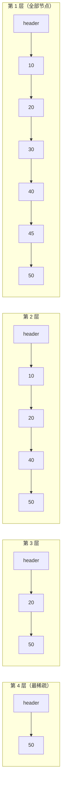
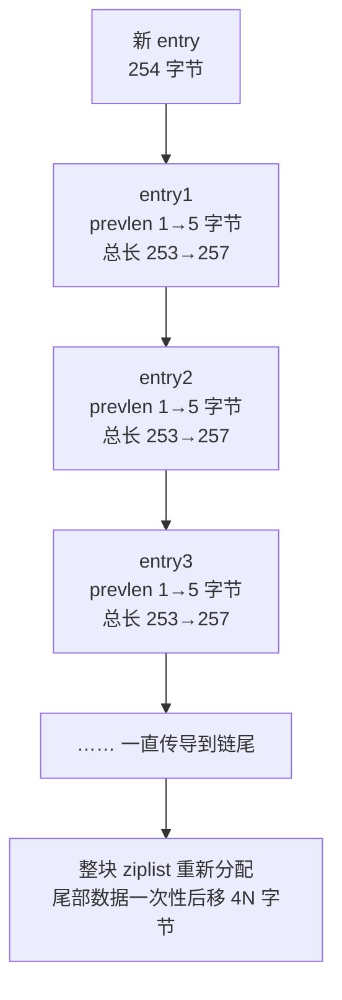
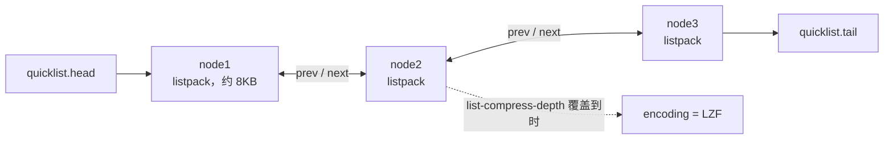
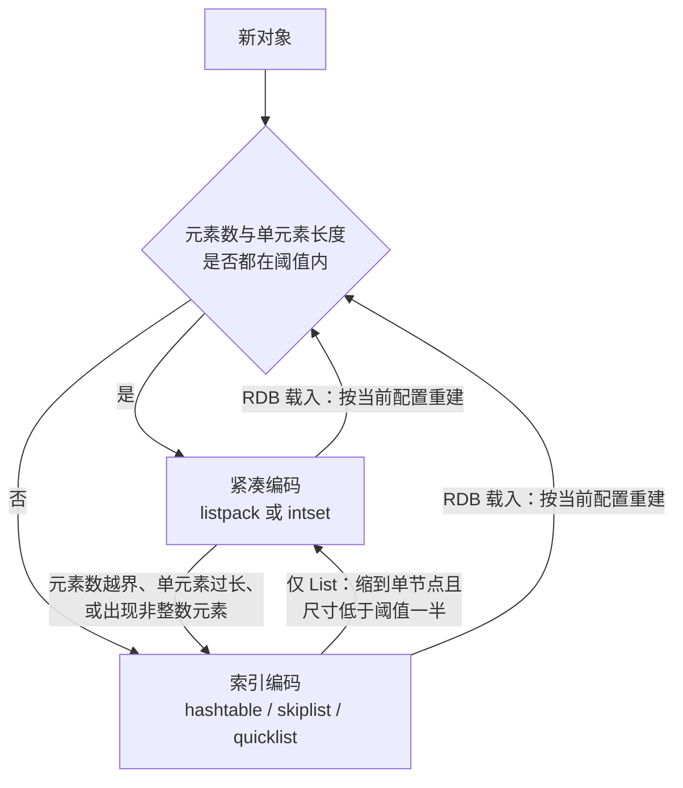

# 04 跳跃表 压缩列表与 Listpack

**摘要：**

Redis 的有序与小对象类型各自挂着两套物理形态：一套用指针与索引换时间，一套用连续内存换空间。本文只谈后一套里最关键的四个结构，以及它们之间那条被反复重画的边界。跳跃表（skiplist）用概率化的多层索引替代平衡树的旋转逻辑，`span` 字段让排名成为查找路径上的一次累加，`ZRANK` 因此得以停在 O(log N)；压缩列表（ziplist）把指针换成偏移量，代价是每个 entry 都要记录前驱长度，前驱一变长，后继的 `prevlen` 就要从 1 字节扩到 5 字节，连锁更新由此而来；listpack 把"记前驱"改成"记自己"，传播链被切断，代价转移到反向遍历的解析方式与"整块搬移仍在"这一事实上；quicklist 把 listpack 切成 8KB 上下的分段串成双向链表，用分段把写放大钉在常数上界内；intset 是整数集合的特化，二分查找与三档编码升级都建立在"有序且定长"这个前提上。文章沿着两条线索推进：一条是这四种结构各自的成本记账，另一条是它们之间的转换阈值与转换方向，最后用一组反例收束，说明"删元素会不会回退编码""大元素为什么不该塞进紧凑结构"这类问题为什么总有例外。

---

## 第 1 章 四种结构，三种成本

### 1.1 四个键，四种落点

设想一个社交产品在同一个 Redis 实例里存着四个键。`rank:game:2026-11` 是本月游戏积分榜，按积分排序，二十万名玩家；`session:u10086` 是某个用户的会话对象，十二个字段，字段名与值都不长；`feed:u10086` 是这位用户的消息流，三千条短消息，两端进出；`tags:u10086` 是他订阅的标签集合，四十个整数 id。这四个键对外分别是 ZSet、Hash、List、Set，四个命令族用起来毫无差别，但它们在内存里的形状却有四种可能：跳跃表加字典、单块 listpack、listpack 分段的双向链表、有序整数数组。

形状的差别不是实现细节，它直接决定了三件事：一次 `ZRANK` 要花多少次比较、这个键占多少字节、以及一次写入会牵动多少其他数据。排行榜二十万成员只能用跳跃表，否则 `ZRANK` 会退化成线性扫描；会话对象十二个字段用 listpack，省下的内存可能是三倍；消息流如果整条塞进一个 listpack，每次 `LPUSH` 都要搬动整块内存；四十个整数用 intset，连元素长度字段都不需要存。这四种选择背后其实是同一道题：在查找成本、内存成本、写放大之间分配预算。

### 1.2 三种成本的记账方式

查找成本好理解，就是一次操作要访问多少个内存位置。内存成本也不难，麻烦的是第三项——写放大（write amplification），即"改一个元素"实际牵动的字节数。连续存储的结构里，插入一个元素要把它后面的所有字节往后推；指针结构里，插入只改几个指针。写放大的量级决定了这个结构能不能承载高频写入，也决定了"O(1) 追加"这个承诺到底成不成立。

把这三项摆在一起，四种结构的站位就清楚了。跳跃表把查找压到 O(log N)，内存付出每元素一百字节上下的固定开销，写入只动局部指针；ziplist 与 listpack 把内存压到极限，查找退化为线性扫描，写入要搬移整块内存；quicklist 用分段把"整块"限制在 8KB 左右，让写放大从"随元素数增长"变成"有常数上界"；intset 只在元素全是整数时成立，用二分查找换回了查找效率，代价是插入时的定长搬移。

这里还有一处容易被忽略的**换算**：O(N) 与 O(1) 的比较，只有在 N 足够大、且每次访问都要真正触达内存时才成立。N 等于十二的 listpack，线性扫描十二个短字节串的总耗时，比一次哈希计算加一次指针追逐还低——因为前者在一块连续内存里顺序读，后者要走两次随机访存。小对象用紧凑编码不是"牺牲性能换内存"，多数时候是两头都赚。

### 1.3 谱系与分工

四种结构并非同时出现，它们各自解决前一代留下的具体问题，也因此各自带着上一代的疤痕。

| 结构 | 进入 Redis 的时间 | 结构本质 | 主要代价 | 主要承载类型 |
| :--- | :--- | :--- | :--- | :--- |
| skiplist | 2009 年起，ZSet 的核心 | 多层概率索引 + 有序链表 | 每元素约 100 字节的固定开销 | ZSet（大数据量） |
| ziplist | 2011 年前后 | 单块连续内存，entry 记前驱长度 | 连锁更新导致写入代价不可预测 | 7.0 之前的 Hash / ZSet / List |
| listpack | 5.0 起用于 Stream，7.0 起全面替代 ziplist | 单块连续内存，entry 记自身长度 | 整块搬移仍在，随机访问仍是线性 | Hash / ZSet / Set / List 的小对象 |
| quicklist | 3.2 起 | listpack 分段 + 双向链表 | 分段边界处的额外指针与碎片 | List |
| intset | 早期即有 | 有序定长整数数组 | 插入搬移，编码只升不降 | Set（全整数且数量不大） |

时间线拉直来看，这条演进不是"越新越好"的线性进步，而是三个阶段各自修补上一阶段的短板。


第一个阶段解决"有序集合怎么在单线程里既快又简单"，答案是跳跃表；第二个阶段解决"小对象被元数据压垮"，答案是 ziplist；第三个阶段解决"ziplist 的连锁更新让最坏情况不可控"，答案是 listpack 加 quicklist 的分段。每一次修补都把问题挪了个位置：跳跃表把平衡逻辑换成了随机数，ziplist 把指针换成了偏移量，listpack 把"前驱依赖"换成了"自身依赖"。理解这三个换法，比记住它们的字段布局有用得多。

---

## 第 2 章 跳跃表：用随机数换掉平衡逻辑

### 2.1 一篇论文与一个反直觉的选择

1990 年 6 月，William Pugh 在《Communications of the ACM》上发表《Skip Lists: A Probabilistic Alternative to Balanced Trees》。彼时的有序结构是平衡树的天下：AVL 树用高度差约束，红黑树用颜色约束，两者都能把查找、插入、删除稳定在 O(log N)，代价是每次写入之后都要检查并修复平衡——旋转、变色、回溯，一套逻辑牵动多个节点。Pugh 的提法在当时显得轻率：如果放弃"必须平衡"这个执念，改用随机数决定每个节点的层数，结构在期望意义上依然是 O(log N)，而实现只需要处理指针。

十九年后 antirez 写 Redis 的有序集合，选了这条"轻率"的路。这个选择在事后被反复解释，最常见的说法是"实现简单"，但这个理由只说对了一半——真正的理由是 Redis 需要的操作集合恰好与跳跃表的长处重合，而红黑树的长处它一项也用不上。

### 2.2 多层索引怎么把遍历摊成对数

跳跃表的基础仍然是一条按 (score, member) 排序的单链表。单链表查找必须从头逐个比较，这是 O(N)。跳跃表在它之上叠了几层稀疏链表：第 1 层包含全部节点，第 2 层只包含其中一部分，第 3 层更少，越往上越稀疏。查找从最高层开始，能往右就往右，右边走不通就下沉一层，直到第 1 层找到目标。



以查找 45 为例：第 4 层从 header 出发，右边是 50，大于 45，不下沉就无路可走，于是降到第 3 层；第 3 层右边是 20，小于 45，前进到 20，再往右是 50，又大了，降到第 2 层；第 2 层从 20 往右到 40，再往右是 50，仍然大，降到第 1 层；第 1 层从 40 往右一步就是 45。整个过程只走了四步，而单链表要逐个比较到第五个节点才命中。

这个例子的规模太小，看不出量级差别。把 N 换成一百万，第 1 层要比较一百万次，跳跃表的期望比较次数则落在几十次这个量级。原因在于层数按几何分布递减：上一层只保留下层约四分之一的节点，层高每加一，单跳距离就涨到四倍，累积到第 k 层正好覆盖 4^k 个节点的区间。层数因此与 N 的对数同阶，而不是与 N 同阶。

### 2.3 p = 0.25 背后的两道算术

节点的层高在插入时随机决定，代码只有几行：

```c
/* t_zset.c —— 层高由随机数决定，与元素内容无关 */
int zslRandomLevel(void) {
    static const int threshold = ZSKIPLIST_P * RAND_MAX;  /* P = 0.25 */
    int level = 1;
    while (random() < threshold)
        level += 1;
    return (level < ZSKIPLIST_MAXLEVEL) ? level : ZSKIPLIST_MAXLEVEL;
}
```

每一次循环有四分之一的概率再升一层，所以层高为 k 的概率是 `0.25^(k-1)`。平均层高是 `1/(1-p)`，代入 p = 0.25 得到 1.33——平均每个节点只比单链表多出三分之一个前向指针。这是 Redis 选 0.25 而不是经典的 0.5 的第一层考虑：p = 0.5 时平均层高是 2，每个节点要多背两个指针，而 `zskiplistNode` 的每一层固定是 16 字节（一个 8 字节前向指针加一个 8 字节 `span`），六十七万节点规模下这就是十 MB 量级的差距。

第二道算术关于查找成本。Pugh 给出的期望比较次数近似为 `(1/p) · log_{1/p}(N)`。p = 0.5 时是 `2 · log₂N`，p = 0.25 时是 `4 · log₄N`，而 `log₄N = log₂N / 2`，两者化简之后都是 `2 · log₂N`——在期望意义上，p = 0.25 与 p = 0.5 的查找成本几乎相同，省下来的是内存而不是时间。把 0.25 说成"用查找换内存"其实不准确，它是一笔**两头都不亏**的买卖，代价落在别处：层数上限更高，`zsl->level` 相关的循环要多走几层，每次查找下沉的判断次数也随之变多；至于随机数调用，p 取 0.25 时平均每次插入只需约 0.33 次 `random()`，反而比 p = 0.5 的 1 次更省。

第三道算术解释 `ZSKIPLIST_MAXLEVEL = 32` 为什么够。层高达到 32 的概率是 `0.25^31`，约等于 `2.2 × 10⁻¹⁹`；反过来说，要让 32 层被真正用上，节点规模得在 `4^31` 这个量级，也就是十的十八次方。这个上限在可预见的规模里永远不会成为瓶颈，它的作用只是给柔性数组一个编译期上界，避免无界内存分配。

随机化还有一个不常被提到的副作用：层高由 `random()` 决定，与元素的键值无关。这意味着攻击者无法通过构造特定键来制造最坏情况——哈希表在恶意输入下会出现哈希洪水，所有键被塞进同一个桶，跳跃表没有这个攻击面。它的最坏情况理论上仍是 O(N)，但那需要随机数发生器本身失灵，而不是数据长得巧。

### 2.4 与红黑树逐项对照

| 维度 | 跳跃表 | 红黑树 |
| :--- | :--- | :--- |
| 实现复杂度 | 插入约 40 行，只调指针 | 插入需处理三种情形与旋转回溯 |
| 范围查询 | 定位起点后沿第 1 层顺序走，天然有序 | 需要中序后继，或线索化 |
| 按排名查询 | `span` 累加，O(log N) | 需增广子树大小（顺序统计树） |
| 单节点内存 | 约 24 字节加每层 16 字节 | 三个指针加颜色位，约 32 字节 |
| 最坏情况 | 理论 O(N)，概率极低且不依赖数据 | 严格 O(log N) |
| 并发改造 | 只需修改相邻节点指针 | 旋转涉及多个节点，锁范围难界定 |

这张表里真正决定 Redis 选择的只有两行。一行是范围查询：`ZRANGEBYSCORE` 要先定位分数区间的起点，再沿链表顺序输出，跳跃表的第 1 层就是一条有序链表，找到起点之后直接走，代码里一个 `while` 就够；红黑树要么做中序后继的栈式遍历，要么把节点线索化，两种做法都不如直接走链表干净。

另一行是按排名查询，它被拆在 2.6 节单独说，因为 `span` 这个字段值得单独记一笔。

实现复杂度那一行常被引用为"代码量约为红黑树的三分之一"，这个说法难以精确核对，但量级可信：`zslInsert` 的主体是三层循环——找插入位置、维护 `span`、拼接新节点的各层前向指针，没有分支判断颜色，也没有回溯修复。对了，还少了一件事：跳跃表不需要"平衡修复"这个阶段，插入结束就是结构合法。

至于"最坏情况不严格"，在实际部署里几乎不构成风险。平衡树的严格 O(log N) 是确定性保证，跳跃表的 O(log N) 是期望保证，两者在 P99 延迟上的差别远小于一次 jemalloc 分配或一次缓存未命中的抖动。反过来，跳跃表的随机层高带来一个平衡树没有的好处：**插入路径与键值无关**，只与随机数有关，这让性能分布不随数据形状漂移。

### 2.5 两个结构体与一处刻意的冗余

```c
/* server.h —— 跳跃表节点与跳跃表 */
typedef struct zskiplistNode {
    sds ele;                          /* 成员，指向 SDS */
    double score;                     /* 分数，排序主键 */
    struct zskiplistNode *backward;   /* 后退指针，只有第 1 层用得上 */
    struct zskiplistLevel {
        struct zskiplistNode *forward;/* 前向指针 */
        unsigned long span;           /* 到下一个节点跨过多少个第 1 层节点 */
    } level[];                        /* 柔性数组，层高在创建时确定 */
} zskiplistNode;

typedef struct zskiplist {
    struct zskiplistNode *header, *tail;
    unsigned long length;             /* 节点数，不含 header */
    int level;                        /* 当前最高层，随插入上升、随删除下降 */
} zskiplist;

typedef struct zset {
    dict *dict;                       /* member -> score */
    zskiplist *zsl;                   /* 按 (score, member) 排序 */
} zset;
```

`level[]` 是柔性数组，节点创建时按随机层高一次性分配，之后不再改变。`header` 是一个特殊节点，它按 `ZSKIPLIST_MAXLEVEL`（32）分配了全部层，`ele` 为 NULL、`score` 为 0——这样查找循环不必为"最高层比其他层短"做特判，从第 32 层起步也能安全地原地不动。这个 32 层的 header 固定占用约 536 字节，无论表里有没有元素都存在。

`backward` 只有一份，不在 `level[]` 里，也就是只有第 1 层带后退指针。这是刻意的冗余削减：`ZREVRANGE` 与 `ZREVRANGEBYSCORE` 只需要沿一条有序链向回走，多层的后退指针没有用处。有意思的是 `ZREVRANK` 并不需要后退指针——它用的是 `length - rank + 1`，一次正向排名换算即可。

两个结构体都不含"元素个数"以外的统计信息，也没有锁、没有版本号，这是单线程模型给的便利。

### 2.6 span：排名为什么能停在 O(log N)

`span` 记录的是"从当前节点沿这一层前进到下一个节点，跨过了多少个第 1 层节点"。这个定义看着绕，用起来很直接：从 header 出发做一次普通查找，每往前跳一步就把跳过的 `span` 累加，走到底时累加值就是目标节点从 1 开始数的排名。

```c
/* t_zset.c —— 排名是查找路径上的累加 */
unsigned long zslGetRank(zskiplist *zsl, double score, sds ele) {
    zskiplistNode *x = zsl->header;
    unsigned long rank = 0;
    int i;
    for (i = zsl->level - 1; i >= 0; i--) {
        while (x->level[i].forward &&
               (x->level[i].forward->score < score ||
                (x->level[i].forward->score == score &&
                 sdscmp(x->level[i].forward->ele, ele) <= 0))) {
            rank += x->level[i].span;      /* 每跳一步，把跨过的节点计入 */
            x = x->level[i].forward;
        }
        if (x->ele && x->score == score && sdscmp(x->ele, ele) == 0)
            return rank;                    /* 边找边算，不必先找到再回头数 */
    }
    return 0;
}
```

关键在于这段代码里没有任何"遍历计数"的动作。如果没有 `span`，排名只能这样算：先按 (score, member) 找到节点，再从 header 沿第 1 层一步一步数过去，一次 `ZRANK` 就退化成 O(N)。`span` 把"数了多少个"这件工作分摊进查找路径的每一跳，于是 `ZRANK` 与 `ZSCORE` 的复杂度一致，都是 O(log N)。

代价落在插入与删除上。`zslInsert` 除了拼接指针，还要维护四处 `span`：

```c
/* 插入新节点 x 时的 span 维护，update[i] 是各层的前驱 */
x->level[i].span = update[i]->level[i].span - (rank[0] - rank[i]);
update[i]->level[i].span = (rank[0] - rank[i]) + 1;
/* 新节点没有覆盖到的高层，前驱的 span 整体加一 */
for (i = level; i < zsl->level; i++)
    update[i]->level[i].span++;
```

删除时的维护方向相反：若某层的前向指针正好指向被删节点，就把被删节点的 `span` 合并进前驱，`span += x->level[i].span - 1`；若不指向它，只是"跨过了它"，前驱的 `span` 减一即可。这两种情形在 `zslDeleteNode` 里用一个 `if/else` 分开。

把 `span` 与顺序统计树（order-statistic tree）对照，能看清它的本质：红黑树要支持"第 k 小"与"排名"，必须在每个节点上增广一个子树大小字段，并且每次旋转都要连带修正；跳跃表把这份增广信息直接放进层结构里，因为它的"层"本来就是跨度的抽象。排名能力不是跳跃表额外加的，而是多层索引自带的**副产品**——这也解释了为什么 Redis 选跳跃表时几乎没有为 `ZRANK` 付出设计成本。

如果把 `zset` 的两个结构放在一起看，分工是这样：

| 命令 | 主要依赖 | 复杂度 |
| :--- | :--- | :--- |
| `ZSCORE` / `ZADD` 的冲突判断 | 字典（member 到 score） | O(1) |
| `ZRANK` / `ZREVRANK` | 跳跃表的 `span` 累加 | O(log N) |
| `ZRANGEBYSCORE` / `ZRANGEBYLEX` | 跳跃表定位起点 + 第 1 层顺序走 | O(log N + M) |
| `ZADD` / `ZREM` | 字典与跳跃表各改一次 | O(log N) |
| `ZRANGE`（按下标） | 跳跃表按排名定位 | O(log N + M) |

两个结构共享同一份 SDS 与同一个 `double`：字典的 key 就是跳跃表节点里的 `ele` 指针，字典的 value 直接指向节点里的 `score` 字段。所以"双结构"并不意味着一份数据存两遍，额外付出的只是一套索引的开销——字典的桶数组与 `dictEntry`，以及跳跃表的层数组。这份开销按示例推算在一百字节上下，是 ZSet 在大数据量下必然要交的过路费。
---

## 第 3 章 压缩列表：把指针换成偏移量

### 3.1 十二个字段的账

回到 `session:u10086` 这个键。它有十二个字段，字段名形如 `uid`、`login_at`、`device`，平均八字节；值也差不多，八到二十字节。如果直接用哈希表存，每个字段的开销是这样摊的：一个 `dictEntry` 结构本身 24 字节（key 指针、value 联合体、next 指针），加上 jemalloc 按 32 字节档位分配带来的 8 字节内部碎片；字段名与字段值各是一份 SDS，八字节的内容要配上 3 字节头部与 1 字节结尾，实际占 16 字节桶；再加上哈希表桶数组里每个桶 8 字节的指针。合计每个字段六十字节上下，而它承载的数据只有二三十字节。

十二个字段的整体账更难看：桶数组按 2 的幂分配，十二个字段要一张 16 桶的表，128 字节；`dict` 结构自身约 96 字节。于是这个小对象的元数据开销超过了数据本身两倍以上。压缩列表要解决的就是这道账——把所有字段与值排进一块连续内存，不留一个指针，不留一次独立分配。

### 3.2 布局：十字节头、entry 序列、一个结束符

ziplist 的整体结构是三段：固定十字节的头部、若干 entry、一个 `0xFF` 结束符。头部三个字段各有明确用途，理解它们各自的用途，才能理解 listpack 后来为什么敢删掉其中一个。

| 字段 | 宽度 | 作用 | 缺失后的后果 |
| :--- | :--- | :--- | :--- |
| `zlbytes` | 4 字节 | 整块 ziplist 占用的字节数 | 每次扩容都要先遍历才能知道长度 |
| `zltail` | 4 字节 | 尾部 entry 相对起始地址的偏移 | `RPOP` 要遍历到尾部，O(N) |
| `zllen` | 2 字节 | entry 数量，达到 65535 时置为该值表示"未知" | 求长度要遍历，O(N) |
| `zlend` | 1 字节 | 固定 `0xFF`，作为结束标记 | 无法判断边界 |

`zlbytes` 让整块内存可以一次性 `realloc` 而不用先数元素，`zltail` 让尾部操作保持 O(1)，`zllen` 让 `LLEN`、`HLEN` 这类命令不必遍历。三者都是"为了避免一次 O(N) 遍历"而设的缓存字段——这正是紧凑结构的一贯套路：用几个固定字节换掉一次全表扫描。

每个 entry 由三段组成：`prevlen`（前一个 entry 的总字节数）、`encoding`（自身类型与长度）、`content`（实际数据）。

### 3.3 encoding 的九种形态

`encoding` 字段的第一字节决定了这一段的读法，Redis 在 `ziplist.c` 里按首字节的高位切分了九种情形。

| 首字节模式 | 含义 | content 长度 | 典型用法 |
| :--- | :--- | :--- | :--- |
| `00xxxxxx` | 6 位长度字符串 | 最长 63 字节 | 短字段名 |
| `01xxxxxx xxxxxxxx` | 14 位长度字符串 | 最长 16383 字节 | 一般字符串值 |
| `10000000` + 4 字节 | 32 位长度字符串 | 最长 4GB | 超长值 |
| `11000000` | int16 | 0（值在编码内） | 小整数 |
| `11010000` | int32 | 0 | 中等整数 |
| `11100000` | int64 | 0 | 大整数 |
| `11110000` | int24 | 0 | 少见的三字节整数 |
| `11111110` | int8 | 0 | 极小整数 |
| `1111xxxx` | 4 位立即数 | 0 | 0 到 12 之间的数 |

后六种情形里，数值直接编进了编码字节，`content` 段为零字节。这是 ziplist 压缩率的另一半来源：整数类型的元素不需要额外存储空间，`prevlen` 加 `encoding` 两个字节就装下了一个数。对 `tags:u10086` 这种全整数的集合，intset 比 ziplist 还省一截，因为 ziplist 每个元素至少要两字节的元数据，而 intset 只用 2、4 或 8 字节存值本身。

### 3.4 prevlen：为什么每个 entry 要记住前驱

`prevlen` 的存在理由只有一个：从后往前遍历。正向遍历时，读完一个 entry 的 `encoding` 就知道它有多长，加上 `prevlen` 的长度就能跳到下一个；但反向遍历方向相反，站在某个 entry 的起始位置，要往回收一个 entry，就必须知道"前一个 entry 有多长"。紧凑结构里没有后退指针，这个信息只能由 entry 自己带。

这个字段是变长的。前一个 entry 的总长度小于 254 字节时，`prevlen` 占 1 字节，直接存值；大于等于 254 字节时，占 5 字节，首字节固定为 `0xFE`，后面跟 4 字节小端长度。

```c
/* ziplist.c —— 变长编码的写入与长度计算 */
unsigned int zipStorePrevEntryLength(unsigned char *p, unsigned int len) {
    if (p == NULL)   /* 只为算长度：小于 254 用 1 字节，否则 5 字节 */
        return (len < ZIP_BIG_PREVLEN) ? 1 : sizeof(uint32_t) + 1;
    if (len < ZIP_BIG_PREVLEN) { p[0] = len; return 1; }
    return zipStorePrevEntryLengthLarge(p, len);   /* 0xFE + 4 字节 */
}
```

两档设计本身没有错，254 这个阈值也选得合理——绝大多数 entry 都远小于 254 字节，1 字节编码覆盖了绝大多数字段。问题出在"这个字段描述的是别人"。

### 3.5 连锁更新：一次插入如何牵动整条链

假设有这样一个 ziplist：连续的 N 个 entry，每个恰好 253 字节。此时每个 entry 的 `prevlen` 都是 1 字节（因为前驱 253 < 254），每个 entry 总长 253 字节。现在在最前面插入一个 254 字节的新 entry。

新 entry 之后的第一个 entry，它的 `prevlen` 要描述新 entry 的 254 字节，1 字节已经装不下，只能扩成 5 字节。这一扩，它自己的总长从 253 变成 257；于是第二个 entry 的 `prevlen` 也要扩成 5 字节，第二个的总长也变成 257；如此传导到链尾。



这个传播链成立的精确条件是：前驱的总长从"小于 254"跨到"大于等于 254"。反方向不成立——Redis 在 `__ziplistCascadeUpdate` 里明确写了"变窄是我们想避免的"：一旦某个 entry 的 `prevlen` 已经是 5 字节，即使前驱缩到 1 字节就能装下，也仍然按 5 字节写入。这条规则让传播**只有一个方向**，也让"删除元素导致长度变短"不会引发反向连锁，代价是空间不再最优。

真实实现比"逐条搬移"聪明一些。`__ziplistCascadeUpdate` 分三步：先从头向尾扫一遍，统计需要多少额外字节 `extra` 与需要重写多少个 entry；然后用 `ziplistResize` 做一次 `realloc`；最后从尾向头逐个重写 `prevlen`，并把整段尾部数据一次性 `memmove` 到新位置。

这里要把复杂度说准确，因为流传的版本常常混淆了两层。单次插入的最坏代价是 O(N)——一次 `realloc`、一次 O(N) 的 `memmove`、加上 N 个 entry 头的重写，不是 O(1)，也不是 O(N²)。真正的平方项出现在操作序列上：如果每次插入都恰好触发一次全长连锁，N 次插入就是 O(N²) 字节搬移。对 `HSET`、`ZADD` 这类逐条写入的命令来说，序列层面的平方才是致命的，因为它在业务无感知的情况下把"追加"变成了随规模增长的开销。

而触发条件并不依赖随机巧合。entry 的长度由**客户端写入的字段长度**决定，一个攻击者或者一个粗心的业务，只要让一批字段的长度稳定落在 250 到 260 字节之间，就能构造出连锁更新的前提。这不是理论上的可能性，而是真实的输入可控面：一个 Hash 的字段值长度完全由应用决定，应用把某个日志字段截断到 256 字节，就等于给 ziplist 埋好了引信。

### 3.6 为什么不能靠"预留空间"绕过去

看到这里通常会有一个自然的想法：既然问题出在 `prevlen` 从 1 字节变 5 字节，那给每个 entry 预留 4 字节不就行了？这个方案在别处成立，在 ziplist 里不成立。

一是预留会把 1 字节的 `prevlen` 变成固定 5 字节，所有 entry 无条件多付四字节，紧凑结构省下来的空间被这笔固定开销吃掉一部分，而且对小 entry 尤其不划算——一个总长 10 字节的 entry 多付 4 字节就是 40% 的膨胀。二是即使预留了空间，entry 变长仍然要移动后面的数据，因为 ziplist 是一整块连续内存，插入位置的后面没有任何缝隙可以利用。三是 ziplist 不支持原地扩容，`ziplistResize` 必须重新分配整块并拷贝，一块被 `sds` 或 `robj` 引用的内存不允许多处引用同一块的不同版本。

所以 ziplist 的连锁更新不是因为某个字段设计得不够聪明，而是"单块连续内存 + 每个 entry 记录前驱长度"这两个前提叠加的必然结果。要消除它，必须动前提本身——这就是 listpack 的出发点。

---

## 第 4 章 Listpack：把长度写在自己身上

### 4.1 一次针对性的重构

listpack 的出现不是为了追求更高的压缩率，它是一次外科手术式的目标明确的重构：保留 ziplist 的连续存储与紧凑编码，去掉 `prevlen`，从而切断连锁更新。它的设计成型于 antirez 在 2017 年前后建起的独立仓库，第一次进入 Redis 是 5.0 用于 Stream 的内部存储——Stream 的消费组状态需要大量小条目，又比 Hash 更容易触发连锁，正好是试刀的地方。7.0 开始，它全面接替 ziplist 在 Hash、ZSet、List 中的位置；7.2 起，Set 的小对象编码与"只有一个节点的 List"也换成它。

这条路线值得注意：listpack 先在 Stream 里跑了一个大版本，才动 Hash 与 ZSet 的地基。数据结构替换的风险不在于新结构本身，而在于所有依赖旧结构二进制布局的外部工具——RDB 解析器、`DEBUG` 命令、第三方客户端的内存分析库。先在低风险的场景验证，再迁移主干，是这类替换的常规路径。

### 4.2 布局：六字节头与"没有 zltail"

listpack 的整体结构是：六字节头部、若干 entry、一个 `0xFF` 结束符（`LP_EOF`）。头部只有两个字段。

| 字段 | 宽度 | 作用 |
| :--- | :--- | :--- |
| `total-bytes` | 4 字节 | 整块 listpack 的字节数 |
| `num-elements` | 2 字节 | 元素个数，达到 65535 表示"未知，需遍历" |
| `LP_EOF` | 1 字节 | 固定 `0xFF`，结束标记 |

与 ziplist 相比，这里少了 `zltail`。省掉它不只是省四个字节，它反映了一个判断：listpack 通常作为"小对象"的整块存储，而那类对象的高频操作是查找与原地更新，不是从两端弹出的队列操作。真需要两端操作时，外层的 quicklist 会用节点指针承担定位职责，listpack 内部不需要再缓存尾部偏移。

代价也是实打实的：定位 listpack 的最后一个元素要调用 `lpSeek(lp, -1)`，而 `lpSeek` 是从头逐条 `lpSkip` 走过去的，复杂度 O(N)。这个代价只有在"整块很小"时才可以忽略——这又反过来解释了 quicklist 为什么把每块限制在 8KB 左右。

### 4.3 entry：encoding、content、backlen

每个 entry 由三段组成：`encoding`（类型与长度）、`content`（数据）、`backlen`（本 entry 除 `backlen` 之外的长度，1 到 5 字节）。三段之间是一条单向的读依赖，反向的读依赖则由 `backlen` 承担。


```c
/* listpack.c —— backlen 按 7 位分组，1 到 5 字节，上限约 2^35 */
static inline unsigned long lpEncodeBacklen(unsigned char *buf, uint64_t l) {
    if (l <= 127) {                       /* 绝大多数 entry 走这一支 */
        if (buf) buf[0] = l;
        return 1;
    } else if (l < 16383) {
        if (buf) { buf[0] = l >> 7; buf[1] = (l & 127) | 128; }
        return 2;
    }
    /* …… 3 到 5 字节同理，每字节 7 位有效，最后一字节的最高位置 1 */
}
```

这段编码有一个巧妙之处：每个字节只用低 7 位存数据，最高位当作"前面还有字节"的标记位。由于 `backlen` 位于 entry 末尾，反向读取时自然是从最后一个字节往回读——读到最高位为 1 就继续往前，读到最高位为 0 就停，然后把各组按位拼接成完整长度。这样解码不需要预先知道编码占几个字节，也就不需要在 entry 头部再存一个"backlen 长度"。5 字节上限对应 2³⁵ 的长度空间，而 listpack 自身被限制在 1GB 以内，五字节绰绰有余。

`encoding` 字段与 ziplist 同源，同样把整数直接编进编码字节，同样分 7 位无符号整数、6 位字符串、13 位整数、12 位字符串、16/24/32/64 位整数、32 位字符串这些档位。整数档的 entry 尺寸分别是 2、3、4、5、6、10 字节（含 1 字节 `backlen`），也就是说最小的整数元素只占 2 字节。

### 4.4 反向遍历：误读与真实代价

不少介绍会说"listpack 的代价是不能反向遍历"。这个说法不准确，`backlen` 存在的全部意义就是支持反向遍历。`lpPrev` 的实现只有几行：

```c
/* listpack.c —— 从当前 entry 回退一个 */
unsigned char *lpPrev(unsigned char *lp, unsigned char *p) {
    assert(p);
    if (p - lp == LP_HDR_SIZE) return NULL;     /* 已经是第一个 */
    p--;                                        /* 退到前一个 entry 的末字节 */
    uint64_t prevlen = lpDecodeBacklen(p);      /* 解出前一个 entry 的总长 */
    prevlen += lpEncodeBacklen(NULL, prevlen);  /* 补上它自己的 backlen 宽度 */
    p -= prevlen - 1;
    return p;                                   /* 前一个 entry 的起点 */
}
```

站在任意一个 entry 的起点上，向前退一个 entry 是 O(1)。`ZREVRANGE` 这类"从后往前"的遍历，靠 `lpPrev` 逐条退，与 ziplist 的 `ZIP_DECODE_PREVLEN` 在成本上没有区别。

真正的代价在别处，两处。第一处是"定位到第 k 个 entry"：listpack 没有索引表，`lpSeek` 只能从头 `lpSkip` 数过去，这一点 ziplist 完全一样，所以它不算 listpack 的新增代价。第二处是入口："从尾部开始反向遍历"必须先拿到尾部 entry 的指针，而 listpack 头部没有 `zltail`，`lpLast` 只能 `lpSeek(-1)` 走一遍——这才是删掉 `zltail` 换来的真实成本，每块 8KB 的分段把它压在常数上界内。

所以准确的表述是：listpack 支持双向遍历，反向遍历是 O(1)/步；它放弃的是"O(1) 定位尾部"和"O(1) 随机访问"，这两项都是"整块越小越不痛"的代价，也因此天然适配 quicklist 的分段策略。

### 4.5 为什么这就消除了连锁

ziplist 的传播链依赖一个方向：entry A 的长度变化 → entry B 的 `prevlen` 字段需要变化 → entry B 的长度变化 → entry C 的 `prevlen` 需要变化。链上的每一环都是"我在描述别人"。

listpack 把这一环换成了"我描述我自己"。`backlen` 记录的是本 entry 自身（除 `backlen` 外）的长度，没有任何其他 entry 引用它。修改一个 entry 时，需要重写的只有它自己的 `encoding`、`content`、`backlen` 三段，落在它自己的字节范围里；后面的 entry 完全不受影响，连锁因此不存在。

但**消除连锁**不等于**消除写放大**。插入或删除一个 entry 之后，它后面所有字节仍然要在内存里整体前移或后移，因为 listpack 依旧是一整块连续内存。一次插入进 8KB 的 listpack，`memmove` 最多搬 8KB；一次插入进 1MB 的 listpack，就要搬 1MB。这个区别是 quicklist 存在的理由，也是后面"大元素为什么不该塞进紧凑结构"的伏笔。

### 4.6 一张对照表

| 维度 | ziplist | listpack |
| :--- | :--- | :--- |
| 头部 | `zlbytes`、`zltail`、`zllen`，10 字节 | `total-bytes`、`num-elements`，6 字节 |
| entry 元数据 | `prevlen`（1 或 5 字节）+ `encoding` | `encoding` + `backlen`（1 到 5 字节） |
| 元数据的描述对象 | 前一个 entry 的长度 | 自身 entry 的长度 |
| 前向遍历 | O(1)/步 | O(1)/步 |
| 反向遍历 | O(1)/步，需起始指针 | O(1)/步，需起始指针 |
| 定位尾部 | O(1)，头部存了 `zltail` | O(N)，需 `lpSeek(-1)` |
| 连锁更新 | 存在，最坏 O(N) 单次、O(N²) 序列 | 不存在 |
| 元素个数 | `zllen`，达到 65535 后需遍历 | `num-elements`，同样有 65535 哨兵 |
| 单元素最小尺寸 | 2 字节（`prevlen` + 编码） | 2 字节（编码 + `backlen`） |

表里最容易被低估的一行是"单元素最小尺寸"：两者的元数据开销几乎一样，都是两字节起步。listpack 不是靠"更省字节"取胜的，它是靠"换掉依赖方向"取胜的——压缩率基本持平，最坏情况的可预测性完全不同。

### 4.7 升级路径上的兼容处理

7.0 之后，`OBJ_ENCODING_ZIPLIST` 这个编码值从代码里消失了，`OBJECT ENCODING` 对小 Hash 会返回 `listpack`。但旧 RDB 文件里存的仍然是 ziplist 编码的类型标记（`RDB_TYPE_HASH_ZIPLIST`、`RDB_TYPE_ZSET_ZIPLIST` 等），这些标记在新版本里仍然被识别：载入时先按 ziplist 格式读出每一条键值对，再逐条追加进一块新建的 listpack。也就是说，从 6.x 升级到 7.x 之后，存量小对象的物理布局在第一次 RDB 载入时就地完成了迁移，不需要业务侧做任何事。

SDS 与编码的细节、以及各类型阈值的完整出处，见 [[02 SDS 与 Redis 对象系统]]；本节只关心这四种结构本身的取舍。顺带一提，ValKey 作为 7.2 之后的分支，在这几个结构的实现上是同源的，listpack 与 quicklist 的行为可以直接对照。

---

## 第 5 章 Quicklist：在两种代价之间分段

### 5.1 List 的三次换底

List 是唯一一个底层实现被整体替换过两次的类型，值得把这条线拉出来看，因为每次替换的动机都不同。

| 版本 | 小 List | 大 List | 替换动机 |
| :--- | :--- | :--- | :--- |
| 3.2 之前 | ziplist | 双向链表，每个节点一个 SDS | 两种结构的边界难定，且链表节点开销大 |
| 3.2 到 6.x | quicklist，节点是 ziplist | 同左 | 用分段消除大 ziplist 的连锁更新 |
| 7.0 | quicklist，节点是 listpack | 同左 | 节点内部换掉连锁更新的根源 |
| 7.2 起 | 单块 listpack | quicklist，节点是 listpack | 省掉"只装三五个元素的链表"的外壳 |

3.2 之前的做法是"按元素数与单元素长度二选一"：元素不多且都短时用 ziplist，一旦元素数越过 `list-max-ziplist-entries`（当年默认 512）或单个元素超过 `list-max-ziplist-value`（64 字节），整个 List 就转成双向链表。今天的 `list-max-listpack-size` 正是这两项配置合流之后的结果。这个方案的问题在于转换是整体的——一个 List 从 512 个元素涨到 513 个，省内存的紧凑编码就整块作废，换成每个元素配一个 `listNode`（三个指针，24 字节）加一个 `robj` 与独立 SDS 的形态，单元素开销从几个字节跳到五六十字节。数据量在阈值附近抖动的业务，内存曲线会跟着抖。

quicklist 的提法是把"二选一"改成分段：仍然用连续内存，但每块只装一批元素，块之间用双向链表连接。于是"大对象"不再是问题，因为没有一块是大的；"链表开销"也不再是问题，因为指针数量按块摊销，而不是按元素。

### 5.2 四十字节的壳与三十二字节的节点

```c
/* quicklist.h —— 链表壳与节点 */
typedef struct quicklist {
    quicklistNode *head, *tail;
    unsigned long count;            /* 所有 listpack 里的元素总数 */
    unsigned long len;              /* quicklistNode 个数 */
    signed int fill : QL_FILL_BITS; /* 分段的容量配置 */
    unsigned int compress : QL_COMP_BITS; /* 两端留几个节点不压缩 */
    unsigned int bookmark_count : QL_BM_BITS;
    quicklistBookmark bookmarks[];
} quicklist;

typedef struct quicklistNode {
    struct quicklistNode *prev, *next;
    unsigned char *entry;           /* 指向 listpack，或被压缩后的字节流 */
    size_t sz;                      /* 这块的字节数 */
    unsigned int count : 16;        /* 这块里的元素个数 */
    unsigned int encoding : 2;      /* RAW = 1，LZF = 2 */
    unsigned int container : 2;     /* PLAIN = 1（单元素），PACKED = 2（listpack） */
    unsigned int recompress : 1;    /* 是否曾被临时解压 */
    unsigned int attempted_compress : 1;
    unsigned int dont_compress : 1;
    unsigned int extra : 9;
} quicklistNode;
```

`quicklist` 在 64 位下是 40 字节，`quicklistNode` 按注释的设计目标是 32 字节——用位域把 `count`、`encoding`、`container` 这些字段压进一个 32 位整数，才让节点结构停在 32 字节。这个数字有意义：一个装 128 个短元素的 listpack 大约 1KB，配 32 字节的节点外壳，摊销到每个元素是 0.25 字节，可以忽略；若节点结构膨胀到 48 字节，摊销变成 0.4 字节，仍然可以忽略。真正在意的是"元素很少的 List"——一个只有三个元素的 List 也要配一个 40 字节的壳加一个 32 字节的节点，七十几字节的元数据压在两三个元素上，这才是 7.2 把单节点小 List 改成裸 listpack 的原因。

`count` 与 `len` 的分工要注意：`count` 是元素总数，`LLEN` 直接读它；`len` 是节点数，`quicklistNode` 的定位靠它。两者都不需要遍历。

分段的样子可以直接画出来：一层双向链表，每个节点挂一块 listpack，中间节点可以被 LZF 压成字节流。



### 5.3 fill：分段大小的旋钮

分段大小由 `list-max-listpack-size` 控制（7.0 之前叫 `list-max-ziplist-size`，旧名保留为别名，写在配置文件里两个名字都生效）。

| 配置值 | 含义 | 单块上界 |
| :--- | :--- | :--- |
| 正数 N | 每块最多 N 个元素 | 条数受限，字节数仍受 8KB 安全值约束 |
| -1 | 按字节数限制 | 4KB |
| -2（默认） | 按字节数限制 | 8KB |
| -3 | 按字节数限制 | 16KB |
| -4 | 按字节数限制 | 32KB |
| -5 | 按字节数限制 | 64KB |

负值映射到内部一张 `optimization_level` 数组，取值就是 4096、8192、16384、32768、65536 这五档；绝对值超过 5 会被夹到最后一档。默认值 -2 对应 8KB，这个数字不是随手取的：8KB 大约是一到两页内存，能装几十到几百个短元素，`memmove` 的量级在微秒级；同时它能让大部分 List 的节点数落在几十到几百之间，链表遍历的层数不至于失控。

值得注意正数配置的实际语义。按条数限制时，代码里还叠了一道 `SIZE_SAFETY_LIMIT`——8KB 的字节安全上限。也就是说 `list-max-listpack-size 500` 并不意味着"每块装 500 个元素就切"，而是"最多 500 个元素，且字节数不超过 8KB"。如果元素平均 20 字节，500 个就是 10KB，实际会在 400 个左右就切块。这个叠加约束在文档里写得不显眼，但它解释了为什么把配置从 -2 改成 1000 之后，节点数往往没有明显减少。

判断是否要切块由 `quicklistNodeExceedsLimit` 完成，它按 fill 的符号走两条不同的路径：负值只比字节数，正值先比字节安全值再比条数。

### 5.4 大元素与 PLAIN 节点

quicklist 里有一类特殊节点：`container` 为 PLAIN，节点里不装 listpack，而是直接放一个元素的字节数组。触发条件是元素大小达到 `packed_threshold`，默认 1GB。

这个 1GB 与 Hash、ZSet 的 64 字节阈值完全是两回事，混在一起谈是常见的误解。64 字节是"紧凑编码的容量门槛"——字段或成员超过 64 字节，整个对象从 listpack 换成哈希表或跳跃表，这是**对象级**的编码切换。1GB 是"单个元素大到无法再塞进 listpack"的物理门槛，超过它才在 List 内部单独开一个 PLAIN 节点，这是**节点级**的降级。两个阈值的作用对象、触发后果、观测方式都不同。

对 List 来说，真正需要关注的不是 1GB 这个门槛，而是分段本身：一个 2KB 的元素塞进 8KB 的块，一块只能装三四个，节点数会暴涨到元素数的三分之一；`LINSERT` 需要在节点间定位，复杂度随节点数线性上升。

### 5.5 LZF 压缩：只压中间

`list-compress-depth` 控制压缩深度，默认 0，即不压缩。设为 1 时，头尾各一个节点保持原样，中间的节点用 LZF 压成字节流；设为 2 则头尾各留两个。

| 配置值 | 不压缩的节点 | 压缩的节点 |
| :--- | :--- | :--- |
| 0（默认） | 全部 | 无 |
| 1 | 头 1 个、尾 1 个 | 其余 |
| 2 | 头 2 个、尾 2 个 | 其余 |
| N | 头 N 个、尾 N 个 | 其余 |

只压中间的理由是访问模式：`LPUSH`、`RPUSH`、`LPOP`、`RPOP` 全部落在两端，如果两端节点是压缩的，每一次推入弹出都要解压再压回，CPU 开销与延迟都会上去。中间节点只在 `LINDEX`、`LRANGE` 的长距离访问时才被碰到，压缩换来的内存收益不需要用高频路径上的 CPU 去付。

压缩节点的访问路径是这样：读到时先解压成 listpack，把 `recompress` 标记置位；操作结束后，若节点仍满足压缩条件，再压回并把 `encoding` 恢复成 LZF 标记。这意味着一次长距离的 `LRANGE` 可能引发"解压—读—压回"的往返，如果这个 `LRANGE` 频繁访问同一段中间节点，压缩就会变成纯亏。这是压缩深度的真正边界：它适合**写两端、中间基本不动**的 List，不适合随机位置反复读的 List。

### 5.6 三种方案摆在一起

| 方案 | 内存 | 中间插入 | 大 List 的风险 |
| :--- | :--- | :--- | :--- |
| 纯 listpack | 最省，每元素几字节 | O(N)，要搬整块 | 连锁不存在，但 `memmove` 随规模线性增长 |
| 纯双向链表 | 最贵，每元素五十字节以上 | O(1)，只改指针 | 无写放大，但内存与碎片都高 |
| quicklist | 接近纯 listpack 加节点外壳 | O(块大小)，需先在节点间定位 | 写放大被钉在 8KB 上界内 |

quicklist 的取舍可以用一句话概括：把"整块"的上限从"这个 List 有多大"改成"这个节点有多大"，从而把最坏情况的搬移量与 List 规模解耦。代价是分段边界带来的额外结构——节点数组、块内偏移、跨节点定位，以及"元素在哪个节点里"这个问题不再有 O(1) 答案。

`LINSERT`、`LPOS`、`LREM` 这几个命令在 quicklist 上都要先遍历节点找到目标位置，复杂度 O(N)。这不是实现偷懒，而是分段结构必然的代价：链表给了你两端的 O(1)，就把中间的 O(1) 收走了。

---

## 第 6 章 intset：一个特化的有序整数数组

### 6.1 结构：只记宽度，不记类型

```c
/* intset.h */
typedef struct intset {
    uint32_t encoding;   /* INTSET_ENC_INT16 / INT32 / INT64，即每个元素占几字节 */
    uint32_t length;     /* 元素个数 */
    int8_t contents[];   /* 柔性数组，按 encoding 解释成 int16/32/64 序列 */
} intset;
```

`contents` 声明成 `int8_t` 数组，真正含义由 `encoding` 决定——这是 C 里常见的"以字节数组承载任意定长元素"的写法。`intset` 不存每个元素的类型，因为在这个结构里所有元素共享同一个宽度；宽度的选择逻辑只有三行：

```c
/* intset.c —— 按数值范围决定宽度 */
static uint8_t _intsetValueEncoding(int64_t v) {
    if (v < INT32_MIN || v > INT32_MAX) return INTSET_ENC_INT64;
    else if (v < INT16_MIN || v > INT16_MAX) return INTSET_ENC_INT32;
    else return INTSET_ENC_INT16;
}
```

三档分别对应 2、4、8 字节。以 `tags:u10086` 那四十个标签 id 为例，如果 id 都落在 32767 以内，整个集合占 `4 + 4 + 40 × 2 = 88` 字节；若其中混进一个百万级的 id，整个集合升到 int32，占 168 字节；再混进一个超过 21 亿的 id，升到 int64，占 328 字节。同一份"四十个整数"的逻辑数据，物理占用可以差四倍。

### 6.2 二分查找与线性插入

`intsetSearch` 是标准的二分查找，外加两条短路：空集合直接返回，目标大于最大值或小于最小值时直接给出插入位置。短路的意义不只是省几次比较——插入极值时不需要再进循环，这让"追加"与"前插"两种常见形态各少一次对数级扫描。

```c
/* intset.c —— 二分找到位置，找不到时 pos 就是该插入的下标 */
static uint8_t intsetSearch(intset *is, int64_t value, uint32_t *pos) {
    int min = 0, max = intrev32ifbe(is->length) - 1, mid = -1;
    int64_t cur = -1;
    if (intrev32ifbe(is->length) == 0) { if (pos) *pos = 0; return 0; }
    if (value > _intsetGet(is, max)) { if (pos) *pos = intrev32ifbe(is->length); return 0; }
    if (value < _intsetGet(is, 0))    { if (pos) *pos = 0; return 0; }
    while (max >= min) {
        mid = ((unsigned int)min + (unsigned int)max) >> 1;
        cur = _intsetGet(is, mid);
        if (value > cur) min = mid + 1;
        else if (value < cur) max = mid - 1;
        else break;
    }
    if (value == cur) { if (pos) *pos = mid; return 1; }
    if (value < cur) { if (pos) *pos = mid; }
    else { if (pos) *pos = mid + 1; }
    return 0;
}
```

查找是 O(log N)，插入不是。找到位置之后，`intsetAdd` 先 `intsetResize` 扩一个元素宽度，再 `intsetMoveTail` 把插入点之后的元素整体后移——`memmove` 的字节数是"插入点之后的元素数 × 元素宽度"。最坏情况是往头部插入，要搬动整块。这就是 `set-max-intset-entries` 默认只有 512 的原因：512 个 int64 元素是 4KB，搬 4KB 在微秒级；5120 个就是 40KB，单次 `SADD` 的搬移量已经能与一次网络往返相比。阈值卡的不是内存，是单线程下的搬移成本。

### 6.3 升级的三步，与一个顺带的好处

插入一个超出当前宽度范围的数，会触发整体升级。`intsetUpgradeAndAdd` 的做法是三步：改写 `encoding`、按新宽度 `intsetResize`、从后往前把老元素逐个按新宽度重写。

```c
/* intset.c —— 升级时从后往前重写，避免覆盖尚未处理的元素 */
static intset *intsetUpgradeAndAdd(intset *is, int64_t value) {
    uint8_t curenc = intrev32ifbe(is->encoding);
    uint8_t newenc = _intsetValueEncoding(value);
    int length = intrev32ifbe(is->length);
    int prepend = value < 0 ? 1 : 0;        /* 负数说明它是新的最小值，要放最前 */
    is->encoding = intrev32ifbe(newenc);
    is = intsetResize(is, intrev32ifbe(is->length) + 1);
    while (length--)
        _intsetSet(is, length + prepend, _intsetGetEncoded(is, length, curenc));
    if (prepend) _intsetSet(is, 0, value);
    else _intsetSet(is, intrev32ifbe(is->length), value);
    is->length = intrev32ifbe(intrev32ifbe(is->length) + 1);
    return is;
}
```

从后往前写的原因很直白：目标位置比源位置靠后，倒着搬运时每个元素的目标位置都还没被写过，不会覆盖。如果从前往后，第一个元素写完就会盖掉第二个元素的原始数据。

这里有一个顺带的好处容易被忽略。能触发升级的 `value` 必然超出当前宽度范围，也就必然是新的最大值或新的最小值——所以升级后的插入位置一定在数组两端，不需要再做二分查找。`prepend` 变量正是在处理"新元素是负数则为新最小值"这个分支。一次升级省掉一次查找，是因为**触发条件本身就限定了插入位置**，这类由结构性质推导出的优化，比在代码里加特判干净得多。

### 6.4 为什么没有降级

删除元素不会触发降级。哪怕删到只剩一个元素、且它能用 int16 表示，`encoding` 仍然停在 int64。

原因不是实现成本，而是判定成本与收益的不对称。要判断"能否降级"，必须确认剩余所有元素都落在更窄的范围内，这需要一次 O(N) 扫描；扫描完可能发现只有边界上的那个大值被删了，也可能发现还有别的大值。即使扫完确认可以降，降级本身又是一次全长重写，把省下来的字节还回去的同时也把一次 O(N) 搬移付了出去。更要紧的是抖动：一个业务反复增删同一个大 id，结构就会在"升级—降级—升级"之间来回搬整块内存，这种抖动比多占几字节难处理得多。

同样的判断在 Hash、Set、ZSet 上一体适用：**编码转换只朝容量更大的方向走**，运行时不做回退。例外只有 List——7.2 之后 quicklist 在缩到只剩一个节点、且尺寸降到阈值一半以下时会退回 listpack。这个例外之所以成立，是因为它的判定不需要扫描元素内容，只看节点数与字节数；而且"一半以下"的迟滞条件专门用来压制抖动。

### 6.5 三档编码的账

| 编码 | 数值范围 | 每元素字节 | 512 个元素的内存（示例推算） |
| :--- | :--- | :--- | :--- |
| int16 | -32768 到 32767 | 2 | 1KB |
| int32 | -2147483648 到 2147483647 | 4 | 2KB |
| int64 | 64 位有符号整数 | 8 | 4KB |

表里的内存数是"元素本身"的账，头部固定 8 字节，不含 `robj`。对比同规模下的 listpack：每个整数元素在 listpack 里至少 2 字节，看起来与 int16 持平，但一旦数值超出 7 位无符号范围，listpack 就要按 13 位、16 位、24 位、32 位逐档加宽，而 intset 是按"整个集合的最大值"统一宽度——如果四十个 id 里有一个需要 int32，listpack 只让那一个元素变宽，intset 则让四十个全都变宽。两者在"元素长度参差"时的表现正好相反，这也解释了为什么 Set 在有整数与非整数混合、以及整数范围差异大时，会从 intset 转向 listpack 或哈希表。

7.2 之后 intset 多了一个出口：当新写入的元素不是整数、但满足"现有元素数不多、新元素不长、现有元素的最大十进制位数也不长"这一组条件时，集合会转成 listpack 而不是直接跳哈希表。这是一次同档替换，不是升级——它的完整判据与 Set 的编码全景在 [[02 SDS 与 Redis 对象系统]] 里已经铺过，这里只标注它与本篇主题的关系：intset 是四种紧凑结构里唯一一个"元素宽度由集合内的极值决定"的结构，这个特性让它的压缩率最好，也让它的升级代价最重。

---

## 第 7 章 四种结构的取舍与阈值

### 7.1 一张总表

把前六章的内容压进一张表，剩下的就是把表里的条件对上自己的数据形状。

| 结构 | 查找 | 写入 | 每元素内存（示例推算） | 成立前提 | 失效信号 |
| :--- | :--- | :--- | :--- | :--- | :--- |
| skiplist | O(log N)，按排名也是 O(log N) | O(log N)，只改指针 | 一百字节上下 | ZSet 元素数或成员长度过阈值 | 元素数少时纯属浪费 |
| ziplist | O(N) | O(N)，最坏触发连锁 | 两字节元数据起 | 7.0 之前的小对象 | 元素长度卡在 250 字节附近 |
| listpack | O(N) | O(N)，整块搬移 | 两字节元数据起 | 元素数与单元素长度都在阈值内 | 单块涨到几百 KB 后写入变慢 |
| quicklist | 块内 O(N)，跨块 O(节点数) | 块内搬移，上界 8KB | 接近 listpack 加节点外壳 | List 类型 | 元素本身接近块大小时节点爆炸 |
| intset | O(log N) | O(N)，插入要搬移 | 2、4 或 8 字节 | 全整数且数量不超过 512 | 混入非整数或超出条目上限 |

表里"每元素内存"这一列只能给量级，因为真实的字节数取决于 jemalloc 的桶大小与元素长度分布。要给具体数字，必须把场景钉死。

### 7.2 配置项与各自的代价

| 配置项 | 默认值（7.x 与 8.x 一致） | 管什么 | 调大的代价 | 调小的代价 |
| :--- | :--- | :--- | :--- | :--- |
| `hash-max-listpack-entries` | 512 | Hash 走 listpack 的字段数上限 | `HGET` 线性扫描变长，单线程下长尾延迟上升 | 更多 Hash 提前退化为哈希表，每字段多约五十字节 |
| `hash-max-listpack-value` | 64 | 字段名与字段值各自的长度上限 | 单块 listpack 容易被长值撑大 | 长字段直接触发哈希表 |
| `zset-max-listpack-entries` | 128 | ZSet 走 listpack 的元素数上限 | `ZSCORE`、`ZRANK` 从对数退化为线性 | 更多小 ZSet 提前变跳跃表 |
| `zset-max-listpack-value` | 64 | 成员长度上限（分数不参与判断） | 单块 listpack 变大 | 长成员直接触发跳跃表 |
| `set-max-intset-entries` | 512 | intset 的元素数上限 | `SADD` 的 `memmove` 变重 | 更多整数集合提前变哈希表 |
| `set-max-listpack-entries` | 128 | Set 走 listpack 的元素数上限 | `SISMEMBER` 线性扫描变长 | 提前转哈希表 |
| `set-max-listpack-value` | 64 | listpack Set 的单元素长度上限 | 单块 listpack 变大 | 长元素直接转哈希表 |
| `list-max-listpack-size` | -2 | 每个 quicklist 节点的容量 | 单块变大，块内搬移量上升 | 节点数变多，链表层开销上升 |
| `list-compress-depth` | 0 | 两端各留几个节点不压缩 | 中间节点的解压次数上升 | 省下的内存变少 |

这些默认值在 7.x 与 8.x 上是一致的，改动集中在编码名称与实现，不在数值。有一处历史遗留值得说明：`hash-max-listpack-entries` 的默认值是 512，不是 128——128 是 ZSet 与 Set 的值，也是早年不少配置模板沿用的数字，把它套到 Hash 上会凭空多出一批哈希表编码的键。旧名 `hash-max-ziplist-entries`、`zset-max-ziplist-entries`、`list-max-ziplist-size` 在新版本里仍然可用，作为别名映射到同一项配置。

### 7.3 转换方向



图里三条边的性质完全不同，读的时候要分开。从紧凑编码指向索引编码的那条是单向的、运行时的、不可逆的；从索引编码指回紧凑编码的那条只对 List 成立，而且带"缩到阈值一半"的迟滞条件；指向判断节点的那两条是加载期的，`RDB` 里存的是保存那一刻的编码类型，载入时会按当前元素数量与当前配置重新选一次档。

第三条边经常被当成"回退"来理解，其实它只是在重放时**重新归一化**——文件里明明记着 hashtable，配置改小之后载入出来仍是 hashtable；只有那些保存时就符合紧凑条件、又被配置改大之后重新装进 listpack 的键，才会在载入后变回紧凑编码。这个区别在迁移与扩容场景里有实际含义：改配置之后重启加载一次，存量数据的编码分布会重排，而这份重排可能与"改配置时预期的效果"相反。

### 7.4 一千个元素：listpack 与哈希表的账

把场景钉死成一个 Hash：一千个字段，字段名都是八字节，值分两档——八字节与二十字节。两种编码下的开销可以逐项算出来。

| 场景 | 结构 | 明细（示例推算） | 合计 |
| :--- | :--- | :--- | :--- |
| 字段 8B、值 8B | hashtable | 桶数组 1024 × 8B = 8192B，dict 结构约 96B，每字段 dictEntry 32B + key SDS 16B + value SDS 16B = 64B | 约 72KB |
| 字段 8B、值 8B | listpack | 头部 6B + 结束符 1B，每字段 10B + 10B = 20B | 约 20KB |
| 字段 8B、值 20B | hashtable | 桶数组 8192B，每字段 32B + 16B + 32B = 80B | 约 88KB |
| 字段 8B、值 20B | listpack | 头部 7B，每字段 10B + 22B = 32B | 约 32KB |

推算的假设要说清楚：jemalloc 的尺寸档按 8、16、32、48、64 这些桶计算，`dictEntry` 的 24 字节落到 32 字节桶；SDS 按 `sdshdr8` 的"3 字节头 + 内容 + 1 字节结尾"计；哈希表的桶数组按负载因子 1 取 1024 桶且假设 rehash 已完成；两侧共同的 `robj`（16 字节）不计。

结论是量级判断：同样的数据，紧凑编码省下的是**两到四倍**，而不是几成。字段与值越短，倍数越大——因为哈希表的每字段固定开销是刚性的（一个 `dictEntry` 加两份 SDS 头），而 listpack 的开销随内容长度线性增长。反过来说，当一个字段的值突然从二十字节涨到两百字节，listpack 侧只是每个 entry 多一百八十字节，哈希表侧不变——但如果这个长值越过了 64 字节阈值，整个对象会转成哈希表，前面积累的节省一次性还回去。

### 7.5 一百万个成员：ZSet 的账为什么必须贵

把同一套算法套到排行榜上。假设成员是十六字节的用户 id，分数是小数，一百万成员。

跳跃表编码下，每个成员的固定开销大致是：跳跃表节点本身平均 1.33 层，24 字节基础结构加 21 字节层数组，落到 48 字节桶；成员 SDS 20 字节落到 32 字节桶；字典的 `dictEntry` 32 字节；桶数组按一百万个槽位算 8 字节。合计约 120 字节，乘上一百万就是一百二十 MB 的量级。这是示例推算，真实值会随 jemalloc 的行为与成员实际长度浮动，但量级不会变。

如果强行把阈值调到一百万，让它留在 listpack 里：每个成员的 entry 是 1 字节编码加 16 字节内容加 1 字节 `backlen`，分数按字符串存五字节左右，一个成员约 25 字节，一百万个就是二十五 MB。账面上省了近五倍，但这份节省买不到——`ZSCORE`、`ZRANK`、`ZADD` 全部退化成对二十五 MB 连续内存的线性扫描，单线程下每次操作都是毫秒级，一整块 listpack 的单次插入还要搬移最多二十五 MB。

真正的省法不在换编码，而在拆规模：按时间或按业务维度把一个大 ZSet 拆成若干个小 ZSet，让每个落在 128 到几百个成员的区间，同时保留一个短成员的索引结构。跨分片的范围查询要在客户端合并，这是用查询复杂度换内存的常规交易。同一个思路也适用于大 Hash：把字段分组、拆成多个键，比调高单一阈值更可控。

---

## 第 8 章 边界与反例

### 8.1 反例一：以为删掉元素就会退回紧凑编码

这是最常被误判的一条。把一个 Hash 写满 600 个字段，它转成了哈希表；再删到只剩 100 个字段，`OBJECT ENCODING` 仍然返回 `hashtable`，内存也没有明显下降。

原因在 6.4 节已经给过：运行时不回退，判定要 O(N) 扫描，回退又要 O(N) 搬移，而增删抖动会让这两笔成本反复发生。这条规则对 Hash、Set、ZSet 一体成立。唯一的例外是 List——7.2 之后，quicklist 缩到只剩一个节点、且该节点的字节数与元素数都降到阈值一半以下时，会退回裸 listpack；这个判定只看节点数与字节数，不需要扫描元素，迟滞条件则用来压住抖动。

所以"删了元素内存不降"是正常行为，不是内存泄漏。真要回收，得让键被删除或过期，或者用重建型手段——`RESTORE` 一个重新编码过的序列化值、或者让这份数据经过一次 RDB 载入。观测上，`MEMORY USAGE` 对同一个键在删除前后应当几乎不变，这个不变本身就是判据。

### 8.2 反例二：把大元素塞进紧凑结构

一个 Hash 有五百个短字段，整块 listpack 约十 KB，很省。某天有一个字段的值从二十字节变成了两百字节，越过 `hash-max-listpack-value` 的 64 字节阈值，整个对象在这一次 `HSET` 里转成哈希表。

代价可以算出来：五百个字段的哈希表，桶数组 512 桶 4KB，每字段约八十字节，合计约四十五 KB。为一个字段的越界，整体内存涨了**四倍多**，而且此后即使把这个长字段改回短值，也回不到 listpack。

这条反例的操作含义是：不要往小对象里放长值，尤其不要把"可变长度的文本"直接当字段值。一个 200 字节的描述字段、一个序列化后的 JSON、一段 base64 的图片缩略，都会让整块紧凑编码作废。合理的做法是把长内容放到独立的键（String 类型或 Stream），Hash 里只留短 id 引用。

还有两个细节容易被漏掉。其一，Hash 的 64 字节阈值对字段名与字段值各自生效，字段名太长同样触发转换；其二，ZSet 的阈值只判成员长度，分数不参与——分数是 `double`，无论多大都占固定八字节。所以"给 ZSet 成员拼接长前缀"这种写法，比"分数写得很大"危险得多。

listpack 自身还有一条物理上限：`LISTPACK_MAX_SAFETY_SIZE` 是 1GB，`lpSafeToAdd` 在追加前会检查。触到这条线的对象已经谈不上"紧凑"，通常意味着数据模型本身出了问题。

### 8.3 反例三：在 ZSet 上挂超大成员

排行榜的成员写成 `user:10086:北京:28岁:黄金段位`，每个成员五十字节以上。这类设计在小规模时看不出问题，规模上去之后有三处代价同时发生。

第一处是每元素的内存：成员 SDS 按实际长度分配，五十字节的内容要占 64 字节桶，加上跳跃表节点与 `dictEntry`，单元素从一百二十字节涨到一百五十字节上下，一百万元素多出三十 MB 左右。第二处是范围查询的响应：`ZRANGE 0 999` 一次返回一千个五十字节成员共五十 KB，网络往返与客户端反序列化的开销都跟着涨，而大多数场景只需要 id 与分数。第三处是字典：`ZSCORE` 每次都要对长成员做 `sdscmp`，命中失败时的比较成本与成员长度成正比。

合理的形态是把成员压到最短标识，把描述信息放进一个配套的 Hash，用 id 关联。排行榜只回答"第几名是谁"，不回答"这个人是什么样"。

### 8.4 反例四：把 O(N) 一律当成慢

看到 listpack 的查找是 O(N)，很容易得出"字段多的 Hash 应该早点转哈希表"的结论，这个结论只在 N 很大时成立。

一个 512 字段的 Hash，`HGET` 平均扫描 256 个字段名，每个字段名八字节，比较是 `memcmp`，256 次加起来通常仍在微秒以内。而哈希表的路径是：计算哈希、取桶、追一次指针、比较——理论上常数，但每一步都可能撞上 cache miss。在小对象上，连续内存的顺序扫描经常比随机访存的哈希查找更快，这就是 Redis 敢把 Hash 的阈值设到 512 的底气。

结论翻转的条件有三个：字段数上千（扫描步数进入四位数）、成员很长（`memcmp` 的单次成本随长度上升）、或者访问极高频且对 p99 敏感（长尾放大）。三个条件里只要成立一个，就该重新评估阈值；一个都不成立时，调小阈值只是在用内存换一个测不出来的性能收益。

### 8.5 观测手段与排查顺序

判断一个实例的编码分布是否合理，靠的不是背默认值，而是把实际分布取出来与数据形状对照。

```bash
# 全库编码分布：先看形状，再决定要不要动配置
redis-cli --scan --pattern 'hash:*' | head -1000 \
  | xargs -n1 -P8 redis-cli object encoding | sort | uniq -c

# 单键的字节数与内部形态：ql_nodes 反映 quicklist 的节点数
redis-cli memory usage 'feed:u10086' samples 0
redis-cli debug object 'feed:u10086'
```

排查顺序大致是：先用 `OBJECT ENCODING` 确认当前档位，与"数据本身应该落在哪一档"对比；不一致时看是"元素数越界"还是"单元素长度越界"，前者多半是数据量正常增长，后者往往有具体的长值可以追；再用 `MEMORY USAGE` 与 `DEBUG OBJECT` 核对字节数，确认单键规模是否已经进入大 key 的范畴；最后看 `SLOWLOG` 与 `LATENCY` 里有没有对应的慢命令，把"编码退化"与"实际延迟"这两件事对上。

> [!info] 判据速查
> 单键字节数超过 1MB、元素数超过一万、或单元素超过 64 字节，这三条里命中任意两条，就该检查编码是否已经落在预期之外的档位。前两条指向大 key，第三条指向"一次写入导致整体换档"。

内存碎片与淘汰策略的处置是另一条线，超出本篇范围，见 [[06 内存管理与过期淘汰策略]]。

---

## 第 9 章 结语

这四种结构可以看成同一道题的四次作答：在单线程、内存敏感、以读写为主的场景里，如何给"有序"与"紧凑"分配预算。跳跃表选择多花内存，把查找与排名都压到对数级，用随机数替代了平衡逻辑；ziplist 选择极致紧凑，代价是把写入代价交给了"前驱长度"这个跨 entry 的依赖；listpack 认识到这个依赖本身是问题，把描述对象从别人换成自己，连锁消失了，但整块搬移仍在；quicklist 不再试图找一个完美的块大小，而是承认块必须小，用分段把最坏情况钉住；intset 则说明特化能带来最好的压缩率，前提是你接受它只在"全整数且规模不大"时成立。

四次作答的共同点在于：每一个"更省"的选择，都是把成本挪到另一个可观测的位置。ziplist 省下的是内存，挪出来的是不可预测的写放大；listpack 消除了连锁，挪出来的是"整块越大越痛"的搬移；quicklist 压住了搬移，挪出来的是节点定位的线性成本；跳跃表换来的是稳定的对数复杂度，挪出来的是每元素一百字节的固定开销。所谓调优，不是把这些成本消掉，而是判断哪一种成本是自己这套负载付得起的。

由此得到的操作习惯也很朴素：先确认数据形状（元素数、元素长度分布、读写比例），再看当前编码落在哪一档，最后才决定动不动阈值。反过来做——先照着一篇博客把阈值调到上万，再去观察效果——通常只会承担代价而拿不到收益，因为存量的键不会回退，而新写入的键本来就在合适的档位里。

---

## 参考资料

1. William Pugh. *Skip Lists: A Probabilistic Alternative to Balanced Trees*. Communications of the ACM, 33(6), 1990. DOI: 10.1145/78973.78977
2. Redis 源码 `t_zset.c`（跳跃表、`zslGetRank`、`zsetAdd` 的编码判断）：https://github.com/redis/redis/blob/7.2/src/t_zset.c
3. Redis 源码 `listpack.c`（`lpEncodeBacklen`、`lpDecodeBacklen`、`lpPrev`）：https://github.com/redis/redis/blob/7.2/src/listpack.c
4. Redis 源码 `quicklist.c` 与 `quicklist.h`（节点位域、`optimization_level`、`quicklistNodeExceedsLimit`）：https://github.com/redis/redis/blob/7.2/src/quicklist.c
5. Redis 源码 `intset.c`（`intsetSearch`、`intsetUpgradeAndAdd`）：https://github.com/redis/redis/blob/7.2/src/intset.c
6. Redis 6.2 源码 `ziplist.c`（`__ziplistCascadeUpdate` 与 `prevlen` 的变长编码，7.0 后已移除）：https://github.com/redis/redis/blob/6.2/src/ziplist.c
7. `redis.conf` 7.2 分支的 ADVANCED CONFIG 段（本文所有默认值的出处）：https://github.com/redis/redis/blob/7.2/redis.conf
8. antirez 的 listpack 独立实现与设计说明：https://github.com/antirez/listpack
9. Redis 官方文档《Memory optimization》与 `OBJECT ENCODING` 命令页：https://redis.io/docs/latest/operate/oss_and_stack/management/optimization/memory-optimization/ ，https://redis.io/docs/latest/commands/object-encoding/
10. 黄健宏.《Redis 设计与实现》. 机械工业出版社. 第 4、5、6 章（跳跃表、整数集合、压缩列表）.

---

> [!note] 思考题
> 1. `ZRANK` 的 O(log N) 依赖 `span`，`ZRANGE` 按下标取元素也依赖它。如果要去掉 `span` 字段，还有哪些办法能保留按排名访问的能力，各自的代价是什么？
> 2. listpack 的 `backlen` 用 7 位有效位加最高位续位标志，与 Protocol Buffers 的 varint 在字节序上并不相同。这个差异是为什么？如果改成 varint 的顺序，`lpPrev` 的实现要跟着改什么？
> 3. 一个 Hash 的字段数长期稳定在 500 上下，恰好卡在 512 阈值之内，但偶尔有字段值会超过 64 字节。你会选择调整阈值、调整数据模型，还是接受转换？判断依据是什么？
> 4. quicklist 的 `list-max-listpack-size` 设成正数与设成负数，切块行为在什么条件下会等价、什么条件下会分叉？
> 5. intset 升级不可逆的口径，与 List 在 7.2 之后可以退回 listpack 的口径并不一致。这两个设计选择分别用"不扫描元素"这条判据解释得通吗？
