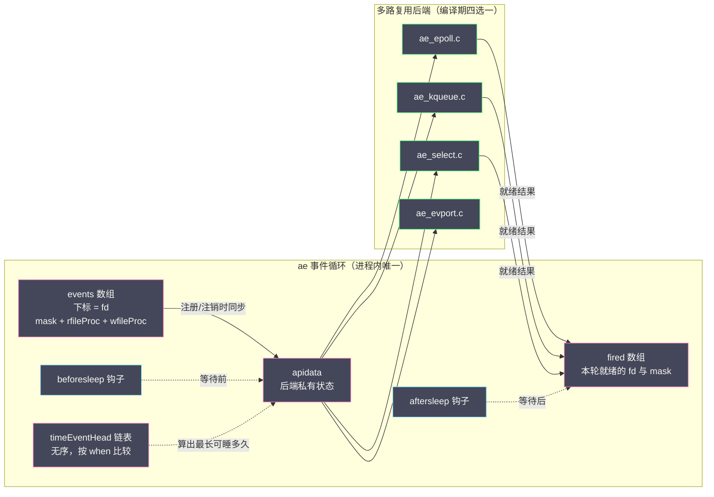
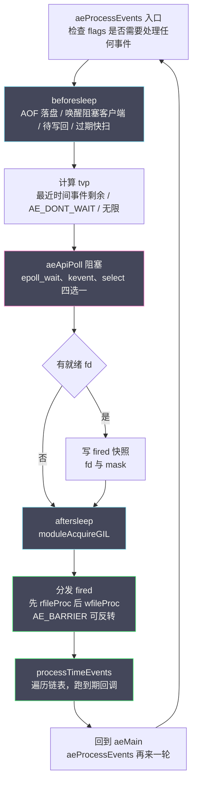
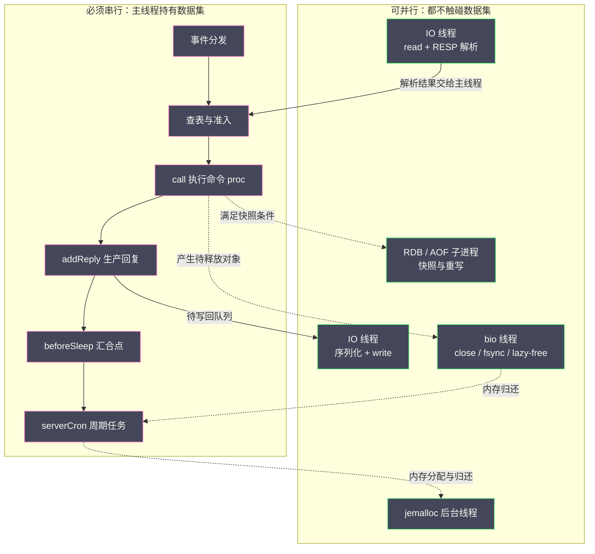
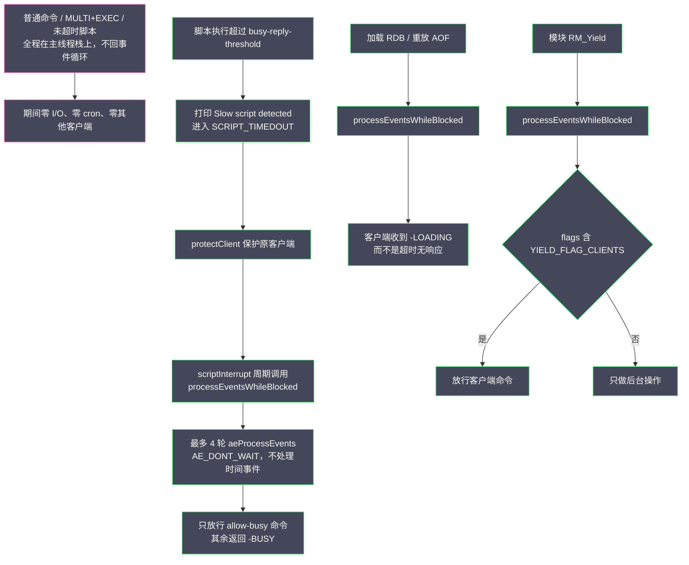

# 05 单线程模型与事件驱动架构

**摘要：**

「Redis 是单线程的」这句话之所以流行，是因为它足够短，可以在一次电梯对话里说完；也正因为它足够短，限定语在传播途中最先掉落。本文要做的不是复述这个结论，而是把它重新拆成可核对的部件：`aeEventLoop` 里到底存了什么（以 fd 为下标的文件事件数组、就绪事件数组、无序的时间事件链表，以及一个指向多路复用后端的私有指针），`aeApiPoll` 如何在 epoll、kqueue、select、evport 四种实现之间抽象出同一张脸，一次循环的七个动作按什么次序发生（`beforeSleep` 在等待之前，`aftersleep` 在等待之后、事件分发之前，时间事件在文件事件之后）。在此基础上给出边界：命令执行单线程、网络解析默认单线程但 6.0 起可多线程、`bio` 后台线程与主线程并行、RDB 与 AOF 重写走子进程。边界清楚了，才能解释单线程为什么仍然快（无锁、无切换、内存操作、pipeline 摊薄往返）、上限在哪里（单核与单命令阻塞全局），以及六类延迟来源各自的机制、量级与判据。落点是一句判断：这个模型约束的从来不是「整机只有一个线程」，而是「同一时刻只有一条命令在改数据集」。

---

## 第 1 章 「单线程」这句话被磨掉了限定语

一个每秒处理十万条命令的服务，进程里只有一条线程在跑业务逻辑——这句话里真正让人不安的地方不是「十万」，而是「只有一条」。但凡接触过多线程服务器的人，脑子里都会自动补上一串画面：锁、条件变量、上下文切换、缓存行在核间来回弹跳。Redis 偏偏在这些地方几乎没有开销，于是「单线程」从一个实现描述，被读成了一种性能神话：好像只要坚持一个线程，谁都能跑到十万 QPS。

神话的成因不在 Redis，而在传播。一句结论要能被记住，就必须短到可以在电梯里说完；而任何限定语都会让句子变长，于是最先被磨掉的就是「哪一段单线程」「读和写呢」「后台任务呢」。等到这句话进入面试题和技术选型会，剩下的只有三个字，与它原本的含义已经隔了好几层。

先把三种常见读法并排放好，分歧一眼可见：

| 读法 | 内容 | 是否成立 | 容易被引申出的错误结论 |
| :--- | :--- | :--- | :--- |
| 强读法 | 整个进程只有一个线程在做所有事 | 不成立 | 「开多线程 IO 就违背了 Redis 的设计」 |
| 中读法 | 命令执行单线程，网络与后台任务另有承担者 | 成立 | 「既然 IO 已经多线程，命令执行迟早也会多线程」 |
| 弱读法 | 数据集在同一时刻只被一个执行体修改 | 成立，且是设计的真正内核 | 无，这一条本来就该这样被记住 |

中读法与弱读法其实是同一件事的两种说法：因为数据集的修改必须串行，所以执行命令的那一段只能是单线程；反过来，只要某段工作被证明不碰数据集，它就可以挪到别的线程或别的进程里去。Redis 这些年的演进——后台 `fsync`、lazy-free、6.0 的多线程 IO、RDB 与 AOF 重写用子进程——都可以用这一条原则解释，不需要为每一项单独找理由。

有必要给这段历史一个锚点。Redis 诞生于 2009 年，那时 Linux 的 epoll 已可用数年，C10K 问题早有定论：一条线程配一套事件通知机制足以撑住上万并发连接。作者没有从零发明事件循环，`ae.c` 的头注释写得直白——这段代码最初是给 Jim Tcl 解释器写的事件循环，后来改成可复用的库。起点因此不是「一个线程够不够快」，而是「既然事件驱动能撑住连接，把数据全放内存、用单线程避开并发会不会更快」。

这个起点决定了后面所有取舍的方向：Redis 的竞争者从来不是多线程的内存数据库，而是「用 MySQL 扛读、加一层缓存」的传统架构，在那个对比里瓶颈通常不在 CPU 核数，而在磁盘与网络往返。

为了不让后面的讨论散开，先把范围划清。本文的机制描述以 Redis 7.x 与 8.x 的源码为准，函数名与结构体字段按 7.2 分支核对，8.0 有结构变化的地方单独标注；不涉及安装、部署与命令用法，配置项只在说明连带后果时出现。数据结构本身的实现（SDS 的头部、字典的渐进式 rehash、listpack 与 quicklist 的取舍）属于 [[02 SDS 与 Redis 对象系统]]、[[03 字典与渐进式 Rehash]]、[[04 跳跃表 压缩列表与 Listpack]] 的范围，这里只在机制需要时引用结论。

打个可能不太精确但足够贴切的比方：Redis 主线程像一间只有一名柜台员的营业厅。柜台员一次只服务一个人，这一点永远不会变；但取号机、叫号屏、后台的保洁与仓库补货，早就换成了别人在做。抱怨「只有一个柜台员」没有意义，真正要问的是——哪些事必须他亲手做，哪些事已经被挪走，以及挪走之后他还能不能及时叫下一个号。

---

## 第 2 章 `aeEventLoop`：三张表撑起一个循环

`ae` 这一层的代码量小得不像一个「框架」。7.2 的 `ae.c` 是 512 行，加上一个后端实现（`ae_epoll.c` 139 行）也不到七百行；它没有抽象基类，没有回调注册中心，没有配置系统，全部家当就是四个结构体和十几个函数。这种克制不是偷懒，而是刻意的取舍：事件库只服务 Redis 一个用户，不需要通用性，凡是 Redis 用不到的能力一律不做。理解这一点，才能理解后面那些看起来「不够优雅」的设计——无序的时间事件链表、以 fd 直接做数组下标、按编译期宏选择后端。

### 2.1 `aeFileEvent`：以 fd 为下标的事件表

文件事件的定义只有四个字段，但它把「一个 fd 上挂了什么回调」这件事说得干干净净：

```c
/* 7.2 src/ae.h：一个 fd 上的事件登记项 */
typedef struct aeFileEvent {
    int mask;                 /* AE_READABLE | AE_WRITABLE | AE_BARRIER 的组合 */
    aeFileProc *rfileProc;    /* 可读回调，mask 含 READABLE 时有效 */
    aeFileProc *wfileProc;    /* 可写回调，mask 含 WRITABLE 时有效 */
    void *clientData;         /* 回调参数，Redis 里几乎总是 client 指针 */
} aeFileEvent;
```

关键在于它怎么被存。`aeEventLoop` 里不是哈希表，而是一个**以 fd 直接做下标的数组**：`events[fd]` 就是该 fd 的登记项，查找是一次地址加法。这个选择换来三样东西：查找 O(1) 且没有哈希冲突；数组连续存放，遍历时缓存命中率高；注册与注销时不需要分配节点，崩溃面小。代价是数组必须开到「可能出现的最大 fd 加一」，而这在 Redis 里是可以接受的，因为 fd 上限本来就被 `maxclients` 管着。

数组大小由此确定：`initServer()` 写的是 `aeCreateEventLoop(server.maxclients + CONFIG_FDSET_INCR)`，`CONFIG_FDSET_INCR` 等于 `CONFIG_MIN_RESERVED_FDS + 96`，即 128，多出来的位置留给监听 socket、管道与临时 fd。示例推算：`maxclients` 取一万时 `events` 一万零一百二十八项，单项在 x86-64 上 32 字节（一个 int 加三个指针），约 324 KB，`fired` 每项 8 字节约 81 KB，两份合计不到半兆。

`aeCreateEventLoop()` 把整个数组的 `mask` 置为 `AE_NONE`，「是否注册过事件」只看 `mask`，不需要额外的位图；`aeApiAddEvent()` 里 ADD 还是 MOD 的判断正是靠这个值：

```c
/* ae_epoll.c：同一个 fd 可能先注册读、后追加写，所以要合并而非覆盖 */
int op = eventLoop->events[fd].mask == AE_NONE ?
        EPOLL_CTL_ADD : EPOLL_CTL_MOD;
mask |= eventLoop->events[fd].mask;      /* 合并旧事件，避免写回时丢掉读 */
```

`clientData` 是把「事件」与「连接」隔开的唯一缝隙：`ae` 不知道 `client` 是什么，只是把注册时传进来的指针原样交给回调，整个网络层因此可以独立演化。

### 2.2 `aeFiredEvent`：一次就绪快照

`aeApiPoll()` 返回之后，哪些 fd 就绪、各自是什么事件，被写进另一份数组 `fired`：

```c
typedef struct aeFiredEvent {
    int fd;    /* 就绪的 fd */
    int mask;  /* 就绪的事件类型，是 AE_READABLE/AE_WRITABLE 的子集 */
} aeFiredEvent;
```

为什么要把就绪结果抄一份到 `fired`，而不是就地分发？因为注册表与就绪表必须分开。分发过程中回调随时可能改注册表：客户端处理完请求立刻注销可写事件，`CLIENT KILL` 注销另一个 fd，连接关闭后 fd 被回收又被新连接复用。若从内核事件数组反查「这个 fd 现在挂的是什么」，拿到的可能是改过之后、甚至已不属于原连接的状态。`fired` 提供的是「本轮开始时谁就绪」的只读快照，配合分发时的二次校验（后文 `fe->mask & mask`），才把这类竞态挡在门外。

两份数组长度都是 `setsize`，一次 poll 最多填满一次，不需要在每轮循环里动态扩容。

### 2.3 `aeTimeEvent`：一条无序链表

时间事件就不是数组了，而是一条双向链表：

```c
/* 7.2 src/ae.h：注意 id 还有一层「逻辑删除」的语义，见 processTimeEvents */
typedef struct aeTimeEvent {
    long long id;                     /* 唯一 ID，删除时置为 AE_DELETED_EVENT_ID */
    monotime when;                    /* 触发时刻，单调时钟，单位微秒 */
    aeTimeProc *timeProc;             /* 到期回调，返回下次间隔（毫秒）或 AE_NOMORE */
    aeEventFinalizerProc *finalizerProc; /* 真正释放节点前的清理回调 */
    void *clientData;
    struct aeTimeEvent *prev;
    struct aeTimeEvent *next;
    int refcount;                     /* 防止回调里删除自己时把节点释放掉 */
} aeTimeEvent;
```

链表没有排序，找「最近一个到期的时间事件」要遍历全部节点，复杂度 O(N)。`ae.c` 在 `usUntilEarliestTimer()` 上方写了三条注释解释为什么接受它：按到期时间插入（但插入删除仍是 O(N)）、用跳表做到插入 O(log N) 与查找 O(1)，「Redis 至今不需要」——长期存在的时间事件基本只有 `serverCron` 一个，N 是个位数，遍历比维护有序结构便宜。

这就是「不为可能的将来付成本」：通用事件库会默认 N 很大而选红黑树或时间轮，`ae` 知道自己只有一个用户。

`refcount` 解决的是一个真实的崩溃点：`timeProc` 里可能调用 `aeDeleteTimeEvent()` 删掉自己，若删除时立刻 `zfree`，回调返回后再访问 `te->when` 就是释放后使用。所以删除只把 `id` 置成 `AE_DELETED_EVENT_ID`，真正释放推迟到 `processTimeEvents()` 且等 `refcount` 归零。

### 2.4 `aeEventLoop`：把三张表串起来

主结构把三张表与两个钩子装在一起。下表按 7.2 字段说明，最后一列写「去掉它会怎样」——这种问法比罗列功能更容易记住意图：

| 字段 | 类型 | 作用 | 去掉它会怎样 |
| :--- | :--- | :--- | :--- |
| `maxfd` | `int` | 当前注册过的最大 fd，初值 -1 | 无法判断「有没有注册任何文件事件」，空转判断失效 |
| `setsize` | `int` | 数组容量，等于 `maxclients + 128` | 注册时无从校验 fd 是否越界 |
| `timeEventNextId` | `long long` | 时间事件的自增 ID 源 | 无法用 ID 定位、删除、区分「本轮新建」 |
| `events` | `aeFileEvent *` | 文件事件登记表，下标即 fd | 无 |
| `fired` | `aeFiredEvent *` | 就绪快照 | 分发时状态被回调改乱，出现竞态 |
| `timeEventHead` | `aeTimeEvent *` | 时间事件链表头 | 定时任务无从挂载 |
| `stop` | `int` | 循环退出标志，仅 `aeStop()` 置位 | 只能靠信号强杀，无法优雅退出 |
| `apidata` | `void *` | 后端私有数据（epoll 的 epfd 与事件数组等） | `ae` 就得知道每种多路复用的细节 |
| `beforesleep` | 回调 | 每轮等待前的钩子 | AOF 落盘、待写回、过期快扫都没有统一的执行点 |
| `aftersleep` | 回调 | 等待返回后的钩子 | 模块线程与主线程无法交接数据集访问权 |
| `flags` | `int` | 全局标志，目前只用于 `AE_DONT_WAIT` | `beforeSleep` 无法临时取消本轮睡眠 |

8.0 加了两项：`nevents` 记录注册事件数量，`privdata[2]` 留给上层挂私有数据。字段本身不改变模型，只说明 `ae` 在被迫稍微通用一点。

三张表与后端的协作关系可以画成这样。图中左侧是 `ae` 自己的数据结构，右侧是后端，唯一穿过边界的是 `apidata`：



---

## 第 3 章 `aeApiPoll`：四种多路复用的同一张脸

事件库最脏的一段活是适配不同操作系统的 IO 多路复用接口。`ae` 的做法简单到近乎粗暴：在 `ae.c` 顶部用预处理器把后端源码直接 `#include` 进来，编译期只留一个实现。

```c
/* ae.c：注释原文是 ordered by performances, descending */
#ifdef HAVE_EVPORT
#include "ae_evport.c"          /* Solaris / illumos 的 event port */
#else
    #ifdef HAVE_EPOLL
    #include "ae_epoll.c"       /* Linux */
    #else
        #ifdef HAVE_KQUEUE
        #include "ae_kqueue.c"  /* macOS / BSD */
        #else
        #include "ae_select.c"  /* 兜底：几乎所有 POSIX 系统都有 */
        #endif
    #endif
#endif
```

这种写法牺牲了「同时构建多个后端」的能力，换来零虚函数开销与零条件分支：`aeApiPoll()` 在编译后就是一次直接调用。对一个每秒要进出数万次的函数来说，这个取舍是划算的。

### 3.1 后端契约：五个函数

每个后端只需实现五个约定函数，`ae` 其余部分与平台无关：

| 函数 | 职责 | epoll 后端对应 | 说明 |
| :--- | :--- | :--- | :--- |
| `aeApiCreate` | 创建后端实例并挂到 `apidata` | `epoll_create` | 失败返回 -1，事件循环创建中止 |
| `aeApiResize` | 调整后端内部容量 | 重分配 `epoll_event` 数组 | 只有 `aeResizeSetSize` 会调用 |
| `aeApiAddEvent` | 在 fd 上追加事件 | `epoll_ctl` ADD 或 MOD | 需要合并已有 mask |
| `aeApiDelEvent` | 从 fd 上撤销事件 | MOD 或 DEL | 撤空时要真正 DEL |
| `aeApiPoll` | 等待并就绪结果写入 `fired` | `epoll_wait` | 唯一的阻塞点 |

这张表里没有的东西才是关键：没有事件语义的抽象，没有「读就绪」「写就绪」「错误」的统一封装，没有优先级。`ae` 只抽象**「等待」**一件事，「就绪意味着什么」全部留给上层，所以 TCP 的错误处理、半关闭、超时判定都不在 `ae` 里，而在 `networking.c` 里。

### 3.2 epoll 后端的三个细节

`ae_epoll.c` 只有 139 行，但有三处细节决定了它的行为特征。

第一处是**增量维护内核侧状态**：`aeApiAddEvent()` 合并新旧 mask 再下发，`aeApiDelEvent()` 用 `events[fd].mask & (~delmask)` 算出剩余感兴趣的事件，撤空时才真正 `EPOLL_CTL_DEL`。在「只读」与「读写」之间反复切换的客户端上，这能省掉大量「先 DEL 再 ADD」的 `epoll_ctl`。

第二处是没有使用边缘触发。全文件搜不到 `EPOLLET`，Redis 用默认的水平触发：接收缓冲里还有数据，下一轮 `epoll_wait` 还会报告它可读。这比边缘触发多几次系统调用，但代码简单得多——不必在回调里一直读到 `EAGAIN` 才敢返回，也不会因为一次没读干净而永久挂住连接。多报告一次的成本，远小于写错边缘触发逻辑的代价。

第三处是 **错误与挂断事件的折算**：

```c
/* EPOLLERR / EPOLLHUP 不是业务能等的东西，折算成读写让上层自行处理 */
if (e->events & EPOLLIN)  mask |= AE_READABLE;
if (e->events & EPOLLOUT) mask |= AE_WRITABLE;
if (e->events & EPOLLERR) mask |= AE_WRITABLE | AE_READABLE;
if (e->events & EPOLLHUP) mask |= AE_WRITABLE | AE_READABLE;
```

这样上层一定会被叫醒一次，`read`/`write` 返回 0 或 `ECONNRESET`，连接在该关的时候关掉。`ae` 只负责转达「有事发生」，代价是每个回调都得自己处理异常返回值。

### 3.3 select 后端：为什么它在现代 Linux 上是个摆设

`ae_select.c` 只为「既无 epoll、也无 kqueue 与 evport 的系统仍能编译」而存在。它用 `fd_set` 位图，每次 `select()` 前要把 `rfds`/`wfds` 拷进 `_rfds`/`_wfds`，因为 `select` 返回时会就地改写传入的集合。硬限制是 `FD_SETSIZE`（通常 1024），`aeApiResize()` 里那句 `if (setsize >= FD_SETSIZE) return -1;` 配合 `maxclients` 默认的 10000，意味着在这类系统上事件循环创建会直接失败——宁可启动不了，也不跑在一条注定撞墙的路径上。

四种后端的对比放在一起看，能看出 `ae` 抽象的是「性能档位」，不是「功能集合」：

| 后端 | 触发方式 | 注册成本 | 单次等待复杂度 | 容量上限 | 主要平台 |
| :--- | :--- | :--- | :--- | :--- | :--- |
| epoll | 水平触发，内核维护就绪链表 | 一次 `epoll_ctl`，增量 | 与就绪数相关 | 受 fd 上限约束 | Linux |
| kqueue | 内核事件队列，注册即挂载 | 一次 `kevent` | 与就绪数相关 | 受 fd 上限约束 | macOS、FreeBSD |
| evport | event port，基于端口 | 一次 `port_associate` | 与就绪数相关 | 受 fd 上限约束 | Solaris、illumos |
| select | 轮询位图，每次传入全集 | 无系统调用，纯内存标记 | O(注册 fd 数) | `FD_SETSIZE`，通常 1024 | 兜底 |

### 3.4 系统调用账：为什么「能直接写就别注册事件」

把注册成本放进算术里，才能理解第 5 章要讲的「先试写」优化。

一次 `epoll_ctl` 的开销在微秒量级（量级判断）。假设一万个客户端同时有待发响应，每个都走「注册可写 → 下轮返回可写 → 回调写完 → 注销」，就是两万次 `epoll_ctl`，按 1 微秒估就是 20 毫秒纯管理开销，一个字节的业务数据都没发出去。反之，`beforeSleep` 里直接 `write()` 成功的话，一个连接只需一次系统调用。

这笔账决定了写回策略：**先试一次、失败才注册**；绝大多数 `GET`/`SET` 的响应只有几十字节，一次 `write` 就完事，只有慢客户端（`write` 返回 `EAGAIN`）才退回事件驱动的慢路径。

---

## 第 4 章 一次循环的精确顺序

事件循环的行为几乎全部由「七个动作的次序」决定。次序错了，现象就无法解释：为什么 AOF 已 `write` 但客户端还没收到回复、为什么脚本超时后 `PING` 能通而业务命令不行。这一章把 7.2 的 `aeProcessEvents()` 逐步摊开，常见资料与源码不一致处一并标出。

### 4.1 `aeMain` 与 `aeProcessEvents`

主循环本身只有三行，信息量全在 flags 里：

```c
void aeMain(aeEventLoop *eventLoop) {
    eventLoop->stop = 0;
    while (!eventLoop->stop) {
        aeProcessEvents(eventLoop, AE_ALL_EVENTS |          /* 文件事件 + 时间事件 */
                                   AE_CALL_BEFORE_SLEEP |   /* 允许调用 beforesleep */
                                   AE_CALL_AFTER_SLEEP);    /* 允许调用 aftersleep */
    }
}
```

两个钩子由 flags 逐轮授权，这个设计的意义到 `processEventsWhileBlocked()` 才显出来：它复用同一个 `aeProcessEvents()`，但传入 `AE_FILE_EVENTS | AE_DONT_WAIT | AE_CALL_BEFORE_SLEEP | AE_CALL_AFTER_SLEEP`，既不要时间事件，也不允许睡眠。同一套分发代码靠 flags 组合出两种运行模式。

`aeProcessEvents()` 的骨架如下，去掉注释后只有几十行，但每个分支都有理由：

```c
int aeProcessEvents(aeEventLoop *eventLoop, int flags) {
    int processed = 0, numevents;

    /* ① 既不要文件事件也不要时间事件，直接返回 */
    if (!(flags & AE_TIME_EVENTS) && !(flags & AE_FILE_EVENTS)) return 0;

    if (eventLoop->maxfd != -1 ||
        ((flags & AE_TIME_EVENTS) && !(flags & AE_DONT_WAIT)))
    {
        struct timeval tv, *tvp = NULL;   /* NULL 表示无限等待 */
        int64_t usUntilTimer;

        /* ② 等待之前先跑钩子 */
        if (eventLoop->beforesleep != NULL && (flags & AE_CALL_BEFORE_SLEEP))
            eventLoop->beforesleep(eventLoop);

        /* ③ 钩子跑完才算超时：钩子可能用 aeSetDontWait 改了 flags */
        if ((flags & AE_DONT_WAIT) || (eventLoop->flags & AE_DONT_WAIT)) {
            tv.tv_sec = tv.tv_usec = 0;
            tvp = &tv;
        } else if (flags & AE_TIME_EVENTS) {
            usUntilTimer = usUntilEarliestTimer(eventLoop);
            if (usUntilTimer >= 0) {
                tv.tv_sec = usUntilTimer / 1000000;
                tv.tv_usec = usUntilTimer % 1000000;
                tvp = &tv;
            }
        }

        /* ④ 唯一的阻塞点 */
        numevents = aeApiPoll(eventLoop, tvp);

        /* 不要求处理文件事件时，丢弃就绪结果（只借 poll 来睡眠） */
        if (!(flags & AE_FILE_EVENTS)) numevents = 0;

        /* ⑤ 等待之后、分发之前的钩子 */
        if (eventLoop->aftersleep != NULL && flags & AE_CALL_AFTER_SLEEP)
            eventLoop->aftersleep(eventLoop);

        /* ⑥ 分发就绪的文件事件 */
        for (int j = 0; j < numevents; j++) {
            int fd = eventLoop->fired[j].fd;
            aeFileEvent *fe = &eventLoop->events[fd];
            int mask = eventLoop->fired[j].mask;
            int fired = 0;
            int invert = fe->mask & AE_BARRIER;

            if (!invert && fe->mask & mask & AE_READABLE) {
                fe->rfileProc(eventLoop, fd, fe->clientData, mask);
                fired++;
                fe = &eventLoop->events[fd];      /* 回调里可能发生扩容 */
            }
            if (fe->mask & mask & AE_WRITABLE) {
                if (!fired || fe->wfileProc != fe->rfileProc) {
                    fe->wfileProc(eventLoop, fd, fe->clientData, mask);
                    fired++;
                }
            }
            if (invert) { /* AE_BARRIER：把读推迟到写之后 */
                fe = &eventLoop->events[fd];
                if ((fe->mask & mask & AE_READABLE) &&
                    (!fired || fe->wfileProc != fe->rfileProc))
                {
                    fe->rfileProc(eventLoop, fd, fe->clientData, mask);
                    fired++;
                }
            }
            processed++;                          /* 统计的是 fd 数，不是回调次数 */
        }
    }
    /* ⑦ 最后处理到期的时间事件 */
    if (flags & AE_TIME_EVENTS)
        processed += processTimeEvents(eventLoop);

    return processed;
}
```

### 4.2 七个动作的次序表

把上面七个动作抽出来单独看，配合「如果调换会怎样」，更容易记住每一步的位置不是随意的：

| 步 | 动作 | 所在位置 | 为什么在这个位置 |
| :--- | :--- | :--- | :--- |
| ① | 空转早退 | 函数入口 | 没有事件可处理时不做任何准备工作，省掉一轮开销 |
| ② | `beforesleep` | `aeApiPoll` 之前 | 把「必须在睡眠前交出」的工作做完，否则数据会滞留一整轮 |
| ③ | 计算等待时长 | `beforesleep` 之后 | 钩子可以用 `aeSetDontWait` 改变本轮是否睡眠 |
| ④ | `aeApiPoll` 阻塞 | 中间 | 唯一的休眠点，超时由最近的时间事件换算 |
| ⑤ | `aftersleep` | poll 返回之后、分发之前 | 它处理的是「刚醒过来」的上下文，而不是「事件处理完」的上下文 |
| ⑥ | 分发文件事件 | 循环体 | 先读后写，`AE_BARRIER` 可反转 |
| ⑦ | 处理时间事件 | 最后 | 周期任务在 I/O 之后跑，且它注册的新事件留到下一轮 |

这里有两个与流行说法不同的点，需要单独说明，因为很多解读文章把它们放错了位置。

其一，**`aftersleep` 在文件事件分发之前，不在时间事件之后**。《Redis 设计与实现》里对事件循环的描述偏重概念顺序，一些博客据此把 `aftersleep` 画在循环末尾；而 7.2 的源码位置非常明确：`aeApiPoll()` 返回、`numevents` 处理完「是否要处理文件事件」的判定之后，紧接着就是 `aftersleep`，然后才进入 `fired` 循环。这个位置差异不是无关紧要的细节——它决定了 `aftersleep` 能看到什么、不能看到什么。Redis 给 `afterSleep()` 的实现只有一件事：调用 `moduleAcquireGIL()` 重新获取模块线程与主线程共享的「全局解释器锁」。它的语义是「主线程刚从睡眠中醒来，要把数据集访问权从模块线程手里收回」，必须在任何命令执行之前完成；如果真放到时间事件之后，模块线程就有机会在命令执行期间读写数据集，整个单线程假设当场失效。

其二，`aeProcessEvents()` 的函数头注释写的是「先处理到期的时间事件，再处理由它注册的文件事件」，而实现恰好相反：先分发文件事件，最后才跑时间事件。以实现为准，后果是 `serverCron` 回调里注册的文件事件要等到下一轮才会被 poll 到。

### 4.3 等待时长是算出来的，不是拍出来的

`tvp` 的取值有三个来源，优先级从高到低：

1. 本轮 flags 含 `AE_DONT_WAIT`，或 `eventLoop->flags` 里有 `AE_DONT_WAIT`——`tv` 置零，poll 只做一次非阻塞检查；
2. flags 含 `AE_TIME_EVENTS` 且存在时间事件——取最近到期时刻与当前的差值；
3. 以上都不满足——`tvp = NULL`，无限等待，直到有文件事件或信号唤醒。

第三条是常态：空闲的 Redis 没有待触发的定时任务时，`epoll_wait` 一直阻塞，CPU 占用为零。不是它聪明地休眠，而是内核替它等着。

第二条的换算要向上取整：`ae_epoll.c` 把 `timeval` 换成毫秒时写的是 `tvp->tv_sec * 1000 + (tvp->tv_usec + 999) / 1000`。多等不会早醒；早醒意味着这一轮 poll 白跑一次，还要按剩余时间再等，白白多一次系统调用。

`AE_DONT_WAIT` 还可以在运行期被 `beforeSleep` 打开：TLS 连接类型检测到自己还有未读完的数据时，会调用 `aeSetDontWait(server.el, connTypeHasPendingData())`。它做的事只是置位或清除 `eventLoop->flags` 里的一个 bit，效果是本轮 `aeApiPoll` 的超时被强制成零——主线程不睡，立刻再检查一轮。这是一个很轻的背压机制：不在事件层加队列，只让循环转得快一点。

下图把一轮循环的时序画出来，横向是时间，标注了每一步内谁在干活、谁在等：



### 4.4 分发时的两处防御

`fired` 循环里有两次校验，都是真实事故的沉淀。一是 `fe` 按 fd 重新取址：读回调之后那句注释写着「Refresh in case of resize」，回调里可能触发 `aeResizeSetSize()`，`events` 数组被 `zrealloc` 搬走，先前算出的指针就悬空。二是 `fe->mask & mask` 的交集判断：一个回调可能已经关掉另一个客户端，而它的 fd 恰在本轮 `fired` 里，此时 `fe->mask` 已是 `AE_NONE`，不判就会拿着已释放的 `client` 指针进 `readQueryFromClient`。

`AE_BARRIER` 是这层唯一一个「刻意反转顺序」的开关。正常先读后写，因为读完新命令再写回最新结果语义最自然；某些连接要求先把积压数据刷出去再读新命令，置位之后同一轮里可写回调先于可读回调执行。`ae.h` 的注释给了动机：在 `beforeSleep` 里 `fsync` 落盘时，要保证回复在落盘之后才发出。

至此，一个循环的骨架已经完整。剩下三章分别把「文件事件」「时间事件」「循环之外的执行体」三块肉填进去，然后才能回答边界问题。
---

## 第 5 章 文件事件：三条注册路径与一次「先试写」

`ae` 只提供「注册、注销、分发」三个动作，真正决定 Redis 网络行为的是调用方怎么用它们。Redis 向事件循环注册文件事件的地方只有三处，三处的形态完全不同：一处长期常驻，一处随连接生命周期存在，一处反复注册与注销。

### 5.1 三条路径

监听 socket 在 `initServer()` 里注册一次可读事件，回调 `acceptTcpHandler`，此后一直有效——监听 fd 的生命周期等于进程生命周期。

客户端 fd 的可读事件在 `acceptTcpHandler` 里注册，回调 `readQueryFromClient`，随连接建立而挂上、随连接关闭而消失：只要连接还在，客户端随时可能发来数据。

客户端 fd 的可写事件只在「有数据等着发、而且一次没发完」时存在，机制是延迟注册：`addReply` 把响应写进输出缓冲后，只把客户端挂进 `clients_pending_write` 队列并打上标志；真正的发送推迟到 `beforeSleep` 的 `handleClientsWithPendingWritesUsingThreads()`，它先试直写，只有 `write` 返回 `EAGAIN` 时才注册 `AE_WRITABLE`，回调 `sendReplyToClient` 发完立刻注销。

三者放在一张表里对照，能看出「事件注册的频率」差异有多大：

| 路径 | 注册时机 | 回调 | 注销时机 | 不注销会怎样 |
| :--- | :--- | :--- | :--- | :--- |
| 监听 socket | 启动时一次 | `acceptTcpHandler` | 永不 | 无影响，本来就该常驻 |
| 客户端可读 | 连接建立时 | `readQueryFromClient` | 连接关闭时 | 关闭的 fd 被复用后误触发，读到别人的数据 |
| 客户端可写 | 有积压响应且一次没写完 | `sendReplyToClient` | 写完立刻注销 | 水平触发下每轮都报告可写，空回调持续烧 CPU |

最后一行最容易被低估。epoll 用水平触发，发送缓冲有空间就一直报告可写；写完不注销，事件循环每轮都会对这个 fd 调一次 `sendReplyToClient`，函数发现没数据可发就返回。一万个空闲连接就是每轮一万次空回调，`instantaneous_ops_per_sec` 看不出来，`--intrinsic-latency` 也测不到。

### 5.2 为什么不直接注册，而要先攒成一个队列

既然最终都要注册，为什么不在 `addReply` 时就注册？三个理由，一个比一个实际。

第一，批量优于逐条。一条命令的响应可能分多次 `addReply` 产生（`HGETALL` 是逐字段追加的），每次检查是否要注册就是重复劳动。

第二，先试写能吃掉绝大多数场景。小响应在 `beforeSleep` 里一次 `write` 就发完，压根不需要注册事件，省下的是两次 `epoll_ctl`。

第三，队列是可调度的抓手：`beforeSleep` 拿到队列长度，才能判断是否值得启用 IO 线程，并按客户端类型分流。

`CLIENT_PENDING_WRITE` 标志还保证不会重复入队：客户端可能在可写事件回调里再次产生输出（譬如脚本持续 `PUBLISH`），此时它已在队列里。这类「标志位 + 队列」的组合在网络层反复出现，是不引入锁也能维持状态一致的主要手段。

### 5.3 `AE_BARRIER`：什么时候需要先写后读

第 4 章提到 `AE_BARRIER` 会反转同一轮里的回调顺序，它存在的场景只有一个：数据的持久化必须先于回复的发出。

`appendfsync always` 策略下，一条写命令的正确语义是「回复 `+OK` 时，这条命令已经在磁盘上」。而 AOF 的 `write` 发生在 `beforeSleep` 里，与写回队列的处理在同一轮；如果某个客户端同时既就绪可读、又有积压响应待发，默认的「先读后写」会让它先读进新命令、再发旧响应，看起来无害，但如果新命令再次触发 AOF 刷盘，轮次关系就变得难以推理。`AE_BARRIER` 把顺序钉死：先把待发的响应发出去（此时 AOF 已在上一步落盘），再读新命令。`ae.h` 对这个标志的注释也直说了动机——「在 `beforeSleep` 里把东西刷到磁盘，然后才回复客户端」。

顺带说明：7.2 的 `server.c` 与 `networking.c` 里搜不到 `AE_BARRIER` 的使用点，同样的效果由 `beforeSleep` 内部「先 `flushAppendOnlyFile` 再处理待写回」的固定次序保证。顺序约束被上层代码承担之后，标志本身成了备份手段。

---

## 第 6 章 时间事件：一条链表，几个任务

时间事件这一层比文件事件简单得多，但有两处机制与直觉不符，值得单独用一章讲清楚：一是 `serverCron` 的实际周期并不精确等于 `1000/hz` 毫秒；二是 `dynamic-hz` 的方向被很多资料写反了。

### 6.1 注册与返回值

`initServer()` 只用一次 `aeCreateTimeEvent()` 就装好了整个定时体系：

```c
/* server.c initServer()：首次 1 毫秒后触发，之后由回调的返回值决定间隔 */
if (aeCreateTimeEvent(server.el, 1, serverCron, NULL, NULL) == AE_ERR) {
    serverPanic("Can't create event loop timers.");
    exit(1);
}
```

首次延迟 1 毫秒而不是 0，是让循环先把第一轮文件事件处理完、把监听 socket 上的积压连接接进来。`serverCron()` 的返回值就是下次间隔：`return 1000/server.hz;`，`hz = 10` 对应 100 毫秒。周期由回调自己决定，`ae` 不预设。

长期存在的时间事件通常只有这一个，模块用 `RM_CreateTimer()` 注册的定时器数量取决于模块。这解释了第 2 章「为什么能接受 O(N) 找最近到期」：链表长度基本是个位数。

### 6.2 `processTimeEvents` 的三个细节

```c
/* ae.c：节选，删去注释 */
static int processTimeEvents(aeEventLoop *eventLoop) {
    int processed = 0;
    aeTimeEvent *te = eventLoop->timeEventHead;
    long long maxId = eventLoop->timeEventNextId - 1;
    monotime now = getMonotonicUs();
    while (te) {
        if (te->id == AE_DELETED_EVENT_ID) {          /* ① 逻辑删除的节点在此真正释放 */
            aeTimeEvent *next = te->next;
            if (te->refcount) { te = next; continue; } /* ② 回调还在栈上，先不释放 */
            /* 摘链、跑 finalizerProc、zfree */
            te = next;
            continue;
        }
        if (te->id > maxId) { te = te->next; continue; } /* ③ 跳过本轮新建的定时器 */
        if (te->when <= now) {
            te->refcount++;
            int retval = te->timeProc(eventLoop, te->id, te->clientData);
            te->refcount--;
            processed++;
            now = getMonotonicUs();                    /* ④ 回调可能很慢，重取时钟 */
            if (retval != AE_NOMORE) te->when = now + (monotime)retval * 1000;
            else te->id = AE_DELETED_EVENT_ID;
        }
        te = te->next;
    }
    return processed;
}
```

第 ① ② 两处合起来是延迟释放：`aeDeleteTimeEvent()` 只把 `id` 改成 `AE_DELETED_EVENT_ID`，真正摘链与 `zfree` 留到下一轮，且必须等 `refcount` 归零——它在调用 `timeProc` 前后自增自减，所以「回调里删除自己」不会造成释放后使用。`finalizerProc` 在真正释放前调用，让上层清理 `clientData`。

`te->when = now + (monotime)retval * 1000` 这行是周期漂移的来源：它用的是「回调执行完之后的时间」加间隔，不是「上次计划时刻」加间隔，于是每轮实际周期是 `retval + 本轮 cron 耗时`，误差持续累积。示例推算：`hz = 10`、`serverCron` 单次耗时 1 毫秒，实际周期约 101 毫秒，一秒跑约 9.9 次；若单次耗时涨到 5 毫秒，实际频率掉到约 9.5 次/秒，偏差接近 5%。

这个漂移不是 bug，但有两个连带后果。其一，`hz` 是「至少这么频繁」，用它反推过期键清理延迟要留余量。其二，`serverCron` 里「每 N 毫秒做一次」的逻辑靠 `run_with_period(ms)` 宏，它比的是 `server.cronloops` 而不是真实时间：

```c
/* server.h：周期性任务的实现方式——按轮数取模，不是按时钟 */
#define run_with_period(_ms_) if (((_ms_) <= 1000/server.hz) || \
    !(server.cronloops%((_ms_)/(1000/server.hz))))
```

轮数本身也受漂移影响，于是「每 100 毫秒」的真实间隔同样略大于 100 毫秒。对着 `INFO stats` 的 `expired_keys` 之类的绝对量做推断时，要记得这一层。

### 6.3 `hz` 与 `dynamic-hz`：被写反的那个方向

`hz` 的合法范围是 1 到 500，默认 10，对应每 100 毫秒一次。调大它的收益是后台任务更及时——过期键清理更密集、客户端超时判定更准、`serverCron` 驱动的复制心跳更密；代价是每轮固定开销乘以频率。示例推算：`serverCron` 单次即使只要 0.5 毫秒，`hz = 100` 时每秒就要付出 50 毫秒的 CPU，也就是 5% 的一个核，而这些时间都是从命令执行那里匀出来的。

`dynamic-hz` 的机制则常被讲反。源码在 `serverCron()` 开头：

```c
server.hz = server.config_hz;
if (server.dynamic_hz) {
    while (listLength(server.clients) / server.hz > MAX_CLIENTS_PER_CLOCK_TICK) {
        server.hz *= 2;                       /* 客户端多了，提高频率，不是降低 */
        if (server.hz > CONFIG_MAX_HZ) { server.hz = CONFIG_MAX_HZ; break; }
    }
}
```

> [!warning] 别把 dynamic-hz 读反
> `MAX_CLIENTS_PER_CLOCK_TICK` 是 200，`CONFIG_MAX_HZ` 是 500。语义是：按当前频率折算，每个时钟节拍要处理的客户端超过 200 个就把频率翻倍，最多 500。方向是**上调**——客户端一多，`clientsCron` 的超时检查更需要精度，否则一个 100 毫秒的节拍里要扫上万个客户端，单轮 cron 耗时反而失控。不少资料写成「繁忙时自动降低频率」，与源码正好相反。

`INFO server` 里同时有 `hz` 与 `configured_hz`，是因为 `server.hz` 每轮都被重新赋值为 `config_hz` 再按上述规则上调；`CONFIG SET hz` 改的是后者，生效点在下次 cron。

### 6.4 `serverCron` 的任务分组

按「占用主线程的方式」给 `serverCron` 的任务分组，比按功能罗列更有用：

| 分组 | 代表任务 | 占主线程的方式 | 与延迟的关系 |
| :--- | :--- | :--- | :--- |
| 每轮必做、开销小 | 更新缓存时间、客户端超时检查、缓冲峰值统计、`run_with_period` 分派 | 微秒级固定成本 | 抬高所有命令的基线，量小 |
| 每轮必做、有预算 | 渐进式 rehash 推进、活跃碎片整理、过期删除慢循环 | 各自有毫秒级时间片 | 大字典扩容期与开启 defrag 时最明显 |
| 触发型 | RDB 保存点检查、AOF 重写触发检查、子进程回收 | 检查本身很轻，触发后可能 `fork` | `fork` 那一瞬是全局停顿，见第 9 章 |
| 跨进程通信 | 复制 cron、集群 cron、`WAIT` 的 ACK 请求 | 每秒或每 100 毫秒一次的编码与写缓冲 | 副本多、集群大时不可忽略 |

第二行最容易误判。「渐进式 rehash 每次只推 1 毫秒」是每轮都付的固定税：十亿级 key 的库扩容期，`serverCron` 每 100 毫秒吃掉 1 毫秒；叠加 `activedefrag`（默认关闭）后基线成本再抬。它不让哪条命令特别慢，只让所有命令一起慢一点，表现是 `instantaneous_ops_per_sec` 小幅下滑、`p99` 轻微上移，`SLOWLOG` 干净。

---

## 第 7 章 单线程的边界：一张可核对的清单

前面六章讲的是「循环怎么转」，这一章回答题目里的核心问题：这个单线程到底管到哪儿。与其给一句结论，不如把进程内的执行体全部列出来，逐个标出「碰不碰数据集」「怎么并行」「哪里会失效」。

### 7.1 命令执行：真正不可并行的一段

命令执行是唯一**必须串行**的一段，理由在第 1 章已经给出：数据集没有锁。两个常被忽略的推论值得补充。

其一，一次读事件里解析出的多条命令是连续执行的。`processInputBuffer()` 是一个 `while` 循环，只要 `querybuf` 里还有完整命令就接着执行，中间不回到事件循环。所以 pipeline 里的 100 条命令是「一口气跑完」，第一条的耗时会原封不动加到后面 99 条的等待上，这就是「慢命令的代价是全局的」在代码层面的依据。

其二，`MULTI/EXEC` 与 Lua 脚本整体处在同一个命令调用栈里。`EXEC` 内部循环调用 `call()`，脚本内部的 `redis.call` 直接在当前栈上调用，整段执行不返回事件循环，也就没有 I/O、没有定时任务、没有其他客户端。这是原子性的来源，也是「脚本里不要写长循环」的根据。

### 7.2 网络 I/O：默认单线程，6.0 起可多线程，但受门控

Redis 6.0 引入的 IO 线程经常被当成「命令执行也要并行了」，实际情况要克制得多。

第一层克制是**阈值**。`handleClientsWithPendingWritesUsingThreads()` 一进门先调 `stopThreadedIOIfNeeded()`：

```c
/* networking.c：待写回客户端不够多时，连已启动的线程都会被停掉 */
int pending = listLength(server.clients_pending_write);
if (server.io_threads_num == 1) return 1;
if (pending < (server.io_threads_num * 2)) {
    if (server.io_threads_active) stopThreadedIO();
    return 1;
}
return 0;
```

`io-threads 4` 意味着要同时有 8 个以上客户端待写回，线程才被激活。理由是同步开销：线程唤醒、缓存行迁移、fan-out 与 fan-in 的交接，在任务很少时换不回并行收益。`INFO server` 的 `io_threads_active` 随负载在 0 与 1 之间翻动，它反映「此刻值不值得并行」，不是「你配了几个」。

第二层克制是**读侧依赖写侧**。读请求的并行不是独立开启的，而是挂在 `postponeClientRead()` 的门条件上：

```c
/* networking.c：读侧并行的五个前提，缺一不可 */
if (server.io_threads_active &&
    server.io_threads_do_reads &&
    !ProcessingEventsWhileBlocked &&
    !(c->flags & (CLIENT_MASTER|CLIENT_SLAVE|CLIENT_BLOCKED)) &&
    io_threads_op == IO_THREADS_OP_IDLE)
```

`io_threads_active` 又由写侧队列长度决定，于是出现一个反直觉现象：连接数不多、单条响应很大的实例，可能因为待写回客户端不够而让线程始终关闭，读侧也一直单线程；写流量一上来线程才被激活，读侧顺带享受并行。这解释了为什么调 `io-threads-do-reads` 有时「没有效果」——线程压根没启动。

第三层克制是分流规则：副本客户端的写回固定交给主线程（`io_threads_list[0]`），因为主从复制共用一份全局复制缓冲，多线程同时读同一块内存要付可见性代价。并行的边界因此不是按「工作类型」划，而是按「是否共享可变状态」划。

同步方式也值得一提。主线程 fan-out 之后并不用条件变量等结果，而是自己做完自己那一份，再忙等一个原子计数器归零：

```c
while (1) {
    unsigned long pending = 0;
    for (int j = 1; j < server.io_threads_num; j++)
        pending += getIOPendingCount(j);
    if (pending == 0) break;
}
```

忙等的合理性在任务粒度：单个客户端的读写是微秒级，用互斥量与条件变量交接（数十微秒）比任务本身还贵。`io_threads` 的配置上限是 128（`IO_THREADS_MAX_NUM`），实际有效值仍取决于命令执行那一段的串行瓶颈。

把一轮拆细，6.0 之后的执行形状是六个阶段：主线程在 `aeApiPoll` 拿到就绪 fd；按轮转把待处理客户端分到各线程的队列；IO 线程并行 `read` 与 RESP 解析，主线程自己也分一份；主线程忙等到计数器归零，串行执行所有已解析的命令；执行完把待写回的客户端再分下去；IO 线程并行序列化与 `write`。读与写各并行一次，中间夹着一段绝对串行的执行。


「并行、串行、并行」的夹心结构，就是多线程 IO 之后单线程模型的实际形状：无论 IO 线程配几个，第四段永远是宽度为一的。

### 7.3 后台线程 `bio`：与主线程并行的另一条线

`bio` 是一组常驻后台线程，存在的意义是把「不需要碰数据集、但会阻塞」的系统调用挪出主线程。7.2 的任务类型有四类：延迟 `close(2)`、AOF `fsync`、lazy-free 的对象释放、AOF 文件关闭。8.0 重新组织了这块：worker 收敛为三类（关闭文件、AOF `fsync`、lazy-free），关闭 AOF 文件降级为任务类型，另加一组「完成通知」任务用于回调。

这套机制之所以敢并行，依据还是第 1 章那条原则：这些任务都不碰数据集。`close` 关的是文件描述符，`fsync` 刷的是页缓存，lazy-free 释放的是已经从键空间摘下来的对象——主线程在摘链那一刻完成所有需要一致性保证的动作，剩下的纯内存回收与系统调用都可以在后台慢慢做。

对使用者有两个直接影响：一是 `UNLINK` 与 `DEL` 的差异（第 9 章展开）；二是 `INFO memory` 的 `lazyfree_pending_objects` 表示「已摘链、待释放」的对象数，它涨起来说明后台释放跟不上，此时内存会短时高于直觉值。

### 7.4 子进程：fork 的那一瞬，和之后的全部时间

RDB 快照与 AOF 重写都走 `fork()` 加子进程。这里要区分两个时间段：`fork` 调用本身在主线程里同步执行，需要复制页表，进程内存越大耗时越长，这段时间主线程完全不处理命令；子进程开始写文件之后，主线程立刻恢复，后续的序列化与磁盘 I/O 全部由子进程承担。所以「fork 不占主线程」只对后半句成立，前半句恰恰是单线程模型下最典型的全局停顿之一。

子进程与主线程之间靠写时复制（Copy-on-Write）共享内存页。关键不是「省内存」，而是「省到了什么程度」：`fork` 之后只要主线程不改某页，那页就一直共享，改了就复制一页。快照期间写入越频繁，复制越多，内存放大越明显，`INFO persistence` 的 `rdb_last_cow_size` 与 `aof_last_cow_size` 记录的就是上一次实际复制了多少字节。结论与 [[07 RDB 持久化——快照的 fork 与 COW 机制]] 一致：fork 的停顿与内存容量成正比，COW 的内存放大与快照期间的写比例成正比。

### 7.5 还有谁在并行

剩余的执行体也该列清：jemalloc 的后台线程（归还脏页、整理内存，取决于构建与配置）、内核的脏页回写线程、模块自己创建的线程（需经 GIL 访问数据集），以及同核邻居与虚拟化层的 steal time。

清单化之后，边界就变成了可以逐条核对的东西：

| 执行体 | 职责 | 触碰数据集 | 并行方式 | 引入版本 | 边界失效时的症状 |
| :--- | :--- | :--- | :--- | :--- | :--- |
| 主线程 | 事件循环、命令准入与执行、`beforeSleep`、`serverCron` | 是，独占 | 不并行 | 全版本 | 任何一条命令慢都是全局慢 |
| IO 线程 | 读入与 RESP 解析、序列化与 `write` | 否 | 受阈值门控的多线程 | 6.0 | 低负载时线程空转，收益为零 |
| `bio` 线程 | `close`、`fsync`、lazy-free | 否 | 后台常驻 | 2.4 起逐步扩充 | 后台跟不上，内存或延迟堆积 |
| RDB / AOF 子进程 | 快照落盘、重写 AOF | 否，靠 COW 拿快照 | 子进程 | 2.x | `fork` 瞬间全局停顿、COW 内存放大 |
| jemalloc 后台线程 | 归还脏页、整理 | 否 | 后台 | 取决于构建 | 碎片率攀升，分配延迟抬高 |
| 模块线程 | 模块自行业务 | 需通过 GIL | 显式 yield | 4.0 起 | GIL 交接不当会破坏串行假设 |

一张图把这层关系画出来更直观。图中把「必须串行」的窄带放在中央，两侧是所有已经并行的搬运与后台工作，箭头标出它们与数据集的关系：



---

## 第 8 章 为什么单线程能快，以及上限在哪里

边界讲清之后，「单线程为什么能快」这个问题就变得容易回答：快不来自线程数，而来自「没有被省掉的那些成本本来就不该存在」。

### 8.1 四项结构性收益

没有锁开销。一次 mutex 加解锁在无竞争时约 25 纳秒（量级判断），乘上每秒百万次操作就是每秒几十毫秒的纯开销，有竞争还会放大；Redis 的数据结构里没有任何一条加锁路径。

没有上下文切换。线程切换要保存恢复寄存器、切换内核栈、刷新 TLB，代价在微秒量级，线程一多切换本身就吃掉可观比例的 CPU——这正是 C10K 时代「一连接一线程」撞墙的原因。

没有缓存行在核间弹跳。多线程修改同一缓存行的不同字段会让该行在核间反复失效；Redis 的热数据全部在一条线程手里，缓存行从不需要跨核同步。

命令是纯内存操作。一次 `GET` 的开销是「哈希函数加一次指针跳转加一次内存拷贝」，几十到几百纳秒，没有磁盘寻道、没有网络往返。把一种微秒级的操作做成并行，协调成本远大于收益——这是 Redis 与「用多线程做磁盘数据库」的根本差别。顺带得到两个副产品：`INCR`、`GETSET` 这类读改写天然原子，客户端观测到的顺序就是命令到达的顺序。

pipeline 则把网络往返摊薄，这是唯一一个「不改变服务端模型、却能成倍提升吞吐」的手段。示例推算：同机房 RTT 取 0.3 毫秒，服务端单条命令耗时取 8 微秒。100 条命令逐条往返需要 `100 × (0.3 + 0.008) ≈ 30.8` 毫秒；合成一次 pipeline，只需 `0.3 + 100 × 0.008 ≈ 1.1` 毫秒。吞吐提升接近 28 倍，而单条命令的服务端耗时一点没变——变的是「等待」被合并了。这个算术也解释了为什么低延迟优化里「减少往返次数」通常比「抠服务端 CPU」划算得多。

### 8.2 三条上限

上限一：单核。命令执行只跑在一条核上，多线程 IO 搬的是字节，不搬 CPU 周期。一台 32 核机器上跑一个 Redis 实例，命令处理能力仍是一条核的能力，加核只能靠多实例或集群分片——容量规划必须按「单核每秒能执行多少条命令」来算。

上限二：单命令阻塞全局。**尾延迟由最慢的那条命令决定**，平均值好看没有意义。一条 `O(N)` 命令在这条线程上跑多久，所有其他客户端就等多久。这与多线程系统里「一个慢请求只占一个线程」完全不同。

上限三：内存而不是 CPU 常常先到顶。实例内存越大，`fork` 的页表复制越久、COW 放大越明显、全量同步越慢。很多事故的触发点不是 CPU 打满，而是「数据涨到几十 GB 之后，快照开始周期性抖动」。

> [!info] 单线程不等于延迟稳定
> 串行化保证的是顺序一致，不是延迟均匀。它把慢操作的代价集中转嫁给所有人，尾延迟曲线反而比多线程系统更陡。稳定的延迟来自「没有慢命令、没有全局停顿」。

把提吞吐的手段并排看，收益与代价总是成对出现：

| 提吞吐的手段 | 作用在哪一段 | 收益量级（示例推算或量级判断） | 代价 |
| :--- | :--- | :--- | :--- |
| 减少命令条数（批量命令、合并写） | 网络往返 | 数倍到数十倍 | 命令语义变粗，失败粒度变大 |
| pipeline | 网络往返 | 与深度近似线性，直到缓冲触顶 | 输入输出缓冲同时膨胀 |
| `io-threads` | 读写搬运 | 大流量写回场景可见，低负载无收益 | 同步开销、低负载空转 |
| 多实例/分片 | 单核上限 | 近似按分片数线性 | 跨分片操作要用客户端或代理处理 |
| 增大 `hz` | 过期与超时精度 | 精度提升，吞吐不升 | 每轮固定开销乘以频率 |
| 换更快的 CPU / 关 THP / 绑核 | 主线程执行与停顿 | 尾延迟改善明显 | 运维复杂度，收益依赖现场 |

---

## 第 9 章 延迟从哪来：六类来源的机制与判据

单线程模型把延迟问题简化成一句话：**主线程被谁占住了，占了多久**。按占用的方式分类，可以归成六类。这一章逐类给机制、量级判断、判据与处置，所有数值都是量级判断而非基准数据。

### 9.1 慢命令：复杂度决定代价

`O(N)` 命令的 N 是「被操作集合的规模」，不是「返回结果的规模」：`KEYS` 的 N 是整库 key 数，`SMEMBERS` 的 N 是集合基数，`LRANGE 0 -1` 的 N 是列表长度。10 万元素在毫秒级，百万元素在十毫秒级（量级判断）。

判据比较直接：`SLOWLOG` 里有样本，`INFO commandstats` 的 `usec_per_call` 突增，而 `INFO latencystats` 的 `p99` 只在这类命令出现时抬升。处置是把一次大操作拆成多次小操作：`SCAN` 系列游标命令、按业务维度分桶、限制单次返回条数。

### 9.2 大 key 删除：`DEL` 与 `UNLINK` 的差别不在速度

`DEL` 一个含 500 万元素的 Hash，要逐个释放 entry 与 SDS 字符串。即便每次释放只要几十纳秒，500 万次也在百毫秒量级，加上分配器归还内存的过程，实际更长。这段时间主线程完全被占住。

`UNLINK` 做的事完全不同：它只把 key 从键空间里摘掉（一次字典删除，微秒级），把整个对象挂到待释放队列，然后由 `bio` 线程逐元素释放。差别不在「删得更快」，而在「删除的成本被**挪出了主线程**」。开启 `lazyfree-lazy-user-del` 之后，连 `DEL` 也会走这条路径——这个配置的名字容易误导，它改变的不是删除语义，而是删除的执行位置。

判据是 `lazyfree_pending_objects` 与 `lazyfreed_objects` 的差值，持续为正说明后台释放跟不上。注意 `UNLINK` 的内存不会立刻归还，容量规划要留出「已删但仍占」的窗口。

### 9.3 fork：与内存容量成正比的停顿

`fork` 在主线程里同步执行，要做的事情包括复制进程的内存管理结构、为子进程建立页表。页表规模与驻留内存成正比。示例推算：8 GB 驻留内存、4 KB 页，约 210 万个页表项，每项 8 字节，光页表数据就有约 17 MB 需要新建与复制，对应约 4100 个页表页；再叠加内核遍历 VMA、分配页表页、刷新 TLB 的成本，这类实例的 `fork` 停顿落在几十毫秒量级（量级判断）。内存翻倍，停顿大致同向增长；开启透明大页（THP）会改变页表规模与 COW 粒度，通常让情况更糟。

判据是 `INFO persistence` 的 `latest_fork_usec` 与 `LATENCY LATEST` 里事件源为 `fork` 的样本。麻烦在于它对 `SLOWLOG` 完全不可见：`call()` 只计时命令函数，而 `fork` 不发生在任何 `proc` 里。所以「客户端集体超时、`SLOWLOG` 却空着」这个组合，第一个该怀疑的就是 `fork` 或刷盘。

### 9.4 AOF 刷盘：三档策略，三种代价

`appendfsync` 的三档差别不是「安全性高低」，而是「谁在什么时候等磁盘」。

| 策略 | `write` 在哪 | `fsync` 在哪 | 最坏数据丢失窗口 | 对主线程的影响 |
| :--- | :--- | :--- | :--- | :--- |
| `always` | 主线程（`beforeSleep`） | 主线程，同步 `fdatasync` | 理论上单条命令 | 每条写命令都要等一次磁盘，吞吐受 IOPS 限制 |
| `everysec` | 主线程（`beforeSleep`） | `bio` 线程，每秒一次 | 正常约 1 秒，极端可到 2 秒以上 | 常态无感；后台 `fsync` 卡住时主线程会推迟 `write` |
| `no` | 主线程（`beforeSleep`） | 交给内核回写 | 取决于内核脏页策略，可达数十秒 | 主线程只付 `write` 的成本 |

`everysec` 的「2 秒」来自源码里的一段保护：如果后台 `fsync` 还没完成，主线程会推迟本次 `write`，最多推迟 2 秒；超过之后不再等，直接写并给 `aof_delayed_fsync` 加一，同时打一条「Asynchronous AOF fsync is taking too long (disk is busy?)」的日志。所以这条日志出现时，说明磁盘已经跟不上了；`aof_delayed_fsync` 持续增长，就是「该换盘或拆实例」的明确信号。

`always` 的代价可以算：一次 SSD 上的 `fdatasync` 在毫秒级（量级判断），机械盘在十毫秒级。若每次写命令都同步刷盘，单线程每秒能处理的写命令数直接被 IOPS 封顶——一万 IOPS 的盘，理论上限就是一万条写/秒，与 CPU 快慢无关。`LATENCY LATEST` 里的事件源 `aof-fsync-always` 专门盯这件事。

### 9.5 swap：从微秒直接掉到毫秒

主线程访问的每个数据结构都假设「在内存里」。某个页一旦被换出，一次指针跳转就变成一次缺页加磁盘读，延迟从纳秒级跳到毫秒级，且停顿随机。判据在系统层：`vmstat` 的 `si`/`so` 持续非零、`smaps` 里的 Swap 项、`--intrinsic-latency` 的抖动。处置是关 swap 或压低 `vm.swappiness`，并给 Redis 内存留出上限。

### 9.6 CPU 争抢：看不见的邻居

主线程只跑在一条核上，这条核的频率、是否被抢占、网卡中断是否同核、虚拟化层的 steal time，都会直接体现在尾延迟上。判据是 `--intrinsic-latency`：它测「进程什么都不做时，内核与硬件能让它停顿多久」。这个数本身就有几十毫秒时，客户端不可能拿到毫秒级延迟，问题在宿主不在 Redis。处置是绑核、隔离中断、避免与高负载服务同机。

六类来源并排放在一张表里，配合「先看哪个指标」的判据，排查时按图索骥即可：

| 来源 | 机制 | 量级判断 | 首要判据 | 处置方向 |
| :--- | :--- | :--- | :--- | :--- |
| `O(N)` 命令 | 遍历集合，主线程独占 | 10 万元素毫秒级、百万元素十毫秒级 | `SLOWLOG`、`usec_per_call` | 游标命令、分桶、限条数 |
| 大 key 删除 | 逐元素释放内存 | 千万级元素可达数百毫秒 | `lazyfree_pending_objects` | `UNLINK`、开 `lazyfree-lazy-*` |
| `fork` | 复制页表，与内存成正比 | 十 GB 实例几十毫秒 | `latest_fork_usec`、`LATENCY` 的 `fork` | 控实例大小、错峰快照、关 THP |
| AOF 刷盘 | `always` 同步刷；`everysec` 后台落后 | SSD 毫秒级、机械盘十毫秒级 | `aof_delayed_fsync`、`aof-fsync-always` | 用 `everysec`、换盘、拆实例 |
| swap | 内存页换出，访问变磁盘 | 微秒跳到毫秒，无上限 | `vmstat si/so`、`smaps` | 关 swap、限 `swappiness` |
| CPU 争抢 | 邻居抢占、中断同核、steal time | 视环境，可达数十毫秒 | `--intrinsic-latency` | 绑核、隔离、避免混部 |

---

## 第 10 章 `beforeSleep` 与 `processEventsWhileBlocked`

第 4 章把 `beforeSleep` 放在循环次序里讲了一句，这一章把它彻底拆开。它在 7.x 里的实现接近两百行，是整条事件循环里密度最高的一段代码；而 `processEventsWhileBlocked()` 则是这段代码被复用出第二种形态的地方，也是最容易被误解的机制。

### 10.1 一个钩子，两种形态

`aeSetBeforeSleepProc()` 本身只有两行，是个纯粹的函数指针赋值：

```c
void aeSetBeforeSleepProc(aeEventLoop *eventLoop, aeBeforeSleepProc *beforesleep) {
    eventLoop->beforesleep = beforesleep;
}
```

真正的工作量全部在 `server.c` 的 `beforeSleep()` 里。这个函数进门第一件事是判断自己处在哪种形态：

```c
if (ProcessingEventsWhileBlocked) {
    /* 阻塞态：只做五件低风险的事，且统计处理了多少事件 */
    processed += handleClientsWithPendingReadsUsingThreads();
    processed += connTypeProcessPendingData();
    if (server.aof_state == AOF_ON || AOF_WAIT_REWRITE) flushAppendOnlyFile(0);
    processed += handleClientsWithPendingWrites();
    processed += freeClientsInAsyncFreeQueue();
    server.events_processed_while_blocked += processed;
    return;   /* 提前返回，绝不继续往下跑 */
}
```

阻塞态下跳过的是：过期键快扫、集群状态更新、阻塞客户端唤醒、`CLIENT TRACKING` 失效广播、复制 ACK、积压裁剪、客户端内存驱逐。这些任务要么依赖「世界静止」，要么会改变数据集或复制流状态，在加载 RDB、加载 AOF、脚本超时这几种上下文里执行是危险的。取舍很清楚：宁可少做事，也不在已经不可重入的场景里做事。

### 10.2 正常路径的清单与次序理由

正常形态下的执行顺序（7.2 源码）如下，第三列写「为什么必须在这个位置」——这份清单的价值几乎全在次序上：

| 序 | 任务 | 为什么在这个位置 |
| :--- | :--- | :--- |
| 1 | 分发待读客户端给 IO 线程 | 越早读越能把网络延迟藏进本轮 |
| 2 | 处理连接类型的待处理数据（TLS 等） | 必须在 AOF 刷盘之前，否则加密层还没吐完数据就落盘了顺序 |
| 3 | `aeSetDontWait()` | TLS 仍有未读数据时禁止睡眠，避免需求被拖到下一轮 |
| 4 | 集群状态更新 | 可能改变节点状态，必须早于阻塞客户端唤醒 |
| 5 | `blockedBeforeSleep()` | 唤醒阻塞在 key 上的客户端、处理 `WAIT` 的副本确认 |
| 6 | 快速过期循环 | 每轮最多约 1 毫秒的预算，只在前一轮已经触发时才继续 |
| 7 | 模块事件通知 | 让模块知道即将进入睡眠 |
| 8 | 向副本请求 ACK | 只在上一轮有客户端阻塞过时才发，避免平白增加复制流量 |
| 9 | 更新故障转移状态 | 依赖客户端发来的偏移量信息 |
| 10 | `CLIENT TRACKING` 失效广播 | 必须在命令产生失效之后、下一轮命令之前送出 |
| 11 | AOF 缓冲落盘 | **必须早于写回**，`always` 策略下这就是「回复前已落盘」的实现点 |
| 12 | 待写回客户端发送 | 先试直写，失败才注册可写事件 |
| 13 | 异步关闭队列清理 | 释放上一轮标记为 ASAP 关闭的客户端 |
| 14 | 裁剪复制积压缓冲 | 按 10 倍速裁剪，尽快释放内存峰值 |
| 15 | 客户端内存驱逐 | `maxmemory-clients` 的生效点 |
| 16 | 释放模块 GIL | 之后不允许再加代码，注释用大号警告标出 |

这张表里有两处次序是「正确性约束」而非「性能优化」，值得单独点出来。

第 5 与第 11 的关系：**唤醒阻塞客户端必须在 AOF 刷盘之前**。被唤醒的客户端往往立刻执行写命令（`BLPOP` 取走一个元素就等于改了数据集），先刷盘再唤醒，这些新产生的写就要等下一轮才落盘，`appendfsync always` 的语义当场破掉。源码注释写得很明确：必须在 `flushAppendOnlyFile` 之前，因为被唤醒的客户端可能写数据。

第 11 与第 12 的关系：AOF 落盘必须在写回之前。这是 `always` 策略在语义上成立的全部原因——回复一旦发出，客户端就认为数据已持久化；落盘还没执行的话，掉电就会产生「收到了 `+OK` 但数据丢了」。

### 10.3 `processEventsWhileBlocked`：四轮、非阻塞、只用一半钩子

函数本身不到四十行，机制密度很高：

```c
void processEventsWhileBlocked(void) {
    int iterations = 4;          /* 最多跑四轮，防止被无限拖住 */
    updateCachedTime(0);
    ProcessingEventsWhileBlocked++;   /* 计数而非布尔：允许嵌套 */
    while (iterations--) {
        long long startval = server.events_processed_while_blocked;
        long long ae_events = aeProcessEvents(server.el,
            AE_FILE_EVENTS | AE_DONT_WAIT |          /* 不处理时间事件，不睡眠 */
            AE_CALL_BEFORE_SLEEP | AE_CALL_AFTER_SLEEP);
        server.events_processed_while_blocked += ae_events;
        if (server.events_processed_while_blocked == startval) break;  /* 没有进展就退出 */
    }
    whileBlockedCron();
    ProcessingEventsWhileBlocked--;
    server.cmd_time_snapshot = prev_cmd_time_snapshot;
}
```

几个设计点连起来看，意图很清楚。`AE_DONT_WAIT` 保证主线程不在这里睡过去——它正被一个「看起来卡住了」的操作占用，不能反过来等事件。不传 `AE_TIME_EVENTS` 意味着 `serverCron` 不跑，但 `whileBlockedCron()` 补上一个精简版本：推进 defrag 循环、更新内存统计、处理加载期间的 `SIGTERM`，异常耗时记进 `while-blocked-cron` 事件源。最多四轮、没有进展就退出，两个条件都指向同一个目标：给客户端一个回应的机会，但不把主线程的注意力让出去太久。

`ProcessingEventsWhileBlocked` 用计数而不是布尔，是因为它可能嵌套——脚本超时期间又碰上 RDB 异步加载，内层再调一次。嵌套时 `beforeSleep` 的阻塞态分支照样生效，层数不改变行为。

调用方只有四处，各自对应一种「主线程暂时交不出控制权」的场景：

| 调用方 | 场景 | 期间允许的命令 | 为什么需要它 |
| :--- | :--- | :--- | :--- |
| `rdb.c` | 启动或全量同步时加载 RDB | 回复 `-LOADING` 等错误 | 加载几十秒也不能让客户端干等无响应 |
| `aof.c` | 启动时重放 AOF | 同上 | 同上，且 AOF 重放可能更慢 |
| `script.c` | 脚本执行超过 `busy-reply-threshold` | 带 `allow-busy` 标志的少数命令 | 让运维有机会 `SCRIPT KILL` 或观察到 `-BUSY` |
| `module.c` | 模块调用 `RM_Yield()` | 视 flags 决定是否放行客户端命令 | 模块做长任务时把控制权还一点给事件循环 |

### 10.4 纠正一个被说反的说法

常见表述是「`MULTI` 与 Lua 脚本执行期间 Redis 仍能处理 I/O」，这句要拆成两半，一半错得彻底，一半是特例。

`MULTI/EXEC` 期间**不处理任何 I/O**。`EXEC` 是普通命令，内部循环执行排队的命令，全程不返回事件循环；没有 `epoll_wait`、没有 `beforeSleep`、没有时间事件，其他客户端的命令只能等着。事务的原子性正建立在「什么都不发生」之上。

正常时长的 Lua 脚本同样不处理 I/O：脚本是一个命令，`redis.call` 在当前栈上调用，整段执行不回循环。它看起来「不影响别人」，只是因为多数脚本只跑几十微秒。

能处理 I/O 的是第三种状态，脚本已经超时。执行时间超过 `busy-reply-threshold`（默认 5000 毫秒，旧名 `lua-time-limit`）后，Redis 打印「Slow script detected」告警，进入 `SCRIPT_TIMEDOUT`，用 `protectClient()` 保护原客户端（防它在脚本结束前被断开），随后周期性调用 `processEventsWhileBlocked()`。此时事件循环确实转了起来，但只放行带 `allow-busy` 标志的少数命令（`SCRIPT KILL`、`FUNCTION KILL`、`SHUTDOWN NOSAVE` 一类），其余一律 `-BUSY`。这不是「脚本执行期间照常服务」，而是「脚本卡住之后开出的应急通道」。

把这两条时间线画在一起，区别就很清楚了：



`afterSleep()` 在 7.x 里只做一件事——`moduleAcquireGIL()`，它与 `beforeSleep` 末尾的 `moduleReleaseGIL()` 配成一对：主线程入睡前把数据集访问权交给模块线程，醒来第一时间收回。这解释了它为何必须紧跟 `aeApiPoll`、位于事件分发之前——处理的是上下文切换，与业务无关。

---

## 第 11 章 四个反例

边界与机制讲完之后，反例是最好的检验。下面四个用法都能在测试环境跑通，且都指向同一种误判：把「单线程」理解成「快」，而忘了它同时意味着「阻塞」。

### 11.1 用 `KEYS` 或 `SMEMBERS` 打大 key

`KEYS prefix:*` 的复杂度是 O(整库 key 数)，返回全量结果，没有游标，全程在主线程执行。三条叠加，小库只是「慢一点」，百万级 key 的库上直接是事故。`SMEMBERS`、`HGETALL`、`LRANGE 0 -1` 同构。

常见的辩解是「用 pipeline 包起来了」。pipeline 解决的是往返次数，不解决单条命令的耗时——`KEYS` 照样遍历整个字典；甚至更糟，pipeline 让命令连续执行，第一条 `KEYS` 的耗时被完整叠加到后面每一条上。正确方向只有两个：换 `SCAN`/`SSCAN`/`HSCAN` 分批取，或按业务维度把大集合拆成多个小 key。

### 11.2 用同步 `DEL` 删大集合

`DEL` 一个大 Hash 或大 ZSet，要逐元素释放内存，千万级元素在数百毫秒量级。这段时间里所有客户端都在排队，而删除本身是「一个不再需要的 key 被清理」这种低价值操作。

处置是 `UNLINK`，或至少对用户删除路径开 `lazyfree-lazy-user-del`。识别大 key 不必猜：`--bigkeys` 给出各类型最大的 key（它本身是全量遍历，别在高峰期跑），`MEMORY USAGE` 给单 key 估算，`OBJECT ENCODING` 能看出是否已从紧凑编码转成哈希表或跳表。

### 11.3 把 `appendfsync always` 当性能配置

有一种误解认为 `always` 是「更安全的性能配置」，实际上它是把每一条写命令的响应时间绑到磁盘 `fdatasync` 的延迟上。单线程下这个绑定是全局的：一条写命令等盘，所有客户端跟着等。

三档策略的正确读法是「用多大的数据丢失窗口换多大的写吞吐」。需要强持久化时，优先「换更快的盘 + 不用 `always` + 用副本冗余」，而不是把 `always` 当默认。另一个误判是把混合持久化当刷盘优化——它改的是重写后的文件格式（前半 RDB、后半 AOF），与刷盘时机无关，见 [[08 AOF 持久化与混合持久化]]。

### 11.4 用 `io-threads` 当多核加速

看到「单线程只用一个核」就调大 `io-threads`，是把并行用错了地方。命令执行仍串行，`io-threads` 只分担读写搬运；瓶颈在命令执行时，加大它不会带来吞吐提升，反而因激活阈值与同步开销让低负载场景更差。

判断顺序是先看主线程时间去向：`CONFIG RESETSTAT` 后压测，按 `calls × usec_per_call` 排序，前几名就占满一条核说明瓶颈在执行，该减命令或分片；若时间大量花在读写与解析上（这类开销不进 `commandstats`，要看 `total_net_input_bytes`、`io_threaded_*_processed` 间接判断），才轮到 `io-threads`。

---

## 第 12 章 收束：把标签还原成边界

行文至此，可以把开头那句话重写一遍：「Redis 的**命令执行**是单线程的」，并补上三条边界——网络读写默认单线程，6.0 起可配 IO 线程但受阈值门控；`bio` 后台线程与主线程并行，因为它们不碰数据集；RDB 与 AOF 重写走子进程，除 `fork` 那一瞬不占主线程。

这个模型的收益与代价是一体的。收益是数据结构里没有任何一条锁路径、命令天然原子、顺序天然一致、诊断只有一条主线程；代价是所有慢操作都是全局的，尾延迟由最慢的那条命令决定，容量规划必须按单核来算。所谓「单线程快」，准确的说法是「在内存操作与事件驱动的组合下，每条命令的固定成本被压到了最低」，而不是「一个线程能顶多个核」。

放回工程实践：调优先问「瓶颈在主线程哪一段」，再决定减命令、换命令、分片还是加 IO 线程；排查先问「主线程被谁占住」，再区分命令慢、`fork`、刷盘、swap 还是机器。标签没有行动含义，边界才有。

一条命令从 accept 到回包的完整链路，在 [[01 Redis 全局架构——一次请求的完整生命周期]] 里逐段展开；`fork` 与 COW 的内存账，见 [[07 RDB 持久化——快照的 fork 与 COW 机制]]；AOF 的刷盘时机与重写流程，见 [[08 AOF 持久化与混合持久化]]；单线程模型的容量上限如何变成分片需求，见 [[10 Redis Cluster 分布式架构]]。

---

## 参考资料

1. Redis 源码 7.2 分支 `src/ae.c`（事件循环、`aeProcessEvents`、`processTimeEvents`）：https://github.com/redis/redis/blob/7.2/src/ae.c
2. Redis 源码 7.2 分支 `src/ae.h`（四个结构体与 `AE_BARRIER` 语义）：https://github.com/redis/redis/blob/7.2/src/ae.h
3. Redis 源码 7.2 分支 `src/ae_epoll.c`（epoll 后端、`epoll_wait` 超时换算）：https://github.com/redis/redis/blob/7.2/src/ae_epoll.c
4. Redis 源码 7.2 分支 `src/ae_select.c`（select 后端与 `FD_SETSIZE` 限制）：https://github.com/redis/redis/blob/7.2/src/ae_select.c
5. Redis 源码 7.2 分支 `src/networking.c`（`processEventsWhileBlocked`、IO 线程 fan-out/fan-in、`postponeClientRead`）：https://github.com/redis/redis/blob/7.2/src/networking.c
6. Redis 源码 7.2 分支 `src/server.c`（`beforeSleep`、`afterSleep`、`serverCron`、`dynamic-hz`）：https://github.com/redis/redis/blob/7.2/src/server.c
7. Redis 源码 7.2 分支 `src/aof.c`（`flushAppendOnlyFile` 的 `everysec` 推迟逻辑）：https://github.com/redis/redis/blob/7.2/src/aof.c
8. Redis 源码 8.0 分支 `src/bio.h`（worker 组织与任务类型变化）：https://github.com/redis/redis/blob/8.0/src/bio.h
9. epoll(7) Linux 手册页（水平触发与边缘触发的语义差别）：https://man7.org/linux/man-pages/man7/epoll.7.html
10. Redis 官方延迟诊断文档（`LATENCY` 事件源与常见停顿来源）：https://redis.io/docs/latest/operate/oss_and_stack/management/optimization/latency/
11. Dan Kegel, The C10K Problem：http://www.kegel.com/c10k.html
12. 黄健宏，《Redis 设计与实现》（第二版），机械工业出版社，第 12 章「事件」

---

> [!note] 思考题
> 1. `aftersleep` 在源码里位于 `aeApiPoll` 返回之后、文件事件分发之前，而不少资料把它画在时间事件之后。假设有人按错误的位置去理解「模块线程能访问数据集的时间窗口」，会得出什么错误结论？
> 2. `serverCron` 的实际周期是「回调耗时 + 1000/hz」，长期运行会产生累积漂移。如果某个业务依赖 `hz` 来估算过期键的清理延迟，这个漂移会带来多大偏差，你会用哪个指标来校准？
> 3. 读侧并行依赖 `io_threads_active`，而后者由待写回客户端数量决定。一个「读多写少、单次响应很大」的实例，能否通过调整配置让读侧并行真正生效，代价是什么？
> 4. `everysec` 策略下，后台 `fsync` 卡住时主线程会推迟 `write` 最多 2 秒。这段窗口里数据丢失风险与「最多丢 1 秒」的通常说法如何统一？`aof_delayed_fsync` 持续增长时，第一步该做什么？
> 5. 如果把 `busy-reply-threshold` 从默认值调小，脚本超时会更早触发 `processEventsWhileBlocked`，这对「脚本原子性」意味着什么？在什么场景下这是一个合理的取舍？
