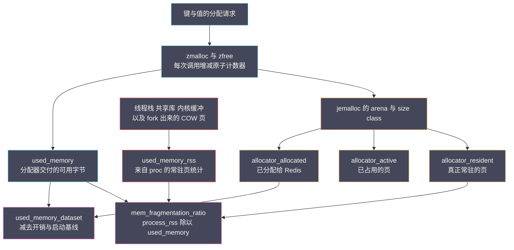
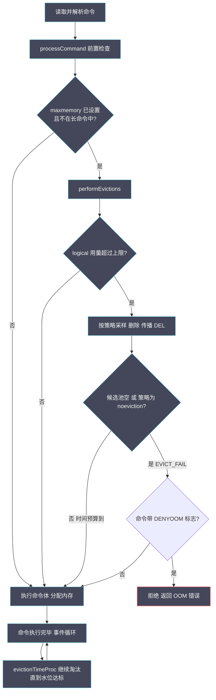
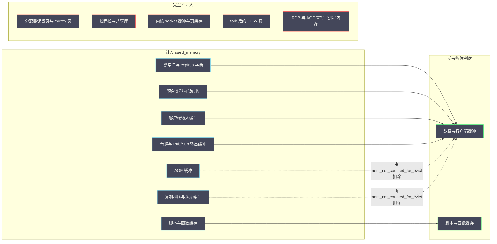
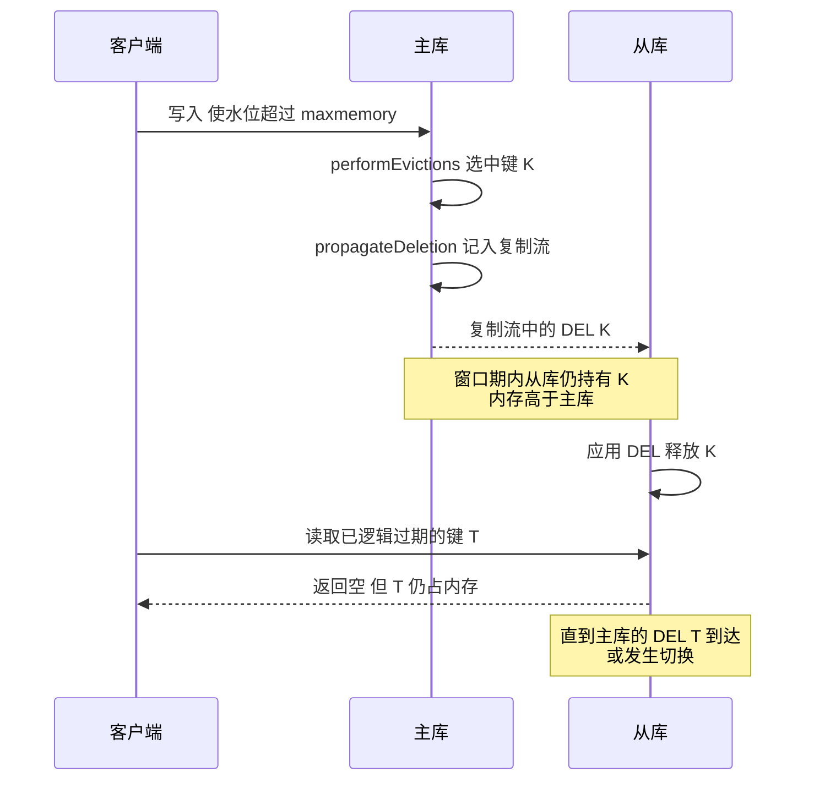
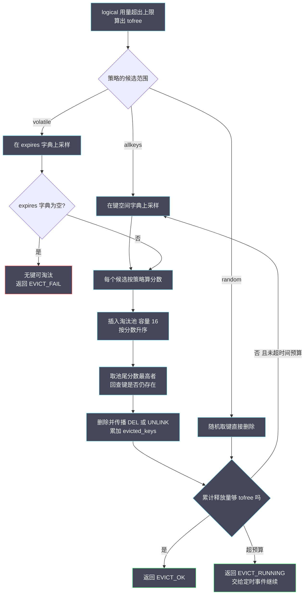
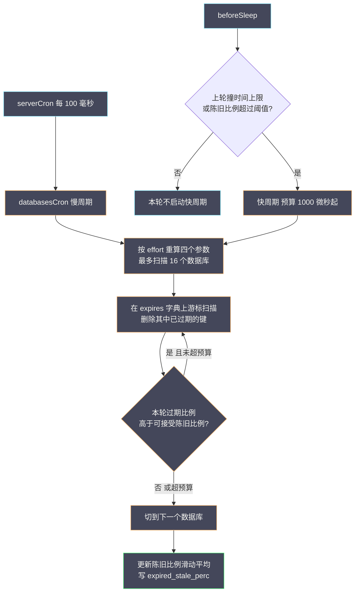

# 06 内存管理与过期淘汰策略

**摘要：**

`maxmemory` 很容易被当成一条硬保证：内存碰到这条线，Redis 就开始淘汰。线上真正发生的却是一套围绕记账口径与执行时机展开的机制。本文先校准三本账——分配器视角的 `used_memory`、进程视角的 `used_memory_rss`、扣掉容器与运行时开销后的 `used_memory_dataset`，以及那个名字叫碎片率、实际衡量 RSS 总开销的 `mem_fragmentation_ratio`；随后把 `maxmemory` 的三条边界逐条拆开。检查发生在命令执行之前而不是申请内存的那一刻，所以一条大命令可以先把上限顶破，再由下一条命令做补偿式淘汰；它统计的是逻辑分配而不是常驻内存，分配器保留页、客户端缓冲、复制积压与 fork 出来的 COW 页各有各的去处；从库从 5.0 起默认忽略 `maxmemory`，删除由主库淘汰后传播的 `DEL` 驱动，这解释了两类现象——从库内存单向上涨，以及主从配置不一致时切换后丢数据。后半段处理机制细节：八种策略的候选池与排序依据、近似 LRU 的采样与淘汰池精度（用概率算术估，而不是背结论）、LFU 的对数计数与时间衰减、过期清理的时间预算如何随 `hz` 与 `active-expire-effort` 缩放、碎片整理与 `UNLINK` 这类动作能改什么改不了什么。落点是一个判断：`maxmemory` 是目标水位，不是上限承诺，用它的前提是知道它没算哪部分内存。

---

## 第 1 章 三本账：同一块内存的三种口径

### 1.1 分配器视角：used_memory 记的是什么

Redis 的堆分配全部走 `zmalloc.c` 那一层薄封装。`zmalloc()` 拿到指针之后做两件事：向全局计数器加上 `zmalloc_size(ptr)`，再与 `used_memory_peak` 比较一次并更新峰值；`zfree()` 做减法。计数器是 `redisAtomic` 类型，加减通过 `atomicIncr`、`atomicDecr` 完成，多线程 IO 下也不会撕裂，读取则是 O(1) 的一次原子读——正因为如此便宜，它才能被放在每条命令的执行路径上做判断。

`zmalloc_size` 在 jemalloc 下转发给 `je_malloc_usable_size`，返回本次分配实际可用的字节数，而不是调用方请求的字节数。请求 100 字节，jemalloc 按 size class 给到 112 字节，记账就是 112。所以这个数的口径可以一句话概括：**分配器已经交付给 Redis 的可用字节总和**。它包含真正写进去的数据，也包含向上取整浪费掉的尾部空洞，后者属于内部碎片，一开始就被记进了账里。

它不包含的部分同样明确：分配器手里保留但还没交付的页（`allocator_active` 减去 `allocator_allocated`）、已经释放但既没还给分配器、分配器也没还给操作系统的页，都不在 `used_memory` 里。这一条是理解后文"逻辑内存不等于常驻内存"的起点。

### 1.2 进程视角：used_memory_rss 从哪里来

`used_memory_rss` 是另一回事，它是操作系统眼里这个进程占用的物理页总量。Linux 上 `zmalloc_get_rss()` 打开 `/proc/self/stat`，取第 24 个字段（`rss`，单位是页），乘页大小得到字节数；macOS 走 `task_info` 的 `resident_size`，FreeBSD 走 `sysctl`，实在拿不到时退化成"把 `used_memory` 当返回值"，此时碎片率恒等于 1，看指标的人会误以为一切健康。

采集频率是一个容易被忽略的细节。它不在 `INFO` 里现算，而是由 [[05 单线程模型与事件驱动架构|serverCron]] 每 100 毫秒调一次 `cronUpdateMemoryStats()` 采样并缓存，`INFO memory` 读的是缓存值。同一段代码里 `used_memory` 也被同步取一次，源码注释写得很直白：两次采样必须同一时刻，否则算出来的比率是两个时刻的数据相除，没有意义。因此 `used_memory_rss` 最多有 **100 毫秒的滞后**，把 Prometheus 同一秒抓到的两个值相除，结果会有几个百分点的抖动。

RSS 包含的东西比 `used_memory` 多得多：Redis 自己的堆分配、线程栈（pthread 默认大小的栈由 mmap 分配，不走 zmalloc）、动态库映射页、jemalloc 的元数据、第三方库直接分配的内存。反方向也成立——如果系统把页换到了 swap，或者容器被 cgroup 挤压触发了匿名页回收，RSS 会比 `used_memory` 还小。

### 1.3 数据集视角：used_memory_dataset 是减出来的

`used_memory_dataset` 是个减法结果，减法在 `getMemoryOverheadData()` 里完成。函数先把开销一项项加出来：`sizeof(redisServer)`、命令表、每个数据库键字典与 expires 字典的表结构与 `dictEntry`、每个键的 `robj` 头（[[02 SDS 与 Redis 对象系统|redisObject]]）、所有客户端结构与输入输出缓冲、复制积压与从库缓冲、集群链路缓冲、AOF 缓冲、脚本与函数缓存，最后再加上 `server.initial_memory_usage`（进程启动时的基线）。得到 `overhead_total` 之后，`dataset = zmalloc_used - overhead_total`。

这个定义有三个推论。其一，`used_memory_overhead` 里已经含了启动基线，`used_memory_dataset` 并不等于"纯 value"——键名的 SDS 与 value 的 SDS 或聚合结构体都还在 dataset 里，只是容器骨架与运行时开销被剔了出去。其二，`used_memory_dataset_perc` 的分母是 `used_memory - used_memory_startup`，不是 `used_memory`，跨实例比较这个百分比要先看分母差多少。其三，键多值小的实例，开销占比会高得惊人：每个键至少要一份 `dictEntry`（三个指针，24 字节）加一个 `robj`（16 字节），一百万个小键光这两项就是 40MB，还没算哈希桶数组与键名 SDS。

### 1.4 三个数对不上时的判读

三个数字几乎从不相等，差异本身就是信息。

| 现象 | 口径差异 | 常见原因 | 处置方向 |
| :--- | :--- | :--- | :--- |
| `used_memory_rss` 明显大于 `used_memory` | 进程常驻与分配器交付 | 分配器保留页、峰值后不归还、线程栈与共享库、内核缓冲 | 用 `allocator_frag_ratio` 与 `rss_overhead_ratio` 定位是哪一层 |
| `used_memory_rss` 小于 `used_memory` | 页被换出或被 cgroup 回收 | swap 被使用、容器内存压力 | 查 swap 计数与 cgroup 事件，不要先动碎片整理 |
| `used_memory_dataset` 占比很低 | 骨架吃掉了大半 | 键小而多、客户端缓冲大、脚本缓存多 | 看 `MEMORY STATS` 的 db 段与 `mem_clients_normal` |
| `used_memory_peak` 远高于当前 | 峰值水位没有归还 | 批量导入、大命令、fork 后的 COW 高峰 | `MEMORY DOCTOR` 会明确说明峰值不算碎片 |

`MEMORY DOCTOR` 的判据是现成的，都写在 `getMemoryDoctorReport()` 里：总碎片率超过 1.4 且差额超过 10MB，报"High total RSS"；分配器外部碎片超过 1.1 且差额超过 10MB，报"High allocator fragmentation"；非分配器部分的 RSS 超过 1.1 且差额超过 10MB，报"High process RSS overhead"；单个客户端输出缓冲平均超过 200KB 报大客户端；脚本缓存超过 1000 条报脚本过多。这套阈值比背下来的经验数字可靠，因为它跟着实现一起演进。

### 1.5 碎片率：一个为兼容保留的名字

INFO 源码对这一行的注释值得原样理解：`mem_fragmentation_ratio` 是"total RSS overhead, including fragmentation, but not just it"，**保留下这个名字只是为了向后兼容**。它的定义是 `process_rss / zmalloc_used`——凡是不在 zmalloc 账上的常驻内存都会推高它，碎片只是其中一部分。

正确的读法要分三层，下面的表按"从分配器往外"的顺序排列。

| 指标 | 算法 | 回答的问题 |
| :--- | :--- | :--- |
| `allocator_frag_ratio` | 小 size bin 的外部碎片字节除以已分配字节，再加 1 | 分配器层面的外部碎片有多重 |
| `allocator_rss_ratio` | `allocator_resident` 除以 `allocator_active` | 分配器占的页有多少真的常驻 |
| `rss_overhead_ratio` | `process_rss` 除以 `allocator_resident` | 除分配器之外进程还常驻了多少 |
| `mem_fragmentation_ratio` | `process_rss` 除以 `used_memory` | 上面几层的合成结果 |

判断要不要动手，看的不该只是比率。`1.5` 在 4GiB 实例上意味着 2GiB 差额，`1.1` 在 40GiB 实例上意味着 4GiB 差额，后者更该处理——所以 `mem_fragmentation_bytes` 的绝对值往往比比率更有决策价值。

小于 1 的读法要更谨慎。它说明有一块逻辑上已分配的内存在物理内存里找不到，最常见的原因是页被换到了 swap：一个数据 6GiB、RSS 5.4GiB 的实例碎片率是 0.9，差的 600MiB 就是被换出去的页，此后任何一次全量扫描都会把这些页读回来，延迟会以毫秒级毛刺的形式出现。容器里还有第二种原因——cgroup 的内存压力让内核回收了匿名页，进程本身没有 swap 可换，指标同样会掉到 1 以下。还有一种无害情形：刚做完一批大删除，`used_memory` 先降下来，分配器归还页要慢半拍，采样时刻的错位造成短暂倒挂。

把三本账与它们之间的换算关系画成一张图，就能看清碎片率为什么必然带着"非碎片"的成分：它把进程层的一切常驻内存都算进了分子，而分母只有分配器交付的那一部分。



---

## 第 2 章 检查点：maxmemory 是"用了才拦"

### 2.1 一次命令的执行顺序

`maxmemory` 的判断写在 `processCommand()` 里，位置在一串前置检查之后：认证、ACL、集群重定向、`evictClients()`（客户端驱逐，若开启）、然后是内存这一关。条件是 `server.maxmemory` 非零且当前不在会让出主线程的长命令里；判断完才轮到命令体执行、分配内存。

这个位置决定了整个语义。它不参与单次 `malloc` 的决策，也不做配额预留，它只是在每条命令开始之前看一眼水位，高过线就把水位压回去，然后把控制权交还给命令。所以准确的说法是**用了才检查**，而不是"申请时拦截"——两者之间隔着一整条命令的执行时间。

`isInsideYieldingLongCommand()` 这个排除条件有两层含义：脚本执行期间不再逐条命令检查，否则淘汰产生的 `DEL` 会混进脚本的传播序列，破坏脚本的原子语义；数据加载期间同样不检查，`isSafeToPerformEvictions()` 里对 `server.loading` 有单独早退。

### 2.2 判据：reported 与 logical

`getMaxmemoryState()` 的计算顺序值得逐行看清。先取 `mem_reported = zmalloc_used_memory()`；未设上限直接返回 OK；若 `reported` 已经低于上限且调用方不要 level，也直接返回 OK。这一处提前返回是为了避免每条命令都去遍历客户端列表算扣除项。需要精算时，才调用 `freeMemoryGetNotCountedMemory()` 得到扣除项，从 `reported` 里减出 `mem_used`，再算 `level = mem_used / maxmemory`。若 `reported` 低于上限则 OK；若 `mem_used` 仍高于上限，则 `tofree = mem_used - maxmemory`。

`reported` 与 `logical` 的差别就在这里：前者是账面全部，后者扣掉了"不该触发淘汰"的那部分。扣什么、为什么扣，见第 3 章。

### 2.3 谁被拒绝

`performEvictions()` 有三种返回值。`EVICT_OK` 表示内存正常，或者当前不适合淘汰；`EVICT_RUNNING` 表示已经超限，但淘汰还在进行中；`EVICT_FAIL` 表示超限且已经没有可淘汰的键，或者策略就是 `noeviction`。

`processCommand()` 只把 `EVICT_FAIL` 当作"内存真的不够"，并且**只拒绝带 `CMD_DENYOOM` 标志的命令**，返回一行 `-OOM command not allowed when used memory > 'maxmemory'.`。读命令、`DEL`、`UNLINK`、`CONFIG SET maxmemory`、`INFO` 都不带这个标志，一律放行；常规写入命令基本都带。事务的判定看汇总标志：`EXEC` 会检查事务内命令的标志位，一个只读事务不会被拒，含写命令的事务会被拒。被拒的次数落在 `INFO errorstats` 里，形如 `errorstat_OOM:count=...`，这是判断"OOM 是否真的在发生"的第一手信号。

`server.pre_command_oom_state` 保存命令开始时的判断结果，供 `EXEC` 与模块调用参考：脚本里第一次写入看到的是这个快照，而不是执行到一半、水位已经涨上去时的状态。

### 2.4 三条突破上限的路径

第一条是单条大命令。4GiB 上限的实例收到一条 500MiB 的 `SET`，检查时淘汰只会把水位压到上限，命令体随后分配 500MiB，瞬时用量变成 4.5GiB。下一条命令的检查发现超了 500MiB，于是补偿式地淘汰掉一批键。这个过程在 `INFO stats` 里表现为 `evicted_keys` 的阶跃，在延迟上表现为一次几毫秒到几十毫秒的尖峰，在 `total_eviction_exceeded_time` 上留下痕迹。

第二条是脚本与事务。`EVAL` 内部的 `redis.call` 走的是 `call()`，不经过 `processCommand`，自然不会触发淘汰检查；外层 `EVAL` 只在开始前检查一次。`MULTI` 与 `EXEC` 同理，事务内命令在 `execCommand()` 里逐条执行，检查发生在整个事务开始之前。一段循环十万次 `SET` 的脚本可以把水位推过上限好几倍，直到脚本结束、下一条客户端命令到来才进入补偿。

第三条是 fork 之后的内存。RDB 快照与 AOF 重写都靠 fork 子进程（[[07 RDB 持久化——快照的 fork 与 COW 机制]] 展开的是这一段的细节），子进程新写的页是它自己的，父进程写入触发 COW 时被复制的页同样不计入父进程的 `used_memory`，而它们都是实打实的物理内存。BGSAVE 期间 `used_memory_rss` 可以比 `used_memory` 高出一大截，`maxmemory` 对此一无所知。

还有一条补丁性质的分支：字典扩容前的预判。`dictResizeAllowed()` 在决定要不要扩表时调用 `overMaxmemoryAfterAlloc()`，如果扩容后会超出上限就暂时不扩，宁可让链变长也不先把预算花掉；只有负载因子超过 `HASHTABLE_MAX_LOAD_FACTOR` 时才放行，避免性能彻底塌掉。这条路径与 [[03 字典与渐进式 Rehash]] 里的扩容判据是同一段逻辑，差别只在于预算这一关。

### 2.5 时间预算：500 微秒与 EVICT_RUNNING

淘汰不是一次算到底的。`evictionTimeLimitUs()` 把 `maxmemory-eviction-tenacity`（默认 10）换算成时间上限：不大于 10 时线性增长，50 微秒乘以 tenacity，默认即 **500 微秒**；大于 10 时按 1.15 的几何级数放大，99 对应约两分钟；100 表示不设上限。循环里每淘汰 16 个键检查一次时间，顺带把从库输出缓冲刷出去，避免从库收不到删除而内存越堆越高。

```c
/* evict.c —— tenacity 与时间上限的换算：低段线性，高段几何增长 */
static unsigned long evictionTimeLimitUs(void) {
    if (server.maxmemory_eviction_tenacity <= 10) {
        /* 默认 10，对应 500 微秒；不设上限会让一次淘汰卡住整个事件循环 */
        return 50uL * server.maxmemory_eviction_tenacity;
    }
    if (server.maxmemory_eviction_tenacity < 100) {
        /* 每档放大约 15%，99 档已是分钟量级，留给后台慢慢追上 */
        return (unsigned long)(500.0 * pow(1.15,
                   server.maxmemory_eviction_tenacity - 10.0));
    }
    return ULONG_MAX;   /* 100 档表示不计时 */
}
```

预算用完时函数返回 `EVICT_RUNNING`，并通过 `aeCreateTimeEvent(server.el, 0, evictionTimeProc, ...)` 注册一个 0 毫秒的定时事件，事件循环下一轮继续淘汰，直到水位达标或者淘不出东西。这条路径解释了两个线上现象：内存超限之后延迟整体抬高一段时间，而不是单条命令长时间卡住；OOM 报错是间歇性的，中间那些轮次返回的是 `EVICT_RUNNING`，命令照常执行。

默认 500 微秒的预算意味着一次调用大致只能删掉几十到上百个键（单键删除加传播按几微秒量级估算）。要是水位一下超出去几百 MB，就需要连续多轮淘汰才能追上，这期间每条命令都要先付一笔淘汰成本。

有一点需要纠正：把 25 毫秒当成淘汰的时间预算，是把过期清理的预算搬错了地方。25 毫秒是 `activeExpireCycle` 在 `hz=10`、`active-expire-effort=1` 时的慢周期预算（100 毫秒的 25%），与淘汰的 500 微秒不是同一个量级，也不是同一段代码。

下面的图把命令执行路径与两个检查点放在一起，注意 `EVICT_RUNNING` 出去之后命令仍然继续执行。



---

## 第 3 章 账内与账外：逻辑内存不是 RSS

### 3.1 在账内的

先看哪些东西会被算进 `used_memory`，以及其中哪些参与淘汰判定——这两件事不是一回事。

| 项目 | 计入 `used_memory` | 计入淘汰判定 | 说明 |
| :--- | :--- | :--- | :--- |
| 键空间与 expires 字典 | 是 | 是 | 每键一份 `dictEntry`、一个 `robj`、一份键名 SDS |
| 聚合类型的内部结构 | 是 | 是 | quicklist 节点、skiplist、listpack 都在 zmalloc 账上 |
| 客户端输入缓冲 | 是 | 是 | 深 pipeline 会显著抬高这一项 |
| 普通客户端与 Pub/Sub 输出缓冲 | 是 | 是 | 慢消费者能把水位直接顶过上限 |
| 脚本与函数缓存 | 是 | 是 | 跨实例比较时最容易被忽略的一项 |
| AOF 缓冲 | 是 | 否 | 由 `mem_not_counted_for_evict` 扣除 |
| 复制积压与从库输出缓冲 | 是 | 否 | 同上，扣除口径有版本差异 |

"普通客户端输出缓冲计入淘汰判定"这一条值得展开。一个 Pub/Sub 消费者卡住，它对应的输出缓冲会持续增长，涨到把水位顶过 `maxmemory`，Redis 就开始按策略淘汰数据键——业务数据被一个与数据无关的慢消费者挤掉。7.0 引入的 `maxmemory-clients` 就是为这类场景准备的第二道闸门，而它**限制的对象不是数据，是客户端本身**。

### 3.2 不在账内的

账外的内存可以按层归类，每一层的处置手段都不同。

- 分配器层：`allocator_active` 与 `allocator_allocated` 的差是保留页，`allocator_muzzy` 与 dirty 页是已经不该算作占用、但还没还给操作系统的部分。`MEMORY PURGE` 能催一次。
- 进程层：线程栈、动态库映射页、jemalloc 元数据、第三方库的直接分配。线程栈会随连接与线程数缓慢变化，在容器里尤其值得留意。
- 内核层：socket 的发送与接收队列、页缓存。一个慢消费者的问题可能同时体现在用户态输出缓冲和内核 socket 缓冲上，而后者不在任何 Redis 指标里。
- 子进程层：fork 出来的 COW 页、RDB 写缓冲、AOF 重写缓冲。这些要么属于子进程，要么是父子共享的物理页，父进程的 `used_memory` 看不见。

> [!info] 一条反直觉的推论
> `maxmemory` 设得再准，也只能约束 zmalloc 记账的那部分。一个实例的实际常驻内存可以合理地高于 `maxmemory` 一整个 COW 峰值加碎片，这不是泄漏，是口径。

把账内与账外的边界画出来，第 3.3 节要讲的 `mem_not_counted_for_evict` 正好落在这条边界上：它在账内，却被排除在淘汰判定之外。



### 3.3 mem_not_counted_for_evict 的版本差异

6.2 及以前的实现扣三样：遍历 `server.slaves` 累加每个从库的输出缓冲、AOF 缓冲，以及 AOF 重写期间独立维护的那份重写缓冲（后者见 [[08 AOF 持久化与混合持久化]]）。7.0 之后复制缓冲改成全局共享的 `repl_buffer_mem`，扣除口径随之变成"复制缓冲超出 `repl-backlog-size` 的部分"加上 AOF 缓冲。

源码注释把理由讲得很清楚：复制积压会涨到设定大小就停，超出部分才是随时间上涨的风险；反过来，正在被慢从库引用的旧缓冲块即使已经释放，也仍然按从库的口径扣掉，否则会形成"淘汰产生 `DEL`、`DEL` 撑大缓冲、缓冲再触发淘汰"的正反馈，严重时能把库淘汰空。

| 版本 | 扣除项 | 备注 |
| :--- | :--- | :--- |
| 6.2 及以前 | 从库输出缓冲、AOF 缓冲、AOF 重写缓冲 | 每个从库单独累加 |
| 7.0 起 | 复制缓冲超出 backlog 设定值的部分、AOF 缓冲 | 复制缓冲全局共享 |

两套口径在 `INFO memory` 里都留了对照字段：`mem_not_counted_for_evict` 是当前被扣掉的总量，`mem_replication_backlog` 与 `mem_total_replication_buffers` 分别给出积压与复制缓冲的规模，对账时三个一起看能分清哪部分是积压、哪部分是慢从库撑出来的。这条差异的实际影响是：同一份负载从 6.2 升到 7.x，`used_memory` 与 `evicted_keys` 都可能出现台阶式变化，容量规划不能按旧版本的读数直接平移。

### 3.4 客户端缓冲与 maxmemory-clients

`maxmemory-clients`（7.0 起，默认 0 表示关闭，也支持 `10%` 这样的百分比写法）提供了另一条限制路径。`evictClients()` 在每条命令执行前、淘汰数据键之前运行：把所有客户端的输入输出缓冲按大小分桶，从最大的桶开始踢客户端，日志里留下 `Evicting client:` 一行，`INFO stats` 的 `evicted_clients` 累加。限额低于 128KB 会被抬到 128KB，防止配置写错把管理连接一起踢掉；`CLIENT NO-EVICT on` 可以保护指定连接；`CLIENT NO-EVICT off` 恢复默认。

配套的还有 `CLIENT NO-TOUCH`（7.2 起）：这条连接读键但不更新 `lru` 字段。它的用途是让旁路查询与巡检脚本不去污染热度统计——否则一次全库 `TTL` 扫描就会把全库的访问时间刷成"现在"，此后淘汰池里再也分不出冷热。

### 3.5 fork 的账

fork 之后父进程与子进程共享物理页，写时复制。对 `maxmemory` 而言，父进程账面只记自己新分配的部分；对 RSS 而言，共享页在两个进程里都要计一次。于是三个数字同时出现：`used_memory` 平稳、`used_memory_rss` 上涨、`mem_fragmentation_ratio` 冲到 1.5 以上。**这不是碎片，是 COW**。

`used_memory_peak` 会在这种时候被推高，而峰值本身不会归还：jemalloc 把释放的页留在 arena 里，`MEMORY DOCTOR` 对这种情形会明确说明"高峰导致的碎片无害，等实例被填满就会用上"。这也是为什么刚做完一次大批量导入或从库全量同步之后，碎片率看着吓人但业务毫无异常。

---

## 第 4 章 从库为什么不淘汰自己

### 4.1 一个开关与一次早退

`performEvictions()` 的第一行是 `isSafeToPerformEvictions()`，不满足就直接返回 `EVICT_OK`，当作什么都没发生。四类不满足：处于会让出主线程的长命令中（脚本执行或超时）、正在加载数据、从库且 `replica-ignore-maxmemory` 为真、淘汰动作被暂停。

`replica-ignore-maxmemory` 默认为 yes（5.0 引入，当时的名字是 `slave-ignore-maxmemory`）。所以一台从库即使配了 `maxmemory`、即使水位早超了，也不会自己删键，`performEvictions()` 直接返回 `EVICT_OK`，连 OOM 都不会报——这解释了为什么从库上的 OOM 计数通常恒为零。

这样设计的理由是角色分工。从库的职责是"主库的精确副本"；如果它按自己的策略淘汰，删掉的键在逻辑上仍然存在于主库，此时发生切换，新主库就少了一批主库认为还在的数据。更糟的是从库的删除不传播回主库，两边会在无人察觉的情况下分叉。把淘汰权收归主库，用"主库淘汰、`DEL` 传播、从库执行"这条单向链路换一致性，代价就是**内存水位的不对称**。

顺带说一句 `CLIENT PAUSE ... WRITE`：`PAUSE_ACTIONS_CLIENT_WRITE_SET` 里同时包含 `PAUSE_ACTION_EXPIRE` 与 `PAUSE_ACTION_EVICT`，也就是说暂停写入期间过期清理与淘汰都停了。暂停结束的那一刻，积压的过期键与超限的水位会集中处理，表现出来就是一段密集的 `expired_keys` 与 `evicted_keys` 增长。

### 4.2 从库上的"逻辑过期"

过期键在从库上有同样的问题。`expireIfNeeded()` 发现键逻辑过期之后，如果 `server.masterhost` 非空，先判当前客户端是不是主库链路（是的话直接当有效，主库发来的命令不受过期影响），否则返回 `KEY_EXPIRED` 而不删除。读命令看到的是"键不存在"，物理内存照旧占着。

从库也不是完全不管。它维护一个 `slaveKeysWithExpire` 字典，记录"逻辑上已过期但还没被主库删掉"的键，`INFO stats` 的 `slave_expires_tracked_keys` 暴露条目数；`expireSlaveKeys()` 在 `databasesCron` 里随机抽样处理，连续 3 个键都还没过期、或者单轮耗时超过 1 毫秒就停。这里处理的含义是把键从跟踪集合里清出去，真正决定内存释放的仍是主库那条 `DEL`。

> [!warning] 只读副本上的可见性
> 从 3.2 起，从库读到逻辑过期的键会返回空值，客户端不会读到脏数据；但 `DBSIZE`、`INFO keyspace` 统计的键数与内存占用仍然包含这些键。两个视角的差异可以一直持续到主库把 `DEL` 发过来为止，做容量核对时不能只看 `DBSIZE`。

### 4.3 从库内存上涨的三个来源

其一是淘汰传播的滞后。主库淘汰一个键之后，`DEL` 进入复制流（复制流的组织方式见 [[09 主从复制与 Sentinel 高可用]]），从库要等这条 `DEL` 被应用才释放内存。滞后窗口等于主从偏移差对应的数据量，正常情况下是毫秒级；一旦从库 IO 线程被阻塞、网络抖动，或者从库上跑着重命令，窗口会拉长到秒级，这期间从库内存持续高于主库。

其二是过期键滞留。主库的 `activeExpireCycle` 与惰性删除都可能没来得及处理完一批过期键，从库更不可能先释放；如果从库在这个时刻被提升为主库，它手里的滞留键会立刻变成"新主库的合法数据"，直到新主库自己的清理追上。这类切换之后"凭空多出一批本该过期的数据"，根因往往在切换之前。

其三是从库特有的缓冲。从库连主库的那条链路本身是一个客户端，它的查询缓冲要装下主库发来的命令流；如果从库还有下级从库，它还要维护自己的复制缓冲；全量同步期间从库先把 RDB 落盘再加载，加载期的内存占用会短暂翻倍，字典扩容与临时对象叠加在一起。级联复制越深，这条链上的缓冲越多。

下面的时序图把三种滞后叠在一起：主库淘汰与从库释放之间存在窗口，而逻辑过期与物理释放之间还隔着主库的一条 `DEL`。



### 4.4 主从配置不一致的故障形态

第一种形态：主库 8GiB、从库 6GiB，两边都设 `maxmemory`，`replica-ignore-maxmemory` 保持默认。从库不淘汰，水位稳定高于 `maxmemory` 并持续上涨，直到物理内存耗尽被 OOM killer 杀掉，或者被内核回收拖到延迟飙升。这时候从库的 `used_memory` 超过 `maxmemory` 是设计如此，告警规则若只按 `used_memory > maxmemory` 判定会天天误报。正确做法是给从库单独设阈值，把复制缓冲与滞留过期键的余量算进去。

第二种形态：有人把 `replica-ignore-maxmemory` 改成 no，想让从库"自己管住自己"。从库会在主库不知情时删数据，主从出现分叉，切换后新主库缺一批数据，回溯与追平都很难。

第三种形态：主从 `maxmemory-policy` 不一致。策略本身不传播，传播的是淘汰结果 `DEL`，所以差异不会立刻显现；但它会影响从库作为只读查询节点被临时提升之后的行为——淘汰顺序会与主库时代完全不同，应用的缓存命中率曲线会出现台阶。

第四种：`repl-backlog-size` 太小导致频繁全量同步。全量同步期间从库内存翻倍、主库 fork 与 COW 同时发生，两边的 `maxmemory` 都形同虚设，这类事故的表现是"每隔几小时一次内存尖峰，伴随主从切换或延迟抖动"。

---

## 第 5 章 八种策略与两种近似

### 5.1 策略矩阵

八种策略由两个维度组合而成：候选范围（全部键，还是只有设了过期时间的键）与排序依据（空闲时间、访问频率、随机、剩余存活时间），再加上一个"不淘汰"的特例。

| 策略 | 候选范围 | 排序依据 | 依赖的字段 | 主要代价 |
| :--- | :--- | :--- | :--- | :--- |
| `noeviction` | 无 | 无 | 无 | 超限后拒绝所有带 DENYOOM 的命令 |
| `allkeys-lru` | 键空间 | 空闲时间最长 | `robj.lru` 的 24 位秒级时钟 | 全量扫描会污染热度 |
| `allkeys-lfu` | 键空间 | 计数最低 | `robj.lru` 拆成 16 位加 8 位 | 新热点上位慢，需调 log factor |
| `allkeys-random` | 键空间 | 无 | 无 | 淘汰顺序不可控，命中率方差大 |
| `volatile-lru` | expires 字典 | 空闲时间最长 | `robj.lru` 与 TTL | 无 TTL 键时完全空转 |
| `volatile-lfu` | expires 字典 | 计数最低 | `robj.lru` 与 TTL | 同上，且计数需要预热 |
| `volatile-random` | expires 字典 | 无 | TTL | 同上 |
| `volatile-ttl` | expires 字典 | 过期时间最早 | expires 的绝对时间戳 | 只在"越早到期越该走"时成立 |

除 `noeviction` 之外的七种里，带 `volatile` 的四种都以 `db->expires` 为候选池，这一点决定了它们的可用前提是"存在足够多的 TTL 键"，5.5 节展开。

### 5.2 近似 LRU：采样、池子与精度算术

精确 LRU 需要一条覆盖全库的双向链表，每次访问把节点移到头部，淘汰取尾部。这在单线程的 Redis 里既费内存（每键两个指针，还要额外节点结构）又费 CPU（每次读都要写链表），所以实现的是采样近似：访问时只把 `LRU_CLOCK()` 写进 `robj` 的 `lru` 字段（毫秒时钟除以 1000 取低 24 位，回绕周期约 194 天），淘汰时随机抽一批键，比较空闲时间。

采样在 `evictionPoolPopulate()` 里完成：先随机选一个非空字典槽，再从槽里取至多 `maxmemory-samples` 个键（默认 5），对每个候选按策略算一个分数——LRU 下是 `estimateObjectIdleTime()`（毫秒），LFU 下是 `255 - LFUDecrAndReturn()`（把"频率低"换算成"分数高"），`volatile-ttl` 下是 `ULLONG_MAX - 过期时间戳`（越早到期分数越高）。分数插进一个容量 16 的淘汰池，池内按分数升序，挤掉分数最低的。

池子改变了两件事。一是跨调用累积：池子不会在两次淘汰之间清空，被选中的位置腾出来后，下一轮采样里更好的候选能补进来，等效于放大了采样规模。二是跨库统一：LRU 与 LFU 策略下每轮会遍历所有数据库填池，所以多 DB 实例里最冷的键不一定在 DB0，选键是全局的。池子里的条目在真正删除前还要回查一次字典（避免选中已经删除的"幽灵"条目），回查失败就顺位取下一个。

精度可以自己算，不必背结论。假设键的访问时间在总体里均匀分布、采样近似独立，抽 k 个键取最冷者，它的**期望名次约为 N/(k+1)**（从最冷端数）：

| `maxmemory-samples` | 期望名次（N=100 万） | 命中"真实最冷 1%"的概率 | 每次淘汰的采样成本 |
| :--- | :--- | :--- | :--- |
| 3 | 约 25 万 | 3.0% | 最低 |
| 5（默认） | 约 16.7 万 | 4.9% | 低 |
| 10 | 约 9.1 万 | 9.6% | 中 |
| 16 | 约 5.9 万 | 14.8% | 高 |

这里标的是量级判断，前提是均匀分布。真实缓存流量的访问分布是长尾偏斜的，绝大多数键的空闲时间都挤在"最近"一侧，最冷端 16% 与最冷端 1% 在实际收益上差别很小，误删真正热键的概率远低于均匀假设给出的数字。再加上淘汰池跨轮累积，实际精度又比单次采样更好。这解释了一个常见现象：`maxmemory-samples` 从 5 调到 10，命中率的提升往往只有千分之几，而在淘汰密集的实例上 CPU 开销会明显上升；反过来，把它从 5 调到 3，在写入压力大的实例上更容易看到命中率下滑，因为淘汰开始变得更"随机"。

### 5.3 LFU：24 位拆成两半之后

LFU 复用同一个 24 位字段：高 16 位存"最近一次衰减的时间"（分钟级，`LFUGetTimeInMinutes()` 取低 16 位，回绕周期 65536 分钟约 45.5 天），低 8 位存对数计数器。新键的计数器从 `LFU_INIT_VAL`（5）起步而不是 0，给新键留出在被淘汰之前累积若干次访问的机会。

递增是概率的：`p = 1 / ((counter - 5) × lfu-log-factor + 1)`，`lfu-log-factor` 默认 10。counter 为 5 时 p 恒为 1，每次访问都加；为 6 时约 1/11；为 10 时约 1/51；为 20 时约 1/151。常见资料把 counter 为 10 的概率说成 10%、把 20 说成 1%，那是既没扣掉 `LFU_INIT_VAL` 也没给分母加 1 的结果，算出来偏高了一个数量级。

```c
/* evict.c —— 递增是概率的：基数越大、越难再加一，这就是"对数"的来历 */
uint8_t LFULogIncr(uint8_t counter) {
    if (counter == 255) return 255;              /* 8 位封顶 */
    double r = (double)rand() / RAND_MAX;
    double baseval = counter - LFU_INIT_VAL;     /* 5 以下视为 0 */
    if (baseval < 0) baseval = 0;
    double p = 1.0 / (baseval * server.lfu_log_factor + 1);
    if (r < p) counter++;                        /* 大部分访问并不改变计数 */
    return counter;
}
```

这段实现解释了为什么 8 位计数器够用：计数不是"每次访问加一"，而是"访问越多的键越难再加一"，于是 8 位能覆盖从个位数到百万级的访问量，代价是没有精确计数、只能比较量级。

把期望访问次数加起来，从 5 涨到 255 大约需要 Σ((c-5)×10+1)，c 从 5 到 254，合计约 31 万次访问（示例推算）。`lfu-log-factor` 调到 100，同样的饱和点要 310 万次；调到 0，p 恒为 1，250 次访问就把 8 位计数器打满。所谓"8 位计数器能表示上百万次访问"，指的正是这个可调的饱和点，而不是说它能精确记录访问次数。

衰减在访问与采样时都会计算：`LFUDecrAndReturn()` 用当前分钟减去 `ldt`，除以 `lfu-decay-time`（默认 1 分钟）得到周期数，计数器按周期数递减，不小于 0。默认参数下，一个打满 255 的热键需要约 255 分钟不被访问才降到 0；`lfu-decay-time` 设为 0 表示不衰减，曾经的批量热点会永久占据高位，通常不是想要的结果。

`OBJECT FREQ` 返回的是衰减之后的计数，`OBJECT IDLETIME` 在 LFU 策略下会直接报错，这两个命令的可用性跟着策略走。用它们做抽样调查时，注意 `FREQ` 的读数已经过衰减，看到 5 附近说明这个键近期确实冷，而不是"从没被访问过"。

### 5.4 访问时间在什么情况下不更新

`lookupKey()` 里有三个条件决定要不要刷新 LRU 或 LFU：客户端带 `CLIENT_NO_TOUCH`（且当前命令不是 `TOUCH` 本身）、存在活动子进程（`hasActiveChildProcess()`）、调用方传了 `LOOKUP_NOTOUCH` 标志。第二条最容易被忽略：只要有一个 BGSAVE 或 AOF 重写子进程在跑，全库的访问时间都不再更新。源码注释把理由称为"避免 COW 疯狂"——每刷新一次 `lru` 字段就是一次写操作，会让共享页被复制，而这类复制完全没有收益。

由此得到一条实战推论：如果持久化配置导致 fork 极其频繁、子进程存活很久（大数据量下的 RDB 快照、AOF 重写），LRU 与 LFU 的信息会在这些窗口里冻结，淘汰依据退化成冻结前的快照。用 `latest_fork_usec`、`total_forks` 观察 fork 的频率与时长，比只看 `evicted_keys` 更能解释"为什么最近淘汰的键看上去并不冷"。

### 5.5 volatile 系的空转

四个 volatile 策略的候选池是 `db->expires`。淘汰循环先统计所有库 expires 字典的总大小，`total_keys` 为 0 就直接跳出，返回 `EVICT_FAIL`。也就是说，一个"所有键都没有 TTL"的实例配上 `volatile-lru`，**行为与不淘汰没有区别**，所有写命令一律被 OOM 拒绝，而 `INFO memory` 里 `evicted_keys` 一动不动。

判据很直接：`evicted_keys` 长期不动、`errorstat_OOM` 在涨、`used_memory` 贴着 `maxmemory`，三者同时成立就说明候选池是空的。进一步确认可以抽样看 TTL 分布：用 `SCAN` 取一批键逐个 `TTL`，统计返回 -1 的比例。`INFO keyspace` 的 `avg_ttl` 只反映有 TTL 那部分键的平均值，没有 TTL 的键根本不参与统计，光看它会得到"平均 TTL 健康"的错误结论。

`volatile-ttl` 还有一层语义上的前提：它的分数来自 expires 字典里的绝对时间戳，完全不关心键的热度。所以这个策略表达的是"先牺牲最早到期的数据"，只有当"越早到期越该先走"在业务上成立时才正确。如果 TTL 是按写入时间批量设置的，它会退化成"先淘汰最早写入的那批"，与 LRU 的选择相关但并不等价——两者对"刚写入但很快过期"的键判断完全不同。

### 5.6 LRU 与 LFU 的命中率差异

差异的根源是抗扫描污染的能力。一次全量遍历（譬如运营拉全量画像、风控跑一次全库匹配）会把所有键的 `lru` 刷成当下，此后淘汰池里再也分不出冷热，热数据被无差别淘汰，命中率在扫描结束之后的一段时间里明显下滑，要等热数据被重新访问过几轮才恢复。LFU 下这些被扫描的键只是偶尔被访问，计数器停在 5 与 6 附近，扫描结束后它们反而是最容易被淘汰的一批，热数据的计数器不受影响。

反向的代价是对新热点迟钝。缓存里出现一批新的热点键，LFU 要从 5 攒到两位数的计数才具备分辨力，在此之前它们与冷键没有区别，可能被淘汰掉再重新加载。`lfu-log-factor` 调小能加快这个进程，代价是高频键更快饱和、区分度下降。

选择可以按数据形态判断，不必按"谁更先进"判断。

| 场景 | 推荐策略 | 理由 | 主要风险 |
| :--- | :--- | :--- | :--- |
| 通用缓存，读多写少 | `allkeys-lru` | 简单稳定，不需要预热 | 全量扫描后短期命中率下降 |
| 热点长期稳定且有长尾 | `allkeys-lfu` | 抵抗扫描污染 | 新热点上位慢，需要调 log factor |
| 冷数据有独立 TTL 设计 | `volatile-lru` 或 `volatile-ttl` | 只动可回收的那一部分 | 无 TTL 键多时完全空转 |
| 数据不可丢，作为主存储 | `noeviction` | 用拒绝换安全 | 写入失败需要应用侧降级 |

两者都拿不准时，先按 LRU 跑，再用 `OBJECT FREQ` 抽样看频率分布是否明显双峰——双峰说明热键与冷键有清晰的分层，LFU 有收益；单峰则说明访问频率本身没什么区分度，换成 LFU 只是多付了调参成本。

下面的图把淘汰决策的完整路径铺开，注意 `volatile` 分支上那个"空池直接失败"的出口，它对应 5.5 节描述的空转。



---

## 第 6 章 过期与淘汰的交界

### 6.1 逻辑过期不等于物理释放

过期时间存在 `db->expires` 字典里，值是毫秒级绝对时间戳；`keyIsExpired()` 只做一次比较，不碰内存。真正释放内存只有三条路：被淘汰选中、被访问时触发 `expireIfNeeded()` 删除、被 `activeExpireCycle()` 清掉。三条路之外，过期键的内存一分不动。

这就是"设了 TTL 就一定会按时释放"这个假设失效的地方。一个从不再被访问、也没赶上淘汰的键，会在过期之后继续占着内存，直到某个清理周期摸到它；在从库上还要再等主库的 `DEL`，第 4 章已经展开。所以过期是**逻辑状态**，释放是**物理动作**，两者之间隔着一条调度链路。

### 6.2 activeExpireCycle 的参数是怎么算出来的

`activeExpireCycle()` 开头按 `active-expire-effort`（1 到 10，默认 1）重算四个参数：每轮每库的采样上限、快周期时长、慢周期时间占比、可接受陈旧比例。effort 先减 1 换算成 0 到 9，再分别加上基数——采样上限 20 加 5 乘 effort，快周期 1000 加 250 乘 effort 微秒，时间占比 25 加 2 乘 effort 个百分点，陈旧比例 10 减 effort 个百分点。

```c
/* expire.c —— effort 只做一件事：把所有"力度相关"的常量按线性放大或收紧 */
unsigned long effort = server.active_expire_effort - 1,       /* 0 到 9 */
    config_keys_per_loop = ACTIVE_EXPIRE_CYCLE_KEYS_PER_LOOP   /* 20 */
                         + ACTIVE_EXPIRE_CYCLE_KEYS_PER_LOOP/4 * effort,
    config_cycle_fast_duration = ACTIVE_EXPIRE_CYCLE_FAST_DURATION /* 1000us */
                               + ACTIVE_EXPIRE_CYCLE_FAST_DURATION/4 * effort,
    config_cycle_slow_time_perc = ACTIVE_EXPIRE_CYCLE_SLOW_TIME_PERC /* 25 */
                                + 2 * effort,
    /* 阈值随 effort 下降：越激进，越不能容忍陈旧键 */
    config_cycle_acceptable_stale = ACTIVE_EXPIRE_CYCLE_ACCEPTABLE_STALE /* 10 */
                                  - effort;
```

这四个量彼此牵制：采样数多了、时间占比高了、阈值严了，清理更快，但同一条线程上留给命令的份额同步减少。

| `active-expire-effort` | 每库采样上限 | 慢周期时间占比 | 可接受陈旧比例 | 快周期时长 |
| :--- | :--- | :--- | :--- | :--- |
| 1（默认） | 20 | 25% | 10% | 1000 微秒 |
| 2 | 25 | 27% | 9% | 1250 微秒 |
| 5 | 40 | 33% | 6% | 2000 微秒 |
| 10 | 65 | 43% | 1% | 3250 微秒 |

慢周期的时间预算是"占比乘 1000000 除 hz 再除 100"微秒：`hz=10`、effort=1 时是 25 毫秒，`hz` 提到 100 则降到 2.5 毫秒但每秒调用 100 次。`dynamic-hz`（默认开）会在客户端数量增长时自动把 `hz` 按倍数提高，判据是"客户端数除以 hz 超过 200"，于是每轮预算按比例缩小、调用频次按比例上升，单位时间内的总预算基本不变。

采样在 7.x 里不是"随机抓 20 个键"，而是在 expires 字典上带游标扫描（`db->expires_cursor`），每轮最多扫 `num` 乘 20 个桶，避免稀疏字典把时间耗在空槽上。删掉一个过期键要走完整路径：从字典摘除、发 `expired` 事件、写 AOF、传播到从库，这些成本都要记在那 25 毫秒里。从 7.4 起 Hash 的字段级过期另有 `activeExpireHashFieldCycle()` 与之交错执行，键级与字段级两套清理共享同一个周期预算。

库内循环的继续条件是"本轮过期比例高于可接受陈旧比例"，默认 10%。旧资料里常见的 25% 阈值来自更早的实现，现行版本里 25% 已经是慢周期的时间占比，阈值是 10% 起、随 effort 一路降到 1%。

### 6.3 快慢两条周期

慢周期挂在 `serverCron` 里，随 `databasesCron()` 每 100 毫秒跑一次，一次最多处理 `CRON_DBS_PER_CALL`（16）个数据库，处理过的库会被记录，下一轮从下一个开始，保证多库实例里时间分配均匀。快周期挂在 `beforeSleep` 里，只在两种情况下启动：上一轮慢周期撞到了时间上限（说明积压没清完），或者估计的陈旧比例超过了阈值；并且两次快周期之间至少隔两倍快周期时长，避免空转。

陈旧比例本身是滑动平均出来的：每轮用本轮的采样比例与历史值按 5% 与 95% 加权，写进 `INFO stats` 的 `expired_stale_perc`。这个字段是判断"过期清理跟不跟得上"的第一信号，它长期高于 effort 对应的阈值，说明当前预算不足，或者有过期键在持续涌入。

### 6.4 过期风暴的量化

假设一场活动结束，100 万个键在同一分钟到期，实例 `hz=10`、effort=1。

慢周期每 100 毫秒拿到 25 毫秒 CPU，相当于单线程 25% 的时间用于过期清理。换算成键数取决于单键删除成本，小键的删除加传播大致在几微秒量级（示例推算），25 毫秒大约处理几千个键，每秒几万个，100 万键的清理需要几十秒到一两分钟。这段时间里三个信号同时出现：`expired_keys` 陡增、`expire_cycle_cpu_milliseconds` 线性上涨、`expired_time_cap_reached_count` 每次撞上限加一；同一条线程上还有正常请求，p99 延迟随之抬升，因为清理抢的就是命令处理的 CPU。

把 effort 调到 10，时间占比提到 43%、采样上限提到 65、陈旧阈值压到 1%，清理更快，代价是这段时间命令处理分到的 CPU 份额更低。两个方向都不是免费的，选哪个取决于当下更怕延迟还是更怕内存。

还有一项常被忽略的滞后：过期键被删掉之后内存不会立刻等量下降。键空间与 expires 两个字典的桶数组只有在填充率降到 10% 以下才会缩容（[[03 字典与渐进式 Rehash]] 里有缩容触发条件的完整判据），而且缩容是渐进的；所以一批过期键清理完之后，`used_memory` 的下降曲线会比 `expired_keys` 的曲线慢半拍，看监控时不要误判成"清理没生效"。

### 6.5 过期与淘汰共同作用下的信号

`expired_keys` 与 `evicted_keys` 是两个独立计数器，线上经常同时上涨，因为 `volatile` 策略淘汰的键里有一部分本来就已过期。区分方法：`evicted_keys` 涨说明是预算内的主动驱逐，`expired_keys` 涨说明是 TTL 生效；如果 `expired_keys` 涨而内存不降，要看 `used_memory_dataset` 是否真的下降，或者 `MEMORY STATS` 里某个 db 的哈希表开销是否占了大头。

| 字段 | 含义 | 异常判读 |
| :--- | :--- | :--- |
| `expired_keys` | 累计过期删除数 | 陡增对应过期风暴 |
| `expired_stale_perc` | 估计的陈旧键比例 | 持续高于阈值说明清理跟不上 |
| `expired_time_cap_reached_count` | 慢周期撞时间上限的次数 | 持续增长说明预算不足 |
| `expire_cycle_cpu_milliseconds` | 过期清理累计 CPU 毫秒 | 除以运行时长得到占用比例 |
| `evicted_keys` | 累计淘汰键数 | 阶跃对应补偿式淘汰 |
| `total_eviction_exceeded_time` | 淘汰超限累计时间 | 与延迟毛刺的时间点对照 |
| `slave_expires_tracked_keys` | 从库跟踪的过期键数 | 从库内存滞留规模的代理指标 |

下面的图把快慢两条周期与各自的入口画在一起，注意慢周期是从 `serverCron` 进入的，快周期只在"上轮超时或陈旧比例高"时才被唤醒。



---

## 第 7 章 碎片与删除：两个记账之外的动作

### 7.1 碎片从哪来

三处。第一处是 size class 与请求尺寸的错配，这是内部碎片，已经在 `used_memory` 里了；第二处是外部碎片，释放掉的小块散落在页内，无法合并给更大的请求，表现为 `allocator_active` 高于 `allocator_allocated`；第三处是"分配器不归还"，被释放的页仍留在 arena 里，表现为 `allocator_resident` 高于 `allocator_active`。三层分别对应 `allocator_frag_ratio`、`allocator_rss_ratio` 与 `rss_overhead_ratio`。

业务形态决定哪一层最重。键名长度从几十字节到上百字节混杂、聚合类型在 listpack 与 hashtable 之间来回升级、批量导入后大量删除、字典反复扩容缩容——这几种负载都会在分配器里留下"洞"。`MEMORY DOCTOR` 的 1.4 与 1.1 判据只是入口，定位要看三层比率各自高在哪里。

### 7.2 activedefrag 的开关、门槛与代价

主动碎片整理依赖 jemalloc 的 `mallocx` 与 `mallctl`，编译时没有 jemalloc 就只有空实现。开启后 `activeDefragCycle()` 在 `databasesCron` 里跑，每秒检查一次是否需要处理：外部碎片低于 `active-defrag-threshold-lower`（默认 10%）或碎片字节数低于 `active-defrag-ignore-bytes`（默认 100MB）就不启动；超过 lower 之后按线性插值把 CPU 占比从 `active-defrag-cycle-min`（1%）拉到 `active-defrag-cycle-max`（25%），超过 upper（100%）就按 25% 满负荷。

时间预算是"占比乘 1000000 除 hz 再除 100"，`hz=10` 时 1% 对应 1 毫秒、25% 对应 25 毫秒。整理的动作是申请新块、拷贝、更新指针、释放旧块，单线程下这些 memcpy 与命令抢 CPU；字段数超过 `active-defrag-max-scan-fields`（默认 1000）的聚合键会被挂到延迟链表里分步处理，避免单个大键卡住一整轮。

一条硬约束：有活动子进程（BGSAVE、AOF 重写）时整轮跳过，源码注释的理由是"fork 期间整理只会造成伤害"——被整理的页正是 COW 即将复制的页，整理动作本身就在制造额外的写时复制。

容易误解的一点是它改的是什么数。整理**主要降低 RSS 与碎片率**，`used_memory` 只会小幅变化（把预分配过多容量的 SDS 收紧一点）。所以"内存满了、碎片率高，开 defrag 救一下"这个思路对 OOM 无效，只对"RSS 逼近物理内存上限"有效。`INFO stats` 的 `active_defrag_hits`、`active_defrag_misses`、`total_active_defrag_time` 可以判断它到底有没有干到活。

### 7.3 MEMORY PURGE 与后台线程

`MEMORY PURGE` 让 jemalloc 把 dirty 与 muzzy 页归还操作系统，受益的是 RSS，不是 `used_memory`。`jemalloc-bg-thread`（默认开）让 jemalloc 用自己的后台线程做归还，减少主线程停顿；关掉它，归还就会挤进主线程的分配路径。这两个动作都在"还给操作系统"这一层，与 `maxmemory` 的账面无关，但会影响"为什么 RSS 降下来了、内存告警还在"这类困惑。

`INFO memory` 里的 `allocator_muzzy` 正是这类"已经不该算作占用、但还没还给 OS"的字节数，它的大小决定了 `MEMORY PURGE` 一次能回收多少。

### 7.4 UNLINK 与 lazyfree 的五个开关

删除大键是单线程的痛点：一个百万元素的 Hash，`DEL` 要同步释放整棵结构，期间主线程停摆。`UNLINK` 把"从字典摘除"与"释放内存"拆开，前者同步、后者丢给 bio 线程。`lazyfree` 系列把这种异步化扩展到五个内部场景。

| 配置 | 默认 | 覆盖的删除路径 | 代价 |
| :--- | :--- | :--- | :--- |
| `lazyfree-lazy-eviction` | no | 淘汰时选中键的删除 | 释放滞后，本轮淘汰记账偏低 |
| `lazyfree-lazy-expire` | no | 过期删除 | 过期风暴时内存下降滞后 |
| `lazyfree-lazy-server-del` | no | 覆盖写等 Redis 内部删除 | 高频覆盖写收益大，内存曲线变平缓 |
| `lazyfree-lazy-user-del` | no | 客户端 `DEL` 自动按 `UNLINK` 处理 | 语义不变但延迟分布改变 |
| `lazyfree-lazy-user-flush` | no | `FLUSHALL`、`FLUSHDB` | 清库不再长时间阻塞，但内存释放变慢 |

`INFO memory` 的 `lazyfree_pending_objects` 是排队待释放的对象数，`lazyfreed_objects` 是已释放数。二者长期高位说明 bio 线程跟不上删除速度，这时该降低单次删除的规模，而不是继续调大该开关。

### 7.5 异步释放对淘汰记账的干扰

淘汰循环的记账方式是在删除调用的前后各读一次 `zmalloc_used_memory()` 取差。异步删除时函数返回不代表内存已经归还，差值会低估本轮释放量，循环于是继续删键，直到每 16 个键的复检发现水位已经达标。开启 `lazyfree-lazy-eviction` 之后，这种"多删一点"的倾向会让 `evicted_keys` 比对同步删除时更高，而那份多删的内存随后由 bio 线程归还。

反方向的情况也存在：候选池空了但 bio 线程还有任务排队时，函数不会立刻报 `EVICT_FAIL`，而是在时间预算内 `usleep` 等待，等内存降下来或者等预算耗尽。这个等待在延迟监控里表现为 `eviction-lazyfree` 的毛刺。两条路径合起来的结论是：开 `lazyfree` 换到的低延迟，要在淘汰的"记账偏差"上付一点代价，把它和 `evicted_keys` 的绝对值一起看，才不会误判成"键被莫名其妙删多了"。

---

## 第 8 章 落地：参数、监控与判据

### 8.1 maxmemory 设多少

从"物理内存减去预留"算。预留项与它们的来源如下：

| 预留项 | 量级 | 为什么需要预留 |
| :--- | :--- | :--- |
| fork 的 COW 峰值 | 与写入比例相关，最坏接近整库 | 子进程页与父进程复制的页都不计入 `used_memory` |
| 分配器保留页与外部碎片 | 10% 量级 | `allocator_active` 高于 `allocated` 的部分 |
| 客户端输入输出缓冲 | 取决于慢消费者与 pipeline 深度 | 计入账面，但会瞬间波动 |
| 复制积压与从库输出缓冲 | 与 `repl-backlog-size` 和复制延迟相关 | 被 `mem_not_counted_for_evict` 排除于淘汰 |
| 内核与进程开销 | 数百 MB 量级 | 线程栈、共享库、socket 缓冲 |
| 同机其他进程 | 视部署密度 | 混部时必须单独留 |

举个具体算法：64GiB 机器、单实例部署、需要开 RDB，预留 16GiB（fork 峰值按写入 20% 估算、碎片按 10%、客户端与内核各留一点），`maxmemory` 设 **48GiB**。若持久化关闭、只做缓存，预留可以压到 8GiB 左右；若从库与主库同机（不推荐，但现实里常见），预留要按两个实例各算一份。

fork 的成本也可以估算，不必依赖别人给的数字。48GiB 数据对应约 1260 万个 4KiB 页，x86-64 上每页一个 8 字节页表项，光页表就要约 100MiB，fork 复制页表的内存流量在百 MB 量级，耗时在几十毫秒量级（示例推算，实际受内存带宽、页表层级与透明大页影响）。这就是"大实例的 fork 会引发延迟毛刺"的算术来源，也说明"10GB 实例 fork 100 到 200 毫秒"这类固定数字不可靠——它把这个与页表规模、THP 设置、内核版本都相关的量当成了常数。

### 8.2 单实例多大的约束

约束来自四个量：fork 时的页表复制与 COW 内存流量、RDB 体积与加载时间、全量同步的传输窗口、故障切换后的恢复时间。经验上把单实例控制在十几 GB 到几十 GB 之间，是这四个量与分片运维成本之间的折中，不是技术上限；超过这个量级就该考虑 [[10 Redis Cluster 分布式架构|Redis Cluster]] 分片，把每个分片压回可恢复的规模。判断时用自己实例的 `latest_fork_usec`、RDB 文件大小、`sync_full` 之后从库追平所需的时间，比套用别人的数字可靠。

### 8.3 监控清单

| 指标 | 判据 | 动作 |
| :--- | :--- | :--- |
| `used_memory` 对 `maxmemory` | 长期贴线 | 扩容或改策略，不要只调大 `maxmemory` |
| `mem_not_counted_for_evict` | 占比超过 10% | 查复制延迟与 AOF 缓冲 |
| `mem_clients_normal` | 单客户端均值超过 200KB | 查慢消费者，考虑 `maxmemory-clients` |
| `evicted_keys` 增速 | 非零且稳定 | 缓存容量不足或 TTL 设计有问题 |
| `errorstat_OOM` | 非零 | 写入被拒，确认应用侧是否有降级 |
| `expired_stale_perc` | 高于当前阈值 | 提高 effort 或把 TTL 批次打散 |
| `allocator_frag_ratio` | 高于 1.1 且差额大 | 评估 `activedefrag` |
| `mem_fragmentation_ratio` | 小于 1 | 查 swap 与 cgroup 内存事件 |
| `lazyfree_pending_objects` | 持续高位 | bio 线程跟不上，降低单次删除规模 |

Prometheus 侧的 redis_exporter 把 `used_memory`、`used_memory_rss`、`evicted_keys`、`expired_keys` 映射成指标；注意它读的是 `INFO` 的缓存值，`used_memory_rss` 最多滞后 100 毫秒，在 15 秒的采样间隔下可以忽略，但做秒级故障回放时要把这段滞后算进去。

### 8.4 处置顺序

先分清是"容量不够"还是"口径误读"。看 `used_memory` 是否真的贴线，同时看 `used_memory_dataset` 占比：如果 dataset 只占一半，说明内存被骨架吃掉了，加机器不如减键数、减客户端缓冲或者清脚本缓存。

再看淘汰是否真的在发生。`evicted_keys` 与 `errorstat_OOM` 同时为零而写入被拒，多半是 volatile 空转或者当前节点是从库；`evicted_keys` 在动但内存不降，多半是写放大（同一批键反复重建）或者 AOF 缓冲在涨；`evicted_keys` 不动而 `errorstat_OOM` 也不涨但延迟高，要看 `total_eviction_exceeded_time` 与 `lazyfree_pending_objects`，可能是淘汰在排队。

然后看过期：`expired_stale_perc` 与 `expired_time_cap_reached_count` 一起看，前者说明陈旧比例，后者说明预算够不够。最后看碎片与 RSS：按 `allocator_frag_ratio`、`allocator_rss_ratio`、`rss_overhead_ratio` 三层定位，决定是开 defrag、执行 `MEMORY PURGE`，还是安排一次重启或数据迁移。

顺序上有一条提醒：先用 `CLIENT LIST` 与 `MEMORY STATS` 确认"谁在占内存"，再去动 `maxmemory`。把 `maxmemory` 调大只是把问题推到物理内存边界，最终以 OOM killer 或 swap 的形式回来。

### 8.5 四个反例

反例一：`maxmemory` 设成物理内存的 100%。账面看着安全，实际没给 fork、碎片、客户端缓冲留任何余量；第一次 BGSAVE 就可能触发换页，延迟从微秒级跳到毫秒级，而 Redis 自己的指标一切正常，因为账面上的数字确实没有越界。

反例二：用 `volatile-lru` 但键没有 TTL。候选池为空，所有写入被 OOM 拒绝，而 `INFO memory` 显示 `evicted_keys` 为 0，容易被误读成"没有触发淘汰，所以内存没问题"；正确的读法是"没有触发淘汰，所以淘汰根本没起作用"。

反例三：主从 `maxmemory` 不一致。主库 8GiB、从库 6GiB 且保持默认配置，从库水位单调上涨，最后被 OOM killer 杀掉或者被内核回收拖到延迟飙升；若把 `replica-ignore-maxmemory` 关掉"自救"，换来的是主从数据分叉。

反例四：把 `mem_fragmentation_ratio` 当成"浪费了多少内存"。它是 RSS 与账面分配之比，含线程栈、共享库、内核缓冲、COW 页；真正的分配器浪费要看 `allocator_frag_bytes`，真正的常驻差额看 `mem_fragmentation_bytes`。一个 1.3 的比率在 40GiB 实例上意味着 12GiB 差额，先看 `MEMORY DOCTOR` 的报告再决定要不要动手，别直接开 defrag 或者重启。

---

## 第 9 章 收束：三个边界合成一个软上限

回到开头那个判断。`maxmemory` 的三条边界分别来自记账口径、执行时机与角色分工：它统计分配器已经交付的逻辑内存，检查发生在命令执行之前，从库把决策权交还主库。三条边界叠在一起，这个参数的真实语义就是"目标水位"——机制在每轮命令前把水位拉回线附近，拉不回来时拒绝写入。

把语义用对，需要三个配套动作。其一，按物理内存减去预留来设，预留里必须包含 fork 的 COW 与碎片，且这两个量按页表规模与写入比例估算，别抄别人的数字。其二，把 `mem_not_counted_for_evict`、`used_memory_dataset`、`mem_fragmentation_bytes` 与 `used_memory` 放在一起看，任何一个单独看都会误判。其三，主从的 `maxmemory` 按"从库更高、且不淘汰"来配，从库的内存告警阈值单独设定。

淘汰策略的选择也不是先进与落后的比较。`allkeys-lru` 与 `allkeys-lfu` 的差别在于访问分布是否长尾稳定；`volatile` 系的正确用法是先有 TTL 设计、再用策略，而不是用策略倒逼 TTL。这些选择最终落到同一个权衡上——用更精确的淘汰换更低的命中率损失，代价是采样精度与调参成本；用更省事的策略换更简单的运维，代价是某些负载下多淘汰一批本可以留下的键。

缓存容量规划的本质，是把命中率、内存与延迟连成一个三点互相牵制的三角形，`maxmemory` 只是其中一条边上的刻度。刻度标得准不准，取决于是否知道它量的是什么，以及它量不到的那部分由谁兜底。

---

## 参考资料

1. Redis 源码 `evict.c`（`performEvictions`、`evictionPoolPopulate`、`getMaxmemoryState`、`freeMemoryGetNotCountedMemory`、`evictionTimeLimitUs`）：https://github.com/redis/redis/blob/8.0/src/evict.c
2. Redis 源码 `expire.c`（`activeExpireCycle`、`active-expire-effort` 缩放、快慢周期）：https://github.com/redis/redis/blob/7.4/src/expire.c
3. Redis 源码 `server.c`（`processCommand` 中的 maxmemory 检查、`INFO memory` 与 `INFO stats` 字段、`cronUpdateMemoryStats`、`databasesCron`）：https://github.com/redis/redis/blob/7.4/src/server.c
4. Redis 源码 `object.c`（`getMemoryOverheadData`、`getMemoryDoctorReport`、`estimateObjectIdleTime`）：https://github.com/redis/redis/blob/7.4/src/object.c
5. Redis 源码 `db.c`（`lookupKey` 的 LRU/LFU 刷新条件、`expireIfNeeded`、删除与传播路径）：https://github.com/redis/redis/blob/7.4/src/db.c
6. Redis 源码 `zmalloc.c`（`used_memory` 记账、`zmalloc_get_rss` 读取 `/proc/self/stat`）：https://github.com/redis/redis/blob/7.4/src/zmalloc.c
7. Redis 源码 `defrag.c`（`activeDefragCycle`、碎片阈值与 CPU 占比插值）：https://github.com/redis/redis/blob/7.4/src/defrag.c
8. Redis 源码 `networking.c`（`evictClients`、`maxmemory-clients` 的百分比换算）：https://github.com/redis/redis/blob/7.4/src/networking.c
9. Redis 文档 Key eviction（策略枚举与 `maxmemory` 语义）：https://redis.io/docs/latest/develop/reference/eviction/
10. Redis 文档 INFO command（`memory` 与 `stats` 各字段定义）：https://redis.io/docs/latest/commands/info/
11. Redis 文档 MEMORY DOCTOR 与 MEMORY PURGE：https://redis.io/docs/latest/commands/memory-doctor/ 、https://redis.io/docs/latest/commands/memory-purge/
12. Redis 文档 UNLINK 与 CLIENT NO-TOUCH：https://redis.io/docs/latest/commands/unlink/ 、https://redis.io/docs/latest/commands/client-no-touch/
13. Redis 文档 Memory optimization（`activedefrag` 与碎片判读）：https://redis.io/docs/latest/operate/oss_and_stack/management/optimization/memory-optimization/
14. antirez 关于 LFU 设计与对数计数器的说明：http://antirez.com/news/109
15. jemalloc 手册（size class、arena、muzzy 页与 purge 语义）：https://jemalloc.net/jemalloc.3.html
16. 黄健宏《Redis 设计与实现》第二版，第 9 章 过期、第 24 章 淘汰策略

---

> [!note] 思考题
> 1. 主库 10GiB、从库 8GiB，两边都设了 `maxmemory`，`replica-ignore-maxmemory` 保持默认。从库会不会 OOM？它会在什么条件下撑不住，用哪几个 `INFO` 字段能把"设计如此"与"真的泄漏"区分开？
> 2. 一条 500MiB 的 `SET` 打进 4GiB 上限的实例，`evicted_keys` 会阶跃多少？如何用 `total_eviction_exceeded_time` 与延迟毛刺的时间点，证明这是补偿式淘汰而不是内存泄漏？
> 3. 把 `maxmemory-samples` 从 5 调到 10，在 100 万键、命中率已经 99% 的实例上，收益为什么可能测不出来？如果实例正在被每小时一次的全量扫描冲击，结论会变吗？
> 4. `volatile-ttl` 与 `allkeys-lru` 无法混用，因为策略是单选。若业务确实想"先淘汰快过期的、再淘汰最冷的"，能怎么组合实例或数据布局来近似这个语义？
> 5. 一次 BGSAVE 持续 30 秒，这期间全库的 `lru` 字段都不再更新。淘汰依据会偏差到什么程度？在这类实例上，调整 `maxmemory-samples` 与调整持久化策略，哪个更有效？
> 6. 观察到 `mem_fragmentation_ratio` 为 0.95，但机器没有开启 swap。列出三种可能的原因，并说明各自用哪个字段可以验证。