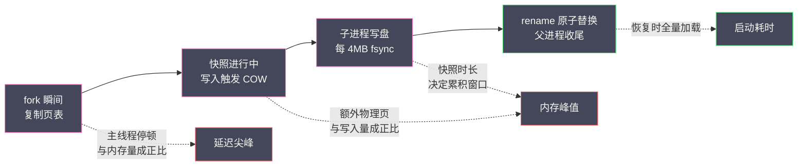
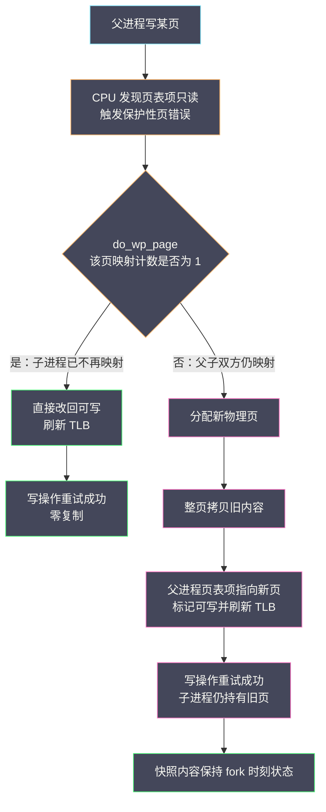
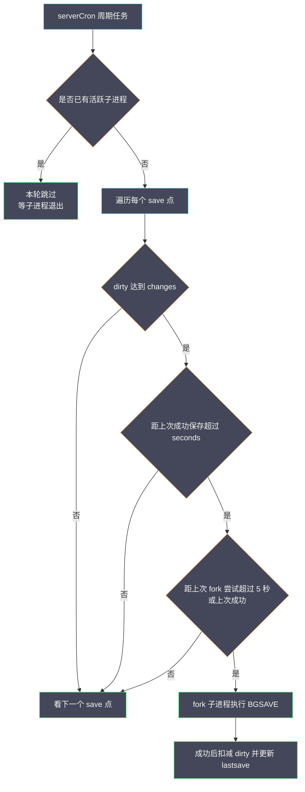
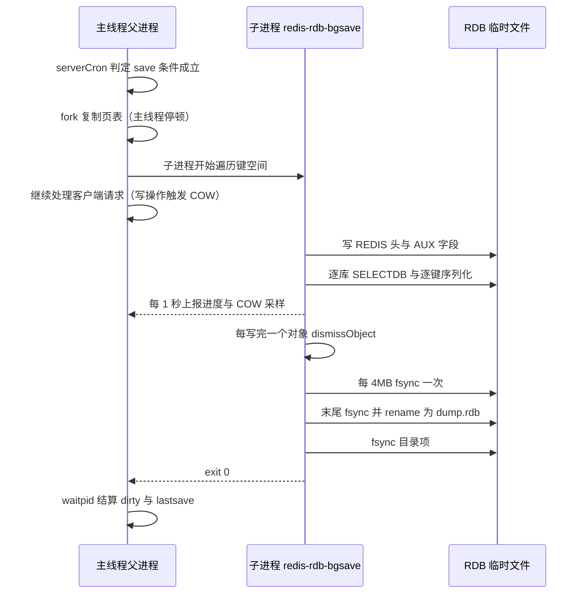

# 07 RDB 持久化——快照的 fork 与 COW 机制

**摘要：**

RDB 常被称为 Redis 里"最轻"的持久化方式，这只在一种意义上成立：它把成本从每一次写入挪到了快照发生的那一个瞬间。本文不把 fork 与 Copy-on-Write 当成两个需要背诵的名词，而是当成一张要结算的账单来拆。第一笔是 `fork()` 的固定成本，它复制的不是内存数据而是**页表**，页表体积与实例内存量成正比，这是"内存越大、fork 越慢"的物理原因，量级落在每 GB 数毫秒，而纯页表拷贝本身只有每 GB 几十到几百微秒。第二笔是写时复制的浮动成本，它的计量单位是页而不是字节，总额等于快照期间被改写的页数乘以页大小，所以决定这笔账的是写入强度与写入的空间分布，而非数据总量，最坏情况下内存峰值翻倍。第三笔是落盘与收尾成本，由 `rdb-save-incremental-fsync` 的 4MB 分片刷盘摊薄。文章给出触发路径的源码判据（`save` 点、`BGSAVE`、`SHUTDOWN`、主从全量同步）、快照期间新写入的去向与 `stop-writes-on-bgsave-error` 的三条件判定、RDB 文件格式的魔数与 opcode、以及大内存实例上 fork 延迟尖峰、COW 峰值触发 OOM、透明大页放大 COW 三个坑的判据与处置。落点是一个判断：RDB 的容量规划输入是"数据量加写入强度"，只看数据量会把内存算少一半。

---

## 第 1 章 先算清一次快照的三笔账

先看一个不陌生的现场。一台跑了 8GB 数据的 Redis，`maxmemory` 设成 7GB，容器 limit 设 10GB，业务高峰的 P99.9 从 3 毫秒跳到 800 毫秒，同一分钟内 RSS 涨到 13.6GB，容器被内核以退出码 137 结束；翻 `INFO persistence`，`rdb_last_bgsave_status` 是 `err`，日志最后一行是 `Background saving terminated by signal 9`。三个现象——延迟尖峰、内存暴涨、进程被杀——发生在同一次 BGSAVE 里，成因却各不相同：尖峰来自 fork 复制页表时主线程的停顿，内存暴涨来自 COW 累积的额外物理页，进程被杀来自 limit 与 COW 峰值相撞。混成一句"BGSAVE 很吃内存"，排查时就只能靠猜。

所以先把账摊开。一次快照的成本可以拆成三笔互不相同的支出，它们的计量单位、发生时刻、以及"什么参数能让它变小"都不一样：

| 成本项 | 计量单位 | 发生时刻 | 决定它的量 | 缩小它的手段 |
| :--- | :--- | :--- | :--- | :--- |
| fork 的固定成本 | 内存映射的页数 | 快照开始的瞬间 | 实例 RSS 与页大小 | 缩小单实例、分片、避开高峰 |
| COW 的浮动成本 | 快照期间被改写的页数 | 整个快照过程中持续累积 | 写入强度与写入的空间分布 | 降低写入、把写入集中到少量页 |
| 落盘与收尾成本 | 字节数与 fsync 次数 | 快照末尾与每 4MB | RDB 体积与磁盘带宽 | 分片 fsync、更快的盘、压缩 |

三笔账里只有第一笔是瞬时的，表现为主线程停顿；第二笔在一段时间内持续累积，表现为内存曲线；第三笔落在子进程与磁盘之间，主线程基本感觉不到，但它决定快照要跑多久——跑得越久，第二笔账的累积窗口越长。三者通过快照时长耦合：磁盘越慢，快照越久，COW 累积越多，OOM 风险越大。



把账单记住之后，"RDB 比 AOF 轻"才能落到具体条件上：RDB 轻在写入路径——每条写命令不向磁盘追加字节、不算校验、不等刷盘；重也重在快照时刻，支付方式是主线程停顿加一段内存峰值。AOF 则把成本摊到每次写入上，`appendfsync always` 时每条命令都要等一次刷盘。两种做法谈不上谁先进，只有"你的业务更怕哪一种代价"。

范围先划清：本文讲机制与代价，不讲安装与命令手册；版本口径以 Redis 7.x 与 8.x 为准，函数名以 7.4 分支源码为基准。ValKey 作为 Redis 7.2 的分支，这套 fork 加 COW 的骨架一致，差异在后续的线程与内存组织。数据结构的编码细节见 [[02 SDS 与 Redis 对象系统]]、[[03 字典与渐进式 Rehash]]、[[04 跳跃表 压缩列表与 Listpack]]，本文只在 RDB 如何把它们原样落盘时引用其结论。

---

## 第 2 章 fork 复制的是页表，不是内存

### 2.1 页表是地址翻译的账本

进程看到的是虚拟地址，内存条上是物理地址，两者的映射由页表维护。以 4KB 为一页，8GB 的进程拥有约 209 万个虚拟页，每页在页表里对应一个页表项（Page Table Entry，PTE），64 位 x86 上固定占 8 字节。换算成空间占用会得到一个反直觉的小数字：

| 实例内存 | 4KB 页的数量 | 页表体积（每项 8 字节） | 占内存比例 |
| :--- | :--- | :--- | :--- |
| 1GB | 约 26.2 万 | 约 2MB | 约 0.2% |
| 8GB | 约 209.7 万 | 约 16MB | 约 0.2% |
| 32GB | 约 838.9 万 | 约 64MB | 约 0.2% |
| 128GB | 约 3355 万 | 约 256MB | 约 0.2% |

这张表解释了 fork 成本的全部秘密。`fork()` 不需要复制 8GB 数据页——父子进程在返回瞬间共享同一批物理页；它要复制的是那 16MB 页表，让子进程拥有独立的映射结构，指向同一批物理页。页表体积与内存量严格成正比（4KB 页固定时每 GB 恒为 2MB），所以 fork 的页表开销随实例变大线性增长，这个关系与数据是否压缩、存的是大 key 还是小 key 无关，只与映射了多少页有关。

### 2.2 内核里 fork 做了什么

往下拆一层，过程与直觉不同。内核走 `copy_process()`，内存相关部分依次是 `copy_mm()`、`dup_mm()`、`dup_mmap()`；`dup_mmap()` 遍历父进程的每个虚拟内存区域（Virtual Memory Area，VMA），为每个区域复制一份 `vm_area_struct`，再调用 `copy_page_range()` 复制该区域的页表项。数据页一个都没动，被复制的是"哪段虚拟地址映射到哪页物理内存"这份账本。

更细的一层在 `copy_page_range()`：对每个存在的页表项，内核把页表项复制到子进程的页表，并调用 `page_dup_rmap()` 把新映射登记到内核的反向映射结构上。反向映射记录"这页物理内存被哪些虚拟地址映射"，写时复制与页回收都依赖它；登记涉及 `anon_vma_chain` 的分配与链表插入，是逐页发生的开销。所以 fork 的耗时不只由页表字节数决定，还由映射的页数决定——前者是纯字节拷贝，后者是每页一次的元数据操作，两者都随内存量线性增长，斜率不同。

由此可以理解一个常被忽略的事实：**fork 耗时与 RSS 更相关**。已被 `MADV_DONTNEED` 释放或换出的内存，处理代价不同；碎片严重、VMA 极多的实例，`dup_mmap()` 遍历 VMA 的开销也会被放大。Redis 常被提醒"别让实例太大"，背后是这条链，而不是某个固定的 GB 门槛。

### 2.3 每 GB 多少时间

先算纯页表拷贝的物理下限：每 GB 复制 2MB 页表，按 10GB/s 的内存带宽估算约 200 微秒，换算成"每 GB 几十到几百微秒"，这是页表字节搬运本身的量级判断，与 CPU 型号、缓存命中率、内核版本都有关，不必当基准数字用。

实测的 `fork()` 墙钟时间比这个数字高两个数量级以上，原因在 2.2 节：逐页的 rmap 登记、`anon_vma_chain` 分配、slab 分配、VMA 复制，都是"每页"或"每区域"的开销而非"每字节"的。社区经验值是每 GB 内存 fork 需要几毫秒到十几毫秒，据此折算，一次快照的 fork 停顿大致落在下表区间——这是量级判断而非基准数据。

| 实例 RSS | fork 停顿的量级 | 典型表现 |
| :--- | :--- | :--- |
| 1GB | 毫秒级（个位数） | 几乎无法从延迟曲线上看出 |
| 4GB | 十几毫秒 | P99 上出现一个可见的尖刺 |
| 8GB | 数十毫秒 | 有重试机制的客户端开始重试 |
| 16GB | 百毫秒上下 | 无重试的短连接客户端出现失败 |
| 32GB | 数百毫秒 | 主从心跳、Sentinel 判活开始受影响 |
| 64GB 及以上 | 接近或超过 1 秒 | 足以触发连接池耗尽与雪崩式重连 |

Redis 记录的是同一个量：`server.stat_fork_time` 在 `redisFork()` 里用 `ustime()` 前后夹出来，写进 `INFO stats` 的 `latest_fork_usec`，同时按 `zmalloc_used_memory() / fork_time` 折算 `stat_fork_rate`（GB/s）。这个折算值比裸的微秒数更有用：两台内存量不同的机器，谁的 fork 更"贵"要看这个比值。

### 2.4 主线程停在哪里

`fork()` 是主线程里的同步系统调用，从返回到子进程开始跑，这段时间主线程不在事件循环里：不读 socket、不执行命令、不推进过期删除与增量 rehash，整条命令链路被冻住。表现是 `aeApiPoll` 迟迟不返回、请求在 socket 缓冲区排队、`SLOWLOG` 里看不到任何命令变慢（暂停发生在两条命令之间），而客户端 P99 曲线上出现一个与命令耗时统计不匹配的尖刺。**只盯 `SLOWLOG` 会得出"Redis 没慢"的错误结论**，但业务侧明明超时了。

能看见它的地方在别处。`latest_fork_usec` 是一个，`LATENCY HISTORY fork` 是另一个——`redisFork()` 里调用了 `latencyAddSampleIfNeeded("fork", ...)`，事件名就叫 `fork`，但受 `latency-monitor-threshold` 控制，默认 0 表示不记录，要先用 `CONFIG SET latency-monitor-threshold 20` 打开才有历史。还有 `INFO persistence` 的 `current_fork_perc` 与 `current_save_keys_processed`，它们描述子进程进度，用来区分"fork 停了 200 毫秒"和"快照跑了 20 秒"——这两件事在延迟问题上完全不是一回事。其余停顿来源（AOF 刷盘、大 key 删除、命令阻塞）的分类见 [[05 单线程模型与事件驱动架构]]。

### 2.5 影响停顿的四个变量

同样 8GB 实例，fork 停顿可以从 20 毫秒到 300 毫秒，差别来自四个变量。一是 RSS 构成：被 jemalloc 归还的脏页不在页表里，逻辑数据量一样但 RSS 小的实例更便宜。二是 THP：开着时页表项少 512 倍，页表拷贝与逐页登记按同比例下降，fork 反而更快，实情见 9.3 节。三是 swap：swap 用满后再 fork，换入开销会附加在停顿里。四是 CPU 配额：容器 `cpu.max` 设得紧，这段纯 CPU 工作会被 CFS 限流拉长，不限额的容器 40 毫秒跑完，限额的可能要 200 毫秒。

这四个变量解释了"单实例不超过多少 GB"为什么总是说不准：它默认了四项都一致，而现实里它们各行其是。

---

## 第 3 章 写时复制：内核替你保存过去

### 3.1 fork 之后的两套页表

fork 返回的瞬间，父子进程各有一套页表，但两套页表里的页表项指向同一批物理页。为了让共享不被任何一方悄悄破坏，内核复制页表项时把双方对该页的写权限位都清掉，页表项变成只读，同时把物理页的映射计数加一。从硬件角度看，这些页此刻是"两个进程共享的只读页"。

这里有个容易跳过的设计问题：为什么不用"共享可写"表达共享？因为 x86 的页表权限是页级而非进程级的，同一物理页不可能对 A 可写、对 B 只读。内核只能用"都设成只读"这种统一姿态，再靠缺页异常在真正发生写时把两边分流。换句话说，写时复制是"**共享加只读**"这个组合在写操作到来时的必然出路，不是一个可以单独开关的机制。

### 3.2 一次写操作的内核路径

父进程执行 `SET` 改掉某个 key，写操作落在某页上。CPU 发现目标页在页表里标记为只读，触发保护性页错误（page fault），进入 `do_wp_page()`。接下来的判断决定这页要不要真的复制：如果该物理页的映射计数已降到 1，说明另一方（子进程）已不再映射它，内核直接把页表项改回可写、刷新 TLB，写操作重试即可，这页没有产生任何复制；只有映射计数仍大于 1 时，内核才分配新页、整页拷贝、更新父进程页表项、把新页标记为可写、刷新 TLB，再让写指令重新执行。

三个后果值得记住。其一，触发条件是写，纯读不引起复制，只读负载下 BGSAVE 的 COW 几乎为零，这是机制决定的。其二，复制单位是整页，改一个字节也付一整页 4KB 的代价。其三，同一页在一次快照里最多被复制一次：复制完成后父进程持有可写副本，后续再写走普通可写页路径，不再复制。所以 COW 的总额是**被改写的不同页数乘以页大小**，这是下一章成本公式的地基。



### 3.3 方向性：只有父进程在写

写时复制本身是对称的，任何一方写都会触发复制；但在 RDB 快照里，写入方向被刻意限制成单向。子进程遍历键空间、把对象序列化到文件，只读不写数据页；父进程继续处理请求，所有写命令都落在父进程这边。于是一个很干净的结论成立：复制出来的新页永远归父进程，子进程始终握有 fork 那一刻的旧页——**写入方向是单向的**。

这就是"RDB 是某一时刻快照"的物理保证。它不是靠子进程按时间戳过滤，也不是靠记录版本号，而是靠"子进程手里的页从来没有被改写"这一条硬约束。由此可推：**写入不进快照，也不丢失**。反过来看，这个设计也有脆弱点：子进程若因任何原因写了数据页——譬如模块在序列化回调里改了对象——快照就被污染，且很难事后发现，Redis 把子进程的代码路径限制得很窄，原因在此。

### 3.4 COW 的成本用页来计量

把 3.2 节的三个后果合起来，得到一个可直接用于容量规划的等式：COW 的额外内存等于快照期间被改写的不同页数乘以页大小。

| 写入形态 | 被改写的页 | COW 内存 | 说明 |
| :--- | :--- | :--- | :--- |
| 只读负载，少量过期删除 | 极少 | 几乎为 0 | 过期删除也是写，但只涉及被删键所在的页 |
| 热点 key 反复更新 | 少数页被反复写 | 很小 | 同一页只复制一次，重复写不重复付账 |
| 随机写遍布全库 | 与写入量近似线性 | 可达数据量的数十个百分点 | 最典型的危险形态 |
| 全量批量导入或重建 | 接近全部页 | 接近数据量本身 | 峰值翻倍的条件 |
| 大 key 的一次整体替换 | 该对象涉及的连续多页 | 从几百 KB 到几十 MB | 与 key 体量成正比，与 QPS 无关 |

最后一行值得单说：改一个 100MB 的 hash 的某个字段，代价不是 4KB，而是这个 hash 占用的页都可能被触碰——listpack 编码时一次修改可能触发整个编码结构重写，hashtable 编码时改一个字段只碰一两页，但插入新字段可能触发扩容，扩容搬动整张表。所以"COW 只和写入量有关"要补一个限定：**它与写入量对应的空间足迹有关**。

### 3.5 释放也是写，lazy-free 不减免 COW

还有一个反直觉的地方。删除 key 看起来是释放内存、与写无关，但在 COW 语境下它同样是写：释放内存要修改分配器的元数据（空闲链表、位图、bin 链表头），这些元数据同样落在匿名页上，同样触发 COW。一个几十万字段的大 hash 被 `DEL`，释放过程会触碰大量元数据页，账照样记在父进程头上。

由此可以纠正一个流传很广的误解：开启 `lazyfree-lazy-*` 能降低 BGSAVE 期间的 COW。事实是 lazy-free 把释放动作从主线程挪到 `bio` 后台线程，减少的是主线程停顿（见 [[05 单线程模型与事件驱动架构]]），释放本身仍发生在父进程地址空间内，仍要写分配器元数据，仍触发 COW；它对 fork 停顿也没有帮助。真正能减少 COW 的是让子进程尽早丢掉它用不着的页——这件事 Redis 自己做了，见 7.5 节的 `dismissObject()`。

### 3.6 复制之外的三项隐性成本

除了内存字节数，COW 还有三项不容易在监控里看到的成本：页错误开销（每次触发复制的写操作都要进内核、分配页、刷 TLB，写入密集期抬高 `sys` 态 CPU 占比）、TLB 与缓存破坏（热数据的地址翻译要重新走多级页表）、以及内存碎片（复制出的新页与原有页交错分布，jemalloc 大块分配效率下降，长跑实例上表现为"每次 BGSAVE 之后 RSS 台阶式上涨"）。

---

## 第 4 章 成本由写入量决定，而不是数据总量

### 4.1 两条曲线的分离

把前两章的结论并排放，会看到两条自变量不同的曲线。fork 的成本随数据总量走：8GB 实例的 fork 比 4GB 贵一倍，与这段时间写了多少无关。COW 的成本随写入量走：同样 8GB 实例，只读负载下接近零，全量刷写负载下可以再吃掉 8GB。两条曲线不共享自变量，这是 RDB 成本结构里最容易算错的地方。

容量规划里最典型的错误是把两条曲线合成一条，得出"8GB 数据留 2GB 余量够了"。这个结论在只读实例上成立，在写入密集的实例上会直接导致 OOM。正确算法是把两个独立上界分别算出再取和：内存需求 = 数据量 + 常驻开销 + COW 峰值上界，而 COW 峰值上界 = 快照时长 × 单位时间被改写的页数 × 页大小，并被数据量截断。

### 4.2 三个量级下的示例推算

假设数据量 8GB、页大小 4KB、快照时长 60 秒、写入随机覆盖全库（COW 最不利的形态之一），用"每秒被改写的不同页数"描述写入强度：

| 每秒改写的页数 | 60 秒累计页数 | COW 峰值（示例推算） | 折算的写入规模 | 内存需求上界 |
| :--- | :--- | :--- | :--- | :--- |
| 2000 页/秒 | 12 万页 | 约 480MB | 相当于每秒数千次小写入 | 8GB + 0.5GB |
| 1 万页/秒 | 60 万页 | 约 2.4GB | 相当于每秒数万次写入 | 8GB + 2.4GB |
| 5 万页/秒 | 300 万页 | 被数据量截断为 8GB | 相当于全库每小时被重写数遍 | 8GB + 8GB |

表格的说服力在最后一行：写入强度足够高、快照时长足够长时，COW 会顶到"每页都被改写一次"的天花板，内存峰值等于数据量的两倍。这不是极端假设——全量迁移、批量 TTL 刷新、大促前的缓存预热、以及"一次改掉十万个 key 的过期时间"都会把写入迅速铺满键空间。危险就在这里：平时 COW 只有几百 MB 的实例，在一次批量操作叠加一次定时快照时可能突然需要两倍内存。

### 4.3 最坏翻倍需要三个条件

把"峰值翻倍"当成有条件的结论，比当成恐怖故事有用。翻倍需要同时满足三条：快照时长足够长（子进程跑得久）、写入强度足够高（单位时间能改写足够多页）、写入分布足够分散（能覆盖大部分页）。任何一条不成立，峰值都到不了两倍：快照短则累积窗口短，写入弱则累积量小，写入集中则大部分页只被复制一次甚至零次。

### 4.4 监控里的 COW 数字是怎么来的

`rdb_last_cow_size` 与 `current_cow_peak` 常被当成精确计量，实际口径比想象的粗。测量发生在子进程里：`childinfo.c` 的 `sendChildInfoGeneric()` 对自身调用 `zmalloc_get_private_dirty(-1)`，读 `/proc/self/smaps` 的 `Private_Dirty` 字段，再通过管道发给父进程。之所以读子进程而不是父进程，是因为复制发生后新页归父进程独占，原来的旧页只被子进程映射——旧页在子进程的 smaps 里正好表现为私有脏页，这个值就是 COW 累积量的直接观测。

这个测量有两个限制。一是采样被节流：读一次 smaps 在大进程上要几毫秒甚至几十毫秒，代码规定"下一次测量必须等上次耗时的一百倍过去"（`CHILD_COW_DUTY_CYCLE` 为 100），8GB 实例大约每秒采样一次，瞬时尖峰可能被漏掉。二是生命周期：`current_cow_*` 要到**下一次 fork 时**才在 `redisFork()` 里被清零，快照结束后它保留最后一次采样值，`current_cow_size_age` 告诉你这个值是多少秒之前测的——age 与 size 都很大时，那不是本次快照的数字。

日志里还有更直接的证据：子进程每次采样按 `Fork CoW for %s: current %zu MB, peak %zu MB, average %llu MB` 记录，采样期间是 `VERBOSE` 级别，子进程结束时以 `NOTICE` 再记一次。开着 `loglevel verbose` 的实例，事后翻日志能看到本次快照的 COW 曲线，比看监控图更完整。

### 4.5 同样的 QPS，不同的 COW

把"写入量"等同于"QPS"是第二个常见错误。同样每秒 5 万次写命令，写在十万个分散的 session key 上，与写在三个热点配置 hash 上，COW 可以差一个数量级。前者每个命令落在不同的页，被复制一次后再也不会被碰；后者所有命令挤在少数页上，第一次复制之后其余写入都是免费的。

对规划的意义很直接：把热数据聚在一起（用 hash 聚合小字段、用固定前缀让相关 key 落在相邻槽位），不只省内存与网络往返，还顺带压低了快照期的内存峰值。COW 按页收费，那就让热点挤在少数页里。

### 4.6 一条可以写进容量文档的公式

收拢前面几节：快照期间的额外内存 ≈ min（数据量，快照时长 × 每秒被改写的不同页数 × 页大小）。实际规划再乘一个安全系数：只读或读多写少取 0.1 到 0.2；常规业务写取 0.3 到 0.5；有批量导入、批量过期修改、大 key 重建取 0.8 到 1.0。这个系数没有理论依据，价值在于让容量评审有一个显式、可事后验证的假设，而不是一句"留点余量"。

---

## 第 5 章 触发路径与阻塞边界

### 5.1 save 点的默认值变过

`save` 配置决定"什么时候自动做快照"，它的默认值常被讲错，需要分两层说。代码里的内置默认值在 6.0 就已是 `3600 1`、`300 100`、`60 10000`（`initServerConfig()` 里三行 `appendServerSaveParams`），但 6.0 随发行版附带的 `redis.conf` 用未注释的 `save 900 1`、`save 300 10`、`save 60 10000` 把它覆盖了；6.2 起配置文件不再覆盖，默认值才真正落到一小时 1 次变更、五分钟 100 次、一分钟 10000 次。7.0 之后可以用单行写法 `save 3600 1 300 100 60 10000` 表达多组条件，`CONFIG SET save "..."` 等价设置，`save ""` 彻底关闭自动快照。

| 版本 | 默认 save 点 | 该版本下的实际含义 |
| :--- | :--- | :--- |
| 6.0 及更早（随发行版 conf） | `900 1` / `300 10` / `60 10000` | 写入稀疏时约 15 分钟一次 |
| 6.2 与 7.x、8.x | `3600 1` / `300 100` / `60 10000` | 写入稀疏时可能一小时一次 |
| 任意版本 | `save ""` | 关闭自动快照，`MISCONF` 保护同时失效 |

从 `900 1` 到 `3600 1` 的这次变化，对写入稀疏的实例意味着 RPO 从十几分钟变成一小时：一天只有几百次写的配置中心，若只靠 RDB，最坏会丢掉近一小时的变更。这个改动是有意为之——写入稀疏的实例往往也不在乎那点数据，频繁快照的 fork 成本对它们更不划算——但它要求使用者自己确认 RPO 是否可接受，不能沿用旧资料的印象。

### 5.2 serverCron 里的判定条件

自动快照的判定写在 `serverCron` 里。每轮周期任务先检查是否已有活跃子进程（`hasActiveChildProcess()`），有就跳过，因为同一时刻只允许一个子进程；没有则遍历 `save` 点数组，对每个 `(seconds, changes)` 组合判断三件事：`server.dirty` 是否达到 `changes`、`unixtime - server.lastsave` 是否超过 `seconds`、上次 BGSAVE 尝试距现在是否超过重试延迟（`CONFIG_BGSAVE_RETRY_DELAY`，值为 5 秒）或上次尝试成功。三条同时满足才触发 BGSAVE，然后 `break` 出循环，一轮最多触发一次。

两个细节值得单独拎出来。第一，`lastsave` 是上次**成功**保存的时间，不是上次尝试的时间，反复失败时这个时间戳不动，条件会一直成立，靠 5 秒重试延迟那道闸把频率压住。第二，`dirty` 是写命令的累计计数器，BGSAVE 成功后父进程从 `dirty` 里减掉 `dirty_before_bgsave` 而不是清零，因为快照期间的新写入还没被任何快照覆盖，必须留在账上。



判定粒度是 `serverCron` 的周期，默认 `hz` 为 10 时约每 100 毫秒一轮，所以触发时刻有百毫秒级抖动；`hz` 调小时抖动变大，调大时 CPU 空转变多，这也是"`hz` 别乱调"的原因之一。

### 5.3 RPO 由写入速率与 save 点共同决定

资料里常说"RDB 最多丢 15 分钟"，这只对应旧默认值，且假设写入足够密集。用 6.2 之后的默认值算三笔账：每秒 100 次写时，60 秒后 `dirty` 为 6000 不到 10000，`60 10000` 不满足；300 秒后 30000 超过 100，`300 100` 满足，于是约 5 分钟一次，RPO 约 5 分钟。每秒 1000 次写时，60 秒后 `dirty` 为 60000，`60 10000` 满足，RPO 约 1 分钟。每秒 0.1 次写（一小时 360 次）时，5 分钟时 `dirty` 只有 30，不到 100；一小时时 `dirty` 为 360，`3600 1` 满足，RPO 接近一小时。

同一份配置，RPO 可以从 1 分钟到 1 小时，取决于写入速率。这就是 RPO 必须实测而不能从配置文件推的原因——配置文件只写了触发条件，没写你的写入曲线。

### 5.4 六条触发路径的阻塞边界

| 触发路径 | 是否 fork | 主线程阻塞段 | 失败后果 |
| :--- | :--- | :--- | :--- |
| `SAVE` 命令 | 否 | 整个序列化过程全程阻塞 | 返回错误，`lastbgsave_status` 置 `err` |
| `BGSAVE` 命令 | 是 | 仅 fork 瞬间 | 返回错误或排队，状态置 `err` |
| `BGSAVE SCHEDULE` | 是（延后） | 无，当前有子进程时排队 | 排队直到可执行 |
| `serverCron` 自动触发 | 是 | 仅 fork 瞬间 | 5 秒后重试，状态置 `err` |
| `SHUTDOWN` | 否（同步保存） | 整个序列化过程，先杀掉正在跑的 RDB 子进程 | 保存失败则拒绝退出（无 `FORCE` 时） |
| 主从全量同步 | 是 | 仅 fork 瞬间 | 副本同步失败，等待下次尝试 |

`SAVE` 与 `BGSAVE` 的差别不只是阻不阻塞，还有互斥关系：`SAVE` 发现已有 RDB 子进程时直接返回 `Background save already in progress`；`BGSAVE` 在已有 RDB 子进程时返回同样的错误，在有 AOF 重写子进程时返回 `Another child process is active (AOF?): can't BGSAVE right now`，此时可用 `BGSAVE SCHEDULE` 让它在子进程退出后补做。这两条错误的措辞值得记住，它们是运维脚本区分"快照正在跑"和"被 AOF 重写挡住"的唯一直接线索。

`SHUTDOWN` 有两点常被忽略。第一，它执行同步保存而不是 fork：`finishShutdown()` 里若配置了 save 点且没有 `NOSAVE`，会调用 `rdbSave()` 在主线程完整序列化，期间不响应任何命令。第二，保存在前会先杀掉正在跑的 RDB 子进程（`killRDBChild()`，用 `SIGUSR1` 让它安静退出），避免两个写者同写一个文件。后果在容器里很具体：`terminationGracePeriodSeconds` 默认 30 秒，32GB 实例同步保存可能要几十秒，超时后 `SIGKILL` 落下，**数据丢失发生在正常下线过程中**。

### 5.5 把 fork 挪到别处付账

既然 fork 停顿无法消除，能改的只有付账的时刻。一是把快照挪到副本上：主节点关掉 `save`、只留 AOF，副本配置 `save` 点（见 [[09 主从复制与 Sentinel 高可用]]）；主节点延迟曲线干净了，但副本的 fork 停顿会拖延复制偏移量推进。二是外部调度在低峰手动 `BGSAVE`：`CONFIG SET save ""` 关自动触发，低峰执行 `BGSAVE` 加 `LASTSAVE` 轮询，结束后恢复配置；完全可控，代价是调度脚本本身成了新故障点。

---

## 第 6 章 快照期间的新写入去哪了

### 6.1 写入不丢，但也不进快照

由 3.3 节的结论直接推：快照期间父进程继续处理写命令，写操作落在父进程自己的页上，子进程持有 fork 时刻的旧页，两者互不干扰。于是三类事实同时成立：写命令照常返回 `+OK`，客户端感知不到快照（除了 fork 那一小段停顿）；写入的数据留在父进程内存里，不因快照丢失；但这些写入不会被写进正在生成的 RDB 文件，因为子进程的视野截止在 fork 那一刻。

这就是 **point-in-time** 的字面意思：RDB 描述的是某一瞬间的键空间，而不是"快照结束时"的键空间。这个语义决定了它的用法——适合备份与冷恢复，不适合单独承担"不丢数据"的职责。要缩小丢失窗口，要么加密快照频率（代价是更多 fork 与 COW），要么让 AOF 承担增量（见 [[08 AOF 持久化与混合持久化]]），要么靠复制从别的节点补。三条路可以叠加，Redis 4.0 之后的混合持久化就是前两条缝在一起。

### 6.2 一个可以亲手验证的实验

这个语义可以用一个很短的实验验证，**只在测试实例上做**，因为 `DEBUG RELOAD` 会丢弃内存中未被持久化的数据。步骤是：关闭 AOF（`CONFIG SET appendonly no`）、记录 `DBSIZE`、执行 `BGSAVE`、在 `rdb_bgsave_in_progress` 为 1 时插入一批新 key、等它变回 0、再执行 `DEBUG RELOAD`。重载后新 key 消失，`DBSIZE` 回到快照开始时的值。之所以能成立，正是因为那些 key 只存在于父进程 fork 之后新分配的页上，RDB 文件里只有子进程看得见的旧页。

若实例开着 AOF，结论会变：重载走 AOF 路径，新 key 会回来。两者的分工由此清楚，也说明"RDB 快照期间写入不丢"不能单独当成数据安全承诺——它只保证内存里不丢，落盘与否取决于另一套机制。

### 6.3 stop-writes-on-bgsave-error 的三条件

快照失败时 Redis 有一个很硬的处置：拒绝写命令。实现集中在 `writeCommandsDeniedByDiskError()`，判断是三个条件的逻辑与——配置项 `stop-writes-on-bgsave-error` 为真、`saveparamslen > 0`（至少有一个 save 点）、`lastbgsave_status == C_ERR`（上次 BGSAVE 失败）。三条同时满足时，所有带写标志的命令返回 `-MISCONF`，错误原文是 `MISCONF Redis is configured to save RDB snapshots, but it's currently unable to persist to disk...`，读命令照常放行。

三条里最容易被忽略的是第二条：一旦执行 `CONFIG SET save ""`，这个保护整体失效——不是"不检查"，而是"根本走不到检查"。于是出现一种隐蔽组合：运维为消除 fork 尖峰关掉自动快照，同时磁盘出问题、BGSAVE 一直失败，但 Redis 既不报警也不拒绝写入，直到某次重启才发现最后一份 RDB 是几周前的。这是配置项之间的耦合，配的时候要一起看。

保护的另一面是恢复：下次 BGSAVE 成功时 `lastbgsave_status` 置回 `C_OK`，写命令自动放行，不需要重启也不需要人工干预。这个自动愈合对可用性友好，但也意味着短暂失败可能被忽略——业务侧看到的是一段 MISCONF 报错后自动恢复，运维侧若只看"当前是否 ok"，就会漏掉这段历史，所以监控要看状态变化次数而不是当前值。

### 6.4 失败原因谱

| 失败原因 | 日志关键字 | 伴随现象 | 处置方向 |
| :--- | :--- | :--- | :--- |
| fork 失败（内存不足或进程数限制） | `Can't save in background: fork` | 状态 `err` 但 `latest_fork_usec` 正常 | 查内存与 `ulimit -u` |
| 磁盘写满 | 7.x 为 `Write error while saving DB to the disk(...)`，6.x 为 `Write error saving DB on disk` | `df` 接近 100% | 清理或扩容，检查目录配额 |
| 临时文件 rename 失败 | `Error moving temp DB file` | 目录权限或跨文件系统 | 检查权限与挂载点 |
| 目录 fsync 失败 | `Failed to fsync directory while saving DB` | 网络文件系统语义问题 | 换本地盘或调整挂载参数 |
| 子进程被 OOM 杀 | `Background saving terminated by signal 9` | 容器退出码 137、`dmesg` 有 OOM 记录 | 扩 limit、降写入、错峰快照 |
| 主动中止（下线或超时） | `Background saving terminated by signal 10` | `SIGUSR1` 属正常路径 | 无需处理，确认状态未误置 `err` |
| 子进程崩溃或断言失败 | `Background saving error` | 退出码非 0 | 查崩溃日志与模块编码 |

表里最后两行的区分很重要：`SIGUSR1` 是 Redis 自己用来安静杀掉子进程的信号（`SHUTDOWN` 与某些中止路径会发），收到它的分支不会把状态置 `err`；`SIGKILL` 是被内核或外部杀的，一定置 `err` 并触发 MISCONF。混淆这两者，会把一次正常关停误判成持久化故障。

### 6.5 RPO 的正确记账方式

正确的账是"从最后一次成功快照到故障时刻之间的时间"，其中包含三种损失：快照未触发时的等待、失败后的重试、以及快照执行期间的新写入。第三种容易被忽略——快照跑了 60 秒，这 60 秒的写入都不在文件里，所以**实际 RPO 要多算一个快照时长**。8GB 实例快照跑 40 秒、按 5 分钟触发，RPO 上界不是 5 分钟而是 5 分 40 秒，恢复演练里对得上。

---

## 第 7 章 子进程这一侧的活

### 7.1 遍历与进度上报

子进程启动后调用 `rdbSave()`：写临时文件、遍历键空间、最后 rename。遍历核心是 `rdbSaveRio()`，先写 9 字节头部（`REDIS` 加 4 位版本号），再写若干 AUX 字段，然后逐库写 `SELECTDB` 与 `RESIZEDB`，接着对每个 key 写过期时间（若有）、类型标记、key 与 value，最后写 `EOF` 和 8 字节 CRC64。整个过程单线程顺序遍历，吞吐取决于对象编码复杂度与磁盘写入速度，CPU 一般不是瓶颈。

进度上报与遍历交织。代码每处理 1024 个 key 检查一次时间，距上次上报超过 1 秒就调用 `sendChildInfo()` 把"已处理 key 数"和"当前 COW 采样值"通过 `child_info_pipe` 发给父进程；父进程据此算出 `current_fork_perc` 与 `current_save_keys_processed/total`。这三个字段是判断"快照卡住了还是在慢慢跑"的主要依据：`current_fork_perc` 长时间不涨而 `current_cow_size` 在涨，说明子进程写盘被阻塞，COW 正在白白累积。

### 7.2 落盘的四步与两次 fsync

RDB 的落盘是"临时文件加原子替换"的经典写法，`rdbSave()` 里四步很清楚。第一步用 `temp-<pid>.rdb` 作临时文件名，正式文件在同目录下不受影响。第二步 `rdbSaveInternal()` 写临时文件，过程中若开启 `rdb-save-incremental-fsync`，每累计 4MB 就 `fsync` 一次。第三步 `rename()` 原子替换为正式文件名——同一文件系统内的 `rename` 是原子的，替换瞬间别人看到的要么是旧文件要么是新文件。第四步 `fsyncFileDir()` 对目录再 fsync，确保"文件名到 inode 的映射"也落盘。

这四步的顺序解释了 RDB 为什么"要么完整要么不存在"：任何一步失败，正式文件都保持原样，临时文件被清理，日志留下一条明确错误。也解释了为什么 RDB 目录必须与数据目录在同一文件系统——跨文件系统的 `rename` 会退化成"复制加删除"，原子性就没了，Redis 会直接报错。

### 7.3 rdb-save-incremental-fsync 摊薄了什么

这个选项默认开启，行为是"每写 4MB 就 fsync 一次"（对应源码的 `REDIS_AUTOSYNC_BYTES`）。要理解它摊薄了什么，先看没有它会怎样：子进程把数据全写完，最后一次性 `fsync`，此时页缓存里可能堆着几个 GB 脏数据，磁盘队列瞬间见底或被打满，同一块盘上的 AOF 刷盘、复制写、别的容器一起受影响。

分批刷盘把洪峰拆成小峰：4GB 的 RDB 会产生约 1024 次 fsync，每次刷 4MB，单次延迟可控，尾部收尾 fsync 几乎不需要等。代价是三笔：fsync 次数上升、对 SSD 的写放大略增；大量 fsync 占用更多磁盘队列深度；4MB 粒度对超大实例仍偏粗。

一个常见误解是"开了它就不会有落盘尖峰"。它解决的是尖峰的**形状**而不是总量：磁盘带宽不足时，摊平之后快照时长变长，COW 的累积窗口也跟着变长。在带宽吃紧的实例上，这个选项带来的是"延迟更平滑但内存峰值更高"的交换。

### 7.4 子进程退出后的结算

子进程退出后，父进程在 `checkChildrenDone()` 里用 `waitpid` 拿到退出码，进入 `backgroundSaveDoneHandlerDisk()` 结算，三种情况分开处理。正常退出时日志记 `Background saving terminated with success`，`dirty` 减去 `dirty_before_bgsave`、`lastsave` 更新为结束时间、`lastbgsave_status` 置 `C_OK`、`rdb_save_time_last` 记录耗时。非零退出码时日志记 `Background saving error`，只把状态置 `err`，不动 `lastsave`。被信号杀死时日志记 `Background saving terminated by signal %d`，清理临时文件（`SIGUSR1` 除外）并置 `err`。

结算里有个容易看漏的细节：`dirty` 减的是 `dirty_before_bgsave`，即"fork 那一刻的脏计数"，不是当前值。快照期间新累积的写入留在 `dirty` 里，作为下次快照的触发依据。这让 `rdb_changes_since_last_save` 的含义变成"自快照开始以来尚未被任何快照覆盖的变更数"，而不是"自快照完成以来的变更数"——用它做 RPO 估算时，口径差了一个快照时长。

### 7.5 子进程的自我减负

Redis 在子进程里做了几件主动减负的事，目标都是让父进程少复制。第一件是 `dismissMemoryInChild()`，fork 之后立刻把子进程用不着的内存还给操作系统——复制缓冲区、各客户端的查询缓冲与回复缓冲，这些内存在快照期间会被父进程频繁改写，子进程留着它们就是留着一批迟早要复制的页。第二件更精巧：`rdbSaveRio()` 每写完一个对象就调用 `dismissObject(o, dump_size)`，用 `madvise(MADV_DONTNEED)` 把该对象占用的页从子进程映射里丢掉。这些页已写进文件，子进程不再需要它们；丢掉之后父进程再写这些页时映射计数只剩 1，内核直接走"改权限复用"的路径，根本不复制。

这两件事与一个前提绑定：`MADV_DONTNEED` 在大页上不生效，所以两个函数开头都有一句"THP 开启时直接返回"。这构成透明大页的第三个副作用（前两个见 9.3 节），也是"关掉 THP"在 COW 场景下最实打实的理由——不是一句笼统的"THP 有害"，而是"THP 一旦开启，Redis 就主动放弃了它自己那套降低 COW 的优化"。

第三件事是子进程的定位与降权：进程名改成 `redis-rdb-bgsave`（`ps` 里能直接分辨），按 `bgsave_cpulist` 绑 CPU；若开启 `oom-score-adj`，子进程按 `CONFIG_OOM_BGCHILD`（`oom-score-adj-values` 第三个数，默认 800）提高 OOM 权重，让内核在内存紧张时优先杀子进程。取舍很明确：杀子进程是快照失败加 MISCONF，可观测；杀父进程是数据全丢。但 `oom-score-adj` 默认 `no`，这套降权默认不生效，容器里没配的实例，OOM 时杀谁并不确定。



---

## 第 8 章 RDB 文件格式

### 8.1 头部：魔数与版本

文件的头 9 个字节是固定结构：5 字节 `REDIS` 魔数加 4 位 ASCII 数字表示的版本号，由 `snprintf(magic, sizeof(magic), "REDIS%04d", RDB_VERSION)` 生成。版本号在 6.2 是 `0009`、7.0 是 `0010`、7.2 是 `0011`、7.4 与 8.x 都是 `0012`。这不是 Redis 的版本号，而是 RDB 格式的版本号，格式每次不兼容变更就加一。

版本兼容是单向的：加载时检查 `rdbver < 1 || rdbver > RDB_VERSION`，超过当前版本的直接拒绝，日志记 `Can't handle RDB format version`；低于当前版本的照常加载，旧字段按旧规则解析，缺失的新字段用默认值补。所以**新版 Redis 能读旧 RDB、旧版 Redis 不一定能读新 RDB**，跨版本回滚时尤其要注意——7.4 写的 RDB，7.0 读不了。

下面这段十六进制是按格式规范构造的示意（不是抓包），用来说明头部与 AUX 字段的排列：

```
52 45 44 49 53 30 30 31 32   REDIS0012
fa 09 72 65 64 69 73 2d 76 65 72   AUX "redis-ver"
06 37 2e 34 2e 30                 "7.4.0"
fa 05 63 74 69 6d 65              AUX "ctime"
fc 12 34 56 78 9a bc de f0       毫秒时间戳
fe 00                             SELECTDB 0
fb 02 00                          RESIZEDB：键数与过期键数
00 06 75 73 65 72 3a 31          类型 0，key "user:1"
...
ff                                EOF
<8 字节 CRC64>
```

### 8.2 opcode：文件里的控制字节

RDB 用一个字节标记"接下来是什么"，取值落在固定枚举里，大于等于 `0xF4` 的这批是控制指令，其余是值类型：

| 字节 | 常量 | 作用 |
| :--- | :--- | :--- |
| `0xFA` | `AUX` | 辅助字段，键值对形式 |
| `0xFB` | `RESIZEDB` | 当前库的键数与过期键数，加载时预分配哈希表 |
| `0xFC` | `EXPIRETIME_MS` | 毫秒级过期时间，8 字节 |
| `0xFD` | `EXPIRETIME` | 旧格式的秒级过期时间，4 字节，仅加载兼容 |
| `0xFE` | `SELECTDB` | 切换数据库编号 |
| `0xFF` | `EOF` | 数据结束，后跟 8 字节 CRC64 |
| `0xF9` | `FREQ` | LFU 访问频率，配合 `maxmemory-policy` 使用 |
| `0xF8` | `IDLE` | LRU 空闲时间，用于恢复淘汰顺序 |
| `0xF7` | `MODULE_AUX` | 模块自定义的辅助数据 |
| `0xF5` | `FUNCTION2` | 函数库数据，7.0 起 |
| `0xF4` | `SLOT_INFO` | 槽位信息，集群模式 |

`RESIZEDB` 值得单独提：它把"这个库有多少键、多少键带过期时间"写在数据前面，加载时先按这个尺寸建好哈希表，避免边加载边扩容。这条优化是 RDB 加载快的原因之一，也是"用 RDB 恢复比逐条重放命令快"的一部分解释——不是"二进制比文本快"这么笼统，而是加载路径从一开始就知道终点的形状。


### 8.3 AUX 字段里存了什么

`rdbSaveInfoAuxFields()` 写入的字段是固定的：`redis-ver`（写文件时的 Redis 版本）、`redis-bits`（32 或 64，由 `sizeof(void*)` 决定）、`ctime`（创建时间戳）、`used-mem`（写文件时的内存占用），以及可选的 `repl-stream-db`、`repl-id`、`repl-offset`（只在为主从同步生成的 RDB 里出现），最后是 `aof-base`（标记这份 RDB 是否被用作 AOF 前缀）。

这些字段不改变数据，诊断价值却很高。`ctime` 与文件 mtime 的差值能看出"这份备份是哪个时刻的"；`used-mem` 与文件体积的比值能算出压缩率（通常在 0.3 到 0.6 之间，取决于数据可压缩性）；`redis-ver` 决定能否被目标版本加载；`repl-id` 与 `repl-offset` 是部分重同步的落脚点。

### 8.4 类型标记与紧凑编码的原样落盘

每个 key 在写 value 前先写一个类型字节，这个字节描述"值在磁盘上用什么形态存"，而不是"值在内存里是什么类型"。两套编码在 7.0 之后大部分收敛到 listpack，但不完全同步：

| 类型字节 | 常量 | 对应的内存编码 | 备注 |
| :--- | :--- | :--- | :--- |
| `0` | `STRING` | 整数或 SDS | 最常见 |
| `2` | `SET` | intset 或 hashtable | 小整数集合用 intset |
| `11` | `SET_INTSET` | intset | 整块二进制直存 |
| `14` | `LIST_QUICKLIST` | quicklist（ziplist 节点） | 旧形态，仍可加载 |
| `16` | `HASH_LISTPACK` | listpack | 7.0 起 |
| `17` | `ZSET_LISTPACK` | listpack | 7.0 起 |
| `18` | `LIST_QUICKLIST_2` | quicklist（listpack 节点） | 7.0 起 |
| `20` | `SET_LISTPACK` | listpack | 7.2 起 |
| `24` / `25` | `HASH_METADATA` / `HASH_LISTPACK_EX` | 带字段级 TTL 的 hash | 7.4 起 |

### 8.5 长度、整数与 LZF

字符串写盘有三层优化，顺序固定。先是整数编码：只有长度不超过 11 字节才尝试，能解析成 8/16/32 位整数就用一两个字节存下，省掉长度头与正文。再是 LZF 压缩：只有开启 `rdbcompression` 且长度大于 20 字节才尝试，压缩后更短才采用，压缩标记用长度字段的高两位表示。最后才是原样写长度加正文。长度表示本身也分层：小于 64 用 1 字节，小于 16384 用 2 字节，更大用 5 或 9 字节。

对容量规划有用的推论是：RDB 大小对"小整数多"与"长文本多"极其敏感。全是计数器的实例，RDB 可能只有内存的十几分之一；存图片或 JSON 大文本的实例，LZF 压不动，RDB 体积接近内存量减去对象头开销。用"RDB 一般是内存的 30% 到 60%"估算磁盘与传输带宽前，先确认自己的数据属于哪一类。

### 8.6 加载：全阻塞的一段路

加载走 `rdbLoad()`，顺序与写相反：校验魔数与版本、读 AUX、按 `SELECTDB` 切库、按 `RESIZEDB` 预分配、逐键读类型与内容建对象、校验 CRC64。开启 `rdbchecksum`（默认开启）时校验和不匹配会导致加载失败，日志记 `Wrong signature trying to load DB from file`，进程退出——这看起来严苛，但比"加载一半发现坏了"要好，至少不会带着半个数据集对外服务。

加载期间 Redis 不服务客户端，请求返回 `-LOADING Redis is loading the dataset in memory`。阻塞时长与 RDB 体积成正比：4GB 的 RDB 在普通 SSD 上大致十几秒到几十秒（示例推算）。7.0 之后副本支持 async loading，能在加载新数据集的同时用旧数据服务读请求；主节点没有这个能力，它的加载是启动路径上的硬阻塞，这就是"大实例重启慢"的根源。

### 8.7 跨版本迁移的三条路

RDB 的兼容承诺只有"向下读"这一条，跨版本迁移时路不多：升级方向（旧版写、新版读）直接用文件；降级方向（新版写、旧版读）不行，要么用 `DUMP`/`RESTORE` 逐键迁移，要么用 `redis-cli --rdb` 导出后由目标版本重建，要么走复制链路让目标版本自己生成。`DUMP` 的序列化格式也带版本号，跨大版本同样可能不兼容，逐键迁移要在中间版本上先验证。

另一条边界是"**RDB 不是稳定的交换格式**"：官方从未承诺它能被第三方工具稳定解析，而格式随版本变化（`SLOT_INFO`、`FUNCTION2`、带 TTL 的 hash 都是近年新增），把 RDB 当交换格式的工具每次升级都要重新验证。

---

## 第 9 章 大内存实例上的三个坑

### 9.1 坑一：fork 造成的延迟尖峰

第一个坑的表现是周期性尾延迟尖刺，周期与 `save` 点或复制全量同步的节奏一致。判据有三条：`INFO stats` 的 `latest_fork_usec` 在尖刺时刻明显跳升；`LATENCY HISTORY fork` 有对应记录（前提是打开了 `latency-monitor-threshold`）；客户端 P99 尖刺与 `rdb_bgsave_in_progress` 从 1 变回 0 的时刻对齐。前两条是 Redis 侧证据，第三条是业务侧证据，只有第三条成立才能确认业务真的被影响——有些实例 fork 停顿虽然长，但连接池缓冲足够，业务感受不到。

缓解手段按代价排序：最彻底的是分片，让每次 fork 只处理一小部分内存，代价是客户端与运维复杂度上升（见 [[10 Redis Cluster 分布式架构]]）；其次是控制单实例体积，RSS 停在尾延迟预算倒推的范围内；再次是错峰，把快照挪到低峰或让副本承担；最后检查 CPU 配额，`cpu.max` 过紧会把 fork 的纯 CPU 工作拉长，调宽配额往往比调任何 Redis 参数都有效。

### 9.2 坑二：COW 峰值撞上 OOM

第二个坑全篇最危险，因为它直接杀进程。把 4.6 节的公式放进容器语境：数据量 9GB、limit 10GB、写入形态取 0.3 的系数，快照期需要 11.7GB，超出 limit 1.7GB，OOM killer 介入。介入方式取决于 cgroup 版本与配置：cgroup v1 下按各进程 `oom_score` 挑一个杀，`oom-score-adj no`（默认）时父子权重接近，杀谁都可能；cgroup v2 下若 `memory.oom.group` 为 1，整个 cgroup 一起被杀，父子同归于尽。容器层看到的是退出码 137，`dmesg` 里有一条 `Out of memory: Killed process ... (redis-server)`。

这个坑最难识别的形态是"平时不出事、批量操作时必死"。因为 COW 峰值与写入强度正相关，日常流量下只有几百 MB，limit 看起来够用；等到一次数据迁移、一次缓存预热、一次批量改过期时间，写入铺满全库，峰值直接顶到上限。事后看监控，内存曲线是"平稳很久之后突然直线拉满然后归零"，与内存泄漏的形态完全不同——泄漏是缓慢爬升，COW 是方形脉冲。

处置有三条：limit 按"数据量 ×（1 + 系数）+ 其他开销"重设，系数按 4.6 节取；降低快照期写入强度，把批量任务挪到快照窗口之外；保留 `stop-writes-on-bgsave-error` 为 `yes`，让失败变成 MISCONF 这种可观测事件，再配合 `rdb_last_bgsave_status` 的变化做告警。

### 9.3 坑三：THP 把 COW 的粒度放大 512 倍

透明大页（Transparent Huge Pages，THP）是内核的自动大页机制，`enabled` 为 `always` 时会把 4KB 匿名页合并成 2MB 大页。它对 fork 与 COW 的影响是双向的，要分开算。

对 fork 这一侧，THP 让事情变便宜：同样 8GB 内存，4KB 页需要 209 万个页表项，2MB 页只需要 4096 个，页表从 16MB 缩到 32KB，页表拷贝与逐页 rmap 登记的工作量都比原来小得多。对 COW 这一侧，THP 让事情变贵：复制单位从 4KB 变成 2MB，父进程写一个字节，内核要复制整张 2MB 大页，放大倍数正好 512。在"随机写遍布全库"的形态下，COW 峰值可以直接顶到数据量的量级；在"热点集中"的形态下影响小一些，但每次复制的绝对量仍然可观。此外 `khugepaged` 后台合并大页本身会带来不可预测的停顿，与 fork 停顿叠加后更难看。

Redis 的处置不是"建议你改内核"，而是在进程内自己关掉：配置项 `disable-thp`（默认 `yes`）在启动时通过 `prctl(PR_SET_THP_DISABLE, 1)` 让 Redis 进程不使用大页。几个前提要说清：它只对 `enabled` 为 `always` 的内核有意义，`madvise` 或 `never` 时本来就没有大页；它只影响 Redis 进程自己的映射，不影响宿主机其他进程；容器里通常没有权限写 `/sys/kernel/mm/transparent_hugepage/enabled`，`prctl` 是唯一能在容器内生效的手段；若内核不支持 `PR_SET_THP_DISABLE`，Redis 只能打一条 WARNING 然后接受现状，`server.thp_enabled` 保持为 1。验证方式很直接：`cat /sys/kernel/mm/transparent_hugepage/enabled` 看全局设置，`grep AnonHugePages /proc/<pid>/smaps_rollup` 看进程实际用了多少大页。

9.3 节与 7.5 节还有一处联动：`dismissObject()` 与 `dismissMemoryInChild()`——Redis 用来主动降低 COW 的那两个优化——在 `server.thp_enabled` 为 1 时都直接返回。THP 开启的实例不只是"COW 粒度变粗"，它还关掉了 Redis 自己的对冲手段，两个副作用叠加，才构成了"必须关 THP"这个结论。

### 9.4 overcommit 与它的真实作用

`vm.overcommit_memory` 是另一个常年被误传的参数。事实是：`fork()` 并不按子进程的虚拟地址空间大小做提交量检查，那 8GB 共享页不会被当成"还要再分配 8GB"记账；overcommit 的启发式判定发生在 `mmap`、`brk` 这类显式申请路径上。BGSAVE 失败的常见原因也不是"提交量超了"，而是页表分配失败（内存真的不够）与 OOM killer 介入。

| 取值 | 内核行为 | 在 Redis 场景下的实际影响 |
| :--- | :--- | :--- |
| `0`（启发式） | 按可用内存估算，明显超额时拒绝分配 | 内存紧张时分配可能被拒，Redis 启动或扩容失败 |
| `1`（总是允许） | 不做过量检查，靠 OOM killer 兜底 | 分配不会因估算被拒，风险后移到 OOM 时刻 |
| `2`（严格） | 提交总量不得超过 swap 加物理内存的比例 | 大实例容易触碰上限，分配与 fork 都可能失败 |

Redis 官方建议设成 `1`，理由不是"让 fork 不被拒绝"，而是让分配不要因保守估算被拒，把风险交给 OOM killer 这个可见机制。容器内改不了宿主 sysfs，这个全局参数只能由宿主机统一设置，所以容器化实例更需靠 limit 与写入控制防 OOM。

### 9.5 三个坑的对照表

| 坑 | 症状 | 关键判据 | 根因 | 处置 |
| :--- | :--- | :--- | :--- | :--- |
| fork 延迟尖峰 | 周期性 P99 尖刺，`SLOWLOG` 无记录 | `latest_fork_usec` 跳升、`LATENCY HISTORY fork` | 页表复制与 rmap 登记随内存量线性增长 | 分片、缩实例、错峰、放宽 CPU 配额 |
| COW 峰值 OOM | 内存方形脉冲后进程消失，退出码 137 | `rdb_last_bgsave_status` 为 `err`、`dmesg` 有 OOM、`current_cow_peak` 接近 limit | 写入量决定 COW，limit 只按数据量设 | 重设 limit、降快照期写入、保留 MISCONF |
| THP 放大 COW | 同样写入强度下 COW 明显偏高 | `AnonHugePages` 非零、`smaps` 中有 2MB 大页 | 复制单位从 4KB 变 2MB，且关闭了 Redis 的对冲优化 | 宿主关 THP，或确认 `prctl` 生效 |

---

## 第 10 章 观测、告警与容量口径

### 10.1 INFO persistence 里的快照字段

| 字段 | 口径 | 怎么用 |
| :--- | :--- | :--- |
| `rdb_bgsave_in_progress` | 当前是否有 RDB 子进程 | 判断尖刺是否与快照对齐 |
| `rdb_last_bgsave_status` | 上次 BGSAVE 成功与否，`ok` 或 `err` | 唯一的失败判据，必须告警 |
| `rdb_last_bgsave_time_sec` | 上次成功的快照耗时（秒） | 估算 COW 累积窗口 |
| `rdb_current_bgsave_time_sec` | 当前快照已运行秒数，无子进程时 `-1` | 判断是否卡住 |
| `rdb_last_save_time` | 上次成功保存的 Unix 时间戳 | 算 RPO 的实际值 |
| `rdb_changes_since_last_save` | 自上次快照以来的变更数 | 判断是否接近下个 save 点 |
| `rdb_last_cow_size` | 上次快照的子进程私有脏页峰值 | 容量规划的直接输入 |
| `current_cow_peak` / `current_cow_size` | 本次快照内的采样峰值与当前值 | 观察快照期内存走势 |
| `current_fork_perc` | 子进程按已处理 key 数估算的进度 | 区分"慢"与"卡住" |
| `current_save_keys_processed` / `total` | 已处理与总 key 数 | 进度与规模的交叉验证 |
| `rdb_saves` | 累计快照次数 | 判定快照是否按预期在跑 |

几个常见误读值得点出。`rdb_last_cow_size` 是"上一次"而不是"历史最大值"，要拿历史峰值得自己留时序；`rdb_changes_since_last_save` 的基准是上次快照开始时而非结束时；`rdb_last_save_time` 只在成功时更新，连续失败时它看起来"很旧"，这正是它作为 RPO 判据的价值。

### 10.2 latest_fork_usec 不在 persistence 里

一个高频错误是把 `latest_fork_usec` 写在 `INFO persistence` 下面。它实际在 `INFO stats` 里，与 `total_forks`、`keyspace_hits` 同段。这个位置差异有实际后果：用 `INFO persistence` 抓快照指标做采集的脚本会一直取不到 fork 耗时，也不会报错——字段缺失在很多采集器里只是空值，于是"fork 耗时监控"实际上从来没生效过。它只记录"最近一次"，短促抖动会被后续正常 fork 覆盖，要留历史峰值就得在采集端做 `max` 聚合，或打开 `latency-monitor-threshold` 用 `LATENCY HISTORY fork` 取。

### 10.3 五条告警与阈值依据

| 告警 | 触发条件 | 为什么这条值得告警 |
| :--- | :--- | :--- |
| 快照失败 | `rdb_last_bgsave_status` 非 `ok` 持续一个采集周期 | 会触发 MISCONF，或（关闭保护时）静默丢失备份 |
| 快照过期 | `now - rdb_last_save_time` 超过 save 周期两倍 | 快照没在跑，RPO 实际已失控 |
| 快照耗时异常 | `rdb_last_bgsave_time_sec` 超过历史基线 3 倍 | 磁盘变慢或 COW 加剧的前兆 |
| fork 停顿超预算 | `latest_fork_usec` 超过尾延迟预算的对应值 | 直接影响业务尾延迟，需要错峰或分片 |
| COW 逼近上限 | `rdb_last_cow_size` 与容器剩余内存之比超过 50% | 下一次快照可能 OOM，需要干预 |

阈值不宜照抄，因为每条的"正常值"都取决于实例规模与磁盘。可取的做法是先跑一周基线，把 P95 作为正常值、P99 作为告警线，再按业务尾延迟预算收紧 fork 那一条。

### 10.4 现场诊断的命令序列

```bash
# 1. 快照是否在跑、上次是否成功、COW 多大
redis-cli INFO persistence | egrep 'rdb_|current_'

# 2. fork 耗时与累计次数（注意在 stats 段）
redis-cli INFO stats | egrep 'latest_fork_usec|total_forks'

# 3. fork 的历史抖动（需先开 latency-monitor-threshold）
redis-cli CONFIG SET latency-monitor-threshold 20
redis-cli LATENCY HISTORY fork

# 4. 进程层面的内存构成与大页使用
grep -E 'AnonHugePages|Private_Dirty|Rss' /proc/$(pgrep -f redis-server | head -1)/smaps_rollup

# 5. 内核大页全局设置，确认 prctl 是否必要
cat /sys/kernel/mm/transparent_hugepage/enabled

# 6. 手工确认全量导出是否可行（会触发 fork，低峰执行）
redis-cli --rdb /tmp/probe.rdb
```

第六条是容易忽略的验证手段：`redis-cli --rdb` 会触发一次完整的 RDB 生成与传输，它成功说明 fork、序列化、写盘整条链路健康；它失败时，错误信息通常比 `INFO` 里的状态更有指向性。

### 10.5 采样口径带来的观测盲区

还有两个更细的盲区。一是 `rdb_last_cow_size` 存的是子进程最后一次上报的峰值，若它在最后一次上报之后、退出之前又复制了大量页，这部分不记账，按它设 limit 要留余量。二是时间维度：COW 在监控里是一根宽度等于快照时长的毛刺，采集周期 30 秒而快照只跑 20 秒时会被平均掉，**用粗粒度判断 COW 峰值会系统性偏低**。

---

## 第 11 章 反例与适用边界

### 11.1 反例一：容器 limit 等于数据量，还开着 BGSAVE

这是最常见也最致命的一种配置：数据 9GB，容器 limit 10GB，`maxmemory` 设 8GB，自动快照开着。配置者的推理是"数据 9GB、maxmemory 8GB，limit 10GB 还有 2GB 余量，够了"。这个推理漏掉了 COW：`maxmemory` 只管逻辑数据量，不管快照期间的物理额外页；2GB 余量在写入平缓时确实够，一旦赶上批量操作，COW 半小时就能吃掉 2GB。

这类实例的事故形态有共同点：上线后长期平稳，直到某次数据迁移、缓存预热或"批量改十万个 key 的 TTL"，凌晨触发 OOM，进程被杀，重启后从旧 RDB 加载，业务看到一波数据回退。复盘时看监控，内存曲线在事故前一小时是平的，事故时是垂直的——这不是内存泄漏，按泄漏去查永远查不到。正确做法 9.2 节给过：limit 按数据量乘（1 加 COW 系数）再加其他开销；或批量操作期间临时关闭自动快照；或把数据量压到 limit 的三分之一以下。

### 11.2 反例二：用 SAVE 做备份

`SAVE` 是同步命令，返回 `+OK` 时快照已经写完，这让它在脚本里看起来更好用——不用轮询 `LASTSAVE`，一条命令下去就完成了。代价是这条命令执行期间主线程完全不响应任何客户端，8GB 实例在普通 SSD 上要几秒到几十秒，这段时间所有请求排队，连接池耗尽，业务侧表现为整站超时。

更糟的是它与定时快照互相干扰：`SAVE` 在检测到已有 RDB 子进程时直接报错；反过来 `SAVE` 正在跑时，`serverCron` 也不会触发新快照，两者在"谁先开始"上有竞态。备份脚本若恰好配了"每天凌晨 SAVE 一次"，就会在业务低峰制造一次几十秒的不可用——低峰不等于没有流量，很多业务的定时任务恰恰在凌晨跑。正确做法是用 `BGSAVE` 加 `LASTSAVE` 轮询确认，或用 `redis-cli --rdb` 从副本拉取，最坏情况下把 `SAVE` 限制在一个只读的、不承接业务的备份实例上执行。

### 11.3 反例三：不监控 rdb_last_bgsave_status

BGSAVE 失败的默认处置是 `MISCONF` 拒绝写入，看起来够响；但这条保护有三个前提（`stop-writes-on-bgsave-error` 为真、有 save 点、上次失败），任何一个不成立它就沉默。常见的沉默组合有两种：为了消除 fork 尖峰设了 `save ""`，保护直接失效；或把 `stop-writes-on-bgsave-error` 设成 `no`（理由是"磁盘抖动时不想让业务写失败"），于是 BGSAVE 一直在失败，业务一直正常，磁盘上的 RDB 停在几周前。

这类问题不制造故障，只制造"故障发生时没有可用的备份"。等到真的需要恢复，才发现最近的成功快照是上个月的，而 AOF 又因为磁盘满被截断。监控 `rdb_last_bgsave_status` 的成本是一条采集规则，收益是把这类事故从"不可恢复"降级为"提前发现"。

### 11.4 反例四：备份脚本与 rename 的配合方式

RDB 的原子性靠 `rename`，这给备份脚本带来一个不太直观的结论：BGSAVE 进行中 `cp dump.rdb` 是安全的，因为 `cp` 打开的是当时的 inode，`rename` 替换的是目录项而非文件内容；`mv dump.rdb /backup/` 也安全，接下来的 `rename` 会在原位置创建新文件。真正会出问题的是几种变形：RDB 目录在网络文件系统上，`rename` 的原子性与 `fsync` 目录的语义都可能不成立（日志里出现 `Failed to fsync directory while saving DB`）；用 `rsync` 边写边传；磁盘满时 `rename` 失败而备份脚本以为成功。判断备份可用看三件事：文件头是 `REDIS` 加合法版本号、`redis-check-rdb` 通过校验、文件里的 `ctime` 与预期窗口吻合。

### 11.5 "单实例不超过 10 到 15GB"是哪种经验

这条建议的来源是 fork 停顿与 COW 峰值在十几 GB 量级开始难以忽略。它不是硬边界，当教条会得出错误结论：20GB 的只读实例 fork 停顿可能只有 200 毫秒、COW 接近零，完全可以用；8GB 的高写入实例 fork 停顿几十毫秒、COW 峰值可达 4GB，反而更危险。判断标准应该是两个独立阈值：fork 停顿是否超过尾延迟预算，COW 峰值是否超过可用内存余量。

还有一项常被忽略的叠加：大实例上除了 COW，还有客户端输出缓冲、复制积压缓冲、AOF 重写缓冲，它们在同一时刻争抢同一份余量。规划内存时把这四项分别列出来加总，比套一个经验值靠谱得多。

### 11.6 关闭 RDB 的连带影响

纯缓存场景常被建议用 `save ""` 关掉 RDB 以减少 fork 尖峰。建议本身没错，但连带影响要说清：`MISCONF` 保护失效（没有 save 点，`saveparamslen > 0` 不成立）；主从全量同步依然会 fork（磁盘与 diskless 两种形态都要生成 RDB），所以"关掉 RDB 就没有 fork"只对单机成立；手动 `BGSAVE` 仍可用；`SHUTDOWN` 时的同步保存不再生效，关停即丢弃内存数据。对纯缓存实例，合理组合是"关闭自动快照、保留手动 `BGSAVE` 做冷备、让副本承担全量同步的 fork 成本"。

### 11.7 与 AOF、复制的边界

RDB 的能力边界一句话可划：提供周期性、全量、点对点的恢复点，不提供秒级 RPO、不提供增量、也不提供"快照期间写入的持久化"。补这三样分别靠 AOF（见 [[08 AOF 持久化与混合持久化]]）、混合持久化、以及复制（见 [[09 主从复制与 Sentinel 高可用]]）。常见组合是"主节点只开 AOF 加定时 RDB，副本开 RDB 做备份"，它把 fork 成本分摊到两个节点；代价是 AOF 重写同样要 fork，两个 fork 在同一实例上交替出现，`hasActiveChildProcess()` 的互斥让它们排队，排队又拉长了从触发到完成的窗口。

---

## 第 12 章 权衡与结论

把全文收成三条可操作的判断。

第一条关于成本结构。RDB 的成本不是"一次快照消耗多少内存"，而是三项独立支出之和：fork 的固定成本与内存量成正比、COW 的浮动成本与写入量成正比、落盘成本与磁盘带宽成反比。三项里只有第一项是瞬时的，第二项决定峰值，第三项决定前两项的累积窗口。任何只盯一项的优化都会在另外两项上付账。

第二条关于容量。规划内存的输入应该是"数据量 + 快照期 COW 上界 + 其他缓冲"，其中 COW 上界按"快照时长 × 每秒改写的页数 × 页大小"估，并用数据量截断；系数按写入形态取 0.1 到 1.0，写进容量文档让它可被事后验证。把 limit 设成"数据量加一点余量"的实例，在批量操作面前没有防线，而批量操作恰恰最容易在没有变更评审的情况下发生。

第三条关于观察。能看见快照的三样东西是 `rdb_last_bgsave_status`（成功与否）、`latest_fork_usec`（固定成本的实测值）、`rdb_last_cow_size`（浮动成本的峰值），三者各有口径陷阱：状态只记最近一次、fork 耗时在 `stats` 段且被覆盖、COW 是采样值且生命周期短暂。把这三个数采全并留历史，比增加任何新的 Redis 参数都更有价值。

落到取舍上，RDB 式的快照把成本集中到时间线上一点：写入路径极简、恢复快、文件紧凑易传输，代价是那个点上的一次停顿与一段内存脉冲。它适合"能接受分钟级 RPO、在意恢复速度与备份体积"的场景，不适合"要求秒级 RPO 且写入密集"的场景。选型该问的不是"RDB 好不好"，而是"我的写入强度与快照时长会把 COW 峰值推到多大"，答案决定了余量要留多少。

---

## 参考资料

1. Redis 源码（7.4 分支，`rdb.c` 的 `rdbSave`、`rdbSaveRio`、`rdbSaveBackground`、`backgroundSaveDoneHandler`）：https://github.com/redis/redis/blob/7.4/src/rdb.c
2. Redis 源码（7.4 分支，`rdb.h` 的 RDB 版本号、opcode 与类型标记）：https://github.com/redis/redis/blob/7.4/src/rdb.h
3. Redis 源码（7.4 分支，`childinfo.c` 的 COW 采样与管道上报）：https://github.com/redis/redis/blob/7.4/src/childinfo.c
4. Redis 源码（7.4 分支，`server.c` 的 `serverCron` 快照判定、`redisFork`、`prepareForShutdown`、`finishShutdown`）：https://github.com/redis/redis/blob/7.4/src/server.c
5. Redis 配置文件（7.4 分支，`save` 默认值、`stop-writes-on-bgsave-error`、`rdb-save-incremental-fsync`、`disable-thp`、`oom-score-adj-values`）：https://github.com/redis/redis/blob/7.4/redis.conf
6. Redis 持久化官方文档：https://redis.io/docs/latest/operate/oss_and_stack/management/persistence/
7. Redis 延迟诊断官方文档（fork 与 COW 相关章节）：https://redis.io/docs/latest/operate/oss_and_stack/management/optimization/latency/
8. INFO 命令与各 section 字段说明：https://redis.io/docs/latest/commands/info/
9. fork(2) 手册页：https://man7.org/linux/man-pages/man2/fork.2.html
10. prctl(2) 手册页（`PR_SET_THP_DISABLE`）：https://man7.org/linux/man-pages/man2/prctl.2.html
11. Linux 内核文档，透明大页：https://docs.kernel.org/admin-guide/mm/transhuge.html
12. Linux 内核文档，overcommit accounting：https://docs.kernel.org/mm/overcommit-accounting.html
13. proc(5) 手册页（`/proc/<pid>/smaps` 的 `Private_Dirty` 等字段）：https://man7.org/linux/man-pages/man5/proc.5.html
14. 黄健宏，《Redis 设计与实现》（第二版），第 10 章 RDB 持久化：http://redisbook.com/

---

> [!note] 思考题
> 1. 一个 16GB 数据的实例，写入集中在三张热点 hash 上，QPS 很高但页的分布很窄。按 4.6 节的公式，COW 系数该取多少？如果用"按 QPS 估 COW"的另一种方法，会高估还是低估？
> 2. `rdb_last_cow_size` 是采样峰值，可能在快照尾部漏掉一段。为容量评审给出一个"不会被打脸"的上界，你会用什么手段交叉验证这个数字？
> 3. 容器里 `cpu.max` 设得很紧，fork 停顿从 40 毫秒变成 200 毫秒。这是"Redis 变慢"还是"配额不足"？你用什么指标把责任分开？
> 4. 关闭 THP 之后 fork 停顿会变长（页表项多了 512 倍），但 COW 会变便宜。在延迟敏感型业务里这个交换划算吗，判断它需要哪些业务侧数字？
> 5. `SHUTDOWN` 会先杀掉正在跑的 RDB 子进程再做同步保存。如果顺序反过来（先等子进程完成再保存），会带来什么问题？
> 6. `save ""` 让 MISCONF 保护失效，也让 fork 尖峰消失。若业务既能接受缓存语义、又需要一份可恢复的冷备，你会怎么组合自动快照、手动 BGSAVE 与副本上的快照？