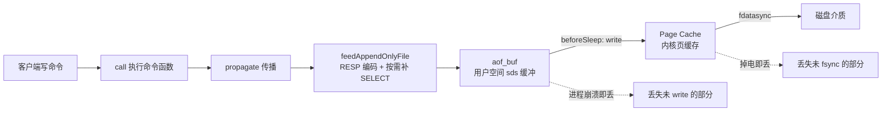
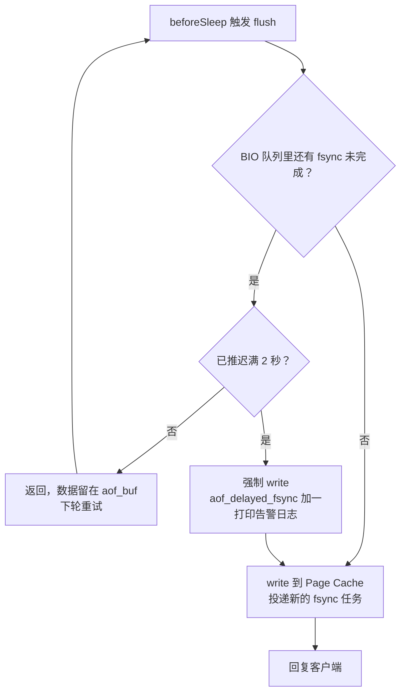
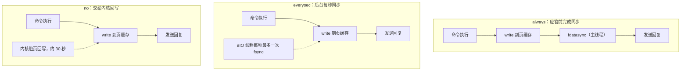
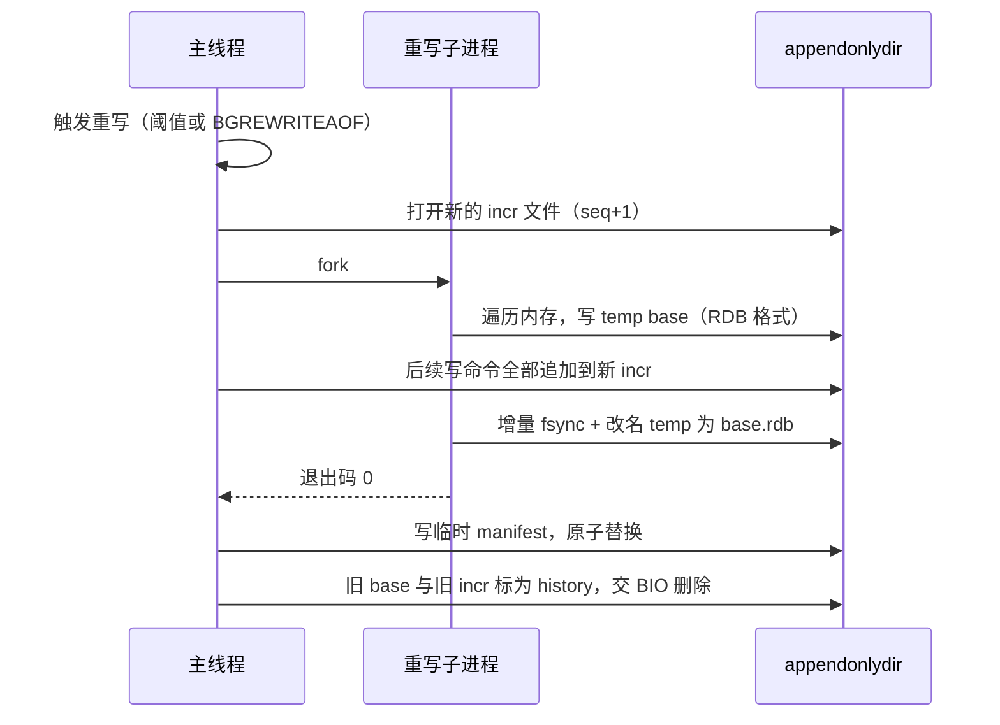
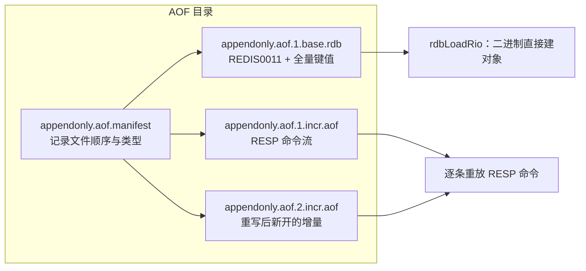
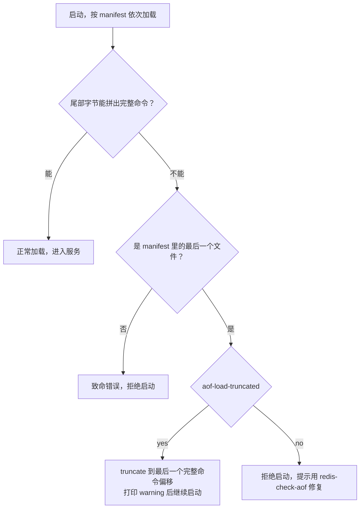

# 08 AOF 持久化与混合持久化

**摘要：**

[[07 RDB 持久化——快照的 fork 与 COW 机制|RDB]] 回答的是“某一时刻的数据长什么样”，AOF 回答的是“数据是怎么变成现在这样的”——两条路线各自把一部分成本推给了别处，谁也没有把成本消灭。本文不按“AOF 原理、重写、混合”的教科书顺序展开，而是把 AOF 拆成三笔必须付出的代价来算账：写入路径上每次事件循环的 `write` 与按策略触发的 `fsync`；重写时 fork 子进程、借 COW 遍历内存、把整份数据重新落一遍盘；启动时逐条解析并重放 RESP 命令。第一笔代价由 `appendfsync` 的三档语义决定，其中 `everysec` 被普遍误读成“最坏丢 1 秒”，真实机制是主线程在后台 fsync 未完成时推迟 `write`、最多推迟 2 秒、超时后强制写入并累加 `aof_delayed_fsync`——丢失窗口因此不止 1 秒。第二笔代价在 7.0 的 multi-part AOF 之后换了形态：重写不再是“子进程写临时文件、父进程末尾追加增量缓冲”，而是 fork 前就打开新的增量文件，完成时只做一次 manifest 原子替换。第三笔代价被混合持久化（`aof-use-rdb-preamble yes`，4.0 引入、5.0 起默认开启）抹平——base 用 RDB 格式承载全量，增量用 RESP 命令补齐尾部，加载速度回到 RDB 的量级。全文给出三档 fsync 的取舍、重写与加载的量化口径、`aof-load-truncated` 与 `redis-check-aof` 的实际动作，以及六个真实反例与一份可直接落地的配置与监控清单。

---

## 第 1 章 一次写入的三次落地

### 1.1 两条持久化路线的分工

Redis 把数据放在内存里，一次进程退出或一次主机掉电就足以让所有键值消失，所以持久化要回答的其实是两个不同的问题：当前的数据集长什么样，以及这个数据集是怎么一步步变成现在这样的。RDB 走的是前一条路，把某个瞬间的全部键值序列化成一个紧凑的二进制文件；AOF 走的是后一条路，把每一条改变数据集的命令按 Redis 协议（REdis Serialization Protocol，RESP）追加到日志末尾，恢复时从头重放。前者是状态的快照，后者是状态的变更流，这个差别决定了后面所有的成本结构。

AOF 并不是 Redis 一开始就有的能力。1.1 版本引入它的时候，动机非常直接：快照之间的窗口太宽，`save 900 1` 这样的规则意味着最坏情况下十五分钟的写入会随着一次断电灰飞烟灭，而很多业务不能接受这种量级的丢失。把命令记下来、重启时重放，顺带还带来一个副作用——日志是文本的，人能读懂，出了事故可以翻着看最后几条命令是什么。

这个“顺带的好处”在混合持久化成为默认之后打了折扣。今天 AOF 文件的主体部分是一个 RDB 格式的 base 文件，可读的只剩尾部那段增量。笔者见过有人拿着 `.base.rdb` 用文本编辑器打开、抱怨全是乱码，这其实说明文件结构已经演进过一轮，而很多资料还停留在单文件时代。

### 1.2 命令执行之后：传播的两条去向

一条写命令在 Redis 里的完整链路是：事件循环读到命令、解析成 `robj` 数组、在 `call()` 里执行命令函数、执行完毕后统一做传播（propagate）。传播有两个目标——AOF 缓冲区和复制缓冲区——由 `PROPAGATE_AOF` 与 `PROPAGATE_REPL` 两个标志位区分。`call()` 里判断是否传播的依据是 `server.dirty` 的增量：命令真正改动了数据集才传播，`SADD` 一个已存在的成员、`DEL` 一个不存在的键都不会产生 AOF 记录。这一条经常被忽略，它意味着 AOF 的体积与“客户端发了多少写命令”并不严格成正比，而与“有多少次真实修改”成正比。

传播最终落到 `propagateNow()`，由它分别调用 `feedAppendOnlyFile()` 和 `replicationFeedSlaves()`。有趣的是 AOF 与复制共用同一份命令流、同一个编码函数（`catAppendOnlyGenericCommand`），因为二者的语法都是 RESP。一个执行单元内如果产生了多条传播命令（譬如一条命令内部改写了多个键、或者 Lua 脚本里的多次写入），Redis 会用 `MULTI`/`EXEC` 把它们包起来再写进 AOF，保证重放时的原子性与执行时一致。

`feedAppendOnlyFile()` 里还有两个不显眼但要命的细节。其一是 `SELECT` 的注入：AOF 是单流文件，命令必须知道自己属于哪个数据库，所以 Redis 用 `server.aof_selected_db` 记住“上一条命令写的是哪个库”，一旦切库就先补一条 `*2\r\n$6\r\nSELECT\r\n...`，而重写 fork 之前会把它强制置为 -1，逼着下一条命令带上 `SELECT`。其二是时间戳注释：开了 `aof-timestamp-enabled` 之后，AOF 里会插入 `#TS:<unix 时间>` 这样的注释行，按时间点截断（后面会讲到的 `--truncate-to-timestamp`）就靠它定位。注释行以 `#` 开头，不是合法 RESP 命令，重放时被跳过，代价是与老版本解析器不兼容，所以默认关闭。

### 1.3 aof_buf：为什么不直接写文件

命令执行完不立刻 `write()` 到磁盘文件，而是先追加到 `server.aof_buf` 这个用户空间的 sds 缓冲里，原因在于事件循环的批处理特性。一次事件循环里可能连续处理几十条命令，如果每条命令都触发一次系统调用，系统调用的固定开销会吃掉可观的比例；攒到循环末尾一次性 `write()`，既摊薄了开销，也让“一次写、一次 fsync”的批量提交成为可能。

`aof_buf` 的生命周期很短：写完就被清空或释放，小缓冲（小于 4 KB 左右）会被复用以免频繁分配。它同时也是 everysec 模式下最危险的一块内存——因为当磁盘拥塞、主线程决定推迟写入时，新产生的命令只能继续堆在这块缓冲里，既不在页缓存（Page Cache）里也不在磁盘上。第 2 章会展开这块缓冲在极端情况下的后果，这里先记住它的位置。

### 1.4 beforeSleep：持久化先于应答

真正把 `aof_buf` 落到文件的是事件循环末尾的 `beforeSleep()`，它调用 `flushAppendOnlyFile()`，而这个调用点被刻意安排在“把回复写给客户端”之前。源码注释写得很直白：AOF 必须在客户端拿到写命令的成功回复之前刷到磁盘。这条顺序决定了 `always` 模式的语义不是“异步把数据交给磁盘”，而是实打实的“应答即已落盘”。



这张图里两条虚线是理解 AOF 安全性的关键：`write()` 只把数据从用户空间搬进页缓存，`fsync()` 才把页缓存刷到介质；进程崩溃丢的是前者，主机掉电丢的是后者。所有 `appendfsync` 讨论的安全性差异，都是在这两条虚线之间做文章。

把这段链路放回一次请求的完整生命周期里看会更清楚：命令从 socket 读入、在事件循环里执行、传播进缓冲、在进入睡眠前落盘、最后才把回复写回 socket，这几步的先后顺序本身就是持久化语义的一部分（请求从监听到回复的完整链路见 [[01 Redis 全局架构——一次请求的完整生命周期]]）。顺序一旦反过来——先回复再落盘——`always` 的承诺就不成立了，而 Redis 是把“落盘”硬编码在“回复”之前的。

### 1.5 三笔代价的总账

把 AOF 的全部开销摊开，可以归成三笔，它们出现的时机、能否优化、能否消除各不相同：

| 代价 | 触发时机 | 主要成本项 | 量级判断 | 混合持久化是否消除 |
| :--- | :--- | :--- | :--- | :--- |
| 写入路径的同步 | 每次事件循环一次 `write`，按策略触发 `fsync` | 磁盘同步延迟、主线程可能被推迟的写入 | 与单次 `fdatasync` 延迟同阶 | 不能，写路径完全不变 |
| 重写的重建 | 达到阈值或手动 `BGREWRITEAOF` | fork 的 COW 内存、整份数据重写落盘、增量双写 | 内存峰值可达数据量的 1–2 倍 | 部分：产物更小、落盘更快 |
| 恢复的重放 | 每次启动 | RESP 解析、命令查找、逐条执行建对象 | 与命令条数成正比，而非与数据量成正比 | 能：主体改为反序列化 RDB |

第一笔代价是常驻的，只要 `appendonly` 开着，每一条真实修改都要为它买单；第二笔代价是周期性的，与写入速率和重写阈值相关；第三笔代价只在启动时付，但它的绝对值往往最大——一份运行了两年的实例，AOF 里可能躺着上亿条命令，而内存里只有几百万个键。

后文的组织就按这三笔账走：第 2 章算第一笔，第 3 章算第二笔，第 4 章解释第三笔如何被混合持久化抹平，第 5 章处理“账算不平”时怎么救，第 6、7 章把账落到反例与配置上。

---

## 第 2 章 appendfsync 的三档语义

### 2.1 always：批量提交，但应答前必须落盘

流传最广的一句误解是“`appendfsync always` 会在每条命令后同步调用一次 fsync”。实际情况是：Redis 在一次事件循环里把所有待写命令攒进 `aof_buf`，`beforeSleep` 里做一次 `write()` 和一次 `fdatasync()`，然后才把这一批客户端回复发出去。所以严格说，一次磁盘同步对应的是“一批命令”，而不是“一条命令”。

但把批量提交理解成“always 很便宜”就错了。批量只影响单条命令摊到的固定开销，不影响“应答之前必须完成一次同步”这个语义约束。吞吐上限于是变成一道简单的算术：每秒能完成多少次 `fdatasync`，就决定了每秒能处理多少批命令：

| 假设的单次 `fdatasync` 耗时 | 每秒批次数上限 | 每批 10 条命令时 | 每批 100 条命令时 |
| :--- | :--- | :--- | :--- |
| 0.1 ms | 10000 | 10 万 op/s | 100 万 op/s |
| 0.5 ms | 2000 | 2 万 op/s | 20 万 op/s |
| 5 ms | 200 | 2000 op/s | 2 万 op/s |

上表是示例推算：假设 CPU 与网络不是瓶颈、每批命令的编码与执行开销可忽略，只做纯算术。真实的 NVMe、普通 SSD、机械盘乃至云上的网络块存储，单次同步延迟可以跨两个数量级，所以这三行的具体数字不能外推，能外推的是结构——`always` 的性能由“同步延迟 × 批大小”共同决定，而批大小取决于客户端是否 pipeline。一个每条命令都等回复的同步客户端，在 `always` 下每条命令都要等一次同步，吞吐直接由单次同步延迟决定，常见量级从每秒几百到上万次不等（量级判断，取决于介质）。

`always` 还有一个少有人注意的失败语义。`flushAppendOnlyFile()` 里对 `always` 分支的 `fsync` 失败处理是直接 `exit(1)`，注释说明这是为了“保证 always 下的数据安全”：既然承诺应答前已落盘，那么落不了盘就不能继续服务。对比 `everysec`，后台 fsync 失败只会把状态置错、让写命令返回 `-MISCONF Errors writing to the AOF file`，进程继续活着。一个选择“宁可停不可错”，一个选择“降级但可用”，这是两种故障哲学，不是性能参数。

最后是平台差异。Linux 上 `redis_fsync` 被宏定义为 `fdatasync()`，只刷数据不刷元数据；macOS 上是 `F_FULLFSYNC`，要求设备把缓存也清掉，代价明显更高；其他 Unix 用 `fsync()`。在笔记本或 CI 容器里测出来的 `always` 性能，搬到 Linux 服务器上没有可比性。

### 2.2 everysec：1 秒的承诺，2 秒的推迟

`everysec` 的实现比文档描述复杂。主线程在 `beforeSleep` 里照常 `write()`，然后判断“当前墙钟秒是否已经大于上次 fsync 的秒”——是的话，把一个 fsync 任务投递给后台 I/O 线程（BIO），由它异步执行。`aof_last_incr_fsync_offset` 记录已投递 fsync 的文件偏移，`aof_last_incr_size` 记录已写入的偏移，二者不等就说明还有数据没同步。源码里甚至专门处理了“缓冲区为空但仍有未同步数据”的情况：写命令停下之后，最后一条命令可能一直躺在页缓存里，直到下一次写入才被顺带 fsync，这个补丁让空闲实例也能在一秒内完成同步。

真正的代价藏在推迟逻辑里。主线程在 `write()` 之前会检查 `aofFsyncInProgress()`，也就是 BIO 队列里是否还有 fsync 没做完。如果有，它不会立刻写，而是把这次 flush 推迟，用 `aof_flush_postponed_start` 记下第一次推迟的时刻：

- 第一次发现 fsync 未完成，记下时刻并直接返回，数据继续留在 `aof_buf`；
- 之后每次 `beforeSleep` 重试，只要推迟时间还不到 2 秒，就继续推迟；
- 推迟满 2 秒，放弃等待，强制 `write()`，把 `aof_delayed_fsync` 计数器加一，并打出一条日志：`Asynchronous AOF fsync is taking too long (disk is busy?). Writing the AOF buffer without waiting for fsync to complete, this may slow down Redis.`

为什么要推迟，而不是像很多资料说的“等 fsync 完成后 write”？因为 Linux 上 `write(2)` 会被正在进行的后台 fsync 挡住，`redis.conf` 里有一句原话：即使把 fsync 放到别的线程，也无法避免它阻塞我们的同步 `write(2)` 调用。推迟写入是让主线程先不碰文件描述符，把阻塞风险从“现在”推到“两秒后”；两秒是一个经验上限，再推下去内存涨得比阻塞更危险。

这段机制推翻了两条常见结论。其一，“`everysec` 最坏丢 1 秒”只是理想情况：推迟期间新命令堆在 `aof_buf` 里，既没进页缓存也没进磁盘，进程崩溃会一起丢掉，所以真实窗口是“上次 fsync 之后的时间 + 当前推迟时长”，磁盘持续拥塞时可以拉长到数秒。其二，“`everysec` 不阻塞主线程”也不成立：推迟满 2 秒后强制写，写操作可能被后台 fsync 阻塞，主线程结结实实地卡在 `write()` 里，这一段的耗时被记录成 `aof-write-pending-fsync` 延迟采样。



监控 `everysec` 的健康度就靠三个量：`INFO persistence` 里的 `aof_delayed_fsync` 累计值（持续增长说明磁盘跟不上）、`aof_pending_bio_fsync`（队列里积压的 fsync 任务数）、以及 `LATENCY HISTORY aof-write-pending-fsync` 的采样（主线程被阻塞的时长分布）。只看“Redis 没报错”是不够的，推迟机制在工作时日志一片安静，直到阈值被突破才喊一声。

### 2.3 no：把持久化交给内核

`appendfsync no` 只做 `write()`，不做 fsync，什么时候刷盘由内核的脏页回写策略决定。官方文档给的经验值是 Linux 默认配置下大约 30 秒刷一次，但这是“由内核参数决定”的约数，不是承诺。这一档的语义要分成两种故障看：Redis 进程崩溃，数据已经在页缓存里，内核仍然持有，不丢；主机掉电或内核崩溃，页缓存里没回写的部分全丢。

所以 `no` 并不等于“不持久化”，它等于“持久化的时机不由 Redis 决定”。适合它的场景是可从上游重建的缓存，或者写入吞吐远比丢失窗口重要的离线计算中间态。把它当成“安全但快”的配置是误读——它快是真的，安全是借来的。

### 2.4 三档的完整对照

| 档位 | fsync 由谁在何时做 | 应答前保证 | 最坏丢失 | 主线程影响 | 典型场景 |
| :--- | :--- | :--- | :--- | :--- | :--- |
| `always` | 主线程，每次 `beforeSleep` 的 `write` 之后 | 数据已经落到介质 | 不承诺“零丢失”，而是同步失败即退出 | 每批命令阻塞一次同步 | 账务、配置中心等不能回滚的写入 |
| `everysec` | BIO 线程，每秒最多投递一次 | 通常只保证进入页缓存，推迟写时连页缓存都未进 | 1 秒加推迟窗口，拥塞时可拉长 | 推迟 `write` 最多 2 秒，之后可能被阻塞 | 绝大多数在线业务，默认值 |
| `no` | 内核脏页回写 | 只保证进入页缓存 | 约 30 秒（取决于内核参数） | 几乎无 | 可重建缓存、离线中间态 |

不过，把三档看成三个不同的“持久化承诺”比看成三个性能档位更准确：`always` 承诺“应答即持久”，`everysec` 承诺“一秒内尽力持久”，`no` 不承诺时限。性能差异是承诺差异的副产品，不是可以随意交换的旋钮。



三张子图并排看，差别只有一个位置：fsync 落在“发送回复”之前、之后，还是根本不由 Redis 决定。`always` 把同步放进关键路径，`everysec` 把它挪到后台线程但在应答前仍要确定数据已进页缓存，`no` 则连页缓存之后的动作都交了出去。

### 2.5 no-appendfsync-on-rewrite 的连带后果

另一个会把 `everysec` 悄悄降级的配置是 `no-appendfsync-on-rewrite`。它默认是 `no`；一旦设成 `yes`，只要后台有子进程在做 I/O（BGSAVE 或 AOF 重写），主进程就完全跳过 fsync，持久性等价于 `appendfsync no`。`redis.conf` 的注释把这个代价写明了：最坏情况下可能丢掉约 30 秒的日志（按 Linux 默认设置）。

它的价值在于削掉重写期间由 fsync 引起的延迟尖刺——子进程在写 base 文件、主进程在 fsync 增量文件，两块 I/O 抢同一块盘时，fsync 延迟会突然变长，`everysec` 的推迟机制随之启动，主线程开始卡。打开这个开关相当于把“重写期间的持久性”抵押出去换平滑度。是否抵押，取决于业务能不能接受“重写期间丢几十秒”，这个判断只能由业务给出，不能由 DBA 替它做。

### 2.6 WAITAOF：把同步粒度下放到单次请求

`always` 的问题是把所有写都拖慢，`everysec` 的问题是无法对某一次写给出确定承诺。Redis 7.2 加了 `WAITAOF`，让客户端可以对“我这条写命令”要求一次本地 AOF 落盘确认：`WAITAOF 1 0 100` 表示等本机 AOF 完成 fsync、零个副本、超时 100 毫秒，返回值是一个两元数组，分别是本地与副本的确认数量。它依赖 `server.fsynced_reploff` 这个“已同步的复制偏移”，只有在 `appendonly yes` 时才允许 `numlocal=1`，否则直接报错。

这个命令的意义不是让 `everysec` 变成 `always`，而是把“什么时候必须持久”从全局配置下放到单次请求：绝大多数写走 `everysec` 的低成本路径，少数关键写（譬如支付状态落库、分布式锁的释放记录）显式要求确认。代价是这条命令会阻塞客户端直到 fsync 完成或超时，超时返回的确认数会小于请求数，调用方必须自己判断是否要重试或回滚。把 `WAITAOF` 当“开关”加上去而不处理超时分支，等于把不确定性从存储层搬到了业务层。

---

## 第 3 章 重写：重建而不是压缩

### 3.1 命令日志为什么会膨胀

AOF 记录的是变更流，重复修改同一个键就会留下多条记录。一个计数器被 `INCR` 一千次，文件里就是一千条 `INCR` 命令，每条约 23 字节，合计大约 23 KB；而重建这个计数器只需要一条 `SET ctr 1000`，约 32 字节。两者相差三个数量级，这就是重写的收益来源，也是重写唯一能压缩的部分。

反过来说，重写对“只写一次的键”几乎没有压缩效果。一百万个不同键各写一次，AOF 与 RDB 承载的是同一份信息，重写之后文件大小基本等于数据本身的大小。很多容量规划的错误来自这里：把“AOF 会一直膨胀”当成普遍规律，给一个只追加不覆盖的时序型数据集预留了十倍空间，结果磁盘长期空转；或者反过来，给一个高频覆盖的会话数据集只留了一倍余量，重写期间磁盘直接打满。

### 3.2 重写产物是怎么生成的

重写**不是**读取旧 AOF 再做压缩优化。`rewriteAppendOnlyFile()` 在 fork 出来的子进程里遍历当前内存中的数据字典，为每个键生成一条能重建它当前状态的最短命令序列。fork 之后父子进程共享物理页、父进程写入时触发写时复制（Copy-On-Write，COW）的机制，与快照完全同源（细节见 [[07 RDB 持久化——快照的 fork 与 COW 机制]]），这里只强调一点：AOF 重写的内存成本结构与 RDB 的快照成本结构是同一套，不会因为产物格式不同而变便宜。开 `aof-use-rdb-preamble` 时，子进程直接调用 `rdbSaveRio()` 把整份数据写成 RDB 格式的 base 文件；关掉它时走 `rewriteAppendOnlyFileRio()`，为每个键拼出 `SET`/`RPUSH`/`SADD`/`ZADD` 这类命令。前者是今天的默认路径，也是第 4 章的主角。

生成过程中有两个细节值得记住。第一是单条命令的元素上限：`AOF_REWRITE_ITEMS_PER_CMD` 定义为 64，一个十万成员的大 Set 会被拆成上千条 `SADD`，每条 64 个成员。这样做不是为了省空间，而是避免加载时一条巨长的命令造成长时间阻塞，以及避免命令缓冲区被单个键撑爆。第二是子进程写盘时的增量 fsync：`aof-rewrite-incremental-fsync yes`（默认）让 rio 每写满 4 MB 就同步一次，把“重写结束时一次性 fsync 几个 GB”的长尾尖刺摊成许多小尖刺。关掉它，重写的最后阶段会出现一次持续数百毫秒到数秒的同步（量级判断，随数据量放大），期间磁盘对主进程的写入几乎不响应。

子进程收尾的步骤是：`fflush`、`fsync`、`reclaimFilePageCache`（把刚写完的文件从页缓存里踢出去，避免它挤占热数据）、关闭文件、再 `rename` 到目标名。最后这个 `rename` 是原子操作，保证“要么是完整的新文件，要么还是旧的”，不会出现半个 base。

### 3.3 触发条件与失败退避

自动重写由 `serverCron` 里的一个周期检查触发，条件是两个阈值同时满足：

- `server.aof_current_size > server.aof_rewrite_min_size`（默认 64 MB）；
- 相对基准大小的增长率 `growth = aof_current_size * 100 / aof_rewrite_base_size - 100` 达到 `auto-aof-rewrite-percentage`（默认 100，即文件比上次重写后翻了一倍）。

基准大小 `aof_rewrite_base_size` 在重写完成后更新为当时的文件大小；重启之后它会被初始化为 base 文件的大小，源码注释承认这可能导致重启后的第一次自动重写偏早，属于可接受的误差。把 `percentage` 设为 0 会关掉自动重写，文件从此无界增长——这不是“省掉重写开销”，而是把成本推迟到某次无法完成的恢复。

失败处理上有一个容易被忽略的退避机制。重写连续失败三次之后，`aofRewriteLimited()` 开始介入：下一次重写推迟 1 分钟，再失败推迟 2 分钟，然后 4、8、16 分钟，上限 60 分钟，日志会打出 `Background AOF rewrite has repeatedly failed and triggered the limit, will retry in %d minutes`。退避的原因是失败的 AOFRW 会不断创建新的增量文件，如果不加限制，一场持续的失败会产出一堆碎小的 incr 文件。手动 `BGREWRITEAOF` 不受这个限制，运维可以随时强行再试一次。

| 触发方式 | 条件 | 说明 | 调整后的代价 |
| :--- | :--- | :--- | :--- |
| `auto-aof-rewrite-percentage` | 增长率达到阈值 | 默认 100，即相对基准翻倍 | 调大：文件更大、恢复更慢；调小：重写更频繁 |
| `auto-aof-rewrite-min-size` | 文件大于阈值才考虑 | 默认 64 MB，避免小文件反复重写 | 调大：小实例永不重写；调小：小实例频繁重写 |
| `BGREWRITEAOF` | 手动 | 有子进程时排队为 `aof_rewrite_scheduled` | 无 |
| 失败退避 | 连续失败 ≥ 3 次 | 1/2/4/8/16…分钟，上限 60 分钟 | 只能等或手动触发 |

### 3.4 重写期间的增量：两代方案的差别

fork 之后父进程还在接收写命令，这些新命令不在子进程的快照里，必须补进最终的数据集合，否则重写完成的瞬间就会丢掉 fork 之后的数据。两代方案处理这件事的方式完全不同，而绝大多数中文资料还停留在第一代。

7.0 之前：父进程在内存里维护一块重写缓冲 `aof_rewrite_buf`，fork 之后每条写命令既追加到正常的 `aof_buf`（继续写旧文件，保证重写失败时数据完整），也追加到 `aof_rewrite_buf`。子进程写完临时文件后，父进程把这块缓冲一次性追加到临时文件末尾，再 `rename` 覆盖旧文件。问题很集中：这块缓冲在内存里，重写持续越久、写入越猛，占用越大；同一批命令被写了两遍（旧文件一遍、新文件一遍）；最后那次追加发生在主线程，积累量大时会造成明显的卡顿。官方文档在“Redis < 7.0”的 AOF 缺点里把这三点都写明了。

7.0 起：fork 之前父进程就先打开一个新的增量文件（`appendonly.aof.N.incr.aof`），之后的写命令直接追加到新文件。子进程只管写 base，父进程只管写 incr，两者物理分离，不需要任何内存缓冲来“补差”。子进程完成后，父进程把临时 base 改名、把旧 base 与旧 incr 标记为 history、写一份临时 manifest 并原子替换，整个切换就完成了。重写失败时，旧 base 加两个 incr 文件仍然构成一份完整的数据集，不需要回滚任何东西。



顺带纠正一条流传很广的说法：有资料称“7.0 通过管道把增量命令持续发给子进程，所以只需追加最后一小段”。7.0 的子进程与父进程之间确实有管道，但管道传的是重写进度、COW 内存采样这类状态信息，不是增量命令。增量根本不经过子进程——它直接落在父进程打开的新 incr 文件里。这个区别很重要，因为它解释了为什么 7.0 的重写结束阶段几乎没有“最后追加”的阻塞点：没有东西需要追加。

### 3.5 为什么重写与快照必须互斥

Redis 在同一时刻只允许一个后台子进程（`hasActiveChildProcess()`），AOF 重写与 RDB 的 BGSAVE 因此天然互斥。发起 `BGREWRITEAOF` 时如果正在 BGSAVE，命令会返回成功但实际只是把 `aof_rewrite_scheduled` 置位，等快照结束后再补上；反过来，自动重写也会跳过有子进程在跑的周期。理由有两层：一层是磁盘 I/O，两个进程同时把整份数据写盘会把设备的写带宽吃干净，主进程的 `write()` 与 fsync 一起排队；另一层是内存，两份 COW 同时存在，脏页复制量可能翻倍。

不过，这条互斥规则对容量规划有直接影响：如果 RDB 的 `save` 规则较密、数据量又大，AOF 自动重写可能长期被“让路”，文件一路涨过预期阈值。排查“为什么重写阈值到了却迟迟不重写”时，先看 `INFO persistence` 的 `rdb_bgsave_in_progress` 与 `aof_rewrite_scheduled`，而不是怀疑阈值算错了。

### 3.6 第二笔代价的量化口径

重写的时间与内存可以用三个已知量粗算，都属于量级判断而非精确预测：

- **内存**：fork 之后父进程的写入会触发 COW 复制，最坏情况（重写期间所有页都被写过）额外占用一份数据量，实际值取决于写入分布，通常远小于一份。`INFO persistence` 的 `aof_last_cow_size` 给出了上一次重写实际复制的字节数，它比任何估算都可靠。
- **磁盘峰值**：重写期间同时存在旧 base、旧 incr、新 base、新 incr，峰值大约是“当前数据集大小 × 2 加上增量期间的新写入”。磁盘余量按 2 倍数据量预留是保守但常见的做法。
- **时长**：与数据量、单条记录大小、磁盘顺序写带宽、以及 `aof-rewrite-incremental-fsync` 的同步频率相关。用 `INFO persistence` 的 `aof_last_rewrite_time_sec` 观察自己的实例，比套用别人的基准数字靠谱。

把重写频率算出来也有用：触发点约为“基准大小 × (1 + percentage)”，写入速率若是每秒 R 字节，两次重写之间的间隔约为 `基准 × percentage / R`。一个 10 GB 的 base、`percentage 100`、写入速率 5 MB/s 的实例，理论上约 2000 秒（半小时）就会触发一次重写——这个频率下磁盘带宽的占用相当可观，把 `percentage` 调到 200 或把 `min-size` 上调，都是可以考虑的杠杆。

---

## 第 4 章 混合持久化：把全量交给 RDB

### 4.1 重放慢在哪里

AOF 的第三笔代价在加载路径上。恢复一份纯 AOF 文件时，Redis 创建一个假的客户端（`createAOFClient()`），逐条读取 RESP 命令、查找命令表、构造参数对象、调用命令函数、更新统计。每一条命令都要走一遍“解析、分派、执行”的完整链路，而且命令是文本格式，同样的数据量下文件比 RDB 大得多，读的字节数也更多。

RDB 加载走的是完全不同的路径：顺序读二进制，按类型直接反序列化出对象，没有命令解析，没有命令查找，没有逐条执行的开销。两者的差距随“命令条数 / 数据量”的比例放大：一个以计数器更新为主的实例，AOF 里可能有上亿条 `INCR`，重放要执行上亿次命令函数；而它的 RDB 里只有几百万个键。笔者不建议背任何“快 N 倍”的数字，正确做法是在自己的实例上量：`INFO persistence` 的 `rdb_last_load_keys_loaded` 与启动日志里的 `DB loaded from append only file: X seconds` 能给出真实口径。

### 4.2 混合的文件结构

混合持久化（Hybrid Persistence）在 4.0 引入，但 4.0 时 `aof-use-rdb-preamble` 的默认值还是 `no`，从 5.0 起才改成 `yes` 并一路沿用到现在：重写产生的 base 文件不再是纯 AOF 格式，而是 RDB 格式。在 7.0 之前，这体现为“一个文件的前半段是 RDB、后半段是 AOF”；7.0 之后，它体现为“base 文件是 `.base.rdb`、增量文件是 `.incr.aof`”，两类文件由 manifest 串起来，物理上已经分开。



base 文件虽然扩展名是 `.rdb`，却带着几个专属标记：文件头是 `REDIS` 加四位版本号（7.2 是 `REDIS0011`），aux 字段里有一个 `aof-base 1` 表明它是 AOF 的 base 分区；加载时打印的日志是 `Reading RDB base file on AOF loading...`。7.0 之前的旧式混合单文件用的是 `aof-preamble 1` 这个 aux 标记，加载日志是 `Reading RDB preamble from AOF file...`，两条路径在源码里都有保留，用于兼容升级前的文件。

### 4.3 加载顺序与失败语义

启动时 `loadDataFromDisk()` 只看一个开关：`aof_state == AOF_ON` 就走 AOF 加载，否则读 RDB 文件。注意这里的含义——当 `appendonly yes` 时，即使同时开着 `save` 规则、磁盘上也有更新的 `dump.rdb`，Redis 也只加载 AOF。官方文档的说法是 AOF 被保证是“最完整的那份”。这条规则解释了一个常见困惑：为什么把 RDB 备份恢复到实例目录里、重启之后数据没变——因为 AOF 优先，RDB 被忽略了。

AOF 的加载按 manifest 顺序执行：先 base，再按 seq 递增依次加载所有 incr。base 走 RDB 反序列化，incr 走命令重放。这里有一个严格约束：只有**最后一个**文件允许被截断，中间任何一个文件尾部不完整都会被当成致命错误，日志打出 `Fatal error: the truncated file is not the last file`，进程拒绝启动。RDB base 部分如果解析失败，同样直接 `AOF_FAILED`，`aof-load-truncated` 这个配置保护不到它——那个配置只管 RESP 命令流的尾部，不管 RDB 二进制。

### 4.4 为什么它成了默认

混合持久化能成为默认，不是因为它“兼顾了 RDB 的速度和 AOF 的安全性”这种笼统说法，而是因为它在三个具体维度上同时改善了账本：

- **恢复路径变短**：主体数据从“逐条执行命令”变成“反序列化对象”，加载时间回到 RDB 量级，尾部增量再重放一小段。
- **重写产物更小、落盘更快**：RDB 格式比等价的 RESP 命令流紧凑，子进程要写的字节数变少，重写对磁盘带宽的占用随之下降。
- **写路径零改动**：`appendfsync` 的语义、`aof_buf` 的流转、fsync 的时机完全不变，运维不需要为“混合”重新理解持久化承诺。

反过来，它没有改善的东西也要说清楚。第一笔代价原封不动：每次事件循环的 `write` 和按策略的 fsync 照旧。第二笔代价只是变轻，fork 与 COW 依然存在。可读性也打了折——base 是二进制，想靠文本编辑器审计历史命令，只能看 incr 那一段。最后，它不能防住逻辑误操作：`FLUSHALL` 会老老实实写进增量文件，重写之后连痕迹都不剩。

> [!warning] 混合持久化不是备份
> base 文件是 RDB 格式，容易让人误以为“拷一个 base 就是备份”。但 base 只在重写时产生，它与 incr 文件共同构成一份完整状态；单独拷走 base 会丢掉 base 之后的所有增量，拷走整个目录又会在实例运行时拿到不一致的快照。真正的备份仍然是独立触发的 RDB 快照，加上异地存放。

### 4.5 7.0 的 multi-part AOF

7.0 把单文件拆成了“目录 + manifest”的结构，这是 AOF 自 1.1 以来最大的一次结构调整，目的不是省空间，而是把“文件切换”这件事做得可原子、可回滚、可解释。

- **目录**：所有 AOF 文件放进 `appenddirname`（默认 `appendonlydir`），文件名由 `appendfilename` 加序号与类型后缀构成，譬如 `appendonly.aof.1.base.rdb`、`appendonly.aof.1.incr.aof`。
- **manifest**：`appendonly.aof.manifest` 是一份纯文本清单，每行形如 `file appendonly.aof.1.base.rdb seq 1 type b`，类型有三种：`b` 是 base，`i` 是当前增量，`h` 是历史文件。加载与切换都以 manifest 为准。
- **原子切换**：重写完成时，先写一份临时 manifest，再用 `rename` 替换正式 manifest。这个大文件改名是原子的，所以不存在“切到一半”的中间态；崩溃发生在替换之前，旧 manifest 仍然指向完整可用的旧文件集合。
- **历史文件回收**：被替换下来的 base 与 incr 标记为 history，交给后台线程异步删除；隐藏配置 `aof-disable-auto-gc` 可以关掉自动回收，用于事故现场保留文件。
- **升级路径**：从 6.x 升级上来、目录里还躺着一个 `appendonly.aof` 时，启动过程会创建目录、把旧文件整体搬进去并写成 base 记录，日志是 `Successfully migrated an old-style AOF file ... into the AOF directory ...`。这一步失败不会损坏数据，下次启动会重试。

8.0 在这一结构上又加了一项：manifest 的每条记录可以带可选的 `startoffset` 与 `endoffset`。它们记录增量文件对应的复制偏移区间，用于在重启后恢复 `master_repl_offset`，避免新开的增量文件把起点算错、让复制偏移在重启后回退。这个改动很小，但恰好说明了 multi-part AOF 的演进方向——不是在写路径上做文章，而是在“重启之后状态能否精确复原”上做厚。

顺带一句版本关系：Valkey 从 Redis 7.2 分支出去，multi-part AOF 的结构与 manifest 格式在它那里是一致的，读到 7.x 的 AOF 资料基本可以平移到 Valkey。

### 4.6 复制链路上的 AOF

副本也有自己的 AOF。主库发来的命令在副本上执行之后，同样走 `propagate` 写进副本自己的 `aof_buf`，所以副本的 AOF 记录的是主库的命令流，而不是副本本地的写入（副本默认只读）。这一点对容量规划有直接影响：从库的 AOF 膨胀速度与主库同阶，若只按“读放大”给从库预留磁盘，重写时同样会撞上空间不足。

`WAITAOF` 的副本确认走的也是这条链路。客户端要求“至少 N 个副本的 AOF 已完成 fsync”时，副本在自己的 BIO 线程完成同步后把已同步偏移回传，主库按偏移统计确认数量；这比 `WAIT` 的“命令已在 N 个副本内存里”更强，代价是额外的 fsync 与往返延迟。主从传播、复制积压缓冲区与部分重同步的细节见 [[09 主从复制与 Sentinel 高可用]]。

副本全量重同步时还有一段与 AOF 相关的窗口：主库把 RDB 快照发给副本，副本先落盘再加载，加载完成后才开始接收增量命令流；如果副本开着 AOF，加载完成后还要由后台重写重建 base。这几分钟里“命令应用”与“AOF 重写”同时进行，I/O 比平时更紧张，把重同步安排在低峰期不是洁癖而是必要。

---

## 第 5 章 加载、截断与修复

### 5.1 尾部截断的三种成因

AOF 文件尾部出现半条命令，最常见的三种成因：写入过程中断电，最后一条命令只落了一部分字节；磁盘写满，`write()` 写到一半返回短写；文件系统在异常掉电后出现元数据与数据不一致。三者的表现都是同一个——文件末尾的字节流不足以拼出一条完整的 RESP 命令。

这里有个容易混淆的点：`aof-load-truncated` 处理的是“尾部不完整”，不是“文件损坏”。如果坏字节出现在文件中间（譬如某条命令的参数字节被篡改成非法长度），加载会在读到那里时报 `Bad file format`，这个配置帮不上忙，只能人工修。

### 5.2 aof-load-truncated 到底做了什么

`aof-load-truncated yes`（默认）的行为不只是“忽略尾部继续加载”。加载器在读每条命令前记录当前的合法偏移，遇到短读时把文件真正 `truncate()` 到最后一个完整命令的末尾，日志打出 `!!! Truncating the AOF ... at offset N !!!` 和 `AOF ... loaded anyway because aof-load-truncated is enabled`，然后启动。也就是说，数据丢失是**永久**的：文件被就地截短了，没有留备份。若希望保留现场，必须在启动前自己拷一份。

还有一个细节针对事务：如果在 `MULTI` 之后、`EXEC` 之前文件结束，加载器会回退到 `MULTI` 之前的合法偏移（源码里记作 `valid_before_multi`），把未完成的事务整段丢掉。这保证重放后的数据集不会停留在“半个事务”的状态上。

把配置设为 `no` 的后果是拒绝启动，日志会提示两条路：备份后用 `redis-check-aof --fix <filename.manifest>` 修，或者把配置改回 `yes` 再启动。生产上把它设成 `no` 的唯一合理理由是“不允许任何形式的数据静默丢失，宁可人工介入”——这要求值班流程真的能在故障时介入，否则就变成“把可用性换成了一句口号”。



这张图的判断顺序值得记住：先判断“是不是最后一个文件”，再判断配置开关。很多人以为 `aof-load-truncated yes` 是一把万能钥匙，实际上它只对最后一个文件生效，中间文件被截断时无论配置是什么都拒绝启动——因为中间文件之后还有数据，截断它等于放弃了后面所有合法命令。

### 5.3 redis-check-aof 的适用范围

```bash
# 只检查，不修改
redis-check-aof appendonlydir/appendonly.aof.manifest

# 截断最后一个文件里的不完整尾部
redis-check-aof --fix appendonlydir/appendonly.aof.manifest

# 按时间戳截断（需要 aof-timestamp-enabled yes 才有 #TS 注释）
redis-check-aof --truncate-to-timestamp 1735689600 appendonlydir/appendonly.aof.manifest
```

7.x 的工具既能检查单个 AOF 文件，也能接收 manifest 路径；对多部分 AOF，要传 manifest，它会按清单把 base 与所有 incr 依次检查一遍。三条硬规则：只有最后一个文件允许被截断，中间文件不完整直接报错退出；`--fix` 会把不完整尾部连同它之后的内容一起丢弃；损坏发生在文件中部时，被丢弃的是“从损坏点到最后”的全部数据，量可能非常大。官方文档对此的措辞是“可能导致大量数据丢失”，修复之前先备份、先用不带 `--fix` 的方式看清偏移与内容，是必须的步骤。

`--truncate-to-timestamp` 是 7.0 随 `#TS` 注释一起引入的能力，用来把实例回退到某个时间点：它找到第一条时间戳大于目标值的注释，把文件截到那之前。它同样只允许作用于最后一个文件，且要求开启过时间戳记录——历史文件里没有 `#TS` 行，工具无从定位。

### 5.4 故障判据表

排查 AOF 相关故障时，先定位“卡在哪一层”，再谈处置。下面这张表按症状组织，字段名都可以在 `INFO persistence` 里直接读到：

| 症状 | 关键字段或日志 | 根因 | 处置 |
| :--- | :--- | :--- | :--- |
| 写入延迟周期性尖刺 | `aof_delayed_fsync` 持续增长、`LATENCY HISTORY aof-write-pending-fsync` | 磁盘跟不上 fsync，主线程推迟写直到强制写 | 换盘、分离 AOF 目录、评估 `no-appendfsync-on-rewrite` |
| 写命令返回 `-MISCONF` | `aof_last_write_status:err`、日志含 `Errors writing to the AOF file` | 磁盘写错误或 fsync 失败，Redis 主动拒写 | 修磁盘/空间后等待自动恢复，或 `CONFIG SET appendonly no/yes` 重建 |
| 重写长期不结束 | `aof_rewrite_in_progress:1`、`aof_current_rewrite_time_sec` 很大 | 数据量大 + 慢盘 + 增量 fsync 频繁 | 调 `aof-rewrite-incremental-fsync`、错峰、加 `aof-rewrite-cpulist` |
| 重写反复失败 | `aof_last_bgrewrite_status:err`、日志含 `repeatedly failed and triggered the limit` | 磁盘空间不足或 fork 失败 | 清理空间、检查 `overcommit` 与内存余量 |
| 启动报截断 | 日志含 `short read while loading the AOF file` | 掉电或磁盘满导致尾部不完整 | 备份后 `--fix`，或调 `aof-load-truncated` |
| 启动报格式错误 | 日志含 `Bad file format reading the append only file` | 文件中段损坏 | 备份、定位偏移、人工修或接受数据丢弃 |
| 启动后数据比预期少 | `aof_load_truncated` 相关日志、加载耗时日志 | 尾部被静默截断 | 建立“启动日志必看”的值班习惯 |

### 5.5 关闭与切换时的语义

优雅关闭（`SHUTDOWN`）与崩溃是两种完全不同的结局：关闭流程会强制 flush 一次 `aof_buf` 并显式 `fsync`，日志打出 `Calling fsync() on the AOF file.`，然后才退出。所以在 `everysec` 下正常重启不丢数据，“最坏丢 1 秒”只针对崩溃场景。这条差别在演练里经常被搞混——用 `SHUTDOWN` 做的恢复演练永远测不出丢失窗口，要测就得用 `kill -9` 或直接断电模拟。

另一个坑是运行时打开 AOF。`CONFIG SET appendonly yes` 会把状态切到 `AOF_WAIT_REWRITE`，触发一次后台重写来生成初始 base；在这一过程中如果 `SHUTDOWN`，且没有 `force`，Redis 会拒绝退出并提示 `Writing initial AOF, can't exit.`，因为它不想在初始文件还没写完时丢数据。切完之后还有一步常被忘记：`CONFIG REWRITE` 把改动写回配置文件。只做了运行时切换而没改配置文件，下次重启实例会回到 `appendonly no`，那份 AOF 就再也不被加载了——官方文档把这个步骤标成了 IMPORTANT，它不是客套话。

---

## 第 6 章 六个反例

### 6.1 把 always 当性能配置

把 `appendfsync` 从 `everysec` 改成 `always`，然后在压测报告里写“吞吐下降 30%”，这类结论多半不可复现：`always` 的吞吐由同步延迟与批大小共同决定，同步客户端的场景下它可以下降一个数量级以上（量级判断，取决于介质与客户端是否 pipeline）。更麻烦的是失败语义，`always` 下 fsync 失败会直接退出进程，一块开始报错的盘可以让实例反复重启。要“关键写必须落盘”，正确工具是 `WAITAOF` 加业务侧确认，而不是把全局配置拉到最严。

### 6.2 AOF 目录与数据目录同盘

默认布局把 `appendonlydir` 和 `dump.rdb` 放在同一个 `dir` 下，这在单盘小实例上无所谓，在写入密集的实例上会把三种 I/O 叠在一起：主进程每秒的 AOF `write` 与 fsync、重写子进程的整份数据顺序写、BGSAVE 子进程的快照写。三者抢同一块设备的队列，fsync 延迟上升，`aof_delayed_fsync` 开始计数，主线程被推迟到 2 秒上限后强制写。修法不是调大超时，而是物理隔离：把 `appenddirname` 指到独立挂载点或独立设备，必要时用 `aof-rewrite-cpulist` 与 `bgsave-cpulist` 把子进程绑到不同核上。

### 6.3 不看 aof_delayed_fsync

推迟机制工作时日志是安静的，只有当推迟超过 2 秒才会打一条 warning。这意味着“日志干净”不能证明磁盘健康，必须看累计量。`aof_delayed_fsync` 是一个只增不减的计数器，把它做成速率告警（譬如每分钟增量大于 0 就提示）比看绝对值有意义；再配 `aof_pending_bio_fsync` 看队列深度，两个指标一起看，才能区分“偶发一次慢盘”和“设备持续跟不上”。顺带一提，`aof_last_cow_size` 也值得纳入监控，它直接反映重写期间内存复制的真实规模，是容量规划里最硬的依据。

### 6.4 重写期间磁盘打满

重写的磁盘峰值大约需要两份数据集加增量期间的写入量。一个 50 GB 的实例、磁盘只剩 60 GB 可用，重写会在写到一半时 `ENOSPC` 失败，然后进入退避重试，每失败一次留下新的 incr 文件，可用空间进一步减少——这是一个会自我加速的失败循环。防御手段有三条：磁盘容量按 2 倍数据量预留；给 AOF 目录设配额或监控告警；把 `auto-aof-rewrite-min-size` 与 `percentage` 调到“重写频率可承受”的区间，而不是让重写在高水位反复触发。

### 6.5 把 AOF 当成备份

`FLUSHALL` 是一条正常写命令，会被追加到 AOF。只要之后没有发生重写，理论上可以停机、删掉最后几条命令、重启救回数据——官方文档确实描述了这个技巧，但它有两个前提：没有重写、且你能准确找到要删的字节。一旦重写发生，base 里就是空数据集，历史彻底消失。把 AOF 当备份还会遇到另一个问题：AOF 是“当前状态”的载体，不是时间点副本，误操作与正常写入混在同一条流里，无法选择性恢复。备份仍然应该是周期性 RDB 快照加异地存放，AOF 只负责“重启时尽量少丢”。

### 6.6 重写阈值一刀切

把 `auto-aof-rewrite-percentage 100` 和 `min-size 64mb` 当成放之四海皆准的默认值，会在两类实例上出问题。写入量很小的实例，base 可能只有几 MB，重写永远不触发，AOF 里的历史命令越积越多，某天重启时重放时间长得像卡死；写入量很大的实例，64 MB 的 base 在几分钟内就翻倍，重写频繁到磁盘带宽被长期占满。合理的做法是先算出“期望的重写间隔”：触发点除以写入速率，间隔短于十分钟就把阈值往上调，长于数小时就往下调。

---

## 第 7 章 选型、配置与容量

### 7.1 三种持久化组合的选择矩阵

| 维度 | 仅 RDB | 仅 AOF | RDB 与 AOF 同时开启（混合） |
| :--- | :--- | :--- | :--- |
| 恢复速度 | 最快 | 最慢 | 接近 RDB |
| 数据安全 | 分钟级窗口 | 秒级窗口，关键写可 `WAITAOF` | 秒级窗口 |
| 文件大小 | 最小、单文件 | 最大、多文件 | base 接近 RDB，增量另计 |
| 写入开销 | 仅快照时 fork | 每次事件循环 `write` 加秒级 fsync | 同 AOF |
| fork 频率 | 由 `save` 规则决定 | 由重写阈值决定 | 同 AOF，且与快照互斥排队 |
| 备份友好度 | 极高，可直接拷文件 | 低，多文件加 manifest | 中，需先做 RDB 快照 |
| 可审计性 | 无 | 强，命令可读 | 仅增量部分可读 |
| 适用场景 | 可容忍分钟级丢失的缓存与报表 | 数据重要但能接受慢恢复 | 绝大多数在线业务 |

矩阵里没有“最优”这一列，因为三个方案的成本落在不同人头上：恢复速度是 DBA 与业务共同承担的 RTO，数据安全是业务承担的风险，写入开销是实例吞吐与磁盘预算，fork 频率是运维要盯的稳定性指标。选型讨论如果只盯其中一列，结论必然是片面的。

### 7.2 恢复时间的构成

一次 AOF 恢复的时间大致是三段之和：base 的 RDB 反序列化、增量文件的命令重放、以及启动后第一次重写（若增量已接近 base 大小，重启后不久就会满足阈值再触发一次重写，把恢复期的 I/O 又叠一层）。第一段与数据量成正比，第二段与增量里的命令条数成正比，第三段是隐藏成本——它发生在业务已经接流量之后。

用示例推算给一个量级：假设一条命令的解析加执行约 1–2 微秒（这个假设本身要按自己的数据验证，复杂命令、大 value、Lua 脚本都会把它推高），一千万条命令的重放大约需要十到二十秒；同样数据量如果 base 是 RDB、增量只有几万条命令，恢复时间就基本由 base 的读取带宽决定。这也解释了为什么“定期触发一次重写”本身是恢复能力的一部分：增量越短，RTO 越可控。

### 7.3 配置清单与代价

| 配置项 | 默认 | 建议 | 改动后的代价 |
| :--- | :--- | :--- | :--- |
| `appendonly` | `no` | 在线业务设为 `yes` | 写路径多一次 `write` 与秒级 fsync |
| `appendfsync` | `everysec` | 保持 `everysec`；关键写用 `WAITAOF` | 改 `always` 吞吐塌陷且 fsync 失败即退出 |
| `aof-use-rdb-preamble` | `yes` | 保持 `yes` | 改 `no` 后 base 变 RESP，加载显著变慢 |
| `aof-load-truncated` | `yes` | 保持 `yes`，除非有能立刻介入的值班 | 设 `no` 会让截断变成启动失败 |
| `no-appendfsync-on-rewrite` | `no` | 仅在延迟敏感且能容忍 30 秒丢失时设 `yes` | 持久性等价于 `no` |
| `aof-rewrite-incremental-fsync` | `yes` | 保持 `yes` | 关闭后重写末尾出现长同步尖刺 |
| `auto-aof-rewrite-percentage` | `100` | 按“期望重写间隔”反算 | 调大文件更大、恢复更慢；调小重写更频繁 |
| `auto-aof-rewrite-min-size` | `64mb` | 小实例下调、大实例上调 | 见上一条的反向代价 |
| `appenddirname` | `appendonlydir` | 指向独立盘或独立挂载点 | 与数据同盘会放大 I/O 争抢 |
| `aof-timestamp-enabled` | `no` | 需要按时间点回退时开启 | AOF 多出注释行，老解析器不兼容 |
| `aof-rewrite-cpulist` / `bio-cpulist` | 未设置 | 子进程与 fsync 线程避开主线程核 | 绑核错误会加剧核间争抢 |

### 7.4 保留 RDB 的理由

即使 AOF 与混合持久化都开着，仍然建议保留 `save` 规则并定期把 RDB 文件异地存放，理由不是“多一层保险”这种空话，而是三条具体收益：其一，RDB 是单文件、可在运行中直接拷贝，是最容易做异地与归档的形态；其二，AOF 引擎出问题（文件损坏、manifest 丢失、升级回退失败）时，RDB 是唯一还能独立恢复的数据源；其三，RDB 文件里保存着复制 ID 与偏移，副本重启后才能据此做部分重同步，快照策略与复制链路本身是联动的。官方文档在“AOF 缺点”里也提到，单独使用 AOF 是“不推荐”的。

### 7.5 容量与重写频率的算术

重写对磁盘的额外占用可以用一个很简单的式子估出来。设数据集大小为 B、写入速率为 R 字节每秒、重写阈值为 p（`auto-aof-rewrite-percentage` 的百分数），那么两次重写之间的间隔约为 `B × p / (100 × R)`，而每次重写要顺序写出约 B 字节的 base，于是重写带来的平均写入带宽约为 `100 × R / p`。换句话说，p 就是“重写 I/O 与正常写路径 I/O 的比例旋钮”：p=100 时重写带宽约等于写入速率，p=200 时降到一半，p=400 时降到四分之一。

举个示例推算：20 GB 的数据集、写入速率 10 MB/s、p=100，触发点约 40 GB，间隔约 2000 秒（半小时出头），每次重写要写 20 GB，平均额外占用约 10 MB/s——与业务写入本身相当。这解释了为什么“重写期间磁盘 IO 打满”不是意外而是必然：在默认阈值下，重写本来就要吃掉一半的写带宽。另一个方向的算术更危险：数据量只有 128 MB、写入速率 1 MB/s 的实例，p=100 意味着每 128 秒就满足一次触发条件，`min-size 64mb` 拦不住它（已经超过下限），于是重写变成周期性风暴，COW 与磁盘写被反复触发。小实例的常见修正不是关自动重写，而是把 `min-size` 与 `percentage` 一起上调。

磁盘余量也要按这个式子反推：重写期间同时存在旧 base、新 base、旧 incr、新 incr，峰值约为 `2B` 加上重写期间的新写入，再留出历史文件回收之前的短暂重叠。按 2.5 倍数据量预留是保守但省心的口径；靠“清理旧文件很快”来压这个数字，等于把风险押在后台删除的及时性上。

### 7.6 监控与演练

需要长期盯的指标可以归成四组：持久化状态（`aof_enabled`、`aof_rewrite_in_progress`、`aof_rewrite_scheduled`、`aof_last_bgrewrite_status`）、写入健康度（`aof_last_write_status`、`aof_delayed_fsync`、`aof_pending_bio_fsync`）、规模与耗时（`aof_current_size`、`aof_base_size`、`aof_last_rewrite_time_sec`、`aof_last_cow_size`）、以及加载侧（启动日志里的加载耗时与截断告警）。恢复演练要用 `kill -9` 而不是 `SHUTDOWN`，否则永远测不到丢失窗口；演练还要覆盖“重写进行中被杀”的场景，这条路径最容易暴露 manifest 与历史文件的问题。

---

## 第 8 章 收束

AOF 的三笔代价里，只有第三笔被混合持久化真正抹平。写入路径的同步代价原样留在原地，重写的 fork 与整份落盘只是变轻而没有消失，所以“开了混合持久化就等于有了 RDB 的速度加 AOF 的安全”是一种被简化的说法：它买到的是恢复速度与增量完整性，买不到写入路径的免费，也买不到备份。

这也解释了 AOF 这些年的演进方向。7.0 的 multi-part AOF 把“切换文件”从一次可能失败的大文件 `rename` 拆成“新 incr 加 manifest 原子替换”，解决的是崩溃一致性；7.2 的 `WAITAOF` 把持久化承诺从全局配置下放到单次请求，解决的是“一刀切档位”与真实业务需求之间的错配；8.0 在 manifest 里补上复制偏移区间，解决的是重启后状态复原的精确性。三次改动都不在写路径上提速，而是在“重启之后还能不能精确地回到过去”上做厚。

所以落到配置上，答案取决于你更怕哪一种损失：怕丢数据，就把 `appendfsync` 保持在 `everysec` 以上、给关键写加 `WAITAOF`、给磁盘留够两次重写的余量；怕恢复太慢，就让 base 保持 RDB、把重写阈值调到能维持较短增量的区间；怕误操作，就别把 AOF 当备份，老老实实做 RDB 快照与异地归档。三种持久化方案之间从来没有高下，只有把三笔代价分摊到不同位置的选择，而分摊方式是否正确，取决于业务能接受哪一种最坏情况。至于下一代 Redis 会不会把持久化本身交给外部存储、让实例彻底无状态，目前仍然言之尚早。

---

## 参考资料

1. Redis Documentation - Persistence（AOF、重写、多部分 AOF、截断修复的官方说明）：https://redis.io/docs/latest/operate/oss_and_stack/management/persistence/
2. Redis 7.2 源码 `src/aof.c`（`flushAppendOnlyFile`、manifest、加载与重写实现）：https://github.com/redis/redis/blob/7.2/src/aof.c
3. Redis 7.2 源码 `src/server.c`（`propagateNow`、`loadDataFromDisk`、AOF 重写触发）：https://github.com/redis/redis/blob/7.2/src/server.c
4. Redis 7.2 配置模板 `redis.conf`（`appendfsync`、`no-appendfsync-on-rewrite`、`aof-use-rdb-preamble` 等注释）：https://github.com/redis/redis/blob/7.2/redis.conf
5. Redis 8.0 源码 `src/aof.c`（manifest 的 `startoffset` / `endoffset`）：https://github.com/redis/redis/blob/8.0/src/aof.c
6. Redis 7.2 源码 `src/redis-check-aof.c`（`--fix` 与 `--truncate-to-timestamp` 的适用边界）：https://github.com/redis/redis/blob/7.2/src/redis-check-aof.c
7. `fdatasync(2)` / `fsync(2)` Linux 手册页：https://man7.org/linux/man-pages/man2/fdatasync.2.html
8. 黄健宏《Redis 设计与实现》第 11 章 AOF 持久化（命令追加、重写、加载的中文经典叙述）

---

> [!note] 思考题
> 1. `everysec` 的推迟写机制用 2 秒作为上限，这个数字是经验值。如果把它改成 5 秒，会同时改善什么、恶化什么？
> 2. 混合持久化的 base 是 RDB 格式，增量是 RESP。假如业务要求“能被第三方工具逐条审计所有历史写入”，这个默认配置还能满足吗，替代方案是什么？
> 3. `WAITAOF 1 0 100` 在超时时返回的本地确认数是 0 或 1，业务代码应该如何处理这两种返回值？
> 4. 7.0 的 multi-part AOF 在重写失败时会留下一串历史的 incr 文件。如果自动回收（`aof-disable-auto-gc`）被关掉，长期运行会带来什么后果？
> 5. 一个只做 `INCR` 的计数器实例和一个只做首次写入的会话实例，同样的数据量下，谁更值得配 `auto-aof-rewrite-percentage 100`，为什么？