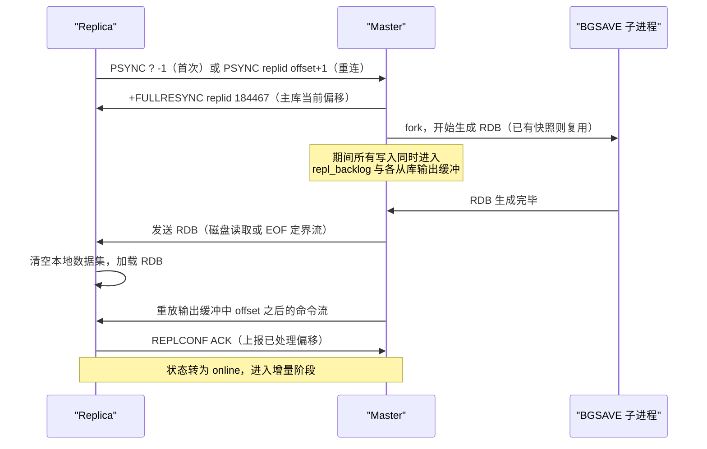
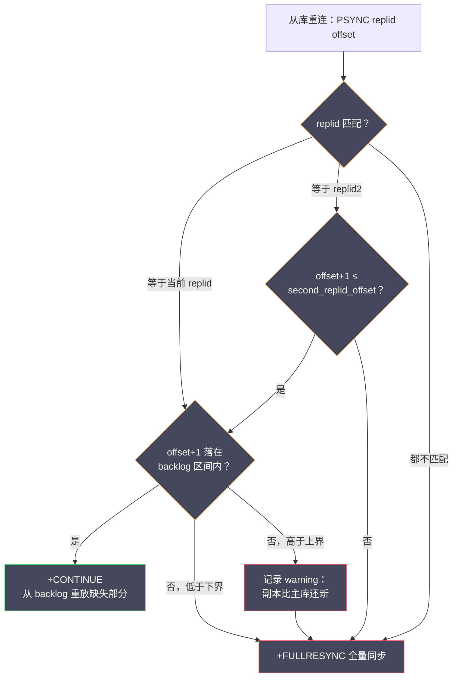
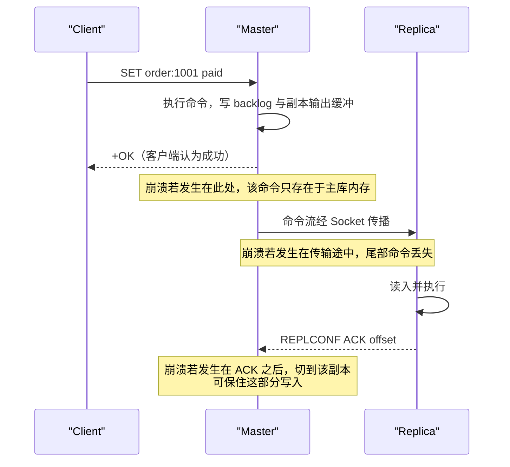
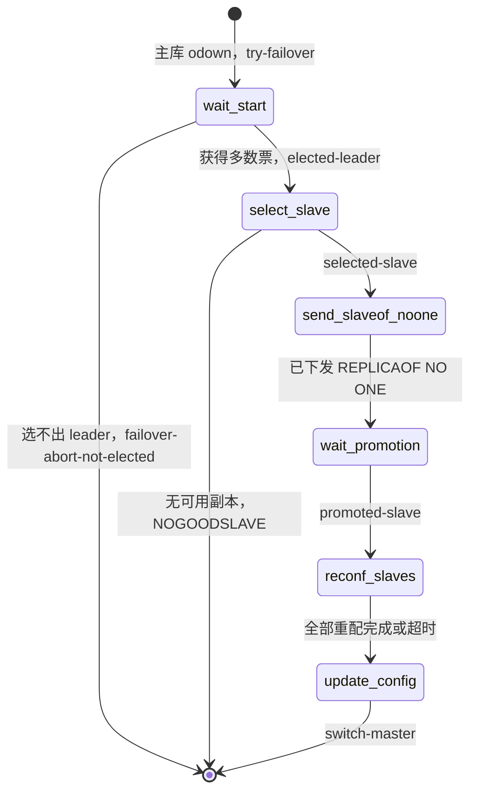
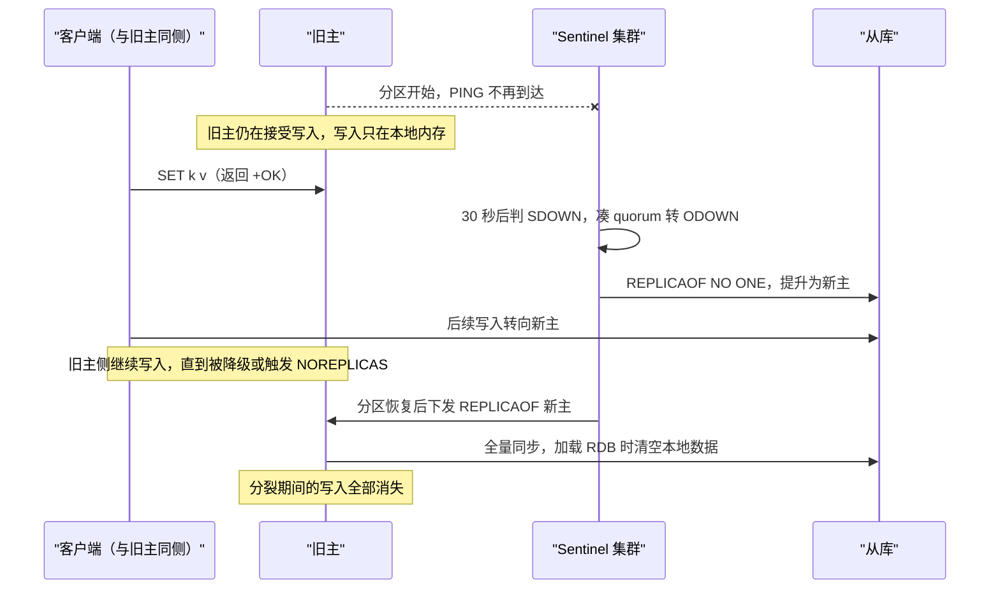

# 09 主从复制与 Sentinel 高可用

**摘要：**

一个 Redis 主库在凌晨失联，Sentinel 用几十秒完成切换，监控显示服务恢复，第二天对账却发现少了几十笔写入。故障复盘时注意力往往集中在"Sentinel 为什么慢"，但真正决定损失的是另一件事：切换点选中的那个从节点，本身就落后于主库。本文围绕"切换时到底会丢多少数据"这条主线，把复制关系的建立拆成握手、全量同步、增量同步三段，逐段标出数据在哪一步被暂存、在哪一步才算从库真正收到；再以复制积压缓冲区（replication backlog）为核心，说明它为什么是断线重连能否走增量的唯一依据，以及默认 1MB 在多大写入量下等价于"每次重连都全量同步"。在此基础上给出异步复制的三个后果：写入成功与副本收到之间的窗口、主库崩溃时未传播命令的丢失量、故障切换必然发生的截断；并把 `min-replicas-to-write` 与 `min-replicas-max-lag` 还原成"用可用性买窗口"的交换，而不是一致性保证。后半部分进入 Sentinel：PING、INFO、hello 三条监控流，主观下线到客观下线的两级判定，quorum 与 leader 选举多数派的关系，选新主的过滤与排序，以及切换窗口由哪几段组成、每一段由哪个参数决定、哪一段根本压不下去。落点是一个不太受欢迎的判断：在客户端语义不改的前提下，异步复制的切换一定会丢数据，配置能做的只是把窗口压到业务可接受的长度，并把脑裂的破坏限制在可控范围内。

---

## 第 1 章 切换时究竟丢了多少数据

### 1.1 一次对不上账的复盘

先把场景固定下来。凌晨两点十七分，主库所在宿主机硬件告警，进程随机器一起消失；三个 Sentinel 在三十秒后陆续把主库标记为**主观下线**（SDOWN），随后在一两秒内凑齐 quorum 转为**客观下线**（ODOWN），选出 leader Sentinel，把复制偏移量最大的那个从节点提升为新主，其余从节点重新指向新主，客户端在收到 `+switch-master` 通知后重建连接。整个过程没有人工介入，监控上只留下一段四十秒左右的写入失败，其余指标很快回到基线。

但业务侧的结果是另一回事。对账程序发现，切换前后有一批写入既不在新主里，也不在任何从库的备份里——它们曾经在主库的内存中执行成功，客户端也拿到了 `+OK`，只是没能走到任何一个副本，随着旧主进程一起消失。这类事故的追责焦点通常落在"Sentinel 判定太慢"或者"切换脚本有 bug"，但把时间线摊开就会发现，Sentinel 的每一步都按设计工作，丢失发生在更早的地方：主库对客户端承诺"已写入"的时刻，比任何从库收到这条命令的时刻都要早。故障切换换掉的是一份落后的副本，不是主库的最新版本，两者之间的差值就是损失的全部。

这个差值有多大，取决于三件事：复制链路把写入传播到从库需要多久、切换点选中的从库落后多少、以及切换判定窗口内主库是否还在接受写入。三件事分别对应复制的建立过程、复制积压缓冲区的容量、以及 Sentinel 的判定与选举机制。本文按这个顺序展开。

### 1.2 三条时间线与一个窗口

理解数据丢失，最有效的办法是把一条写命令经过的每个时刻标出来，再看故障切换能"看见"到哪一个。以 `SET order:1001 paid` 为例，它在系统里依次经过五个时刻：

| 时刻 | 发生的事 | 数据只存在于 | 客户端可感知 |
| :--- | :--- | :--- | :--- |
| T0 | 主库执行命令，写进自身数据集、复制积压缓冲区，并追加到每个从库的输出缓冲 | 主库内存 | 否 |
| T1 | 主库回写 `+OK` | 主库内存 | 是，认为成功 |
| T2 | 命令流离开主库网卡 | 主库内存 + 网络 | 是 |
| T3 | 从库读取并执行命令 | 主库 + 该从库内存 | 是 |
| T4 | 从库发 `REPLCONF ACK <offset>`，主库更新该从库的已确认偏移 | 主库 + 该从库 | 是 |

客户端看到的"成功"发生在 T1，而故障切换只能选择某个从库在 T3 之后的状态作为新主。T1 与 T3 之间所有已经返回成功的写入，构成了**丢失窗口**：它们对客户端而言是既成事实，对系统的未来而言却不存在。窗口的长度不是某个固定参数，而是"写入速率 × 传播延迟"的乘积——传播延迟包含网络往返、从库执行耗时，以及从库事件循环何时轮到这批命令。

这里有一个容易混淆的推断：很多人看到 `INFO replication` 里 `lag=0`，就认为从库与主库数据一致。`lag` 只表示"离上一次收到该从库的 ACK 过了多少秒"，是一个新鲜度指标，不是偏移量差值。一秒内回过 ACK 的从库，其偏移量仍可能落后主库几十万字节。判断数据差多少必须自己算 `master_repl_offset` 与从库 `offset` 的差，而不能看 `lag`。

### 1.3 版本口径与范围

本章机制以 Redis 7.2 的 `replication.c`、`sentinel.c` 与两份配置模板注释为准（7.2.17），7.4 与 8.x 在这条链路上没有结构性改动，差异只在少数新增命令（`WAITAOF` 自 7.4 引入）与默认值上，会在出现处单独标注。命令名沿用 5.0 之后的 `REPLICAOF`、`replica-*` 命名，`SLAVEOF`、`slave-*` 作为兼容别名仍然可用。2024 年自 7.2.4 分叉的 Valkey 基本延续了同一套复制与 Sentinel 语义，本文的结论对它同样成立。

范围上划三条线：全量同步里的 `fork` 与写时复制（Copy-On-Write）属于快照机制，细节见 [[07 RDB 持久化——快照的 fork 与 COW 机制|RDB 的 fork 与 COW]]；命令落盘与重放属于持久化，见 [[08 AOF 持久化与混合持久化|AOF 与混合持久化]]；分片与集群内建的 failover 属于另一套机制，见 [[10 Redis Cluster 分布式架构|Cluster]]。本文只关心数据在复制链路上被暂存、被确认、被截断的过程。

---

## 第 2 章 复制关系的建立

### 2.1 握手：在 PSYNC 之前还有五步

复制协议本身换过两次代。2.8 之前只有 `SYNC`，从库每次重连都要求主库把整份数据重发一遍，短暂断线也逃不掉；2.8 引入 `PSYNC` 之后，从库可以带着"上次同步到哪"来请求，主库据积压缓冲区判断能否只补差值；4.0 的 PSYNC2 又把复制 ID 从一个扩成两个，让被提升的新主能沿着上一段历史继续给其他从库补数据。

| 版本 | 协议 | 重连时的行为 | 切换后的从库 |
| :--- | :--- | :--- | :--- |
| 2.8 之前 | `SYNC` | 无条件全量重发 | 只能全量同步 |
| 2.8 起 | `PSYNC` v1 | 条件满足时只补缺失的命令流 | 新主 replid 变化，只能全量 |
| 4.0 起 | `PSYNC` v2 | 同上，并校验 `replid2` 与偏移上限 | 条件满足时可增量 |

从节点执行 `REPLICAOF 10.0.1.1 6379` 只是在内存里记下 `masterhost` 与 `masterport`，并把复制状态机推进到"待连接"，真正的复制由主循环每秒一次的 `replicationCron` 驱动。这个状态机（`repl_state`）从 `CONNECT` 出发，逐级经过建连、等 `PONG`、按需 `AUTH`、`REPLCONF listening-port`、`REPLCONF ip-address`、`REPLCONF capa eof capa psync2`，最后才发出 `PSYNC`。每一步都有超时约束（`repl-timeout`，默认 60 秒），任何一步卡住都会让 `master_link_status` 停在 `down`。

有两个细节常被跳过。`REPLCONF listening-port` 让主库能在 `INFO replication` 里报出从库端口，否则只剩一个 IP——多实例部署时这会让运维多花时间定位"哪台机器的哪个实例掉了"。`capa eof capa psync2` 是能力协商：`eof` 表示从库能识别以 EOF 为界的 RDB 流，这是无盘复制的前提；`psync2` 表示它支持双复制 ID，决定了故障切换后它能否向新主走增量。

```bash
# 从节点上的状态机推进过程，观察点在日志与 INFO 里
REPLICAOF 10.0.1.1 6379

redis-cli info replication | grep -E "role|master_link_status|master_replid|master_repl_offset"
# role:slave
# master_link_status:down        ← 握手未完成或链路中断
# master_replid:a1b2c3...        ← 同步完成后才有意义
# master_repl_offset:184467      ← 从库自己已处理到的位置

# 连接阶段最常见的日志（主库与从库各一侧）
# 主库：Replica 10.0.1.2:6379 asks for synchronization
# 从库：MASTER <-> REPLICA sync started
# 从库：Full resync from master: <replid>:<offset>
# 从库：MASTER <-> REPLICA sync: Finished with success
```

握手完成后，从节点根据自己是否保存过上一个主库的复制上下文，决定第一句 `PSYNC` 带什么：首次连接发 `PSYNC ? -1`，`?` 表示不知道主库的复制 ID，`-1` 表示没有偏移量；断线重连则发 `PSYNC <cached_replid> <cached_offset+1>`，注意这里带的是**希望接收的下一个字节**，而不是"我已经有的最后一个字节"——源码里 `cached_master->reploff+1` 决定了这个加一，主库据此从缓冲区的下一个位置开始重放，多一个字节或少一个字节都会让判定错位。

### 2.2 全量同步的七个步骤

当 `PSYNC` 请求无法满足增量条件时，主库回 `+FULLRESYNC <replid> <offset>`，进入全量同步。这个过程持续的时间远长于握手，也是复制链路里资源占用最集中的一段，流程如下。



七个步骤里的资源账值得逐项算清楚，因为它们决定了全量同步能不能在可接受的时间内完成。

第一，`fork` 发生在主线程里，需要复制页表，内存越大耗时越长。一个 10GB 数据集的实例，`fork` 停在数十毫秒到数百毫秒之间（量级判断，取决于内核与 `transparent_hugepage` 配置），这段时间主线程完全不处理命令，客户端的尾延迟会有一个尖峰。

第二，RDB 由子进程生成，写时复制机制让父进程在同步期间修改的页被额外复制一份，峰值内存增量与同步期间的写入量成正比，这是全量同步期间内存告警的常见来源。

第三，传输本身受网络与磁盘双重约束。10GB 数据在 1Gbps 链路上按 110MB/s 的有效吞吐估算，约需 90 秒（示例推算）；如果走磁盘落盘再读取，还要叠加两次磁盘 I/O。

第四，从库加载 RDB 的速度取决于对象数量与单条大小，解析并建对象是 CPU 密集型操作，亿级 key 的实例加载耗时以十秒计。加载期间从库按 `replica-serve-stale-data` 的取值决定是返回旧数据还是 `-LOADING` 错误。

第五，也是最容易被忽略的一项：全量同步期间的写入必须被兜住。这段时间主库不能把命令流发给还没加载完 RDB 的从库，于是每条写入都按字节追加到该从库的输出缓冲里。这个缓冲受 `client-output-buffer-limit replica 256mb 64mb 60` 约束——硬上限 256MB 一到，或软上限 64MB 连续 60 秒不降，主库就会断开这个从库，从库重连后再次请求全量同步。如果写入速率是 20MB/s，256MB 只够撑十几秒，而一次全量同步要 90 秒，于是出现"永远追不上"的循环：每次都在同一个位置被踢掉，日志里反复出现 `Client ... scheduled to be closed ASAP for overcoming of output buffer limits`，`INFO stats` 的 `sync_full` 持续上涨。这是全量同步最典型的失败形态，判据与处置放在第 3 章一起讲。

### 2.3 无盘复制与批量 fork

传统全量同步要把 RDB 落到磁盘再读出来发走，两次磁盘 I/O 在大数据集上都不便宜。无盘复制（diskless sync）让子进程直接把 RDB 流写进 Socket，跳过了磁盘环节。7.x 的 `repl-diskless-sync` 默认已是 `yes`，也就是说新部署的实例默认走这条路。

无盘复制引入了一个新的时间参数 `repl-diskless-sync-delay`（默认 5 秒）：主库收到第一个全量同步请求后不立刻开始，而是等 5 秒，把这段时间内到达的从库合并成一批，用一次 `fork`、一份 RDB 同时服务多个从库。这个延迟是权衡——等得越久，可合并的从库越多，`fork` 与序列化的开销摊得越薄；但第一个从库要多等这段时间才能开始同步。`repl-diskless-sync-max-replicas`（默认 0，表示不限）用来给这个批次设上限，避免一次涌入几十个从库时把主库的带宽与子进程压垮。

从库一侧的 `repl-diskless-load` 决定它怎么收：`disabled`（默认）先把 RDB 落到本地磁盘再加载；`swapdb` 在内存里流式加载并在完成后一次性切换，加载期间旧数据仍可服务读请求，代价是内存里同时存在两份数据。

### 2.4 稳定期的复制流量

全量同步结束后进入增量阶段，链路上持续跑着三类流量。第一类是命令流本身，主库每执行一条写命令，就把它按 RESP 数组格式追加进 `repl_backlog` 与各从库的输出缓冲。第二类是心跳，主库按 `repl-ping-replica-period`（默认 10 秒）向从库发 `PING`，用来确认链路还活着，超过 `repl-timeout`（默认 60 秒）没有任何交互就判定链路断开。第三类是确认，从库每秒向主库发一次 `REPLCONF ACK <offset>`，把"我已处理到哪个位置"告诉主库，这条 ACK 既是 `WAIT` 的判断依据，也是 `min-replicas-max-lag` 的计算依据。

### 2.5 拓扑、只读与过期键

一主多从是最常见的拓扑，从库还可以继续挂从库，形成级联复制。级联分摊的是同步压力：主库直接挂十个从库时，每个从库的全量同步都要主库 `fork` 并传一份 RDB，十个同时做会显著抬升负载；改成"主库挂两个中间层、中间层各挂五个"，RDB 的生成与传输就被分摊到中间层。代价是链路变长、末端延迟变大，中间层一挂会带走它下面所有从库。级联也不改变"切换丢数据"的结论——提升候选只能来自 Sentinel 直接看得到的从库，末端的间接从库不参与选主。

从库默认只读（`replica-read-only yes`），客户端向它写入会得到 `READONLY You can't write against a read only replica.`。这个默认值的意义在 7.4 节展开，这里只强调一点：关闭只读不会让写入进入复制流，只会让这一侧的副本偏离主线。

过期键在复制链路上有一个特殊约定：从库不主动删除自己发现的过期键，而是等主库删除后收到传播的 `DEL` 或 `UNLINK` 再删。这样约定的原因是过期判断依赖本地时钟，两侧时钟不一致会造成主从不一致。为了避免从库把已过期的键当成有效数据返回，Redis 3.2 起在读路径上加了一次判定：键即使还留在内存里，只要按当前时间已经过期，读请求就返回空。

还有一个与延迟相关的小参数：`repl-disable-tcp-nodelay no`（默认）表示不禁用 TCP 的 `NODELAY`，小包立即发出而不等待合并，延迟低但每个小包都要带 40 字节的 TCP/IP 头。跨机房链路带宽紧张时把它设为 `yes`，内核会把小包攒成更大的段再发，带宽利用率提高，代价是传播延迟增加几十毫秒——在"切换时会丢多少数据"这个问题上，这几十毫秒会直接折算成丢失的写入量。

---

## 第 3 章 repl_backlog：能不能增量的唯一依据

### 3.1 7.x 里的积压缓冲是什么形状

**复制积压缓冲区**（replication backlog）是主库维护的一段"最近传播过的命令流"的历史，从库断线重连时，主库判断它需要的起点是否还在这段历史里：在，就从历史里把缺的部分补给它；不在，就只能全量同步。它是一个固定容量、先进先出的环形结构，这个描述在 2.8 到 6.x 都成立。

7.0 起实现有变化，值得说清楚，因为按"一块 `malloc` 出来的环形数组"去理解内存账会算错。新实现里，命令流被切成一串复制缓冲块（`replBufBlock`），主库维护一个块链表 `server.repl_buffer_blocks`，并用一个基数树（`rax`）按块内第一字节的复制偏移量给这些块建索引；backlog 结构本身只持有三个关键量：仍被 backlog 引用的第一块 `ref_repl_buf_node`、有效长度 `histlen`、以及第一个有效字节对应的偏移量 `offset`。从库的输出缓冲与 backlog **共享同一批内存块**，只是各自持有不同的引用计数起点——这正是 7.x 把"复制缓冲"和"积压缓冲"合并成一套内存管理的结果。

容量控制也因此从"环形覆盖"变成了"增量裁剪"。`incrementalTrimReplicationBacklog()` 在 `histlen > repl_backlog_size` 时释放链表头部的块，但受两条约束：一是永不裁到只剩零块，二是头部块若还被某个从库引用就不裁。源码注释对此写得很直白——这样做会让实际占用大于配置值，但能让主库尽可能接受增量同步请求。因此 `repl-backlog-size` 是一个裁剪水位目标，不是一个硬上限；把 `INFO replication` 里的 `repl_backlog_histlen` 当成"配置值"来核对内存，会得出偏小的结论。

另外两条容易被忽略的规则来自配置模板注释：backlog 只在至少有一个从库连接时才分配，没有从库的主库不占这份内存；`repl-backlog-ttl`（默认 3600 秒）表示最后一个从库断开后多久释放 backlog，而从库永远不会因为超时释放自己的 backlog，因为它随时可能被提升为主库，需要保留这段历史去服务别的从库的重连。

### 3.2 判定条件：replid 与 offset 两道门

主库收到 `PSYNC <replid> <offset>` 后做两道判断，先验身份，再验数据。

**身份门**要求请求里的 `replid` 等于主库当前的 `server.replid`；或者等于 `server.replid2`（上一段复制历史的 ID），且请求的偏移量不超过 `second_replid_offset`。这个上限的意义在第 3.5 节展开。

**数据门**要求 `psync_offset = offset + 1` 落在 `[repl_backlog->offset, repl_backlog->offset + histlen]` 闭区间内。下界之外意味着从库要的数据已经被裁掉，上界之外意味着从库声称的进度超过了主库自己——后者会打出一条 warning：`replica ... tried to PSYNC with an offset that is greater than the master replication offset`，这条日志在故障切换后会频繁出现，含义是"这个从库比新主还新"，它注定要被全量同步。

两道门都通过时，主库回 `+CONTINUE`（协商了 `psync2` 能力时会附带当前的 replid），把 backlog 里 `psync_offset` 之后的内容直接写进连接，进入 online 状态；任意一道不过，回 `+FULLRESYNC`，走全量，判定路径如下。



### 3.3 大小该怎么算

容量估算的公式只有一项是真需求：在从库断线到重连的这段时间里，主库新产生的命令流不能超过 backlog 的有效长度。写成式子：

```
repl-backlog-size ≥ 写入速率（字节/秒） × 最长可容忍断线时长（秒） × 2
```

后面的 2 是余量，用来覆盖"从库重连后仍在追赶、主库继续写入"的那段时间——追赶期间新写入和待重放的数据同时在增长，余量不够就会出现"追到一半又被裁掉"的尴尬局面。

| 写入速率（命令流） | 可容忍断线 | 需要的 backlog | 默认 1MB 能覆盖的断线时长 |
| :--- | :--- | :--- | :--- |
| 1 MB/s | 60 秒 | 128 MB | 约 1 秒 |
| 5 MB/s | 60 秒 | 640 MB | 约 0.2 秒 |
| 20 MB/s | 30 秒 | 1.2 GB | 约 0.05 秒 |

表中数据为示例推算，写入速率按命令流字节数而非数据集大小计量；实际写入速率可以用 `INFO stats` 的 `instantaneous_input_kbps` 或自采的 `master_repl_offset` 增量来估计，后者更准，因为它直接反映复制流量的增长速度。这张表要说明的结论只有一句：默认 1MB 在但凡有点写入量的实例上，等价于"每次从库重连都全量同步"。一个 20MB/s 的主库，1MB 的 backlog 只覆盖 50 毫秒的断线窗口，任何一次网络抖动、任何一次从库重启，都会落进全量同步分支。

### 3.4 太小的代价与太大的代价

太小带来的不是"慢一点"，而是一条会自我放大的正反馈链。从库重连触发全量同步，主库 `fork` 生成 RDB，主线程在 `fork` 瞬间停顿，RDB 传输又吃掉带宽，命令流与心跳的传播随之变慢；多个从库因同一场网络抖动同时掉线时，它们几乎同时请求全量同步，合并不了的各自占一份带宽与输出缓冲，主库延迟抬升又让 Sentinel 的 PING 更容易超时。这条链条的入口判据很明确：`INFO stats` 里 `sync_full` 单调上涨，`sync_partial_err` 与 `sync_partial_ok` 的比值偏高，日志里满是 `Unable to partial resync ... for lack of backlog`。

太大也不是没有代价。显性的代价是常驻内存：虽然 7.x 里这部分内存与从库输出缓冲共享，实际占用不等于配置值乘以从库数，但一个 2GB 的 backlog 在一主三从的实例上仍是一笔需要计入容量规划的账，而且它不会因为"没有从库在读"而缩小，只在超过水位后裁掉尾部。更隐蔽的代价是**增量不一定比全量快**：从库落后 1GB 时，走增量要把这 1GB 命令流逐条解析并执行，走全量则是流式加载一份紧凑的 RDB，后者的吞吐通常远高于前者。判断方法很直接：看 `repl_backlog_histlen` 与该从库偏移量的差值，如果落后量已经接近数据集本身的大小，与其让它慢慢重放，不如主动断开让它做一次全量；落后量超过数据集规模的 10% 到 20% 时，全量往往更划算（量级判断）。

### 3.5 replid2：切换之后的身份继承

每个实例的复制上下文里有两个 ID：`replid` 标识当前这段复制历史，`replid2` 标识上一段。从库被提升为新主时，代码会执行一次"平移"：`replid2` 被赋为旧主的 `replid`，`second_replid_offset` 被赋为新主当时的 `master_repl_offset + 1`，同时 `replid` 换成随机生成的新值。这条规则是 PSYNC2 的核心：其他从库带着旧主的 `replid` 来请求增量时，新主能通过 `replid2` 认出"我们曾经在同一条历史里"，允许在 `second_replid_offset` 之内继续增量。

不过这套机制解决的是身份连续性，不解决进度差。两种情形要分清：

- **从库落后于新主**（offset 小于 `second_replid_offset`）：身份门通过，数据门也通过——只要它的偏移量还落在新主 backlog 的区间里，就能增量补齐。这是理想情形。
- **从库超过新主**（offset 大于 `second_replid_offset`）：它比新主收到的命令更多，身份门直接不过，只能全量同步。加载新主的 RDB 意味着它多出来的那部分写入被抹掉。

第二种情形正是"切换会丢数据"的另一种形态，而且比第一种更伤人：那批写入并非无人收到，而是至少有一个从库收到了，只是被选中的新主没收到。系统在切换后主动把这份唯一的副本清空，因为它无法判断这份数据是否合法——从新主的角度看，超过自己偏移量的历史是不可信的。

### 3.6 观察点与最常见的一处配置错误

判断复制健康状况，需要的字段集中在两个 INFO 段落里。

| 字段 | 出处 | 含义与判据 |
| :--- | :--- | :--- |
| `master_repl_offset` | `INFO replication` | 主库当前复制偏移量，所有差值计算的基准 |
| `repl_backlog_active` / `histlen` | `INFO replication` | backlog 是否分配、当前有效长度；`histlen` 长期贴着配置值说明刚好够用或不够用 |
| `repl_backlog_first_byte_offset` | `INFO replication` | 有效区间下界，与从库 offset 相减可知落后是否已被裁掉 |
| `slaveN:...offset,lag` | `INFO replication` | 各从库已处理偏移与 ACK 新鲜度；`lag` 不是数据差 |
| `sync_full` | `INFO stats` | 累计全量同步次数，单调上涨即有异常 |
| `sync_partial_ok` / `sync_partial_err` | `INFO stats` | 增量成功与失败次数，后者高说明 backlog 太小或 replid 频繁变化 |
| `master_link_down_time` | 从库 `INFO replication` | 与主库链路断开的累计秒数，Sentinel 选主时会用它做过滤 |

最常见的一处配置错误是把 `repl-backlog-size` 留在默认值 1MB，然后抱怨"从库一重启就全量同步"。这个组合在压测里不容易暴露，因为压测往往同时重启主从、跑完就拆；在生产里它表现为每次抖动后 `sync_full` 加一，反复几次之后主库的延迟曲线开始出现与全量同步同频的尖峰。

---

## 第 4 章 异步复制的三个后果

### 4.1 后果一：写入成功不等于副本收到

主库返回 `+OK` 时，命令已经执行完、已经写进 backlog 与各从库的输出缓冲，但还没有离开网卡，更没有在从库上执行。这中间没有任何同步等待，这是**异步复制**的定义，也是它性能好的原因：客户端延迟只取决于主库自身，与副本数量、跨机房距离无关。代价是主库对客户端作出的承诺，在副本那里还不成立。

Redis 为此提供了一个有限的同步原语 `WAIT`。它的语义是"等到至少 N 个副本确认收到了这个客户端此前发出的所有写入"，实现上有几处细节值得摊开：

```bash
# 主库上执行：等待至少 1 个副本确认到当前客户端偏移
SET order:1001 paid
WAIT 1 100
# 返回 1 表示已达条件；超时则返回实际确认数（可能是 0），而不是报错
```

`WAIT` 取出该客户端最后一次引起传播之后的复制偏移量（源码里记在客户端的 `woff` 字段），先用 `replicationCountAcksByOffset()` 数一遍当前有多少副本的 ACK 偏移已经追平它；够了就立刻返回，不够就阻塞当前客户端，同时向所有副本下发 `REPLCONF GETACK *` 要求立即回 ACK，避免等到下一个一秒周期。返回值的含义是"此刻已确认的副本数"，不是"写入成功/失败"——客户端必须自己比较返回值与期望值，把超时返回的较小数字当成成功是用法错误。

这条命令有四个边界：

- 只对主库可用。在从库上执行会直接报错，提示写入副本只是本地行为、不会传播。
- 不保证落盘。副本的 ACK 来自"命令已在内存中执行并处理到该偏移"，与副本的 AOF 是否 `fsync` 无关。7.4 引入的 `WAITAOF` 才把本地 AOF 落盘纳入等待条件，两者语义不同。
- 不改变已执行的写入。超时后命令不会回滚，数据仍在主库内存里，后续仍可能传播给副本。
- 事务中不阻塞。在 `MULTI`/`EXEC` 里调用时，客户端带有禁止阻塞的标记，`WAIT` 走"不阻塞"分支，返回的是调用瞬间的快照数字。在事务里用它当条件判断，会得到看似正常实则无意义的结果。

因此 `WAIT` 能做的是把"副本收到"这个时点前移到返回之前，把丢失窗口从"写入速率 × 传播延迟"压缩到接近零；它不能把异步模型变成同步复制，主库仍然不会因为副本故障而拒绝写入，副本也仍然可能在 `fsync` 之前断电而丢掉已 ACK 的数据。

### 4.2 后果二：主库崩溃时窗口里有多少

把 1.2 节的时刻表再细化一层，可以看到主库崩溃点落在不同位置时，损失的边界不同：



崩溃点与最后一条 ACK 之间的这段写入，就是主库故障时的丢失量。它的上限由写入速率决定：写入 2 万 op/s、平均每条命令 80 字节时，命令流约 1.6MB/s，从库 ACK 周期最长 1 秒，最坏情况下约 2 万条命令、1.6MB 数据处于"已执行未确认"状态（示例推算）。这个量级与持久化机制的丢失窗口不在一个数量级上，放在同一张表里对比更清楚。

| 机制 | 最坏丢失量 | 决定参数 | 主要代价 |
| :--- | :--- | :--- | :--- |
| RDB 快照 | 一个快照间隔内的全部写入 | `save` 规则或手动触发频率 | 恢复快，丢失多 |
| AOF `everysec` | 约 1 秒写入 | `appendfsync` | 恢复慢，重写占用资源 |
| 异步复制 | 最后一个 ACK 之后的全部写入 | 写入速率、传播延迟、ACK 周期 | 无额外延迟，丢失与写入速率成正比 |
| `WAIT n timeout` | 超时仍未确认的部分 | `numreplicas`、`timeout` | 客户端阻塞，吞吐下降 |
| `min-replicas-to-write` | 至多 `max-lag` 秒的写入 | `min-replicas-max-lag` | 副本不足时直接拒写 |

表格里 `min-replicas-to-write` 那一行的"至多 `max-lag` 秒"需要解释：它不让主库等待副本，而是在副本不够"合格"时直接拒绝写入，从而把"主库与副本脱节期间继续写入"这件事从时间维度上切断。

### 4.3 后果三：故障切换必然丢数据

切换时选新主的排序键里，复制偏移量是第二优先级（第一是 `replica-priority`），这个设计的目标是"在可用副本里挑最不落后的一个"。但"最不落后"仍然是落后——主库已经不可达，任何副本都不可能再有它最后那一段写入。丢失量 = 主库最后偏移 − 被提升副本的最后偏移，这个差值在任何静态配置下都不为零，只能被压小。

前文提到 `lag=0` 不等于偏移量相同，这里给出更完整的判断方式。假设主库写入速率 5MB/s，某从库的 offset 落后 500KB，这个落后量对应约 0.1 秒的命令流；如果该从库的 ACK 在 0.2 秒前发出，`lag` 显示 0，但切换后这 500KB 对应的写入就消失了。把这个差值换算成业务笔数需要知道平均命令大小：500KB ÷ 每条 100 字节 ≈ 5000 条写入（示例推算）。这个数字通常比运维凭直觉给出的估计大得多，因为它与"主从延迟看起来正常"并不矛盾。

还有一层更隐蔽的丢失方式，来自 3.5 节的分支：如果被提升的副本不是偏移量最大的那个（譬如它 `replica-priority` 更小因而排在前面），那么偏移量更大的那个副本上独有的写入，会在它向新主请求增量时被身份门拦下，全量同步后清除。也就是说，一次切换可能同时造成两类损失——主库没来得及传播的尾部写入，以及部分副本已经收到但未被提升的那些写入。要避免后一类，排序的第一优先级（优先级）与第二优先级（偏移量）之间必须做明确的取舍：让跨机房副本的优先级远高于同机房副本，等于用潜在的数据损失换取"主库留在同机房"。

### 4.4 min-replicas：用可用性买窗口

Redis 提供 `min-replicas-to-write` 与 `min-replicas-max-lag` 两个配置来限制这个窗口，它们必须成对生效，任一为 0 都等于关闭功能：

```bash
min-replicas-to-write 1    # 至少 1 个"合格副本"才允许写入
min-replicas-max-lag 10    # "合格"的定义：ACK 距今不超过 10 秒
```

实现上，主库在执行写命令前调用 `checkGoodReplicasStatus()`：若本实例不是主库、或两个参数任一为 0、或合格副本数已达到 `min-replicas-to-write`，就放行；否则返回 `-NOREPLICAS Not enough good replicas to write.`。**合格副本**数由每个副本的 ACK 时间滚动统计，副本从 online 状态掉线或 ACK 超时都会被扣减。

官方配置模板对这项能力的定位写得相当克制，值得原样转述：它**不保证** N 个副本会接收写入，只是把"丢写的暴露窗口"限制在 `max-lag` 秒以内。这个措辞背后是一个重要事实——主库并不会在每次写入时等待副本，它只是周期性检查副本的 ACK 新鲜度。因此最坏情况下，主库可能在副本停止 ACK 之后仍继续写入接近 `max-lag` 秒，然后才开始拒写。

它的价值集中在一个场景：网络分区导致旧主与所有副本失联，但旧主仍能接受客户端写入。此时旧主的合格副本数归零，`min-replicas-to-write 1` 会让它在一个 `max-lag` 之后拒绝写入，把"分裂期间两边都写、恢复后一边被清空"的最坏情况，收敛成"旧主短暂接受写入后停写"。如果没有这项配置，旧主会一直写到 Sentinel 把它降级为止，分裂窗口内的所有写入注定消失。

代价则分三层，每一层在真实故障里都会出现：

第一层是可用性。所有副本同时不可用时主库拒写，对于缓存层，这意味着请求全部回源；如果回源链路撑不住，一次从库故障会升级为业务故障。因此副本数量与可用性之间需要算账：`min-replicas-to-write 1` 要求至少一个副本合格，一主两从的部署在滚动重启时仍能满足；设成 2 则要求两个副本同时在线，任何一次单副本维护都会触发拒写。

第二层是切换后的空窗。新主刚被提升时其余副本还没连上，合格副本数从 0 开始；如果新主也带着同一份模板里的 `min-replicas-to-write 1`，它会在切换完成后继续拒写，直到第一个副本完成握手。这正是"Sentinel 说切换已完成、业务说还在报错"的常见成因，观察手段是 `INFO errorstats` 里 `NOREPLICAS` 的计数与 `connected_slaves` 何时从 0 变成 1。

第三层是与 `WAIT` 叠加的放大：副本侧抖动先触发主库拒写，再触发客户端重试，重试又放大主库负载。把 `WAIT` 的超时设得比 `max-lag` 短，是常见的组合方式。

| `min-replicas-to-write` | 保护强度 | 可用性代价 | 适用场景 |
| :--- | :--- | :--- | :--- |
| 0（默认） | 无 | 无 | 纯缓存、丢失可重建 |
| 1 | 挡住"完全无副本"的脑裂写入 | 单副本故障不受影响，全副本故障时拒写 | 多数有状态场景的折中 |
| 2 | 挡住"只剩一个副本"的降级阶段 | 任一副本维护即拒写 | 数据敏感、可接受短暂不可写 |
| 3 | 接近"多数副本在场才写" | 运维窗口被严格限制 | 极小规模、强一致要求 |

---

## 第 5 章 Sentinel 的判定与切换

### 5.1 它到底在监控什么

Sentinel 是一个独立的 Redis 进程（`redis-server --sentinel` 或 `redis-sentinel`），不代理数据流量，只做三件事：盯着主库、从库和其他 Sentinel 的状态；在需要时发起切换；把新主地址告诉客户端。它对每个被监控实例维持两条连接——一条命令连接用来发 `PING`、`INFO`、`REPLICAOF`、`CONFIG`，一条订阅连接用来收发 `__sentinel__:hello` 频道消息，两条连接分开的原因是订阅连接一旦进入 Pub/Sub 模式就不能再发普通命令。

三条监控流的周期各不相同：`PING` 每 1 秒一次，`INFO` 每 10 秒一次（当主库已被判定主观下线时，对从库的 `INFO` 频率提高到 1 秒，因为此时急需各副本的最新偏移量），`hello` 每 2 秒向 `__sentinel__:hello` 发布一次。hello 消息里带着发布者的 IP、端口、运行 ID（runid）、当前纪元（epoch），以及它认为的主库地址与主库纪元。Sentinel 之间不需要互相配置地址，全靠这个频道互相发现；同时 runid 用来区分"同一个地址上的新实例"与"旧实例重启"——同一个 `ip:port` 出现不同的 runid，意味着对端重启过，与它相关的状态需要重置。

判活的口径值得一提：`PING` 的合法回复不只有 `PONG`，`-LOADING` 和 `-MASTERDOWN` 同样被视为"还活着"。这条规则的本意是避免主库在加载大 RDB 期间被误判下线，但它带来一个副作用——重启后正在加载空数据的从库、或者刚从空盘启动的主库，在 Sentinel 眼里都是健康的。业务侧看到的是全部命令报 `LOADING`，监控侧看到的是一切正常。7.0 加入的 `sentinel master-reboot-down-after-period` 才提供了改变这一行为的开关：设置一个毫秒值后，Sentinel 只会容忍主库重启后返回 `-LOADING` 这么久，超时即判定下线并触发切换；默认值 0 表示维持旧行为、一直容忍。

### 5.2 主观下线

单个 Sentinel 判定某个实例不可用时，打的是主观下线标记。判定条件是"距离最近一次未获回复的 `PING` 已经超过 `down-after-milliseconds`"，连接已经断开的情况下则从链路最后一次有可用回复的时刻算起。默认 30 秒。

这条判定还有两个补充入口：一是某个 Sentinel 认为某实例是主库，而该实例连续报告自己是从库，且持续时间超过 `down-after + 2 × INFO 周期`，也会被标记主观下线——这覆盖了"主库被别人切换掉了、自己还不知道"的情形；二是 7.0 引入的主库重启识别，配合 `master-reboot-down-after-period` 使用。

`down-after-milliseconds` 作用于主库、从库与 Sentinel 自身三类实例（配置模板注释明确写了这一点），但只有主库的主观下线会走向切换。这也解释了同一份配置里的这个值为什么既影响"多久发现主库挂了"，又影响"多久发现某个从库不可用"。

### 5.3 客观下线：quorum 的含义

主观下线只是单个 Sentinel 的看法，网络抖动、Sentinel 自身所在机器的负载都会造成误判。为了避免单点误判引发切换，Sentinel 引入了客观下线：标记主观下线的那个 Sentinel 会向其他 Sentinel 发 `SENTINEL is-master-down-by-addr` 询问"你也认为它下线了吗"，把回答"是"的数量加上自己，达到 `quorum` 就把主库标记为客观下线。

`quorum` 来自 `sentinel monitor` 的第四个参数，譬如 `sentinel monitor mymaster 10.0.1.1 6379 2` 表示至少两个 Sentinel 同意才认定下线。这里有一个极易被误解的地方：`quorum` 只决定"是否认定下线"，**不决定"能否执行切换"**。配置模板对此有一句明确的话——无论 ODOWN 的 quorum 设成多少，一个 Sentinel 必须获得已知 Sentinel 的多数票才能被选为 leader 并开始切换，因此少数派永远无法完成切换。这句话是理解"为什么不能只部署两个 Sentinel"的关键，下一节展开。

### 5.4 从客观下线到 leader 选举

主库被标记客观下线后，需要一个 Sentinel 作为 leader 来执行切换，不能所有 Sentinel 同时动手。选举沿用 Raft 的简化版本：**纪元**（epoch）单调递增；发起者把自己的纪元加一，向其他 Sentinel 请求投票；每个 Sentinel 在同一个纪元内只投一票，先到先得；得票达到多数即当选，否则本轮作废，等待随机延迟后以更大的纪元重试。

源码里的当选条件比"多数票"多一条：参与统计的选民数是"已知 Sentinel 数 + 1"（加的是自己），当选需要同时满足票数不少于选民数的一半加一，即**绝对多数**，且票数不少于该主库的 `quorum`。两条同时成立才算选出 leader；任一条不满足，本轮选举作废，等 `failover-timeout` 之后重来，日志里出现 `+failover-abort-not-elected`。

把这个规则套到"只部署两个 Sentinel"的配置上，两种 quorum 取值都会失效：

| 部署 | quorum | 客观下线是否可达成 | 选举是否可达成 | 实际结果 |
| :--- | :--- | :--- | :--- | :--- |
| 2 个 Sentinel | 1 | 是，单个即可判定 | 否，选民数为 2，需 2 票 | 一个节点故障即永远选不出 leader |
| 2 个 Sentinel | 2 | 否，需两个都在线 | 需两个都在线 | 任何单点故障都不触发切换 |
| 3 个 Sentinel | 2 | 是，需两个同意 | 是，2 票即为绝对多数 | 可容忍 1 个 Sentinel 故障 |
| 5 个 Sentinel | 3 | 是，需三个同意 | 是，3 票即为绝对多数 | 可容忍 2 个 Sentinel 故障 |

由此可见，两个 Sentinel 的部署在任何 quorum 下都不提供故障切换能力：要么永远选不出 leader，要么永远凑不齐客观下线。它唯一提供的价值是"两个都活着的时候比一个更不容易误判"，而这个价值并不值一份独立的部署成本。

### 5.5 选新主：过滤与排序

选出 leader 之后，第一件事是从存活的从库里挑一个提升为新主。选择逻辑分两步，先过滤，再排序。

过滤条件来自 `sentinelSelectSlave()`，任何一条命中即被排除：

| 过滤条件 | 含义 | 不排除的后果 |
| :--- | :--- | :--- |
| 处于主观/客观下线状态 | 这个副本本身不可用 | 提升一个不可用的副本，等于没切换 |
| 链路已断开 | 与 Sentinel 的网络不通 | 无法向它下发提升命令 |
| 最近 5 秒内没有可用回复 | 链路质量极差 | 提升过程可能中途失败 |
| `replica-priority` 为 0 | 运维显式标记"永不提升" | 违反运维意图，常用于跨机房副本 |
| `INFO` 数据过期 | 主库 isdown 时 5 秒内没刷新到、否则 30 秒内没刷新到 | 用它过期的偏移量做比较，等于瞎选 |
| 与主库失联时间过长 | 超过 `down-after × 10` 加上已持续的下线时长 | 落后太多，提升它等于丢更多数据 |

排序键由 `compareSlavesForPromotion()` 给出，依次比较：`replica-priority` 升序（数值小者优先）、`slave_repl_offset` 降序（数据新者优先）、runid 字典序升序（保证确定性，避免不同 Sentinel 选出不同结果）。第三个键看起来多余，但在前两个键完全相同时它能让所有 Sentinel 得到一致答案，这对避免"两个 leader 各提升一个副本"至关重要。

`replica-priority` 是这里唯一由运维控制的旋钮。给跨机房副本设一个较大的值，可以让同机房副本优先被提升，缩短切换后客户端到新主的延迟；设 0 则彻底排除，用于只读副本、小规格副本或者"数据可能不完整"的副本。它只影响选主，不影响该副本提供读服务，也不阻止它被 `REPLICAOF` 指向别处。

排序键里偏移量的位置，恰好是"切换会丢数据"的执行点：选主算法只保证"在合格副本里挑最不落后的"，它无法知道主库最后那一段未传播的写入，也无法把这段写入找回来。选主算法优化的是"少丢"，不是"不丢"。

### 5.6 状态机与事件序列

切换过程是一个显式的状态机，每个状态都有事件可观察，运维排查时盯事件比盯日志文本更可靠。



各状态的动作为：`wait_start` 里反复向其他 Sentinel 征询投票，直到确认自己是 leader；`select_slave` 按 5.5 节的规则挑副本；`send_slaveof_noone` 向被选中的副本下发 `REPLICAOF NO ONE`，让它停止复制、生成新的 `replid`、并把旧的 `replid` 存进 `replid2`；`wait_promotion` 等这个副本报告自己已经是主库；`reconf_slaves` 向其余副本逐个下发 `REPLICAOF <新主>`，同时受 `parallel-syncs` 控制并行度；`update_config` 把新主地址写进自己的配置并广播 `+switch-master`。

`parallel-syncs`（默认 1）表示同一时刻允许几个副本重新向新主同步：设成 1 时其余副本排队依次全量同步，新主不会被同时抽走带宽，但恢复读容量的时间长；设得更大则新主负担加重。`failover-timeout` 到点后 Sentinel 不再遵守这个节奏，会把剩下的副本一次性重配——配置模板明确写了这一行为。

### 5.7 旧主回归与客户端感知

切换完成后，旧主并没有被遗忘：它仍然在 Sentinel 的监控列表里，只是地址被登记为新主的从节点。旧主恢复上线后，Sentinel 发现它报告的仍是主库角色，会向它下发 `REPLICAOF <新主>`，事件为 `+convert-to-slave`。旧主随后的同步几乎必然是全量的——它的 `replid` 与新主不同，身份门过不去——加载 RDB 时清空本地数据集，分裂期间它接受的所有写入就此消失。这条路径是"两边都写、最后一边归零"的完整闭环，7.1 节还会从网络分区角度再走一遍。

客户端侧有两条路：主动查询与被动通知。主动查询是连上任意 Sentinel 执行 `SENTINEL get-master-addr-by-name mymaster`，拿到主库地址后再连；被动通知是订阅 Sentinel 的 `+switch-master` 频道，收到消息后重新取地址。成熟的客户端库两者都用：启动时查询，运行中订阅，操作失败时再查一次。判断客户端是否"切干净"的标志是它在切换后有没有连上旧主：旧主此时是只读副本，写入会得到 `READONLY You can't write against a read only replica.`；如果旧主还没被降级，写入会"成功"但注定被抹掉——后者比前者危险，因为它不报错。

```bash
# 手工核对 Sentinel 视角的拓扑，切换前后各看一次
redis-cli -p 26379 sentinel get-master-addr-by-name mymaster
redis-cli -p 26379 sentinel masters
redis-cli -p 26379 sentinel replicas mymaster

# 检查 quorum 是否可达（7.x 支持），不可达时切换必然失败
redis-cli -p 26379 sentinel ckquorum mymaster
```

客户端库把这套流程封装成固定的几步：从 Sentinel 列表里取一个可用节点、执行 `SENTINEL get-master-addr-by-name`、连接返回的地址并核对角色、订阅 `+switch-master`，之后每次操作失败都重新走一遍。以 redis-py 为例：

```python
from redis.sentinel import Sentinel

sentinel = Sentinel([("sentinel-1", 26379), ("sentinel-2", 26379), ("sentinel-3", 26379)],
                    socket_timeout=0.5)
master = sentinel.master_for("mymaster", socket_timeout=0.5)
master.set("name", "Alice")   # 写入走当前主库，地址由 Sentinel 解析
slave = sentinel.slave_for("mymaster", socket_timeout=0.5)
slave.get("name")             # 读走从库，可能读到略旧的值
```

---

## 第 6 章 切换窗口的构成

### 6.1 时间都花在哪

"切换用了多久"常被答成 Sentinel 的日志间隔，但业务感知的不可用时间比这个区间长得多。把整段时间按责任方拆开，才能判断该调哪个参数，分段如下。


按默认参数逐段估算，量级如下（示例推算，取一主两从、同机房部署）：

| 阶段 | 典型耗时 | 决定参数 | 能否压缩 |
| :--- | :--- | :--- | :--- |
| 故障发生到 SDOWN | 30～31 秒 | `down-after-milliseconds` | 可压缩，但有误判风险 |
| SDOWN 到 ODOWN | 1～2 秒 | `quorum`、询问周期（1 秒） | 基本不可压缩 |
| ODOWN 到选出 leader | 1～2 秒 | 选民多数派是否在线 | 不可压缩，依赖部署 |
| leader 到新主就绪 | 1 秒以内 | 被选副本的负载与状态 | 少量压缩空间 |
| 新主就绪到广播 | 1 秒以内 | 状态机推进 | 不可压缩 |
| 客户端感知 | 毫秒到数秒 | 订阅推送还是轮询 | 可压缩，改客户端 |
| 应用侧恢复 | 数秒到数十秒 | 连接池、健康检查、退避策略 | 可压缩，改应用 |

合计四十秒上下，其中三十秒是 `down-after-milliseconds`，占了大头。这个分布是理解"该优化哪里"的前提：把 `parallel-syncs` 从 1 调到 4、把广播做得更快，对总时长的贡献都在秒级；真正决定量级的是故障判定那一段，而它受制于"判定太快会误判"这个反向约束。

### 6.2 down-after 的两面

调小 `down-after-milliseconds` 是缩短不可用时间最直接的手段：从 30 秒降到 10 秒，总窗口立刻缩短 20 秒。但它同时降低了判定的置信度，因为 Redis 的 `PING` 由主线程处理，而主线程会被以下几类操作阻塞：

- `fork` 子进程的瞬间，页表复制的耗时与内存大小相关；
- 大对象的惰性释放与 `UNLINK` 的收尾；
- AOF 在 `appendfsync always` 下的同步 `fsync`，或 `everysec` 下磁盘抖动时的写阻塞；
- 慢查询、大 key 删除、`KEYS` 之类的长命令。

任何一种阻塞超过 `down-after`，Sentinel 就会把这个"还活着、只是卡住"的主库判为下线。误判的代价不只是"多切一次"：旧主并没有死，它稍后会恢复处理命令，而那时新主已经被提升、客户端已经切走。如果旧主这一侧还有写入进入（譬如客户端尚未感知、或者另有写入链路），就形成两个主库同时接受写入的**脑裂**局面，恢复后旧主的数据会被全量同步清空。

因此这个参数的取值存在一个下界：它应当明显大于主库的最坏阻塞时长，可用监控里的命令延迟最大值与 `fork` 耗时估算，再留出余量；在笔者看来，10 到 15 秒是相对激进的取值，5 秒以下几乎必然会在某次 `fork` 或磁盘抖动时误切换（量级判断）。Sentinel 对自己也有类似防护：事件循环出现明显阻塞（系统时间跳变、进程被挂起）时，它会进入 **TILT 模式**并暂停动作，避免在自身状态不可靠时做出切换决定。

### 6.3 failover-timeout 不是总超时

`failover-timeout`（默认 180000 毫秒）常被当成"切换最多花三分钟"，这个理解是错的。配置模板列出的用途有四项，每一项都是一个独立的判定阈值：

- 同一个 Sentinel 对同一个主库重试切换的间隔，是它的两倍；
- 某个副本跟错了主库（按 Sentinel 的当前视图），从发现错误到被强制纠正的等待时间，等于它；
- 一个已经开始、但没造成任何配置变更的切换（`REPLICAOF NO ONE` 未被确认）被取消的时间，等于它；
- 等待所有副本完成重配的上限，等于它——超过之后副本仍会被重配，只是不再遵守 `parallel-syncs` 的节奏。

由此可见，它是一个"分阶段判定"的参数，而不是一个总时长上限。配得过小，选举失败后的重试来得太频繁，可能在不同纪元间反复拉锯；配得过大，一次失败的切换要等很久才重来，而这段时间里主库一直是不可用的。180 秒对应的是"给足重试与重配空间"；副本多、全量同步慢的环境反而可能需要调大。

### 6.4 切换之后的第二波

切换完成后，业务恢复写入，但复制链路并没有立刻恢复健康。新主的 `replid` 已经变化，其余副本要重新同步：偏移量小于等于 `second_replid_offset` 的副本可以走增量，把落后的部分补齐；偏移量超过它的副本（比新主新）必须全量。后一类副本的数量取决于切换前的写入分布，在"主库刚写完、还没来得及传播"的时刻切换，很可能不止一个副本比新主新。

于是出现第二波压力：新主要同时服务客户端写入、为每个需要全量的副本 `fork` 生成 RDB、并向它们传输。`parallel-syncs 1` 把这个压力摊成串行：10GB 数据集、两个待全量副本，按 110MB/s 传输估算，约需三分钟以上（示例推算），期间可用读副本从两个降到一个甚至零个，新主的 `fork` 停顿还会让写延迟出现尖峰。这段时间是切换后最脆弱的窗口——如果此时再有一次节点故障，系统没有余量。

缩短第二波的思路不是把 `parallel-syncs` 调大——那只是把队列压力换成带宽与新主负载——而是让副本尽量贴近新主的偏移量：把 `repl-backlog-size` 调到能覆盖切换前的断线、保证网络质量让传播延迟稳定、让 `replica-priority` 与机房布局对齐。这些措施同时改善第一波与第二波。

---

## 第 7 章 脑裂与反例

### 7.1 分区里的两个主库

脑裂的触发条件比想象中窄，也比想象中常见：主库与所有副本、所有 Sentinel 之间的网络中断，而主库与部分客户端之间的网络仍然通畅。这个形态在机房内部交换机故障、跨机房专线抖动、容器网络策略误配时都会出现，时序如下。



这条时间线解释了两件事。其一，旧主上那些"写成功"的命令注定消失：它们从未进入任何副本的复制流，唯一副本就是旧主自己，而旧主恢复后要加载新主的全量快照。其二，旧主侧的客户端可能几分钟都没察觉，写入一直成功，直到 Sentinel 把它降级，之后才开始返回 `READONLY`。

### 7.2 防线与它的边界

对付脑裂，Redis 能提供的防线只有主库侧的副本数量检查，也就是 4.4 节的 `min-replicas-to-write` 与 `min-replicas-max-lag`。在分区场景里，旧主与所有副本失联，合格副本数在 `max-lag` 之后归零，写入开始被拒，分裂窗口被截断在一个可配置的长度内。没有这项配置时，窗口一直延伸到 Sentinel 完成降级为止，长度由 `down-after` 加上切换耗时决定。

这条防线有三处边界。其一，它只在主库上生效：`checkGoodReplicasStatus()` 在实例是副本时直接返回通过，从库即使可写也不受它约束。其二，它挡不住"部分连通"的脑裂——旧主还能连上某个副本、而 Sentinel 与这个副本不通时，旧主仍认为副本在线，写入照常，另一侧却可能已经完成切换。其三，`max-lag` 本身就是允许窗口，旧主在分区后仍可写接近 `max-lag` 秒。

因此更可靠的防线在客户端与业务侧：写入路径对 `READONLY` 与 `NOREPLICAS` 两类错误做明确处理并重试到新主；对关键写入用 `WAIT` 缩小确认窗口；对无法承受丢失的数据，采用幂等写入加业务侧对账，而不是寄望于复制层。架构上能做的，是让丢失可被发现、可被补偿，而不是假设它不会发生。

### 7.3 反例清单

把前面散落的失效场景集中成一张表，便于在评审时逐条对照。表中"判据"一栏都是可直接观察的信号，"处置"一栏给出最小改动。

| 配置错误 | 症状 | 判据 | 处置 |
| :--- | :--- | :--- | :--- |
| 只部署 2 个 Sentinel | 主库挂了却迟迟不切换 | 日志出现 `+failover-abort-not-elected` 或不出现 `+odown` | 改为 3 个或 5 个，quorum 取多数 |
| `down-after-milliseconds` 设成 3 秒 | 网络抖动或 `fork` 停顿就切换，反复切 | `+switch-master` 事件密集，且伴随 `+sdown`/`-sdown` 交替 | 调到明显大于最坏阻塞时长，10～15 秒起步 |
| 不配 `min-replicas-to-write` | 脑裂期间旧主持续写入，恢复后数据消失 | 旧主侧有写入，但新主与所有副本都没有 | 至少配 1，并让应用处理 `NOREPLICAS` |
| `replica-read-only no` | 从库出现主库没有的 key，切换后被清空 | 主从 `DBSIZE` 与 key 集合不一致 | 恢复只读；需要影子写用独立实例 |
| `repl-backlog-size` 保持 1MB | 每次抖动后主库延迟尖峰 | `sync_full` 单调上涨，日志出现 `lack of backlog` | 按写入速率 × 断线窗口 × 2 重算 |
| 所有副本 `replica-priority 0` | 切换时报无可用副本 | 日志 `-NOGOODSLAVE No suitable replica to promote` | 至少保留一个有优先级的副本 |
| Sentinel 与 Redis 同机部署 | 主机故障时监控方与数据一起消失 | 主机级故障后无任何 failover 事件 | Sentinel 独立部署，跨故障域 |
| `sentinel.conf` 不可写 | 重启 Sentinel 后回到旧主地址，二次切换 | 日志出现配置重写失败，拓扑与预期不符 | 保证配置目录可写，或核对挂载方式 |
| 把 `failover-timeout` 当总超时 | 配得过大导致失败切换迟迟不重试 | 切换失败后长时间无新 `+try-failover` | 按四项用途分别评估，而不是按"总时长" |

### 7.4 从库可写的连锁后果

`replica-read-only no` 是一个看起来无害、实际很难收场的开关。它允许客户端向从库写入，这些写入只落在从库本地，不进入复制流，主库永远不会知道。接下来的连锁反应分三步：

第一步是不一致。从库上多出主库没有的 key，主库上删掉的 key 可能在从库上以修改后的形式继续存在。此时 `DBSIZE`、抽样比对、业务查询都会给出互相矛盾的结果，排查方向很容易被带到"复制是否中断"上，而复制本身是健康的。

第二步是被覆盖。只要这个从库因为任何原因触发一次全量同步（网络抖动、主库重启、backlog 不足），加载 RDB 时清空数据集，本地写入无条件消失，业务侧表现为"写进去的数据过一会儿自己没了"。

第三步是污染扩散。如果这个从库在故障切换中被提升为新主（它的 `replica-priority` 未必是 0），它上面的脏数据就成了"正统"数据，其余从库全量同步它，脏数据扩散到整个复制组。到这一步，回滚的代价已经远高于最初禁止写入的成本。

需要"只写某一侧"的场景确实存在，譬如影子流量验证、离线修复数据，正确的做法是使用独立实例或独立数据库、通过显式脚本写入并在修复完成后做一致性校验，而不是把生产从库的只读保护关掉。

---

## 第 8 章 部署与观察

### 8.1 数量与位置

Sentinel 的部署要求可以用"三个以上、奇数、跨故障域、与数据分离"概括，每一条都有对应的失效模式。

| 要求 | 原因 | 违反后的具体后果 |
| :--- | :--- | :--- |
| 至少 3 个，取奇数 | 选举需要绝对多数，偶数不增加容错 | 2 个时任何单点故障都无法切换；4 个与 3 个容错能力相同但成本更高 |
| quorum 取多数派 | quorum 控制客观下线，多数派控制选举 | quorum 小于多数派时容易误判，大于多数派时无法达成 |
| 跨可用区、跨机架部署 | 单故障域失效不应带走判定能力 | 同机架断电后剩余 Sentinel 不足多数派，切换不发生 |
| 不与 Redis 同机 | 主机故障会同时带走数据与监控 | 主机级故障下既无主库也无 Sentinel，只能人工介入 |
| 到 Redis 与 Sentinel 之间的网络可达 | PING、INFO、投票、REPLICAOF 都走网络 | 链路不通导致误判或切换失败 |
| 配置文件所在目录可写 | 切换后需要重写配置以持久化新拓扑 | 重启后退回旧主地址，可能触发二次切换 |
| 时间同步 | 纪元比较与 TILT 判定依赖时间单调 | 时钟跳变导致 TILT 或投票异常 |

跨区部署有代价：Sentinel 之间通信引入 RTT，投票与询问变慢，切换窗口小幅增加；相比"单区故障即失去切换能力"，这点延迟几乎总是值得的。

### 8.2 配置要点

一份能用的最小配置如下，注释只写"为什么设成这样"：

```bash
# sentinel.conf
port 26379
sentinel monitor mymaster 10.0.1.1 6379 2      # quorum=2，3 个 Sentinel 的多数派
sentinel down-after-milliseconds mymaster 15000 # 大于最坏 fork/慢查询停顿，又比 30 秒短
sentinel parallel-syncs mymaster 1              # 切换后逐个重配，保护新主带宽
sentinel failover-timeout mymaster 180000       # 分阶段阈值，不是总超时
sentinel auth-pass mymaster <password>          # 主从密码需一致，否则监控无法 INFO
sentinel resolve-hostnames no                   # 避免 DNS 抖动被误判为实例故障
```

主库侧的配套配置决定数据安全边界，与 Sentinel 的配置必须一起评审：

```bash
# redis.conf（主库）
min-replicas-to-write 1      # 副本不足时拒写，截断脑裂窗口
min-replicas-max-lag 10      # 容忍 10 秒 ACK 中断，超过即视为不合格
repl-backlog-size 256mb      # 按写入速率与断线窗口重算，不要留默认 1mb
repl-backlog-ttl 3600        # 无副本 1 小时后释放，避免内存长期占用
replica-read-only yes        # 从库只读，防止本地写入污染
repl-diskless-sync yes       # 默认已开启，大数据集下省两次磁盘 IO
repl-diskless-sync-delay 5   # 合并批次，多个从库同时全量时共用一次 fork
```

### 8.3 观察点清单

排查复制与切换问题，信号分布在三个层面。

| 层面 | 信号 | 判据 |
| :--- | :--- | :--- |
| Redis 侧 | `master_repl_offset` 与各副本 `offset` 的差 | 差值持续扩大说明传播跟不上或副本过载 |
| Redis 侧 | `sync_full` / `sync_partial_err` | 前者单调上涨即有全量同步风暴 |
| Redis 侧 | `repl_backlog_histlen` | 长期贴着配置值说明容量刚好或不足 |
| Redis 侧 | `INFO errorstats` 的 `NOREPLICAS` | 出现即表示副本数量检查在拒写 |
| Sentinel 侧 | `+sdown` / `+odown` / `+switch-master` 事件 | 事件密集或频繁交替说明阈值过低 |
| Sentinel 侧 | `INFO sentinel` 的 `sentinel_tilt` | 为 1 表示 Sentinel 自身处于异常保护状态 |
| Sentinel 侧 | `SENTINEL CKQUORUM` | 返回不可达时切换必然失败，需立即处理部署 |
| 业务侧 | `READONLY`、`NOREPLICAS`、连接超时计数 | 切换瞬间的分布决定客户端是否切干净 |

### 8.4 与 Cluster 的分界

Sentinel 与 Cluster 都能提供自动切换，但它们的适用边界并不重叠。Sentinel 的切换由外部进程完成，数据仍然集中在一个主库，容量受单机内存限制；Cluster 把数据分散到多个主库，切换由节点内置的故障检测与多数主节点投票完成，客户端还需要处理重定向。把两者放在同一张表里对比，能避免"用 Sentinel 解决容量问题"这类方向性错误。

| 维度 | Sentinel | Redis Cluster |
| :--- | :--- | :--- |
| 解决的问题 | 单点故障时的自动切换 | 分片 + 自动切换 |
| 数据容量 | 受单节点内存限制 | 可横向扩展 |
| 切换执行者 | 独立的 Sentinel 进程 | 集群节点自身 |
| 判定依据 | quorum 与多数派投票 | 节点间 Gossip 与多数主节点同意 |
| 客户端要求 | 需支持查询 Sentinel 获取主库地址 | 需支持集群重定向（`MOVED`/`ASK`） |
| 数据丢失边界 | 与从库落后量相同，无法消除 | 同样存在，且迁移期间有额外约束 |
| 适用规模 | 单机内存可容纳、拓扑简单 | 数据量超出单机、需要水平扩展 |

两者的数据安全边界是同一个问题的两种表达：切换总是发生在"某个副本的最后状态"上，Cluster 的多数派同意只让"谁有权切换"更可靠，不能把副本落后的那段写入找回来。

---

## 第 9 章 结语

回到最初那个对不上账的问题。Sentinel 的每一步都按设计工作，丢失发生在更早的位置：主库对客户端承诺成功的时刻，早于任何副本收到这条命令的时刻；切换只能选一份落后的副本，差值就是损失；而这份差值由写入速率、传播延迟与 backlog 容量共同决定，不会因为切换更快而消失。

配置能做的三件事，按性价比排序：按真实写入量重算 `repl-backlog-size`，让断线尽量走增量；把 `down-after-milliseconds` 设在最坏阻塞时长之上，让切换快而不误判；配上 `min-replicas-to-write` 与 `min-replicas-max-lag`，在脑裂时截断旧主的写入窗口。

剩下的部分必须由业务侧承担：关键写入用 `WAIT` 缩小确认窗口、对 `READONLY` 与 `NOREPLICAS` 做明确重试、对无法承受丢失的数据做幂等与对账。异步复制换来的低延迟是实打实的，切换必然丢数据也是实打实的，架构决策的价值在于把这个交换的代价算清楚并写进设计，而不是假设某一侧不存在。

---

## 参考资料

1. Redis Documentation - Replication：https://redis.io/docs/latest/operate/oss_and_stack/management/replication/
2. Redis Documentation - High availability with Sentinel：https://redis.io/docs/latest/operate/oss_and_stack/management/sentinel/
3. Redis Command Reference - WAIT：https://redis.io/docs/latest/commands/wait/
4. Redis Command Reference - INFO：https://redis.io/docs/latest/commands/info/
5. Redis Source - replication.c（7.2 分支）：https://github.com/redis/redis/blob/7.2/src/replication.c
6. Redis Source - sentinel.c（7.2 分支）：https://github.com/redis/redis/blob/7.2/src/sentinel.c
7. Redis 配置模板 - redis.conf 与 sentinel.conf 注释：https://github.com/redis/redis/blob/7.2/redis.conf
8. Raft Consensus Algorithm：https://raft.github.io/
9. 黄健宏 - 《Redis 设计与实现》（第二版）第 15、16 章

---

> [!note] 思考题
> 1. 把 `min-replicas-to-write` 设为 1 之后，一次滚动重启会让主库短暂拒写。如果你的业务把"缓存写入失败"直接当作服务不可用，这个配置是在保护数据还是在放大故障？
> 2. `WAIT 1 100` 让写入多等一次 ACK，代价是每次写入增加约一个网络往返的延迟。在写入 QPS 十万级的场景里，这个延迟能否通过批量提交摊薄，还是只能靠业务侧容忍？
> 3. 如果主库的 `fork` 停顿已经接近 `down-after-milliseconds`，你会选择调大 `down-after`（切换变慢）还是优化 `fork`（譬如减小实例内存、调整 `transparent_hugepage`），判断依据是什么？
> 4. 切换后被提升的副本如果比某个从库还旧，那个从库的全量同步会清掉它独有的写入。有没有办法在切换前识别这类从库，并把它排除在候选之外？
> 5. Sentinel 与 Cluster 都能自动切换，但前者依赖外部进程、后者依赖节点间多数派。在跨三可用区部署时，哪种方式的误判概率更低，代价分别落在哪里？