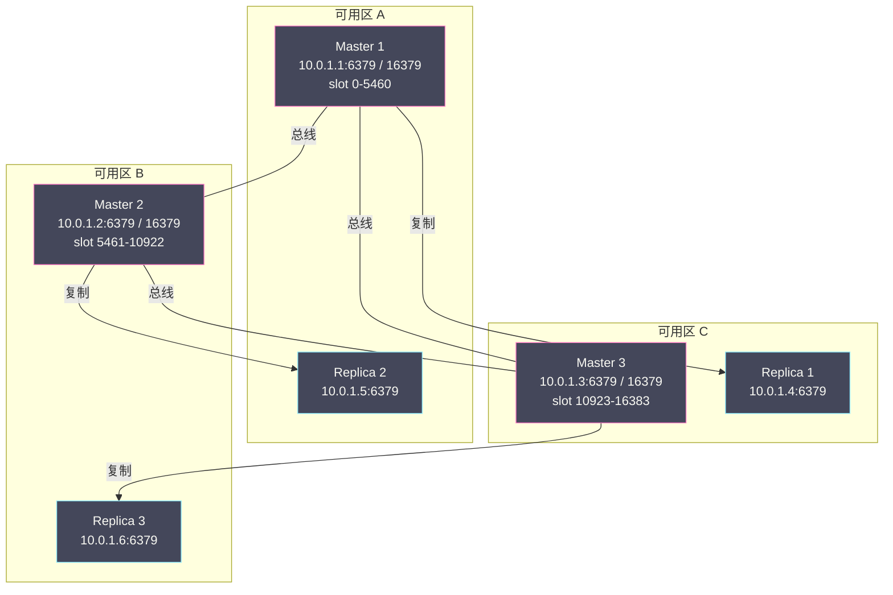
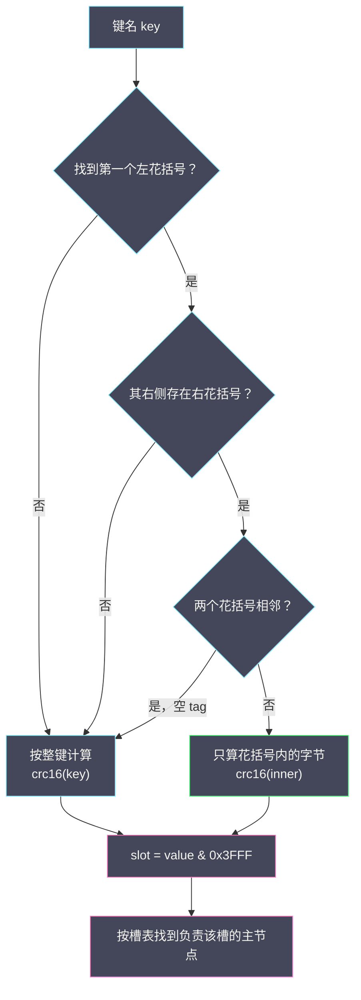
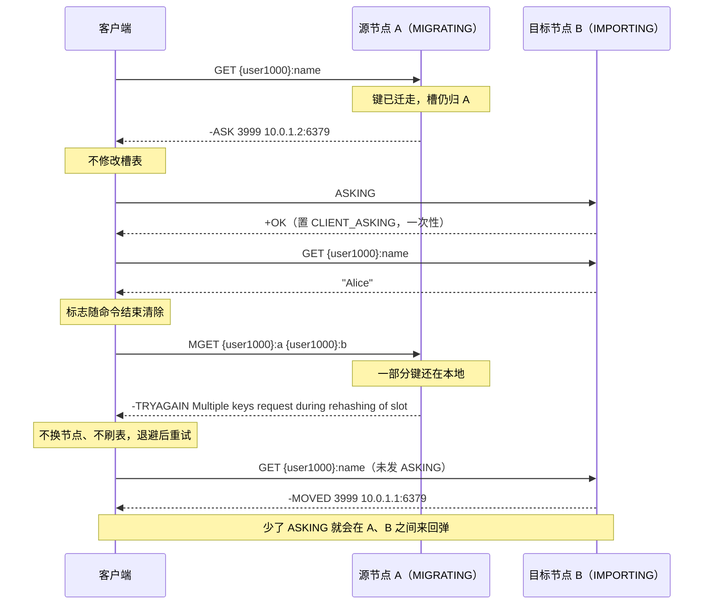
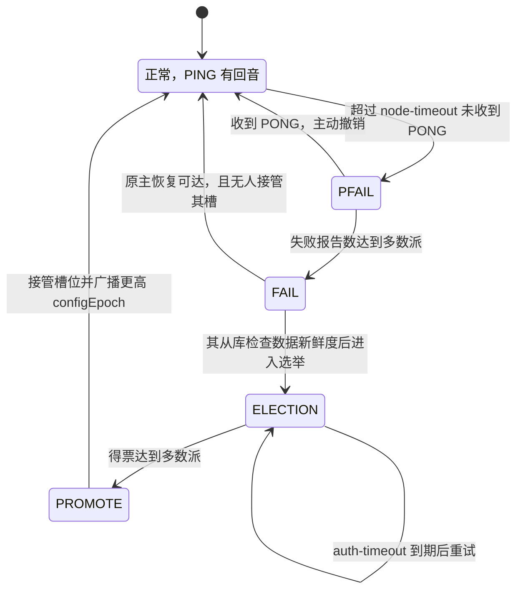
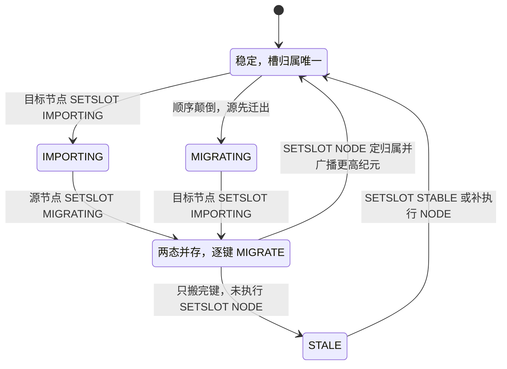

# 10 Redis Cluster 分布式架构

**摘要：**

一台机器装不下数据时，把数据切开只是第一步，真正的难题是切开之后随之而来的三个问题：键该落在哪台机器、客户端怎么知道去哪里问、某台机器消失之后它负责的那部分数据由谁接手。Redis Cluster 用 16384 个哈希槽同时回答这三问，付出的代价并不在"能不能用"，而在"用起来以后哪些原本免费的东西开始收费"。本文按分片、重定向与故障转移三条线把它们逐一结算：槽的数量为什么止步于 16384 而不是 65536，这笔账要算到心跳报文的字节数上；键到槽的映射为什么是 `crc16(key) & 0x3FFF`，以及花括号 hash tag 成为跨键命令唯一合法通道的原因与代价；MOVED 与 ASK 的区别为什么不是"永久"与"临时"两个词，而是"客户端缓存该不该改"这一个动作，以及 `ASKING` 这条一次性命令为何不能省；集群总线上的二进制报文如何用全量位图与十分之一节点的 gossip 段换取收敛，节点数增加时带宽如何随之抬升；主观下线到客观下线再到从库投票的判据链，以及 `cluster-node-timeout` 与 `cluster-replica-validity-factor` 如何把恢复时间与误判概率绑在一起互相交换。后半部分进入边界：为什么集群只留 db 0，跨槽操作的四条出路各自的代价，`MIGRATE` 的阻塞本质与三态迁移的读写行为，`cluster-require-full-coverage` 如何把一个节点的故障放大成整个集群的拒绝服务。落点是一句不太讨喜的结论：Cluster 没有消除复杂性，它把复杂性从运维手里搬到了客户端实现与数据建模上，谁承担了这部分工作，谁才真正拿到了横向扩展。

---

## 第 1 章 分片要回答的三个问题

### 1.1 一台机器装不下之后

Redis 的容量上限有两层，混在一起谈容易得出错误的结论。第一层是内存：单实例能装多少，取决于物理内存与必须留出的余量。一台 128GB 的机器如果真装 120GB 数据，[[07 RDB 持久化——快照的 fork 与 COW 机制|BGSAVE 的 fork 与写时复制]]会在快照时刻把内存推向峰值——子进程复制页表、父进程继续写入触发复制，两条曲线叠加，OOM killer 往往就在这个窗口动手。流传甚广的"单实例可用 10-15GB"不是硬件限制，而是把 fork 峰值、分配器碎片、从库输出缓冲、客户端缓冲都算进去之后的经验留量（量级判断），它随写入模式剧烈浮动：一主三从、每秒上万次写入的实例，这个数字要比读多写少的实例保守得多。

第二层是吞吐。[[05 单线程模型与事件驱动架构|单线程事件循环]]把一条命令的处理压进微秒级，十万到三十万 QPS 是常见区间；6.0 之后的多线程 IO 抬高了网络收发一侧的上限，却没有改变"命令在单线程里串行执行"这个事实，所以复杂命令、大 value、慢脚本带来的尾延迟依旧无法靠加核解决。

两层上限指向同一个动作：把数据切开。但切开之后立刻有三个问题等在前头——一个键该落在哪台机器、客户端怎么知道该去问谁、某台机器挂掉之后它负责的那部分数据由谁接手。这三个问题分别是**分片**（sharding）、**路由**（routing）与**故障转移**（failover），任何一套分布式缓存方案都绕不开，区别只在于把它们交给谁去解决。

### 1.2 三种分片方案的账本

客户端分片把三件事全塞进应用：自己算散列、自己维护节点列表、自己感知节点故障。它的链路最短，没有中间环节，实现也最直白；代价是扩缩容要发版，故障转移要应用自己写，多语言栈意味着同一套逻辑要在三四种语言里各实现一遍并保持行为一致——这类"逻辑正确性靠复制"的设计，出问题时往往表现为只有某个语言的客户端在特定边界上路由错。

代理分片（Twemproxy、Codis 那一路）把分片逻辑收进中间层，客户端连代理、代理算槽再转发。好处是应用无感，坏处是链路多一跳、代理自身成为吞吐瓶颈与单点，跨分片的命令仍要在代理里拆包再聚合，而"代理集群"本身还要再配一套高可用。

Redis Cluster 把三件事内建进服务端：槽的归属由节点自己协商，重定向由节点直接回给客户端，故障转移由从库投票完成，不需要额外进程。代价落在另外三处——客户端必须实现 Cluster 协议（解析重定向、维护槽表、在重定向后重放请求），跨键操作被槽的边界约束，运维要重新学习一整套命令与状态机。

| 维度 | 客户端分片 | 代理分片 | Redis Cluster |
| :--- | :--- | :--- | :--- |
| 路由知识存放 | 应用代码 | 代理内存 | 节点元数据 + 客户端缓存 |
| 扩容代价 | 改配置并发版，通常要停写迁数据 | 改代理配置，仍要迁数据 | `CLUSTER SETSLOT` 加 `MIGRATE`，在线完成 |
| 故障转移 | 应用自己实现 | 代理层实现或外部组件 | 从库投票，节点自愈 |
| 额外组件 | 无 | 代理集群及其高可用 | 无 |
| 跨键操作 | 应用自己拼 | 代理拆包聚合 | 要求同槽，否则 `CROSSSLOT` |
| 主要失效模式 | 多语言客户端版本不一致导致路由错乱 | 代理单点、转发延迟、代理内存成为新上限 | 客户端实现缺陷、槽表陈旧、迁移期抖动 |

### 1.3 三条主线与版本口径

下面按三件事分别算账：第 2 到第 3 章讲分片（槽是什么、为什么是 16384、键怎么落到槽上），第 4 到第 6 章讲路由与节点通信（MOVED、ASK、集群总线），第 7 章讲故障转移，第 8 到第 10 章讲这些机制共同划出的边界（多键、迁移、可用性开关）与运维读法。版本口径以 Redis 7.x 与 8.x 为准，机制描述对着源码 `src/cluster_legacy.c`、`src/cluster.c`、`src/cluster.h` 核过，配置默认值取 7.4 的 `redis.conf` 模板，8.4 引入的原子槽迁移单独放在 9.5 节。2024 年从 Redis 7.2.4 分叉出去的 Valkey 沿用了同一套槽模型与命令语义，本文对两者都成立，差异只在版本特性是否具备。

---

## 第 2 章 槽位：16384 的取舍

### 2.1 槽不是存储单位，是分配与迁移的计量单位

Cluster 把键空间切成 16384 份，每一份是一个哈希槽（hash slot），编号 0 到 16383。槽本身不存任何数据，它只是一段键空间的编号；数据仍然以键为单位躺在某个节点的字典里，键的槽号决定了它允许出现在哪个节点上。

这个抽象的价值在于把"数据分布"从键上升到槽：集群元数据只需要记录 16384 个槽各归谁，不需要记录每个键在哪里。三个主节点的集群，元数据是三条区间；一百个主节点，元数据是一百条区间；存 1GB 还是存 1TB，这份元数据的大小与传播代价都不变。槽的另一重身份是迁移单位：扩容时搬的是槽，`CLUSTER SETSLOT` 的操作对象也是槽。两个身份叠在一起，就产生了后文反复出现的现象——槽的粒度决定分布均匀度与迁移次数，槽内键的数量决定一次迁移要搬多少东西、要花多久。

### 2.2 为什么不是 65536

CRC16 的输出是 16 位，天然覆盖 0 到 65535。既然散列值本来就有 65536 种，为什么只取低 14 位、把范围压到 16384？这个问题在 2015 年被提交到 Redis 仓库，antirez 的回答留在 issue 2576 里，原文两段：

> Normal heartbeat packets carry the full configuration of a node, that can be replaced in an idempotent way with the old in order to update an old config. This means they contain the slots configuration for a node, in raw form, that uses 2k of space with 16k slots, but would use a prohibitive 8k of space using 65k slots.

> At the same time it is unlikely that Redis Cluster would scale to more than 1000 master nodes because of other design tradeoffs. So 16k was in the right range to ensure enough slots per master with a max of 1000 masters, but a small enough number to propagate the slot configuration as a raw bitmap easily. Note that in small clusters the bitmap would be hard to compress because when N is small the bitmap would have slots/N bits set that is a large percentage of bits set.

转述成三句：心跳报文承载的是节点的完整槽位配置，而且是**幂等替换**式的——收到就整份覆盖，不做增量、不做版本比对，所以必须带全量位图，16384 个槽是 16384 位即 2KB，65536 个槽是 8KB；集群的设计目标上限约一千个主节点，16384 分给一千个主节点平均每个 16 个槽，仍能表达"这个节点多分一点、那个少分一点"的差异；小集群的位图几乎无法压缩，因为设位比例太高——三个主节点时每个节点持有约三分之一的槽，三分之一的位置是 1，压缩算法拿不到便宜，所以"位图太大就压缩"这条路在设计阶段就被排除了。

| 槽数 | 位图大小 | 1000 主节点时每节点平均槽数 | 16 主节点时每节点平均槽数 |
| :--- | :--- | :--- | :--- |
| 16384（2^14） | 2 KB | 16 | 1024 |
| 65536（2^16） | 8 KB | 65 | 4096 |

表里的字节数与集群规模无关，它是一个"每个心跳包都必须携带"的固定项。这一点决定了它的放大效应不能只看单包：后文 6.4 节会把节点数放进去一起算，结论会比"多了 6KB"更具体。

### 2.3 位图在报文里的位置

集群总线的报文结构定义在 `cluster_legacy.h`：`clusterMsg` 头部以四字节签名 `RCmb` 开头，随后是总长度、协议版本（当前为 1）、端口、报文类型、`currentEpoch`、`configEpoch`、复制偏移量、发送者 40 字节节点 ID，接着就是 `unsigned char myslots[CLUSTER_SLOTS/8]` 这 2048 字节的位图，再往后是 `slaveof`、`myip`、若干端口与标志位，最后是变长的 gossip 段。为了在滚动升级期间保证新旧版本能互读同一份报文，字段偏移被 `static_assert` 钉死，例如 `offsetof(clusterMsg, myslots) == 80`。

一条最小心跳的固定开销因此是 2256 字节的头部，位图占了九成；剩下的 gossip 段按 6.2 节的规则携带若干邻居信息。这也解释了"16384 还是 65536"为什么值得作者亲自回答：位图**不是可选字段**，而是每条 PING、PONG、MEET 都必须带上的全量配置，改槽数等于改整条总线的基准带宽。

### 2.4 槽的分配：从 MEET 到 ADDSLOTS

新节点加入集群的入口是 `CLUSTER MEET <ip> <port> [bus-port]`：发起方向目标节点发 MEET，目标节点若不认识对方，先把它记成握手节点并回一条 PONG，双方再靠后续 PING/PONG 报文里的节点 ID 与地址把彼此补全，握手结束才算正式入表；此后的拓扑靠心跳自然扩散，不需要对每个节点重复 MEET。刚握手的节点是一个"没有槽的空主节点"，它知道集群里有谁，但不承担任何键。

把槽判给节点有四条路径。`CLUSTER ADDSLOTS` 一次给若干离散槽（3.0 起），`CLUSTER ADDSLOTSRANGE` 一次给一段区间（7.0 起，建集群时省事得多）；`CLUSTER SETSLOT <slot> NODE <id>` 直接把槽判给指定节点，通常用于迁移收尾；`CLUSTER SET-CONFIG-EPOCH` 在建集群阶段手动指定各主节点的配置纪元，避免大家从 0 开始撞车。`redis-cli --cluster create` 并没有做什么魔法，它只是把 MEET、SET-CONFIG-EPOCH、ADDSLOTS 与从库的 `CLUSTER REPLICATE` 编排成一串命令。

三个主节点各带一个从库、从库与主库分处不同可用区时，槽区间与拓扑的对应关系大致如下。图里只画了主节点之间的三条总线，实际是每个节点与其余每个节点都有一条连接。



这种摆放的含义是：任一可用区整体失联，只会带走该区内的节点，而每个分片的两个成员必有一半在别的区，于是没有任何分片同时失去主与从。以 A 区失联为例，消失的是一台主库（Master 1）与另一台主的从库（Replica 2）：前者的从库在 C 区接任，后者的主库在 B 区独撑一段时间，直到运维补上新副本。三个可用区、每区一主一从、且主从不同区，是三副本结构下"单区故障不丢数据"的最低配置；只有两个可用区时，六个节点无论怎么摆，总有一个区同时装着某个分片的主与另一个分片的从，失去整区必然让那个分片的主从一起消失。

值得单独说明的是集群配置的持久化位置：槽归属与 `configEpoch` 写在 `cluster-config-file`（默认 `nodes-6379.conf`）里，不在 RDB 与 AOF 中。节点重启后靠这个文件恢复"我记得哪些槽归我"。这条设计带来两种典型事故：文件被删而数据还在，重启的节点就成了空主节点，需要重新分槽；文件与数据版本不一致（用旧备份回滚了整机），节点会带着过期的槽表给客户端回 MOVED，把流量引向一个错误的地址。因此备份集群时，`nodes.conf` 与 RDB 必须成对取值。

### 2.5 槽数的元数据账

16384 这笔账要记两处。第一处在 `clusterState` 里：`clusterNode *slots[16384]` 指针数组，每个节点 128KB，记录每一个槽的归属。第二处在 7.0 之后的键空间结构里：7.0 把"槽到键的映射"从一棵 rax 换成把每个 db 的字典按槽切成 16384 个桶（`kvstore`），cluster 模式下桶数取 2^14，`dicts` 数组是 16384 个指针，又是 128KB，而非 cluster 模式下只有一个桶；真正有键的桶再懒分配一个 dict 头，每个一百多字节。

所以 cluster 模式对内存的**空壳税**是每节点每 db 约 128KB 指针数组，加上非空槽的 dict 头；keys 与 expires 两个键空间各算一份，后者只在有 TTL 时才有键。若 16384 个槽全部有键，dict 头合计约 1.5MB 量级（示例推算，按每个 dict 头 96 字节计），相比它换来的能力不值一提——按槽取键、按槽删除、按槽统计在 7.0 之后都是按桶直接定位，而 7.0 之前 `CLUSTER GETKEYSINSLOT` 要遍历整棵 rax，是 O(N)，槽内键越多越慢。这条改动对迁移工具的意义很实际：`redis-cli --cluster reshard` 的取键循环从"全量扫描"变成了"按槽取值"。

---

## 第 3 章 键到槽：CRC16 与花括号

### 3.1 一次按位与，而不是取模

文档写的公式是 `slot = CRC16(key) mod 16384`，源码里写的是 `crc16(key,keylen) & 0x3FFF`。16384 是 2 的 14 次方，取模等价于截取低 14 位，用掩码省掉了除法，也不必担心负数取模的语言差异。CRC16 用的是 CRC-16/CCITT 变体，多项式 0x1021，实现是一张 256 项的表，对短 key 是十几个周期的开销。

7.x 之后这次计算还多了一层缓存：`getKeySlot()` 优先复用客户端结构里已经算好的槽号——命令执行前路由阶段已经算过一次，键空间查找时不必再算；只有"并非用户请求的键"（例如淘汰、过期清理）才走 `calculateKeySlot()` 重算。这类细节对单条命令是纳秒级收益，但在百万 QPS 的集群里，它省下的是每条命令一次查表。

### 3.2 hash tag 的四条分支

`keyHashSlot()` 只有十几行，四个返回点穷尽了所有情况：从前往后找第一个 `{`，找不到则以整键计算；找到 `{` 之后从它后面找第一个 `}`，找不到仍以整键计算；`}` 紧跟在 `{` 之后即中间为空，还是以整键计算；其余情况只对两个花括号之间的字节计算 CRC16。

由此得到三个必须记住的推论。只有第一对花括号有效，`user:{1001}:{name}` 的 tag 是 `1001`，后面那对是字面量；空花括号不构成 tag，`{}user:1` 与 `user:{}1` 都按整键散列，这一条容易被忽略：客户端若把 `{}` 当成 tag 传给服务端，算出来的槽与不带花括号完全一样；花括号不做嵌套解析，`{{a}}` 的 tag 是 `{a}`，其中还带着一个左花括号，算出来的槽同样稳定但不必指望它有什么语义。

### 3.3 为什么它是唯一能让多键命令工作的手段

`MGET`、`SUNION`、`MULTI`、Lua 脚本要求的不是"键在同一台机器上"这么含糊的条件，而是"一次执行里涉及的所有键必须落在同一个哈希槽"。服务端在 `getNodeByQuery()` 里把这条检查做成了**硬拒绝**：逐个算出槽号，一旦不一致就返回 `CLUSTER_REDIR_CROSS_SLOT`，客户端看到的是 `-CROSSSLOT Keys in request don't hash to the same slot`。

要让 `{user1000}.following` 与 `{user1000}.followers` 这两个集合能被 `SUNION` 或 `SINTERSTORE` 一次算出来，合法途径只有一条：让它们算出同一个槽，也就是共用同一段花括号内容。Redis 的集群规范正是拿这对键做例子，因为它是"关注关系求交、求并"的最小模型，而这类操作在实际业务里对应的是"共同关注""推荐候选"这类无法拆成单键请求的查询。

换个角度看得更清楚：客户端分片与代理也能返回"跨节点的 MGET 合并结果"，但那已经换了一套语义——多次往返、没有原子性、读到的不是同一时刻的快照、失败时部分成功。hash tag 保留的仍然是"一条命令在一个节点上执行"，这是 MULTI 与 Lua 能成立的前提，也是 Cluster 里不需要引入任何分布式协调就能拿到跨键原子性的唯一手段。代价前移到建模阶段：键名怎么拼，从设计之初就决定了哪些操作是可能的。



### 3.4 花括号的代价：倾斜、热点与大槽

tag 把键的分布从"按 key 散列"退化成"按 tag 散列"：tag 的种类数才是实际的分片数。每个用户一个 tag（`{user:1000}`）时分布仍然均匀，因为用户数量远大于槽数；用少量业务维度做 tag（`{type:order}`、`{region:bj}`）时，所有同类型的键挤进一个槽、一个主节点，集群退化为单机，而这个节点的故障会让整类业务同时不可用——hash tag 把数据绑在一起的同时，也把故障域绑在了一起。

更隐蔽的问题在大槽上。迁移的单位是槽，但槽内的键只能逐个搬（9.2 节的 `MIGRATE`），一个装着数百万键的槽在迁移时会长时间停在两态，客户端持续吃到 ASK 与 TRYAGAIN；而且槽是迁移的最小单位，槽再热也不能对半切开，只能等它整体搬完。这就是"用 tag 换原子性"的完整价目表：拿到了跨键操作，付出了倾斜风险、热点风险与迁移刚性。

| 键写法 | 参与散列的部分 | 结果 |
| :--- | :--- | :--- |
| `user:1000:name` | 整键 | 与 `user:1000:age` 大概率不同槽，`MGET` 直接 `CROSSSLOT` |
| `{user1000}.following` | `user1000` | 与 `{user1000}.followers` 同槽，可 `SUNION`、可 MULTI |
| `user:{1000}:name` | `1000` | 同 `user:{1000}:age` 同槽，tag 在中间同样生效 |
| `user:{}name` | 整键 | 空 tag 不生效，与不带花括号等价 |
| `{{user1000}}:x` | `{user1000` | 只有第一对花括号生效，tag 内含左花括号 |

---

## 第 4 章 MOVED：把路由表推给客户端

### 4.1 一条错误回复的语义

客户端可以连集群中的任意节点发命令。若键所在的槽不归当前节点，节点回一条错误回复：`-MOVED 3999 10.0.1.2:6379`。第一个数字是槽号，之后是目标地址；它以 `-` 开头，在协议层是错误，客户端库按前缀识别后并不把它当失败上报。语义是：该槽已经永久归目标节点，请更新本地路由表，并把请求重发过去。

"永久"两个字是相对 ASK 而言的，它的真实含义是"从我掌握的配置看，这个归属已经落定，不再是迁移中间态"。客户端收到之后可以放心地改缓存，因为服务端不会在两个节点之间来回改主意——槽的归属由 `configEpoch` 排序决定，同一时刻只有一个节点能对某个槽声称更高的纪元。

### 4.2 路由表从哪里来，什么时候过期

成熟客户端在建立连接时执行一次 `CLUSTER SLOTS`（3.0 起）或 `CLUSTER SHARDS`（7.0 起）拿全量槽表：前者返回 `[起始槽, 结束槽, [ip, port, 节点 id], ...]` 的区间数组，后者按分片组织，把主从与健康状态一起给出。缓存之后，绝大多数命令按本地表直接发往正确节点，重定向只在配置变化后的短暂窗口里出现。

**槽表的陈旧期**等于"配置变更发生"到"客户端收到第一个 MOVED"之间的时间。这段时间里所有打到旧节点的请求都是先发错再改正，每条多一个往返。所以重定向率不是一个独立指标，它是"集群变更频率 × 客户端表刷新策略"的乘积：滚动重启、扩缩容、failover 都会制造一段集中重定向，其余时间它应当接近零。**重定向率长期不为零**，说明槽表在反复变化或者客户端根本没缓存。

### 4.3 MOVED 的真实成本

第一笔成本是一个额外往返。单条命令多一跳在毫秒级延迟里占比不大，但对 P99 敏感的场景，这一跳经常正好落在超时阈值附近。

第二笔成本在 pipeline 上。批量命令里若有一条命中已迁移的槽，服务端在这一条上回 MOVED，后续命令照常执行但客户端拿到的是"部分成功"。客户端要么整批重放（可能让非幂等命令执行两次），要么逐条判定后只重发失败项。这是 Cluster 客户端实现里最容易出 bug 的地方，也是"用 pipeline 提升吞吐"和"用集群换取容量"这两个诉求互相摩擦的地方。

第三笔成本是重定向风暴。一次 failover 会让新主接管原主的全部槽，所有客户端手里的表同时过期，同一瞬间它们都在向旧节点发请求、收 MOVED、刷新表；如果刷新策略是"每次 MOVED 都拉一次 `CLUSTER SLOTS`"，这条命令会成为集群里最热的查询。成熟客户端通常做局部更新：MOVED 里已经带了槽号与目标地址，直接把该槽的行改掉，全量刷新按时间窗限流。

### 4.4 客户端的三个常见实现缺陷

第一种是把 MOVED 当普通错误，退避后重试同一个节点——服务端每次都会回同样的 MOVED，重试次数耗尽后抛错，看起来像"集群不稳"，实际是客户端从未跟随重定向。`redis-cli` 需要 `-c` 参数才跟随重定向，不加 `-c` 时它老老实实把 MOVED 当错误打印出来，这个行为常被误判成集群故障。

第二种是把 MOVED 与 ASK 一视同仁，都去改槽表。迁移期间的 ASK 一旦被写进缓存，客户端就会把槽永久指向目标节点，等 `SETSLOT NODE` 撤销或迁回时，整片流量全部错位。

第三种是只在建连时取一次槽表。长时间存活的连接池在集群变更后全部指向旧节点，理论上 MOVED 能纠正，但如果客户端把重定向计入错误率并触发熔断，就变成"路由本来能自愈、业务先被熔断掉"。

---

## 第 5 章 ASK：迁移中的一次临时问路

### 5.1 一个槽同时存在两个主人

迁移窗口内，槽的归属在服务端被拆成两个数组：源节点的 `migrating_slots_to[slot]` 记录"这个槽我要搬去 B"，目标节点的 `importing_slots_from[slot]` 记录"这个槽我要从 A 搬来"。两个数组都只在迁移期间非空，`CLUSTER SETSLOT <slot> NODE <id>` 落定之后被清空，槽回到稳定态。这段窗口里，槽的键一部分在源、一部分在目标，"槽归谁"这个问题没有唯一答案，只能退化为"这个键现在在谁那里"。

### 5.2 判定顺序：源码里的四个分支

`getNodeByQuery()` 在迁移或导入状态下，对请求涉及的每个键做一次只读查找（`LOOKUP_NOTOUCH|LOOKUP_NOSTATS|LOOKUP_NONOTIFY|LOOKUP_NOEXPIRE`，不更新 LRU、不触发过期删除），统计"本地有"与"本地没有"的键数，然后按四种组合回答：

- 源节点（处于 MIGRATING）：部分键已在目标、部分还在本地，回 `TRYAGAIN`；全部键都已迁走，回 `ASK` 指向目标；全部在本地，就地执行。
- 目标节点（处于 IMPORTING）：客户端带了 `ASKING` 标志就就地执行；多键请求且本地缺键，回 `TRYAGAIN`；没带 ASKING，回 `MOVED` 把客户端弹回源节点。

上面这些组合的共同点在于：迁移期间的判定是**逐键**的，而一条多键命令只能得到一个答复，于是"部分迁移"必然以 `TRYAGAIN` 收场。这也解释了为什么迁移期间的 MGET 会间歇性失败——它不是 bug，而是"多键请求要求槽稳定"这条规则在迁移窗口里的必然结果。

### 5.3 ASKING 为什么必须存在

目标节点此刻并没有这个槽的归属，按常规逻辑它应当回 MOVED 让客户端回源。若客户端真的照做，就会形成 ASK → MOVED → ASK 的循环：源说"去问 B"，B 说"去问 A"，请求永远落不了地。`ASKING` 就是打断这个循环的那句话：告知目标节点"我知道这个槽还没正式给我，这一条命令请就地执行"。

它的实现极简——`askingCommand()` 只是给客户端结构打上 `CLIENT_ASKING` 标志，回 `+OK`；真正的语义由"标志何时被清除"定义。命令执行完毕后的清理逻辑是：不在 MULTI 事务内、且刚执行的不是 `ASKING` 本身，就清掉这个标志。所以它严格只对下一条命令有效，事务内则持续到 `EXEC` 结束，让事务里的每条命令都能被目标节点接受。

这条**一次性**特性带来一个非常具体的坑：ASKING 之后若插入任何其他命令（哪怕是一条 `PING` 或客户端自己的探活），标志就被消耗掉了，紧随其后的真实命令会收到 MOVED。因此客户端必须保证 ASK 重定向之后，`ASKING` 与真实命令在同一连接上连续发送，中间不插入任何东西；连接池实现若在中间做了可观测性埋点，就会踩中这个坑。

### 5.4 TRYAGAIN：第三种答案

迁移期间还存在第三种回复：`-TRYAGAIN Multiple keys request during rehashing of slot`。它出现在"多键请求、槽处于迁移中、本地缺了一部分键"的分支上，含义是"这个请求现在没有确定的答案，请稍后重试"。

处理方式与 MOVED、ASK 都不同：不能换节点，也不能刷槽表，只能在原节点上短暂延迟后重试。重试间隔要给迁移留出推进的时间，退避到几十毫秒量级比较常见；用固定间隔原地重试会变成对源节点的压力，恰好拖慢正在进行的迁移。8.x 还引入了一个同族错误 `-TRYAGAIN Slot is being trimmed`，出现在按槽裁剪（`TRIMSLOTS`）期间，处理逻辑相同。

### 5.5 MOVED 与 ASK 的对照

两者的差别不是措辞，而是客户端动作完全不同。这也是判断一个客户端实现是否合格的第一道门槛：它是否区分了这两条错误。

| 维度 | MOVED | ASK |
| :--- | :--- | :--- |
| 触发条件 | 槽已永久归属其他节点（稳定态） | 槽正在迁移，且请求的键已不在源节点 |
| 语义 | 更新路由表，此后都去新节点 | 仅这一次去目标节点，路由不变 |
| 客户端缓存动作 | 修改该槽的映射 | 不得修改任何缓存 |
| 目标节点前置动作 | 无需 | 必须先发 `ASKING` |
| 生命周期 | 持久，直到下次配置变更 | 一次性，迁移结束自动消失 |
| 迁移完成后 | 仍然是 MOVED | 消失，源节点改回 MOVED |
| 错误文本 | `-MOVED 3999 10.0.1.2:6379` | `-ASK 3999 10.0.1.2:6379` |



---

## 第 6 章 集群总线：gossip 的带宽账

### 6.1 独立端口与没有认证的入口

集群节点之间的通信走一条独立的 TCP 通道，叫集群总线（cluster bus）。`cluster-port 0` 表示绑定在命令端口加 10000 上，6379 对应 16379；显式设置该参数后，执行 `CLUSTER MEET` 时必须额外带上总线端口，否则握手连不上。总线上跑的不是 RESP，而是私有二进制协议：签名 `RCmb`，协议版本 1，字段偏移用静态断言锁死，保证滚动升级期间新旧版本能互读同一份报文。

这条通道长期是个安全盲点，8.2 起的配置模板里终于写明白了：集群总线没有自己的认证，任何能连到该端口的主机都能说集群协议，一个来自未知主机的 MEET 就足以让它被加入集群、它携带的 gossip 被信任；能给总线提供认证的是 `tls-cluster yes`，且与客户端口的 `tls-auth-clients` 无关，总线始终要求对端证书。正因如此，8.2 起节点在总线端口没有认证时会拒绝启动，除非显式设置 `cluster-bus-port-protected-mode no` 豁免（默认 yes，模板里给出的正是关闭它的示例）。对任何要上线的集群，这条比应用层加固都直接：用防火墙把总线端口限制在集群成员之间，别让它暴露在业务网段。

### 6.2 一条心跳报文的解剖

PING、PONG、MEET 三种报文的结构相同，区别只在语义：MEET 是"第一次 PING"，PONG 是对 PING 的应答。固定的头部之后是 gossip 段，每一项是一个 `clusterMsgDataGossip`，104 字节：目标节点 40 字节 ID、`ping_sent` 与 `pong_received` 各 4 字节、46 字节 IP、主端口与总线端口各 2 字节、标志位 2 字节、备用端口 2 字节、保留位 2 字节，合计 104 字节。

携带多少项由节点数决定：`floor(节点数 / 10)`，最少 3 项，上限是"除自己和接收方之外的节点数"；处于 PFAIL 的节点会被优先塞进 gossip 段，因为"我怀疑它挂了"这条信息比"某个正常节点还活着"更值得传播。于是每条心跳的信息量是两层：一层是本节点的**全量槽位图**（幂等、必带，2048 字节），一层是**随机抽样的邻居状态**（增量、尽力而为，按十分之一取样、最少三项）。前一层保证整个集群最终收敛到同一份槽表，后一层只负责让收敛快一点。


### 6.3 心跳的节奏

`clusterCron()` 每 100 毫秒跑一次，心跳由两套规则驱动。第一套是"每秒随机打一次"：每十次 cron（即一秒）从节点表里随机取五个候选，挑其中 `pong_received` 最旧的那个发 PING，意在让"最久没被问候"的邻居优先被补上。第二套是兜底：若某节点的上次 PONG 距今超过 `cluster-node-timeout / 2`（默认 7.5 秒）且当前没有在途 PING，立刻补发；若链路在 timeout/2 内既没有 PING 回音也没有任何数据往来，直接断开重连。

两套规则合起来的效果是：任意两个节点之间，**至少每 timeout/2** 就有一次往返回合。这个"至少"是后文所有检测时间的基准——PFAIL 的判定条件是"发过 PING 且距今超过 `cluster-node-timeout`"，而两次正常心跳的间隔是 timeout/2，于是从一个 PING 发出到它被判超时又要再等一个 timeout；把这两段叠起来，故障从发生到被某个邻居标成 PFAIL，落在一个 timeout 到一个半 timeout 之间，具体落在哪一端取决于故障恰好卡在两次心跳之间的哪个位置。

### 6.4 节点数与流量的算术

单条心跳的字节数 = 2256 + gossip 项数 × 104。按 6.3 的节奏，每个节点每秒发出的心跳次数约为 `(N-1) / (timeout/2) + 1`，N 是节点总数（含从节点，因为从节点之间也互相 PING）。据此可以把不同规模的数量级摆出来，全部按默认 `cluster-node-timeout 15000` 计算：

| 节点总数 | gossip 项数 | 单包字节 | 每节点每秒发包 | 每节点出向带宽 | 全集群双向流量 |
| :--- | :--- | :--- | :--- | :--- | :--- |
| 6（3 主 3 从） | 3 | 约 2.6 KB | 约 1.7 | 约 4.4 KB/s | 约 53 KB/s |
| 100（50 主 50 从） | 10 | 约 3.3 KB | 约 14 | 约 46 KB/s | 约 9 MB/s |
| 200 | 20 | 约 4.3 KB | 约 27 | 约 116 KB/s | 约 46 MB/s |
| 1000 | 100 | 约 12.7 KB | 约 134 | 约 1.7 MB/s | 约 3.4 GB/s |

表中数值为示例推算：包数按"每个邻居至少每 7.5 秒一次往返加每秒一次随机 PING"估算，全集群流量按"每节点出向 × 节点数 × 2（含应答）"估算，未计 TCP/IP 头与重传。结论有三层。其一，几十个节点的集群里 gossip 完全可以忽略，每节点不到 0.1 Mbps；其二，规模到一百节点量级，gossip 仍是带宽的零头，但节点两两之间各有一条 TCP 连接，200 个节点意味着近两万条长连接、每节点近 400 个 socket，文件描述符与连接缓冲开始进入容量规划；其三，一千个节点在设计上是上限而绝非运维目标，3.4 GB/s 的总量与五十万条连接的数量级，说明真实约束不是带宽而是连接数与元数据维护成本。

顺带把 16384 与 65536 的账补完：同样在 100 节点，位图从 2KB 涨到 8KB，单包从 3.3KB 变成 9.4KB，带宽约 2.9 倍；而在 1000 节点时单包只从 12.7KB 变成 18.8KB，约 1.5 倍，因为 gossip 段已经开始占大头。位图在报文中的占比随规模下降，**放大四倍的代价因此被摊薄**，这从另一个侧面印证了 16384 是在"小集群不吃亏、大集群不失控"之间的折中。

### 6.5 配置纪元：让状态可幂等收敛

每个主节点维护一个单调递增的 `configEpoch`，它标识"我这套槽位声明是第几版"。节点之间交换的是声明本身而不是变更日志，收到更新的声明就整份替换，这正是 antirez 说的"幂等替换"。

冲突的裁决规则只有一条：同一个槽被两个节点声明时，`configEpoch` 大的胜出，输的一方把该槽从自己的表里删掉，连同槽内已不归自己的键一起清理（`clusterDelKeysInSlot`）。failover 时新主把 `configEpoch` 设为选举用的 epoch，自然压过旧主；手工场景用 `CLUSTER BUMPEPOCH` 递增；建集群阶段用 `CLUSTER SET-CONFIG-EPOCH` 预先分配，避免所有节点从 0 开始互不相让。还有一条专门的 UPDATE 报文，用于把一个节点的槽表变更精确地推给对端，不必等心跳轮次。

---

## 第 7 章 故障转移：没有 Sentinel 的集群

### 7.1 从 PFAIL 到 FAIL

单个节点的判断叫主观下线（PFAIL）：A 给 B 发过 PING，在 `cluster-node-timeout` 内没等到 PONG，A 就在本地把 B 标成 `fail?`。这个状态只是"我认为"，不对外生效，也允许随后收到 PONG 就撤销。

要升级成客观下线（FAIL），需要**多数主节点的共识**。每个节点把收到的失败报告按来源记录在 `fail_reports` 里，每条带时间戳、超过 `timeout × 2` 就作废；`markNodeAsFailingIfNeeded()` 计算 `needed_quorum = cluster->size / 2 + 1`，其中 `size` 是"持有至少一个槽的主节点数"，如果自己是主节点则把自己的判断也算一票，票数够格就把对方标成 FAIL，并向全集群广播一条 FAIL 报文，收到 FAIL 的节点直接采信，不再自己判定。

撤销 FAIL 比标记更保守：节点重新可达后，若它是从节点或没有槽，立刻清掉 FAIL；若它是仍持有槽的主节点，还要等 `timeout × 2`（`CLUSTER_FAIL_UNDO_TIME_MULT` 为 2）才清，以防抖动的链路在两态之间反复横跳。



### 7.2 选举：数据新鲜度决定谁先说话

主节点被标 FAIL 之后，它的从库不会同时抢着参选，而是先过两道闸。

第一道是数据新鲜度。从库计算自己与主库失联的时长 `data_age`（在复制链路仍连着时用最后一次交互时间，断链时用断链时刻），先把 `cluster-node-timeout` 从里面扣掉——因为主库从"离线"到"被判 FAIL"本来就该花掉一个 timeout，这段时间的滞后不算从库的错。剩下的差值若超过 `repl-ping-replica-period × 1000 + cluster-node-timeout × cluster-replica-validity-factor`（默认系数 10），这个从库直接放弃自动 failover，并在日志里留下 `clusterLogCantFailover` 的相应原因。按默认值算，节点超时 15 秒、系数 10、复制心跳 10 秒，阈值是 160 秒；也就是说从库与主库失联超过约 160 秒，它的数据就被认为太旧，宁可让槽空着也不让旧数据上位。把系数设为 0 会关掉这道闸，从库无论落后多久都参选，这是"可用性优先"的极端配置，代价是分区愈合后可能出现数据回退。

第二道是排序延迟。从库之间互相交换复制偏移量，算出自己在该主库所有从库里的排名 `rank`（偏移量越大排名越靠前），然后把自己的选举时间推迟 `500 毫秒 + 随机 0~500 毫秒 + rank × 1000 毫秒`。排名第一的从库最先发难，等于让"数据最新的那个"拥有先手；排名靠后的从库只是在它失败时依次补位，避免所有从库同时拉票导致选票被摊薄。

拉票通过 `FAILOVER_AUTH_REQUEST` 报文广播，主节点收到后在自己记录的本轮选举纪元里只投一票，回 `FAILOVER_AUTH_ACK`；候选需要拿到 `size / 2 + 1` 票才算赢。投票窗口 `auth_timeout` 取 `max(2 × timeout, 2000)` 毫秒，超时未凑齐则以 `2 × auth_timeout` 的间隔重新发起一轮。赢了之后，新主把 `configEpoch` 设为选举纪元、接管原主全部槽位、通过 PONG 广播新配置；旧主若在之后恢复，会发现自己的槽已被更高纪元的声明接管，按规则降级为从节点。

### 7.3 少数派分区与集群状态

`clusterUpdateState()` 每次拓扑变动后重算集群状态，两个条件任一成立就把 `cluster_state` 置为 `fail`：一是开启了 `cluster-require-full-coverage` 且存在没有归属或归属节点处于 FAIL 的槽；二是能与自己通信的主节点数少于 `size / 2 + 1`。第二个条件意味着被网络分区切到少数派一侧的节点会主动停摆——它无法确认自己手里的槽是否已被另一侧接管，继续接受写入就会产生两个都认为自己合法的数据集。

恢复过程也有防抖：状态从 fail 转回 ok 时，主节点要等一个 `rejoin_delay`（取 `cluster-node-timeout`，并夹在 500 到 5000 毫秒之间）之后才重新接受流量，给配置更新留出传播时间。这一条经常被误读成"集群恢复慢"，实际上是故意的：刚愈合的分区两侧对槽归属的认识可能还差着一个 gossip 轮次。

### 7.4 手动切换的三档

`CLUSTER FAILOVER` 在从库上执行，三档语义完全不同。不带参数时先走 `MFSTART`：向主库请求暂停客户端写入，等自己的复制偏移追上主库，然后主库下线、从库接管——这是唯一能做到**零数据丢失**的切换路径，用于版本升级、宿主机维护这类计划内操作。带 `FORCE` 时不请求主库配合，直接参选，用于主库已经不可达但还没被判 FAIL 的场景，会有异步复制的丢失窗口。带 `TAKEOVER` 则连选举都跳过，直接接管槽位并把 `configEpoch` 推到最高，这是分区场景下的最后手段，用错会制造双主。

### 7.5 切换窗口的时间账

把默认参数代进去，一次自动切换的时间大致由四段构成：检测（一到一点五个 `cluster-node-timeout`，即 15 到 22 秒）、失败报告扩散（每个 gossip 轮次秒级，通常一到两轮）、排序延迟（0.5 到 1 秒，排名靠后的从库按秒递增）、投票（一个往返，毫秒级）。合计约 18 到 25 秒，客户端在这段时间里看到的先是超时，然后是 `CLUSTERDOWN`，最后收到 MOVED 回到新主。

把 `cluster-node-timeout` 调到 5 秒，检测段压到 5 到 7.5 秒，总窗口缩短到 7 到 10 秒；代价是同样的抖动更容易被判成 PFAIL——一次超过 5 秒的 GC 停顿、一次网络设备切换、一次宿主机快照，都可能让一个健康主库被判下线并触发无谓切换，而每次无谓切换都带着数据回退的风险（异步复制的丢失窗口与 [[09 主从复制与 Sentinel 高可用]] 里算过的完全同构）。所以这个参数的调整方向不该由"想多快恢复"决定，而应由"业务能等多长、链路抖动多大"两头夹出来，并且必须与 `cluster-replica-validity-factor` 一起改——检测窗口缩短之后，如果新鲜度系数不变，从库可容忍的失联时长也随之腰斩。

---

## 第 8 章 只支持 db 0，以及跨槽的边界

### 8.1 为什么只剩一个库

集群模式下 `SELECT 1` 会直接报错：`SELECT is not allowed in cluster mode`。原因不是实现偷懒，而是 db 编号与分片空间在语义上正交冲突。

槽空间是一维的 16384 份，db 是另一维的十六份。若两者同时存在，分片单元就变成 16384 × 16，所有围绕槽的操作都要额外带 db 号：`CLUSTER GETKEYSINSLOT` 要问"哪个库的槽"，迁移要逐库进行，同一个槽在不同库里的键集互不相干，"键的唯一性"也要从 `key` 变成 `(db, key)`。更要紧的是 Cluster 的定位——它把整个集群当成一个逻辑数据集，客户端连上来就该看到同一份命名空间；保留多库只会让"这个 key 在不在"这种最基本的问题多一个维度，而收益仅仅是"同一实例内做业务隔离"，这件事本来该用不同集群或 key 前缀解决。

### 8.2 CROSSSLOT 的判定与受影响的命令

`getKeysFromCommand()` 先把命令的所有键收集出来（含 Lua 的 `KEYS`、事务中累积的键、`XREAD` 的多 stream 等），逐个算槽，只要出现两个不同的槽就返回 `CLUSTER_REDIR_CROSS_SLOT`。受影响的远不止 MGET：`MSET`、`MSETNX`、`SUNION`、`SINTER`、`SDIFF` 及其 STORE 变体、`SMOVE`、`RENAME`、`COPY`、`PFCOUNT` 的多键形式、`BITOP`、`ZUNIONSTORE` 的多键形式、多键 `EVAL`、事务里跨槽的 `MULTI`，以及跨 stream 的 `XREAD`，全都在内。单个键的命令、以及键名重复出现的命令（例如 `RPOPLPUSH mylist mylist`）不受影响——后者只算出一个槽，属于同槽的合法情形。

### 8.3 跨槽操作的四种解法

| 解法 | 做法 | 保留的语义 | 代价 | 适用场景 |
| :--- | :--- | :--- | :--- | :--- |
| hash tag | 键名共用同一段 `{...}` | 单命令原子性、MULTI、Lua 全部保留 | 倾斜与热点、故障域绑定、大槽迁移刚性 | 同一实体的多个键需要一起读写 |
| 客户端拆分聚合 | 拆成多条单键命令，在应用内合并 | 无原子性，读到的可能不是同一时刻的快照 | 往返次数线性增长、失败时部分成功 | 批量读、对一致性要求宽松 |
| Lua 或 Function | 脚本内只操作同槽的键 | 脚本级原子 | 受同槽限制，脚本内不能跨槽 | 同槽内的多步逻辑合并成一次往返 |
| 业务模型改造 | 把需要一起读的字段合成一个 Hash 或一个 JSON | 天然单键 | 需要重构数据模型，单键可能变大 | 多键需求本身就是建模问题的场景 |

四条路的排序值得说明：hash tag 与业务模型改造都能保留语义，前者把约束加在键名上，后者把约束加在结构上；客户端拆分与 Lua 都是在"放弃一部分语义"的前提下换取灵活。工程上还有第五种做法——在应用与集群之间放一层代理做聚合——但那本质上等于把方案二搬到中间件里，延迟与部分成功的问题只是换了个位置。

### 8.4 那些只在单节点生效的命令

`KEYS`、`SCAN`、`DBSIZE`、`RANDOMKEY`、`FLUSHALL`、`INFO keyspace` 在集群模式下都只作用于**当前连接的那一个节点**。这不是缺陷，而是分片结构的直接后果：没有任何一个节点掌握全局键空间，除非遍历所有节点再合并。

正确的用法是逐节点执行后聚合。`redis-cli --cluster call <任一节点> KEYS 'order:*'` 会把命令发到每个节点并收集输出；`redis-cli --cluster call <节点> DBSIZE` 拿到的是一串按节点的数字，相加才是总量。`FLUSHALL` 在集群上尤其要小心——它对单个节点执行是合法的，于是在一个六节点集群里敲一次只清掉六分之一的数据，剩下的会在后续读请求里原样返回，看起来像"删了又回来"。

---

## 第 9 章 扩容与迁移：三态机与 MIGRATE

### 9.1 三态与设置顺序

槽的迁移由一个状态机驱动，三个状态分别是稳定（STABLE）、迁出（MIGRATING，记在源节点上）、迁入（IMPORTING，记在目标节点上）。设置顺序不能颠倒：先在目标节点声明"这个槽我要从 A 接过来"，再在源节点声明"这个槽我要搬给 B"。反过来的话，源节点会立刻把缺失的键 ASK 给一个尚未进入 IMPORTING 的目标，目标再用 MOVED 把它们弹回源，客户端就在两个节点之间往复。

```bash
# 1. 目标节点：声明接管的意图与来源
redis-cli -h B -p 6379 CLUSTER SETSLOT 5461 IMPORTING <A-node-id>

# 2. 源节点：声明迁出的意图与去向
redis-cli -h A -p 6379 CLUSTER SETSLOT 5461 MIGRATING <B-node-id>

# 3. 循环搬键：GETKEYSINSLOT 取一批，MIGRATE 一批
while [ "$(redis-cli -h A -p 6379 CLUSTER COUNTKEYSINSLOT 5461)" -gt 0 ]; do
  redis-cli -h A -p 6379 CLUSTER GETKEYSINSLOT 5461 100 \
    | xargs -r redis-cli -h A -p 6379 MIGRATE <B-ip> 6379 "" 0 5000 KEYS
done

# 4. 收尾：把归属定死，其余节点靠 gossip/UPDATE 收敛
redis-cli -h A -p 6379 CLUSTER SETSLOT 5461 NODE <B-node-id>
redis-cli -h B -p 6379 CLUSTER SETSLOT 5461 NODE <B-node-id>
```

第 4 步不必对每个节点都敲一遍，但至少要在源与目标两端都执行：目标节点执行 `NODE` 后会提升 `configEpoch` 并广播，其余节点收到更高纪元的声明就更新自己的槽表。手动操作时容易漏掉这一步，结果槽长期停在两态——`CLUSTER NODES` 的 myself 行会带着 `[5461->-<目标 id>]` 或 `[5461-<-<源 id>]` 的标记，客户端则持续吃到 ASK 与 TRYAGAIN。

### 9.2 MIGRATE 内部做了什么

`MIGRATE host port key destination-db timeout [COPY] [REPLACE] [AUTH ...] [KEYS ...]` 看起来是一条命令，内部是一段手写的同步客户端：先对每个键取过期时间，用 `DUMP` 生成序列化载荷（这一步**在主线程完成**），把可选的身份认证、`SELECT`、以及每个键一条 `RESTORE-ASKING` 拼成一个大请求；集群模式下用的必须是 `RESTORE-ASKING` 而不是 `RESTORE`，否则目标节点会因为"这个槽还不归我"而拒绝写入。请求以 64KB 为单位同步写出，再逐条同步读回复；全部成功之后，源节点删除本地键，并把这次迁移作为 DEL 命令传播给从库与 AOF（除非指定了 `COPY`）。

三个细节值得记住。`timeout` 作用于连接与每一次同步读写，超时不代表迁移失败，键可能已经落到目标而删除没完成，因此失败后要按"目标可能已有"来重试（配合 `REPLACE`）。源节点在整段过程中不处理其他命令，因为这串同步 IO 就发生在主线程。返回 `NOKEY` 表示键已经不存在（可能刚过期或在上一轮已迁走），不是错误。

### 9.3 迁移期间的读写行为

| 节点角色 | 键的位置 | 单键请求 | 多键请求（同槽） |
| :--- | :--- | :--- | :--- |
| 源（MIGRATING） | 键还在本地 | 就地执行 | 全部在本地则就地执行 |
| 源（MIGRATING） | 键已迁走 | 回 `ASK` 指向目标 | 部分缺失回 `TRYAGAIN` |
| 目标（IMPORTING） | 带 `ASKING` | 就地执行 | 本地缺键回 `TRYAGAIN` |
| 目标（IMPORTING） | 不带 `ASKING` | 回 `MOVED` 指向源 | 回 `MOVED` 指向源 |
| 其他节点（STABLE） | 任意 | 按槽表回 `MOVED` 指向源 | 按槽表回 `MOVED` 指向源 |

这张表解释了迁移期间"部分请求变慢、部分请求失败"的现象：写请求总能找到落点（键在源就写源，在目标就写目标），读请求若命中的是已迁走的键则多一个往返，多键请求则在两态之间反复吃到 `TRYAGAIN`。真正要避免的是长事务与大批量 MGET 与迁移窗口重叠。

### 9.4 阻塞、抖动与残留

`MIGRATE` 的阻塞时长由"序列化 + 传输 + 对端加载"三段决定，全部发生在主线程视野内。给它一个量级：一个序列化后 10MB 的键，在千兆链路上光传输就要 80 毫秒（10MB × 8 ÷ 1 Gbps），加上 `DUMP` 序列化与对端 `RESTORE` 的解析加载，单键阻塞过百毫秒并不奇怪。一个装着百万元素的有序集合、一个几十万元素的 Hash，都会落进这个量级。因此集群里应当避免超大键，这条规矩在单机时代是为了删除与过期，在集群时代又多了一条理由：它是迁移与故障转移的阻塞源。

抖动的来源是 `TRYAGAIN` 与 ASK 的叠加：迁移越慢，客户端重试越多；重试越多，源节点越忙，迁移越慢。控制手段是提高单批搬键的效率而不是提高重试频率——`redis-cli --cluster reshard` 默认就是流水线批量搬运，手工脚本用 `GETKEYSINSLOT` 取批量再 `MIGRATE ... KEYS` 也是同一个思路，批大小取几百到一千量级比较常见，太小则往返开销占比过高，太大则单次阻塞变长。

残留则几乎总是"最后一步没做完"造成的：源节点仍在 MIGRATING、目标仍在 IMPORTING，而槽的实际归属已经通过 gossip 收敛到目标（或者根本没有收敛）。处理顺序是先把键的去向弄清楚，再动状态：若源节点上还有键，就把它搬完再执行 `CLUSTER SETSLOT <slot> NODE`；若键已全部搬完而归属没落定，直接补执行 `NODE`；只有当脚本中断、两边都有键且无法判断完整集合时，才用 `CLUSTER SETSLOT <slot> STABLE` 清掉两态、把归属定给持有大部分键的一方，另一侧残留的孤儿键单独清理。反过来做——在状态不明时先清两态——会让一部分键暂时无法访问，只能靠 `MOVE`/`RESTORE` 手工回填。

### 9.5 原子槽迁移：8.4 之后的另一条路

上面这套"两态 + 逐键 MIGRATE"的流程从 3.0 沿用至今，它的固有缺陷很清楚：迁移窗口长、逐键阻塞、窗口内多键请求不可用、失败后状态难收拾。Redis 8.4 引入了**原子槽迁移**（atomic slot migration，ASM），把迁移从"客户端驱动的命令序列"变成"服务端任务"：用 `CLUSTER MIGRATION IMPORT <起始槽> <结束槽>` 发起，`CLUSTER MIGRATION STATUS` 观察进度，`CLUSTER MIGRATION CANCEL` 取消，数据以快照加增量补齐的方式搬运，槽在切换点上一次性易主，中间不再有"一半在 A 一半在 B"的可见窗口。

这条路径并不让前文的机制失效，原因有两条。其一，8.4 之前的所有版本只有三态加 `MIGRATE`，存量集群的运维知识、监控脚本、故障处理手册都建立在那套状态机上；其二，原子迁移期间仍有可见性限制——快照搬运阶段与增量追赶阶段，源与目标的部分键尚未就绪，遍历类命令与按槽取键会被过滤或返回不完整结果，8.4 的发布说明把它列为新能力，官方的迁移文档同时标注了迁移期间的这类可见性限制。想用它的前提是升到 8.4 及以上，并接受迁移期间"看不见部分键"与"逐键阻塞消失"这两件事同时发生。



---

## 第 10 章 可用性开关与运维读法

### 10.1 cluster-require-full-coverage 的真实含义

这个参数名字容易误导，它管的不是"数据是否完整"，而是"槽是否全部有人负责"。默认 `yes` 时，`clusterUpdateState()` 会遍历 16384 个槽，只要有一个槽没有归属、或其归属节点处于 FAIL，整个集群的 `cluster_state` 就置为 `fail`。于是三个主节点、每个带一个从库的集群，在某个主节点连从库一起失联（例如整台宿主机或整个机架断电）之后，会整体拒绝服务——不是那三分之一的数据不可用，而是剩下三分之二也一起停摆。这是默认配置最容易造成**小故障大后果**的地方，也是很多团队在第一次真实故障后立刻把它改成 `no` 的原因。

> [!warning] 改成 no 之前要先确认一件事
> 判定条件始终是"槽是否全部有主"，不是"数据是否完整"。应用若把 `-CLUSTERDOWN Hash slot not served` 当成"key 不存在"做负缓存，那个错误会被缓存到 TTL 结束，槽恢复后照样读不到正确值；先确认错误处理链路区分了"查不到"与"暂时不可查"，再动这个开关。

改成 `no` 之后，缺少归属的槽在访问时返回 `-CLUSTERDOWN Hash slot not served`，其余槽照常读写。这等于把**整体不可用**换成**局部不可用**，代价是把"数据不存在"与"暂时看不见"混在了同一种用户体验里：缓存场景可以从后端数据库补，交易类场景必须自己兜住这部分错误。还有第三个开关 `cluster-allow-reads-when-down`，它允许在 `cluster_state` 为 `fail` 时继续服务读命令（写仍然拒绝），适合把 Redis 当纯缓存的用法。

| require-full-coverage | allow-reads-when-down | 部分槽失主时 | 少数派分区时 |
| :--- | :--- | :--- | :--- |
| yes（默认） | no（默认） | 全集群读写皆拒 | 少数派侧读写皆拒 |
| yes | yes | 读可服务，写拒绝 | 少数派侧读可服务，写拒绝 |
| no | no | 失主槽的请求报错，其余槽正常读写 | 少数派侧读写皆拒 |
| no | yes | 失主槽读可尝试，其余槽正常；写仍受槽归属约束 | 少数派侧读可服务 |

### 10.2 CLUSTER INFO 的读法

`CLUSTER INFO` 给出的是集群视角的十来个字段，判断集群是否健康只需要看其中几项的组合。

| 字段 | 含义 | 异常判据 |
| :--- | :--- | :--- |
| `cluster_state` | 集群整体状态 | `fail` 即整体不可用，配合下面两项判断原因 |
| `cluster_slots_assigned` | 已被分配的槽数 | 小于 16384 说明有槽没主，扩容或缩容中途常见 |
| `cluster_slots_ok` | 归属节点可达的槽数 | 与 assigned 的差值就是受影响的槽范围 |
| `cluster_slots_pfail` / `cluster_slots_fail` | 归属节点主观/客观下线的槽数 | 非零说明正在故障处理中 |
| `cluster_known_nodes` | 节点表里的节点总数 | 与预期不符说明有节点未加入或被 FORGET 遗漏 |
| `cluster_size` | 持有至少一个槽的主节点数 | 多数派阈值按它算，为 0 说明没有任何主节点有槽 |
| `cluster_current_epoch` / `cluster_my_epoch` | 集群最大纪元与本节点纪元 | 两者相等说明本节点是最新配置，长期落后说明收不到 UPDATE |
| `cluster_stats_messages_sent` / `_received` | 各类总线报文的累计收发量 | 增长停滞说明总线不通，某一类陡增说明有异常广播 |
| `total_cluster_links_buffer_limit_exceeded` | 因超限被释放的总线连接数 | 非零说明对端消费太慢，需要看 `CLUSTER LINKS` 的缓冲 |

### 10.3 CLUSTER NODES 的一行

`CLUSTER NODES` 每行一个节点，字段顺序从 7.0 起是：节点 ID、`ip:port@总线端口`（若配置了主机名则在逗号后追加）、标志位、主节点 ID 或 `-`、`ping_sent`、`pong_received`、`configEpoch`、链路状态，最后是若干槽区间；myself 那行还会有迁移标记。

```
e7d1eecce10fd6bb5eb35b9f99a514335d9ba9ca 10.0.1.1:6379@16379 myself,master - 0 1426238317239 1 connected 0-5461 [5461->-8b4b3f2f...]
07c37dfeb235213a872192d90877d0cd55635b91 10.0.1.4:6379@16379 slave e7d1eecce10fd6bb5eb35b9f99a514335d9ba9ca 0 1426238316232 1 connected
8b4b3f2f1e9d6c2a4b7e8f0a1c3d5e7f9a1b2c3d 10.0.1.2:6379@16379 master - 0 1426238318200 2 connected 5462-10922
```

标志位的取值集合是固定的：`myself`、`master`、`slave`、`fail?`（主观下线）、`fail`（客观下线）、`handshake`（握手未完成）、`noaddr`（无地址）、`nofailover`（禁止参选），全都没有时显示 `noflags`。`ping_sent` 是毫秒级时间戳，为 0 表示当前没有在途 PING；`pong_received` 是最后一次收到应答的时间，两者的差是判断链路单向故障的关键——若 `ping_sent` 非 0 而 `pong_received` 长期不动，说明去程通、回程不通。最后一列之后若出现 `[槽->-节点 ID]` 或 `[槽-<-节点 ID]`，分别表示本节点正在迁出或迁入该槽，这是排查"迁移残留"最直接的一行证据。

### 10.4 规模上限与配置代价

规模上的约束有三条，性质不同。第一条来自 gossip 与连接数：**全互联**意味着 N 个节点两两之间各有一条总线连接，连接数按 N²/2 增长，6.4 节算过 200 个节点时每节点近 400 个 socket——先撞上的不是带宽，而是文件描述符与连接缓冲。第二条来自单节点内存：超过 10-15GB 之后 fork 峰值与全量同步耗时都会变成故障恢复时间的瓶颈，[[06 内存管理与过期淘汰策略|内存管理与淘汰]]里算过的余量在这里直接决定切换窗口。第三条来自槽的粒度：一千个主节点时每节点十六个槽，已经接近"无法再细分"的边界，想按业务隔离就只能靠 key 前缀而不是再加节点。

| 配置项 | 默认值 | 调大的代价 | 调小的代价 |
| :--- | :--- | :--- | :--- |
| `cluster-node-timeout` | 15000 ms | 故障检测变慢，切换窗口线性拉长；数据落后容忍度同步放宽 | 抖动更易被判下线，无谓切换增多，每次切换都带数据回退风险 |
| `cluster-replica-validity-factor` | 10 | 旧数据从库也可能上位，切换后数据回退更多 | 过小会让没有足够新鲜从库的分片彻底无法选主 |
| `cluster-migration-barrier` | 1 | 从库不再向孤主迁移，孤主失去保护 | 设为 0 只在调试有意义，会抽干其他主节点的从库 |
| `cluster-require-full-coverage` | yes | 无 | 改为 no 后局部不可用，业务必须自己处理报错 |
| `cluster-allow-reads-when-down` | no | 改为 yes 后牺牲一致性换可用性，可能读到过期数据 | 保持 no 时集群状态 fail 即全停 |
| `cluster-port` | 0（端口 + 10000） | 无直接代价，但要同步改 `CLUSTER MEET` 与安全组 | 与命令端口重叠会导致启动失败 |
| `cluster-link-sendbuf-limit` | 0（不限） | 不设限时慢对端会让发送缓冲无界增长，吃掉内存 | 设得过小会频繁断链，公网或大 Pub/Sub 场景尤其明显 |

### 10.5 反例清单

在集群上执行 `KEYS`，拿到的是单个节点的键，当作全量结果用就会漏数据；正确做法是 `--cluster call` 逐节点聚合，或者干脆不要在生产环境用 `KEYS`。

跨槽的 `MGET`，报错文本已经写得很清楚，但常见的错解是"加个 try 捕获后逐条 GET"——语义上可行，代价是从一次往返变成 N 次，且不再有一致性；更好的选择是回到键名设计层面加 tag。

`cluster-require-full-coverage yes` 配单副本或零副本的分片，等于把"一个节点挂"升级成"整个集群停"，这是默认配置下最常见的可用性放大器。

把 `cluster-node-timeout` 调到一两秒，看起来是"让故障发现更快"，实际是把 GC 停顿、网络抖动、宿主机快照都纳入了误判范围；一旦误判触发切换，异步复制的丢失窗口就被打开一次。

单节点塞进几十 GB 数据，迁移时大键阻塞、故障转移时全量同步慢、fork 峰值高，三个问题会同时出现，而且都在业务最不希望它们出现的时刻。

最后一条更容易被忽略：把 `nodes.conf` 排除在备份之外。数据备份恢复了，槽表没有恢复，重启后的节点是一个空主节点，集群状态与数据全对不上。

---

## 第 11 章 结语

分片、重定向、故障转移，三件事各自有一个明确的代价，把它们并排放在一起看，Cluster 的设计取向就清楚了。

分片用槽这个中间层，换来了元数据规模与数据规模解耦；代价是跨键语义被槽边界切开，所有试图"一次原子地操作多个键"的诉求，要么用 hash tag 把键绑到同一个槽、同时接受倾斜与故障域绑定，要么退回应用层自己拼装并放弃原子性。这个交换不是可以绕开的实现细节，而是分片这件事的固有形状：只要数据被切开，跨片的原子性就必须由别的机制补贴。

重定向把路由知识的所有权交给了客户端，换来了服务端不需要中心化的路由服务；代价是路由表的陈旧期，以及客户端必须完整实现一套协议——区分 MOVED 与 ASK、在 ASK 之后连发 `ASKING`、正确重试 `TRYAGAIN`、在槽表变化时限流刷新。所有"集群偶发报错"的故事里，相当大的比例最终定位在客户端这一侧，而不是服务端。

故障转移把 Sentinel 的活接了过来，换来了少一个组件、少一条运维链路；代价是判据变复杂了——主观下线、失败报告、多数派、数据新鲜度、排序延迟、配置纪元，六个概念共同决定"谁在什么时刻接管哪部分数据"，而每一个参数的调整都在恢复时间与误判概率之间挪动位置。异步复制带来的数据窗口不会因为换了一套选举机制而消失，它只是从 Sentinel 的配置项搬到了 Cluster 的配置项里。

于是得到那个不太讨喜的结论：Cluster 并没有消除分布式系统的复杂性，它**把复杂性重新分配**了——从"运维多部署一套 Sentinel"转移到"客户端多实现一套协议"和"数据模型多考虑一层键名设计"。谁承担了这部分工作，谁才真正拿到了横向扩展；只看到"官方原生、自动 failover"就上集群，复杂性通常会在第一次扩缩容或第一次真实故障时补齐账单。

---

## 参考资料

1. Redis Documentation - Cluster Specification：https://redis.io/docs/latest/operate/oss_and_stack/reference/cluster-spec/
2. Redis Documentation - Scaling with Redis Cluster（cluster tutorial）：https://redis.io/docs/latest/operate/oss_and_stack/management/scaling/
3. antirez - why redis-cluster use 16384 slots?（GitHub issue #2576）：https://github.com/redis/redis/issues/2576
4. Redis 源码 `src/cluster_legacy.c`（心跳、故障检测、选举、槽状态机）：https://github.com/redis/redis/blob/unstable/src/cluster_legacy.c
5. Redis 源码 `src/cluster.c`（`getNodeByQuery` 路由与重定向判定、`MIGRATE`、`RESTORE-ASKING`）：https://github.com/redis/redis/blob/unstable/src/cluster.c
6. Redis 源码 `src/cluster.h`（`keyHashSlot`、`CLUSTER_SLOTS` 与重定向错误码）：https://github.com/redis/redis/blob/unstable/src/cluster.h
7. Redis 7.4 配置模板 `redis.conf`（cluster 段默认值与注释）：https://github.com/redis/redis/blob/7.4/redis.conf
8. Redis Documentation - CLUSTER MIGRATION（8.4 原子槽迁移）：https://redis.io/docs/latest/commands/cluster-migration/
9. Redis Documentation - MIGRATE：https://redis.io/docs/latest/commands/migrate/
10. Redis 8.4.0 Release Notes：https://github.com/redis/redis/releases/tag/8.4.0
11. 黄健宏 -《Redis 设计与实现》第 17 章 集群

---

> [!note] 思考题
> 1. 16384 个槽在多少个主节点时开始不够用？按"每节点 16 槽"的粒度反推，什么规模的集群应该改用多套集群而不是继续加节点？
> 2. 如果业务把用户主键做成 `{user:1000}` 这样的 tag，槽的分布由用户数决定；若改成 1024 个桶的 tag，分布更可控但故障域更大，这个权衡的判据是什么？
> 3. `ASKING` 只对下一条命令有效，连接池与可观测性埋点都可能把它消耗掉。你会用什么方式在客户端侧验证这条链路没有被打断？
> 4. `TRYAGAIN` 的正确处理是原地退避重试，而 MOVED 要换节点、ASK 要连发 ASKING。三类重定向的重试预算应该如何分别设定，才能既不打爆迁移中的节点也不让请求超时？
> 5. 把 `cluster-require-full-coverage` 改成 no 之后，应用如何区分"这个键不存在"和"这个槽暂时没人负责"？两种错误在业务语义上能否统一处理？
> 6. 8.4 的原子槽迁移把中间态收进了服务端，三态机与 `MIGRATE` 的知识会不会过时？迁移期间"部分键不可见"这件事，对依赖 `SCAN` 的离线任务意味着什么？