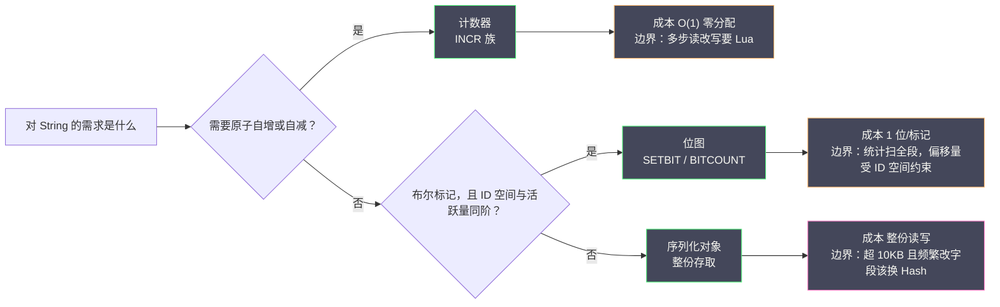
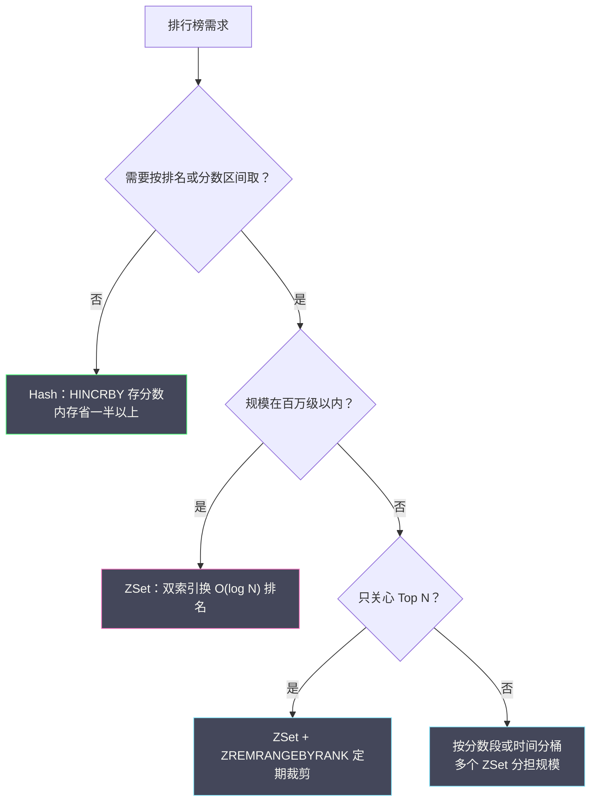
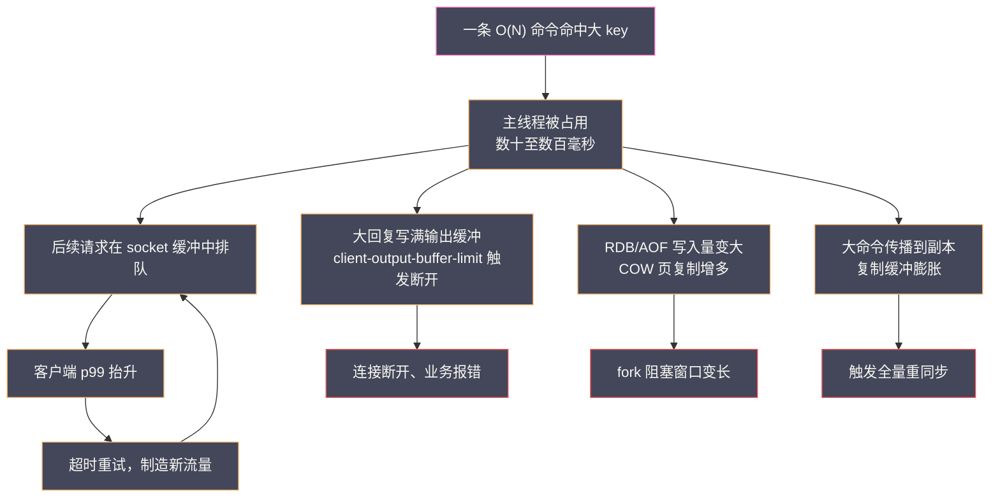
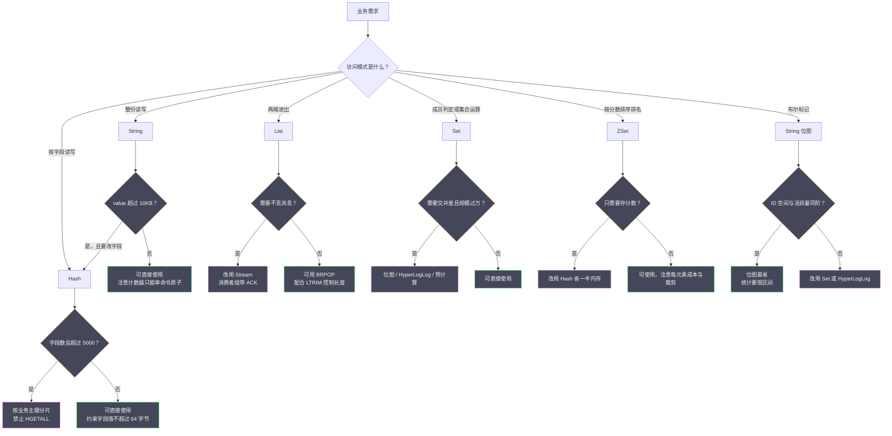

# 01 Redis 数据类型全景——五大基础类型的进阶用法

**摘要：**

Redis 的五种基础类型通常被当成五个盒子：String 放值、Hash 放对象、List 放队列、Set 放集合、ZSet 放排行榜。盒子这个比喻掩盖了一件事——同一个逻辑需求往往有两条以上的命令路径可走，而不同路径的内存成本、CPU 成本与阻塞风险可以差一个数量级。本文不列命令清单，只算“选哪个”的代价：先立三条代价轴（内存、主线程 CPU、阻塞时延），再逐个类型拆开它会在哪一步失效——String 的计数器止于单命令原子、位图的空间按最大 ID 走、超过 10KB 的大字符串该换 Hash 因为整份替换既慢又会丢更新；Hash 的两个陷阱是 HGETALL 的线性成本与超长字段值导致的编码退化；List 作为队列原型缺的是确认、重投与消费进度；Set 的交并差在百万级上是一次百毫秒量级的停摆；ZSet 用双份索引换来 O(log N) 的排名，代价是每元素内存数倍于 List。行文给出一条贯穿案例、若干代价量级表与一张命令复杂度速查表，并把大 key 的判据收敛成三条可执行的线。本列的边界是使用与运维，编码阈值、事件循环、fork 与 COW、槽位分配这些机制只给结论并路由到 [[02 SDS 与 Redis 对象系统]] 所在的机制专栏，不在这里重讲。

---

## 第 1 章 同一份数据，五种代价结构

设想一个内容社区的用户行为模块：签到要在千万级用户 ID 上打标记，阅读数要能扛住秒级并发自增，用户资料要支持单字段更新，关注关系要做“共同关注”计算，热门榜要按分数翻页，异步任务要能排队消费。这六件事在 Redis 里都能做，用到的类型分别是 String（位图）、String（计数器）、Hash、Set、ZSet、List 或 Stream。表面上看是六个容器各司其职，实际决定线上表现的是另一个问题：每一条命令落到单线程上要花多少时间，占多少内存。

### 1.1 五种类型是五类访问模式的抽象

五种类型的划分依据不是数据结构本身，而是访问模式。String 面向“整份读写”，每次操作的对象是一个字节序列的全部；Hash 面向“按字段读写”，对象是一组键值对的集合；List 面向“按位置两端读写”，对象是一串有顺序的元素；Set 面向“成员判定与集合运算”，对象是一组无序且唯一的成员；ZSet 面向“按分数排序与排名”，对象是一组带权重的成员。凡是业务需求能落进某一种访问模式，用对应类型就是自然的；落不进的时候，就出现了“选哪个”的代价问题。

代价问题的第一个来源是访问模式与存储模式的不匹配。把一份结构化的用户资料序列化成 JSON 塞进 String，读写模式其实是“按字段”，存储模式却是“整份”，于是每改一个字段都要把整份读出来再整份写回去，代价从 O(1) 变成 O(数据大小)。代价问题的第二个来源是同一个访问模式下有多条命令路径：Set 既能判成员也能做集合运算，两条路径的复杂度相差好几个数量级；ZSet 既能做排名也能做范围查询，两项能力背后是两套索引。

### 1.2 三条代价轴

评价一次 Redis 操作，绕不开三条轴。

第一条是**内存**。每种类型的每个元素都有固定开销：对象头、容器节点、分配器的取整。这些开销在小规模上是噪声，在千万级键上就是容量规划的全部内容。

第二条是**CPU 时间**，而且这个时间不是花在某个工作线程上，是花在唯一那一条处理命令的主线程上。第三条是**阻塞时延**，即一条命令执行期间，排在它后面的所有请求要多等多久。第二条与第三条其实是同一件事的两种看法：CPU 时间决定阻塞时延，阻塞时延再通过排队被放大成用户看到的超时。

三条轴不能同时最优，这才是选型之所以是选型的理由。位图在“布尔标记”这个需求上把内存压到极限（每个标记 1 位），代价是 `BITCOUNT` 必须扫过整段内存；Set 在同样需求上给出 O(1) 的成员判定与 O(1) 的计数，代价是每个成员几十字节。选了位图就要接受按区间统计的成本，选了 Set 就要接受内存翻十几倍。

### 1.3 与机制专栏的分工

本文只谈“用哪个、代价多少、什么时候失效”。凡涉及底层怎么实现的问题——44 字节的 embstr 上限是怎么减出来的、listpack 与 hashtable 的转换闸门写在哪一行、跳表的层数怎么随机、单线程的事件循环如何调度读写——一律给一句结论加一条路由，正文不展开。机制细节见 [[02 SDS 与 Redis 对象系统]]、[[03 字典与渐进式 Rehash]]、[[04 跳跃表 压缩列表与 Listpack]] 与 [[05 单线程模型与事件驱动架构]]，这四篇已经把阈值与源码路径逐条校准过。

笔者这么分工不是为了省事，而是因为两类知识的用途不同。机制知识回答“为什么这样设计”，用来判断某个参数能不能动；使用知识回答“这条命令到底花了多少”，用来在需求落地时做选择。把两者混在一篇里，读者容易记住阈值却忘了阈值背后的成本结构。

### 1.4 一张代价地图

先把本文的结论摊开，后面各章逐条展开。下表按“典型需求 → 首选类型 → 该选择的主要代价”排列，代价一列写的是这条路径最容易被忽略的成本。

| 需求 | 首选路径 | 主要代价 |
| :--- | :--- | :--- |
| 计数、库存扣减 | String + `INCR` | 只能做单命令原子操作，多步读改写要 Lua |
| 布尔标记（签到、活跃） | String 位图 | 空间按最大 ID 走，`BITCOUNT` 是 O(N) |
| 结构化对象的部分更新 | Hash | 大 hash 的 `HGETALL` 阻塞，字段数越阈值后编码退化 |
| 异步任务的排队 | List + `BRPOP` | 弹出即丢，无确认无重投 |
| 关系判定与集合运算 | Set | 交并差是 O(N*M)，大集合上不能随手算 |
| 排行、延迟队列、滑动窗口 | ZSet | 每元素成本最高，约为 List 的数倍 |
| 消息的可靠投递 | Stream | 与本文无关，见 [[07 Redis 消息队列——从 PubSub 到 Stream]] |

---

## 第 2 章 复杂度的读法：O(1) 不等于免费，O(N) 才是危险的

复杂度记号在教科书里描述的是增长趋势，在 Redis 里描述的是“这条命令占用主线程多久”。同一个记号在两处的含义差别很大，因为 Redis 的命令执行没有并发可以掩盖长尾。不妨把它想成一家只有一位主诊医生的诊所：一次检查占住诊室多久，后面候诊的人就得多等多久，医生的熟练度对应算法的常数项，病人的数量对应复杂度里的 N，两者共同决定队伍排到哪里。

### 2.1 单线程把复杂度直接翻译成时延

Redis 处理命令的主线程是一条流水线：读请求、解析、执行、写回复。执行阶段在 7.x 与 8.x 里依然是单线程的，I/O 多线程只分担 socket 的读写，不改变“同一时刻只有一条命令在执行”这个事实，具体调度见 [[05 单线程模型与事件驱动架构]]。这条性质带来一个直接的换算：命令的执行时间就是它对所有其他客户端造成的延迟增量。

于是复杂度记号里的 N 有了物理含义。N 是这次要遍历或构造的元素数量，遍历每个元素要花几十到几百纳秒，构造每个回复对象还要额外分配内存。N 等于 10 的时候，几微秒的事；N 等于 100 万的时候，几十上百毫秒的事，而这几十上百毫秒里，整个实例不处理任何其他请求。

### 2.2 N 的口径：元素数、字节数还是键数

同一条命令的 N 口径不同，误判的后果也不同。`HGETALL` 的 N 是字段数，`BITCOUNT` 的 N 是字节数，`SMEMBERS` 的 N 是成员数，`KEYS` 的 N 是整个键空间，`LRANGE` 的 N 是返回的元素数加偏移量。判断一条命令危不危险，第一步是问“它的 N 对应我数据里哪个维度，这个维度上界是多少”。

口径错位的典型是位图。`BITCOUNT` 看着只是统计置位数量，复杂度记作 O(N)，但这个 N 是位图占用的字节数，与“有多少个 1”无关。一个只有 100 个用户签到、但最大用户 ID 是 1 亿的位图，`BITCOUNT` 仍然要扫过 12.5MB。反过来，一个 100 万元素的整数 Set，`SCARD` 是 O(1)，因为元素个数单独存了字段。

### 2.3 O(1) 的常数项也会咬人

`GET` 是 O(1)，但取一个 512MB 的 value 依然是灾难。原因有三层：主线程要把这块内存通过 socket 写出去，期间要处理输出缓冲；内核要把数据拷进协议栈；客户端要分配同样大的缓冲接收。复杂度不看常数，工程上常数才是全部——`GET` 一个 1KB 的 value 与取一个 10MB 的 value，复杂度都是 O(1)，时延差三到四个数量级。

同样属于 O(1) 但常数可变的还有 `SET`、`DEL`、`EXPIRE`、`LPUSH`。`DEL` 一个 key 是 O(1) 的查找，但在找到之后还要释放它占用的全部内存，释放 100 万个元素的 Hash 与释放一个整数是两件事。Redis 4.0 起提供 `UNLINK` 把释放动作交给后台线程，就是为这一类常数准备的。

### 2.4 三档划分

把常用命令按“是否会在主线程上停留很久”分三档，比按数据结构分类更贴近运维。第一档是恒定成本，代价与数据规模无关，可以放心放在请求路径上；第二档是对数成本，规模翻倍只多一次比较，百万级也能接受；第三档是线性成本，规模是它的敌人。

| 档次 | 复杂度 | 典型命令 | 在请求路径上的可用性 |
| :--- | :--- | :--- | :--- |
| 恒定 | O(1) | `GET`、`SET`、`INCR`、`HSET` 单字段、`SADD` 单成员、`ZADD` 单成员、`EXPIRE`、`LLEN` | 可用，但要控制 value 大小 |
| 对数 | O(log N) | `ZADD`、`ZINCRBY`、`ZRANK`、`ZRANGEBYSCORE` 的定位部分 | 可用，N 到千万级仍在一个数量级内 |
| 线性 | O(N) | `HGETALL`、`SMEMBERS`、`KEYS`、`LRANGE` 全量、`SINTER`、`BITCOUNT`、`DEL` 大集合 | 不能放在请求路径上，必须改造成分批或离线 |

这张表只解决“别把线性命令放到线上”，不解决“什么时候该换类型”。换类型的判断标准是访问模式，接下来的五章依次处理。

---

## 第 3 章 String 的三种用法，三种代价

String 是 Redis 里最像“变量”的类型，也是最容易被用错的类型。它在同一个类型名下装着三种完全不同的用途：整数槽、位数组、字节缓冲区。三种用途的代价结构各不相同，混用的时候，任何一条经验都会失效。

### 3.1 计数器：原子性止于单命令

`INCR`、`DECR`、`INCRBY`、`INCRBYFLOAT`、`HINCRBY` 这一族命令的原子性来自单线程，不需要任何锁。一次 `INCR` 在内部做三件事：把字符串解析成整数、加一、把结果写回。因为三件事在一条命令里完成，其他客户端看不到中间状态。

代价出现在原子性的边界上。业务需要“读出来、判断、再写回去”时，`INCR` 帮不上忙。典型的库存扣减：先 `GET` 库存，判断够不够，再 `DECRBY`。三步之间可能插入别的请求，两个消费者读到同一份余量，都认为够，于是超卖。解决办法要么是 Lua 脚本把三步包成一次执行（脚本的原子性见 [[03 Redis 事务 Lua 脚本与原子性保证]]），要么把判断挪进 Redis 自身的数据结构里。

一个常见的替代是“允许负数、事后补偿”：`DECRBY` 无条件减，返回值小于零就说明超卖，立刻 `INCRBY` 补回来。这个方案在低并发下有效，在秒杀场景下会让库存短暂变成负数，被其他读请求看到。它把一致性问题从“写冲突”转成了“读脏值”，并没有消除问题。

计数器还有两个容易被忽略的细节。第一是数值范围：`INCR` 只在 64 位有符号整数内有效，溢出时命令直接报错、值保持原样，业务侧要自己处理这个错误，不能指望它自动封顶。第二是过期时间：按天粒度的计数器通常配 `EXPIRE`，但先 `INCR` 再 `EXPIRE` 是两条命令，进程在中间挂掉会留下永不淘汰的键。更稳的写法是先用 `SET key 0 EX 86400 NX` 建槽，再 `INCRBY`。

```bash
# 按天计数：先在键不存在时建槽并带上过期时间
SET stat:read:20261119 0 EX 172800 NX
INCR stat:read:20261119

# 原子地取走当前值并清零：适合分钟级指标上报
SET stat:qps:minute 0 GET
```

### 3.2 位图：布尔集合的空间公式

位图不是一种新类型，它就是把 String 当成一个可按位寻址的数组。`SETBIT key offset 1` 把第 offset 位置 1，`GETBIT` 读一位，`BITCOUNT` 统计置位数量，`BITOP` 做按位与或异或。对“用户 ID 到布尔值”的映射，这是内存效率的极限：每个标记一位。

空间公式很直接：占用字节数等于最大偏移量除以 8。1 亿用户的签到表，若 ID 从 0 编到 99,999,999，位图大小是 100,000,000 / 8 = 12,500,000 字节，约 12.5MB。用这个量级换“一天之内任意用户的签到状态可 O(1) 判定、总量统计可用一条命令”，看起来划算。

但位图的三个约束必须一起看。

第一，空间取决于**最大 ID**，不是元素个数。偏移量 1 亿意味着中间任何空洞都被分配了内存。如果用户 ID 是雪花算法生成的 19 位数字，`SETBIT` 的偏移量上限是 2 的 32 次方减一（约 42.9 亿位、512MB 上限），单个位图根本装不下，需要先做一层“ID 取模分桶”把偏移量压回可接受范围。稀疏场景下，位图的内存优势会瞬间反转成劣势。

第二，统计与遍历都是线性成本。`BITCOUNT` 要扫过整个字节区间，12.5MB 的位图在 `BITCOUNT` 上是几毫秒到十几毫秒的量级（示例推算：按每秒处理 GB 级的位运算吞吐估算），足以让一次运营看板查询变成一次可见的延迟尖刺。`BITCOUNT` 支持 `BIT` 与 `BYTE` 参数限定区间，把统计范围收窄到关心的那一段，是把成本压回可控的唯一办法。

第三，位图天生不适合“按人查询多个维度”。一个用户 30 天的签到状态，若按天分键就是 30 个 12.5MB 的键，合计 375MB；若按用户分键，就是千万个几十字节的位图，键数量本身又成了问题。合理的折中是按月一个键、按 ID 取模分片，把单键压到百万位级别，让 `BITCOUNT` 落在亚毫秒。

位图和 Set 的取舍可以算成一张表。设 ID 空间 1 亿、实际活跃 100 万，Set 存放的是用户 ID 这类整数：

| 方案 | 内存（示例推算） | 判定单个成员 | 统计总量 | 交并运算 |
| :--- | :--- | :--- | :--- | :--- |
| 位图（1 亿位） | 约 12.5MB | O(1) | O(N) 扫 12.5MB | `BITOP` O(N)，产物仍是位图 |
| Set（hashtable 编码，100 万成员） | 约 56MB（56 字节/成员） | O(1) | O(1) | `SINTER` O(N*M) |
| Set（调大 intset 阈值，100 万成员） | 约 8MB（8 字节/成员） | O(1) | O(1) | `SINTER` O(N*M)，但插入是 O(N) |

表里第三行是个陷阱。Set 的 intset 编码在默认配置下只到 512 个成员，突破就跳到 hashtable，所以现实中一个百万级整数集合几乎必然按 56 字节一成员付费，第三行那种 8 字节的成本要靠改 `set-max-intset-entries` 换来，代价是每次 `SADD` 都要在有序数组里搬内存，写入路径从 O(1) 变成 O(N)，规模越大越不可用。

换算下来，位图与 Set 的交叉点落在 22 万到 156 万活跃成员之间（示例推算：12.5MB 除以 56 字节约为 22 万，除以 8 字节约为 156 万）。活跃量在这条线以下，Set 更省而且多一个 O(1) 的计数；活跃量在这条线以上，位图开始赢，而且赢得越来越多——ID 空间 1 亿、活跃 3000 万时，Set 是 1.7GB 量级，位图仍是 12.5MB。所以“签到用位图”这条经验只在 ID 空间与活跃量同阶时成立，ID 空间远大于活跃量时，Set 或 HyperLogLog 更合适。

### 3.3 大字符串：10KB 这条线

第三种用法是把对象序列化后整体塞进 String：一个用户的资料、一份配置、一条订单快照，序列化成 JSON 或 MessagePack，`SET` 进去，读的时候 `GET` 出来反序列化。这种做法在原型阶段极其方便，在数据长大之后开始变坏。

变坏的机制不是“慢”，是**整份替换**。`SET` 的语义是把整个 value 换掉，改一个字段也要把整份读出来、在内存里改、再整份写回去。三次网络往返、两次序列化、一次 10KB 级的解析与拷贝，全部发生在主线程上。字段越多、value 越大，单次修改的成本越高，而且这个成本与“改了几个字段”无关。

更麻烦的是并发。读改写不是原子的：两个请求同时读到同一份 JSON，各自改一个不同字段，先后写回，后写的那份覆盖先写的那份，**丢更新**。加分布式锁能解决，但锁的代价比问题本身还大（锁的实现与争议见 [[06 Redis 分布式锁——从 SETNX 到 Redlock 的争议]]）。真正的解法是换结构：把序列化对象拆成 Hash，用 `HSET` 只改目标字段。

阈值取在哪里，取决于 value 大小与写入频率的乘积。经验上，单个 String 超过 10KB 就应当评估迁移到 Hash；超过这个尺寸，每次修改要搬运的字节数、序列化与反序列化的 CPU、以及并发覆盖的窗口都开始显著，而 Hash 的按字段写入可以把单次成本压回 O(1)。这条线不是 Redis 的硬限制，Redis 的 String 最大能到 512MB，10KB 是工程口径，与下面大 key 判据里的阈值同源。

| 维度 | 序列化进 String | 拆成 Hash |
| :--- | :--- | :--- |
| 改一个字段 | 读整份、改、写整份，O(数据大小) | `HSET` 一个字段，O(1) |
| 并发安全 | 读改写非原子，会丢更新 | 字段级原子，不同字段互不影响 |
| 部分读取 | 取整份再解析 | `HGET`、`HMGET` 取指定字段 |
| 内存 | 一份 SDS，无字段级开销 | 字段多时每字段约 20 至 70 字节开销 |
| 过期控制 | 整键 TTL | 整键 TTL，7.4 起支持字段级过期 |

### 3.4 三种用法的边界

三种用法各有明确的失效条件。计数器在需要读改写多步业务时失效；位图在 ID 空间远大于活跃量、或需要按区间反复统计时失效；大字符串在 value 超过 10KB 且需要频繁单字段更新时失效。这三条失效条件都可以在写代码之前判断，不需要等到线上出问题。

把三种用法并排放，代价结构一目了然。注意“单次成本”这一列写的都是最佳情况，失效条件那一列写的才是决定线上表现的东西。

| 用法 | 代表命令 | 单次成本 | 主要边界 |
| :--- | :--- | :--- | :--- |
| 计数器 | `INCR`、`DECR`、`INCRBY`、`SET key v GET` | O(1)，零分配 | 只对单命令原子，多步读改写必须上 Lua |
| 位图 | `SETBIT`、`GETBIT`、`BITCOUNT`、`BITOP` | 置位 O(1)，统计 O(N) 按字节 | 空间按最大 ID 走，统计必须限区间，偏移量有上限 |
| 大字符串 | `SET`、`GET`、`APPEND`、`GETRANGE` | O(1) 但常数随 value 线性增长 | 整份替换、并发丢更新，超 10KB 且频繁改字段该换 Hash |



---

## 第 4 章 Hash 的两个陷阱

Hash 在 Redis 里的定位是“小对象的容器”，它的设计目标是用紧凑编码把一组字段放进一块连续内存。这个设计在字段数少、值短的时候极其高效，两个陷阱都出现在它被撑大的时候。

### 4.1 HGETALL 的线性成本

`HGETALL` 返回一个 Hash 的全部字段与值，复杂度 O(N)，N 是字段数。这个命令的危险不在于它慢，而在于它慢得没感觉：一个 20 个字段的 Hash 上，`HGETALL` 是微秒级；一个 10 万字段的 Hash 上，它要遍历整个哈希表、为每个字段和值各构造一个回复对象、再把它们串成协议数组写进输出缓冲，几毫秒到几十毫秒（示例推算），期间主线程不处理任何其他请求。

替代方案是 `HSCAN`：用游标分批遍历，每次返回一部分字段，单次调用的成本与 `COUNT` 大小相关，与总字段数无关。`HSCAN` 的语义是渐进式遍历，不保证快照一致性，遍历期间新增的字段可能被看到也可能不被看到，需要业务侧容忍。还有一条容易忽略的行为：Hash 处于 listpack 编码时，`HSCAN` 会一次性把全部字段返回，因为底层就是一块紧凑内存，没有游标可走。所以 `HSCAN` 只在 hash 已经是大 hashtable 时才真正分批。

```bash
# 分批遍历，游标从 0 开始，返回 0 表示结束
HSCAN user:1001:events 0 COUNT 200
HSCAN user:1001:events 12800 COUNT 200

# 只关心字段名、不关心值时，可以用 NOVALUES 省掉一半回复体积（7.4 起）
HSCAN user:1001:events 0 COUNT 200 NOVALUES
```

`HSCAN` 的正确用法是配合业务上的“可中断”。遍历 10 万字段的 hash，一次请求里做完整遍历没有意义，应当由后台任务分多轮完成，每轮之间让出主线程。

### 4.2 编码退化的两条路径

第二个陷阱是编码。Hash 在字段数少且字段名、字段值都短的时候用 listpack 编码，把全部字段压在一块内存里；超过阈值后转成 hashtable。判据是 `hash-max-listpack-entries`（默认 512）与 `hash-max-listpack-value`（默认 64 字节），转换单向不可逆。两种形态的差别好比一个塞满纸质档案的抽屉与一份带标签的目录：前者省地方但找一份要挨个翻，后者多占几成空间却能直接抽到；512 这个默认值就是在“翻得动”与“装得下”之间取的折中。这里的机制细节在 [[02 SDS 与 Redis 对象系统]] 里逐行对过，此处只留两条结论：一个 300 字节的字段值就足以让整个 Hash 退化成 hashtable，哪怕它只有三个字段；退化之后删掉超长字段也不会回来，每字段内存从约 20 字节跳到约 70 字节。

工程含义是：Hash 的字段值长度要在设计阶段就约束住。备注、签名、富文本摘要这类长度不可控的字段，不该放进同一个 Hash，应该单独用一个 String 键存。

### 4.3 Hash 与多个 String 的账

同一个用户对象拆成多个 String 键，与放进一个 Hash，内存账差别很大。多个 String 的方案里，每个键都要独立承担一套固定成本：键名的 SDS、字典项、对象头、value 的对象。以 `user:1001:name` 这样的 14 字节键名、6 字节 value 估算，每个键约 100 字节（示例推算：键名 SDS 16、字典项 32、对象头 16、value 对象 32、桶分摊 8）；十个字段就是 1KB 量级。

放进一个 Hash 之后，固定成本只有一份：键名、对象头、字典或 listpack 的容器头。字段级的成本在 listpack 编码下约 20 字节，在 hashtable 编码下约 70 字节。十个字段的 Hash，listpack 下总共 200 字节出头，即使退化成 hashtable 也只有 700 字节，都比多键方案省。

不过这个账在字段数很少、且每个字段都需要独立过期时间时会反转。Hash 的 TTL 只能整键设置，字段级过期是 7.4 才有的能力（`HEXPIRE` 一族，实现上会引入第三种编码），在此之前“每个字段独立过期”只能靠拆成多个键实现。

### 4.4 Hash 不适用的三种情况

Hash 不是结构化数据的默认答案。三种情况要换方案。

其一是字段数会涨到万级以上，且业务需要遍历全部字段。这时 Hash 一定退出紧凑编码，`HGETALL` 与 `HSCAN` 的成本随字段数线性增长，同时单个键的内存与迁移成本也随之上来。按业务主键分片是唯一出路。

其二是单字段会被高频整体替换，且字段值很大。Hash 的字段写入是 O(1)，但写入大 value 依然要分配内存、修改编码判断，一个大字段会让整个 Hash 常驻在 hashtable 编码上。

其三是需要按字段做范围查询或排序。Hash 没有顺序，取出来还得在客户端排。这时候该考虑 ZSet，代价是每元素内存翻几倍，见第 7 章。

---

## 第 5 章 List 的定位变化：队列的原型，不是队列的终点

List 在 Redis 历史上承担过一个重要角色：轻量消息队列。`LPUSH` 生产者入队、`BRPOP` 消费者阻塞取，两行代码就能跑起来。这个用法至今有效，但它的适用边界在过去几年里明显收窄了。

### 5.1 阻塞弹出解决了什么

朴素队列用 `RPOP` 轮询：没有数据返回空，客户端隔一会儿再问一次。轮询的代价是双份的——空闲时浪费请求与 CPU，有数据时最多晚一个轮询周期才被取走。`BRPOP`、`BLPOP` 把“等”交给服务端：客户端发一条带超时的命令，服务端在没有数据时把连接挂起，数据到了立刻推给第一个等待者。

这个机制带来两个性质：空闲零成本，数据到达零延迟。对延迟敏感、流量不稳定的异步任务，这两点比吞吐更重要。`BRPOP` 还支持一次给出多个键，按顺序取第一个非空的，天然的优先级队列；Redis 7.0 的 `LMPOP` 把同一能力做成了非阻塞版本，并支持 `COUNT` 批量弹出。

### 5.2 没有 ACK，弹出即丢

队列的可靠性由三个环节组成：消息不丢、可重投、有消费进度。List 只提供了第一个环节的一半。

`BRPOP` 一旦返回，元素就从 List 里消失了，**弹出即丢**。消费者拿到消息、还没处理完就崩溃，这条消息永久丢失，服务端没有任何记录。这不是实现缺陷，是数据结构的能力边界：List 只有“元素在”与“元素不在”两种状态，没有“已被取出、等待确认”的第三态。

社区演化出过一条半可靠的做法：用 `LMOVE`（6.2 之前是 `RPOPLPUSH`）把元素从待处理队列原子地搬到备份队列，处理成功后再从备份队列删掉。消费者崩溃时，备份队列里的消息还在，可以由巡检任务搬回主队列。这条路径能补上“不丢”，补不上另外两项：备份队列没有消费者归属，多个消费者同时巡检会重复处理；没有重投次数的记录，一条毒消息会被反复搬来搬去；没有消费进度的游标，扩容消费者时无法分配历史积压。

```bash
# 半可靠队列：取出即备份，成功后才确认
LMOVE task:queue task:processing LEFT RIGHT
# 处理成功后
LREM task:processing 1 "<task-payload>"
# 巡检任务把超时未确认的消息搬回主队列
LMOVE task:processing task:queue RIGHT LEFT
```

真正需要“不丢 + 可重投 + 有进度”的场景，答案是 Stream 的消费者组（`XADD`、`XREADGROUP`、`XACK`、`XPENDING`、`XAUTOCLAIM`），模型见 [[07 Redis 消息队列——从 PubSub 到 Stream]]。List 的位置因此收缩为：延迟不敏感、允许偶发丢失、消费逻辑幂等的内部任务队列。

### 5.3 LTRIM 做定长列表

List 的第二个经典用法是定长记录：`LPUSH` 写入最新一条，`LTRIM 0 99` 只保留最近 100 条。这个组合的成本要分开算：`LPUSH` 是 O(1)，`LTRIM` 的复杂度是 O(N)，N 是被删除的元素数。只删一条时是 O(1)，一次裁掉几千条时会占用主线程一段时间。

更隐蔽的成本在内存上，譬如被裁掉的那一段会留下分配器碎片。List 在 7.2 之后小规模时用单块 listpack，超过 `list-max-listpack-size`（默认 -2，即每节点 8KB）转成 quicklist 的节点链表。定长列表反复 `LPUSH` 加 `LTRIM`，会让 quicklist 节点不断分裂与释放，分配器的碎片率上升；同时被裁掉的元素释放的内存不一定回到 `used_memory` 的统计口径里，看起来“裁了但没省”。

### 5.4 定位收缩之后还剩什么

List 剩下的不可替代用途不多，但确实存在：后进先出的栈（撤销操作、最近访问）、需要按位置访问的定长时间线、以及 `LPOS` 这类精确查找（6.0.6 起，支持 `RANK`、`COUNT`、`MAXLEN`）。这些用途的共同点是数据量有限、访问模式简单、不需要可靠性保证。

一旦需求里出现“不能丢”“要能重放”“多个消费者组各自消费”，就该换 Stream。一旦需求里出现“积压几百万条还要能扛”，就该换专业的消息中间件。List 的边界很清楚：它是一个两端可进出的内存数组，不是一个消息系统。

---

## 第 6 章 Set 的三种用途

Set 是五种类型里语义最干净的一个：无序、唯一、支持集合运算。干净语义的代价藏在运算复杂度里——单成员操作都是 O(1)，集合运算都是 O(N)，而这两类操作的延迟差三个数量级。

### 6.1 去重与成员判定

最基础的用途是判重。`SADD` 返回本次实际新增的成员数，返回 0 说明已存在，这一个返回值就可以做幂等判重，不必先 `SISMEMBER` 再 `SADD`（两条命令之间会有竞态）。`SISMEMBER` 是纯判定，O(1)，适合“这个用户是否已经领过券”这类高频查询。

去重集合的规模决定内存。Set 有三种编码：全整数且元素数不超过 512 时用 intset，按整数宽度紧密排列，每成员 2 到 8 字节；元素数不超过 128、单元素不超过 64 字节时用 listpack；再大就是 hashtable，每成员 50 到 60 字节。编解码转换的规则同样在 [[02 SDS 与 Redis 对象系统]]。这意味着一个存用户 ID 的 Set 在 512 个成员以内极其省，一旦突破就跳到 hashtable，内存直接涨六七倍。

### 6.2 交并差：O(N*M) 的真实成本

`SINTER`、`SUNION`、`SDIFF` 的时间复杂度记作 O(N*M)，N 是最小集合的基数，M 是参与运算的集合数。这个记号的读法是：以最小集合为基准逐个成员去其他集合里查，每个成员查一次哈希。两个百万级集合求交集，好比拿两本各百万条的通讯录对名字，逐条翻到对方那本里查一遍，落成机器动作就是一千万次哈希查找加字符串比较的量级，一百毫秒到两百毫秒（示例推算：单次哈希查找与短字节串比较按 100 纳秒估算），期间实例完全停摆。

这条成本有两个常见的误判。第一个误判是以为 `SINTERSTORE` 更快——它只是把结果写到新键，省掉了把结果集序列化后传到客户端的那部分网络与内存开销，集合运算本身一秒都没省。第二个误判是以为把大集合拆小就能解决——拆小之后交集运算的总量没变，只是变成了多次小运算，反而多了往返。

真正可行的做法有三条。其一，把运算挪到从节点上执行，用只读副本来承担这类离线计算，主节点不受影响，前提是业务能接受副本的复制延迟。其二，改数据结构：两个百万级集合的交集，如果成员是整数 ID，位图上的 `BITOP AND` 是一次线性扫描，12.5MB 的位图做与运算在十毫秒量级（示例推算），比哈希查找快一个档；如果只需要基数而非具体成员，HyperLogLog 的 `PFMERGE` 与 `PFCOUNT` 是常数级内存（见 [[02 高级数据类型——HyperLogLog Bitmap Geo Stream]]）。其三，预计算：把常用的交集离线算好写进一个结果 Set 或 ZSet，线上只读。

| 做法 | 计算成本 | 内存成本 | 适用前提 |
| :--- | :--- | :--- | :--- |
| 主节点 `SINTER` | O(N*M)，百毫秒级 | 无额外 | 集合规模在万级以内 |
| 从节点 `SINTER` | 同上，但不伤主节点 | 需要副本 | 可接受复制延迟 |
| 位图 `BITOP AND` | O(N)，十毫秒级 | 12.5MB / 亿位 | 成员是连续可映射的整数 ID |
| HyperLogLog | O(N) 单次，常数内存 | 12KB / 结构 | 只要基数，不要成员 |
| 预计算 | 线上 O(1) | 一份结果集 | 交集组合固定且可离线跑 |

### 6.3 随机抽样：SRANDMEMBER 与 SPOP

抽奖与随机推荐是 Set 的另一类用途，两条命令的语义差别决定了它们不能互换。

`SRANDMEMBER key count` 返回 count 个随机成员但不删除，适合“随机展示、允许重复曝光”的推荐位。带正数 count 时返回去重后的最多 count 个成员；带负数 count 时允许重复，`SRANDMEMBER key -5` 可能返回同一个成员两次。`SPOP key count` 返回并删除，适合“抽走即消耗”的抽奖池。

选择的分界线是“这次随机是否改变集合”。语义上看起来只是“删不删”的差别，工程上差别很大：`SPOP` 会让集合单调变小，抽到后期还需要处理“池子空了”的边界与补池逻辑；`SRANDMEMBER` 不改变集合，可以无限次调用，但无法保证“每个人只中一次”，需要额外的中奖记录来去重。

成本上两者也有差别。不带 count 的 `SPOP` 与 `SRANDMEMBER` 都是 O(1)；带 count 时，`SPOP` 是 O(count)，`SRANDMEMBER` 在 count 接近集合规模时退化为遍历全集合，因为要保证不重复就必须换算法。抽一个百万集合里的 10 个成员，不要用 `SRANDMEMBER key 1000000` 这种写法。

### 6.4 大集合的三个信号

Set 出问题的信号通常不是单条命令报错，而是三件事同时出现：`SMEMBERS` 被用在线上路径（一次返回几十万元素）、`SINTER` 的耗时开始进入慢查询日志、集合的内存占用超过预期一个数量级（说明早已从 intset 退化到 hashtable）。这三个信号都指向同一个结论——这个 Set 的规模已经超出“集合运算”这种访问模式的舒适区，应当改成位图、拆分成多个键，或者把运算搬到离线。

---

## 第 7 章 ZSet 是 Redis 最贵的结构

ZSet 是五种类型里能力最强、也是每元素成本最高的一个。它的能力来自**双索引**：一份数据同时挂在两个结构上，一个负责按成员查分数，一个负责按分数排序。双索引换来了 O(log N) 的排名与范围查询，代价是每个元素都要为两套结构付费。

### 7.1 双索引的代价

ZSet 在元素数超过 128 或成员长度超过 64 字节后，编码从 listpack 转成 skiplist，底层同时维护一个跳表和一个字典。字典负责“给成员查分数”，O(1)；跳表负责“按分数排序、按排名定位、按区间取成员”，O(log N)。两个结构共享同一份成员字符串，但各自有自己的节点。

节点开销是双份的：字典项约 32 字节（键指针、值指针、链指针），跳表节点约 45 字节（成员指针、分数、后退指针，加上平均 1.33 层的层数组），成员字符串本身约 16 到 32 字节。三项合计每元素 90 到 120 字节，具体取决于成员长度，量级与各项的推导见 [[04 跳跃表 压缩列表与 Listpack]] 与 [[02 SDS 与 Redis 对象系统]] 里的逐项估算。

### 7.2 内存账：同一份数据的倍数

把同样一批成员分别放进 List 与 ZSet，内存差多少，取决于成员长度。下面的表按“成员 40 字节左右、元素 100 万”估算（示例推算，分配器按 jemalloc 的分级取整）：

| 结构 | 每元素成本（示例推算） | 100 万元素合计 | 相对 List |
| :--- | :--- | :--- | :--- |
| List（quicklist，8KB 分节点） | 约 43 字节（内容 40 加编码开销 3） | 约 43MB | 1 倍 |
| Hash（hashtable 编码） | 约 70 字节 | 约 70MB | 1.6 倍 |
| Set（hashtable 编码） | 约 56 字节 | 约 56MB | 1.3 倍 |
| ZSet（skiplist 编码） | 约 100 至 120 字节 | 约 100 至 120MB | 2.3 至 2.8 倍 |

倍数随成员长度变化，方向相反：成员越短，ZSet 的相对开销越夸张——8 字节整数成员在 List 里是 9 到 10 字节，在 ZSet 里仍是 90 字节往上，十倍以上；成员越长，双索引的固定开销被内容摊薄，倍数回落到 List 的两倍上下。所以“ZSet 内存是 List 的两到三倍”这句话只在成员长度几十字节的区间成立，把它当通用结论会在短成员场景低估一个数量级。

### 7.3 换来的是 O(log N) 的排名

付出双份内存，换来的是三种 List 与 Hash 都给不了的能力。

按排名取区间：`ZRANGE key 0 9` 取前十名，复杂度 O(log N + 10)，与总元素数几乎无关。百万级的榜，取前十名仍是微秒级。

按分数取区间：`ZRANGEBYSCORE key 1000 2000 LIMIT 0 10`，先 O(log N) 定位到分数下界，再顺序取 10 个，复杂度 O(log N + 10)。延迟队列、时间窗口、分数段查询都建立在这个能力上。

按成员取排名：`ZRANK`、`ZREVRANK` 返回成员在排序中的位置，O(log N)。这是排行榜里“我的名次”需求的核心，用 List 或 Hash 都做不到——它们要么得全量拉出来在客户端排，要么得为每个名次维护一个键。

### 7.4 三种典型用途

排行榜是 ZSet 的原型场景。成员是用户或内容 ID，分数是热度。`ZINCRBY` 累加分值（原子，O(log N)），`ZREVRANGE` 取前 N，`ZREVRANK` 取个人名次。要注意的是同分排序：分数相同时按成员的字面序排列，若业务要求“同分时先到先得”，需要把时间信息编码进分数。把时间戳拼进 double 的低位是一种做法，但 double 只有 53 位有效精度，分数放大多少倍就会损失多少个低位，编码前要算清楚位数够不够，不够就会出现“不同时间戳被压成同一个分数”的静默错误。

延迟队列利用分数存“到期时间戳”这个性质：生产者 `ZADD` 一条到期时间在未来某个时刻的任务，消费者定期用 `ZRANGEBYSCORE 0 now` 取到期任务。这条路径有两个必须处理的细节：取出与删除必须是原子操作，否则多个消费者取到同一条任务，需要 Lua 脚本包住（见 [[03 Redis 事务 Lua 脚本与原子性保证]]）；同一时刻到期的大量任务会形成一次密集的线性扫描，`LIMIT` 要设得当，否则一次取几万条同样会阻塞。更根本的问题是轮询——ZSet 没有“到点通知”的能力，消费者只能定期问，精度与开销取决于轮询间隔。

滑动窗口限流是第三种。把每次请求的时间戳作为分数写进 ZSet，用 `ZREMRANGEBYSCORE` 删掉窗口外的旧记录，用 `ZCARD` 得到窗口内的请求数。它的精度讨人喜欢，代价是每个请求都要写一条记录：一个 10 万 QPS 的接口，60 秒窗口内就是 600 万条 ZSet 元素，内存按每元素 100 字节算是 600MB 量级（示例推算），而这还只是单个限流维度的量。高并发下的限流更适合令牌桶加 Lua（用 Hash 存令牌数），ZSet 方案留给低 QPS、要求精确平滑的场景。

### 7.5 什么时候不该用 ZSet

ZSet 的贵是结构性的，所以判断标准很直接：如果不需要按顺序取，就不该付双索引的钱。只需要存“谁的分是多少”、不需要“第几名是谁”，用 Hash，`HINCRBY` 同样是 O(1)，内存省一半以上。只需要一次性排序、排序结果不重复使用，用数据库的 `ORDER BY` 或离线计算，把结果缓存成一个 List 或 String。只需要取 Top N 且 N 很小、更新又极频繁，可以在应用侧维护一个固定大小的最小堆，只在进榜时写一次 Redis。

### 7.6 规模上去之后的处理

排行榜到千万级之后，内存与写入都会成为问题。常见的三条处理路径：只保留 Top N，用 `ZREMRANGEBYRANK key 0 -1001` 定期裁掉尾部，代价是每个被裁掉的成员都会触发一次 O(log N) 的删除，裁剪量要分批；按分数段分桶，一个 ZSet 只存某个区间，查询时先定位桶再取成员；按时间滚动，日榜、周榜、总榜分开，靠过期而不是裁剪控制规模。



---

## 第 8 章 大 key 的判据

前面五章讲的是类型选择，这一章讲规模。同一个类型，元素数量涨到某个点之后，性质会变：原本 O(1) 的操作还在，但“这条命令占主线程多久”的答案是另一个量级。

### 8.1 三条判据

判定大 key 的通行口径来自工程实践，不是 Redis 的硬限制。《阿里巴巴 Java 开发手册》给出的建议是：String 类型的 value 控制在 10KB 以内，Hash、List、Set、ZSet 的元素个数不要超过 5000。把这条与运维侧的“单键总大小不超过 1MB”合起来，得到三条判据。

第一条按大小：**String 超过 10KB** 视为大 key。这条线同时是第 3 章里“该不该换成 Hash”的分界线，两者同源——value 大到一定程度，整份读写的代价就超过了拆分带来的字段开销。

第二条按元素数：**Hash、List、Set、ZSet 的元素数超过 5000** 视为大 key。5000 这个数字与各种编码阈值没有关系，它是“线性命令还勉强能忍”的上界：5000 个元素的一次 `HGETALL` 或 `SMEMBERS`，回复体积在几十到几百 KB，耗时可接受但已经进入慢查询的观察范围。

第三条按总大小：**单个键超过 1MB** 视为大 key，无论什么类型。这条是兜底，覆盖“元素数不多但每个元素很大”的情形，譬如一个 200 个元素的 List，每个元素是一段 10KB 的 HTML。

| 类型 | 判据 | 阈值 | 主要风险 |
| :--- | :--- | :--- | :--- |
| String | value 长度 | 10KB | 整份传输与替换，阻塞网络输出缓冲 |
| Hash | 字段数 | 5000 | `HGETALL`/`HSCAN` 线性、编码必为 hashtable |
| List | 元素数 | 5000 | `LRANGE` 线性、`LTRIM` 一次删太多 |
| Set | 成员数 | 5000 | `SMEMBERS` 线性、`SINTER` 参与方越大越慢 |
| ZSet | 成员数 | 5000 | 双索引内存、`ZRANGE` 全量取 |
| 任意 | 总大小 | 1MB | 删除释放、持久化、复制、迁移全能放大 |

三条判据要一起用。只看大小会漏掉“元素数百万但每个都是短整数”的 Set；只看元素数会漏掉“只有 200 个元素、每个 10KB”的 List。

### 8.2 伤害是阻塞，不是慢

大 key 的危害常被写成“操作变慢”，这个说法漏掉了关键的一半。慢是一个请求慢，阻塞是所有请求慢，两者的故障形态完全不同。

机制是这样的。主线程按顺序执行命令，一条命令执行期间不处理任何其他请求。大 key 上的命令耗时长，这段时间内到达的所有请求都排在后面，排队时间随并发线性增长。设一条命令耗时 100 毫秒，实例平时能处理 5 万 QPS，那么这 100 毫秒内到达的 5000 个请求全部延迟，客户端的 p99 从毫秒级跳到百毫秒级；如果客户端有超时设置，超时的请求会被重试，重试又制造新流量，队列进一步变长。这就是阻塞与慢的区别：慢是局部的，**阻塞会自我放大**。

放大的路径有五条，按常见程度排列：

其一是**命令执行本身**。`HGETALL`、`SMEMBERS`、`LRANGE 0 -1`、`SINTER`、`BITCOUNT` 这类线性命令，耗时与数据规模成正比。

其二是**删除与释放**。`DEL` 一个百万元素的 Hash，要把每个字典项、每个字段字符串逐块还给分配器，释放过程在主线程上同步完成，耗时可达数百毫秒（示例推算）。4.0 起的 `UNLINK` 把释放交给后台线程，只从键空间摘除引用，这是大 key 场景必须记住的一条命令。

其三是**网络输出**，譬如一次 `SMEMBERS` 的回复可能达到几十 MB。大 key 的回复要写进客户端的输出缓冲，缓冲区受 `client-output-buffer-limit` 约束，超限的客户端会被直接断开（`normal` 类默认是 0，即不限制，但 `pubsub` 与 `replica` 类有硬限制）。一次大回复还可能打满单个连接的带宽，拖慢同一实例上的其他连接。

其四是**持久化与复制**。大 key 让 RDB 与 AOF 的写入量变大，fork 之后对它的写入会触发更多页复制（COW 的代价见 [[07 RDB 持久化——快照的 fork 与 COW 机制]]）；主从复制时，一次大 key 的写入会作为一条大命令传播给每个副本，复制缓冲区随之膨胀，极端情况下触发全量重同步。

其五是**集群迁移**。Cluster 的槽迁移以键为单位，`MIGRATE` 一个 1MB 的键会把整份数据序列化后传给目标节点，迁移期间源节点与目标节点都要为它付出一次完整的内存与网络开销。

下面这张图把一条线性命令如何演化成全站延迟尖刺串起来。



### 8.3 量级判断表

把常见操作在大 key 上的耗时分档列出来，能帮助我们判断“这条命令能不能放线上”。下表全部是示例推算，前提是单机、无网络拥塞、value 为主内存中的普通数据，真实值随硬件与数据分布浮动，量级可靠、精确值不可靠。

| 操作 | 数据规模 | 耗时量级 | 能否放请求路径 |
| :--- | :--- | :--- | :--- |
| `GET` 1KB | 1 个 key | 数十微秒 | 可以 |
| `SET` 10KB | 1 个 key | 百微秒级 | 可以，注意频率 |
| `HGETALL` | 1 万字段 | 数毫秒 | 不可以 |
| `SMEMBERS` | 100 万成员 | 数十毫秒，回复几十 MB | 不可以 |
| `LRANGE 0 -1` | 100 万元素 | 数十毫秒 | 不可以 |
| `SINTER` | 两个 100 万集合 | 百毫秒级 | 不可以 |
| `BITCOUNT` | 12.5MB 位图 | 十毫秒级 | 谨慎，建议限区间 |
| `DEL` | 100 万元素 Hash | 数百毫秒 | 不可以，改用 `UNLINK` |
| `ZRANGEBYSCORE ... LIMIT 0 10` | 1000 万元素 | 微秒级 | 可以 |
| `ZRANK` | 1000 万元素 | 微秒级 | 可以 |

这张表最后两行说明了一件事：ZSet 虽然内存贵，但只要取数时带上 `LIMIT`，单次操作的成本与规模无关。贵与慢是两件事，大 key 的核心问题是慢（准确说是阻塞），不是贵。

### 8.4 怎么发现

发现大 key 的手段有四类，各有盲区。

`redis-cli --bigkeys` 基于 `SCAN` 抽样，对每种类型报告最大的那个键，成本低、可在线跑，但只给“每个类型最大的一个”，且统计维度只有元素数，看不出字节大小。`--memkeys` 换成按内存排序，能补上大小这个维度。

`MEMORY USAGE key` 给单个键的精确占用，聚合类型默认采样若干元素外推，元素尺寸差异大时偏差明显，需要精确值要传 `SAMPLES 0`，代价是遍历整个容器，本身也是一次大 key 操作。

慢查询日志是事后入口。`SLOWLOG GET` 记录超过 `slowlog-log-slower-than`（默认 10000 微秒）的命令，能抓到已经造成影响的命令，但抓不到“还没超过阈值、但在持续吃 CPU”的命令。配合 `INFO commandstats` 看每条命令的平均耗时与调用次数，能定位到“调用量不大但单次很重”的命令族。

第四类是离线分析 RDB 文件，用 `redis-rdb-tools` 之类的工具扫全库，得到每个键的类型、元素数、内存占用，不受线上采样限制，代价是需要一份 RDB 快照。

治理手段留给 [[05 热 Key 大 Key 治理与容量规划]]，这一章只解决“怎么判定”与“为什么伤害是阻塞”。

---

## 第 9 章 三个反例

把前面的结论放回具体代码，三个反例覆盖了三种最常见的误用。它们的共同点是：单看每条命令都没错，错在命令与数据规模、访问模式不匹配。

### 9.1 用 HGETALL 读大 hash

场景：一个活动系统把用户的任务进度存成 Hash，字段是任务 ID，值是进度。活动上线三个月后，单个用户的任务数涨到几万，运营后台做一个“导出全部用户进度”的功能，代码写的是 `HGETALL user:{id}:tasks`。

问题有三层。第一层是命令本身，几万字段的 `HGETALL` 要遍历哈希表、构造几万个回复对象、序列化几十 KB 到 MB 的回复，单次耗时进入毫秒级，而运营后台是并发拉取的，十几个用户同时导出就足以让实例的延迟曲线出现明显的毛刺。第二层是编码，字段数早已超过 512，Hash 必然是 hashtable，内存按每字段 70 字节算是几 MB 一个键。第三层是读取的语义，导出只需要字段名与进度，`HGETALL` 把两者都取回来，其实可以用 `HSCAN ... NOVALUES` 只要字段名。

正确的改法是把 `HGETALL` 换成 `HSCAN` 分批遍历，每批 200 个字段，遍历在后台任务里跑，批次之间不占主线程；如果字段数确实到了几万，还要评估是不是该按任务类型或时间段拆成多个 Hash。

### 9.2 用 SINTER 算两个百万级集合

场景：推荐系统要算“关注了 A 也关注了 B 的用户”，两个集合各有百万成员，代码在接口里直接 `SINTER follow:A follow:B`。

这条命令的耗时是百毫秒量级（示例推算），意味着这个接口每调用一次，整个 Redis 实例就被占用百毫秒。如果这个接口的 QPS 是 10，实例就有 100% 的时间在执行它，其他所有请求全部排队。

正确的改法取决于业务需求。只要“有没有共同关注的人”这类布尔判断，可以先用 `SISMEMBER` 在较小的集合上抽样；只要数量，用 HyperLogLog 的 `PFMERGE` 加 `PFCOUNT`；要具体成员且调用频繁，把结果离线算好写进一个 ZSet 或 Set，线上只读；如果成员是整数 ID 且 ID 空间可控，用位图做 `BITOP AND`。没有一条改法是“换个命令”，四条都改变了计算的时机或数据结构。

### 9.3 把 JSON 塞进 String 然后频繁改一个字段

场景：商品详情存成 JSON 放 String，商品价格变化时，代码 `GET` 出来、解析、改价格、`SET` 回去。

问题在于这段代码有三个成本叠加：每次改价要传输整份 JSON（假设 20KB），要在应用侧解析与重新序列化，还要承担并发覆盖的风险——两次改价并发执行，后写的会覆盖先写的其他字段修改。

正确的改法是拆成 Hash：字段是属性名，值是小字符串，改价格就是 `HSET product:1001 price 99.00`，O(1)，与其他字段的修改互不影响。如果确实需要整份 JSON 的原子读写，那就该用模块化的 JSON 类型（见 [[09 Redis 与搜索——RediSearch 与 RedisJSON]]），它支持路径级更新，代价是引入模块依赖。

### 9.4 三个反例的共同结构

三个反例的代码都能跑，测试也都能过，问题只在规模上来之后暴露。它们的共同结构是：把一个“整份”的操作放在了一个“按部分”访问的需求上，或者把一个“线性”操作放在了一条“在线”的路径上。

判断一个 Redis 用法是否有隐患，可以问三个问题，这三个问题对绝大多数命令都成立，与具体类型无关。第一，这条命令的 N 对应数据里哪个维度，上界是多少，会不会随时间增长。第二，这条命令是否在请求路径上，它占主线程的时间与被调用的频率相乘是多少。第三，这段代码的读写模式与所选类型的访问模式是否一致，不一致的地方有没有变成“**整份读、改一处、整份写**”。

---

## 第 10 章 命令复杂度速查表

这一章把常用命令按复杂度归档，作为选型时的硬约束清单。表里的 N 一律注明口径——同一个符号在不同命令上指的不是同一件事，误读口径是判断失误的主要来源。

### 10.1 恒定成本档

| 命令 | 复杂度 | N 的口径 | 备注 |
| :--- | :--- | :--- | :--- |
| `GET` / `SET` | O(1) | 与 value 大小无关 | value 越大常数越大，阻塞在传输上 |
| `INCR` / `DECR` / `INCRBY` | O(1) | 无 | 仅 64 位整数范围内 |
| `EXPIRE` / `TTL` / `PERSIST` | O(1) | 无 | 过期字典的写入是 O(1) |
| `HSET` / `HGET` / `HDEL` | O(1) | 无 | 单字段操作；多字段版本是 O(字段数) |
| `LPUSH` / `RPUSH` / `LPOP` / `RPOP` | O(1) | 无 | 多元素版本是 O(元素数) |
| `LLEN` / `SCARD` / `ZCARD` / `HLEN` | O(1) | 无 | 长度单独存字段 |
| `SADD` / `SREM` / `SISMEMBER` | O(1) | 无 | 单成员；intset 编码下插入是 O(N) |
| `SETBIT` / `GETBIT` | O(1) | 无 | 偏移量上限约 42.9 亿位 |
| `UNLINK` | O(1) | 无 | 释放交给后台线程 |

### 10.2 对数成本档

| 命令 | 复杂度 | N 的口径 | 备注 |
| :--- | :--- | :--- | :--- |
| `ZADD` / `ZSCORE` / `ZINCRBY` | O(log N) | 元素数 | 单成员写入与取分数 |
| `ZRANK` / `ZREVRANK` | O(log N) | 元素数 | 排名查询的核心 |
| `ZRANGE`（按下标） | O(log N + M) | M 是返回元素数 | M 大时按 M 计 |
| `ZRANGEBYSCORE` / `ZRANGEBYLEX` | O(log N + M) | M 是返回元素数 | 带 `LIMIT` 时 M 可控 |
| `ZCOUNT` | O(log N) | 元素数 | 只数不取 |
| `ZREMRANGEBYSCORE` | O(log N + M) | M 是删除元素数 | 一次删太多会阻塞 |
| `ZREMRANGEBYRANK` | O(log N + M) | M 是删除元素数 | 裁剪排行榜尾部时用 |

### 10.3 线性成本档：单线程的敌人

| 命令 | 复杂度 | N 的口径 | 阻塞风险 |
| :--- | :--- | :--- | :--- |
| `KEYS` | O(N) | 全库键数 | 极高，生产禁用 |
| `HGETALL` | O(N) | 字段数 | 高，改 `HSCAN` |
| `SMEMBERS` | O(N) | 成员数 | 高，改 `SSCAN` |
| `LRANGE` 全量 | O(N) | 列表长度 | 高，改分段取 |
| `LTRIM` | O(N) | 被删元素数 | 中，一次删太多会卡 |
| `LPOS` | O(N) | 列表长度 | 中，带 `RANK` 与 `MAXLEN` 可收窄 |
| `SINTER` / `SUNION` / `SDIFF` | O(N*M) | N 为最小集合基数 | 极高，百万级百毫秒 |
| `SINTERSTORE` 等 | O(N*M) | 同上 | 节省网络但不省计算 |
| `SORT` | O(N log N) | 元素数 | 高，尽量用 ZSet 替代 |
| `BITCOUNT` | O(N) | 字节数 | 中，用 `BYTE`/`BIT` 限区间 |
| `BITOP` | O(N) | 参与运算的字节数 | 中，12.5MB 十毫秒级 |
| `DEL` 大集合 | O(N) | 元素数 | 高，改 `UNLINK` |
| `SCAN` 全量 | O(N) | 键数 | 低（分批），但全量遍历总成本高 |
| `MEMORY USAGE` | O(N) | 元素数 | 中，默认采样后会快很多 |
| `PFCOUNT` 多键 | O(N) | 参与键数 | 中，`PFMERGE` 后单键是常数级 |

### 10.4 会改变本文结论的阈值

前面各章的结论都以默认阈值为前提，改动这几个数字会直接改变“该用哪个类型”的判断。这里只列代价方向，阈值是怎么算出来的、转换闸门写在源码哪一行，见 [[02 SDS 与 Redis 对象系统]]。

| 配置项 | 默认值 | 调大的代价 | 调小的代价 |
| :--- | :--- | :--- | :--- |
| `hash-max-listpack-entries` | 512 | 大 Hash 上的 `HGET`、`HSET` 退化为线性扫描，单线程下长尾明显 | 更早退化成 hashtable，每字段内存从约 20 字节涨到约 70 字节 |
| `hash-max-listpack-value` | 64 | 长字段值留在紧凑编码里，整块内存变大，重写与迁移成本上升 | 一个长字段就足以让整个 Hash 退化，而且不可逆 |
| `set-max-intset-entries` | 512 | 插入变成 O(N) 的内存搬移，`SADD` 出现长尾 | 整数集合更早转 hashtable，内存涨六七倍 |
| `list-max-listpack-size` | -2（8KB） | 单节点变大，写入与范围读取的单次拷贝变重 | 节点数变多，quicklist 骨架开销与遍历开销上升 |
| `zset-max-listpack-entries` | 128 | 小 ZSet 的 `ZSCORE` 退化为线性扫描 | 更早转 skiplist，每元素内存翻数倍 |
| `slowlog-log-slower-than` | 10000（微秒） | 慢日志记录变少，大 key 命令容易被漏采 | 记录变多，慢日志本身开始占内存与磁盘 |

这张表的用法是反向的：默认值不是最优值，而是“在常见数据规模下不需要动”的值。真的需要调，先确认调完之后单键的复杂度还在可接受范围，再确认内存收益能覆盖复杂度风险，两者缺一就不要动。

### 10.5 读表的三个动作

拿到一条命令，笔者建议按三个动作依次做。

第一，确认 N 的口径，把它映射到自己的数据维度上，问上界是多少、会不会随时间增长。`HGETALL` 的 N 是字段数，如果字段数由业务配置决定且上限 20，这条命令永远是安全的；如果字段数由用户行为累积，它就是一颗定时炸弹。

第二，确认它是否在请求路径上。同一个命令在后台任务里是 O(N) 也无所谓，在接口里就是事故。判断标准是“单位时间内它占主线程的总时长占比”，单个命令 5 毫秒、每秒调用 200 次，就是 100% 占用。

第三，确认有没有等价的低复杂度替代。多数线性命令都有渐进式版本：`KEYS` 对 `SCAN`、`HGETALL` 对 `HSCAN`、`SMEMBERS` 对 `SSCAN`、`DEL` 对 `UNLINK`、`SINTER` 对位图或预计算。替代的代价通常是“需要业务侧支持分批与幂等”，这笔改造费该花。



---

## 第 11 章 收束

五种类型的分界不在数据结构，在代价结构。String 用“整份”换简单，Hash 用“字段开销”换局部更新，List 用“两端进出”换顺序，Set 用“线性运算”换集合语义，ZSet 用“双份内存”换有序。每一种交换都有它成立的前提，前提一变，原来的选择就变成负债。

三条判据可以带走。第一，先问访问模式，再问命令；模式不匹配时换命令解决不了问题，只能换类型。第二，把复杂度表当硬约束，而不是当作面试知识——一条 O(N) 命令放在 5 万 QPS 的接口上，无论数据多小都是事故隐患。第三，大 key 的伤害是阻塞而不是慢，判断标准是“命令占主线程的时间乘以调用频率”，而不是“这条命令跑了几毫秒”。

剩下的问题都在这三条之外：大 key 怎么拆、热 key 怎么分散、容量怎么规划，见 [[05 热 Key 大 Key 治理与容量规划]]；消息的可靠投递怎么实现，见 [[07 Redis 消息队列——从 PubSub 到 Stream]]；本文省略的编码阈值与内存算账，见 [[02 SDS 与 Redis 对象系统]]。

---

## 参考资料

1. Redis Documentation - Commands：https://redis.io/docs/latest/commands/
2. Redis Documentation - Data types：https://redis.io/docs/latest/develop/data-types/
3. Redis Documentation - Memory optimization：https://redis.io/docs/latest/develop/tips/memory-optimization/
4. Redis Documentation - SCAN 家族与渐进式遍历：https://redis.io/docs/latest/commands/scan/
5. 《阿里巴巴 Java 开发手册》Redis 规约（String 控制在 10KB 以内，集合类元素数不超过 5000）
6. Redis 源码 t_string.c / t_hash.c / t_list.c / t_set.c / t_zset.c：https://github.com/redis/redis/tree/unstable/src

---

> [!note] 思考题
> 1. 签到表的 ID 空间是 2 亿、日活 300 万：位图约 25MB，而同样 300 万活跃 ID 放进 Set，默认配置下按 hashtable 编码是 168MB 量级，把 `set-max-intset-entries` 调到 300 万后 intset 只需 24MB，代价是每次 `SADD` 的 O(N) 搬移。你会按内存选 intset，还是按写入路径选位图或 hashtable？`BITCOUNT` 与 `SCARD` 的复杂度差异在这个场景里值多少？
> 2. 一个 Hash 因为某个 300 字节的备注字段退化成 hashtable，现在要把它改回 listpack。删键重写、`DUMP`/`RESTORE` 迁移、等一次重启从 RDB 载入，三条路径的可用性与风险分别是什么？
> 3. List 加 `LMOVE` 备份队列能补齐“消息不丢”，补不齐的是“重投次数”与“消费进度”。如果坚持不上 Stream，你会用哪些额外的键来模拟这两项能力，代价又落在哪里？
> 4. 两个百万级集合的 `SINTER` 需要百毫秒，业务要求亚毫秒响应。位图、HyperLogLog、预计算三条改造路径各自牺牲了什么（精确性、内存、实时性），你能接受哪一个？
> 5. 大 key 的判据是 10KB/5000/1MB，但一个 4000 元素、每个元素 10KB 的 List 只触发第三条。这个组合在 `LRANGE`、`DEL`、`MIGRATE` 三条路径上的表现分别如何，为什么“元素数达标”不代表安全？
> 6. 如果 `slowlog-log-slower-than` 设成 10 毫秒，一条持续占用主线程 9 毫秒、每秒执行 100 次的命令永远不会被记录。你会用什么手段发现这类“单次不超阈值、总量却吃满 CPU”的命令？