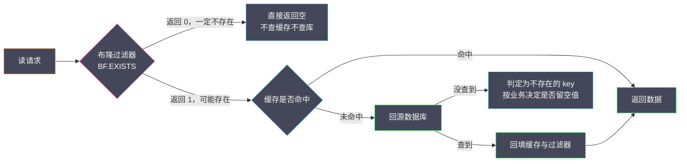
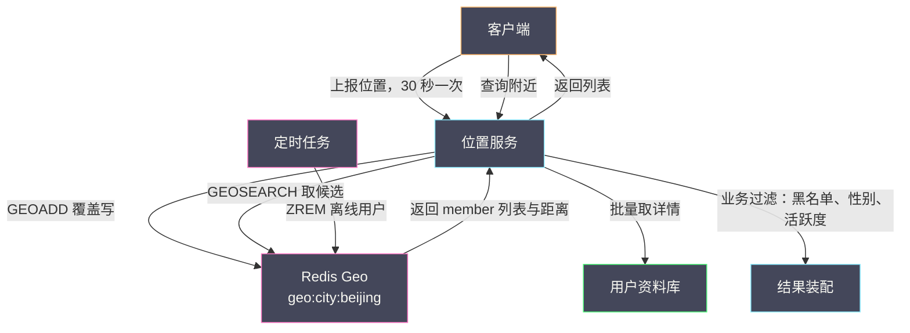
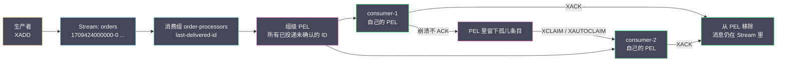
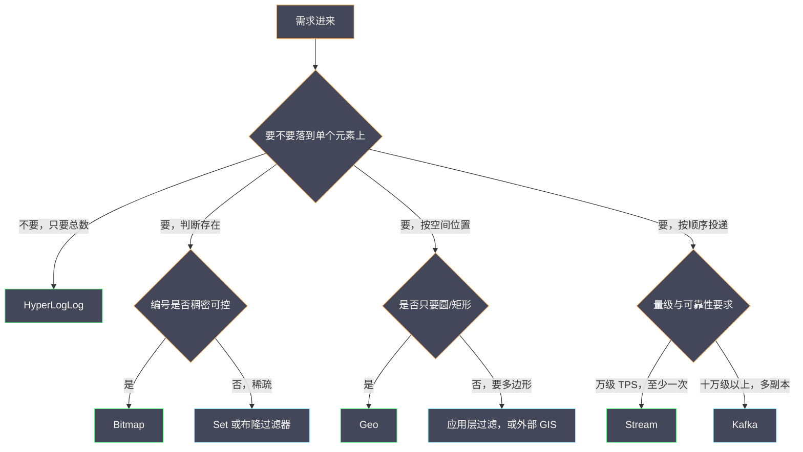

# 02 高级数据类型——HyperLogLog Bitmap Geo Stream

**摘要：**

Redis 的四种高级数据类型经常被当作"更省内存的基础类型"来记，这个记法会让人在第一次踩坑时毫无准备。它们真正提供的是四份带刻度的承诺：HyperLogLog 承诺 12KB 管住任意规模的基数，代价是 0.81% 的标准误差、只能加不能删、只能报总数不能报成员；Bitmap 承诺一位一个布尔值，代价是把内存交给最大偏移量，稀疏 ID 一上来就是灾难；Geo 承诺约 0.6 米的坐标精度，代价是只认圆形与矩形、成员不能单独过期、单个 key 只能落在一个分片上；Stream 承诺至少一次投递，代价是 PEL 与裁剪这两件事从此归客户端管。本文按"承诺是什么—代价记在哪—什么情况下失约"三段推进，把四者的命令面、量化口径、失效条件与反例逐条摆开，最后收在一张按问题选类型的判据表上。所有数字都标明是官方口径、量级判断还是示例推算，不给出没有出处的基准值。四者都不是基础类型的加强版，而是四份标好刻度的承诺——精度、开销的基准、失约的条件，三行写清楚，才谈得上选型。

---

## 第 1 章 四种承诺，四种失约方式

### 1.1 四个年份与同一条思路

2012 年的 Redis 2.2 拿到 `SETBIT`，2013 年的 2.8.9 补上 `PFADD`，2016 年的 3.2 加入 `GEOADD`，2018 年的 5.0 落下 `XADD`。四个命令隔着六年陆续出现，动机各不相同：位操作是为了把布尔状态压进一个字节的八分之一，基数统计是为了绕开 Set 的体积，地理索引是为了把"附近三公里"变成一次范围扫描，Stream 是为了补上 List 与 Pub/Sub 之间那块关于可靠性的空缺。

把这四条线并排看，会发现它们走的是同一条路：都不去扩展已有的五种基础类型，而是在 String 或 ZSet 之上约定一层新语义，让某个特定问题在 Redis 内部就地解决。约定是一件**有刻度**的事——它规定了什么能问、什么不能问、问到什么精度，以及记账的基准是"实际元素数"还是"最大编号"。

### 1.2 本篇只管怎么用，不拆内部实现

这里要先划清边界。Redis 键值对在内存里的形状、SDS 的头部设计、listpack 的编码转换阈值、事件循环的执行顺序、fork 与 COW 的代价、Cluster 的槽位分配，这些属于"内部实现"，已在 [[中间件/Redis/Redis设计与实现/00 专栏导览|Redis 设计与实现]] 一列里逐篇铺过，本篇只在需要解释"用起来为什么会这样"时给一句结论并引到对应篇目，不重述机制。

本篇关心的是另一侧：这四种类型各自向使用者承诺了什么，这份承诺在什么条件下成立，代价记在哪本账上，以及失约时现场长什么样。同样，编码阈值这类判据只说结论——String 在 44 字节处从 embstr 转 raw、Hash 与 ZSet 在元素数与长度达标时走 listpack、Set 的整数集合会在元素变宽时升级，`ZRANK` 之所以能停在 O(log N) 是因为跳跃表的 `span` 字段，这些细节的账在 [[02 SDS 与 Redis 对象系统]] 与 [[04 跳跃表 压缩列表与 Listpack]] 里算过，本篇不再重复。

### 1.3 四种承诺，四本不同的账

把这四份承诺放到一张表里对照，能看出它们的**记账基准**完全不同，而记账基准恰恰是踩坑的根源。

| 类型 | 承诺 | 记账基准 | 代价记在哪 | 典型失约现场 |
| :--- | :--- | :--- | :--- | :--- |
| HyperLogLog | 任意基数只花 12KB | 桶数，与元素数无关 | 概率误差、不可回查 | 想拿它判重、想算交集 |
| Bitmap | 一位一个布尔值 | 最大偏移量 | 稀疏时按最远编号付费 | 雪花 ID 直接当 offset |
| Geo | 约 0.6 米精度与范围查询 | 成员数 | 只认圆与矩形、成员无 TTL | 拿它做行政区筛选 |
| Stream | 至少一次投递 | 消息数与 PEL 条目数 | 清理职责转移给客户端 | 只 ACK 不裁剪、PEL 膨胀 |

这四种基准里，HyperLogLog 与 Bitmap 最反直觉：前者与元素数彻底脱钩，后者与元素数彻底无关。一套系统的容量规划如果按"实际存了多少东西"算，就会在这两个类型上算错数量级。一个在多个团队反复出现的例子是这样的：某活动页用用户 ID 直接做 `SETBIT` 的 offset，测试环境 ID 从 1 开始、只占几 KB，上线后 ID 换成 19 位雪花号，一个 key 瞬间冲到几百 MB，还没等监控告警，主从复制带宽先被打满。

另一件需要提前说清的事：这四种类型都不带自动清理。HyperLogLog 只能整键删除，Bitmap 的位没有过期概念，Geo 的成员不能单独设 TTL，Stream 的消息和 PEL 条目更是要客户端主动裁。它们的生命周期管理全靠外层的 key 过期策略与业务侧定时任务，这一点与 String、Hash 那种"设个 TTL 就完事"的直觉相差很远。

> [!warning] 三类"看不见的容量"
> 第一类是 HLL 的固定开销：每个指标每个时间窗 12KB，与用量无关，指标数一多就是纯堆积。第二类是 Bitmap 的偏移量开销：实际存了 10 个用户，仍按最大 offset 付账。第三类是 Stream 的 PEL 开销：消息本体可以裁，PEL 条目在未 ACK 前不会消失。监控里只看 `used_memory` 的增长曲线，这三类都不容易认出来。

---

## 第 2 章 HyperLogLog——用概率换一个固定的字节数

### 2.1 一道算术题引出的类型

统计日活这类需求，最直白的做法是 Set：来一个用户 `SADD` 一次，收工时 `SCARD`。问题是内存。一个元素进了 Set，除了 id 本身，还要付字典条目、RedisObject 与分配器对齐的开销，按每元素 50 到 60 字节估算（示例推算，随 id 长度与哈希表负载浮动），一亿用户的日活键就是 5 到 6GB；每天一份、保留一个月，光这一项就上到百 GB 量级。

而业务方要的往往只是一个数字，连名单都不看。HyperLogLog 接的正是这种活：不论集合里有一个元素还是一亿个，它只占一段固定的寄存器内存，返回一个误差在千分之八上下的估计值。这句"不论"是它全部的价值，也是它全部的局限。这个算法出自 2007 年 Flajolet 等人的论文《HyperLogLog: the analysis of a near-optimal cardinality estimation algorithm》，Redis 在 2.8.9 里把它做成了 `PF` 开头的三个命令。

### 2.2 12KB 与 0.81% 是怎么来的

HyperLogLog 的骨架可以这样理解：把每个元素哈希成一个 64 位整数，用其中 14 位决定它落进 16384 个桶里的哪一个，剩下的位数用来数"从某端起连续零的长度"，每个桶只记住自己见过的最长记录。真实基数越大，桶里的最大记录就越长，于是可以用所有桶记录的调和平均数反推总数。

内存的算式极短：**16384 个桶**，每桶 6 位（能记 0 到 63），16384 × 6 ÷ 8 = 12288 字节；再加 16 字节的头部（魔数、编码标记、缓存的基数），密集编码下一个键是 12304 字节，也就是常说的 12KB。

误差的算式同样短：**标准误差**约等于 1.04 ÷ √16384 = 1.04 ÷ 128 ≈ 0.8125%。公式里只有桶数，没有元素数——这意味着误差不会因为数据变多而变差，也不会因为数据变少而变好。想让误差减半，桶数得翻四倍，内存也跟着翻四倍；这是一个纯粹用空间买精度的线性交易，没有别的杠杆。

| 桶数 | 寄存器内存 | 理论标准误差 | 说明 |
| :--- | :--- | :--- | :--- |
| 16384（Redis 固定） | 12288 字节 | 约 0.81% | Redis 不支持改桶数，`hll-*` 参数只管编码 |
| 65536 | 49152 字节 | 约 0.41% | 用于对照：误差减半，内存四倍 |
| 1024 | 768 字节 | 约 3.25% | 用于对照：精度换空间的另一端 |

基数很小的时候，Redis 不会立刻按 12KB 收钱。寄存器大面积为零时它用稀疏编码只记非零桶的位置与取值，越过 `hll-sparse-max-bytes`（默认 3000 字节）这个门槛后转成密集编码，从此按 12KB 计。这里有一个容易被误读的点：稀疏与密集只是存储形态的切换，估计值的算法并没有跟着换。自 5.0 起 Redis 采用 Ertl 在 2017 年提出的 tau/sigma 估计式，取消了旧实现里"小基数切线性计数"的分段处理，因此不存在某个基数规模上误差突然跳变的情况——对使用者来说，这意味着不必为"数据量刚过某个阈值"设计额外的兼容逻辑。

> [!info] 想看具体编码与估计式
> 稀疏与密集编码的字节布局、`hllPatLen` 的取值方式、tau/sigma 两个辅助函数的收敛写法，属于内部实现，不在本篇展开。要判断当前这个键处在哪种编码，`OBJECT ENCODING` 帮不上忙——HLL 对象的类型标识一律是 `string` 的 `raw` 编码，能看出差别的是 `MEMORY USAGE` 返回的字节数：几千字节说明还在稀疏形态，12304 字节上下说明已经是密集形态。这类内存口径的判读方法见 [[06 内存管理与过期淘汰策略]]。

### 2.3 只有三个命令，这不是缺陷

| 命令 | 语义 | 复杂度 | 边界 |
| :--- | :--- | :--- | :--- |
| `PFADD key el [el ...]` | 加入元素并更新估计 | 平均 O(1) | 重复元素不改变结果，天然幂等 |
| `PFCOUNT key [key ...]` | 取估计基数 | 单键有缓存时接近 O(1)，否则 O(16384) | 多键为即时合并，不写盘 |
| `PFMERGE dst src [src ...]` | 合并到目标键 | O(16384) | 目标键若已存在会先并入自身 |

三个命令之外，没有"取元素"、没有"删元素"、没有"判断某个元素在不在"。这三件事做不了，不是版本没跟上，而是结构里根本没有留位置：桶里存的是"连续零的最大长度"，它抹掉了是哪个元素贡献的这件事。要删掉一个元素的影响，必须知道剩下的元素最长能到多少，而 HLL 没有保留这些信息，除非把整个键重算一遍——那等于把数据重放一次。

所以判据可以压成一句话：HyperLogLog 回答**有多少**，不回答**是谁**。任何需要落到单个元素上的操作，都不能从这里得到答案。

`PFCOUNT` 的复杂度值得单独说明。N 是桶数 16384，听起来不大，但它意味着这个命令不是免费读一个计数器：缓存未命中或者一次传多个键时，它要把所有桶遍历一遍再算估计值。单次十几万次算术运算，在微秒到几十微秒的量级（示例推算），一次两次无所谓，放进每秒几千次的接口里或者大屏每三秒刷一次，就会变成真实的主线程压力。稳妥的做法是定时把结果写进一个普通 String 键，读侧只读那个键，让 `PFCOUNT` 的频率与业务读频率脱钩。

### 2.4 合并才是它的主场

日活用每天一个 HLL 统计，周活把七天的键 `PFMERGE` 到一起，月活再合并三十天，全年只需要在需要的时候合并一次。合并的代价是逐桶取最大值，16384 次比较，与集合里到底有多少元素完全无关；这意味着把一个一亿人的日活键和另一个一亿人的日活键合并，耗时与合并两个只有一千人的键没有区别。

更值钱的是它的代数性质：并集运算满足交换律与结合律，所以合并顺序无关、分组合并也无关。这一点直接支持了"按任意时间窗口现场推导"的用法——不必预先把"最近七天""最近三十天""本自然月"都物化成键，只需要保留原始的按天键，查询时临时合并，返回后丢弃。9 月的最后一天要出第三季度报表，也不必提前准备季度键。

```bash
# 按天记录：UV 统计只关心去重人数
PFADD uv:2026-11-19 "u:1001" "u:1002" "u:1003"

# 现场合并出周活，目标键不设过期，靠定时任务覆盖或删除
PFMERGE uv:week:2026-11-19 uv:2026-11-13 uv:2026-11-14 uv:2026-11-15 \
        uv:2026-11-16 uv:2026-11-17 uv:2026-11-18 uv:2026-11-19
PFCOUNT uv:week:2026-11-19
```

这段脚本里有两个细节值得留意。其一，`PFMERGE` 的目标键如果已经存在，它会被当作源之一并入结果，因此"反复合并到同一个目标键"是幂等的（取最大值，重复无害），但"每天把当天的键合并进月键"与"每天从零重建月键"在语义上并不相同——前者省事，后者能避免早期写坏的数据一直污染下去。其二，合并出来的中间键要自己管生命周期，Redis 不会因为它"只是个中间结果"就替它回收。

还有一个更隐蔽的陷阱：合并在数学上**只能做并集**。用 HLL 算"既访问又下单"的人数、算新老用户留存、算两个集合的交集或差集，都是做不到的——包含排除法需要交集，而 HLL 没有交集运算。有人用两个估计值相减去近似差集，得到的结果可能为负，也可能完全没有意义。这类需求要么改用 Bitmap（如果 ID 范围可控），要么回到 Set，要么在数仓侧算。

### 2.5 误差的口径，与五类反例

0.81% 是标准误差，不是误差上限。真实基数一亿时，估计值落在正负八十一万之内属于常态，越过两倍、三倍标准差的概率并不为零（示例推算，按正态近似）。譬如业务方拿 HLL 的数字去做趋势判断，一亿零八十万与九千九百二十万的差别不该被解释成"涨了"；如果拿它去对账，差一万人就说不清。

基数越小，相对误差带来的困扰越大。真实基数只有个位数时，绝对偏差不过一两个人，换算成相对偏差却被放大到百分之几十（量级判断，与估计式在小基数区间的收敛方式有关），因此任何"恰好有几个人""今天是不是没人来"的判断都不该以它为准。HLL 的数字适合看趋势与量级，一旦业务开始追问个位数的差异，它就不再是合适的工具。

| 反例 | 为什么会错 | 判别信号 | 替代方案 |
| :--- | :--- | :--- | :--- |
| 判断某用户是否访问过 | 没有 `PFCONTAINS`，结构里没有成员信息 | 需求里出现"这个用户" | Set / Bitmap / 布隆过滤器 |
| 精确去重（订单号、风控名单） | 只有估计值，且无法删除单个元素 | 需求里出现"准确""对账" | Set，或落库后由数据库唯一约束兜底 |
| 算交集、留存、差集 | 只有并集运算 | 需要同时满足两个条件 | Bitmap 位运算，或数仓侧计算 |
| 大屏高频刷新 | `PFCOUNT` 要遍历 16384 个桶 | 读 QPS 与指标数相乘很大 | 定时快照写普通键，读侧读快照 |
| 统计"每人访问了几次" | 它记的是去重基数，不是计数 | 需求里出现"次数""频次" | Hash 或 String 计数器 |

把 HLL 与它的两个近亲摆在一起，选择就清楚了。

| 维度 | Set | Bitmap | HyperLogLog |
| :--- | :--- | :--- | :--- |
| 精度 | 精确 | 精确 | 标准误差约 0.81% |
| 一亿元素的内存 | 数 GB 量级（约 5 到 6GB，示例推算） | 12.5MB（ID 连续时） | 12KB |
| 能否判断单个元素存在 | 能，`SISMEMBER` | 能，`GETBIT` | 不能 |
| 能否合并 | 能，`SUNION`/`SINTER` | 能，`BITOP` 四种运算 | 能，但只能并集 |
| 元素形态要求 | 任意 | 整数 ID，且偏移可控 | 任意 |
| 能否删除元素 | 能 | 能（把位清 0） | 不能 |

---

## 第 3 章 Bitmap——一位一世界，世界由最大偏移量决定

### 3.1 它不是类型，是 String 的另一副面孔

Bitmap 在 Redis 里没有自己的类型标识，它就是 String：一个二进制安全的字节序列，最大 512MB，也就是 2^32 位，偏移量上限 4294967295。`SETBIT` 与 `GETBIT` 是这串字节的按位读写入口，`BITCOUNT` 数 1 的个数，`BITOP` 做位运算，`BITPOS` 找第一个 1 或 0 的位置。RedisObject 与 SDS 的关系见 [[02 SDS 与 Redis 对象系统]]，这里只需记住一个后果：位图的上限由 String 的 512MB 决定，而不是由业务需要决定。

按位定位是 O(1) 的，这一点与很多人对"位操作很轻"的印象一致：`SETBIT key 1000000 1` 只改一个字节里的一位。但这个 O(1) 说的只是寻址，不是分配。第一次写到第 1000000 位时，Redis 需要保证这串字节确实存在到第 125000 个字节，于是它把前面那些字节一起补上。

用一张登记表来比：这张表按门牌号排列，第 1 号到第 99999999 号都得印出来，哪怕只有最远那一户真的住人。门牌号越靠后，纸印得越多，与住进来几户没有关系。这个比喻的边界也要说清——Bitmap 不需要真的把每个"门牌"都写一遍，未写入的位天然是 0，所以省下的是写入时间，省不下的却是内存。

### 3.2 空间由最大 offset 决定

算式只有一条：占用字节数约等于最大偏移量除以 8。一亿位是 12.5MB，十亿位是 125MB，四十亿位就到 512MB 上限。这条算式把 Bitmap 的适用面压得很窄：只有当**最大编号**与**实际元素数**处在同一量级时才划算。

| 场景 | 最大偏移量 | 理论占用 | 判断 |
| :--- | :--- | :--- | :--- |
| 自增用户 ID，一亿用户 | 1 亿 | 12.5MB | 接受 |
| 月度签到位（一位一天） | 31 | 4 字节 | 极划算 |
| 自增 ID 但有大量历史空洞 | 10 亿 | 125MB | 需要分段或换方案 |
| 雪花 ID、UUID 直接当 offset | 10^18 量级 | 直接越界 | 不可用 |

稀疏 ID 的问题不只是内存。一个 125MB 的单键会同时触发一连串副作用：`DEL` 这类操作在释放大块内存时可能造成可感知的延迟（用 `UNLINK` 可以把释放挪到后台线程），主从复制要为这个键传一整块，Cluster 环境下迁移的最小单位就是 key，一次迁移就是百兆流量，RDB 落盘与 AOF 重写都要把它算进去，而 fork 后的 COW 也更容易被这样的大块写操作触发（这部分代价见 [[07 RDB 持久化——快照的 fork 与 COW 机制]]）。大键治理的通用手段——拆分、改名换键、异步删除、容量水位——在 [[05 热 Key 大 Key 治理与容量规划]] 里有系统整理，这里只讨论 Bitmap 特有的三种拆法。

| 拆法 | 做法 | 收益 | 新代价 |
| :--- | :--- | :--- | :--- |
| 分段 bitmap | 按 ID 区间分键，`bucket = id >> 22` 之类 | 单键内存封顶，删除粒度变小 | 查询要算桶号，聚合要遍历多键 |
| ID 序号化 | 维护一张自增映射表，用序号做 offset | 偏移量压到实际元素数量级 | 映射表本身成为热点与单点 |
| 换类型 | 稀疏场景改用 Set，只要基数改用 HLL | 彻底解决稀疏浪费 | 失去按位运算与 O(1) 判断 |
| 换结构 | 应用侧用 Roaring Bitmap 等压缩位图 | 压缩率随稀疏度自适应 | 计算在客户端，Redis 只存序列化块 |

分段的细节值得展开，因为它会改变查询的形状。按 ID 高位分桶后，"今天有多少活跃用户"从一次 `BITCOUNT` 变成 N 次 `BITCOUNT` 再求和，N 取 64 就意味着 64 次往返；"最近七天都活跃的人"从一次 `BITOP AND` 变成 64 组 `BITOP AND`，而且前提是同一个桶号对应的键落在同一个槽上，否则 Cluster 会直接拒绝跨槽的多键操作——用 hash tag 把桶号括进 `{}` 是常见解法，代价是这些键被固定绑到一个分片上。批量往返的问题可以用 Pipeline 摊薄（见 [[08 Redis Pipeline 与客户端性能优化]]），但运算量本身不会消失。

### 3.3 BITCOUNT 的复杂度与范围参数

`BITCOUNT` 全键扫描的复杂度是 O(N)，N 是字节数。125MB 的键扫一遍，按每秒数 GB 的 popcount 吞吐估算也要几十毫秒，再加上它跑在单线程上，这段时间里所有其他命令都在排队（单线程模型与阻塞代价见 [[05 单线程模型与事件驱动架构]]）。所以大位图上的统计要么挪到从节点、要么拆成后台任务、要么靠拆分把单键压小。

范围参数有个流传很广的误读：`BITCOUNT key start end` 的 start 与 end 是**字节偏移**，不是位偏移。

```bash
# 只统计第一个字节里的 8 位
BITCOUNT online:2026-11-19 0 0

# 只统计前 8 位，要显式声明单位（7.0 起支持 BYTE/BIT）
BITCOUNT online:2026-11-19 0 7 BIT

# 负数按字节从尾部计，-1 是最后一个字节
BITCOUNT online:2026-11-19 -1 -1
```

这个差异在实际项目里制造过不少"数字差了八倍"的故障：有人想统计某天的签到率，写了 `BITCOUNT key 0 30` 以为按天切片，实际数的是前 31 个字节，也就是前 248 位。7.0 起 `BITCOUNT` 与 `BITPOS` 都支持了 `BYTE`/`BIT` 单位后缀，把这层歧义显式化，但如果客户端或运维脚本还停在 6.x，写法就得自己保证正确。

`BITPOS` 用来找第一个置位的偏移，适合"本月第一次签到是哪天"这类问题。它的返回单位是位，与 `BITCOUNT` 的字节单位又不一致，写代码时最好把两个命令的单位差异写在注释里。

### 3.4 两种建模，方向决定查询

同一个签到需求，位的方向和键的维度可以有两种摆法，选错方向以后改造成本很高。

| 建模 | key | 位语义 | 单键大小 | 顺手的查询 | 别扭的查询 |
| :--- | :--- | :--- | :--- | :--- | :--- |
| 用户维度 | `sign:1001:2026-11` | 第 N 位 = 第 N 天 | 4 字节 | 某人本月签了几天、连续签到 | 今天全站多少人签到 |
| 日期维度 | `sign:2026-11-19` | 第 N 位 = 用户 ID | 随最大 ID 增长 | 全站日活、七日留存、位运算 | 某人这个月签了几天 |

用户维度的账很好算：每人每月 4 字节，一亿用户一年是 1 亿 × 12 × 4 字节 ≈ 4.8GB。这个数字看着大，但它是按用户数线性增长的，可控、可估、可以靠过期自动回收（给月份键设 90 天 TTL 即可）。

日期维度把单键大小交给了用户规模，一亿用户就是 12.5MB 一个键，一天一个，保留三十天是 375MB。它的好处是位运算极顺手：把七天的键 `BITOP AND` 起来就是"连续七天都签到的人"，`OR` 起来就是"七天里来过的人"，再 `BITCOUNT` 一次就能出留存报表。这正对应前面提到的：**位的方向**决定了查询的方向，而查询的方向往往由产品最关心的那张报表决定。

### 3.5 位运算做集合运算

`BITOP` 支持 `AND`、`OR`、`XOR`、`NOT`，结果写到一个目标键。语义上可以把它当作集合的与、或、对称差、补集，前提是所有参与运算的位图用同一套 offset 语义——这也是为什么日期维度建模能把留存玩得很顺，而用户维度建模做同样的事就得先把维度转过来。

```bash
# 连续七天都到岗（AND）：结果里为 1 的位，是七天都为 1 的那些用户
BITOP AND present:week:2026-11-19 present:2026-11-13 present:2026-11-14 \
        present:2026-11-15 present:2026-11-16 present:2026-11-17 \
        present:2026-11-18 present:2026-11-19

# 七天里至少来过一次（OR）
BITOP OR seen:week:2026-11-19 present:2026-11-13 present:2026-11-14 \
        present:2026-11-15 present:2026-11-16 present:2026-11-17 \
        present:2026-11-18 present:2026-11-19

BITCOUNT present:week:2026-11-19
BITCOUNT seen:week:2026-11-19
```

几个容易忽略的边界。结果键的长度取最长输入的长度，参与运算的键如果长度不一，短的那一侧在尾部按 0 补齐；`NOT` 只接受一个源键，长度等于源键长度，并且会把所有未设置的位翻成 1，因此用 `NOT` 表达"没有签到的人"通常没有意义（那些位置本来就不属于任何用户），要用"全集 AND NOT 当日"来限定范围。结果键不会自动过期，每天生成一个却不定 TTL，几个月后就是一堆几十 MB 的垃圾键。

复杂度是 O(最长输入的字节数)。一亿用户的七天 `AND`，一次要扫 12.5MB，按内存带宽与单线程开销估算在十毫秒量级（示例推算，不含网络往返），放在低峰期跑没问题，放在业务高峰的同步链路里就是可观测的抖动。

### 3.6 BITFIELD 与手写布隆过滤器

`BITFIELD` 把"一位"扩展到"任意位宽"，可以按无符号 1 到 63 位、有符号 1 到 64 位读写，还支持原子自增与三种溢出策略。

```bash
# 一个角色的三个属性打包进同一串位：生命值 8 位、等级 4 位、暴击倍率 4 位
BITFIELD hero:1001 SET u8 0 200 SET u4 8 12 SET u4 12 8

# 批量读，一次往返拿三个字段
BITFIELD hero:1001 GET u8 0 GET u4 8 GET u4 12

# 原子自增，OVERFLOW SAT 表示到顶不再涨，而不是回绕
BITFIELD hero:1001 OVERFLOW SAT INCRBY u8 0 10
```

`BITFIELD` 的适用面很窄：字段的取值范围固定、字段数量固定、不需要按字段查询与过期时，它把多个小整数压进一个键，省下的是键与对象头的固定开销。反过来，一旦某个字段会长成不定长大整数、或者需要单独给某个字段设 TTL，这套打包就得拆。

手写布隆过滤器是 Bitmap 最经典的用法：用 m 个位做位图，k 个不同的哈希函数把元素映射到 k 个位置并置 1；查询时如果这 k 位里有任何一位是 0，元素一定不在集合里，如果全为 1，则只能说"可能存在"。误判率随 m/n（位数除以元素数）与 k 变化，量级上位数取元素数的十倍左右可以把误判率压到百分之一量级（量级判断，实际取决于 k 的取值与哈希分布）。它不能删除元素——把某一位清 0 会连带抹掉其他元素的证据。

Redis 原生没有布隆过滤器，RedisBloom 模块提供了 `BF.RESERVE`/`BF.ADD`/`BF.EXISTS`，配置形式是"预期元素数 + 误判率"，由服务端自己算位数与哈希个数。用 Bitmap 手写则要自己控制 offset 的分布：如果直接拿用户 ID 当 offset，就回到了稀疏爆炸的老问题；正确做法是让哈希函数输出落在 `[0, m)` 区间内。



这张图里有一处常被省略的细节：布隆过滤器只能挡"一定不存在"，对"可能存在"它帮不上忙，回源照旧。因此它挡的是攻击者构造的随机 key，挡不住"确实存在但缓存失效"的合法请求——那是缓存击穿要解决的问题，两者常被混为一谈。

---

## 第 4 章 Geo——0.6 米的承诺，与一句"我不是 GIS"

### 4.1 GeoHash 与 52 位

Redis 的地理索引没有引入新的数据结构，它把经纬度编码成一个 52 位整数，塞进 ZSet 的 score 里。编码方式是交替二分：把经度区间 [-180, 180] 对半切，落在左半记 0、右半记 1，再对纬度区间 [-90, 90] 做同样的切分，如此交替进行若干轮，得到一个二进制串。

Redis 用的是 26 轮经度加 26 轮纬度，合计 **52 位**。52 位这个数字不是随手选的：双精度浮点数能精确表示的整数上限是 2^53，52 位刚好落在安全区内，所以 score 不需要任何精度妥协。ZSet 本身的实现是跳跃表加字典（结构细节见 [[04 跳跃表 压缩列表与 Listpack]]），score 的数值大小就是 GeoHash 的大小，因此"同一区域内的点"在 score 上是一段连续区间，范围查询可以直接退化成跳跃表的区间遍历。

0.6 米这个精度可以自己算出来：经度方向 360 度被切成 2^26 份，每份约 5.36 × 10⁻⁶ 度，赤道上折算约 0.6 米；纬度方向 180 度切 2^26 份，每份约 2.68 × 10⁻⁶ 度，折算约 0.3 米。对外宣传取的是较差的那个方向，也就是 0.6 米。这个数字是"坐标能表示的最小间隔"，不等于"查询结果的误差"——后者还叠加了距离公式的近似与候选块的覆盖范围。

### 4.2 从 GEORADIUS 到 GEOSEARCH

早期的 `GEORADIUS` 与 `GEORADIUSBYMEMBER` 把查询、排序、存储三件事混在一个命令里，参数组合爆炸，语义也容易被误用。6.2 起这两个命令被标记为弃用，配套的 `GEOSEARCH` 与 `GEOSEARCHSTORE` 成为唯一推荐路径。

| 维度 | GEORADIUS 系列（6.2 起弃用） | GEOSEARCH 系列（推荐） |
| :--- | :--- | :--- |
| 搜索形状 | 只有圆形 | 圆形 `BYRADIUS` 与矩形 `BYBOX` |
| 中心点来源 | `FROMMEMBER` 或 `FROMLONLAT` | 同样两种，参数位置统一 |
| 结果持久化 | 混在查询命令里用 `STORE`/`STOREDIST` | 独立的 `GEOSEARCHSTORE`，查询与写入分离 |
| 提前返回 | 不支持 | `COUNT n ANY`，凑够即止 |
| 附带信息 | `WITHDIST`/`WITHCOORD`/`WITHHASH` | 同样支持，参数名一致 |

```bash
# 圆形范围：三公里内最近的十家店
GEOSEARCH restaurants FROMLONLAT 116.41 39.92 BYRADIUS 3 km ASC COUNT 10 WITHDIST

# 矩形范围：某个网格内的目标
GEOSEARCH restaurants FROMLONLAT 116.41 39.92 BYBOX 5 5 km ASC

# 只求命中，不关心是否最近：凑够 20 个就返回，省掉排序
GEOSEARCH restaurants FROMLONLAT 116.41 39.92 BYRADIUS 5 km COUNT 20 ANY

# 把结果落到新键，供后续打分或分页
GEOSEARCHSTORE nearby:u1001 restaurants FROMLONLAT 116.41 39.92 BYRADIUS 3 km ASC
```

`COUNT n ANY` 的语义差异值得单独拎出来。不带 `ANY` 时，Redis 会取出范围内全部候选再按距离排序取前 n 个，结果是"最近的 n 个"；带上 `ANY`，它在扫描过程中凑够 n 个就返回，省掉排序与完整扫描，代价是这 n 个不保证是最近的。这个差别在"取最近的十家店"里会造成明显的体验偏差——用户看到的可能是三家远店和七家近店，顺序也不对。

`GEOSEARCH` 的复杂度是 O(N + log M)，N 是候选范围内的元素数，M 是索引里的总元素数。它不是一次精确的圆形扫描：内部先按 GeoHash 前缀定位到九个相邻格子（九宫格是为了避开格子边界的漏网），取出候选，再用 Haversine 公式逐个算距离过滤。这也解释了为什么矩形查询与圆形查询一样走这套路径。

`GEODIST` 用的是球面距离，Redis 内部取的地球半径是 6372797.560856 米，与真实椭球相比存在 0.5% 量级的偏差（官方文档的说法）。对"附近三公里"够用，对需要按里程计费的场景不够——那是路网距离或椭球距离的事。

### 4.3 它不是 GIS 数据库

Geo 常被当成"Redis 里的小型地理数据库"，这个印象会立刻在需求评审上撞墙。它的能力边界很硬：

- 只有两把量具：圆形与矩形。多边形、行政区划、任意几何体的包含判断，一概没有。
- 没有三维。海拔、楼层、地下车库层级，它不认识。
- 没有拓扑。不判断两条路是否相交，不判断某个点在不在某条线附近，没有路径规划。
- 没有坐标系转换。传入的经纬度按 WGS84 的数值直接使用，国内坐标系偏移要业务侧自己先纠偏。
- 纬度有硬限制：合法范围是 -85.05112878 到 85.05112878 度，这是 Web 墨卡托投影的截断范围，超出直接报错。极地科考、远洋航线的数据用不了这个类型。
- **成员没有 TTL**。Geo 的每个成员就是 ZSet 的一个成员，ZSet 不支持给单个成员设过期时间（8.0 的字段级过期只覆盖 Hash），所以"用户下线后位置自动消失"只能靠业务侧 `ZREM`，或者按时间分键让整键过期。
- **单键单分片**。一个 Geo 键就是 ZSet 键，在 Cluster 下只能落在一个槽、一个分片上（槽位与迁移见 [[10 Redis Cluster 分布式架构]]）。把全国 POI 塞进一个键，等于把所有位置查询压到一台机器上。

最后两条是最容易在生产里出问题的。成员不能过期意味着"附近的人"这类功能需要一套额外的清理逻辑：一个每天活跃用户百万级的应用，如果用户关闭 App 后位置不删，一个月后这个键就有几千万成员，`GEOSEARCH` 的候选集里全是幽灵；按天分键能解决过期，但"查附近的人"就变成了跨多个键的并集查询，得在应用侧合并。单键单分片意味着扩容只能靠拆键——按城市拆、按网格拆、按业务线拆，拆完再面对跨键合并的问题。

内存的账是这样的：一个成员在 ZSet 里既是字典条目又是跳跃表节点，两份开销，每成员百字节量级（示例推算，随成员名长度浮动）。十万成员大约十兆上下；百万成员就是百兆级，而它们全部落在同一个分片上。这个量级放在缓存里不算夸张，但要看清楚它是"常驻"还是"可回收"。

### 4.4 "附近的人"的落地与三处硬伤



这套架构里有四个值得写进设计文档的决定。其一，Geo 键只存用户标识与坐标，头像昵称之类的详情放资料库，`GEOSEARCH` 返回后再批量取，避免把大字段塞进 ZSet（那会同时放大内存与复制流量）。其二，按城市或网格拆键，单键成员数控制在十万量级，让单分片的内存与查询耗时都可预测。其三，位置上报用 `GEOADD` 覆盖写，天然幂等，不需要先查再改。其四，清理靠定时任务 `ZREM`，因为成员没有 TTL；任务本身要能容忍"用户其实还在线但刚被误删"的情况，下一轮上报会自动补回。

三处硬伤要提前和产品对齐：成员不能过期，所以"附近的人"永远包含一段时间内不再活跃的账号，除非清理任务跑得足够勤；单键单分片，所以热门城市的键会成为热点，冷门城市的键会浪费分片；没有多边形，所以"只看这个商圈里的人"要么用矩形近似，要么把候选拉回应用层做多边形判断——后者在候选量大时会把 Redis 省下的时间还给应用服务器。

---

## 第 5 章 Stream——用一张 pending 表换可靠性

### 5.1 三种方案，差别不在 API 在责任

List 做队列是最省事的：`LPUSH` 进、`BRPOP` 出，一条命令一个消息。但消息在弹出的一瞬间就离开了 Redis 的记账范围，消费者拿到后崩溃，这条消息既不在队列里也不在任何地方。Pub/Sub 更轻，发出去就不管了，订阅者离线期间的消息全部消失，也没有确认机制。Stream 是第三个方案，它在 5.0 落地，把"谁拿了、处理到哪、有没有确认"这三件事变成结构里的一等公民。

消息队列的横向对比——List、Pub/Sub、Stream 三者的能力矩阵，以及与 Kafka、RabbitMQ 的选型——见 [[07 Redis 消息队列——从 PubSub 到 Stream]]，本篇只谈 Stream 的承诺怎么兑现、代价记在哪、什么时候会失约。

### 5.2 消费组的三层结构



结构上是三层：Stream 存消息本体，组记录一个"投递到哪了"的游标，PEL（Pending Entries List）记录"投递出去但还没确认"的条目，而每个消费者又有一份自己的 PEL 视图。`XREADGROUP GROUP g c ... STREAMS key >` 里的 `>` 表示"给我新消息"，Redis 会推进组游标、把消息写进组级与消费者级 PEL，然后把消息返回给这个消费者。

这里有一个必须记住的语义：`XACK` **只清 PEL，不删消息**，消息本体仍然留在 Stream 里。想让消息消失，得另外 `XTRIM` 或 `XDEL`。反过来，`XTRIM` 删掉消息本体，PEL 里的引用还在——两个动作是脱钩的。这条脱钩是 Stream 大部分运维故障的总根源。

`XREADGROUP` 用具体 ID 而不是 `>` 时，读的是这个消费者自己的 PEL 历史，也就是"我还没确认的那些消息"，这是重启后重放未完成工作的标准手段。消费者名是一个逻辑身份：进程重启后沿用同名，PEL 里那些条目就还归它管；随手换个名字，原来的条目会变成没有归属的孤儿，一直挂在组级 PEL 里等别人接管。

### 5.3 PEL 会怎么长起来

PEL 里每条待确认记录要存消息 ID、消费者引用、投递次数与空闲时间，加上基数树节点的开销，量级在几十到一百多字节（示例推算，随 ID 长度与树结构浮动）。这个数字本身不大，问题在于它会无声地累积。

举一个示例推算的账：某业务每小时两万条消息，消费者每小时重启一次，每次重启前有五千条已投递未确认，这些条目在消费者换名之后就成了孤儿；一天二十四个小时，孤儿条目按一半能被人接管、一半留下来的比例，一天留下六万条，一个月一百八十万条，按每条八十字节算就是一百四十多兆的 PEL，全挂在组级 PEL 上。这段时间里 `XPENDING` 的响应会变慢，因为它要遍历这些条目；内存曲线看起来像是"消息漏了"，实际是记账没清。

比内存更麻烦的是**幽灵消息**：`XTRIM MAXLEN` 把老消息裁掉了，PEL 里还留着对它们的引用。此时 `XPENDING` 能查到这些 ID，`XCLAIM` 也能把"归属"改到新消费者名下，但 `XRANGE` 拿不到内容——消费者拼命重试一条已经不存在于任何地方的消息。判断方法很直接：比较 `XPENDING` 返回的最小 ID 与 `XINFO STREAM` 返回的 `first-entry`，前者明显小于后者时，说明 PEL 在引用已被裁掉的消息。

```bash
# 组级 PEL 概况：条数、最小 ID、最大 ID、各消费者分布
XPENDING orders order-processors

# 明细：区间 + 数量 + 指定消费者
XPENDING orders order-processors - + 20 consumer-1
```

8.2 起 Redis 为这种脱钩补了两个命令：`XACKDEL key group [KEEPREF|DELREF|ACKED] IDS n id ...` 把确认与删除合成一步，`XDELEX key [KEEPREF|DELREF|ACKED] IDS n id ...` 单独处理删除并顺带清理引用。`DELREF` 会一并抹掉所有消费组 PEL 里的引用，`ACKED` 只在所有组都确认过之后才真正删除——多消费组场景下，后者比手工拼 `XACK` 与 `XDEL` 可靠得多。版本还停在 7.x 的集群就得按老规矩办：先确认再裁剪，且裁剪阈值要留有余量。

### 5.4 XCLAIM 与 XAUTOCLAIM

消费者崩溃后，PEL 里的条目不会消失，也不会自动转给别人，需要另一个消费者主动接管。

```bash
# 逐条接管：把空闲超过 30 秒的那条消息转到 consumer-2
XCLAIM orders order-processors consumer-2 30000 1709424002000-0

# 只改归属不顺带返回消息体，省带宽
XCLAIM orders order-processors consumer-2 30000 1709424002000-0 JUSTID

# 批量接管（6.2+）：从 0-0 开始扫，一次最多扫 COUNT 的十倍个 PEL 条目
XAUTOCLAIM orders order-processors consumer-2 30000 0-0 COUNT 10
```

| 维度 | XCLAIM | XAUTOCLAIM（6.2+） |
| :--- | :--- | :--- |
| 指定方式 | 必须逐条给出消息 ID | 给起点 ID 与 COUNT，自己扫 |
| 扫描范围 | 只处理给定 ID | 每次最多扫 COUNT × 10 个 PEL 条目 |
| 返回值 | 被接管的消息列表 | 下一个游标、被接管的消息，较新版本还会多返回一列已被删掉的 ID |
| 适合场景 | 定点接管，知道具体哪条卡住 | 巡检式全量接管，反复调用直到游标回到 0-0 |
| 遗漏风险 | 调用方要知道有哪些 ID 才不漏 | 需要循环到游标归零，否则中途停下会漏扫 |

`XAUTOCLAIM` 多出来的那一列容易被忽略：它会把"PEL 里引用了、但 Stream 里已经不存在"的 ID 也报出来（7.0 起返回）。这正是排查幽灵消息的入口——巡检任务如果只取前两个返回值，就会永远看不见这批数据。

接管本身是有副作用的：它会把消息重新投递给新消费者，于是**重复消费成为必然**。示例里"超时 30 秒就接管"的策略，遇上处理耗时不稳定的业务，会在"消费者其实还活着、只是慢"的时候不停抢回，同一条消息被处理两三次。所以下游处理必须幂等，这是 Stream 的硬性前提，不是可选的加分项。投递次数可以通过 `XCLAIM` 的 `RETRYCOUNT` 覆盖或者自增，超过阈值后把消息转到一个专门的死信 Stream 里，再配合告警——死信的处理策略在 [[07 Redis 消息队列——从 PubSub 到 Stream]] 里有完整讨论。

### 5.5 裁剪：MAXLEN 与 MINID 两条路

Stream 不会自动删除任何东西。写入时裁剪、或者定时 `XTRIM`，两条路都指向同一组参数。

| 方式 | 依据 | 是否精确 | 适用 | 风险 |
| :--- | :--- | :--- | :--- | :--- |
| `XADD ... MAXLEN ~ n` | 条数，近似 | 否 | 匀速流量，只要"大致"保留 n 条 | 会略超 n，超多少取决于节点粒度 |
| `XADD ... MAXLEN n` | 条数，精确 | 是 | 对条数有硬要求 | 每次写都要精确判断，吞吐略低 |
| `XADD ... MINID ~ ts-0` | 时间点，近似 | 否 | "保留最近 N 天"这种按时间的语义 | 同上，且要自己算时间 ID |
| `XTRIM ... MINID ts-0` | 时间点，精确 | 是 | 定时批删 | 删得比 PEL 能承受的快，就出幽灵消息 |

近似裁剪的粒度由节点决定。Stream 的底层是紧凑结构串成的分段链（分段与 listpack 的关系见 [[04 跳跃表 压缩列表与 Listpack]]），每条消息在分段里占一个条目，`XADD MAXLEN ~` 只在节点边界处整段裁掉，因此实际长度会在目标值附近浮动；控制粒度的两个参数是 `stream-node-max-entries`（默认 100）与 `stream-node-max-bytes`（默认 4096），节点越小，裁剪越接近精确，代价是每段能容纳的消息少、内存开销的占比升高。

`MINID` 是"保留最近一段时间"的正确表达方式，也是避免幽灵消息的关键。譬如业务承诺"消息至少保留七天"，那就该用 `MINID` 把阈值卡在七天前，而不是用 `MAXLEN` 按条数猜；同时把裁剪阈值放在"最老的 PEL 条目之前"，让未确认的消息不会先被裁掉。

```bash
# 保留最近七天：先确认再裁剪，裁剪点取七天内最早的 ID
XTRIM orders MINID 1709424000000-0

# 只在近似模式下才能带 LIMIT，控制一次删除的工作量，避免单次阻塞
XTRIM orders MAXLEN ~ 100000 LIMIT 1000
```

`LIMIT` 只能与 `~` 同用，这是 6.2 起的限制：精确裁剪必须一次删到目标，近似裁剪才可以分批删，用 `LIMIT` 把单次删除的条数压小，避免一条大 Stream 的裁剪把主线程占住。

### 5.6 它不是 Kafka

| 维度 | Redis Stream | Kafka |
| :--- | :--- | :--- |
| 定位 | 轻量消息队列 | 分布式事件流平台 |
| 落盘 | 内存为主，靠 RDB/AOF 持久化 | 磁盘顺序写，长期保留 |
| 分区 | 无。一个 Stream 是一个键，一个键落一个分片 | Topic 分多个 Partition，可水平扩展 |
| 消费进度 | 组游标 + PEL 存在 Redis 里，随键一起持久化 | 消费者组 offset 存在 Kafka 内部 Topic |
| 复制语义 | 依赖主从异步复制，故障切换可能丢最近消息 | 多副本 ISR，可配 `acks=all` |
| 保留策略 | 条数或时间点裁剪，没有按大小/按段滚动的机制 | 按时间或大小滚动删除 |
| 吞吐 | 单分片受单线程与内存限制 | 百万级 TPS 量级（量级判断，取决于集群与配置） |
| 运维成本 | 低，已有 Redis 即可 | 高，需要独立集群与调优 |

把这张表读薄，Stream 的两条硬约束就浮出来了。第一条是**没有分区**：一个 Stream 键只能落在一个槽、一个分片上，扩容不能靠"加分区"，只能靠"加 Stream"——在应用层按业务键哈希到 N 个 Stream，自己实现分片与合并。第二条是**复制是异步的**：主节点把消息写给客户端时，从节点可能还没收到；主从切换的瞬间，最后一批消息会消失。Redis 的 `WAIT` 能降低这个窗口，但它只是把概率压小，不是 Kafka 那种 `acks=all` 的确定语义（复制细节见 [[09 主从复制与 Sentinel 高可用]]）。

所以判据是：消息量在万级 TPS 以下、已有 Redis、需要"投递 + 确认 + 重试 + 至少一次"但不需要长期回放与多副本强一致，Stream 是合适的选择；需要百万级吞吐、需要消息长期保留、需要多副本保证，就得上 Kafka。中间地带——十万级、需要重试但不需要回放——往往是最难判断的，笔者的建议是先在 Stream 上跑到它的实测上限，再考虑迁移的复杂度，因为迁移的成本通常高于在 Stream 上做分片的成本。

---

## 第 6 章 选择判据与四类反例

### 6.1 四个问题定类型

走到选型这一步，问题通常只有四种形状，各自对应一个类型。

| 你要回答的问题 | 类型 | 关键命令 | 精度 | 空间量级 | 失效条件 |
| :--- | :--- | :--- | :--- | :--- | :--- |
| 去重之后有多少个 | HyperLogLog | `PFADD`/`PFCOUNT`/`PFMERGE` | 标准误差约 0.81% | 每键 12KB，与基数无关 | 需要列举、需要删除、需要交集 |
| 某个编号在不在 | Bitmap | `SETBIT`/`GETBIT`/`BITCOUNT` | 精确 | 最大偏移量 ÷ 8 | 编号稀疏、编号超过 2^32 |
| 谁在我附近 | Geo | `GEOADD`/`GEOSEARCH`/`GEODIST` | 坐标约 0.6 米，距离约 0.5% 偏差 | 每成员百字节量级 | 需要多边形、需要成员级 TTL、单键过大 |
| 按顺序处理且不能丢 | Stream | `XADD`/`XREADGROUP`/`XACK`/`XAUTOCLAIM` | 至少一次 | 消息本体 + PEL | 需要百万级吞吐、需要多副本强一致 |



这张流程图有一条隐含的分支没画出来：四种需求并不互斥。一个内容平台同一天可能要出 UV（HLL）、要判断用户是否已读（Bitmap 或 Set）、要做"附近的内容"（Geo）、还要把点赞事件投给下游（Stream）。四个类型共存在一个实例里是常态，选型的重点是让每个键落进正确的类型，而不是让一个系统只容得下一种类型。

### 6.2 四种常见搭法

组合用法比单一用法更常见，值得单独列一下。

| 组合 | 各自负责 | 需要注意 |
| :--- | :--- | :--- |
| Bitmap + HLL | 位图记"谁"，HLL 记"多少" | 两者口径要对齐，位图按天、HLL 也按天 |
| Geo + Hash | Geo 存 id 与坐标，Hash 存详情 | 详情不要塞进 ZSet，会放大复制流量 |
| Stream + HLL | Stream 传事件，HLL 统计去重参与人数 | HLL 更新可以放在异步侧，别阻塞消费 |
| Bitmap + Stream | 位图记状态，Stream 传递状态变更 | 位图是快照，Stream 是流水，两者会不一致 |

第四种组合里那条"不一致"要展开一句：位图是最终状态，Stream 是变更流水，消费滞后时两者对不上是正常的。判断系统是否健康，看的不是两者是否相等，而是"流水追平后是否收敛"。这个视角能把很多"数据不一致"的告警从故障降级为滞后。

### 6.3 四类反例

第一类，用 Bitmap 存稀疏 ID。现象是单键内存远超预期，扩容、迁移、备份三件事同时变慢。根因是把"最大编号"当成了"元素数量"。判别信号很简单：拿 `MEMORY USAGE` 除以元素数，若是百字节以上，说明偏移量远大于实际数量。替代方案是分段、序号化或者换类型。

第二类，用 HLL 做精确去重。现象是报表数字与小表对不上，且差值每次都在变。根因是把估计值当计数用。判别信号是业务方开始要求"误差不能超过 1%"。替代方案是 Set 或数据库唯一约束，HLL 只用来出趋势。

第三类，用 Geo 做多边形。现象是需求从"附近的店"演化成"这个商圈里的店"，然后 Geo 的接口怎么拼都拼不出来。根因是它只有两把量具。判别信号是产品开始画地图圈选。替代方案是 Geo 取候选、应用层做多边形判断，或者直接上 PostGIS、Elasticsearch 的地理查询。

第四类，用 Stream 当 Kafka。现象是吞吐上不去、扩容加不上、故障切换丢一批消息。根因是没有分区、复制是异步。判别信号是消费延迟开始在高峰堆积、且加消费者无效（同一个 Stream 只能由一个消费者拿到同一条消息，加消费者加的是处理并行度，不是读取并行度）。替代方案是提前评估 Kafka，或者按业务键拆多个 Stream。

### 6.4 参数面：几项值得调的配置

| 参数 | 默认值 | 调大的代价 | 调小的代价 |
| :--- | :--- | :--- | :--- |
| `hll-sparse-max-bytes` | 3000 | 小基数键长期停在稀疏编码，单键内存高于必要值 | 稀疏转密集提前，小基数键也按 12KB 计 |
| `stream-node-max-entries` | 100 | 单节点容纳消息多，近似裁剪的误差变大，单次操作搬移量大 | 节点碎，内存开销占比升高，裁剪更接近精确 |
| `stream-node-max-bytes` | 4096 | 同上，单段字节数变大 | 同上，段更碎 |
| `maxmemory-policy` | `noeviction` | 不淘汰，写入直接被拒，业务报错暴露快 | 用 `allkeys-lru` 时 HLL 与 Bitmap 可能被当普通键淘汰，统计与位图突然清零 |

最后一行值得单独说：HLL 与 Bitmap 通常没有 TTL（按天分键的除外），在 `allkeys-*` 策略下它们和普通缓存键一样可能被淘汰，而且淘汰时没有任何提示——第二天出报表，某个指标凭空少了一大截。要么把它们归入独立的实例或库，要么用 `volatile-*` 策略并保证这些键都有 TTL。

---

## 第 7 章 结语

四种类型各自把成本从一个维度挪到另一个维度：HyperLogLog 把"随基数增长的内存"换成"固定的 12KB 加 0.81% 的误差"，Bitmap 把"按元素付费"换成"按最大编号付费"，Geo 把"通用空间索引"换成"两把量具加 0.6 米精度"，Stream 把"服务端替你保证"换成"客户端自己记账"。挪动本身没有对错，问题在于挪过去的那一侧是否被看见。

这也是笔者建议在选型文档里固定写下的三行：这个类型的承诺是什么精度、它的开销按什么基准增长、它在什么条件下失约。三行写不出来，说明还没到能用它的程度；三行写得出来，后面所有的容量规划、监控指标与清理任务都有了依据。至于用哪个——只有选择问题，没有高下之分，因地制宜地选那个"失约时你能承受"的方案，才是唯一有效的做法。

---

## 参考资料

1. Redis Documentation - HyperLogLog：https://redis.io/docs/latest/develop/data-types/probabilistic/hyperloglogs/
2. Redis Documentation - Bitmaps：https://redis.io/docs/latest/develop/data-types/bitmaps/
3. Redis Documentation - Geospatial：https://redis.io/docs/latest/develop/data-types/geospatial/
4. Redis Documentation - Streams：https://redis.io/docs/latest/develop/data-types/streams/
5. Redis Commands - XACKDEL（8.2 引入）：https://redis.io/docs/latest/commands/xackdel/
6. Redis Commands - XAUTOCLAIM（6.2 引入）：https://redis.io/docs/latest/commands/xautoclaim/
7. Flajolet, P., Fusy, E., Gandouet, O., Meunier, F. "HyperLogLog: the analysis of a near-optimal cardinality estimation algorithm." AofA 2007.
8. Ertl, O. "New cardinality estimation algorithms for HyperLogLog sketches." 2017.

---

> [!note] 思考题
> 1. HyperLogLog 的标准误差与桶数绑定，而 Redis 把桶数写死成 16384。如果业务确实需要 0.4% 的精度，你会选择改用其他系统、在应用层做多次独立估计再平均，还是接受这个精度并调整业务口径？
> 2. Bitmap 的建模方向（按用户建键还是按日期建键）一旦上线就很难改。在只能二选一的约束下，你会用哪张报表的出现频率来做决策？
> 3. Geo 的成员没有 TTL，而"附近的人"天然需要过期。按天分键、定时 ZREM、以及把在线状态另存一份，三种做法的失效模式分别是什么？
> 4. Stream 的 PEL 与裁剪脱钩会产生幽灵消息。如果只能加一条监控，你会选"PEL 最小 ID 与 Stream 首条 ID 的差值"还是"PEL 条目数的增长率"，为什么？
> 5. 这四种类型都不参与常规的 key 过期清理逻辑（除按时间分键外）。在 `maxmemory` 逼近上限时，它们与普通缓存键应该受同一套淘汰策略约束吗？